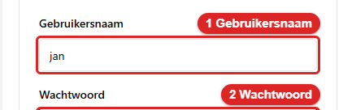
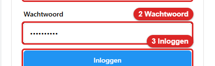
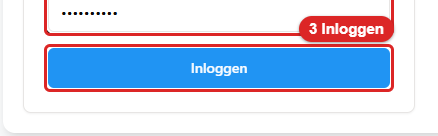
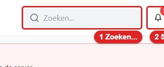
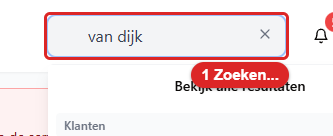
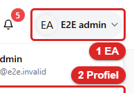
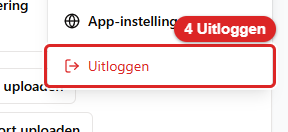

# 1. Snel aan de slag

Dit hoofdstuk helpt je in een half uur op weg. Je leert inloggen. Je leert het scherm lezen.
Je leert iets terugvinden. En je leert de handelingen die je in de eerste week het vaakst doet.

**Zo lees je deze handleiding.** Elke handeling staat in genummerde stappen. Onder de stappen staat
een afbeelding van wat je dan op je scherm ziet. Op die afbeelding staan rode vakjes met een nummer.
Die vakjes wijzen aan waar je moet klikken of typen. De regel onder de afbeelding zegt wat elk nummer
betekent. De rode vakjes staan alleen in de handleiding, niet in de app. Een woord dat **vet** staat,
is precies de tekst die je in de app ziet. Dat kan een knop, een menu of een tabblad zijn.

---

## 1.1 Inloggen

1. Open de browser. De browser is het programma waarmee je internet bekijkt, zoals Chrome of Edge.
   Ga naar het adres van Car Rental Manager. Je collega of de beheerder geeft je dat adres.
   Zet het bij je favorieten.
2. Je ziet **Auto Lease LAM**. Daaronder staat *Log in op je account* en het kaartje **Inloggen**.
3. Vul je **Gebruikersnaam** in.

   
   *Zo ziet het veld **Gebruikersnaam** eruit. Typ hier je gebruikersnaam.*
4. Vul je **Wachtwoord** in.

   
   *Zo ziet het veld **Wachtwoord** eruit. Typ hier je wachtwoord.*
5. Klik op **Inloggen**. Of druk op Enter.

   
   *Zo ziet de knop **Inloggen** eruit.*

*Het inlogscherm: typ je gebruikersnaam in veld 1 en je wachtwoord in veld 2. Klik daarna op knop 3,
**Inloggen**. De rode nummers staan alleen in deze handleiding, niet in de app.*

Je komt binnen op het **Dashboard**. Dat is het beginscherm van de app.

**Let op — vijf pogingen.** Lukt het inloggen vijf keer niet binnen een kwartier? Dan blokkeert de
app je werkplek een kwartier lang. Je ziet dan de melding *Te veel verzoeken achter elkaar.
Wacht even en probeer het opnieuw.* Dat betekent gewoon: wacht een kwartier. Of vraag de beheerder
om je wachtwoord opnieuw te zetten. Blijf niet doorproberen. Elke poging telt mee.

Klopt je gebruikersnaam of wachtwoord niet? Dan staat er *Ongeldige gebruikersnaam of wachtwoord*.
De app zegt met opzet niet welke van de twee fout is. Controleer ze allebei. Let ook op Caps Lock.
Dat is de toets waarmee je alles in hoofdletters typt.

**Je eigen wachtwoord wijzigen.** Klik rechtsboven op je naam. Klik op **Profiel**. Klik op het
tabblad **Wachtwoord**. Vul **Huidig wachtwoord**, **Nieuw wachtwoord** en **Bevestig nieuw wachtwoord**
in. Klik op **Wachtwoord wijzigen**. Onder het veld staat waar het wachtwoord aan moet voldoen:
*Minimaal 10 tekens, met een kleine letter, een hoofdletter en een cijfer.* Vergeet je het
bevestigingsveld? Dan staat er *Bevestig je nieuwe wachtwoord.* Typ je twee verschillende
wachtwoorden? Dan staat er *De wachtwoorden komen niet overeen.* Kreeg je een fout en pas je het
nieuwe wachtwoord daarna aan? Dan controleert de app het bevestigingsveld opnieuw.

---

## 1.2 Het hoofdscherm

Elk scherm heeft dezelfde opbouw.

**Links: het menu.** Bovenaan staat **Auto Lease LAM**. Daaronder staan de menu-items. Hoeveel
items je ziet, hangt af van je rechten (hoofdstuk 15). Rechten zijn de dingen die jij in de app
mag doen. Een beheerder ziet ze alle twaalf:

**Dashboard · Voertuigen · Scannen · Klanten · Klantenportaal · Reserveringen · Onderhoud ·
Kosten · Documenten · Transporten · Communicatie · Rapporten**

Staat er een rood bolletje met een getal achter **Klantenportaal**? Dan zijn er zoveel
ongelezen portaalmeldingen.

*Het menu links. Klik op een item om naar dat scherm te gaan. Het item waar je nu bent, is donker.*

**Bovenaan: de balk.** Van links naar rechts:

| Onderdeel | Waarvoor |
|---|---|
| De naam van het scherm | Waar je bent, bijvoorbeeld *Reserveringen* |
| De portaaltegel, bijvoorbeeld *2 nieuwe aanvragen · 7 meldingen · **Klantenportaal*** | Eén klik naar het klantenportaal. De tegel staat er alleen als er iets openstaat |
| Het zoekveld **Zoeken...** | Zoeken door het hele systeem, zie 1.3 |
| Het belletje met een getal | Het **Meldingencentrum** |
| Je initialen en je naam | Je eigen menu: **Profiel**, taal, **Handleiding**, **Uitloggen** |

*De balk bovenin: 1 is het zoekveld **Zoeken...**, 2 is het belletje van het **Meldingencentrum**,
3 is je naam. Achter je naam zit je eigen menu.*

*Klik op je naam (1). Het menu klapt open. Je ziet **Profiel** (2) voor je eigen gegevens en
wachtwoord, **Handleiding** (3) voor deze handleiding in de app, en **Uitloggen** (4). Een beheerder
ziet daartussen ook het kopje **Beheer** met **Gebruikers**, **Back-upbeheer** en **App-instellingen**.*

**Midden: het scherm zelf.**

**Dialoogvensters.** Veel handelingen gebeuren in een venster dat over het scherm heen opent.
Zo'n venster heet een dialoogvenster. Bijvoorbeeld: een klant bekijken, een voertuig ophalen of
een document uploaden. Uploaden betekent: een bestand van je computer in de app zetten. Het scherm
eronder blijft gewoon staan. Sluit zo'n venster met **Sluiten**, **Annuleren** of het kruisje
rechtsboven. Of druk op Esc.

---

## 1.3 Een klant, voertuig of reservering zoeken

Het zoekveld **Zoeken...** bovenaan doorzoekt alles tegelijk.

1. Klik in **Zoeken...**. Of druk op `/` of `Ctrl+K`.

   
   *Zo ziet het veld **Zoeken...** eruit. Klik erin.*
2. Typ minimaal **twee tekens**. De app wacht tot je klaar bent met typen. Dan pas zoekt de app.
   Dat is normaal. Blijf niet op toetsen drukken.

   
   *Zo ziet het veld **Zoeken...** eruit als je iets typt. Typ minimaal twee tekens en wacht even.*
3. De resultaten verschijnen eronder in drie groepen: **Voertuigen**, **Klanten** en
   **Reserveringen**.
4. Klik op een resultaat. Het opent meteen in een venster over je huidige scherm heen.

*Typ in het zoekveld (1). De resultaten verschijnen eronder, in groepen. Klik op een regel om die
klant, auto of reservering te openen.*

Zijn er veel resultaten? Klik dan op **Bekijk alle resultaten** of druk op Enter. Je krijgt een
groter venster: *Zoekresultaten voor "…"*.

**Wat je kunt intypen:**

| Je typt | Je vindt |
|---|---|
| Een kenteken, heel of een deel, met of zonder streepjes | Het voertuig |
| Een naam of e-mailadres van een klant | De klant en zijn reserveringen |
| Een contractnummer | De reservering. Bij het resultaat staat dan *Contractnr. 0419* |
| Een merk of model | De voertuigen van dat merk |

Het contractnummer is het nummer dat een klant aan de telefoon voorleest. Je kunt op dat nummer
zoeken. Zo hoef je niet door de kalender te bladeren.

**Een voertuig zoeken met de scanner.** Heb je het sleutellabel in je hand? Dan is scannen
sneller dan typen. Druk op `S`. Of ga naar **Scannen**. Zie 1.4.

---

## 1.4 De taken die je het vaakst doet

**Wat er vandaag meegaat en terugkomt,** zie je in de kalender onder **Reserveringen**. In het
vakje van vandaag staat per auto het kenteken. Daarachter staat **uit** of **in**. **uit** betekent:
de auto gaat vandaag mee. **in** betekent: de auto komt vandaag terug. Ook de klant staat erbij.
Zie hoofdstuk 5, paragraaf 5.1.

### Een auto meegeven (ophalen)

1. Ga naar het **Dashboard**. Klik onder **Snelle acties** op **Ophalen starten**.

   
   *Zo ziet de tegel **Ophalen starten** eruit. Hij staat links bovenaan het **Dashboard**.*
2. Scan het sleutellabel. Of typ het kenteken. Hoort er bij die auto een ophaling? Dan opent
   meteen het venster **Ophaalproces starten**. (Heb je geen sleutel in je hand? Dan kan het ook
   zo: open de reservering in de kalender. Klik daar op **Ophalen starten**.)
   
   *Het venster **Ophalen starten**: scan het sleutellabel in veld 1. Of typ het kenteken en druk op
   Enter.*
3. Opent het venster niet? Dan staat er voor deze auto geen ophaling klaar. Je ziet dan alleen de
   gegevens van de auto. Controleer het kenteken en de reservering.
4. Controleer bovenin **Kenteken**, **Voertuig** en **Klant**. Is dit niet de juiste regel?
   Klik dan op **Annuleren**.
5. **Contractnummer** is al ingevuld. Laat het staan. Wijzig het alleen als daar een reden voor is.
6. **Ophaaldatum** staat op vandaag.
7. Vul **Kilometerstand bij ophalen** in. In het veld zie je de laatste stand die de app kent,
   bijvoorbeeld *Huidig: 42.391 km*.
8. Zet **Brandstofniveau bij ophalen** op de juiste waarde: **Vol**, **3/4**, **1/2**, **1/4**
   of **Leeg**.
9. Maak eventueel een schadecheck. Een schadecheck is een lijst van de schade aan de auto.
   Kies **Ophaal-schadecheck aanmaken** voor de digitale check. Of kies
   **Papieren check uploaden** als je een formulier op papier hebt.
10. Klik op **Ophalen voltooien & contract genereren**.

    
    *Zo ziet de knop eruit. Hij staat rechtsonder in het venster.*

*Het venster **Ophaalproces starten**: 1 het **Contractnummer** staat al klaar. 2 Vul de
**Kilometerstand bij ophalen** in. 3 Kies het **Brandstofniveau bij ophalen**. 4 Maak eventueel een
schadecheck. 5 Klik op **Ophalen voltooien & contract genereren**.*

Je krijgt de melding *Ophalen voltooid — Voertuig succesvol opgehaald. Contract is gegenereerd.*
Direct daarna opent het venster **Contract klaar**.

*Het venster **Contract klaar**: klik op **Afdrukken** (1) om het contract te printen. Of klik op
**Mail naar klant** (2) om het naar de klant te sturen. Met **Sluiten** sluit je het venster. Het
contract staat dan al bij **Documenten**.*

**Drie dingen die de app kan vragen:**

- *De huur start eerder — datum aanpassen?* Je haalt de auto op vóór de afgesproken startdatum.
  Gaat de huur vandaag in? Antwoord dan **Ja, startdatum naar vandaag**. Dan kloppen de periode
  en de prijs. Krijgt de klant de auto nog niet mee? Antwoord dan **Nee, niet ophalen**. Er wordt
  dan niets opgeslagen.
- *Dubbel contractnummer.* Het nummer is al in gebruik. De app laat zien bij welke reservering.
  Ga alleen door met **Overschrijven & doorgaan** als je zeker weet dat je een fout herstelt.
  De andere reservering raakt dan haar contractnummer kwijt.
- *Kilometerstand-overschrijving vereist.* De stand die je invult, is lager dan de stand die de
  app van deze auto kent. Kijk eerst of je je niet hebt verkeken. Klopt jouw stand echt? Dan moet
  iemand met het recht **Kilometerverlaging goedkeuren** dit bevestigen. Dat doet die persoon met
  **zijn eigen** accountwachtwoord. Heb jij dat recht niet? Dan meldt de app dat. Haal er dan een
  collega bij.

### Een auto terugnemen (innemen)

1. Ga naar het **Dashboard**. Klik onder **Snelle acties** op **Innemen starten**.

   
   *Zo ziet de tegel **Innemen starten** eruit. Hij staat naast **Ophalen starten**.*
2. Scan het sleutellabel. Of typ het kenteken. Staat de auto als opgehaald? Dan opent meteen het
   venster **Inleverproces starten**. (Of: open de reservering in de kalender. Klik daar op
   **Inleveren starten**.)
3. Opent het venster niet? Dan staat deze auto niet als opgehaald. Je ziet dan alleen de gegevens
   van de auto. Controleer het kenteken en de reservering.
4. Vul **Kilometerstand bij inleveren** in. Die mag niet lager zijn dan bij het ophalen. Is de
   stand toch lager? Dan weigert de app met *"Kilometerstand bij inleveren kan niet lager zijn dan bij
   ophalen (… km)."* Lees de teller dan opnieuw af.
5. Zet **Brandstofniveau bij inleveren** op de juiste waarde.
6. Maak eventueel een schadecheck met **Inlever-schadecheck aanmaken**. Of upload een
   **Papieren check**.
7. Zet bijzonderheden in **Aanvullende notities**. Bijvoorbeeld schade, een ontbrekende sleutel
   of een vuile auto.
8. Klik op **Inleveren voltooien & schadecheck genereren**.

   
   *Zo ziet de knop eruit. Hij staat rechtsonder in het venster.*

*Het venster **Inleverproces starten**: 1 de **Inleverdatum** staat op vandaag. 2 Vul de
**Kilometerstand bij inleveren** in. 3 Controleer het **Brandstofniveau bij inleveren**. 4 Maak
eventueel een schadecheck. 5 Klik op **Inleveren voltooien & schadecheck genereren**.*

*Na het innemen zie je **Schadeformulier klaar**, met **Afdrukken** (1) en **Mail naar klant** (2).*

**Belangrijk:** met het innemen is de huur meteen afgesloten. De auto staat weer vrij. Je hoeft
daarna niets meer op een status te zetten. De afgesproken einddatum blijft staan zoals hij was.
De werkelijke inleverdatum wordt apart vastgelegd.

### Een nieuwe klant aanmaken

1. Klik links op **Klanten**.
2. Klik rechtsboven op **Klant toevoegen**. Je ziet nu het venster **Nieuwe klant toevoegen**.
3. Vul op het tabblad **Basisgegevens** minimaal de naam in. Kies bij **Klanttype** tussen
   **Zakelijk** en **Particulier**.

   
   *Het tabblad **Basisgegevens**: 1 **Klanttype**. 2 **Volledige naam**, het enige verplichte veld.
   3 **Postcode** en 4 **Huisnummer**. De app vult straat en plaats dan zelf in. 5 Het tabblad
   **Contact** voor de volgende stap.*
4. Klik op het tabblad **Contact**. Vul het e-mailadres en het telefoonnummer in. Doe dit meteen.
   Zonder e-mailadres kun je de klant later geen contract of herinnering sturen.

   
   *Het tabblad **Contact**: 1 **Primair e-mailadres**, 2 **Primair telefoonnummer**, 3 het tabblad
   **Bedrijf**.*
5. Is de klant een bedrijf? Vul dan ook het tabblad **Bedrijf** in.
6. Klik onderaan op **Klant toevoegen**.

   
   *Zo ziet de knop **Klant toevoegen** onderaan het venster eruit.*

### Een nieuwe reservering maken

1. Druk op `N`. Of klik op **Reserveringen** en daarna op **Nieuwe reservering**.
2. **1. Selecteer huurdata**: vul **Startdatum** en **Einddatum** in. Weet je de inleverdatum
   nog niet? Zet dan **Huur zonder einddatum** aan. Vul de datums als eerste in. Daarna toont de
   app alleen voertuigen die in die periode vrij zijn.

   
   *Stap 1 van het boekingsvenster: 1 **Startdatum**, 2 **Einddatum**, 3 **Huur zonder einddatum**.*
3. **2. Selecteer voertuig en klant**: kies het **Voertuig** en de **Klant**. Beide velden
   zoeken mee terwijl je typt. Eventueel kies je ook een **Gemachtigde chauffeur**.
4. **3. Reserveringsdetails**: een nieuwe reservering is altijd **Geboekt**. Een statusveld is er
   niet. De status verandert alleen met **Ophalen**, **Inleveren**, **Annuleren** en
   **Terugdraaien**. De **Totaalprijs (€)** vult de app zelf in. De app rekent het dagtarief maal
   het aantal dagen. Typ je er zelf een bedrag in? Dan blijft jouw bedrag staan.

   
   *Stap 3: 1 **Totaalprijs (€)**. 2 **Bezorgservice vereist** en 3 **Ophaalservice bij inleveren**,
   als wij de auto brengen of halen. 4 **Reservering aanmaken**.*
5. Klik op **Reservering aanmaken**. Wil je de auto meteen meegeven? Klik dan op **Nu ophalen**.

   
   *Zo ziet de knop **Reservering aanmaken** eruit. Hij staat helemaal onderaan het venster.*

   
   *Na **Reservering aanmaken** staat de reservering erin. Staat de klant al aan de balie? Klik dan
   op **Nu ophalen** (1).*

Twee dingen die je kunt tegenkomen:

- Een gele balk met *"Let op: dit voertuig staat in deze periode ingepland voor onderhoud (… t/m …).
  Opslaan mag; het onderhoudsblok blijft staan."* Je mag doorgaan. Maar weet dan dat de werkplaats
  de auto in die periode ook nodig heeft.
- Een rode balk die zegt dat het voertuig al gereserveerd is. Dan kun je niet opslaan. Kies een
  andere auto of andere datums.

### Een voertuig opzoeken en bekijken

1. Klik links op **Voertuigen**. Of typ het kenteken in het zoekveld bovenaan.
2. Klik bij de juiste regel op **Bekijken**. Of klik ergens op de regel zelf.
3. Je ziet **Voertuiggegevens** met de tabbladen **Algemeen**, **Kosten**, **Documenten**,
   **Reserveringen**, **Onderhoud**, **Geschiedenis** en **Fiscaal**.

   
   *Het venster **Voertuiggegevens**: bovenin staan de knoppen 1 **Barcode bekijken**, 2 **Bewerken**,
   3 **Brandstofstatus bijwerken** en 4 **Nieuwe reservering**. Daaronder staan de tabbladen (5).*
4. Sluit met **Sluiten** of **Terug**.

### Een reservering opzoeken

1. Typ het kenteken, de klantnaam of het contractnummer in het zoekveld bovenaan.
2. Klik onder **Reserveringen** op de juiste regel. Je ziet **Reserveringsdetails** met de
   periode, het voertuig, de klant, de documenten en de geschiedenis.

   
   *Zoek op een kenteken of model. Onder **Reserveringen** staat per regel de auto, de klant en de
   periode. Klik op de regel van de juiste klant.*

Het kan ook via de kalender. Klik op **Reserveringen**. Zoek de dag in de kalender. Klik op de
regel. Op een kalenderdag staat achter elk kenteken **uit** of **in**. **uit** betekent: die dag
opgehaald. **in** betekent: die dag terug.

---

## 1.5 Uitloggen

1. Klik rechtsboven op je naam. Dat is knop 1 op de afbeelding van het eigen menu in 1.2.

   
   *Zo ziet de knop met je naam eruit. Klik erop. Het menu klapt open.*
2. Klik op **Uitloggen**. Dat is knop 4 op die afbeelding.

   
   *Zo ziet de knop **Uitloggen** eruit. Klik erop.*

Log uit als je de werkplek verlaat. Doe je dat niet? Dan verschijnt na veertien minuten zonder
handelingen het venster **Sessie verloopt binnenkort**. Daarin loopt een aftelling. Kies
**Ingelogd blijven** om door te werken. Of kies **Nu uitloggen**. Doe je niets? Dan meldt de app
*Sessie verlopen — Je bent uitgelogd wegens inactiviteit*. Je moet dan opnieuw inloggen. Werk dat
nog niet is opgeslagen, ben je dan kwijt. Maak een formulier dus af en sla het op voordat je
wegloopt.

---

## 1.6 Wat je in de eerste week beter niet doet

| Niet doen | Waarom |
|---|---|
| Een klant of voertuig verwijderen | Er hangen reserveringen, documenten en kosten aan. Vraag het eerst na. |
| Een contractnummer overschrijven | De andere reservering raakt haar nummer kwijt. |
| Een bestaande reservering "even" op een andere status zetten | Ophalen en innemen doe je met de knoppen **Ophalen starten** en **Innemen starten**. Niet met het statuslijstje. |
| Vanuit de app een back-up terugzetten | Dat overschrijft alle gegevens. Dit doet alleen de beheerder. |

Zie verder hoofdstuk 11 over veelgemaakte fouten.
