# 2. Navigatie

Dit hoofdstuk loopt het menu van boven naar beneden af. Je leest waar elk onderdeel voor is.
Je leest wanneer je het gebruikt. Je leest wat je er kunt doen. En je leest welk recht je ervoor
nodig hebt. Een recht is een vinkje bij jouw account. Met dat vinkje mag je iets doen in de app.
Daarna volgen de balk bovenin, het zoeken, de snelle acties en de sneltoetsen.

---

## 2.1 Het menu links

Het menu staat links. Het blijft altijd staan. Je ziet alleen de items waar je rechten voor hebt
(hoofdstuk 15). Op een smal scherm is het menu verborgen. Klap het dan open met het knopje linksboven.

| Menu-item | Waarvoor | Recht dat je nodig hebt |
|---|---|---|
| **Dashboard** | Overzicht, snelle acties en signaleringen | Dashboard bekijken |
| **Voertuigen** | Het wagenpark, dus alle auto's van het bedrijf | Voertuigen bekijken of beheren |
| **Scannen** | Een sleutellabel scannen en meteen doorwerken | Voertuigen bekijken of beheren |
| **Klanten** | De klantendatabase, dus de lijst met alle klanten | Klanten bekijken of beheren |
| **Klantenportaal** | Alles wat klanten online doen | Klantportaal bekijken of beheren |
| **Reserveringen** | De verhuurkalender | Reserveringen bekijken of beheren |
| **Onderhoud** | De werkplaatskalender | Onderhoud beheren |
| **Kosten** | Kosten per voertuig | Kosten beheren |
| **Documenten** | Alle documenten en de sjablonen | Documenten bekijken, of Documenten bewerken en genereren |
| **Transporten** | Leveringen, wissels, sleepacties en terughalen | Reserveringen bekijken of beheren |
| **Communicatie** | E-mails en meldingen naar klanten | E-mailsjablonen beheren of Meldingen beheren |
| **Rapporten** | Cijfers en overzichten | Rapporten bekijken of beheren |

**Instellingen, gebruikers en back-up staan níét in dit menu.** Ze zitten rechtsboven achter je
eigen naam. Alleen een beheerder ziet ze. Zie 2.10.

---

## 2.2 Dashboard

Het **Dashboard** is het scherm waar je binnenkomt na het inloggen. Het is je vertrekpunt. De
**Snelle acties** bovenaan starten de handelingen die je het vaakst doet. De blokken eronder
laten zien waar aandacht nodig is. Het echte werk doe je daarna in de vensters die die knoppen
openen. Of op de schermen **Reserveringen**, **Onderhoud**, **Transporten** en
**Klantenportaal**.

Van boven naar beneden:

1. **De back-upbalk.** Een back-up is een reservekopie van alle gegevens. Staat er *Geen
   geverifieerde back-up bekend* of *Geen geverifieerde back-up in … uur*? Meld dat dan bij de
   beheerder. Je hoeft het niet zelf op te lossen.

   Ben je zelf **beheerder**? Dan kan hier ook een balk staan met *Sinds je vorige inlog … probeerden …
   medewerkers iets waarvoor ze geen recht hebben*. Klik op **Bekijken**. Je ziet dan wie wat
   probeerde (hoofdstuk 10, paragraaf 10.2).
2. **Snelle acties**. Zie 2.9.
3. **Vier signaalblokken:**
   - **Beschikbare voertuigen**: auto's die nu klaarstaan om te verhuren. Daaronder staan de
     kentekens.
   - **APK verloopt binnenkort**: auto's met een APK die binnen twee maanden verloopt. Erbij
     staat het aantal dagen, of *… d te laat*.
   - **Achterstallige verhuringen**: auto's die niet op tijd zijn ingeleverd. Klik op het oogje
     achter een regel. Je opent dan de reservering.
   - **Garantie verloopt binnenkort**.
4. **Beheer vervangende voertuigen** met de tabbladen **Nog te bepalen**, **Aankomend** en
   **Actief**. Op **Nog te bepalen** staan de vervangers waarvoor nog geen auto is aangewezen.
   Daar staat de knop **Voertuig toewijzen**.
5. **Recente kosten** met de knop **Alles bekijken**. Die knop staat er alleen voor wie het recht
   **Kosten beheren** heeft. Een categorie staat in het Nederlands, bijvoorbeeld **Banden** en
   niet *Tires*.
6. **Aankomende reserveringen** in een tabel met de kolommen **Voertuig**, **Klant**, **Periode**,
   **Status** en **Acties**.
7. **Reserveringskalender**: een kleine maandkalender met de knop **Reservering toevoegen**.

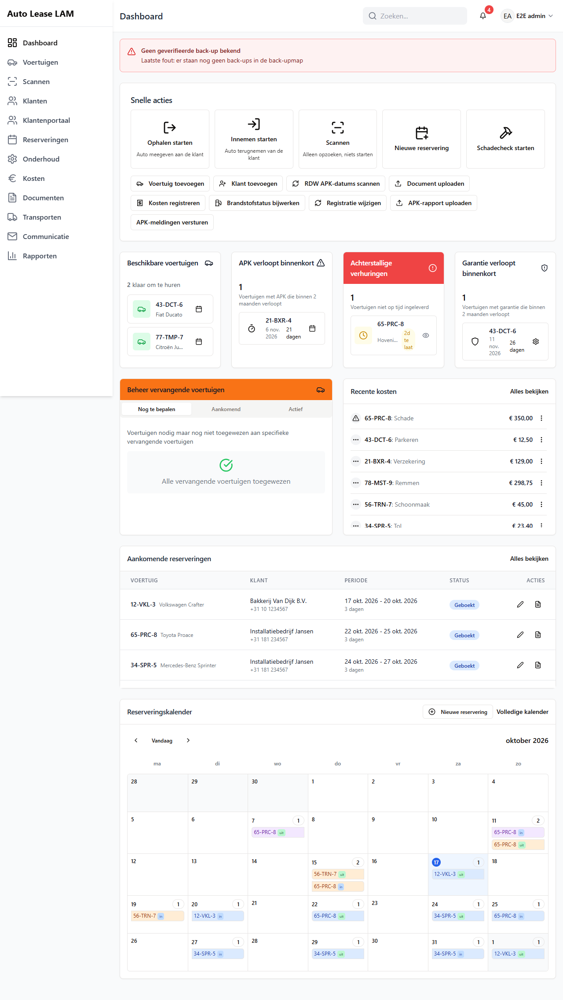
*Het **Dashboard**: bovenaan **Snelle acties**, daaronder de vier signaalblokken.*

---

## 2.3 Voertuigen

Het scherm heet **Voertuigbeheer**. Hier staat het hele wagenpark. Het wagenpark is alle auto's
van het bedrijf samen.

Rechtsboven staan deze knoppen:

| Knop | Waarvoor |
|---|---|
| **Verwijderde voertuigen** | De prullenbak van dit scherm. Hier staan alleen voertuigen in, zie hieronder |
| **Barcodeboek** | Alle sleutellabels op een rij om af te drukken |
| **Sleutelkast-audit** | De sleutelkast nalopen en aftekenen |
| **Reservesleutelkast-audit** | Hetzelfde voor de reservesleutels |
| **Bulk importeren** | Meerdere voertuigen tegelijk uit een bestand inlezen |
| **Voertuig toevoegen** | Eén nieuw voertuig |

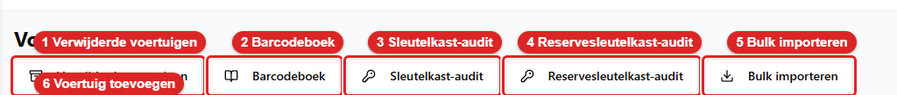
*De knoppen rechtsboven op **Voertuigbeheer**. Ze staan in de volgorde van de tabel hierboven (1 tot en met 6).*

Daaronder staat de lijst **Voertuigenpark**. Boven de lijst staan **Filter functies**,
**Sorteren op:** en **Tonen:**. Per regel zie je het kenteken, een statuslabel, het merk en model
en de APK-datum. Ook staan er de knoppen **Bekijken**, **Reserveren** of **Verhuur bekijken**.
Klik je ergens op de regel? Dan opent de auto ook.

**De statuslabels die je tegenkomt:** *Beschikbaar*, *Gepland*, *Verhuurd*, *Reparatie nodig*,
*Niet voor verhuur*, *Vervangend voertuig*, *Vervangend voertuig (actief)*, en combinaties als
*Gepland (vervanger toegewezen)*.

**Beschikbaar betekent overal hetzelfde:** de auto is vrij in de gevraagde periode **én** zijn
status is in orde. Een auto die in onderhoud staat, telt dus niet mee als beschikbaar. Ook niet
op het dashboard.

**Een voertuig openen.** Klik op **Bekijken**. Je krijgt **Voertuiggegevens**. Bovenaan staan de
knoppen **Terug**, **Barcode bekijken**, **Bewerken**, **Brandstofstatus bijwerken**,
**Verwijderen** en **Nieuwe reservering**. Daaronder staan de tabbladen:

- **Algemeen**: basisgegevens, techniek, status en uitrusting.
- **Kosten**: alle kosten van deze auto.
- **Documenten**: alles wat bij deze auto is opgeslagen.
- **Reserveringen**: de verhuurgeschiedenis.
- **Onderhoud**: de werkplaatsbezoeken.
- **Geschiedenis**: wie wat wanneer aan deze auto heeft gewijzigd.
- **Fiscaal**: de fiscale check van deze auto. Alleen voor wie het recht **Fiscaal bekijken** heeft.

**De prullenbak.** De knop **Verwijderde voertuigen** opent de prullenbak van dit scherm. Daar
staan alleen voertuigen in. Vroeger stonden hier alle soorten door elkaar. Sinds oktober 2026
heeft elk scherm zijn eigen prullenbak. Zie hieronder en hoofdstuk 10, paragraaf 10.6. Per regel
staat wie het voertuig wanneer verwijderde en wat eraan hing. Klik op **Terugzetten**. Het
voertuig komt dan terug met alles wat eraan hing. Klik op **Definitief verwijderen**. Het voertuig
gaat er dan voorgoed uit. De knop is er voor iedereen met het vinkje **Prullenbak beheren**.
Zonder dat vinkje staat de knop er grijs.

**Alle prullenbakken.** De acht prullenbakken staan elk op hun eigen scherm: **Verwijderde voertuigen**
(Voertuigen, 2.3), **Verwijderde klanten** (Klanten, 2.5), **Verwijderde reserveringen**
(Reserveringen, 2.7), **Verwijderd onderhoud** (Onderhoud, 2.8), **Verwijderde transporten**
(Transporten, 2.8), **Verwijderde kostenposten** (Kosten, 2.8), de knop **Prullenbak** bij de
bekeuringen (Klantenportaal → **Bekeuringen**, 2.6) en **Verwijderde chauffeurs** op het tabblad
**Chauffeurs** van een klant (2.5).

---

## 2.4 Scannen

Het scherm heet **Barcode scannen**. Er staat: *Scan een sleutellabel met een barcodescanner of
camera, of typ de code handmatig.*

Dit is het snelste pad in de app. Eén handeling, en je zit meteen op de juiste auto of
reservering. Je kunt intypen of scannen. Dat kan een `VEH-…`-code zijn, een `RES-…`-code of een
kenteken.

Na de scan zie je het voertuig. Je ziet de status, de APK-datum, de kilometerstand, de brandstof
en de actieve of aankomende reservering. Daaronder staan de acties die op dat moment zinvol zijn:

**Ophalen starten · Inleveren starten · Reservering maken · Voertuig openen · Reservering
openen · Kosten registreren · Document uploaden · Tanken · Km-stand bijwerken · Onderhoud
inplannen · Terug uit onderhoud · Transport starten · Transport afronden · Opnieuw scannen**

*Na een scan: bovenin de auto, daaronder de tegels. Welke tegels er staan, hangt af van de stand van
de auto. Zie hoofdstuk 18, paragraaf 18.4.*

Onderaan staat **Recente scans**. Zo kun je terugzien wat je net in handen had. Klik op een regel
daarin. De app zoekt die code dan opnieuw op.

Scannen met de camera werkt alleen als de app via een beveiligde verbinding draait. Zo'n
verbinding herken je aan https in het adres. Lukt dat niet? Gebruik dan de USB-scanner. Of typ de
code.

---

## 2.5 Klanten

Het scherm heet **Klanten**. Daaronder staat de **Klantendatabase**. Dat is de lijst met alle klanten.

- Rechtsboven: **Klant toevoegen** en **Verwijderde klanten**. Dat laatste is de prullenbak van
  dit scherm. Die is voor wie het vinkje **Prullenbak beheren** heeft.
- Boven de lijst: een zoekveld, een sorteerkeuze (**Naam (A-Z)**, **Nieuwste eerst**, **Meeste
  verhuur**, **Actieve verhuur**, …) en **Filters** (onder andere *Zakelijk*, *Particulier*,
  *Actieve verhuur*, *Onvolledig profiel*).
- De tabel heeft de kolommen **Naam**, **E-mail**, **Telefoon** en **Plaats**. Per regel staan de
  knoppen **Bekijken**, **Nieuwe reservering** en **Verwijderen**. Klik je ergens op de regel?
  Dan opent de klant ook.
- Onderaan staat hoeveel klanten er worden getoond, met **Vorige** en **Volgende**.

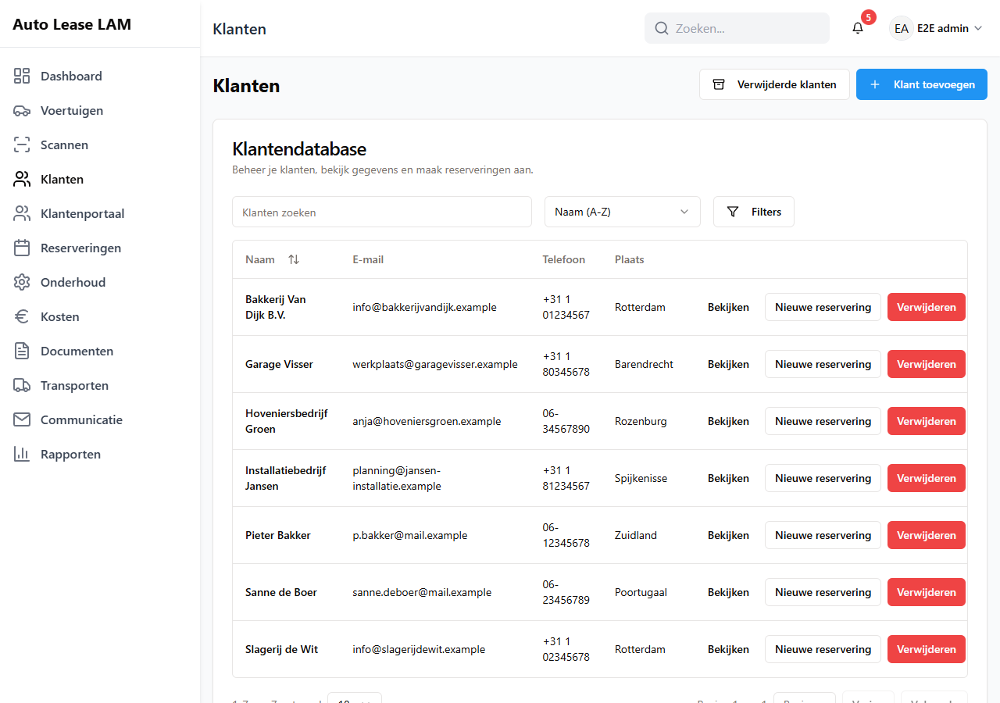
*Het scherm **Klanten**: rechtsboven **Verwijderde klanten** en **Klant toevoegen**. Daaronder de
**Klantendatabase** met het zoekveld, de sorteerkeuze en **Filters**.*

**Een klant openen.** Klik op **Bekijken**. Je krijgt **Klantgegevens**. Bovenaan staan het aantal
verhuringen, de actieve verhuringen en het totaal aantal gereden kilometers. Ook staan er de
knoppen **Terug**, **Bewerken** en **Nieuwe reservering**. Daaronder staan de tabbladen
**Persoonlijke gegevens**, **Chauffeurs**, **Actieve verhuringen**, **Geschiedenis** en
**Portaal**. Op **Chauffeurs** staat de prullenbak **Verwijderde chauffeurs** voor de chauffeurs
van deze klant. Onderaan staat **Geblokkeerde voertuigen**. Dat zijn auto's die deze klant niet
mag huren.

**Verwijderen.** Klik je op **Verwijderen**? Dan opent het venster **Klant verwijderen**. Dat
venster laat eerst zien wat er aan de klant hangt (*Dit verwijdert ook:*). Daarna vraagt het je de
naam van de klant over te typen. Heeft de klant een lopende of toekomstige reservering? Dan
weigert de app met *Verwijderen kan niet: deze klant heeft een lopende of toekomstige reservering.*
De app noemt die reserveringen erbij. Lukt het verwijderen wel? Dan gaat de klant naar de
prullenbak van dit scherm (**Verwijderde klanten**). Iemand met het vinkje **Prullenbak beheren**
kan hem terugzetten. Uitgebreid in hoofdstuk 3, paragraaf 3.8.

---

## 2.6 Klantenportaal

Het scherm heet **Klantenportaal beheren**. Er staat: *Aanvragen, accounts, bekeuringen en het
aanbod voor klanten op één plek. Klik op een tegel om die lijst te openen.* Het klantenportaal is
de plek waar klanten zelf online dingen regelen.

Bovenaan staan **Bekeuringen**, **Fiscale check** (alleen voor wie **Fiscaal bekijken** heeft),
**Brieven scannen** en **Account uitnodigen**. Daaronder staan acht tegels. Klik op een tegel om
die lijst te openen:

**Aanvragen** (nieuw) · **Onderhoud** (meldingen en placeholders) · **Bekeuringen** (niet
gekoppeld) · **Klanten** (nu online) · **Accounts** (open · verlopen) · **Voertuigen online**
(online aangeboden) · **Blacklist** (blokkades) · **Activiteit** (laatste acties in het portaal)

Daaronder staan vier panelen:

| Paneel | Wat je er ziet |
|---|---|
| **Aandacht nodig** | De aanvragen en bekeuringen die om actie vragen, met **Alle aanvragen** en **Alle bekeuringen** |
| **Meldingen** | Wat er in het portaal is gebeurd. Je ziet het aantal ongelezen meldingen en de knop **Alles gelezen** |
| **Aankomende reserveringen** | *Ophalen en inleveren in de komende 14 dagen* |
| **Klanten** | Per klant hoeveel portaalaccounts er zijn, en wanneer er voor het laatst iets gebeurde |

Elk paneel toont alleen de eerste regels. Klik op **Alles bekijken en zoeken** om de volledige
lijst te openen. In de lijsten achter **Aanvragen**, **Voertuigen online** en **Blacklist** kun je
sorteren. Klik daarvoor op een kolomkop. Nog een klik draait de volgorde om. **Voertuigen online**
en **Blacklist** hebben daarnaast een zoekveld, filters en pagina's van 50 regels.

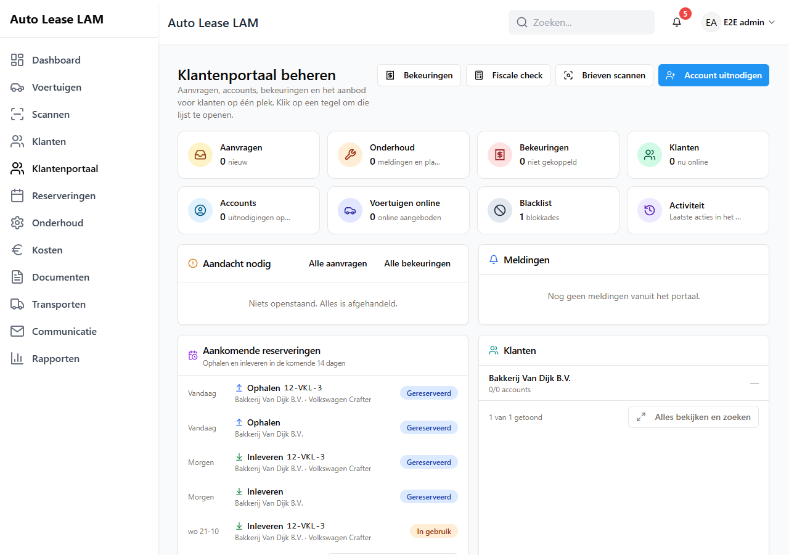
*Het scherm **Klantenportaal beheren**: de tegels bovenaan zijn ingangen naar een lijst. De
panelen eronder tonen de laatste regels.*

In de lijst achter de tegel **Bekeuringen** staat de knop **Prullenbak** voor verwijderde bekeuringen
(hoofdstuk 10, paragraaf 10.6). Dezelfde lijst open je ook met de knop **Bekeuringen** bovenaan de
pagina **Klantenportaal**. Er is geen menu-item **Bekeuringen** meer. Bekeuringen worden per klant
bewaard en ingevoerd via het klantenportaal. Daarom staat de lijst daar. De knop is voor wie
**Boetes bekijken** of **Boetes beheren** heeft. Zonder dat vinkje staat hij grijs. Er staat dan
bij welk vinkje je mist. Heb je alleen **Boetes bekijken** of **Boetes beheren** en geen
portaalvinkje? Dan kun je de lijst dus niet meer openen (besluit B-44, de eigenaar vond dat goed).
Het is dezelfde tabel met dezelfde vensters. Heb je het vinkje **Fiscaal bekijken** maar geen
vinkje voor rapporten? Dan toont het scherm **Rapporten** voor jou alleen de fiscale check, met de
knop **Fiscale check** (hoofdstuk 15, paragraaf 15.4).

**Een bekeuring openen.** Klik op een regel. Het venster toont het bedrag, de **Administratiekosten**
en het **Totaal**. Ook zie je de klant, de reservering en de bestuurder. De administratiekosten pas je
hier niet aan. Ze komen uit **App-instellingen** (hoofdstuk 10). Hoe je een bekeuring invoert en koppelt,
staat in [hoofdstuk 20](20-klantenportaal-en-bekeuringen.md). Bedragen staan
als € 95,00. Tijden staan zonder seconden. Kentekens staan met streepjes. Dat geldt ook in het
klantenportaal en in de mail aan de klant. Elke handeling meldt zichzelf met een eigen zin:
*Bekeuring opgeslagen.*, *Bekeuring gekoppeld.*, *Bekeuring ontkoppeld.*, *Bekeuring geannuleerd.*
of *Bekeuring heractiveerd.* De knop **Bekeuring annuleren** vraagt eerst *Bekeuring PT-99-ZY van
€ 95,00 annuleren? Je kunt hem daarna weer heractiveren.* De veilige keuze is **Nee, laten
staan**. Met **Sluiten** sluit je het venster zonder iets te wijzigen. Heb je tekst getypt en
sluit je het venster? Dan vraagt de app **Wijzigingen verwerpen?**

**Nieuwe bekeuring en Brieven scannen** lijken op elkaar. Maar ze doen iets anders. **Nieuwe
bekeuring** is voor één bekeuring. Je vult de velden in. Of je kiest de brief en laat hem inlezen.
Daarna controleer je alles voordat je opslaat. **Brieven scannen** is voor een stapel brieven
tegelijk. Elke brief wordt gelezen. Je loopt de lijst na. Daarna maakt de app er in één keer
bekeuringen van. Beide knoppen hebben een uitleg bij het venster. Ook zie je een tekstje als je er
met de muis op gaat staan.

**Een bekeuring alleen registreren.** De app registreert bekeuringen. Het doorbelasten en betalen
regel je buiten de app om. De statussen zijn daarom **Niet gekoppeld**, **Gekoppeld** en **Geannuleerd**.
**Doorbelast**, **Betaald** en **Betwist** staan niet meer in het filter **Alle statussen**. Je kunt
ze ook niet meer kiezen. Een oude bekeuring die zo'n status al had, houdt hem als label. Zijn er
zulke bekeuringen? Dan staat die status ook in het filter. Anders niet. Probeert een oude pagina
een bekeuring toch op doorbelast, betaald of betwist te zetten? Dan weigert de app dat.

**De klant informeren is een eigen handeling.** Een bekeuring invoeren, inlezen, importeren of aan
een klant koppelen stuurt de klant niets. Wil je dat de klant het weet? Open dan de gekoppelde
bekeuring. Klik op **Klant informeren**. De app vraagt **Klant informeren?** en noemt het adres:
*Een e-mail over bekeuring PT-99-ZY van € 95,00 gaat naar jan@voorbeeld.nl, en de klant krijgt een melding in het portaal.* Met **Nee, niet sturen** laat je het zoals het was. Klik je in dat
venster op **Klant informeren**? Dan krijg je **Klant geïnformeerd.** In het venster staat dan
*Klant geïnformeerd op <datum>*. De knop heet daarna **Opnieuw informeren**. Die vraagt eerst *De
klant is al geïnformeerd op <datum>. Opnieuw een e-mail … sturen naar …?* De knop is er voor wie
**Boetes beheren** heeft. Hij staat er alleen bij een gekoppelde bekeuring met een klant. Zie
hoofdstuk 9, paragraaf 9.1 voor wat er misgaat als het versturen niet lukt.

**Een bekeuring zonder naam van het bedrijf.** Is bij een klant het veld **Bedrijfsnaam** leeg?
Dan staat in de bekeuringen en in het portaal de naam van de klant zelf. Er staat dus geen lege
regel meer.

Nieuwe aanvragen handel je hier af. Dat doe je via de tegel **Aanvragen** of het paneel
**Aandacht nodig**. Is er iets nieuws? Dan zie je dat bovenin elk scherm aan de portaaltegel. Je
ziet het ook aan het rode bolletje achter **Klantenportaal** in het menu.

---

## 2.7 Reserveringen

Het scherm heet **Reserveringskalender**. Standaard zie je een maand.

Rechtsboven staan deze knoppen:

| Knop | Waarvoor |
|---|---|
| **Lijstweergave** | Dezelfde reserveringen als lijst in plaats van als kalender |
| **Voltooid bekijken (…)** | De afgesloten verhuringen |
| **Verwijderde reserveringen** | De prullenbak van dit scherm |
| **… achterstallig** | De verhuringen die over hun einddatum heen zijn |
| **Administratie** | Factuurgegevens, zie hieronder |
| **Nieuwe reservering** | Een nieuwe boeking |

Boven de kalender staan **Kleuren** (de kleuren van de kalender aanpassen), **Vandaag** (spring terug naar
deze maand), de maandnavigatie en de filters **Alle typen** en **Alle voertuigen**. Met de
maandnavigatie ga je naar de vorige of de volgende maand.

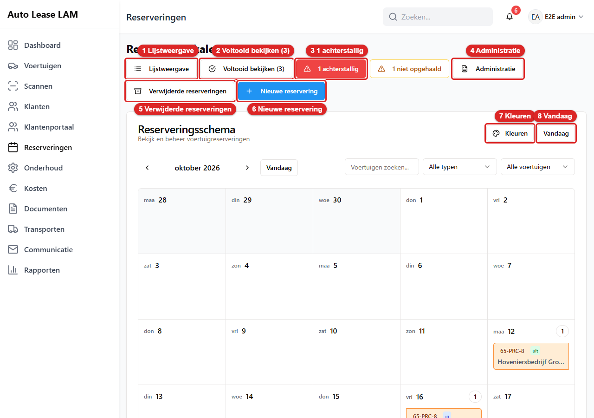
*De knoppen van de **Reserveringskalender**: 1 **Lijstweergave**, 2 **Voltooid bekijken (…)**,
3 **… achterstallig** (alleen als er iets achterstallig is), 4 **Administratie**, 5 **Verwijderde
reserveringen**, 6 **Nieuwe reservering**, 7 **Kleuren**, 8 **Vandaag**.*

In een dagvakje staat per reservering het kenteken, het woordje **uit** of **in**, en de klant.
**uit** betekent: die dag gaat de auto mee. **in** betekent: die dag komt hij terug. Staan er
meer dan vijf reserveringen op een dag? Dan verschijnt **+… meer**. Klik op een regel. Je ziet dan
**Reserveringsdetails**.

**Reserveringsdetails** toont de status, de huurperiode, de totaalprijs, het voertuig, de klant,
de chauffeur, de documenten en de geschiedenis. Onderaan staan **Ophalen starten** of
**Inleveren starten**, **Bewerken**, **Verwijderen** en **Sluiten**.

**Administratie.** Achter deze knop zit *Administratie - Factuurgegevens*. Dat is een overzicht
van de verhuurinformatie voor het facturatiesysteem buiten de app. Het heeft de tabbladen
**Huidige verhuur** en **Geschiedenis**. Je zoekt er op kenteken, GPS, bedrijf of contract. Je
sorteert op **Ophaaldatum**, **Kenteken**, **Bedrijf** of **Contract #**. De kolommen zijn onder
andere **GPS**, **Kenteken**, **Merk / Model**, **Vervangend voertuig**, **Contract #**, **Bedrijf /
Klant**, **Ophaaldatum**, **KM uit** en **KM in**. Dit scherm maakt geen facturen. Het levert
alleen de gegevens waarmee ergens anders gefactureerd wordt.

---

## 2.8 Onderhoud, Kosten, Documenten, Transporten, Communicatie en Rapporten

**Onderhoud**: het scherm **Onderhoudskalender** met de **Onderhoudsplanning**. Rechtsboven staan
**Lijstweergave**, **Voltooide bekijken (…)**, **Verwijderd onderhoud** (de prullenbak van dit
scherm) en **Onderhoud plannen**. In de kalender staan de werkplaatsafspraken en de APK-signalen
(*APK-keuring verschuldigd*, *APK Herinnering (2 maanden)*). Er staan labels bij als
**Vervanger nodig** en **Verhuur komt eraan**. Uitgebreid in hoofdstuk 7.

**Kosten**: het scherm **Kostenbeheer** met **Factuur scannen** en **Kosten registreren**.
Daaronder staan het **Kostenoverzicht** (*Bekijk en beheer alle voertuiggerelateerde kosten*) en de
**Kostensamenvatting**. Alles over kosten en facturen, stap voor stap, staat in
[hoofdstuk 19](19-kosten-en-facturen.md). Kosten vastleggen met de auto in je hand staat in hoofdstuk 18. Wat je moet weten:

- **Filters bovenaan, twee weergaven eronder.** Filteren betekent: alleen de regels tonen die bij
  je keuze passen. Boven de lijst filter je op **Voertuig** (typ het kenteken met of zonder
  streepjes), **Van** en **Tot en met** (allebei meegeteld), **Categorie** en het zoekveld *Zoeken
  op kenteken, merk, categorie of omschrijving...*. De knoppen **Deze maand**, **Vorige maand** en
  **Dit jaar** zetten de periode in één klik. **Filters wissen** zet alles terug. Onder de filters
  staat hoeveel kostenposten je selectie heeft en wat ze samen kosten (*11 kostenposten · totaal
  € 2.856,85*). Daarnaast kies je de weergave:
  - **Per categorie** (standaard): elke categorie is een ingeklapte regel met het aantal en het
    totaal. Klik op de regel. Je ziet dan de vijf nieuwste kostenposten van die categorie. Met de
    knop **Alle N tonen** open je de hele categorie in een venster. Dat venster heeft een eigen
    zoekveld en **Sorteren**.
  - **Alle kosten**: één tabel met de kolommen **Datum**, **Voertuig**, **Categorie**, **Omschrijving**
    en **Bedrag (excl. btw)**. Klik op een kolomkop om te sorteren. Onderaan kies je de pagina. Je
    kiest daar ook hoeveel regels je per pagina ziet.

  De **Kostensamenvatting** rechts rekent altijd over wat je hebt gefilterd (*Totaal van de gekozen
  filters*). Je ziet een totaal per categorie.

  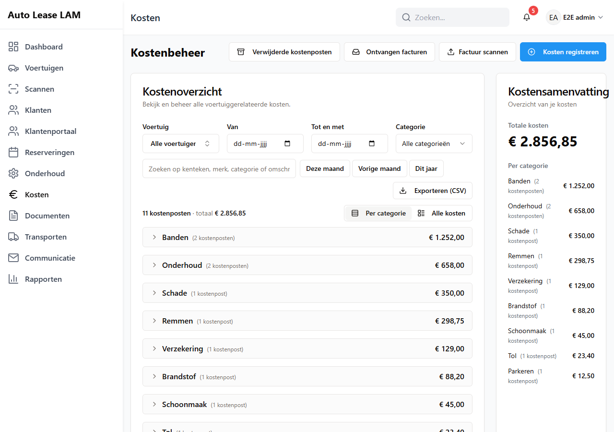
  *Het scherm **Kosten**: bovenin de filters en de snelle periodes. Daaronder de categorieën (klik op
  een regel om hem open te klappen) en de keuze **Per categorie** / **Alle kosten**.*
- **De prullenbak van Kosten.** Rechtsboven staat de knop **Verwijderde kostenposten**. Dat is de
  prullenbak van dit scherm, voor wie het vinkje **Prullenbak beheren** heeft. Een verwijderde
  kostenpost staat daar met zijn bon. Je kunt hem terugzetten (hoofdstuk 10, paragraaf 10.6). Vul
  je bij **Brandstofstatus bijwerken** een tankbedrag in? Dan ontstaat er een kostenpost. Die
  staat hier gewoon tussen de rest, in de categorie **Brandstof** (hoofdstuk 4, paragraaf 4.9).
- **Exporteren (CSV).** Die knop bewaart precies de gefilterde regels voor Excel. Het bestand
  gebruikt puntkomma's, een decimale komma en datums als dd-mm-jjjj (zie hoofdstuk 12). De app
  meldt **Bestand gemaakt**. Heb je **Prijzen verbergen**? Dan staat de knop er niet.
- **Eén formulier voor kosten.** **Kosten registreren** opent altijd hetzelfde venster:
  **Nieuwe kosten toevoegen**. Het maakt niet uit of je vanaf het Dashboard, het scherm **Kosten**
  of een voertuig komt. Een voertuig is verplicht: *Een voertuig is verplicht: elke kostenpost
  hoort bij één voertuig.* Laat je het leeg? Dan staat er *Kies een voertuig*. Ontbreekt de
  categorie? Dan staat er *Kies een categorie*.
- **Categorieën.** Er is één lijst, overal gelijk: **Onderhoud**, **Banden**, **Remmen**, **Schade**,
  **Brandstof**, **Verzekering**, **Registratie**, **Schoonmaak**, **Accessoires**, **Tol**,
  **Parkeren** en **Overig**. **Tol** en **Parkeren** zijn nieuw. Is een kostenpost ooit onder een
  eigen categorienaam ingevoerd? Dan krijgt hij bij het bewerken de categorie **Overig**.
  Controleer dat als je zo'n kostenpost wijzigt.
- **Ontvangen facturen.** In het venster **Ontvangen facturen** staat naast **Nu ophalen** de knop
  **Logboek** (hoofdstuk 9, paragraaf 9.9).

**Documenten**: het scherm **Documentbeheer** met **Document uploaden** en de tabbladen
**Documentbibliotheek**, **Contractsjablonen**, **Transportrapportsjablonen**, **Barcodelabels**
en **Schadecheck-sjablonen**. Een sjabloon is een voorbeelddocument dat de app voor je invult.
Uitgebreid in hoofdstuk 8.

**Transporten**: het **Transportdashboard**: *Leveringen, wissels, sleepacties, inbeslagnames
en andere voertuigbewegingen*. Bovenaan staan **Route-optimalisatie** en de tellers **Wacht op
planning**, **Klaar voor levering**, **In uitvoering** en **Leveringen voltooid**. Daaronder staan
de tabbladen **Alle transporten**, **Voertuigwissel**, **Slepen**, **Terughalen**, **Levering** en
**Overig**. Ook staan er de knoppen **Nieuw transport** en **Verwijderde transporten** (de
prullenbak van dit scherm). Klik in de tabel op een kolomkop om te sorteren. Klik op een regel om
het transport te openen. Uitgebreid in hoofdstuk 6.

**Communicatie**: het scherm **Klantcommunicatie** met de tabbladen **Meldingen versturen**,
**Sjabloonbouwer**, **E-maillogboek** en **Analyse**. Onder **Meldingen versturen** kies je
**APK-herinneringen**, **Onderhoud** of **Aangepast bericht**. Uitgebreid in hoofdstuk 9.

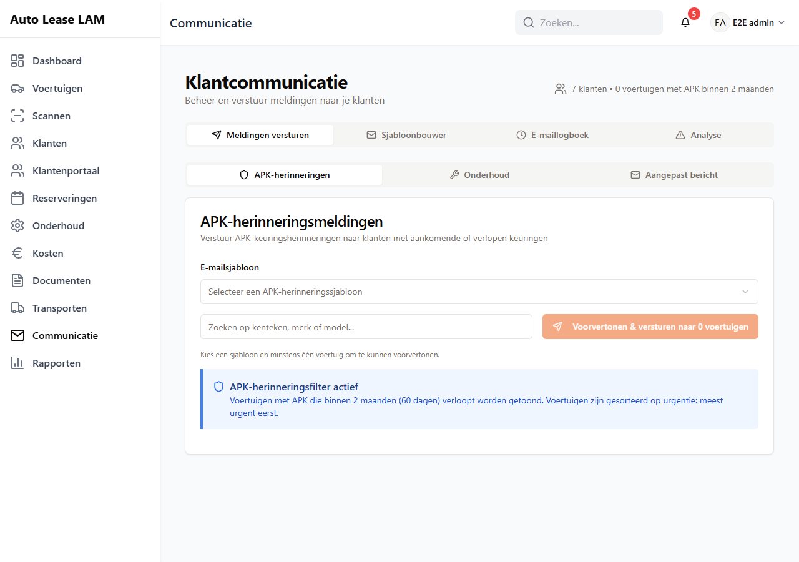
*Het scherm **Communicatie**: bovenin de vier tabbladen, daaronder de drie soorten berichten.*

**Rapporten**: het scherm **Rapporten**: *Genereer en analyseer rapporten voor je
autoverhuurbedrijf.* Bovenaan staat de filterbalk. Daar kies je de **Periode** (bijvoorbeeld
**Deze maand**, **Volgende maand**, **Alle gegevens** of **Zelf kiezen**), **Vergelijk met** en het
**Voertuig**. Rechts staan de knoppen **Rapportbouwer** en **Onderhoudsanalyse**. Daaronder staan
de tabbladen **Overzicht**, **Kosten**, **Voertuigen**, **Klanten**, **Transporten**,
**Financieel**, **Fiscaal**, **Portaal** en **Kantoor**. **Overzicht** toont acht belangrijke
getallen; klik op een getal en het rapport erachter opent. Op de andere tabbladen staat links de
lijst met rapporten en rechts één rapport. Elk rapport heeft een eigen knop **Afdrukken** met een
afdrukvoorbeeld. Alles over dit scherm staat in [hoofdstuk 21](21-rapporten.md).

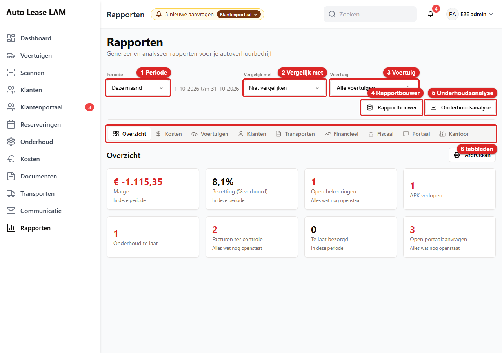
*Het scherm **Rapporten**: 1 **Periode**, 2 **Vergelijk met**, 3 **Voertuig**, 4 **Rapportbouwer**,
5 **Onderhoudsanalyse**, 6 de tabbladen.*

**Wat je moet weten:**

- **Eén rapport tegelijk.** Klik links in de lijst op een rapport. Een rood getal achter een
  rapport betekent dat er iets te doen is. Op een telefoon is de lijst een keuzemenu (**Kies een
  rapport**).
- **Klikken op een getal.** Een tegel, een staaf in een grafiek of een regel in een tabel opent de
  regels achter dat getal. Een blauw kenteken of een klantnaam opent een klein venster met **Openen
  in nieuw tabblad**.
- **Tabellen.** Tien regels per pagina, met **Zoeken** (een kenteken mag zonder streepjes) en
  sorteren op de kolomkop. Met **Kolommen** kies je welke kolommen je ziet.
- **Afdrukken.** Klik bij het rapport op **Afdrukken**. Je ziet eerst een voorbeeld op A4. Kies
  **Tegels**, **Grafiek**, **Tabel** en eventueel **Liggend**. Pas **Afdrukken** in het voorbeeld
  opent het afdrukvenster van je browser.

  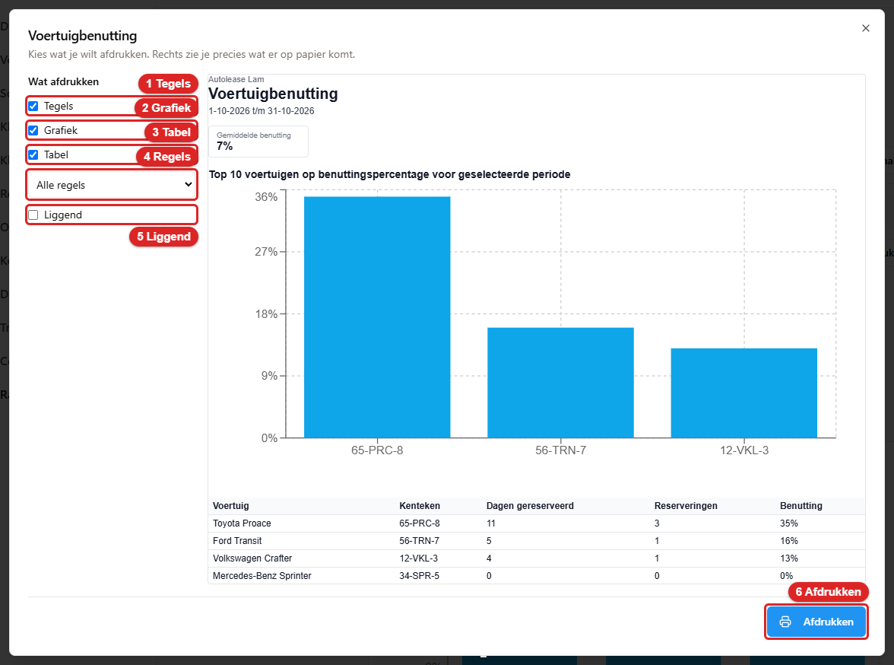
  *Het afdrukvoorbeeld: 1 **Tegels**, 2 **Grafiek**, 3 **Tabel**, 4 de keuze voor de regels,
  5 **Liggend**, 6 **Afdrukken**.*

- **Vergelijken.** Kies bij **Vergelijk met** **Vorige periode** of **Zelfde periode vorig jaar**.
  Onder de getallen staat dan het oude getal en het verschil in groen of rood. Gaat een bedrag van 0
  naar iets? Dan staat er *nieuw* en geen percentage.

**Analyse onderhoudskosten.** Klik op **Onderhoudsanalyse**. Deze analyse telt alleen de kosten die
echt onderhoud zijn: **Onderhoud**, **Banden** en **Remmen**. **Kosten per km** staat alleen bij
**Alle tijd**. Zie hoofdstuk 21, paragraaf 21.9.

**De rapportbouwer.** Klik op **Rapportbouwer**. Je kiest een bron, velden (ook van de gekoppelde
auto of klant), filters, groepen en zelf berekende velden. Met **Opslaan** zet je het rapport op
een tabblad. Een opgeslagen rapport verwijderen vraagt eerst **Rapport verwijderen?** Pas na
**Verwijderen** is het weg. Zie hoofdstuk 21, paragraaf 21.8.

---

## 2.9 Snelle acties

Op het **Dashboard** staat het blok **Snelle acties**. Daarmee hoef je niet te zoeken naar het
juiste scherm. Bovenaan staan vijf grote tegels:

**Ophalen starten · Innemen starten · Scannen · Nieuwe reservering · Schadecheck starten**

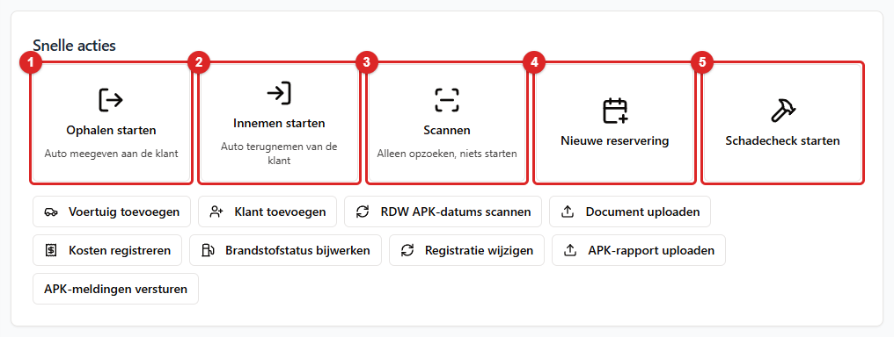
*Het blok **Snelle acties**: 1 **Ophalen starten**, 2 **Innemen starten**, 3 **Scannen**, 4 **Nieuwe
reservering**, 5 **Schadecheck starten**. Daaronder de kleinere knoppen.*

Daaronder staan **Voertuig toevoegen**, **Klant toevoegen** en **RDW APK-datums scannen**. Daarna
volgt een rijtje kleinere knoppen: **Document uploaden**, **Kosten registreren**, **Brandstofstatus
bijwerken**, **Registratie wijzigen**, **APK-rapport uploaden** en **APK-meldingen versturen**.

Drie dingen om te weten:

- **Ophalen starten** en **Innemen starten** openen eerst het scanvenster. Je scant of typt het
  kenteken. De app opent dan meteen de juiste handeling. Onder elke tegel staat in één regel wat
  hij doet: *Auto meegeven aan de klant* bij **Ophalen starten**, *Auto terugnemen van de klant* bij
  **Innemen starten** en *Alleen opzoeken, niets starten* bij **Scannen**.

  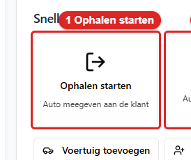
  *Zo ziet de tegel **Ophalen starten** eruit. Klik erop. Daarna zie je het scanvenster.*

  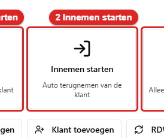
  *Zo ziet de tegel **Innemen starten** eruit. Klik erop. Daarna zie je het scanvenster.*
- **Nieuwe reservering** opent het boekingsformulier als een venster. Klik je op **Annuleren**?
  Dan sluit alleen het venster. Je blijft op het Dashboard.

  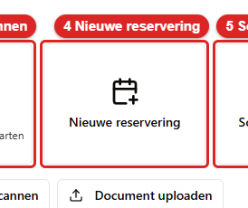
  *Zo ziet de tegel **Nieuwe reservering** eruit. Klik erop. Daarna opent het boekingsformulier als een venster.*
- **RDW APK-datums scannen** vraagt eerst of je het zeker weet (**RDW APK-datums scannen?** met
  **Scan starten**). Daarna haalt de app de APK-datums op bij de RDW. Dat loopt op de achtergrond
  ("*De scan is gestart en loopt op de achtergrond. Je kunt gewoon doorwerken*"). Dit is werk voor
  wie het wagenpark bijhoudt. Niet voor de balie.

---

## 2.10 De balk bovenin

**Zoeken.** Zie 1.3.

**Het belletje.** Klik erop. Je ziet dan het **Meldingencentrum** met de tabbladen **Alle**,
**Reserveringen**, **Onderhoud**, **APK**, **Garantie** en **Aangepast**. Je kunt een melding
**Markeer als gelezen** of **Markeer als ongelezen** geven. Je kunt ook zelf een **Nieuwe melding**
aanmaken. Die heeft een titel, een omschrijving, een datum en een prioriteit (**Hoog**, **Normaal**,
**Laag**).

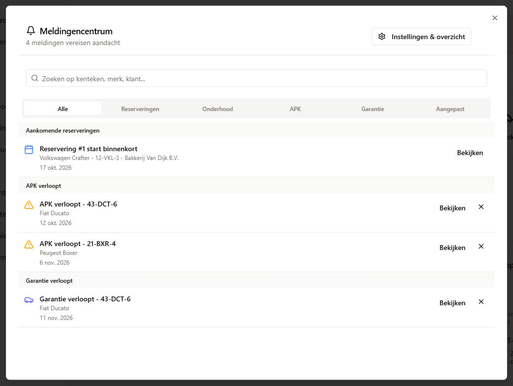
*Het **Meldingencentrum**. Je opent het met het belletje rechtsboven.*

**Je eigen menu (je initialen en naam).** Hierin staan:

- je naam en e-mailadres.
- **Profiel**: je gegevens bekijken en wijzigen, en je wachtwoord veranderen.
- een taalknop. Staat de app in het Nederlands, dan staat er **English**. En andersom.
- **Handleiding**: deze handleiding, leesbaar in de app. Er is een zoekveld om snel iets terug te
  vinden. Dezelfde lezer staat op de pagina `/handleiding`.
- alleen voor een beheerder, onder het kopje **Beheer**: **Gebruikers**, **Back-upbeheer** en
  **App-instellingen**.
- **Uitloggen**.

De afbeelding van dit menu staat in hoofdstuk 1, paragraaf 1.2. De afbeelding van het beheerdeel
staat in hoofdstuk 10, paragraaf 10.1.

---

## 2.11 Sneltoetsen

Er is één kleine, vaste set sneltoetsen. Een sneltoets is een toets waarmee je snel iets opent.
Druk op **?** voor het overzicht **Sneltoetsen**.

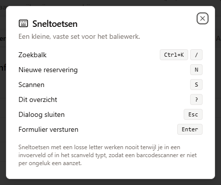
*Het overzicht **Sneltoetsen**. Je opent het met de toets `?`.*

| Toets | Wat er gebeurt |
|---|---|
| `Ctrl+K` of `/` | De cursor springt naar de **Zoekbalk** |
| `N` | **Nieuwe reservering**: het boekingsvenster opent |
| `S` | **Scannen**: het scanvenster opent |
| `?` | Dit overzicht |
| `Esc` | Het openstaande venster sluiten. Staat er een formulier open met wijzigingen die nog niet zijn opgeslagen? Dan vraagt de app eerst **Wijzigingen verwerpen?** |
| `Enter` | Het formulier versturen |

De losse letters `N`, `S` en `?` werken **nooit** terwijl je in een invoerveld of in het
scanveld typt. Dat is met opzet. Een barcodescanner typt letters als een toetsenbord. Anders zou
een scan per ongeluk een venster openen. `Ctrl+K` werkt wél overal.

**Een keuzelijst met zoekveld bedien je ook met het toetsenbord.** Dit geldt voor de klantkeuze en
de voertuigkeuze in het reserveringsformulier en in **Onderhoud plannen**. Het geldt ook voor het
voertuigfilter bij **Rapporten** en bij **Kosten**. Typ om te zoeken. Ga met de pijltjestoetsen
omhoog en omlaag door de lijst. Kies met Enter. Sluit de lijst met Escape. Elke optie heeft een
naam. Zo kan een schermlezer hem voorlezen. Een schermlezer is een programma dat het scherm
voorleest aan mensen die slecht zien. Past er niets bij wat je typt? Dan staat er een melding in
plaats van een lege lijst.

**Dit zijn de enige sneltoetsen in de werkschermen.** In de sjablooneditors bestaan daarnaast de
gebruikelijke toetsen voor knippen, plakken en de pijltjes. Die heb je aan de balie niet nodig.
