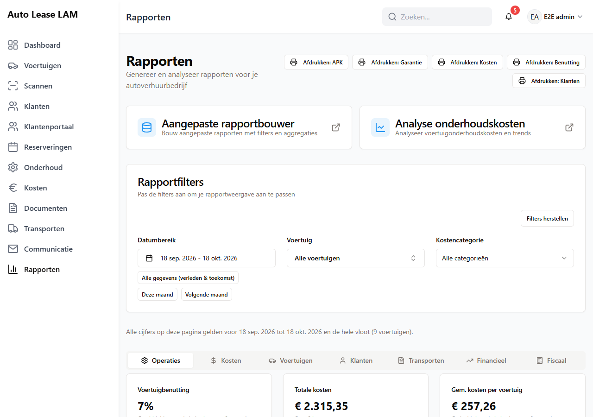

# 2. Navigatie

Dit hoofdstuk loopt het menu van boven naar beneden af: waar elk onderdeel voor is, wanneer je
het gebruikt, wat je er kunt doen en welk recht je ervoor nodig hebt. Daarna volgen de balk
bovenin, het zoeken, de snelle acties en de sneltoetsen.

---

## 2.1 Het menu links

Het menu staat links en blijft altijd staan. Je ziet alleen de items waar je rechten voor hebt
(hoofdstuk 15). Op een smal scherm klap je het menu open met het knopje linksboven.

| Menu-item | Waarvoor | Recht dat je nodig hebt |
|---|---|---|
| **Dashboard** | Overzicht, snelle acties en signaleringen | Dashboard bekijken |
| **Voertuigen** | Het wagenpark | Voertuigen bekijken of beheren |
| **Scannen** | Een sleutellabel scannen en meteen doorwerken | Voertuigen bekijken of beheren |
| **Klanten** | De klantendatabase | Klanten bekijken of beheren |
| **Klantenportaal** | Alles wat klanten online doen | Klantportaal bekijken of beheren |
| **Bekeuringen** | De lijst met bekeuringen, ook voor wie geen portaalrecht heeft | Boetes bekijken of beheren |
| **Reserveringen** | De verhuurkalender | Reserveringen bekijken of beheren |
| **Onderhoud** | De werkplaatskalender | Onderhoud beheren |
| **Kosten** | Kosten per voertuig | Kosten beheren |
| **Documenten** | Alle documenten en de sjablonen | Documenten bekijken, of Documenten bewerken en genereren |
| **Transporten** | Leveringen, wissels, sleepacties en terughalen | Reserveringen bekijken of beheren |
| **Communicatie** | E-mails en meldingen naar klanten | E-mailsjablonen beheren of Meldingen beheren |
| **Rapporten** | Cijfers en overzichten | Rapporten bekijken of beheren |

**Instellingen, gebruikers en back-up staan níét in dit menu.** Ze zitten rechtsboven achter je
eigen naam en alleen een beheerder ziet ze. Zie 2.10.

---

## 2.2 Dashboard

Het **Dashboard** is het scherm waar je binnenkomt na het inloggen. Het is je vertrekpunt: de
**Snelle acties** bovenaan starten de handelingen die je het vaakst doet, en de blokken eronder
laten zien waar aandacht nodig is. Het echte werk doe je daarna in de vensters die die knoppen
openen, en op de schermen **Reserveringen**, **Onderhoud**, **Transporten** en
**Klantenportaal**.

Van boven naar beneden:

1. **De back-upbalk.** Staat er *Geen geverifieerde back-up bekend* of *Geen geverifieerde
   back-up in … uur*, meld dat dan bij de beheerder. Zelf oplossen hoeft niet.
2. **Snelle acties** — zie 2.9.
3. **Vier signaalblokken:**
   - **Beschikbare voertuigen** — auto's die nu klaarstaan om te verhuren, met daaronder de
     kentekens.
   - **APK verloopt binnenkort** — auto's met een APK die binnen twee maanden verloopt, met het
     aantal dagen of *… d te laat*.
   - **Achterstallige verhuringen** — auto's die niet op tijd zijn ingeleverd. Met het oogje
     achter een regel open je de reservering.
   - **Garantie verloopt binnenkort**.
4. **Beheer vervangende voertuigen** met de tabbladen **Nog te bepalen**, **Aankomend** en
   **Actief**. Op **Nog te bepalen** staan de vervangers waarvoor nog geen auto is aangewezen,
   met de knop **Voertuig toewijzen**.
5. **Recente kosten** met de knop **Alles bekijken**; die knop staat er alleen voor wie **Kosten
   beheren** heeft. Een categorie staat er in het Nederlands, bijvoorbeeld **Banden** en niet *Tires*.
6. **Aankomende reserveringen** in een tabel: **Voertuig**, **Klant**, **Periode**, **Acties**.
7. **Reserveringskalender** — een kleine maandkalender, met **Reservering toevoegen**.

*Het **Dashboard**: bovenaan **Snelle acties**, daaronder de vier signaalblokken.*

---

## 2.3 Voertuigen

Het scherm heet **Voertuigbeheer**. Hier staat het hele wagenpark.

Rechtsboven staan de knoppen:

| Knop | Waarvoor |
|---|---|
| **Verwijderde voertuigen** | De prullenbak van dit scherm — alleen voor voertuigen, zie hieronder |
| **Barcodeboek** | Alle sleutellabels op een rij om af te drukken |
| **Sleutelkast-audit** | De sleutelkast nalopen en aftekenen |
| **Reservesleutelkast-audit** | Hetzelfde voor de reservesleutels |
| **Bulk importeren** | Meerdere voertuigen tegelijk uit een bestand inlezen |
| **Voertuig toevoegen** | Eén nieuw voertuig |

Daaronder staat de lijst **Voertuigenpark**, met **Filter functies** en **Sorteren op**. Per
regel zie je het kenteken, een statuslabel, merk en model, de APK-datum en de knoppen
**Bekijken**, **Reserveren** of **Verhuur bekijken**.

**De statuslabels die je tegenkomt:** *Beschikbaar*, *Gepland*, *Verhuurd*, *Reparatie nodig*,
*Niet voor verhuur*, *Vervangend voertuig*, *Vervangend voertuig (actief)*, en combinaties als
*Gepland (vervanger toegewezen)*.

**Beschikbaar betekent overal hetzelfde:** de auto is vrij in de gevraagde periode **én** zijn
status is in orde. Een auto die in onderhoud staat, telt dus niet mee als beschikbaar — ook niet
op het dashboard.

**Een voertuig openen.** Klik op **Bekijken**. Je krijgt **Voertuiggegevens** met bovenaan de
knoppen **Terug**, **Barcode bekijken**, **Bewerken**, **Brandstofstatus bijwerken**,
**Verwijderen** en **Nieuwe reservering**, en de tabbladen:

- **Algemeen** — basisgegevens, techniek, status, uitrusting.
- **Kosten** — alle kosten van deze auto.
- **Documenten** — alles wat bij deze auto is opgeslagen.
- **Reserveringen** — de verhuurgeschiedenis.
- **Onderhoud** — de werkplaatsbezoeken.
- **Geschiedenis** — wie wat wanneer aan deze auto heeft gewijzigd.

**De prullenbak.** De knop **Verwijderde voertuigen** opent de prullenbak van dit scherm, met
alleen voertuigen erin (vroeger stonden hier alle soorten door elkaar; sinds oktober 2026 heeft
elk scherm zijn eigen prullenbak, zie hieronder en hoofdstuk 10, paragraaf 10.6). Per regel staat
wie het wanneer verwijderde en wat er aan hing; met **Terugzetten** komt het voertuig met alles
eraan weer terug, en met **Definitief verwijderen** gaat het er voorgoed uit. De knop is er voor
iedereen met het vinkje **Prullenbak beheren**; zonder dat vinkje staat hij er grijs.

**Alle prullenbakken.** De zes prullenbakken staan op hun eigen scherm: **Verwijderde voertuigen**
(Voertuigen, 2.3), **Verwijderde klanten** (Klanten, 2.5), **Verwijderde reserveringen**
(Reserveringen, 2.7), **Verwijderd onderhoud** (Onderhoud, 2.8), **Verwijderde transporten**
(Transporten, 2.8) en de knop **Prullenbak** bij de bekeuringen (Klantenportaal → **Bekeuringen**,
2.6).

---

## 2.4 Scannen

Het scherm heet **Barcode scannen**: *Scan een sleutellabel met een barcodescanner of camera, of
typ de code handmatig.*

Dit is het snelste pad in de app: één handeling, en je zit meteen op de juiste auto of
reservering. Je kunt intypen of scannen: een `VEH-…`-code, een `RES-…`-code of een kenteken.

Na de scan zie je het voertuig met zijn status, de APK-datum, de kilometerstand, de brandstof en
de actieve of aankomende reservering. Daaronder staan de acties die op dat moment zinvol zijn:

**Ophalen starten · Inleveren starten · Reservering maken · Voertuig openen · Reservering
openen · Kosten registreren · Document uploaden · Tanken · Km-stand bijwerken · Onderhoud
inplannen · Terug uit onderhoud · Transport starten · Transport afronden · Opnieuw scannen**

Onderaan staat **Recente scans**, zodat je kunt terugzien wat je net in handen had.

Camera scannen werkt alleen als de app via een beveiligde verbinding (https) draait. Gaat dat
niet, gebruik dan de USB-scanner of typ de code.

---

## 2.5 Klanten

Het scherm heet **Klanten**, met daaronder de **Klantendatabase**.

- Rechtsboven: **Klant toevoegen** en **Verwijderde klanten** (de prullenbak van dit scherm, voor
  wie het vinkje **Prullenbak beheren** heeft).
- Boven de lijst: een zoekveld, een sorteerkeuze (**Naam (A-Z)**, **Nieuwste eerst**, **Meeste
  verhuur**, **Actieve verhuur**, …) en **Filters** (onder andere *Zakelijk*, *Particulier*,
  *Actieve verhuur*, *Onvolledig profiel*).
- De tabel heeft de kolommen **Naam**, **E-mail**, **Telefoon** en **Plaats**, en per regel
  **Bekijken**, **Nieuwe reservering** en **Verwijderen**.
- Onderaan staat hoeveel er getoond worden, met **Vorige** en **Volgende**.

**Een klant openen.** Klik op **Bekijken**. Je krijgt **Klantgegevens** met bovenaan het aantal
verhuringen, de actieve verhuringen en het totaal aantal gereden kilometers, de knoppen
**Terug**, **Bewerken** en **Nieuwe reservering**, en de tabbladen **Persoonlijke gegevens**,
**Chauffeurs**, **Actieve verhuringen**, **Geschiedenis** en **Portaal**. Onderaan staat
**Geblokkeerde voertuigen**: auto's die deze klant niet mag huren.

**Verwijderen.** Klik je op **Verwijderen**, dan opent het venster **Klant verwijderen**. Dat
laat eerst zien wat er aan de klant hangt (*Dit verwijdert ook:*) en vraagt je daarna de naam
van de klant over te typen. Is er een lopende of toekomstige reservering, dan weigert de app met
*Verwijderen kan niet: deze klant heeft een lopende of toekomstige reservering.* en noemt die
reserveringen erbij. Lukt het verwijderen wel, dan gaat de klant naar de prullenbak van dit scherm (**Verwijderde
klanten**) en kan iemand met het vinkje **Prullenbak beheren** hem terugzetten. Uitgebreid in
hoofdstuk 3, paragraaf 3.8.

---

## 2.6 Klantenportaal

Het scherm heet **Klantenportaal beheren**: *Aanvragen, accounts, bekeuringen en het aanbod voor
klanten op één plek. Klik op een tegel om die lijst te openen.*

Bovenaan staan **Brieven scannen** en **Account uitnodigen**. Daaronder acht tegels die je
aanklikt om die lijst te openen:

**Aanvragen** (nieuw) · **Onderhoud** (meldingen en placeholders) · **Bekeuringen** (niet
gekoppeld) · **Klanten** (nu online) · **Accounts** (open · verlopen) · **Voertuigen online**
(online aangeboden) · **Blacklist** (blokkades) · **Activiteit** (laatste acties in het portaal)

Daaronder staan vier panelen:

| Paneel | Wat je er ziet |
|---|---|
| **Aandacht nodig** | De aanvragen en bekeuringen die om actie vragen, met **Alle aanvragen** en **Alle bekeuringen** |
| **Meldingen** | Wat er in het portaal gebeurd is, met het aantal ongelezen en de knop **Alles gelezen** |
| **Aankomende reserveringen** | *Ophalen en inleveren in de komende 14 dagen* |
| **Klanten** | Per klant hoeveel portaalaccounts er zijn en wanneer er voor het laatst iets gebeurde |

Elk paneel toont alleen de eerste regels; met **Alles bekijken en zoeken** open je de volledige
lijst.

*Het scherm **Klantenportaal beheren**: de tegels bovenaan zijn ingangen naar een lijst, de
panelen eronder tonen de laatste regels.*

In de lijst achter de tegel **Bekeuringen** staat de knop **Prullenbak** voor verwijderde bekeuringen
(hoofdstuk 10, paragraaf 10.6). Dezelfde lijst staat ook als eigen menu-item **Bekeuringen**, voor wie
**Boetes bekijken** of **Boetes beheren** heeft maar niet bij het klantenportaal hoeft te komen. Het is
dezelfde tabel met dezelfde vensters; alleen de toegang is los van het portaal. Heb je het vinkje
**Fiscaal bekijken** maar geen vinkje voor rapporten, dan toont het scherm **Rapporten** voor jou alleen de
fiscale check, met de knop **Fiscale check** (hoofdstuk 15, paragraaf 15.4).

**Een bekeuring openen.** Klik op een regel. Het venster toont het bedrag, de **Administratiekosten** en het
**Totaal**, de klant, de reservering en de bestuurder. Wijzig je de administratiekosten en klik je op
**Opslaan**, dan blijft dat bedrag echt bewaard. Bedragen staan als € 95,00, tijden zonder seconden en
kentekens met streepjes, ook in het klantenportaal en in de mail aan de klant. Elke handeling meldt
zichzelf met een eigen zin: *Bekeuring opgeslagen.*, *Bekeuring gekoppeld.*, *Bekeuring ontkoppeld.*,
*Bekeuring geannuleerd.* of *Bekeuring heractiveerd.* De knop **Bekeuring annuleren** vraagt eerst
*Bekeuring PT-99-ZY van € 95,00 annuleren? Je kunt hem daarna weer heractiveren.*, met **Nee, laten
staan** als veilige keuze; **Sluiten** sluit het venster zonder iets te wijzigen. Heb je tekst getypt en
sluit je het venster, dan vraagt de app **Wijzigingen verwerpen?**

**Nieuwe bekeuring en Brieven scannen** lijken op elkaar maar doen iets anders. **Nieuwe bekeuring** is voor
één bekeuring: je vult de velden in, of kiest de brief en laat hem inlezen, en controleert alles voordat
je opslaat. **Brieven scannen** is voor een stapel brieven tegelijk: elke brief wordt gelezen, je loopt
de lijst na en daarna maakt de app er in één keer bekeuringen van. Beide knoppen hebben een uitleg
bij het venster en een tekstje als je er met de muis op gaat staan.

**Een bekeuring zonder naam van het bedrijf.** Is bij een klant het veld **Bedrijfsnaam** leeg, dan staat in de
bekeuringen en in het portaal de naam van de klant zelf, en niet meer een lege regel.

Nieuwe aanvragen handel je hier af, via de tegel **Aanvragen** of het paneel **Aandacht nodig**.
Als er iets nieuws is, zie je dat bovenin elk scherm aan de portaaltegel en aan het rode bolletje
achter **Klantenportaal** in het menu.

---

## 2.7 Reserveringen

Het scherm heet **Reserveringskalender**. Standaard zie je een maand.

Rechtsboven staan:

| Knop | Waarvoor |
|---|---|
| **Lijstweergave** | Dezelfde reserveringen als lijst in plaats van kalender |
| **Voltooid bekijken (…)** | De afgesloten verhuringen |
| **Verwijderde reserveringen** | De prullenbak van dit scherm |
| **… achterstallig** | De verhuringen die over hun einddatum heen zijn |
| **Administratie** | Factuurgegevens, zie hieronder |
| **Nieuwe reservering** | Een nieuwe boeking |

Boven de kalender: **Kleuren** (de legenda van de kleuren), **Vandaag** (spring terug naar deze
maand), de maandnavigatie en de filters **Alle typen** en **Alle voertuigen**.

In een dagvakje staat per reservering het kenteken, het woordje **uit** of **in**, en de klant.
**uit** betekent: die dag gaat de auto mee. **in** betekent: die dag komt hij terug. Staan er
meer dan vijf, dan verschijnt **+… meer**. Klik op een regel voor **Reserveringsdetails**.

**Reserveringsdetails** toont de status, de huurperiode, de totaalprijs, het voertuig, de klant,
de chauffeur, de documenten en de geschiedenis. Onderaan staan **Ophalen starten** of
**Inleveren starten**, **Bewerken**, **Verwijderen** en **Sluiten**.

**Administratie.** Achter deze knop zit *Administratie - Factuurgegevens*: een overzicht van de
verhuurinformatie voor het externe facturatiesysteem, met de tabbladen **Huidige verhuur** en
**Geschiedenis**. Je zoekt er op kenteken, GPS, bedrijf of contract en sorteert op
**Ophaaldatum**, **Kenteken**, **Bedrijf** of **Contract #**. De kolommen zijn onder andere
**GPS**, **Kenteken**, **Merk / Model**, **Vervangend voertuig**, **Contract #**, **Bedrijf /
Klant**, **Ophaaldatum**, **KM uit** en **KM in**. Dit scherm maakt geen facturen; het levert de
gegevens waarmee elders gefactureerd wordt.

---

## 2.8 Onderhoud, Kosten, Documenten, Transporten, Communicatie en Rapporten

**Onderhoud** — het scherm **Onderhoudskalender** met de **Onderhoudsplanning**. Rechtsboven
**Lijstweergave**, **Voltooide bekijken (…)**, **Verwijderd onderhoud** (de prullenbak van dit
scherm) en **Onderhoud plannen**. In de kalender staan de
werkplaatsafspraken en de APK-signalen (*APK-keuring verschuldigd*, *APK Herinnering (2
maanden)*), met labels als **Vervanger nodig** en **Verhuur komt eraan**. Uitgebreid in
hoofdstuk 7.

**Kosten** — het scherm **Kostenbeheer** met **Factuur scannen** en **Kosten registreren**.
Daaronder het **Kostenoverzicht** (*Bekijk en beheer alle voertuiggerelateerde kosten*) en de
**Kostensamenvatting**. Kosten heeft geen eigen hoofdstuk; de klikpaden staan in hoofdstuk 13,
paragraaf 13.10, en vastleggen met de auto in je hand staat in hoofdstuk 18. Wat je moet weten:

- **Eén lijst met filters.** Het **Kostenoverzicht** is één lijst, nieuwste bovenaan, met de kolommen
  **Datum**, **Voertuig**, **Categorie**, **Omschrijving** en **Bedrag**. Je filtert op **Voertuig** (typ
  het kenteken met of zonder streepjes), **Van** en **Tot en met** (allebei meegeteld), **Categorie** en
  het zoekveld *Zoeken op kenteken, categorie of omschrijving...*; **Filters wissen** zet alles terug.
  De **Kostensamenvatting** rekent precies over wat je ziet (*Totaal van de gekozen filters*), met een
  totaal per categorie. De lijst toont er 100 tegelijk; klik op **Meer tonen** voor de volgende. De
  uitklapbare lijst per categorie is vervangen door deze lijst met een filter.
- **Exporteren (CSV).** Die knop bewaart precies de gefilterde regels voor Excel (puntkomma's,
  decimale komma, datums dd-mm-jjjj; zie hoofdstuk 12). De app meldt **Bestand gemaakt**. Heb je
  **Prijzen verbergen**, dan staat de knop er niet.
- **Eén formulier voor kosten.** **Kosten registreren** opent altijd hetzelfde venster, **Nieuwe
  kosten toevoegen**, of je nu vanaf het Dashboard, het scherm **Kosten** of een voertuig komt. Een
  voertuig is verplicht: *Een voertuig is verplicht: elke kostenpost hoort bij één voertuig.* Laat je
  het leeg, dan staat er *Kies een voertuig*, en ontbreekt de categorie, *Kies een categorie*.
- **Categorieën.** Er is één lijst, overal gelijk: **Onderhoud**, **Banden**, **Remmen**, **Schade**,
  **Brandstof**, **Verzekering**, **Registratie**, **Schoonmaak**, **Accessoires**, **Tol**,
  **Parkeren** en **Overig**. **Tol** en **Parkeren** zijn nieuw. Een kostenpost die ooit onder een eigen
  categorienaam is ingevoerd, krijgt bij bewerken de categorie **Overig**; controleer dat als je zo'n
  kostenpost wijzigt.
- **Ontvangen facturen.** In het venster **Ontvangen facturen** staat naast **Nu ophalen** de knop
  **Logboek** (hoofdstuk 9, paragraaf 9.9).

**Documenten** — het scherm **Documentbeheer** met **Document uploaden** en de tabbladen
**Documentbibliotheek**, **Contractsjablonen**, **Transportrapportsjablonen**, **Barcodelabels**
en **Schadecheck-sjablonen**. Uitgebreid in hoofdstuk 8.

**Transporten** — het **Transportdashboard**: *Leveringen, wissels, sleepacties, inbeslagnames
en andere voertuigbewegingen*. Bovenaan **Route-optimalisatie** en de tellers **Wacht op
planning**, **Klaar voor levering**, **In uitvoering** en **Leveringen voltooid**. Daaronder de
tabbladen **Alle transporten**, **Voertuigwissel**, **Slepen**, **Terughalen**, **Levering** en
**Overig**, en de knoppen **Nieuw transport** en **Verwijderde transporten** (de prullenbak van dit
scherm). Uitgebreid in hoofdstuk 6.

**Communicatie** — het scherm **Klantcommunicatie** met de tabbladen **Meldingen versturen**,
**Sjabloonbouwer**, **E-maillogboek** en **Analyse**. Onder **Meldingen versturen** kies je
**APK-herinneringen**, **Onderhoud** of **Aangepast bericht**. Uitgebreid in hoofdstuk 9.

**Rapporten** — het scherm **Rapporten**: *Genereer en analyseer rapporten voor je
autoverhuurbedrijf.* Rechtsboven staan vijf afdrukknoppen: **APK**, **Garantie**, **Kosten**,
**Benutting** en **Klanten**. Daaronder de twee ingangen **Aangepaste rapportbouwer** en
**Analyse onderhoudskosten**, en het blok **Rapportfilters** waarmee je het **Datumbereik**, het
**Voertuig** en de **Kostencategorie** instelt. De cijfers zelf staan op de tabbladen
**Operaties**, **Kosten**, **Voertuigen**, **Klanten**, **Transporten** en **Financieel**.
Rapporten heeft geen eigen hoofdstuk; de klikpaden staan in hoofdstuk 13, paragraaf 13.13.

**Wat je moet weten:**

- **Wat de cijfers delen.** Onder de filters staat één regel die zegt waar alle cijfers voor gelden:
  *Alle cijfers op deze pagina gelden voor <periode> en de hele vloot (N voertuigen).* Elk
  gemiddelde deelt door de hele vloot, ook door auto's zonder verhuur; daarom staat bij de
  benutting *Gemiddelde over de hele vloot van N voertuigen (M met verhuur)*.
- **De filters werken.** Het **Voertuig**-filter is een zoekveld (kenteken met of zonder streepjes,
  merk of model). De **Kostencategorie** biedt alleen de categorieën die in de gegevens voorkomen.
  Verander je een filter, dan staat er *Cijfers worden bijgewerkt...* totdat de nieuwe cijfers er zijn,
  zodat je geen oude cijfers voor nieuwe aanziet. Het categoriefilter geldt niet op elk tabblad: bij
  **Financieel** (omzet en marge worden over alle kosten berekend), **Fiscaal**, **Transporten** en de
  overzichten **APK** en **Garantie** staat een regel die dat zegt, bijvoorbeeld *Het categoriefilter
  (Banden) geldt niet voor dit tabblad.*
- **Afdrukken.** De vijf afdrukknoppen noemen wat ze afdrukken (*Afdrukken: APK*, ...). Het
  klantenrapport telt alleen klanten met een reservering in de periode.
- **Een stijging vanaf 0.** Gaat een bedrag van 0 naar iets, dan staat er *nieuw* en geen *+100%*; is
  er niets om mee te vergelijken, dan staat er een streepje.

**Analyse onderhoudskosten.** Deze analyse telt alleen de kosten die echt onderhoud zijn: de
categorieën **Onderhoud**, **Banden** en **Remmen**. Schade, brandstof, tol, parkeren, verzekering
en de rest tellen niet mee; boven de cijfers staat een regel die dat zegt (*Telt alleen
onderhoudskosten (...)*). De **Kosten per km** deelt de kosten door de totale kilometerstand van de
voertuigen die kosten hebben, en staat daarom alleen bij **Alle tijd**; bij een andere periode staat er
een streepje met *alleen bij Alle tijd: de kilometerstand is een totaal*. Een merk krijgt pas een
beoordeling bij minstens drie kostenregels en twee voertuigen, anders staat er **Onvoldoende
gegevens**. De maanden staan in het Nederlands (*mei 2026*). Periode en merk werken nu echt: ze
worden meegestuurd, vroeger toonde de pagina altijd alle tijd.

**De rapportbouwer.** Bij **Aangepaste rapportbouwer** staan bronnen, velden en voorwaarden in het
Nederlands (de opgeslagen rapporten blijven werken). Het resultaat heeft **Exporteren naar CSV** en
**Afdrukken**; beide zijn grijs zolang er geen resultaat is. Draai je een opgeslagen rapport, dan
staan de kolommen van dat rapport boven de resultaten. Het verwijderknopje achter een opgeslagen
rapport (*Rapport verwijderen: <naam>*) vraagt eerst **Rapport verwijderen?** — *U staat op het punt het
opgeslagen rapport "<naam>" te verwijderen. Dit kan niet ongedaan worden gemaakt.* Pas na
**Verwijderen** is het weg.

*Het scherm **Rapporten**: de afdrukknoppen rechtsboven, daaronder **Rapportfilters** en de
tabbladen met de cijfers.*

---

## 2.9 Snelle acties

Op het **Dashboard** staat het blok **Snelle acties**. Het scheelt je het zoeken naar het juiste
scherm. Vijf grote tegels bovenaan:

**Ophalen starten · Innemen starten · Scannen · Nieuwe reservering · Schadecheck starten**

Daaronder: **Voertuig toevoegen**, **Klant toevoegen** en **RDW APK-datums scannen**. En als
rijtje kleinere knoppen: **Document uploaden**, **Kosten registreren**, **Brandstofstatus
bijwerken**, **Registratie wijzigen**, **APK-rapport uploaden** en **APK-meldingen versturen**.

Drie dingen om te weten:

- **Ophalen starten** en **Innemen starten** openen eerst het scanvenster. Je scant of typt het
  kenteken, en de app opent meteen de juiste handeling. Onder elke tegel staat in één regel wat hij
  doet: *Auto meegeven aan de klant* bij **Ophalen starten**, *Auto terugnemen van de klant* bij
  **Innemen starten** en *Alleen opzoeken, niets starten* bij **Scannen**.
- **Nieuwe reservering** opent het boekingsformulier als een venster. Klik je op **Annuleren**, dan
  sluit alleen het venster en blijf je op het Dashboard.
- **RDW APK-datums scannen** vraagt eerst of je het zeker weet (**RDW APK-datums scannen?** met
  **Scan starten**) en haalt dan de APK-datums bij de RDW op. Dat loopt op de achtergrond
  ("*De scan is gestart en loopt op de achtergrond. Je kunt gewoon doorwerken*") en is werk voor
  wie het wagenpark bijhoudt, niet voor de balie.

---

## 2.10 De balk bovenin

**Zoeken.** Zie 1.3.

**Het belletje.** Klik erop voor het **Meldingencentrum**, met de tabbladen **Alle**,
**Reserveringen**, **Onderhoud**, **APK**, **Garantie** en **Aangepast**. Je kunt een melding
**Markeer als gelezen** of **Markeer als ongelezen** geven en zelf een **Nieuwe melding**
aanmaken met een titel, omschrijving, datum en prioriteit (**Hoog**, **Normaal**, **Laag**).

**Je eigen menu (je initialen en naam).** Hierin staan:

- je naam en e-mailadres;
- **Profiel** — je gegevens bekijken, wijzigen en je wachtwoord veranderen;
- een taalknop: staat de app in het Nederlands, dan staat er **English**, en omgekeerd;
- alleen voor een beheerder, onder het kopje **Beheer**: **Gebruikers**, **Back-upbeheer** en
  **App-instellingen**;
- **Uitloggen**.

---

## 2.11 Sneltoetsen

Er is één kleine, vaste set sneltoetsen. Druk op **?** voor het overzicht **Sneltoetsen**.

| Toets | Wat er gebeurt |
|---|---|
| `Ctrl+K` of `/` | De cursor springt naar de **Zoekbalk** |
| `N` | **Nieuwe reservering** — het boekingsvenster opent |
| `S` | **Scannen** — het scanvenster opent |
| `?` | Dit overzicht |
| `Esc` | Het openstaande venster sluiten (staat er een formulier met niet-opgeslagen wijzigingen open, dan vraagt de app eerst **Wijzigingen verwerpen?**) |
| `Enter` | Het formulier versturen |

De losse letters `N`, `S` en `?` werken **nooit** terwijl je in een invoerveld of in het
scanveld typt. Dat is met opzet: een barcodescanner typt letters als een toetsenbord, en anders
zou een scan per ongeluk een venster openen. `Ctrl+K` werkt wél overal.

**Een keuzelijst met zoekveld bedien je ook met het toetsenbord.** Dit geldt voor de klantkeuze en de
voertuigkeuze in het reserveringsformulier en in **Onderhoud plannen**, het voertuigfilter bij **Rapporten**
en bij **Kosten**. Typ om te zoeken, ga met de pijltjestoetsen omhoog en omlaag door de lijst, kies met
Enter en sluit de lijst met Escape. Elke optie heeft een naam, zodat een schermlezer hem voorleest.
Past er niets bij wat je typt, dan staat er een melding in plaats van een lege lijst.

**Dit zijn de enige sneltoetsen in de werkschermen.** In de sjablooneditors bestaan daarnaast de
gebruikelijke knip-, plak- en pijltjestoetsen, maar die heb je aan de balie niet nodig.
