# 3. Klanten

Alles wat je met een klant doet, gebeurt op het scherm **Klanten**. Je kunt hier een klant
opzoeken, aanmaken en bijwerken. Je houdt er de chauffeurs bij. Je regelt er een portaalaccount.
En als het echt moet, verwijder je hier een klant.

Een klant is de partij die de auto huurt. Dat is meestal een bedrijf. De persoon achter het stuur
is de **chauffeur**. Die leg je apart vast bij de klant (3.6). Dat verschil is belangrijk. Het
contract gaat naar de klant. Het rijbewijs hoort bij de chauffeur.

---

## 3.1 Een klant opzoeken

1. Klik links op **Klanten**. Je ziet nu de **Klantendatabase**.
2. Typ in het veld **Klanten zoeken** een deel van de naam. Je kunt ook een deel van het
   e-mailadres of de plaats typen. De lijst wordt korter terwijl je typt.

   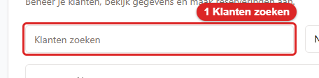
   *Het veld **Klanten zoeken** (1), van dichtbij. Klik erin en typ.*
3. Wil je de lijst anders sorteren? Gebruik dan het keuzelijstje ernaast. Je kunt kiezen uit
   **Naam (A-Z)**, **Naam (Z-A)**, **Nieuwste eerst**, **Oudste eerst**, **Meeste verhuur**,
   **Recente activiteit** of **Actieve verhuur**.
4. Wil je alleen een bepaald soort klanten zien? Klik dan op **Filters**. Je ziet nu het vakje
   **Klanten filteren**. Daarin staan onder andere **Recente klanten (30 dagen)**, **Frequente klanten
   (3+ reserveringen)**, **Volledig profiel**, **Onvolledig profiel**, **Actieve verhuur**,
   **Heeft chauffeurs**, **Zakelijk** en **Particulier**. Met **Filters wissen** zet je alle filters
   weer uit.

   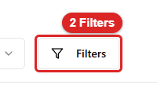
   *Zo ziet de knop **Filters** eruit. Klik erop. Daarna zie je het vakje Klanten filteren.*

De tabel heeft de kolommen **Naam**, **E-mail**, **Telefoon** en **Plaats**. Achter elke regel
staan de knoppen **Bekijken**, **Nieuwe reservering** en **Verwijderen**. Een leeg veld toont een
streepje. Soms staat er onder het e-mailadres een blauw label **Portaal (1)**. Het getal zegt
hoeveel portaalaccounts deze klant heeft (3.7).

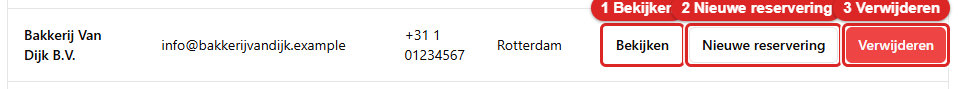
*Eén regel uit de lijst, van dichtbij. 1 **Bekijken** opent de klant. 2 **Nieuwe reservering** maakt
meteen een boeking voor deze klant. 3 **Verwijderen** zet de klant in de prullenbak.*

Onderaan staat hoeveel regels je ziet, bijvoorbeeld *1-10 van 300 getoond*. Daarnaast staan de
knoppen **Vorige** en **Volgende**. Ernaast staat *Pagina 1 van 30* met een invulveld **Pagina**.
Typ daar een paginanummer en druk op Enter. Je springt dan meteen naar die pagina. Typ je een
nummer dat niet bestaat? Dan kom je op de laatste of de eerste pagina uit.

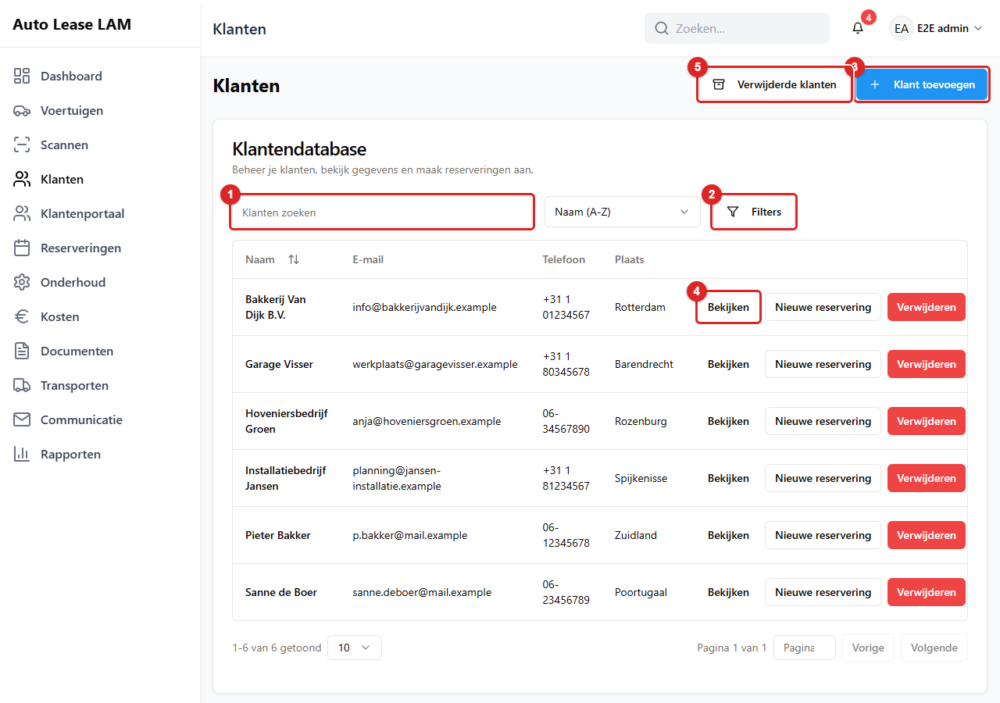
*De **Klantendatabase**: 1 het zoekveld **Klanten zoeken**, 2 **Filters**, 3 **Klant toevoegen**,
4 **Bekijken** achter een regel (een klik ergens op de regel werkt ook), 5 **Verwijderde klanten**,
de prullenbak van dit scherm.*

**Sneller:** het zoekveld bovenin het scherm (hoofdstuk 1, paragraaf 1.3) zoekt in klanten,
voertuigen en reserveringen tegelijk. Zoek je alleen een klant? Dan is de klantenlijst
overzichtelijker.

---

## 3.2 Een klant bekijken

Klik bij de juiste regel op **Bekijken**. Je kunt ook ergens op de regel zelf klikken. Je ziet nu
het venster **Klantgegevens**. De ondertitel is *Bekijk klantinformatie en reserveringsgeschiedenis*.

Bovenin staan de naam en de regel *Klant sinds <datum>*. Daar staan ook de knoppen **Terug**,
**Bewerken** en **Nieuwe reservering**. Daaronder staan vier tegels: **Totaal aantal verhuringen**,
**Actieve verhuringen**, **Voltooid** en **Totaal aantal km gereden**. Een tegel is een vakje met
een getal erin.

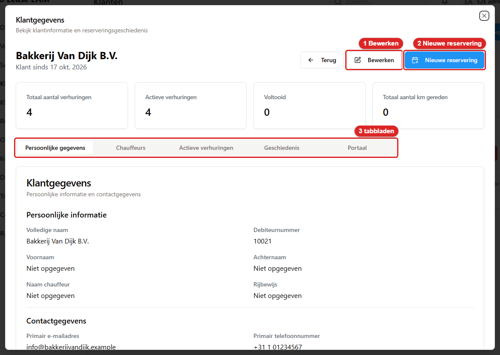
*Het venster **Klantgegevens**: 1 **Bewerken**, 2 **Nieuwe reservering**, 3 de tabbladen. Het tabblad
**Persoonlijke gegevens** staat open. Scrol naar beneden voor de rest van de gegevens en het blok
**Geblokkeerde voertuigen**.*

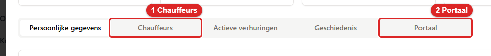
*De tabbladen van dichtbij. Klik op **Chauffeurs** (1) voor de chauffeurs van deze klant. Klik op
**Portaal** (2) voor het klantenportaal.*

Daaronder staan vijf tabbladen. Een tabblad is een knop bovenaan die een ander deel van het venster
laat zien. Het tabblad **Portaal** zie je alleen als je het recht **Klantportaal bekijken** of
**Klantportaal beheren** hebt.

| Tabblad | Wat je er ziet |
|---|---|
| **Persoonlijke gegevens** | Alle vastgelegde gegevens: persoonlijke informatie, contactgegevens, adres, bedrijfsgegevens en de recordgegevens (wie de klant aanmaakte en wanneer) |
| **Chauffeurs** | De bevoegde chauffeurs van deze klant, zie 3.6 |
| **Actieve verhuringen** | Wat er nu loopt |
| **Geschiedenis** | De afgeronde verhuringen, met de knop **Exporteren (CSV)** |
| **Portaal** | Het klantenportaal van deze klant, zie 3.7 |

Wat niet is ingevuld, staat er als **Niet opgegeven**. Dat is geen fout. Het betekent alleen dat
het veld leeg is. Vul het aan zodra je het weet. Wat leeg is op de klantkaart, blijft ook leeg op
het contract (hoofdstuk 8).

### Eigen risico van deze klant

Op het tabblad **Persoonlijke gegevens** staat de kaart **Eigen risico**. Er zijn twee regels:
**Auto** en **Bus**. Per regel staat een vak **Binnenland (€)** en een vak **Buitenland (€)**.

- Laat je een vak leeg? Dan geldt het algemene bedrag. In het lege vak staat welk bedrag dat is.
  Bijvoorbeeld *algemeen 750*.
- Heeft deze klant een ander bedrag? Typ het in het vak. Klik op **Opslaan**.
- Of een auto een bus is, staat op de voertuigkaart bij **Eigen risico** (hoofdstuk 4).
- Het contract pakt zelf het bedrag van de goede regel. Huurt de klant een bus? Dan komt het
  busbedrag op het contract. Anders het autobedrag.
- Bij het ophalen zie je het bedrag nog een keer. Daar kun je het voor die ene huur aanpassen
  (hoofdstuk 5).

Stonden er bij een klant al bedragen per voertuigsoort? Die zijn niet weg. De app zet ze bij
**Auto** of **Bus**. Hadden twee soorten in één regel een ander bedrag? Dan staat het hoogste bedrag
er. Kijk het na en klik op **Opslaan**.

### Geblokkeerde voertuigen: een auto blokkeren voor deze klant

Onderaan het tabblad **Persoonlijke gegevens** staat het blok **Geblokkeerde voertuigen**. Daarbij
staat *Voertuigen die deze klant niet mag huren*. Soms staat er *Deze klant is niet geblokkeerd voor
enig voertuig.* met eronder *Ze kunnen alle beschikbare voertuigen huren.* Dan mag de klant alles
huren. Een geblokkeerde auto staat hier met het kenteken en de **Reden**. Je ziet ook wie de
blokkade toevoegde en wanneer. In het boekingsvenster staat zo'n auto voor deze klant niet meer in
de keuzelijst (hoofdstuk 5, paragraaf 5.3).

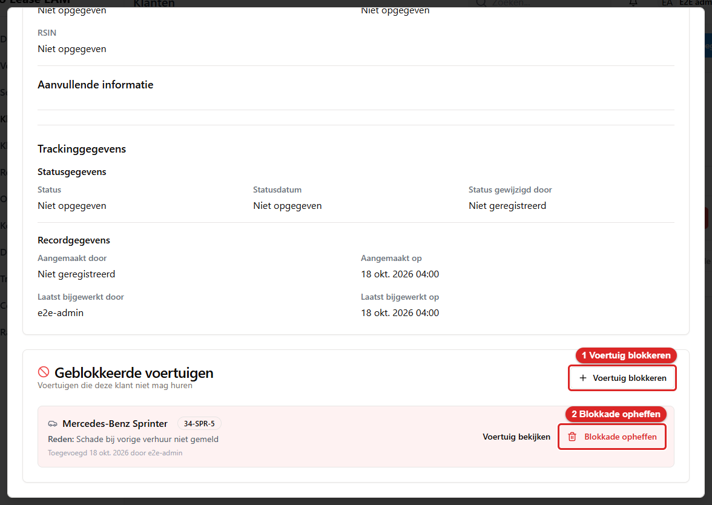
*Het blok **Geblokkeerde voertuigen**: 1 **Voertuig blokkeren**, 2 **Blokkade opheffen** achter een
bestaande blokkade.*

**Een auto blokkeren**

1. Open de klant met **Bekijken**. Scrol op het tabblad **Persoonlijke gegevens** naar beneden tot
   **Geblokkeerde voertuigen**.

   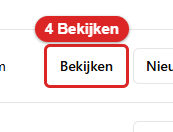
   *Zo ziet de knop **Bekijken** eruit. Klik erop. Daarna zie je het venster Klantgegevens.*
2. Klik op **Voertuig blokkeren**.

   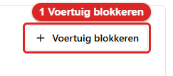
   *De knop **Voertuig blokkeren** (1), van dichtbij.*

   Je ziet nu het venster **Voertuig blokkeren voor deze klant**.
   Daarin staat *Kies een voertuig dat <naam> niet mag huren.*
3. Klik op **Voertuig**. Zoek de auto op kenteken, merk of model. In het veld staat *Zoek op
   kenteken, merk of model...*. Auto's die al geblokkeerd zijn voor deze klant staan niet in de lijst.

   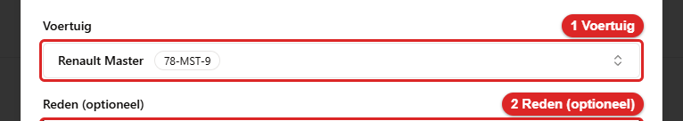
   *Zo ziet het veld **Voertuig** eruit. Klik erop en zoek de auto op kenteken, merk of model.*
4. Vul eventueel **Reden (optioneel)** in. Daarbij staat *Waarom mag deze klant dit voertuig niet
   huren?* Die reden ziet elke collega die de klant of de auto opent.

   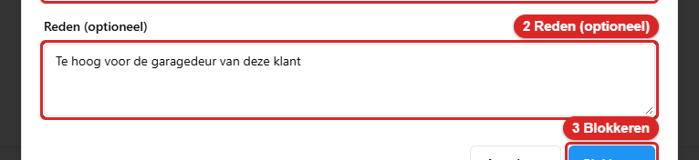
   *Zo ziet het veld **Reden (optioneel)** eruit. Typ hier waarom deze klant de auto niet mag huren.*
5. Klik op **Blokkeren**.

   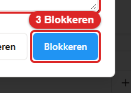
   *Zo ziet de knop **Blokkeren** eruit. Hij wordt pas klikbaar als je een auto hebt gekozen.*

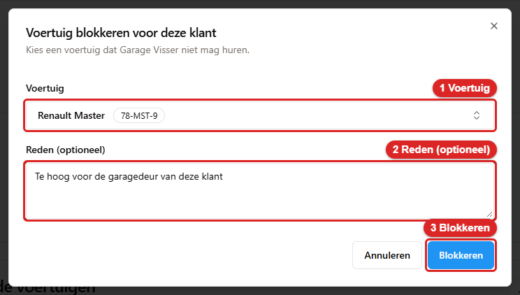
*Het venster **Voertuig blokkeren voor deze klant**: 1 kies het **Voertuig**, 2 vul de **Reden** in,
3 klik op **Blokkeren**.*

Je ziet nu de melding **Voertuig geblokkeerd**. De auto staat meteen in het blok. Staat de auto er
al? Dan weigert de app met een rode melding.

**Een blokkade opheffen.** Klik achter de blokkade op **Blokkade opheffen**. De app vraagt
**Blokkade opheffen?** Daarbij staat *<voertuig> (<kenteken>) wordt vrijgegeven; deze klant kan het
voertuig daarna weer huren.* Bevestig met **Blokkade opheffen**. Of kies **Annuleren**.

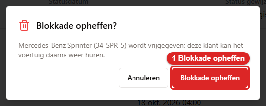
*De bevestiging **Blokkade opheffen?**: pas na een klik op **Blokkade opheffen** (1) is de blokkade weg.*

Beide knoppen werken alleen als je het recht **Klanten beheren** of **Voertuigen beheren** hebt.
Zonder dat vinkje staan de knoppen er grijs. Je kunt hetzelfde ook vanaf de andere kant doen. Op de
voertuigkaart heet het blok **Klant zwarte lijst**. Daar staat de knop **Toevoegen aan zwarte lijst**
(hoofdstuk 4). Het is dezelfde lijst. Wat je aan de ene kant doet, zie je meteen aan de andere kant.

Sluit het venster met **Sluiten** of **Terug**.

---

## 3.3 Een nieuwe klant aanmaken

1. Klik links op **Klanten**.
2. Klik rechtsboven op **Klant toevoegen**. Je ziet nu het venster **Nieuwe klant toevoegen**.

   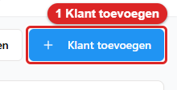
   *De blauwe knop **Klant toevoegen** (1) staat rechtsboven op het scherm **Klanten**.*
3. Boven de tabbladen staat een kort blokje. Het legt uit wat je minimaal nodig hebt. Alleen de naam
   is verplicht. Voor een reservering heb je ook een telefoonnummer en een e-mailadres nodig. Voor
   het contract (pdf) heb je ook adres, postcode, plaats, bedrijfsnaam en rijbewijsnummer nodig.
   Vul het tabblad **Basisgegevens** in:
   - **Klanttype**: kies **Zakelijk** of **Particulier**. Standaard staat hij op **Zakelijk**.
   - **Debiteurnummer**: het nummer waaronder de boekhouding deze klant kent.
   - **Volledige naam**: het enige veld dat echt verplicht is.
   - **Voornaam**, **Achternaam**, **Naam chauffeur**, **Rijbewijsnummer**.
   - Onder **Adresgegevens**: begin met **Postcode** en **Huisnummer**. Vul zo nodig ook
     **Toevoeging** in. Zijn die compleet? Dan vult de app **Straatnaam**, **Straatadres** en
     **Plaats** zelf in (zie hieronder, *Postcode en huisnummer*). Daarna staat nog **Land**. Dat
     staat al op *Nederland*.

   
   *Het tabblad **Basisgegevens**: 1 **Klanttype**, 2 **Volledige naam**, 3 **Postcode** en 4
   **Huisnummer** (de app vult straat en plaats in), 5 het tabblad **Contact** voor de volgende stap.*

   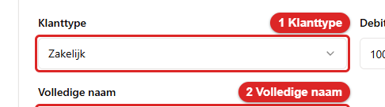
   *Zo ziet het veld **Klanttype** eruit. Kies Zakelijk of Particulier.*

   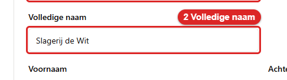
   *Zo ziet het veld **Volledige naam** eruit. Dit veld is verplicht. Typ hier de naam.*

   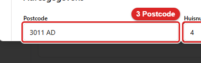
   *Zo ziet het veld **Postcode** eruit. Typ hier de postcode.*

   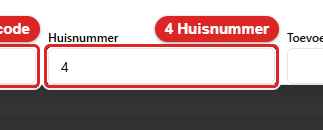
   *Zo ziet het veld **Huisnummer** eruit. Typ hier het huisnummer. Daarna vult de app straat en plaats in.*
4. Ga naar het tabblad **Contact**. Vul minstens **Primair e-mailadres** en **Primair
   telefoonnummer** in. Doe dit meteen. Zonder e-mailadres kun je deze klant later geen contract
   sturen. Je kunt dan ook geen herinnering sturen. Verder kun je hier een apart **E-mailadres voor
   APK-keuring**, **E-mailadres voor facturen**, **Algemeen e-mailadres** en **Telefoonnummer
   chauffeur** invullen.

   
   *Het tabblad **Contact**: 1 **Primair e-mailadres**, 2 **Primair telefoonnummer**, 3 het tabblad
   **Bedrijf**.*

   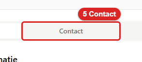
   *Zo ziet het tabblad **Contact** eruit. Klik erop. Daarna zie je de contactvelden.*

   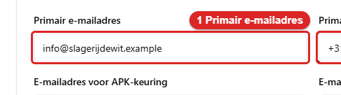
   *Zo ziet het veld **Primair e-mailadres** eruit. Typ hier het e-mailadres van de klant.*

   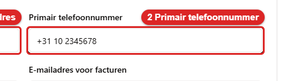
   *Zo ziet het veld **Primair telefoonnummer** eruit. Typ hier het telefoonnummer van de klant.*
5. Is het een bedrijf? Vul dan het tabblad **Bedrijf** in. Daar staan **Bedrijfsnaam**,
   **Contactpersoon**, **Kamer van Koophandel nummer (KvK)**, **BTW-nummer**, **RSIN**, het
   **Facturatiecontact**, de **Accountmanager** en de **Zakelijke korting (%)**. Is het
   factuuradres anders dan het gewone adres? Vul dan ook **Facturatieadres** in.

   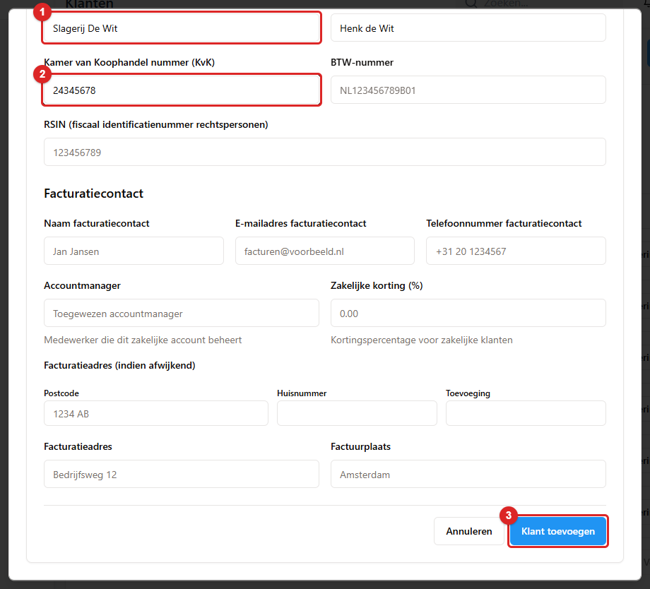
   *Het tabblad **Bedrijf**: 1 **Bedrijfsnaam**, 2 **Kamer van Koophandel nummer (KvK)**, 3 de knop
   **Klant toevoegen** onderaan.*

   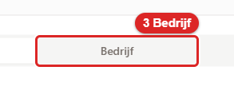
   *Zo ziet het tabblad **Bedrijf** eruit. Klik erop. Daarna zie je de bedrijfsvelden.*

   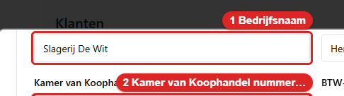
   *Zo ziet het veld **Bedrijfsnaam** eruit. Typ hier de naam van het bedrijf.*

   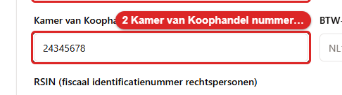
   *Zo ziet het veld **Kamer van Koophandel nummer (KvK)** eruit. Typ hier het KvK-nummer.*
6. Op het tabblad **Aanvullend** vul je **Status**, **Statusdatum** en **Notities** in.
7. Klik onderaan op **Klant toevoegen**.

   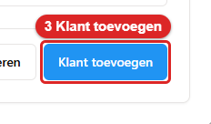
   *Zo ziet de knop **Klant toevoegen** onderaan het venster eruit.*

Je ziet nu de melding **Klant succesvol aangemaakt**. Daarbij staat *De klant is toegevoegd aan je
systeem.*

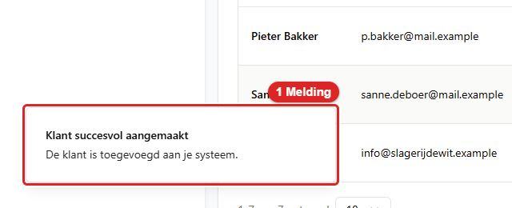
*De melding linksonder na het opslaan (1). Zo'n melding verdwijnt na een paar seconden vanzelf.*

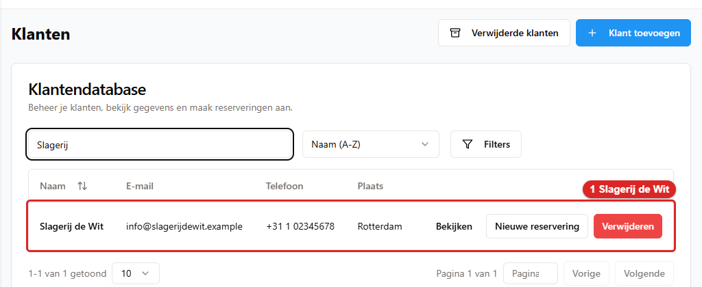
*Dit zie je daarna: de nieuwe klant staat in de **Klantendatabase** (1). Typ de naam in het zoekveld
en je vindt hem meteen.*

### Postcode en huisnummer

Bij een Nederlands adres zoekt de app de straat en de plaats voor je op. Dat doet de app in het
adresregister van het Kadaster (BAG, via PDOK). Typ de **Postcode** en het **Huisnummer**.
Hoofdletters en een spatie in de postcode maken niet uit. Na een kort moment staat onder de velden
*Adres gevonden: straat en plaats zijn ingevuld.* De velden **Straatnaam**, **Straatadres** en
**Plaats** zijn dan ingevuld. In **Straatadres** staat ook het nummer, bijvoorbeeld *Coolsingel 4A*.
De postcode krijgt zelf de spatie (*3011 AD*).

- Een letter hoort bij het huisnummer. Typ je *12a* in het veld **Huisnummer**? Dan komt de *A*
  vanzelf in **Toevoeging**.
- Alles blijft aan te passen. Wat de app invulde, kun je gewoon overschrijven.
- Vindt de app het adres niet? Dan staat er *We vinden dit adres niet. Controleer de postcode en het
  huisnummer, of vul straat en plaats zelf in.* Vul het adres dan met de hand in. Soms kent de app
  alleen de toevoeging niet. Dan staan straat en plaats er wel. De melding vraagt dan om het
  huisnummer te controleren.
- Werkt het opzoeken even niet? Dan zegt de app dat ook. Het formulier blijft gewoon bruikbaar.
- Bij een ander land dan Nederland zoekt de app niets op. Een bestaand adres dat je opent, verandert
  de app nooit vanzelf. De app zoekt alleen als jij de postcode of het huisnummer wijzigt.
- Hetzelfde geldt bij **Facturatieadres** op het tabblad **Bedrijf**. Het geldt ook in het
  klantenportaal (zie 3.7).

**Twee dingen om te weten:**

- Typ je een naam helemaal in kleine letters? Dan maakt de app van elk woord de eerste letter een
  hoofdletter. Typ je *jan van der berg*, dan staat er *Jan van der Berg*. De woorden *van*, *de*,
  *der*, *den*, *het*, *ten* en *ter* blijven klein. Heb je zelf al een hoofdletter midden in een
  woord gezet? Of een punt in een woord? Dan laat de app dat woord staan zoals je het typte.
  *DHL Express B.V.*, *ABN AMRO* en *AUDIT Testklant B.V.* blijven dus precies zo staan. Typ je een
  naam helemaal in hoofdletters? Dan blijft die ook zo. De app maakt er niets kleiner van.
- Vul je de naam niet in, of te kort? Dan verschijnt onder het veld de melding *De naam moet
  minimaal 2 tekens bevatten*.
- De voorbeelden in de lege velden zijn Nederlands, bijvoorbeeld *Jan Jansen*, *Hoofdstraat 1*,
  *jan.jansen@voorbeeld.nl* en *Voorbeeld Transport B.V.* Het zijn alleen voorbeelden. Ze worden
  niet opgeslagen.
- Sluit je het venster terwijl je al iets hebt getypt? Dan vraagt de app **Wijzigingen
  verwerpen?** Daarbij staat *Je hebt wijzigingen gemaakt die nog niet zijn opgeslagen. Als je sluit,
  gaan ze verloren.* Met **Verder bewerken** blijf je in het formulier. Met **Verwerpen** sluit je
  het. Dat geldt ook bij **Klant bewerken**.

---

## 3.4 De waarschuwing "Deze klant bestaat mogelijk al"

Typ je op het tabblad **Contact** een e-mailadres of telefoonnummer dat al bij een andere klant
staat? Dan verschijnt er direct onder dat veld een oranje kader:

> **Deze klant bestaat mogelijk al**
> *<naam> — zelfde e-mailadres*
> *Je kunt gewoon doorgaan; dit is een waarschuwing, geen blokkade.*

Staat de klant er al op met **zelfde telefoonnummer**? Of met **zelfde e-mailadres +
telefoonnummer**? Dan zie je dat er ook bij.

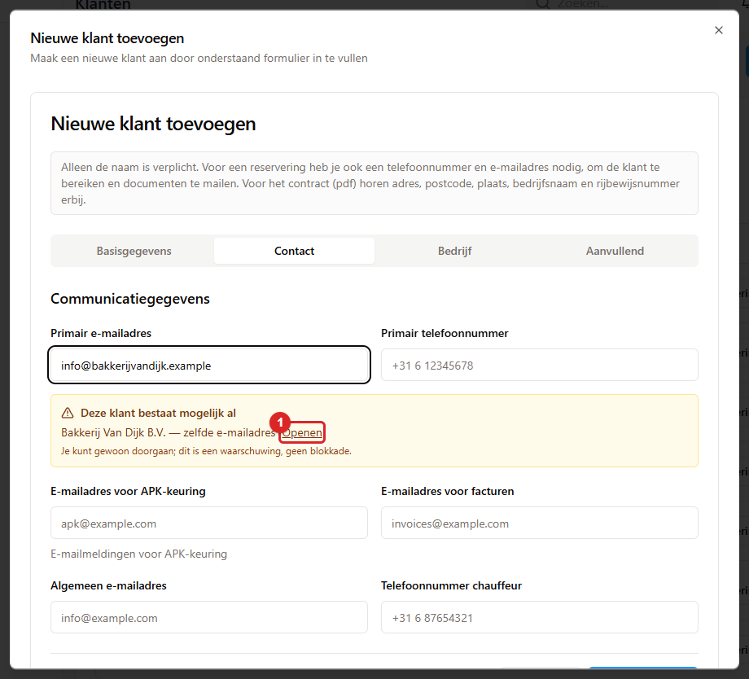
*De waarschuwing onder het veld: klik op **Openen** (1) om de bestaande klant te bekijken.*

**Wat je doet:** klik op **Openen** naast de naam. Je opent dan de klant die er al is. Gebruik die
klant. Sluit het formulier dat je aan het invullen was.

De app blokkeert niet. Dat is met opzet. Twee chauffeurs van hetzelfde bedrijf mogen best
hetzelfde telefoonnummer hebben. Maar staat één klant twee keer in het systeem? Dan raken zijn
huren verdeeld over twee kaarten. Je ziet zijn geschiedenis dan nooit meer in één keer. Neem de
waarschuwing dus serieus.

De waarschuwing verschijnt pas als het e-mailadres een `@` bevat. Bij een telefoonnummer verschijnt
hij pas bij minstens acht cijfers. Er zit ook een kleine vertraging in. Dat is normaal.

---

## 3.5 Een klant bijwerken

1. Open de klant met **Bekijken**. Klik op **Bewerken**. Je kunt ook het potloodje in de lijst
   gebruiken.

   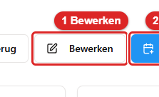
   *Zo ziet de knop **Bewerken** eruit. Klik erop. Daarna zie je het venster Klant bewerken.*
2. Je ziet nu het venster **Klant bewerken**. Daarbij staat *Werk klantinformatie en gegevens bij*.
   Het is hetzelfde formulier als bij het aanmaken. Het heeft dezelfde vier tabbladen.

   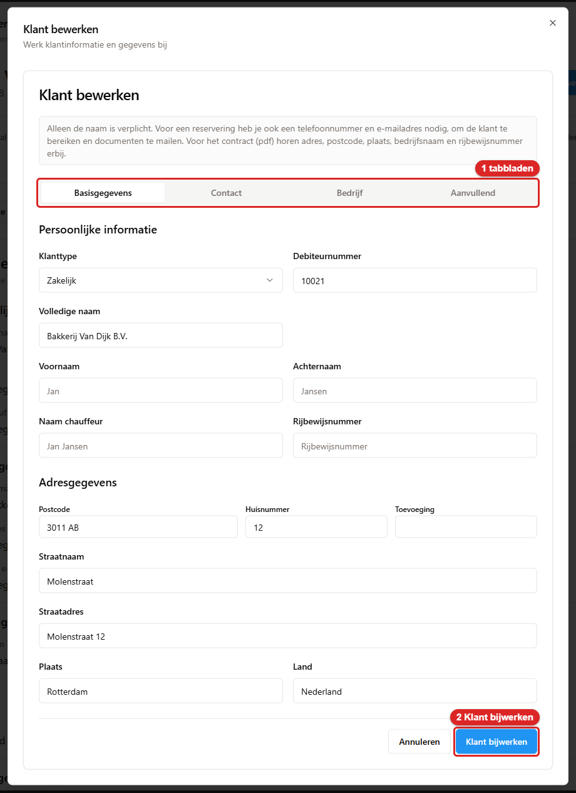
   *Het venster **Klant bewerken**: 1 de vier tabbladen bovenaan, 2 **Klant bijwerken** onderaan.*
3. Wijzig wat nodig is. Klik onderaan op **Klant bijwerken**.

   
   *Zo ziet de knop **Klant bijwerken** eruit. Klik erop. Daarna zie je de melding Klant succesvol bijgewerkt.*

Je ziet nu de melding **Klant succesvol bijgewerkt**. Daarbij staat *De klant is bijgewerkt in je
systeem.*

Wat je verandert, staat daarna in de geschiedenis van de klant. Je ziet wie het deed en wanneer. Je
ziet ook de oude en de nieuwe waarde.

> **Let op:** een lopend contract verandert niet mee. Wijzig je het adres of de naam van een
> klant nadat het contract gemaakt is, genereer het contract dan opnieuw (hoofdstuk 8).

---

## 3.6 Chauffeurs

Een chauffeur is de persoon die namens de klant mag rijden. Je koppelt hem aan de klant. Bij het
maken van een reservering kun je hem als **Gemachtigde chauffeur** aanwijzen (hoofdstuk 5). Zo weet
je achteraf wie de auto echt had.

**Een chauffeur toevoegen**

1. Open de klant met **Bekijken**.

   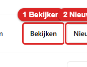
   *Zo ziet de knop **Bekijken** eruit. Klik erop. Daarna zie je het venster Klantgegevens.*
2. Klik op het tabblad **Chauffeurs**. Je ziet het kaartje **Bevoegde chauffeurs**. Daarbij staat
   *Beheer chauffeurs die voertuigen mogen huren voor deze klant*.

   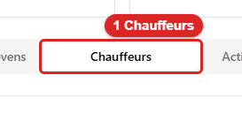
   *Zo ziet het tabblad **Chauffeurs** eruit. Klik erop. Daarna zie je het kaartje Bevoegde chauffeurs.*
3. Klik rechtsboven in dat kaartje op **Chauffeur toevoegen**.

   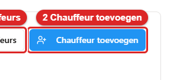
   *Zo ziet de knop **Chauffeur toevoegen** eruit. Klik erop. Daarna zie je het venster Chauffeur toevoegen.*

   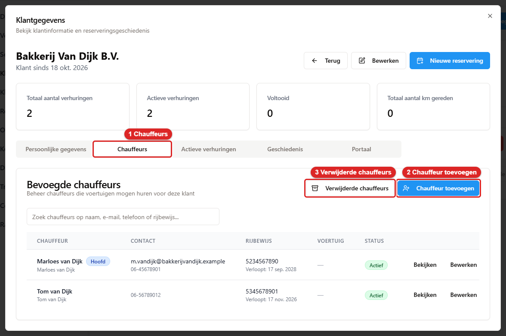
   *Het tabblad **Chauffeurs** (1): 2 **Chauffeur toevoegen**, 3 **Verwijderde chauffeurs** (de prullenbak
   van deze klant). In de lijst staat de hoofdchauffeur met het label **Hoofd**.*
4. Je ziet nu het venster **Chauffeur toevoegen**. Vul minstens **Weergavenaam** in. Dat is het
   enige verplichte veld. Er staat een sterretje bij. Verder kun je invullen: **Voornaam**,
   **Achternaam**, **E-mailadres**, **Telefoonnummer**, **Rijbewijsnummer**, **Land van afgifte
   rijbewijs**, **Vervaldatum rijbewijs**, een **Kopie rijbewijs (optioneel)** (JPG, PNG of PDF,
   maximaal 10 MB), **Voorkeurstaal**, **Status** (**Actief** of **Inactief**) en **Notities**.
5. Is dit de vaste bestuurder van deze klant? Zet dan **Hoofdchauffeur** aan.
6. Klik op **Chauffeur toevoegen**.

   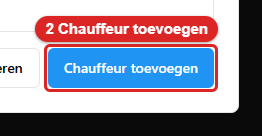
   *Zo ziet de knop **Chauffeur toevoegen** onderaan het venster eruit. Klik erop. Daarna zie je de melding Chauffeur toegevoegd.*

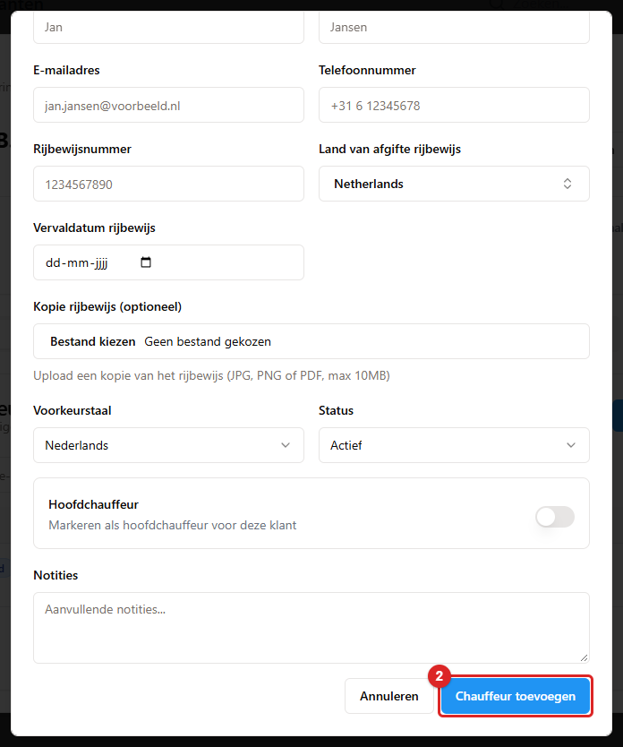
*Het venster **Chauffeur toevoegen**: 1 het verplichte veld **Weergavenaam** bovenaan, 2 **Chauffeur
toevoegen** onderaan.*

Je ziet nu de melding **Chauffeur toegevoegd**. Daarbij staat *De chauffeur is succesvol toegevoegd.*

Vul de **Vervaldatum rijbewijs** in als je die weet. In de lijst krijgt de chauffeur dan het label
**Verloopt: <datum>**. Na die datum wordt dat **Verlopen**. Dit is de enige plek waar je ziet dat
een rijbewijs afloopt.

**Een chauffeur bekijken, wijzigen of verwijderen.** In de lijst staan per regel de kolommen
**Chauffeur**, **Contact**, **Rijbewijs**, **Voertuig**, **Status** en **Acties**. Daar staan de
knoppen **Bekijken**, **Bewerken** en **Verwijderen**. De hoofdchauffeur heeft het label **Hoofd**.
Een chauffeur met een eigen portaallogin heeft het label **Portaalaccount**. Onderaan het venster
van een chauffeur staat **Geschiedenis**. Daar zie je wie wat wanneer aan deze chauffeur heeft
gewijzigd (hoofdstuk 10, paragraaf 10.5).

Klik je op **Verwijderen**? Dan vraagt de app: *Weet je zeker dat je <naam> wilt verwijderen? De
chauffeur gaat naar de prullenbak van deze klant; terugzetten kan via Prullenbak.* Een verwijderde
chauffeur is dus niet weg. Hij staat in de prullenbak van deze klant. Je kunt hem terugzetten.
Twijfel je of je hem ooit nog nodig hebt? Zet hem dan op **Inactief**. Verwijder hem dan niet.

**De prullenbak van de chauffeurs.** In de kop van het kaartje **Bevoegde chauffeurs** staat de knop
**Verwijderde chauffeurs**. Die laat alleen de verwijderde chauffeurs van deze klant zien. De knop
staat er grijs als je het vinkje **Prullenbak beheren** niet hebt (hoofdstuk 15, paragraaf 15.16).
Per regel kun je kiezen:

- **Terugzetten**: de chauffeur komt terug. De koppelingen aan reserveringen en bekeuringen komen
  ook terug. Dat lukt alleen als die reserveringen en bekeuringen nog bestaan. Bestaat de klant zelf
  niet meer? Dan weigert de app met *De klant van deze chauffeur bestaat niet meer. Zet eerst de
  klant terug (Klanten, Verwijderde klanten) en daarna de chauffeur.* Zet de klant dan eerst terug
  (3.8).
- **Definitief verwijderen**: de chauffeur is dan echt weg. De kopie van het rijbewijs is dan ook
  weg. Reserveringen en bekeuringen die naar hem verwezen, krijgen die koppeling nooit meer terug.

> **Let op bij een verzoek om gegevens te wissen.** De persoonsgegevens van een verwijderde chauffeur
> (naam, contactgegevens, rijbewijsnummer en de kopie van het rijbewijs) blijven in de prullenbak staan
> tot die geleegd is. Vraagt iemand om zijn gegevens te laten wissen, verwijder de chauffeur dan niet
> alleen, maar kies ook **Definitief verwijderen** in **Verwijderde chauffeurs**. Alles over de
> prullenbakken staat in hoofdstuk 10, paragraaf 10.6.

Staan er veel chauffeurs? Gebruik dan het zoekveld boven de lijst. Daarin staat *Zoek chauffeurs op
naam, e-mail, telefoon of rijbewijs...*. Onder de lijst staat bijvoorbeeld *Pagina 1 van 2
(12 chauffeurs)*. Daar staan ook **Vorige** en **Volgende**.

---

## 3.7 Het portaalaccount van een klant

Via het klantenportaal kan een klant zelf online meekijken en aanvragen doen. Het klantenportaal is
een aparte website voor klanten. Je regelt dat per klant op het tabblad **Portaal**.

Het tabblad bestaat van boven naar beneden uit: **Portaalaccounts**, **Instellingen voor deze
klant**, **Aanvragen**, **Bekeuringen** en **Activiteit in het portaal**.

### Iemand uitnodigen

1. Open de klant met **Bekijken**. Ga naar het tabblad **Portaal**.

   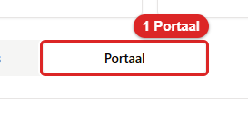
   *Zo ziet het tabblad **Portaal** eruit. Klik erop. Daarna zie je bovenaan Portaalaccounts.*
2. Staat er nog niets? Dan lees je *Nog geen accounts. Nodig een contactpersoon uit.*

   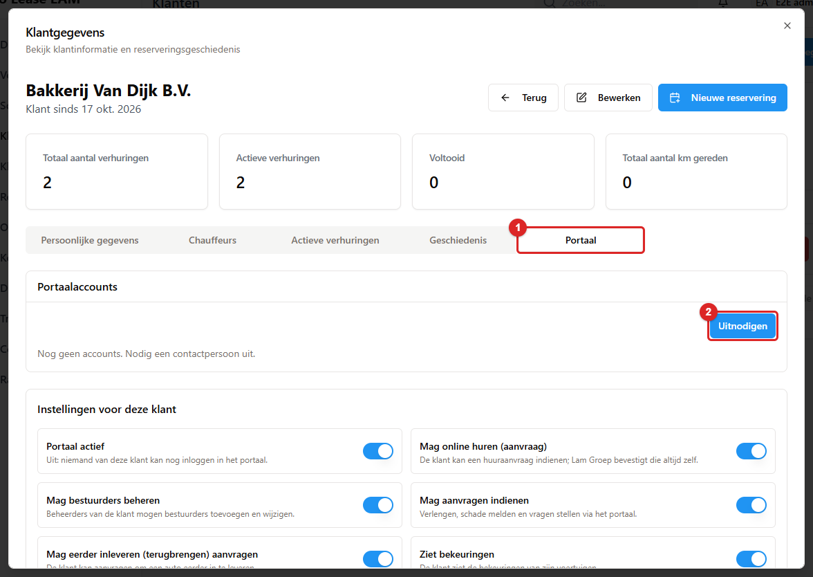
   *Het tabblad **Portaal** (1): bovenaan **Portaalaccounts** met de knop **Uitnodigen** (2), daaronder
   **Instellingen voor deze klant**.*
3. Klik op **Uitnodigen**. Je ziet nu het venster **Portaalaccount**.

   
   *Het venster **Portaalaccount**: 1 het **E-mailadres** staat al ingevuld, 2 **Uitnodigen** verstuurt de
   uitnodiging.*

   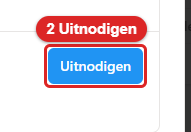
   *Zo ziet de knop **Uitnodigen** eruit. Klik erop. Daarna zie je het venster Portaalaccount.*
4. Het **E-mailadres** is alvast ingevuld vanuit de klantgegevens. Er staat bij: *Vooraf ingevuld
   vanuit de klantgegevens; aanpassen mag.* Controleer het adres. De uitnodiging gaat daarheen.

   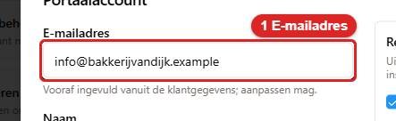
   *Zo ziet het veld **E-mailadres** eruit. Het staat al ingevuld. Controleer het adres.*
5. Vul de **Naam** in. Kies de **Rol**. **Beheerder** mag alles wat de klant mag. **Bestuurder** is
   één chauffeur. Kies je **Bestuurder**? Dan moet je ook een **Gekoppelde bestuurder** aanwijzen.
6. Onder **Rechten voor dit account** kun je per onderdeel een vinkje weghalen. Er staat bij:
   *Uitvinken haalt een onderdeel weg voor dit account. De instellingen van de klant blijven de
   bovengrens.* Je kunt dus nooit meer geven dan de klant zelf mag (zie hieronder).
7. Klik op **Uitnodigen**.

   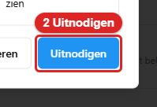
   *Zo ziet de knop **Uitnodigen** onderaan het venster eruit.*

De klant krijgt een uitnodiging per e-mail. In de tabel staat de regel daarna met de status
**Uitnodiging open**.

### De accountlijst lezen

De tabel heeft de kolommen **Naam**, **E-mail**, **Rol**, **Status** en **Laatste login**. Dit zijn
de statussen die je tegenkomt:

| Status | Betekenis |
|---|---|
| **Uitnodiging open** | De uitnodiging is verstuurd. De klant heeft nog niets gedaan |
| **Niet geactiveerd** | Er is een account. Het is nog nooit gebruikt |
| **Actief** | De klant kan inloggen |
| **Geblokkeerd** | Het account is dichtgezet |

Achter een regel zit een klein menu. Daarin staan **Bewerken en rechten**, **Uitnodiging opnieuw
sturen**, **Wachtwoord-reset sturen**, **Blokkeren** / **Deblokkeren** en **Verwijderen**.
**Uitnodiging opnieuw sturen** zie je alleen zolang het account niet geactiveerd is.
**Wachtwoord-reset sturen** zie je alleen als het account wel geactiveerd is. **Verwijderen** zie je
alleen bij een account dat niet geactiveerd is.

Met **Alles bekijken en zoeken** open je de volledige accountlijst van alle klanten.

> **Wachtwoorden van portaalaccounts.** De wachtwoordregel van hoofdstuk 10 (10 tekens met hoofdletter,
> kleine letter en cijfer) geldt voor medewerkers van het kantoor, niet voor portaalaccounts. De klant
> kiest zelf een wachtwoord via de uitnodiging; daarvoor geldt een eigen, kortere regel (minimaal 10
> tekens, zonder eisen aan hoofdletters of cijfers). Jij zet dat wachtwoord nooit; je stuurt alleen een
> uitnodiging of een reset.

**De melding klopt nu met wat er gebeurde.** Stuur je een uitnodiging of een wachtwoord-reset? En
komt de mail niet uit de mailserver? Dan staat er in het rood *De e-mail is niet verstuurd. Controleer
de e-mailinstellingen en probeer het opnieuw.* Vroeger stond er dan toch **E-mail verstuurd.** Klik je
op **Blokkeren**? Dan vraagt de app eerst **Account blokkeren?** Daarbij staat *<naam> kan daarna niet
meer inloggen in het portaal. U kunt het account later weer deblokkeren.* Daarna zie je **Account
geblokkeerd.** (of **Account gedeblokkeerd.**). Klik je op **Verwijderen**? Dan vraagt de app in
hetzelfde soort venster **Account verwijderen?** Daarna zie je **Account verwijderd.** Bij een
geblokkeerd account staan **Uitnodiging opnieuw sturen** en **Wachtwoord-reset sturen** niet in het
menu.

### Wat deze klant online mag

Onder **Instellingen voor deze klant** zet je per onderdeel een schakelaar aan of uit:

**Portaal actief · Mag online huren (aanvraag) · Mag bestuurders beheren · Mag aanvragen
indienen · Mag eerder inleveren (terugbrengen) aanvragen · Ziet bekeuringen · Ziet contracten en
schadeformulieren · Ziet prijzen**

Daaronder is ruimte voor **Interne notities (wat heeft deze klant nodig?)**. Klik op **Opslaan**.
Je ziet nu *Instellingen opgeslagen.*

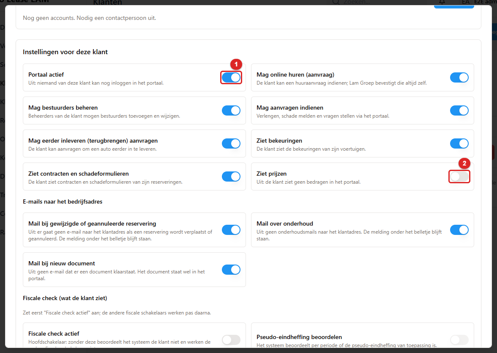
*De schakelaars onder **Instellingen voor deze klant**: 1 **Portaal actief** is de hoofdschakelaar,
2 **Ziet prijzen** staat hier uit. Deze klant ziet dus geen bedragen in het portaal.*

Onder elke schakelaar staat één regel die zegt wat hij doet. Bij **Portaal actief** staat
bijvoorbeeld: *Uit: niemand van deze klant kan nog inloggen in het portaal.* Zet je een schakelaar
om? Dan meldt de app welke schakelaar je hebt omgezet. Er staat dan blijvend *Opgeslagen om 14:32*.
De schakelaars van de fiscale check zijn grijs zolang de hoofdschakelaar uitstaat. Een regel eronder
legt dat uit.

Deze instellingen zijn de bovengrens. Staat **Ziet prijzen** hier uit? Dan ziet geen enkel account
van deze klant prijzen. Ook niet als dat vinkje bij het account zelf aanstaat.

### Bedrijfsgegevens die de klant zelf aanpast

In het portaal ziet een beheerder van de klant onder **Mijn account** → **Bedrijf** de gegevens die
jij van het bedrijf hebt. Dat zijn de contactpersoon, het telefoonnummer, het adres, het
factuuradres en de vier e-mailadressen. Die past de klant zelf aan. Ze staan dan meteen in het
klantrecord. Je krijgt een melding die in woorden zegt wat er is gewijzigd (bijvoorbeeld
*telefoonnummer, adres*). Slaat de klant op zonder iets te wijzigen? Dan krijg je geen melding. Het
KvK-nummer en het btw-nummer staan niet in het portaal. Die blijven van jou.

Wijzigt de klant een van de vier **e-mailadressen**? Dan vraagt het portaal om het wachtwoord van de
klant ter bevestiging. Die adressen bepalen namelijk waar facturen, bekeuringen en APK-berichten
naartoe gaan. Voor het adres en de contactgegevens is dat niet nodig.

De **bedrijfsnaam** kan de klant niet zelf wijzigen. Die staat namelijk op contracten en facturen.
De klant klikt op **Wijziging aanvragen**, vult de nieuwe naam in en verstuurt die. Dat komt bij jou
binnen als aanvraag **Wijziging bedrijfsnaam** in het overzicht van aanvragen. De gevraagde naam
staat bovenaan. Met **Goedkeuren** wordt de naam in het klantrecord aangepast. Is de korte naam van
de klant nog gelijk aan de oude bedrijfsnaam? Dan gaat die mee. Met **Afwijzen** (met een antwoord)
blijft alles zoals het was. **Afhandelen** zonder goedkeuren kan niet. Zo hoort de klant nooit dat
de naam is gewijzigd terwijl dat niet zo is. Per klant staat er maar één aanvraag tegelijk open.
Contracten en facturen die al gemaakt zijn, houden de oude naam. Dat blijft zo tot je ze opnieuw
aanmaakt.

Ook de klant vult zijn adres in met postcode en huisnummer. De straat en de plaats verschijnen dan
vanzelf, zoals hierboven beschreven. Dat geldt voor het adres en voor het factuuradres.

### Wat een bestuurder in het portaal ziet

Een account met de rol **Bestuurder** ziet alleen zijn eigen reserveringen, bekeuringen, aanvragen
en documenten. Het ziet niet de bestuurderslijst van het bedrijf. Daarin staan naam, telefoon,
e-mail en rijbewijsnummer van collega's. Onder het belletje krijgt het alleen meldingen over zijn
eigen auto. Meldingen over bekeuringen, documenten en aanvragen verschijnen alleen als die onderdelen
voor dat account aanstaan. Per klant staan maximaal 30 aanvragen tegelijk open. Daarna moet de klant
er eerst een laten afhandelen of intrekken.

### Ophalen en inleveren in het portaal

In elke reservering die loopt of nog moet beginnen, staat bovenaan een blok. Daarin staan twee
stappen onder elkaar: **Ophalen** en **Inleveren**. Elke stap zegt waar de auto wordt opgehaald of
ingeleverd. Wat al gebeurd is, staat in de verleden tijd met een vinkje en de datum (*Opgehaald bij
ons*, *Gebracht naar …*, *Opgehaald bij …*). Wat nog komt, staat in de toekomende tijd. De stap die
nu aan de beurt is, toont een telling (*Over 3 dagen*, *Morgen*, *Nog 8 dagen*) en de knoppen.

- **Bij ons aan de zaak:** de stap toont het adres van de zaak. Is de stap nog niet geweest? Dan
  staan ook de openingstijden erbij. Bij ophalen staan ook de ophaalinstructies erbij.
- **Gebracht of opgehaald op een locatie:** de stap noemt de plek in vet: *Wij brengen de auto naar
  …*, *Wij halen de auto bij u op …*, later *Gebracht naar …* en *Opgehaald bij …*. Het adres van de
  zaak staat er dan niet. De plek komt uit het reserveringsformulier (**Bezorgservice vereist** en
  **Ophaalservice bij inleveren**, zie hoofdstuk 5). Is er nog geen adres ingevuld? Dan staat er
  *een locatie die we met u afspreken*.
- **Bij elk inleveren** staan de inleverinstructies. Dat geldt ook als wij de auto ophalen. De klant
  moet de auto schoon en compleet inleveren. Anders brengen wij kosten in rekening. Haalt de klant de
  auto nog bij de zaak op, of levert hij daar in? Dan staat onder het blok de tekst dat brengen en
  ophalen kan, vanaf € 125.
- **Is de einddatum verstreken,** dan kleurt het blok rood met *x dagen te laat*. De knop
  **Verlengen** staat dan vooraan. **Eerder inleveren** vervalt dan.
- De knoppen **Verlengen** en **Eerder inleveren** staan bij de stap Inleveren. Je ziet ze alleen
  bij accounts die dat mogen.

De teksten **Inleverinstructies** en **Brengen en ophalen** pas je aan onder het portaalbeheer, bij
de instellingen van het portaal. Daar staan ook het adres, de openingstijden en de
ophaalinstructies.

### De APK laten inplannen in het portaal

De klant kan zelf de APK van een gehuurde auto laten inplannen. Dat kan alleen als:

- de auto is opgehaald (de huur loopt);
- de APK verlopen is, of binnen 45 dagen verloopt;
- die datum vóór het einde van de huur ligt. Een huur zonder einddatum telt ook.

Verloopt de APK pas na de huur? Dan ziet de klant wel de melding, maar niet de knop.

1. De klant opent de reservering. Bovenaan staat een oranje melding over de APK. Daarin staat de
   knop **APK inplannen**.

   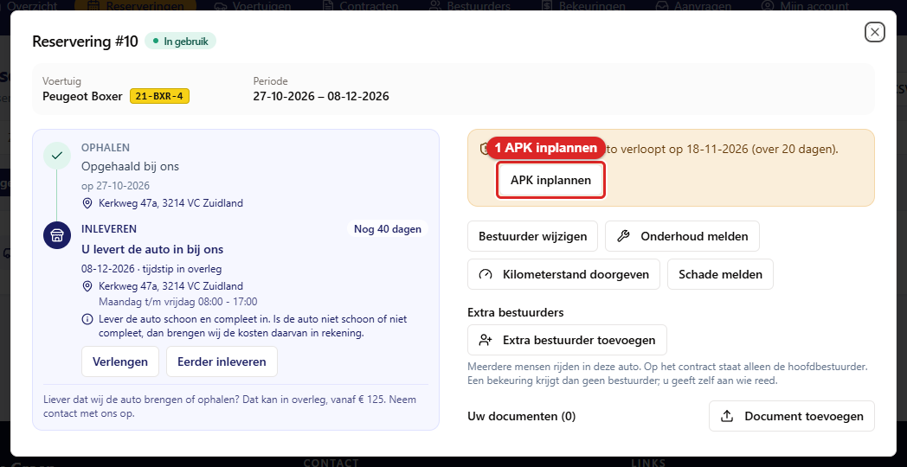
   *De reservering in het portaal. 1 is de knop **APK inplannen** in de APK-melding.*

   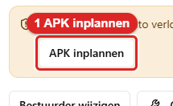
   *Zo ziet de knop **APK inplannen** eruit.*
2. Er opent een venster met twee keuzes: **Aanvraag doen** of **Zelf een afspraak maken**.

   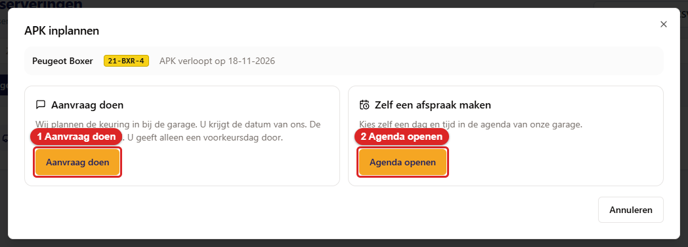
   *Het venster **APK inplannen**. 1 is **Aanvraag doen**. 2 is **Agenda openen**.*
3. Kiest de klant **Aanvraag doen**? Dan opent het aanvraagformulier. De auto staat al ingevuld. De
   klant kiest een **Voorkeursdag**. Dat mag ook leeg blijven. Daarna klikt hij op **Versturen**.

   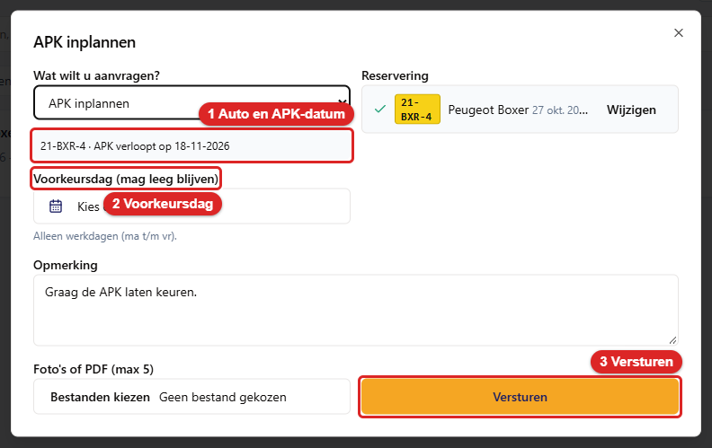
   *Het formulier. 1 is de auto met de APK-datum. 2 is **Voorkeursdag**. 3 is **Versturen**.*

   De aanvraag komt bij jou binnen als **APK inplannen**. Jij zet de afspraak in de planner van de
   garage. Daarna antwoord je de klant met de datum. Zie hoofdstuk 20.2.
4. Kiest de klant **Agenda openen**? Dan opent de online agenda van de garage in het venster. Links
   staat wat de klant moet doen: in de agenda alleen **APK** aanvinken. Daaronder staan het kenteken
   en merk en model. Met het knopje ernaast kopieert de klant het kenteken.

   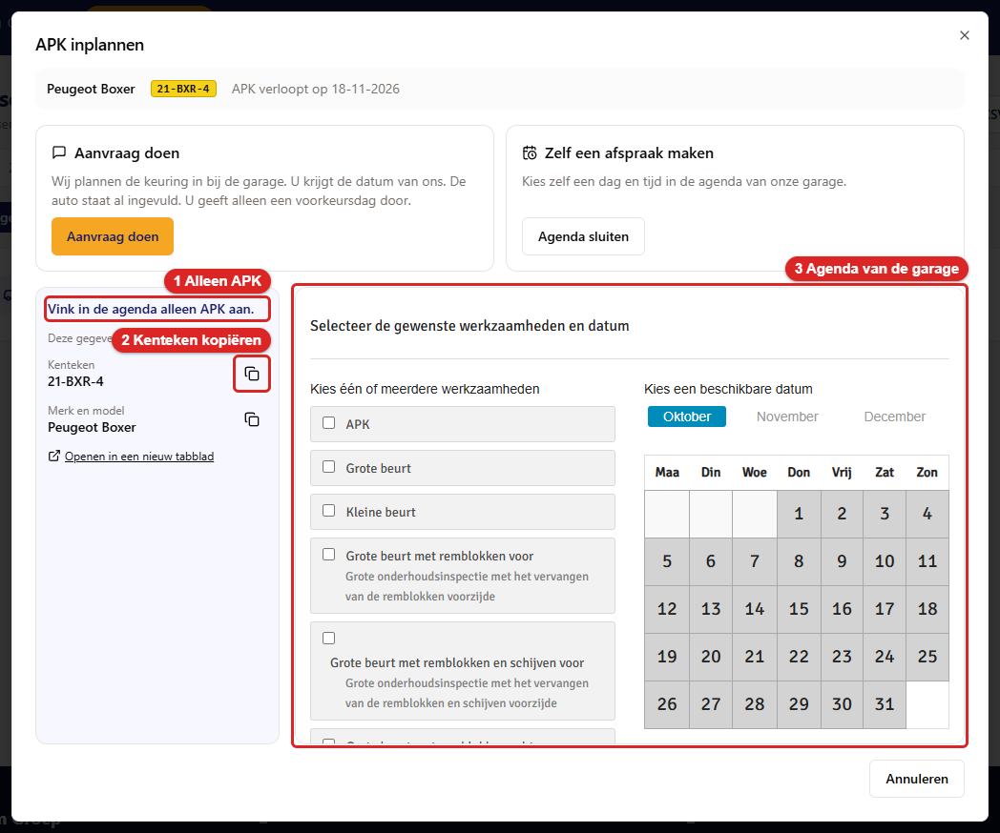
   *De agenda is open. 1 zegt: vink alleen APK aan. 2 kopieert het kenteken. 3 is de agenda van de
   garage.*

   De agenda is een pagina van Garagesoftware. Het portaal kan daar niets invullen of verbergen. De
   klant vult zelf zijn gegevens in. Lukt het niet in het venster? Dan opent de link **Openen in een
   nieuw tabblad** de agenda los.

Een klant kan per reservering één open aanvraag **APK inplannen** hebben. Een tweede lukt pas als
jij de eerste hebt afgehandeld.

### Onderhoud melden in het portaal

De knop **Onderhoud melden** staat op het overzicht, in een reservering en bij een voertuig. Hij
opent eerst dezelfde soort keuze als bij de APK.

1. De klant klikt op **Onderhoud melden**. Er opent een venster met twee keuzes: **Melding doen** of
   **Zelf een afspraak maken**.

   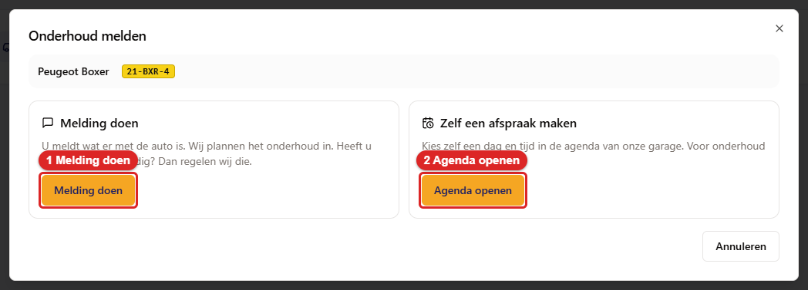
   *Het venster **Onderhoud melden**. 1 is **Melding doen**. 2 is **Agenda openen**.*

   **Melding doen** opent het gewone meldingsformulier. Jij plant het onderhoud in. Jij regelt ook
   een vervangende auto als dat nodig is. Zie hoofdstuk 16.4.
2. **Agenda openen** toont de online agenda van de garage. Daarnaast staat een korte uitleg: heeft de
   klant tijdens het onderhoud een andere auto nodig? Dan kiest hij in de agenda voor vervangend
   vervoer. De app ziet dat in de mail van de garage en zet een **TBD vervangend vervoer** klaar
   (hoofdstuk 7.10). Dat werkt alleen als de afzender van de garageplanner is ingevuld (hoofdstuk 9.9).

   
   *1 is de uitleg over vervangend vervoer.*

Opent de klant **Onderhoud melden** vanaf het overzicht? Dan staat er nog geen auto in het venster.
In het meldingsformulier kiest de klant zelf de reservering.

### De online agenda instellen

Het adres van de agenda zet je in de instellingen van het portaal.

1. Klik rechtsboven op je naam. Klik daarna op **App-instellingen** (zie hoofdstuk 10.3).

   
   *Zo ziet de knop **App-instellingen** eruit.*
2. Klik op het tabblad **Klantenportaal**.

   
   *Zo ziet het tabblad **Klantenportaal** eruit.*
3. Zoek het veld **Online agenda van de garage**. Vul het adres van de online afspraken van de
   garage in. Klik daarna onderaan het blok op **Opslaan**.

   
   *1 is het veld **Online agenda van de garage**.*

Alleen een adres op **planner.garage.software** werkt. Een ander adres slaat de app niet op. Laat
je het veld leeg? Dan zien klanten geen agenda. Ze kunnen dan alleen een aanvraag of melding doen.

### Welke e-mails de klant krijgt

De klant kiest zelf welke e-mails hij van het portaal wil ontvangen. Dat doet hij in het portaal
onder **Mijn account** → **E-mailmeldingen**. Alles staat standaard aan. Er zijn twee soorten:

- **Per account:** de waarschuwing bij inloggen op een nieuw apparaat en het antwoord op een eigen
  aanvraag. Elk account kiest dit voor zichzelf. Zet iemand de waarschuwing voor een nieuw apparaat
  uit? Dan staat daar in het portaal een waarschuwing bij. Hij merkt dan namelijk niet dat iemand
  anders inlogt.
- **Per bedrijf:** de mails over een verplaatste of geannuleerde reservering, over onderhoud en over
  een nieuw document. Deze gaan naar het e-mailadres van het bedrijf, niet naar één account. Alleen
  een beheerder van de klant wijzigt ze. Jij ziet ze ook onder **Instellingen voor deze klant**, bij
  **E-mails naar het bedrijfsadres**. Daar kun je ze zelf omzetten.

Wat de klant niet kan uitzetten: de uitnodiging, het herstellen van een wachtwoord en het bevestigen
van een nieuw e-mailadres. De melding onder het belletje in het portaal blijft altijd staan. Alleen
de e-mail valt weg. Heeft een klant het antwoord op een aanvraag uitgezet? Dan slaat de app het
antwoord wel op. De klant ziet het in het portaal. Maar er gaat geen mail. Een bekeuring mail je zelf
met **Klant informeren**. Dat staat los van deze keuzes.

Elke wijziging staat in **Activiteit in het portaal**, als *E-mailvoorkeur van account gewijzigd* of
*E-mailvoorkeur van bedrijf gewijzigd*. Zo zie je later wie een mail uitzette.

### Aanvragen, bekeuringen en activiteit

Onder het accountblok staan drie kleine overzichten: **Aanvragen** (wat deze klant online heeft
gevraagd), **Bekeuringen** en **Activiteit in het portaal**. Ze tonen alleen de laatste regels. Met
**Alles bekijken en zoeken** ga je naar het volledige overzicht op het scherm **Klantenportaal**.

Het afhandelen van aanvragen doe je niet hier. Dat doe je op het scherm **Klantenportaal**, via de
tegel **Aanvragen**. Een onderhoudsaanvraag staat in hoofdstuk 7. In een aanvraag kun je met
**Standaardantwoord invullen** een van de knoppen **Ontvangen**, **Akkoord** of **Afwijzing** kiezen.
De tekst komt dan in het antwoordveld. Je mag hem nog aanpassen. **Bericht plaatsen** zet een bericht
in de draad met de klant, *de aanvraag blijft open en er gaat geen e-mail uit*. **Antwoord mailen
(blijft open)** stuurt wel een e-mail. Datums in dit venster staan als dd-mm-jjjj.

**Voertuigen online** (de tegel op het scherm **Klantenportaal**) toont de status van elke auto in
woorden. Zet je een auto online die niet verhuurbaar is? Bijvoorbeeld met de status **Reparatie
nodig** of **Niet voor verhuur**? Dan vraagt de app eerst *<kenteken> heeft de status "…" en kan niet
worden verhuurd. Klanten kunnen het dus niet boeken zolang die status zo blijft. Toch online
aanbieden?* Daarbij staat de knop **Toch online aanbieden**. Dat geldt ook als je er meerdere
tegelijk aanvinkt. De tegel **Activiteit** en de meldingen laten acties en velden in gewone woorden
zien. Ze gebruiken niet meer de interne naam van het veld.

---

## 3.8 Een klant verwijderen

Verwijder een klant alleen als hij er echt niet hoort te staan. Bijvoorbeeld een dubbel aangemaakte
kaart. Een klant met geschiedenis laat je staan.

1. Klik in de klantenlijst bij de juiste regel op **Verwijderen**.

   
   *Zo ziet de knop **Verwijderen** eruit. Klik erop. Daarna zie je het venster Klant verwijderen.*
2. Je ziet nu het venster **Klant verwijderen**. Daarin staat eerst *Dit verwijdert ook:* met een
   lijst. Dat is alles wat aan deze klant hangt, bijvoorbeeld *6 reserveringen*, *1 chauffeur* en
   *1 portaalinstelling*. Hangt er niets aan? Dan staat er *Er is niets anders aan deze klant
   gekoppeld.*
3. Eronder staat *Een beheerder kan de klant daarna terugzetten vanuit de prullenbak.*
4. Typ de naam van de klant over in het veld **Typ <naam> om te bevestigen**. Zolang de naam niet
   klopt, blijft de knop **Klant verwijderen** uitgeschakeld. Hoofdletters en extra spaties maken
   niet uit.

   
   *Het venster **Klant verwijderen**: typ de naam over in veld 1. Pas dan wordt knop 2, **Klant
   verwijderen**, rood.*

   
   *Zo ziet het veld **Typ <naam> om te bevestigen** eruit. Typ hier de naam van de klant over.*
5. Klik op **Klant verwijderen**. Twijfel je? Klik dan op **Annuleren**.

   
   *Zo ziet de knop **Klant verwijderen** eruit. Hij is rood, omdat je er iets mee weghaalt.*

**De app weigert als er nog een huur aan hangt.** Heeft de klant een lopende of toekomstige
reservering? Dan zie je dat meteen bovenin het venster, in het rood:

> *Verwijderen kan niet: deze klant heeft een lopende of toekomstige reservering.*
> *Reservering #3370 — 13-09-2026 t/m 16-09-2026 (Geboekt)*
> *Rond die reservering af of annuleer hem eerst; daarna kan de klant naar de prullenbak.*

De knop **Klant verwijderen** blijft dan uit. Ook als je de naam goed overtypt. Je hoeft dus niet
eerst te klikken om de weigering te zien. Sluit het venster met **Annuleren**. Rond eerst de huur
af, of annuleer hem (5.9). Probeer het daarna opnieuw. Dat is met opzet. Haal je een klant weg onder
een lopende huur? Dan raken het contract en de factuur los van de persoon die de auto heeft.

**Terugzetten kan.** Een verwijderde klant komt in de prullenbak van dit scherm. Dat is de knop
**Verwijderde klanten** naast **Klant toevoegen**. Daar zet je hem terug met **Terugzetten**. Had hij
er echt nooit moeten staan? Dan haal je hem voorgoed weg met **Definitief verwijderen**. Dat mag
iedereen met het vinkje **Prullenbak beheren** (hoofdstuk 15, paragraaf 15.16). Zonder dat vinkje
staat de knop er grijs. Let op: de tekst in het venster zegt nog *Een beheerder*. Maar het vinkje
bepaalt wie het mag. Alles over de prullenbak staat in hoofdstuk 10, paragraaf 10.6.

*De prullenbak **Verwijderde klanten**: per regel zie je wie de klant wanneer verwijderde en wat
eraan hing, met de knoppen 1 **Terugzetten** en 2 **Definitief verwijderen**.*

**Een dubbele klant opruimen doe je zo:**

1. Zet de reserveringen van de dubbele kaart over. Dat doe je met **Klant wijzigen** op de
   reservering (hoofdstuk 5, paragraaf 5.5).
2. Verwijder daarna de lege dubbele kaart.

---

## 3.9 Debiteurnummer: als het al bezet is

Vul je op het tabblad **Basisgegevens** een **Debiteurnummer** in dat al bij een andere klant
hoort? Dan weigert de app op te slaan. Dat geldt bij het aanmaken en bij het bewerken. Het geldt ook
bij het snel toevoegen van een klant vanuit een reservering (hoofdstuk 5). Het is overal hetzelfde
formulier. Onder het veld verschijnt een rode veldfout:

> *Dit debiteurnummer is al in gebruik bij klant <naam>.*

Dit is een echte blokkade, geen waarschuwing zoals in 3.4. Opslaan lukt pas als je een ander nummer
intypt. Of als je het veld leeg maakt. Het maakt niet uit of je het net iets anders schrijft.
Hoofdletters of een spatie erbij maken geen verschil. De app vergelijkt op het kale nummer. Verbeter
je het veld? Dan verdwijnt de foutmelding vanzelf bij de eerstvolgende toets.

Je krijgt alleen deze veldmelding. Er komt geen rode melding rechtsboven bij. Zat je op een ander
tabblad toen je op **Klant toevoegen** klikte? Dan springt de app terug naar **Basisgegevens**. De
cursor staat dan in het veld **Debiteurnummer**.

**Zit de andere klant in de prullenbak?** Dan blijft zijn nummer toch bezet. Je ziet dan in plaats
daarvan:

> *Dit debiteurnummer hoort bij klant <naam> in de prullenbak. Zet die klant terug of verwijder
> hem definitief uit de prullenbak.*

Je hebt twee mogelijkheden. Allebei doe je in **Verwijderde klanten** op het scherm **Klanten**
(3.8). Je kunt de klant **terugzetten**. Of je kunt hem **definitief verwijderen**. Verwijder je hem
definitief? Dan komt het debiteurnummer meteen weer vrij. Je kunt het dan aan een andere klant
geven. Beide kan iedereen met het vinkje **Prullenbak beheren**. Heb je dat niet? Overleg dan met
iemand die het wel heeft.

**Het veld mag gewoon leeg blijven.** Een debiteurnummer is niet verplicht. Vul je er wel een in?
Dan moet het uniek zijn. Uniek betekent: geen andere klant heeft hetzelfde nummer.

---

## 3.10 Snel naslaan

| Wat je wilt | Waar |
|---|---|
| Een klant zoeken | **Klanten** → **Klanten zoeken**, of het zoekveld bovenin |
| Een klant aanmaken | **Klanten** → **Klant toevoegen** |
| Een klant wijzigen | **Bekijken** → **Bewerken** |
| Meteen boeken voor deze klant | **Nieuwe reservering** in de lijst of in het klantvenster |
| Een chauffeur toevoegen | **Bekijken** → **Chauffeurs** → **Chauffeur toevoegen** |
| Een verwijderde chauffeur terughalen | **Bekijken** → **Chauffeurs** → **Verwijderde chauffeurs** → **Terugzetten** (vraagt het vinkje **Prullenbak beheren**) |
| Een portaallogin regelen | **Bekijken** → **Portaal** → **Uitnodigen** |
| Zien wat een klant online mag | **Bekijken** → **Portaal** → **Instellingen voor deze klant** |
| Een auto blokkeren voor deze klant | **Bekijken** → **Persoonlijke gegevens** → **Geblokkeerde voertuigen** → **Voertuig blokkeren** |
| Een blokkade opheffen | **Bekijken** → **Geblokkeerde voertuigen** → **Blokkade opheffen** → bevestigen |
| Een klant verwijderen | **Verwijderen** in de lijst (lukt niet bij een lopende huur) |
| Debiteurnummer al bezet | Rode melding onder **Debiteurnummer** (ook als de andere klant in de prullenbak zit), zie 3.9 |
| Een verwijderde klant terughalen | **Klanten** → **Verwijderde klanten** → **Terugzetten** (vraagt het vinkje **Prullenbak beheren**) |
| Een debiteurnummer vrijmaken van een verwijderde klant | **Klanten** → **Verwijderde klanten** → **Definitief verwijderen** |
