# 4. Voertuigen

Alle auto's van het bedrijf samen heten het wagenpark. Het wagenpark staat op het scherm
**Voertuigbeheer**. Hier zoek je een auto op. Je ziet wat er met de auto aan de hand is. Je houdt
de APK bij. Je drukt sleutellabels af. En je haalt een auto uit de verhuur.

Eén regel om te onthouden: **werk altijd op kenteken.** Hetzelfde merk en model komen tientallen
keren voor in het park. Het kenteken komt maar één keer voor.

---

## 4.1 Het wagenpark doorzoeken

1. Klik links op **Voertuigen**. Je komt op het scherm **Voertuigbeheer**. Daaronder staat het
   kaartje **Voertuigenpark**.
2. Typ in het vak **Zoeken op kenteken, merk of model...** wat je zoekt. De lijst past zich meteen
   aan. Met het kruisje naast het vak wis je de zoekterm.

   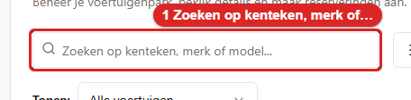
   *Het zoekvak (1), van dichtbij. Klik erin en typ.*
3. Met **Sorteren op:** kies je alleen de volgorde van de lijst. Je kunt kiezen uit **Standaard (ID)**,
   **Kenteken**, **Merk**, **APK-datum (eerst vroegste)**, **APK-datum (eerst laatste)**,
   **Beschikbaarheid (beschikbaar eerst)** en **Beschikbaarheid (gereserveerd eerst)**.
   Wil je maar een deel van het park zien? Gebruik dan het aparte keuzelijstje **Tonen:**. Daar kies
   je **Alle voertuigen**, **Reparatie nodig**, **Opnaam**, **BV** of **Niet opgegeven**. Sorteren en
   tonen werken samen. Je kunt bijvoorbeeld alleen de auto's **Opnaam** laten zien. Die lijst sorteer
   je dan op **Kenteken**. Vroeger stonden al die keuzes in één lijstje door elkaar. Een keuze als
   **Opnaam** sorteerde toen niet, maar filterde.

   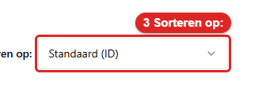
   *Zo ziet het keuzelijstje **Sorteren op:** eruit. Kies hier de volgorde van de lijst.*

   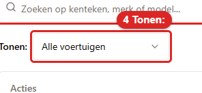
   *Zo ziet het keuzelijstje **Tonen:** eruit. Kies hier welk deel van het park je wilt zien.*
4. Met **Filter functies** zoek je op uitrusting. Je ziet dan het vakje **Filter op functies**. Vink
   daar aan wat de auto moet hebben: **Toegang milieuzone**, **Move IZI**, **GPS**, **GPS gewisseld**,
   **Stoelhoezen**, **Achteruitrijsignalering** of **Reservesleutel**. Kies daarna **Alles
   geselecteerd** of **Iets geselecteerd**. Bij **Alles geselecteerd** moet de auto álles hebben wat
   je aanvinkte. Bij **Iets geselecteerd** is één aangevinkt ding genoeg. Met **Wissen** zet je het
   filter uit.

   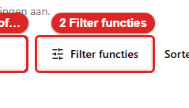
   *Zo ziet de knop **Filter functies** eruit. Klik erop. Daarna zie je het vakje Filter op functies.*

De tabel heeft de kolommen **Acties**, **Kenteken**, **Merk**, **Model**, **Type**, **Status**,
**Registratie**, **GPS**, **Radiocode**, **Bandenmaat** en **APK verloopt**.

Onder de tabel staan de knoppen **Vorige** en **Volgende**. Daarnaast staat de regel *Pagina 1 van 8*
met een invulveld **Pagina**. Typ daar een paginanummer en druk op Enter. Je springt dan meteen naar
die pagina. Zo hoef je niet tientallen keren op **Volgende** te klikken. Typ je een nummer voorbij de
laatste pagina? Dan kom je op de laatste pagina.

- **Registratie** toont **Opnaam** of **BV** met *Sinds: <datum>*. Anders staat er **Niet opgegeven**.
- **APK verloopt** toont de datum. Eronder staat hoeveel dagen er nog zijn, of *… dagen te laat*.
  Is er geen datum? Dan staat er **Niet ingesteld**.
- Onbekende waarden tonen **N.v.t.**

Per regel staan de knoppen **Bekijken**, een potlood (bewerken) en een prullenbak (verwijderen).
Daarachter staat **Reserveren** of **Verhuur bekijken**. Je kunt ook ergens op de regel klikken. Dan
opent de auto ook. Staat een auto op *niet voor verhuur*? Dan is **Reserveren** grijs. Er staat dan
de tekst *Voertuig is niet beschikbaar voor verhuur*.

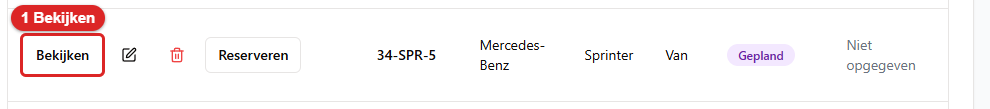
*Eén regel uit het **Voertuigenpark**, van dichtbij. Klik op **Bekijken** (1) om de auto te openen.*

*Het scherm **Voertuigbeheer**: 1 het zoekveld, 2 **Filter functies**, 3 **Sorteren op:**, 4 **Tonen:**,
5 **Bekijken** achter een regel, 6 **Voertuig toevoegen**.*

*De knoppen rechtsboven: 1 **Verwijderde voertuigen**, 2 **Barcodeboek**, 3 **Sleutelkast-audit**,
4 **Reservesleutelkast-audit**, 5 **Bulk importeren**, 6 **Voertuig toevoegen**.*

---

## 4.2 Een voertuig bekijken

Klik op **Bekijken**, of klik ergens op de regel. Je ziet nu het venster **Voertuiggegevens - <merk>
<model> (<kenteken>)**.

**Staan er opmerkingen bij de auto**? Dan zie je eerst het venster **Voertuigopmerkingen
waarschuwing** met die opmerkingen. Lees ze en klik op **Ik begrijp het**. Met **Opmerkingen bewerken**
pas je ze meteen aan. Dit is dezelfde tekst die de balie ziet bij het ophalen (4.5).

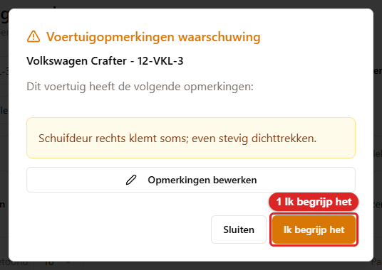
*De waarschuwing bij een auto met opmerkingen: klik op **Ik begrijp het** (1) om door te gaan.*

Bovenin staat de barcode van de auto, bijvoorbeeld *VEH-001821*. Daarnaast staan de knoppen
**Sleutellabel** en **Reservesleutel-label**. Verder staan er deze knoppen:

**Terug · Barcode bekijken · Bewerken · Brandstofstatus bijwerken · Verwijderen · Nieuwe
reservering**

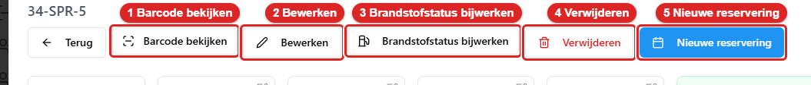
*De knoppen bovenin de voertuigkaart, van dichtbij. 1 **Barcode bekijken**, 2 **Bewerken**, 3
**Brandstofstatus bijwerken**, 4 **Verwijderen**, 5 **Nieuwe reservering**.*

*Het venster **Voertuiggegevens**: 1 **Barcode bekijken**, 2 **Bewerken**, 3 **Brandstofstatus
bijwerken**, 4 **Nieuwe reservering**, 5 de tabbladen.*

Daaronder staan zes tegels. Een tegel is een klein vak met één gegeven. De tegels zijn
**Voertuigtype**, **Huidige kilometerstand**, **Huidig brandstofniveau**, **APK-vervaldatum** (met
het aantal dagen), **Garantievervaldatum** en de statusinformatie. Heeft de auto geen garantiedatum?
Dan staat er *Geen garantiedatum*. Er staat dan niet meer *Dagen resterend: 0*. Bij drie tegels
staat een potloodje. Daarmee pas je die waarde direct aan. De potloodjes heten **Kilometerstand
aanpassen**, **Brandstofniveau aanpassen** en **APK-vervaldatum aanpassen**.

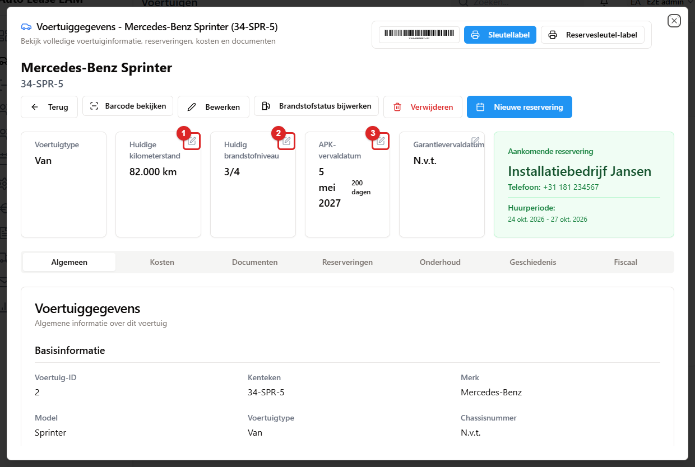
*De tegels: 1 **Kilometerstand aanpassen**, 2 **Brandstofniveau aanpassen**, 3 **APK-vervaldatum
aanpassen**.*

Onder de tegels staan zeven tabbladen. Een tabblad is een knop bovenaan een vak. Klik je erop, dan
zie je andere inhoud in dat vak.

| Tabblad | Wat je er ziet |
|---|---|
| **Algemeen** | Basisgegevens, techniek, datums, status en uitrusting |
| **Kosten** | Alle kosten die op deze auto zijn geboekt |
| **Documenten** | Alles wat bij deze auto is opgeslagen, plus de schadechecks |
| **Reserveringen** | Alle verhuur van deze auto, vroeger en nu |
| **Onderhoud** | APK, garantie en de volgende onderhoudsbeurt |
| **Geschiedenis** | Wie wat wanneer aan deze auto heeft gewijzigd |
| **Fiscaal** | De fiscale check van deze auto. Alleen voor wie het recht **Fiscaal bekijken** heeft |

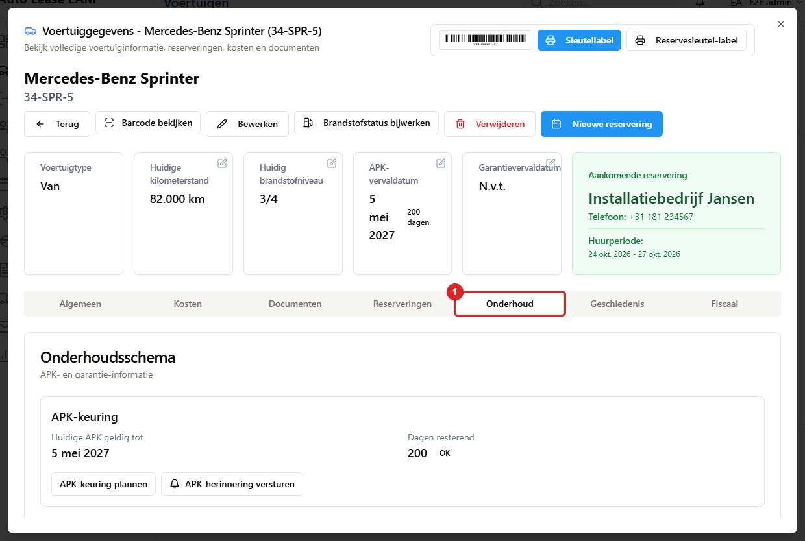
*Het tabblad **Onderhoud** (1): de APK- en garantiegegevens en de knop **APK-keuring plannen** (4.7).*

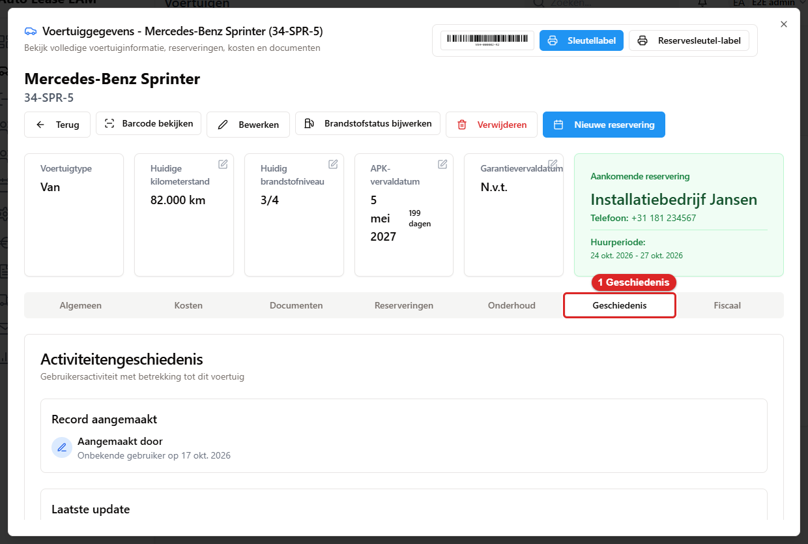
*Het tabblad **Geschiedenis** (1): elke wijziging aan deze auto, met wie en wanneer.*

---

## 4.3 Een voertuig toevoegen

Klik rechtsboven op **Voertuig toevoegen**.

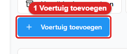
*De blauwe knop **Voertuig toevoegen** (1) staat rechtsboven op het scherm **Voertuigbeheer**.*

Je ziet nu het venster **Nieuw voertuig toevoegen**. Het
heeft dezelfde vijf tabbladen als het bewerkformulier (4.5). Vul minstens **Kenteken**, **Merk** en
**Model** in. Klik daarna onderaan op **Voertuig toevoegen**. De datumvelden mag je leeg laten. Een
leeg datumveld betekent gewoon "geen datum".

*Het venster **Nieuw voertuig toevoegen**: 1 typ het **Kenteken**, 2 klik op **Opzoeken** om de
gegevens bij de RDW op te halen, 3 **Voertuig toevoegen** onderaan.*

Je ziet nu de melding **Voertuig succesvol aangemaakt** met de tekst *Het voertuig is toegevoegd aan
je wagenpark.* De auto staat daarna meteen in het **Voertuigenpark**.

Is er iets mis? Dan zie je dat. Boven de knoppen verschijnt een rood blok **Het formulier is
nog niet compleet**. Daarin staat per veld wat eraan mankeert. Dezelfde melding zie je ook als tegel
rechtsboven. De knop doet dus nooit "niets".

> **Tip:** heb je meerdere auto's tegelijk, gebruik dan **Bulk importeren** (4.4). Dat haalt de
> gegevens meteen bij de RDW op.

In het formulier kun je de gegevens ook opzoeken bij de RDW. De RDW is de dienst die alle
kentekens in Nederland bijhoudt. Zo gaat dat:

1. Typ het kenteken in het veld bovenaan het venster.

   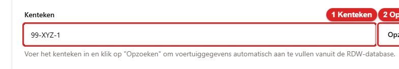
   *Zo ziet het veld **Kenteken** eruit. Typ hier het kenteken.*
2. Klik op **Opzoeken**. Er staat bij: *Voer het kenteken in en klik op "Opzoeken" om
   voertuiggegevens automatisch aan te vullen vanuit de RDW-database.*

   
   *Zo ziet de knop **Opzoeken** eruit. Klik erop. De app zoekt het kenteken op bij de RDW.*
3. Wordt de auto gevonden? Dan vult de app merk, model, voertuigtype, brandstof, chassisnummer,
   APK-datum en bouwdatum zelf in. Je ziet de melding **Voertuiggegevens gevonden** met de tekst
   *Voertuiggegevens succesvol opgehaald uit de RDW-database.*

   
   *Na **Opzoeken**: de velden op **Algemeen** zijn ingevuld. Controleer ze en vul de rest aan.*

   **Hoe de app het voertuigtype kiest.** Een bestelwagen volgens de RDW wordt **Van**. Een
   personenauto met **acht of meer zitplaatsen** wordt ook **Van**. Waarom? De RDW registreert een
   Transporter, Ducato, Boxer, Transit, Vito, Trafic of Scudo met negen zitplaatsen als personenauto.
   Daardoor kwamen die bussen vroeger onterecht als **SUV** binnen. Een gewone gezinsauto of MPV met
   minder zitplaatsen blijft **SUV**. Dit geldt voor nieuwe opzoekingen. Auto's die er al stonden,
   veranderen niet vanzelf. Klopt het type van een bestaande auto niet? Zet het dan goed met
   **Bewerken**. Wil je het hele wagenpark in één keer nalopen? Dat kan een beheerder doen in
   **Instellingen**. Daar staat op het tabblad **Voertuigen** de kaart **RDW-voertuigtypes** (zie 4.13
   en hoofdstuk 10).
4. Wordt de auto niet gevonden? Dan staat er **Voertuig niet gevonden** met de tekst *Geen voertuig
   gevonden met dit kenteken in de RDW-database. Controleer het kenteken en probeer het opnieuw.*
   Controleer dan hoe je het kenteken hebt getypt.

Je kunt ook andere meldingen krijgen: **Kenteken vereist**, **Service time-out** (*De
RDW-service reageert te langzaam*), **Service niet beschikbaar** en **Opzoeken mislukt**. In al die
gevallen doe je hetzelfde. Probeer het later nog eens, of typ de gegevens zelf in.

Sluit het venster met **Annuleren**. Heb je al iets ingevuld? Dan vraagt de app eerst **Wijzigingen
verwerpen?** met de tekst *Je hebt wijzigingen gemaakt die nog niet zijn opgeslagen. Als je sluit, gaan ze
verloren.* Kies **Verder bewerken** om terug te gaan. Kies **Verwerpen** om te sluiten. Dit geldt
ook voor **Voertuig bewerken** (4.5).

---

## 4.4 Bulk importeren — ook voor één auto

Importeren betekent: gegevens in één keer in de app zetten. Dat kan ook voor één auto.

1. Klik rechtsboven op **Bulk importeren**. Je ziet nu het venster **Voertuigen bulk importeren**.
   Het heeft twee tabbladen: **Handmatig invoeren** en **CSV uploaden**.

   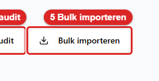
   *Zo ziet de knop **Bulk importeren** eruit. Klik erop. Daarna zie je het venster Voertuigen bulk importeren.*

   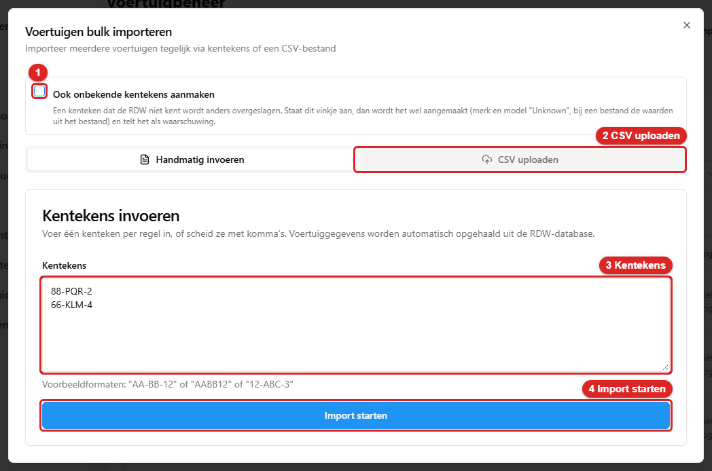
   *Het venster **Voertuigen bulk importeren**: 1 het vinkje **Ook onbekende kentekens aanmaken**, 2 het
   tabblad **CSV uploaden**, 3 het veld **Kentekens** (één per regel), 4 **Import starten**.*

### Tabblad "Handmatig invoeren"

Dit is de snelste manier. Ook voor één auto.

2. Typ in het veld **Kentekens** één kenteken per regel. Je mag ze ook scheiden met komma's. Er
   staat bij: *Voorbeeldformaten: "AA-BB-12" of "AABB12" of "12-ABC-3"*.

   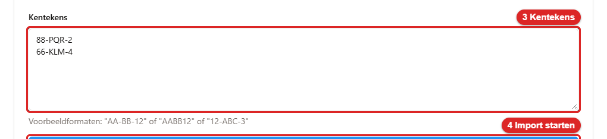
   *Zo ziet het veld **Kentekens** eruit. Typ hier één kenteken per regel.*
3. Klik op **Import starten**. De knop verandert in *Import verwerken...*

   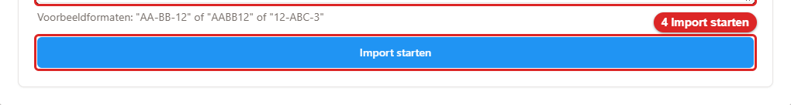
   *Zo ziet de knop **Import starten** eruit.*
4. De app zoekt elk kenteken op bij de RDW. Daarna maakt de app het voertuig aan.

**Het vinkje "Ook onbekende kentekens aanmaken".** Boven de twee tabbladen staat het vinkje **Ook
onbekende kentekens aanmaken**. Het staat standaard uit. Er staat bij: *Een kenteken dat de RDW niet kent wordt
anders overgeslagen. Staat dit vinkje aan, dan wordt het wel aangemaakt (merk en model "Unknown", bij
een bestand de waarden uit het bestand) en telt het als waarschuwing.* Het vinkje geldt voor beide
tabbladen. Laat je het uit? Dan maak je niet per ongeluk een auto aan op een typefout in het
kenteken. Zet je het aan? Dan maak je bewust ook een auto aan die de RDW niet kent. Dat is handig
bij een nieuw kenteken dat nog niet in de RDW staat. De rest vul je dan zelf aan met **Bewerken**.

Laat je het veld leeg? Dan meldt de app **Geen kentekens gevonden** met de tekst *Voer minstens één geldig
kenteken in.*

### Tabblad "CSV uploaden"

Heb je een lijst van de leverancier? Gebruik dan dit tabblad. Een CSV is een eenvoudig bestand met
een tabel erin.

2. Sleep het bestand naar het vak **Sleep je bestand hierheen**. Of klik op **Bestanden
   doorzoeken** en kies het bestand. CSV en Excel (.xlsx, .xls) kunnen allebei.
3. De eerste rij moet kolomkoppen bevatten. Een kolomkop is de naam boven een kolom. Het verwachte
   formaat staat in het venster:
   *Eerste rij: kolomkoppen (Kenteken, Merk, Model, Voertuigsoort, Brandstof, Bedrijf, Op naam,
   Chassisnummer, Productie datum)* en *Volgende rijen: voertuiggegevens*.
4. Je ziet eerst **Importgegevens voorbeeld** met alle rijen. Rijen zonder kenteken
   krijgen een rode achtergrond met een waarschuwingsdriehoekje.
5. Controleer de lijst. Klik daarna op **Import bevestigen (<aantal> voertuigen)**. Of ga met **Terug**
   naar het bestand.

### Het resultaat lezen

Na de import zie je het kaartje **Importresultaten**. Daarop staat de regel *<aantal> geïmporteerd, <aantal> met
waarschuwing, <aantal> mislukt*. Er zijn dus drie uitkomsten per regel. Daaronder staan drie blokken:

- **Succesvol geïmporteerd (n)**. Per regel staat er `KENTEKEN - Merk Model`. De RDW kende het kenteken.
  De auto is aangemaakt.
  Wijken jouw kolommen af van wat de RDW zegt? Dan staat er *Afwijkingen ten opzichte van de
  RDW:*. Per veld zie je wat er in het blad stond en wat de RDW weet. De app gebruikt de waarde van de RDW.
- **Met waarschuwing (n)**. Dit zijn de regels die je even moet nakijken. Er zijn drie soorten:

| Melding | Betekenis | Is de auto aangemaakt? |
|---|---|---|
| *Onbekend bij de RDW: niet aangemaakt.* | De RDW kent het kenteken niet. Het vinkje **Ook onbekende kentekens aanmaken** stond uit | Nee |
| *Onbekend bij de RDW: wel aangemaakt, zonder RDW-gegevens.* | De RDW kent het kenteken niet. Het vinkje stond aan | Ja, met merk en model *Unknown* (bij een bestand de waarden uit het bestand). Werk hem bij met **Bewerken** |
| *RDW niet bereikbaar: aangemaakt zonder RDW-gegevens. Controleer de gegevens later.* | De RDW gaf geen antwoord (te langzaam of een storing). Het kenteken kan best kloppen | Ja, zonder RDW-gegevens. Controleer de auto later. Of importeer het kenteken opnieuw als hij nog niet bestaat |

  Een storing van de RDW staat dus niet meer onder *niet gevonden*. De melding zegt alleen wat er
  echt gebeurde. Een waarschuwing telt niet als geslaagd. Ze telt ook niet als mislukt.
- **Mislukte imports (n)**. Per regel staat er `KENTEKEN - reden`. De redenen zijn in het Nederlands:

| Melding | Betekenis |
|---|---|
| *Het kenteken ontbreekt.* | De regel heeft geen kenteken |
| *Dit voertuig bestaat al.* | Dit kenteken staat al in het park |
| *Een datum kon niet worden gelezen (gebruik dd-mm-jjjj).* | Een datum in die regel is onleesbaar |
| *Dit voertuig kon niet worden geïmporteerd.* | Onbekende fout. Probeer die regel los opnieuw |

Een afgekeurde regel houdt de rest niet tegen. De andere rijen worden gewoon geïmporteerd.

Je ziet ook de melding **Import voltooid** met de tekst *<aantal> voertuigen geïmporteerd, <aantal> met
waarschuwing, <aantal> mislukt.*

---

## 4.5 Een voertuig bijwerken

1. Klik in de lijst op het potloodje. Of open de auto met **Bekijken** en klik op **Bewerken**.

   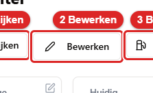
   *Zo ziet de knop **Bewerken** op de voertuigkaart eruit. Klik erop. Daarna zie je het venster Voertuig bewerken.*
2. Je ziet nu het venster **Voertuig bewerken** met de tekst *Werk de gegevens bij voor <merk> <model> (<kenteken>)*.
   Boven de tabbladen staat weer het kenteken met de knop **Opzoeken** (4.3).

   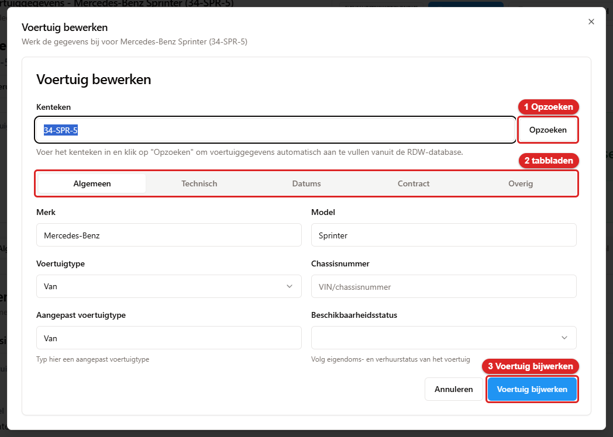
   *Het venster **Voertuig bewerken**: 1 **Opzoeken** bij de RDW, 2 de tabbladen **Algemeen**,
   **Technisch**, **Datums**, **Contract** en **Overig**, 3 **Voertuig bijwerken**.*
3. Vul aan wat nodig is. Klik daarna onderaan op **Voertuig bijwerken**.

   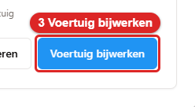
   *Zo ziet de knop **Voertuig bijwerken** eruit. Klik erop om je wijzigingen op te slaan.*

Je ziet nu de melding **Voertuig succesvol bijgewerkt** met de tekst *Het voertuig in je wagenpark is bijgewerkt.*

De vijf tabbladen:

| Tabblad | Wat erin staat |
|---|---|
| **Algemeen** | **Merk**, **Model**, **Voertuigtype**, **Chassisnummer**, **Aangepast voertuigtype** en **Beschikbaarheidsstatus** |
| **Technisch** | **Brandstoftype**, **Aanbevolen olie**, **Onderhoudsinterval (km)** en **(maanden)**, **AdBlue**, **GPS** en **IMEI-nummer**, **Pechhulp**, **Reservesleutel** (en of die bij de klant ligt), **Winterbanden**, **WOK-melding**, **Stoelhoezen**, **Achteruitrijsignalering**, **Reserveband**, **Boordgereedschap & krik**, **Bandenmaat** en **Radiocode** |
| **Datums** | **APK-vervaldatum**, **Vervaldatum garantie**, **Bouwdatum**, de **Registratiestatus** (Opnaam of BV, met datum), **Vervaldatum Euro-zone**, **Toegang milieuzone**, **Move IZI** |
| **Contract** | **Maandprijs (€)**, **Dagprijs (€)** en **Retourkilometerstand (km)** |
| **Overig** | **Interne afspraken** en **Opmerkingen** |

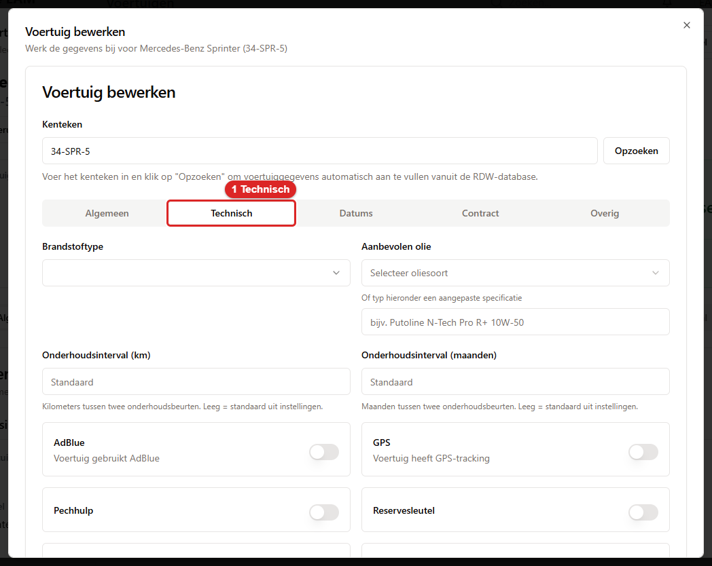
*Het tabblad **Technisch** (1): brandstof, GPS, reservesleutel, banden en uitrusting.*

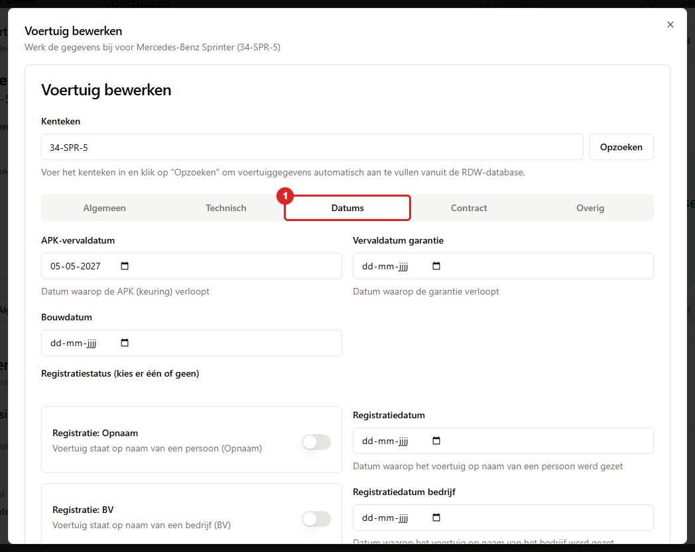
*Het tabblad **Datums** (1): APK, garantie, bouwdatum en registratie.*

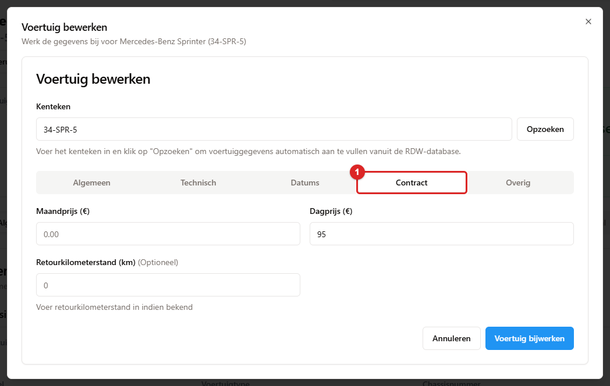
*Het tabblad **Contract** (1): de prijzen die bij het boeken worden gebruikt.*

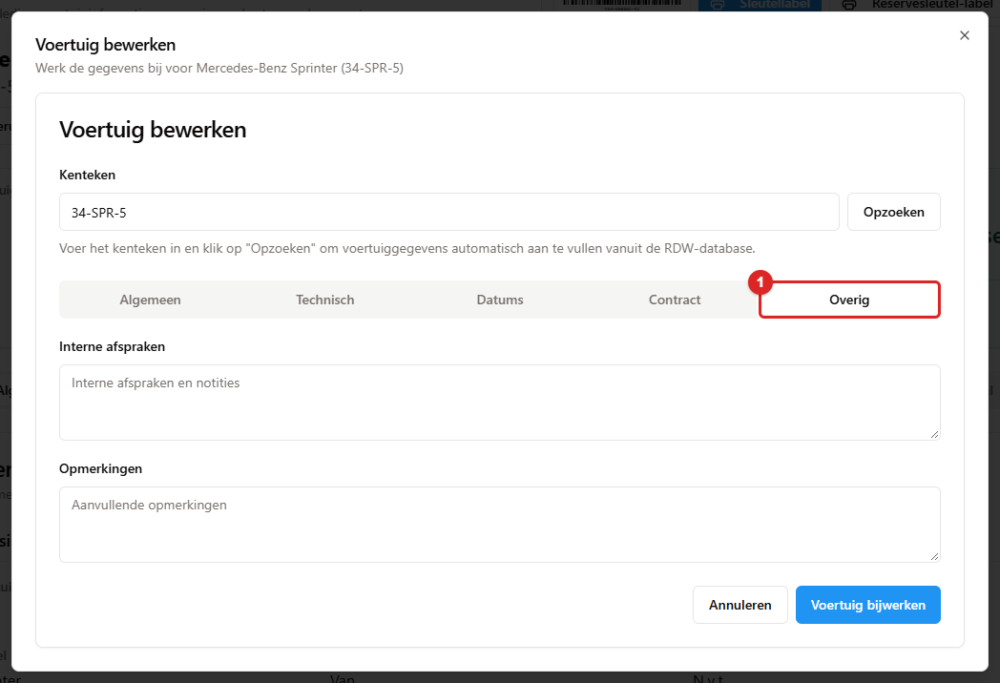
*Het tabblad **Overig** (1): **Interne afspraken** voor kantoor en **Opmerkingen** voor de balie.*

**Verplicht zijn kenteken, merk en model.** Ontbreekt er één? Dan meldt de app *Vul alle
verplichte velden in: kenteken, merk en model.* Onder het veld zelf staat dan *Kenteken is
verplicht*, *Merk is verplicht* of *Model is verplicht*.

**De dagprijs telt bij het boeken.** Vul je op het tabblad **Contract** een **Dagprijs (€)** in?
Dan rekent de app bij een nieuwe reservering het totaalbedrag zelf uit (hoofdstuk 5, paragraaf
5.3). Zonder dagprijs blijft het bedrag op nul staan. Je moet het dan zelf invullen.

**Opmerkingen worden aan de balie getoond.** Wat je op het tabblad **Overig** in **Opmerkingen**
zet, verschijnt bij het ophalen in een apart venster. De medewerker moet dat venster bevestigen
(hoofdstuk 5, paragraaf 5.7). Gebruik dat veld dus voor dingen die de klant echt moet weten. Denk
aan een bekende kras of een klemmende schuifdeur. Gebruik het niet voor kantoornotities. Die horen bij
**Interne afspraken**.

---

## 4.6 De statussen en wat ze betekenen voor beschikbaarheid

Een voertuig heeft **twee** aparte statussen. Een status is een stand die zegt hoe het met de auto
staat. De twee statussen doen allebei iets anders.

### A. De beschikbaarheidsstatus

Dit is de status die je in de lijst ziet. Je stelt hem in op het tabblad **Algemeen** onder
**Beschikbaarheidsstatus**.

| Status | Wat het betekent | Kun je hem verhuren? |
|---|---|---|
| **Beschikbaar** | De auto staat klaar | Ja |
| **Gepland** | Er ligt een reservering op. Of er is onderhoud ingepland en de auto is nog niet binnen gemeld | Ja, buiten die periode. Bij gepland onderhoud krijg je een waarschuwing, zie hoofdstuk 7, paragraaf 7.3 |
| **Verhuurd** | De auto is opgehaald en staat bij een klant | Nee |
| **Reparatie nodig** (in het formulier: **Moet gerepareerd worden**) | Er is iets kapot. Of de auto staat binnen voor onderhoud (**Binnen**) | Nee |
| **Niet voor verhuur** | De auto is bewust uit de verhuur gehaald | Nee |

In de lijst kom je ook combinaties tegen: **Vervangend voertuig**, **Vervangend voertuig
(actief)**, **Gepland (vervanger toegewezen)**, **Reparatie nodig (vervanger toegewezen)** en
**Verhuurd (vervanger toegewezen)**. Die zeggen dat de auto als vervanger is ingezet
(hoofdstuk 7).

Op het scanscherm heten dezelfde statussen net iets anders: **Beschikbaar**, **Gereserveerd**,
**Verhuurd**, **In reparatie** en **Niet voor verhuur** (hoofdstuk 18).

Zo wijzig je de status. Klik op **Bewerken** en ga naar het tabblad **Algemeen**. Of klik op de
voertuigkaart op de knop **Wijzigen** bij het blok **Beschikbaarheidsstatus**. In dat lijstje kun
je vier waarden kiezen: **Beschikbaar**, **Moet gerepareerd worden**, **Niet voor verhuur** en
**Verhuurd**. **Gepland** staat er niet bij. Die status zet de app zelf. Dat gebeurt zodra er een
reservering op de auto ligt, of zodra er onderhoud voor is ingepland.

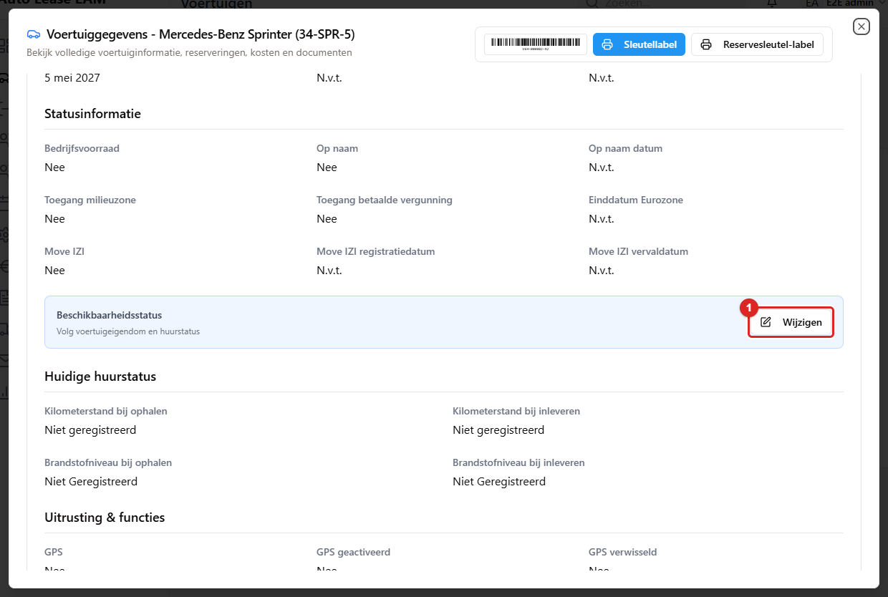
*Het blok **Beschikbaarheidsstatus** op het tabblad **Algemeen**: klik op **Wijzigen** (1) en kies een
van de vier waarden.*

**Gepland onderhoud maakt van een auto geen "Reparatie nodig".** Plan je onderhoud? Dan blijft de auto
**Gepland** zolang hij er nog niet is. Zet je het onderhoud op **Binnen**? Pas dan wordt het **Reparatie
nodig**. Haal je dat onderhoud daarna weg (verwijderen of annuleren)? En was het de enige reden? Dan
gaat **Reparatie nodig** er weer af. Een stand die je zelf met de hand zette, blijft staan. Zie hoofdstuk 7,
paragrafen 7.3 en 7.8.

Zet een auto **nooit** met de hand op **Verhuurd**. Dat doet het ophaalproces voor je. Het vult dan
ook het contractnummer en de kilometerstand in. De app waarschuwt daar ook voor met **Geen actieve
reservering** of **Reservering nog niet opgehaald**.

### B. De onderhoudsstatus (de werkplaatsstatus)

Daarnaast heeft de auto een onderhoudsstatus. Die is in orde, **Onderhoud nodig** of **In onderhoud**.
Je ziet hem terug op het scanscherm, in het oranje blok **Onderhoud** daar.

**Deze vlag blokkeert de uitgifte.** Uitgifte is het meegeven van de auto aan de klant. Staat de vlag
aan? Dan weigert de app het ophalen. Je ziet dan het venster **Uitgifte geblokkeerd** met de melding:

> *Dit voertuig staat in de werkplaats en kan niet worden uitgegeven. Rond de werkplaatsklus
> eerst af.*

Dat is bewust. Een auto die kapot naar binnen ging, mag er niet stilletjes weer uitkomen. Je
zet de vlag om met **Voertuig markeren voor onderhoud** en **Terug van onderhoud** (hoofdstuk 7).
Of je doet het vanaf het scanscherm met **Onderhoud inplannen** en **Terug uit onderhoud** (hoofdstuk 18).

> **Terug uit onderhoud doet het hele rondje.** De werkplaatsstatus gaat eraf, het onderhoudsblok
> dat vandaag loopt wordt afgesloten en de **Beschikbaarheidsstatus** komt meteen in een
> verhuurbare staat — dus niet meer op **Reparatie nodig**. Je hoeft er niets meer met de hand
> achteraan te zetten. Zie hoofdstuk 7, paragraaf 7.5.

> **Een beheerder kan de uitgifte forceren.** Ben je beheerder, dan staat in het venster
> **Uitgifte geblokkeerd** een veld **Reden voor het forceren** en de knop **Toch uitgeven**; de
> reden komt in de notities van de reservering. Ben je dat niet, dan lees je *Alleen een
> beheerder kan de uitgifte forceren* en is de werkplaatsstatus vrijgeven de weg. Zie hoofdstuk
> 5, paragraaf 5.7.

### Wat "beschikbaar" precies betekent

Een auto telt als **beschikbaar** als hij in de gevraagde periode vrij is **én** zijn status
in orde is. Dat betekent: geen overlappende reservering, niet in onderhoud, niet op *niet voor
verhuur* en niet verwijderd. Die regel geldt overal hetzelfde. Op het dashboard, in het
boekingsformulier en in de tellingen.

**Eén uitzondering om te kennen:** een auto met een *gepland* onderhoudsblok staat nog steeds in
de keuzelijst van het boekingsformulier. Je mag hem bewust boeken. Je krijgt dan een gele
waarschuwing met de onderhoudsperiode erbij (hoofdstuk 5, paragraaf 5.3).

---

## 4.7 APK en garantie

**Waar je de datums invult:** klik op **Bewerken**. Ga naar het tabblad **Datums**. Vul daar
**APK-vervaldatum** en **Vervaldatum garantie** in.

**Waar je ze terugziet:**

- In de lijst, in de kolom **APK verloopt**. Daar staat het aantal dagen of *… dagen te laat*.
- Op de voertuigkaart, op de tegels **APK-vervaldatum** en **Garantievervaldatum**.
- Op het tabblad **Onderhoud** van de auto. Daar staan de blokken **APK-keuring** en
  **Garantie-informatie**. In het blok **APK-keuring** staan **Huidige APK geldig tot**, **Dagen
  resterend** en een van de labels **Verlopen**, **Actie binnenkort nodig** of **OK**. Is er geen
  garantiedatum ingevuld? Dan staat daar *Geen garantiedatum*.
- Op het **Dashboard**, in de blokken **APK verloopt binnenkort** en **Garantie verloopt
  binnenkort**.
- Op de **Onderhoudskalender**, als de signalen **APK-keuring verschuldigd**, **APK Herinnering
  (2 maanden)** en **APK Herinnering (1 maand)** (hoofdstuk 7).

**Een APK-keuring inplannen.** Op het tabblad **Onderhoud** van de auto staat de knop
**APK-keuring plannen**. Klik erop. Je kiest een datum in de **Werkplaatskalender**. Vul
**Geselecteerde datum** en **Duur (dagen)** in. Klik daarna op **APK-keuring plannen**. Heeft de auto
in die periode een lopende verhuur? Dan meldt de app **Actieve verhuur gedetecteerd** met de periode
erbij. Er staat dan ook de regel *Er is een vervangend voertuig nodig voor deze klant.* Vink dan
**Vervangend voertuig aanvragen** aan. De vervangende auto wijs je later toe (hoofdstuk 7).

**Een verlopen APK blokkeert het boeken niet.** Bij het maken van een reservering krijg je alleen
een rode waarschuwing: *De APK (keuring) van dit voertuig is verlopen op <datum>. Bevestig dat
het veilig en legaal is om te verhuren voordat je verdergaat.* Verhuur zo'n auto niet. Laat hem
eerst keuren.

**De RDW-scan.** Op het **Dashboard** staat onder **Snelle acties** de knop **RDW APK-datums
scannen**. Die haalt de APK-datums van het hele park op bij de RDW. Daarna werkt hij ze bij. Dat
loopt op de achtergrond. Het is werk voor wie het wagenpark bijhoudt, niet voor de balie. De app
vraagt eerst **RDW APK-datums scannen?** met de tekst *Dit vraagt de APK-datum van het hele wagenpark
op bij de RDW en kan enkele minuten duren. Er wordt niets aangepast: verschillen komen als voorstel
in een lijst te staan, die jij beoordeelt.* Pas na **Scan starten** begint de scan. Zo'n voorstel zie
je in het venster **APK-datums gewijzigd bij de RDW**. Per voertuig kies je **Bevestigen** of
**Negeren**. Wil je er nu niet naar kijken? Klik dan op **Later (morgen opnieuw)**. Het venster sluit
dan. De volgende werkdag komt het terug.

---

## 4.8 De kilometerstand

De kilometerstand wordt automatisch bijgewerkt bij het ophalen en het innemen (hoofdstuk 5). Soms
doe je het los, bijvoorbeeld na een werkplaatsbezoek. Zo gaat dat:

1. Open de auto, of scan hem (hoofdstuk 18).
2. Op de voertuigkaart klik je op het potloodje bij de tegel **Huidige kilometerstand**. Dat
   potloodje heet **Kilometerstand aanpassen**. Je ziet nu het venster **Kilometerstand aanpassen**
   met het veld **Huidige kilometerstand**. Op het scanscherm klik je op **Km-stand bijwerken**. Dat
   venster heet **Kilometerstand bijwerken**. Daar staat *Huidige stand: <getal> km* en het veld
   **Nieuwe kilometerstand**.

   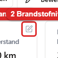
   *Zo ziet het potloodje **Kilometerstand aanpassen** eruit. Klik erop. Daarna zie je het venster Kilometerstand aanpassen.*
3. Vul de nieuwe stand in. Klik daarna op **Opslaan**.

   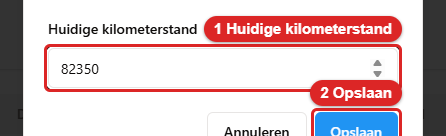
   *Zo ziet het veld **Huidige kilometerstand** eruit. Typ hier de nieuwe stand.*

   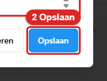
   *Zo ziet de knop **Opslaan** eruit. Klik erop als de stand klopt.*

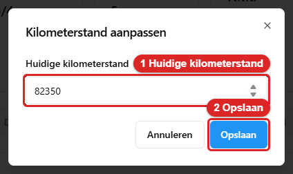
*Het venster **Kilometerstand aanpassen** vanaf de voertuigkaart: 1 typ de stand, 2 **Opslaan**.*

Je ziet nu de melding **Kilometerstand opgeslagen** met de tekst *Nieuwe stand: <getal> km.*

**Een lagere stand invoeren mag niet zomaar.** Typ je een stand die lager is dan de vorige? Dan
verschijnt eerst een oranje regel: *Lager dan de huidige stand (<getal> km). Hiervoor is een
autorisatiewachtwoord nodig.* Ga je door? Dan opent het venster **Kilometerstand-overschrijving
vereist**. Daarin staan de huidige stand, de nieuwe stand en het verschil. Vul **je eigen
accountwachtwoord** in. Klik daarna op **Overschrijving bevestigen**.

Heb je dat recht niet? Dan meldt de app: *Je hebt geen recht om een verlaging van de
kilometerstand te autoriseren. Vraag iemand met het recht 'authorize_mileage_decrease'.* Haal er
dan een collega bij.

Waarom is dit zo streng? De kilometerstand bepaalt de afrekening en het onderhoudsmoment. Een stand
omlaag zetten mag alleen om een fout te herstellen. En dat moet je later kunnen terugvinden. Een té
hoge stand wordt niet tegengehouden. Lees de teller dus twee keer af.

---

## 4.9 Brandstof en tanken

Klik op de voertuigkaart op **Brandstofstatus bijwerken**. Of gebruik **Tanken** op het
scanscherm. Je ziet nu het venster **Brandstofstatus bijwerken**. Daar vul je in:

- **Brandstofniveau**. Je kiest van **Leeg** tot **Vol**. De huidige stand staat erbij.
- **Tankkosten (€)**. Je mag een komma of een punt typen. *45,50* en *45.50* zijn allebei goed.
  Ook *1.234,50* wordt goed gelezen, als duizend tweehonderdvierendertig euro vijftig. Staat er iets
  anders, bijvoorbeeld letters of een bedrag met meer dan twee cijfers achter de komma? Dan verschijnt
  onder het veld *Vul een geldig bedrag in, bijvoorbeeld 45,50.* Er wordt dan niets opgeslagen. Het
  bedrag moet positief zijn en ten hoogste € 1.000.000. Anders weigert de app met *Het tankbedrag moet
  een positief bedrag zijn van ten hoogste € 1.000.000.*
- **Bon (optioneel)**. Die voeg je toe met **Bon uploaden**.
- **Notities (optioneel)**.

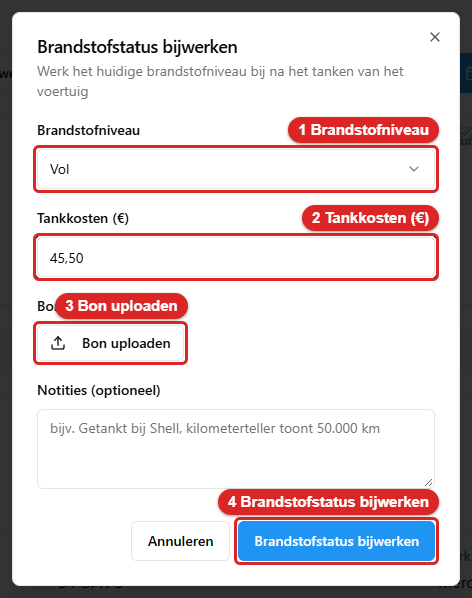
*Het venster **Brandstofstatus bijwerken**: 1 **Brandstofniveau**, 2 **Tankkosten (€)**, 3 **Bon
uploaden**, 4 **Brandstofstatus bijwerken** om op te slaan.*

Vul je niets in? Dan meldt de app *Geef minstens één veld op om bij te werken.*

**Een tankbedrag wordt ook een kostenpost.** Een kostenpost is een regel in de kostenlijst. Vul je
bij **Tankkosten (€)** een bedrag in? Dan boekt de app in dezelfde handeling een kostenpost op deze
auto, in de categorie **Brandstof**. Je ziet dan **Brandstofstatus bijgewerkt; kostenpost van € 45,50
geboekt** (met je eigen bedrag). Je hoeft het bedrag dus niet nog eens op het scherm **Kosten** in te
typen. Doe je dat wel? Dan staat het er twee keer.

- De omschrijving van de kostenpost is *Tankbeurt <niveau> <datum>*, met de datum van vandaag.
- Heb je een **Bon** meegegeven? Dan is dat ook de bon van de kostenpost.
- Je hebt hiervoor het vinkje **Voertuigen beheren** nodig, niet **Kosten beheren**. De kostenpost is
  een gevolg van het tanken. Daarna wijzigen of verwijderen kan alleen met **Kosten beheren**. Een
  verwijderde kostenpost staat in de prullenbak van het scherm **Kosten** (hoofdstuk 10,
  paragraaf 10.6).
- Klik je per ongeluk twee keer? Of verstuur je hetzelfde nog eens binnen twee minuten? Dan boekt de
  app het bedrag maar één keer. Een nieuwe tankbeurt later op de dag wordt wel een nieuwe kostenpost.
  Dat geldt ook voor een tankbeurt met een ander bedrag.
- Lukt het boeken van de kostenpost niet? Dan wordt er niets opgeslagen. Er staat dan *De kostenpost voor
  de tankbeurt kon niet worden geboekt; er is niets opgeslagen. Probeer het opnieuw.*
- Vul je alleen het niveau in en geen bedrag? Dan komt er geen kostenpost.

**Het laatste tankbedrag.** Op de voertuigkaart staat op de tegel **Huidig brandstofniveau** ook de
regel *Laatste tankbedrag: € 45,50 (9 okt. 2026)*. Dat zijn het bedrag en de datum van de laatste
tankbeurt waarbij je een bedrag invulde. Die regel blijft staan. Ook als je de kostenpost later
verwijdert.

---

## 4.10 Documenten bij een voertuig

Open de voertuigkaart en ga naar het tabblad **Documenten**. Je ziet het kaartje
**Voertuigdocumenten** met de tekst *Alle documenten met betrekking tot dit voertuig*.

- Onder **Snel uploaden categorieën** staan de knoppen **APK-keuring**, **Contract**,
  **Schaderapport**, **Voertuigfoto's** en **Onderhoud**. Klik op de categorie die past. Kies het
  bestand. Klaar.
- Daarboven staat het blok **Interactieve schadechecks** met de knop **Nieuwe check**. Per check
  zie je het label **Ophalen** of **Inleveren**. Je ziet ook wie de check maakte, de kilometerstand,
  de brandstof en de knop **PDF**.
- Een document verwijderen vraagt om bevestiging: *"Weet je zeker dat je het document "<naam>"
  wilt verwijderen? Deze actie kan niet ongedaan worden gemaakt."*
- Bij elk document staat ook de knop **Geschiedenis**. Daar zie je wie het document wanneer heeft
  geüpload, bekeken, gedownload, afgedrukt of gemaild (hoofdstuk 10, paragraaf 10.5).

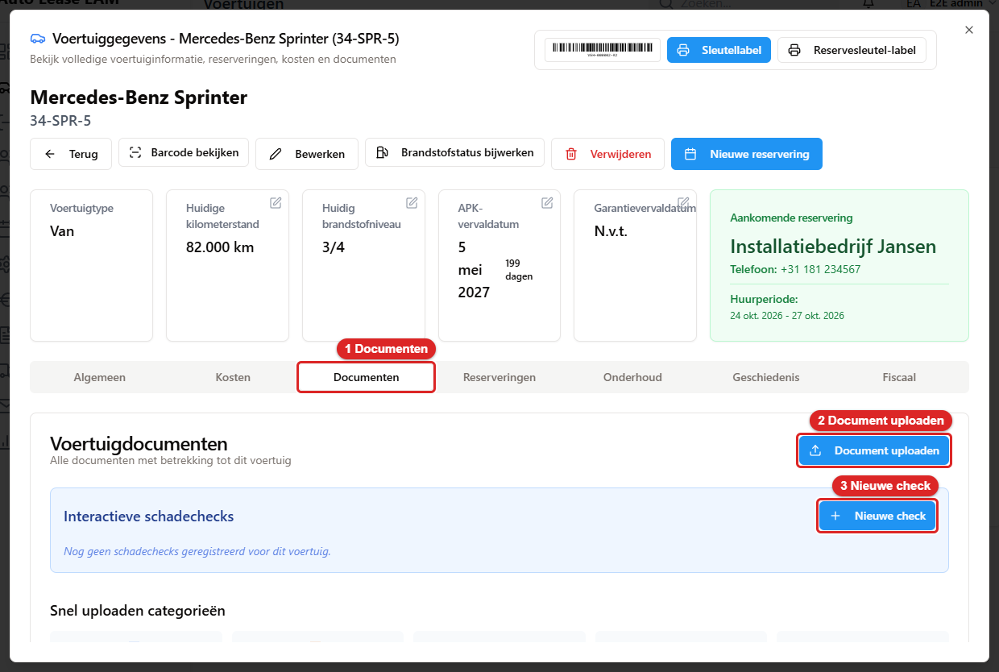
*Het tabblad **Documenten** (1): **Document uploaden** (2), het blok **Interactieve schadechecks** met
**Nieuwe check** (3), en daaronder de **Snel uploaden categorieën**.*

Meer over documenten, sjablonen en afdrukken staat in hoofdstuk 8.

---

## 4.11 Barcode, sleutellabel en sleutelkast

Elke auto heeft een eigen barcode. Een barcode is een streepjescode die een scanner kan lezen. De
code heeft de vorm **VEH-000123**. Die staat op het sleutellabel dat aan de sleutelbos hangt.
Scannen is de snelste en veiligste weg in de app. Je kunt er niet de verkeerde auto mee pakken.

**Het label bekijken en afdrukken**

1. Open de auto met **Bekijken**.

   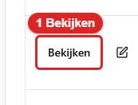
   *Zo ziet de knop **Bekijken** in de lijst eruit. Klik erop om de auto te openen.*
2. Klik op **Barcode bekijken**. Je ziet nu het venster **Voertuigbarcode**.

   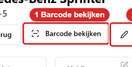
   *Zo ziet de knop **Barcode bekijken** eruit. Klik erop. Daarna zie je het venster Voertuigbarcode.*

   
   *Het venster **Voertuigbarcode**: 1 **Labelsjabloon**, 2 **Sleutellabel afdrukken**, 3
   **Reservesleutel-label afdrukken**. Onderaan staat **Barcode opnieuw genereren**.*
3. Kies bij **Labelsjabloon** de indeling die bij jullie labelprinter hoort. Een sjabloon is een
   vaste opmaak voor het label. Je kunt kiezen uit de **Standaardindeling** (62 bij 29 mm), een
   eigen sjabloon uit **Documenten**, of **DYMO-tape (labelmaker, staand)** voor de labelmaker aan
   de balie (zie hieronder). Zijn er onder **Documenten** → **Barcodelabels** standaardsjablonen
   aangewezen (**Hoofdsleutel**, **Reservesleutel**, **Autolabel**)? Dan staat het juiste sjabloon
   hier al klaar.

   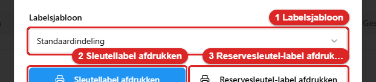
   *Zo ziet het keuzelijstje **Labelsjabloon** eruit. Kies hier de indeling van je labelprinter.*
4. Klik op **Sleutellabel afdrukken** of op **Reservesleutel-label afdrukken**. Je ziet nu een
   afdrukvenster van je browser. De app meldt dat met **Afdrukvenster geopend** en de tekst *Het
   afdrukvenster van je browser is geopend voor het label van <kenteken>. Kies daar de printer.*
   Je kiest daar zelf de printer. De app maakt geen bestand.

   
   *Zo ziet de knop **Sleutellabel afdrukken** eruit. Klik erop. Daarna zie je het afdrukvenster van je browser.*

   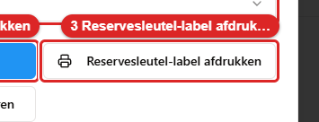
   *Zo ziet de knop **Reservesleutel-label afdrukken** eruit. Klik erop voor het label van de reservesleutel.*

**Wat er op het label staat.** Op het scherm en in het barcodeboek heet de barcode *VEH-000123*. Op
het sleutellabel zelf staat de **korte code**. Dat is **V123** voor de hoofdsleutel en **S123** voor
de reservesleutel. Na *Barcode opnieuw genereren* wordt het bijvoorbeeld **V123R2**. Zo blijft de
streepjescode leesbaar op een label van 30 bij 12 mm. Scannen of typen werkt met beide vormen. De
app zet de korte code zelf om.

**Op de DYMO-labelmaker (tape).** De labelmaker aan de balie is een LabelManager 420P met tape van
12 mm. Die drukt via Windows alleen staand af. Een gewoon sleutellabel van 62 bij 29 mm kwam daardoor
afgesneden uit de printer. Kies daarom bij **Labelsjabloon** de optie **DYMO-tape (labelmaker,
staand)**. Je ziet dan de velden **Tapebreedte** (6, 9, 12, 19 of 24 mm, standaard 12), **Labellengte
(mm)** (standaard 48, de lengte van het sleutellabel, minimaal 15), **Marge links/rechts (mm)** en
**Marge boven/onder (mm)**. Daaronder staat **Uitvoer**. Daar kies je waar het label heen gaat:

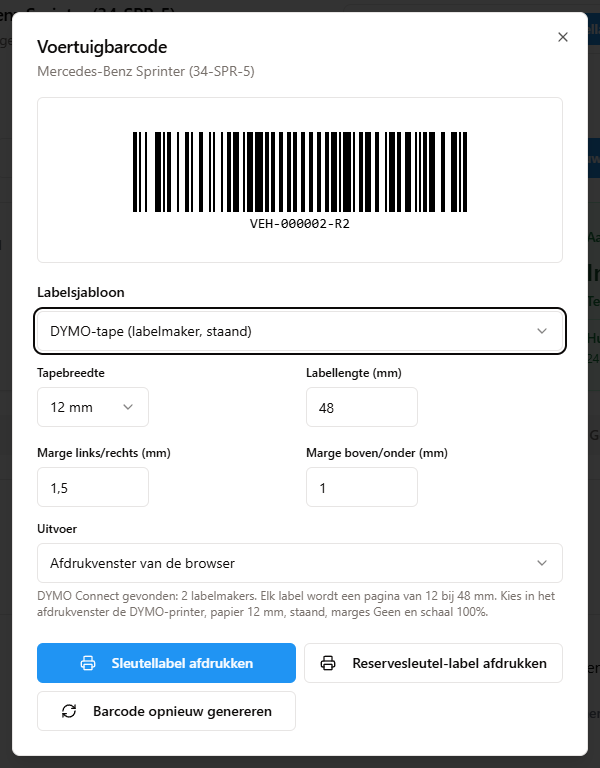
*Hetzelfde venster met **DYMO-tape (labelmaker, staand)** gekozen: de tapematen en de keuze
**Uitvoer** verschijnen eronder.*

- **<naam van de labelmaker> (rechtstreeks via DYMO Connect)**, bijvoorbeeld *DYMO LabelManager
  420P*. De app stuurt het label zelf naar de labelmaker, zonder afdrukvenster. Dat kan als op de pc
  het programma DYMO Connect draait. De regel eronder zegt dan *DYMO Connect gevonden: 1 labelmaker.*
  De labelmaker snijdt elk label af. Na het sturen meldt de app **Naar de labelmaker gestuurd** met
  de tekst *1 label is naar DYMO LabelManager 420P gestuurd.* Dit is de bedoelde weg aan de balie.
  Bij deze keuze kun je ook de **Positie op de tape** kiezen: **Links (begin van de tape)**,
  **Midden** of **Rechts**. Je kunt ook **Doorlopend printen (minder lege tape, niet knippen na elk
  label)** aanzetten. Voegt de labelmaker toch steeds een stuk lege tape toe? Zet dan **Meerdere
  labels op één strook, met kniplijn ertussen (zelf knippen)** aan. Kies daarna de **Ruimte naast de
  kniplijn (mm)**. De labels komen dan achter elkaar op één strook, met een kniplijn ertussen. De
  lege rand komt dan maar één keer.
- **Bestand .label (openen in DYMO Connect)**. De app maakt per label een bestand in het formaat van
  DYMO. Je ziet dan **Bestand gemaakt** met de naam *sleutellabel-<kenteken>-<code>.label*. Open
  het in DYMO Connect en druk het daar af. Dit is handig op een pc zonder aangesloten labelmaker.
- **Afdrukvenster van de browser**. De app maakt per label één pagina van 12 bij 48 mm. De inhoud
  draait hij zelf een kwartslag. Kies in het afdrukvenster de DYMO-printer, papier 12 mm, staand,
  marges **Geen** en schaal **100%**. Let op: de Windows-printer van de LabelManager 420P heeft als
  poort *FILE:*. Die levert dan een .prn-bestand op in plaats van een label. Gebruik voor de 420P
  daarom een van de twee keuzes hierboven.

Op het label staat de barcode over de lengte van de tape. Daarnaast staan het kenteken en **Hoofd** of
**Reserve**. Staat er *DYMO Connect is niet gevonden op deze pc*? Start dan DYMO Connect, of kies
het bestand. De keuzes en de maten worden op die pc onthouden. De volgende keer staan de tape en de
labelmaker dus meteen goed. Druk eerst één label af. Leg het naast een oud label. Doe pas daarna de
hele kast.

**Zelf bepalen wat er op de tape staat.** De keuze **DYMO-tape (labelmaker, staand)** heeft een vaste
indeling. Wil je iets anders op het label, zoals een bedrijfsnaam, een ander lettertype of het merk?
Maak dan onder **Documenten** → **Barcodelabels** een sjabloon van het soort **DYMO-tape (48 x 12 mm)**.
Kies dat sjabloon daarna bij **Labelsjabloon**. Zo'n sjabloon wordt net zo staand en gedraaid
afgedrukt. Zie [hoofdstuk 8, paragraaf 8.5](08-documenten.md).

De reservesleutel krijgt een eigen label. De code eindigt dan op **-S**. Zo weet de sleutelkast
het verschil tussen de hoofdsleutel en de reserve.

**Een barcode opnieuw genereren** doe je alleen als het label onleesbaar of kwijt is. De app
waarschuwt: *"De oude barcode (<code>) werkt daarna niet meer. Reeds afgedrukte labels moeten
opnieuw worden afgedrukt. Deze actie kan niet ongedaan worden gemaakt."*

**Alle labels tegelijk** druk je af met de knop **Barcodeboek** rechtsboven op het scherm
**Voertuigbeheer**. Er staat bij: *Druk alle voertuigbarcodes af voor in een map of klapper.* Je
kiest een **Labelsjabloon**. Je filtert eventueel op status. Daarna klik je op **Alles afdrukken (…)**,
**Gefilterde afdrukken (…)**, **Selectie afdrukken** of **Stickers afdrukken**. De app meldt dan
**Afdrukvenster geopend** met de tekst *Het afdrukvenster van je browser is geopend voor het
barcodeboek (12 voertuigen). Kies daar de printer.* Staat het **Labelsjabloon** op **DYMO-tape
(labelmaker, staand)**? Dan maakt **Stickers afdrukken** één tapelabel per auto. De labelmaker
snijdt ze na elkaar af. **Stickers afdrukken** kiest vanzelf het sjabloon dat onder **Documenten** →
**Barcodelabels** als **Autolabel (sticker in de auto)** is aangewezen.

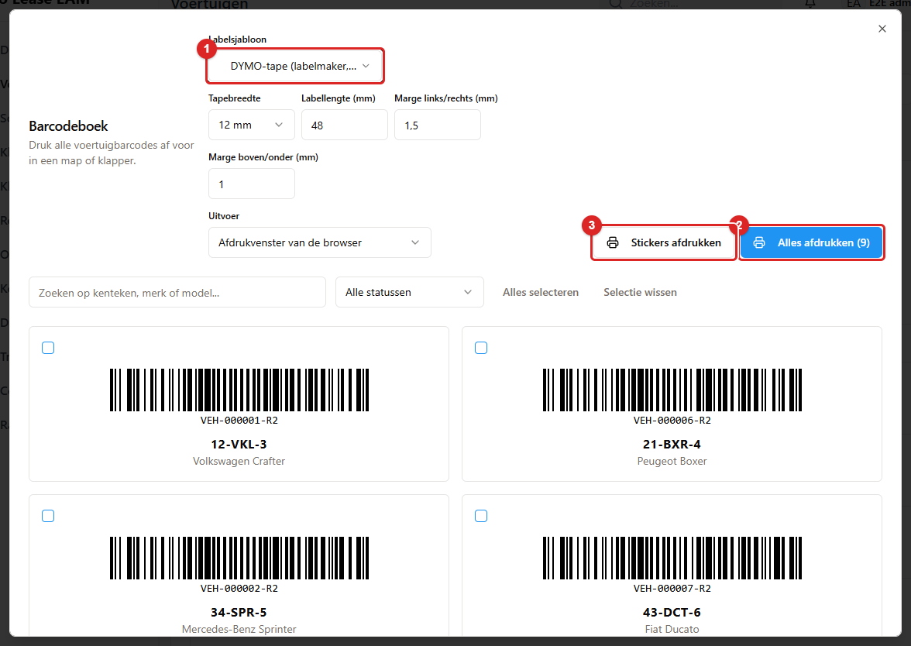
*Het venster **Barcodeboek**: 1 **Labelsjabloon**, 2 **Alles afdrukken (…)**, 3 **Stickers afdrukken**.
Daaronder staan het zoekveld, het statusfilter en de lijst om auto's aan te vinken.*

**De sleutelkast nalopen** doe je met **Sleutelkast-audit** en **Reservesleutelkast-audit**.
Tijdens het scannen zie je welke sleutels al gescand zijn en welke nog niet. Meer hierover staat in
hoofdstuk 18.

---

## 4.12 Een voertuig verwijderen en terugzetten

1. Klik in de lijst op het prullenbakje. Of open de auto en klik op **Verwijderen**.

   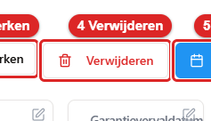
   *Zo ziet de knop **Verwijderen** op de voertuigkaart eruit. Klik erop. Daarna zie je het venster Voertuig verwijderen.*
2. Je ziet nu het venster **Voertuig verwijderen** met de tekst *"Je staat op het punt om <merk> <model> te
   verwijderen met kenteken <kenteken>."*
3. De app zoekt uit wat er aan de auto hangt. Je ziet *Controleren wat aan dit voertuig gekoppeld is...*
   Daarna zie je een oranje blok **Dit verwijdert ook:**. Daarin staat per soort een regel, bijvoorbeeld
   *1 reserveringen* en *1 documenten*. Hangt er niets aan? Dan staat er *Er is niets anders aan
   dit voertuig gekoppeld.* Daaronder staat: *Een beheerder kan het daarna terugzetten vanuit de
   prullenbak op de voertuigenpagina.*
4. Typ het kenteken over in het veld **Typ <kenteken> om te bevestigen**. Zolang dat niet klopt,
   blijft de knop grijs. Dat overtypen is de rem. Zo verwijder je nooit per ongeluk de regel
   erboven.

   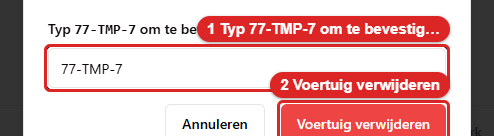
   *Zo ziet het veld **Typ <kenteken> om te bevestigen** eruit. Typ hier het kenteken over.*

   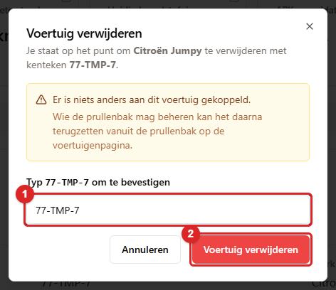
   *Het venster **Voertuig verwijderen**: typ het kenteken in veld 1. Dan wordt knop 2 rood en
   klikbaar.*
5. Klik op **Voertuig verwijderen**.

   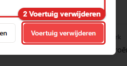
   *Zo ziet de knop **Voertuig verwijderen** eruit. Hij wordt pas rood als je het kenteken goed hebt
   overgetypt.*

Je ziet nu de melding **Voertuig verwijderd** met de tekst *<merk> <model> is verwijderd. Een beheerder kan het
terugzetten vanuit de prullenbak.*

Verwijder je de auto vanuit het detailscherm (**Bekijken** → **Verwijderen**)? Dan sluit dat
scherm zich. Het blijft bij die ene bevestiging. Vroeger verscheen er daarna een rode melding
*Vehicle not found*. Die komt niet meer.

**De app weigert bij een lopende of geplande huur.** Je ziet dan een rood blok in hetzelfde
venster:

> *Verwijderen kan niet: dit voertuig heeft een lopende of geplande huur.*
> *Reservering #3366 — 13-09-2026 t/m 25-09-2026 (Opgehaald)*
> *Rond de huur af of annuleer hem eerst; daarna kan het voertuig naar de prullenbak.*

De huren die het tegenhouden staan er dus bij, met hun periode en hun status in het Nederlands. De
knop blijft grijs. Pas als je die huren hebt afgerond of geannuleerd, wordt hij klikbaar.

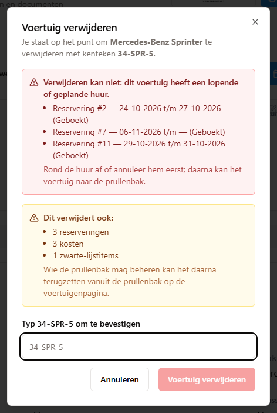
*De weigering: de reserveringen die het verwijderen tegenhouden staan erbij. De knop blijft grijs.*

### De prullenbak

De knop **Verwijderde voertuigen** rechtsboven op **Voertuigbeheer** is de prullenbak van dit
scherm. Hij is er voor iedereen met het vinkje **Prullenbak beheren** (hoofdstuk 15, paragraaf
15.16). Zonder dat vinkje staat de knop er wel, maar grijs, met uitleg. De teksten bij het verwijderen
zeggen nog *Een beheerder*. Maar het vinkje bepaalt wie mag terugzetten.

Sinds oktober 2026 staan hier **alleen voertuigen** (label **Voertuig**). Verwijderde klanten,
reserveringen, transporten, onderhoud en bekeuringen staan in de prullenbak van hun eigen scherm. Zie
hoofdstuk 10, paragraaf 10.6. Per regel zie je de omschrijving en de regel *Verwijderd <datum> door
<naam>*. Je ziet ook *Bevat: <wat er aan hing>* (of *geen gekoppelde gegevens*).

1. Zoek de regel. Dat kan ook met het zoekveld *Zoeken op omschrijving of naam…*
2. Klik op **Terugzetten**.

   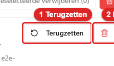
   *Zo ziet de knop **Terugzetten** eruit. Klik erop. Het voertuig komt terug in het wagenpark.*

*De prullenbak **Verwijderde voertuigen**: 1 **Terugzetten**, 2 **Definitief verwijderen**.*

Je ziet nu de melding **Teruggezet** met een bevestiging erbij, bijvoorbeeld *12-AB-34 Kia Picanto is
teruggezet.* Het voertuig staat weer op zijn plek, met alles wat eraan hing. Een regel die al is
teruggezet, krijgt het groene label **Teruggezet**. De knop wordt dan grijs.

Twee dingen om te weten:

- Zit er inmiddels een andere auto op hetzelfde kenteken? Dan lukt terugzetten niet. Je ziet *Er bestaat al
  een voertuig met hetzelfde kenteken. Verwijder of hernoem dat eerst.*
- Wil je het voertuig voorgoed kwijt? Dat kan ook. Klik op **Definitief verwijderen** achter de regel.
  Of kies een selectie. Of klik op **Prullenbak leegmaken**. De app vraagt altijd eerst om een
  bevestiging. Het voertuig verdwijnt dan met zijn reserveringen, documenten, kosten en de
  bijbehorende bestanden. Dat is niet terug te draaien. Wat er precies weggaat, staat in hoofdstuk
  10, paragraaf 10.6.

---

## 4.13 De voertuigtypes controleren met de RDW

De typering van de RDW is verbeterd. Een bus met negen zitplaatsen is geen **SUV** meer, maar een **Van**
(zie 4.3). Auto's die al in het wagenpark staan, houden hun oude type. Wil je die in één keer laten
nalopen? Dat doet een beheerder in de app, niet op de server.

1. Klik rechtsboven op je naam. Kies onder **Beheer** de ingang **App-instellingen**. Ga naar het
   tabblad **Voertuigen**. Je ziet de kaart **RDW-voertuigtypes**. Er staat bij: *Er wordt niets
   aangepast voordat een beheerder op Toepassen drukt.*

   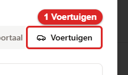
   *Zo ziet het tabblad **Voertuigen** eruit. Klik erop. Daarna zie je de kaart RDW-voertuigtypes.*

   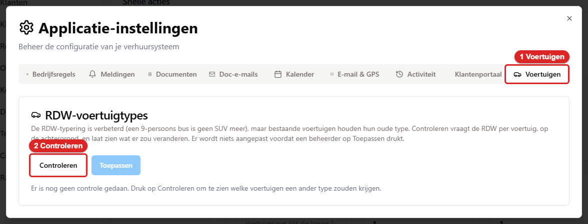
   *Het tabblad **Voertuigen** (1) van de app-instellingen met de knop **Controleren** (2).*
2. Klik op **Controleren**. De app vraagt de RDW per voertuig, op de achtergrond. Je ziet hoe ver
   hij is: *Controleren… 12 van 99 voertuigen*. Voor ongeveer honderd auto's duurt dat anderhalve
   minuut of meer. Je kunt het scherm laten staan. Je kunt er ook later terugkomen. Er loopt maar één
   controle tegelijk. Anders zie je *Er loopt al een controle. Wacht tot die klaar is.*

   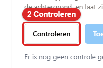
   *Zo ziet de knop **Controleren** eruit. Klik erop. De app vraagt de RDW per voertuig.*
3. Is de controle klaar? Dan zie je een lijst met per kenteken **Type: oud → nieuw**. Erbij staat een
   regel als *7 voertuigen krijgen een ander type (controle van <datum>: 99 voertuigen bekeken, 2 niet
   gevonden bij de RDW, 1 mislukt).* Auto's die de RDW niet kent, staan onderaan met hun kenteken.
   Dat geldt ook voor auto's waarbij het opzoeken mislukte. Je ziet dan *Niet gevonden bij de RDW, type
   blijft: …* of *Opzoeken mislukt, type blijft: …*. Die auto's veranderen niet. Is er niets te
   veranderen? Dan staat er *Alle gecontroleerde voertuigen hebben al het type dat de RDW geeft.*
4. **Bekijk de lijst goed.** De controle markeert elk verschil tussen het type in de app en het type van de
   RDW. Ook een type dat iemand bewust met de hand zette. Toepassen doet alles of niets. Je kunt geen
   regels uitzetten. Hoort een auto zijn handmatige type te houden? Zet hem dan na het toepassen met
   **Bewerken** terug.
5. Alleen een **beheerder** ziet de knop **Toepassen**. De app vraagt eerst **RDW-voertuigtypes
   toepassen?** en noemt het aantal: *Het type van 7 voertuigen wordt aangepast zoals in de lijst staat.
   Een voertuig waarvan het type intussen is gewijzigd, blijft ongemoeid. Dit kan niet in één keer
   ongedaan worden gemaakt.* Kies **Toepassen**.

Je ziet nu de melding **RDW-voertuigtypes toegepast** met de tekst *7 voertuigen aangepast, 0 overgeslagen (type intussen
gewijzigd).* Is het type van een auto tussen de controle en het toepassen veranderd? Dan wordt die
auto overgeslagen. Hij telt mee bij *overgeslagen*. Elke aangepaste auto krijgt een regel in het
activiteitenlog (10.5) met het oude en het nieuwe type. De lijst is daarna weg. Voor een volgende ronde
druk je opnieuw op **Controleren**. Is de lijst verdwenen voordat je toepast? Dan meldt de app *Er is geen
controle-uitkomst meer om toe te passen. Draai eerst Controleren.*

---

## 4.14 Snel naslaan

| Wat je wilt | Waar |
|---|---|
| Een auto zoeken | **Voertuigen** → **Zoeken op kenteken, merk of model...** |
| Een auto bekijken | **Bekijken** |
| Een nieuwe auto aanmaken | **Voertuig toevoegen**, of **Bulk importeren** → **Handmatig invoeren** voor meerdere tegelijk |
| Gegevens aanvullen | **Bewerken** |
| APK-datum invullen | **Bewerken** → **Datums** → **APK-vervaldatum** |
| Kilometerstand bijwerken | **Km-stand bijwerken** (of via **Scannen**) |
| Tanken vastleggen (met bedrag: ook een kostenpost) | **Brandstofstatus bijwerken** |
| Sleutellabel afdrukken | **Bekijken** → **Barcode bekijken** → **Sleutellabel afdrukken** |
| Alle labels afdrukken | **Barcodeboek** |
| Een auto uit de verhuur halen | **Bewerken** → **Beschikbaarheidsstatus** → **Niet voor verhuur** |
| Een auto verwijderen | Prullenbakje in de lijst. Kenteken overtypen |
| Een verwijderd voertuig terugzetten | **Verwijderde voertuigen** → **Terugzetten** (vraagt het vinkje **Prullenbak beheren**) |
| Onbekende kentekens toch aanmaken bij het importeren | **Bulk importeren** → vinkje **Ook onbekende kentekens aanmaken** |
| De voertuigtypes van het park laten nalopen door de RDW | Je naam → **App-instellingen** → **Voertuigen** → **RDW-voertuigtypes** → **Controleren**, daarna (beheerder) **Toepassen** |
| Een klant blokkeren voor deze auto | **Bekijken** → tabblad **Reserveringen** → blok **Klant zwarte lijst** → **Toevoegen aan zwarte lijst** (of vanaf de klantkaart, hoofdstuk 3, paragraaf 3.2) |
