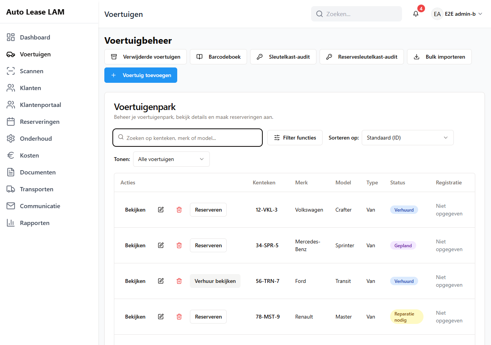

# 4. Voertuigen

Het wagenpark staat op het scherm **Voertuigbeheer**. Hier zoek je een auto op, kijk je wat er
mee aan de hand is, houd je de APK bij, druk je sleutellabels af en haal je een auto uit de
verhuur.

Eén regel om te onthouden: **werk altijd op kenteken.** Merk en model komen tientallen keren voor
in het park; het kenteken maar één keer.

---

## 4.1 Het wagenpark doorzoeken

1. Klik links op **Voertuigen**. Je komt op **Voertuigbeheer**, met daaronder het kaartje
   **Voertuigenpark**.
2. Typ in **Zoeken op kenteken, merk of model...** wat je zoekt. De lijst filtert meteen mee.
   Met het kruisje ernaast wis je de zoekterm.
3. Met **Sorteren op:** kies je alleen de volgorde: **Standaard (ID)**, **Kenteken**, **Merk**,
   **APK-datum (eerst vroegste)**, **APK-datum (eerst laatste)**, **Beschikbaarheid (beschikbaar
   eerst)** of **Beschikbaarheid (gereserveerd eerst)**.
   Wil je maar een deel van het park zien, gebruik dan het aparte keuzelijstje **Tonen:**: **Alle
   voertuigen**, **Reparatie nodig**, **Opnaam**, **BV** of **Niet opgegeven**. Sorteren en tonen
   werken samen: je kunt bijvoorbeeld alleen de auto's **Opnaam** laten zien, gesorteerd op
   **Kenteken**. Vroeger stonden die keuzes in één lijstje door elkaar; een keuze als **Opnaam**
   sorteerde dan niet maar filterde.
4. Met **Filter functies** zoek je op uitrusting. In het vakje **Filter op functies** vink je aan
   wat de auto moet hebben: **Toegang milieuzone**, **Move IZI**, **GPS**, **GPS gewisseld**,
   **Stoelhoezen**, **Achteruitrijsignalering** of **Reservesleutel**. Kies met **Alles
   geselecteerd** of **Iets geselecteerd** of de auto álles moet hebben of één van de
   aangevinkte dingen. **Wissen** zet het filter uit.

De tabel heeft de kolommen **Acties**, **Kenteken**, **Merk**, **Model**, **Type**, **Status**,
**Registratie**, **GPS**, **Radiocode**, **Bandenmaat** en **APK verloopt**.

Onder de tabel staat naast **Vorige** en **Volgende** de regel *Pagina 1 van 8* met een invulveld
**Pagina**. Typ een paginanummer en druk op Enter om er meteen heen te springen, zonder
tientallen keren op **Volgende** te klikken. Een nummer voorbij de laatste pagina brengt je naar
de laatste pagina.

- **Registratie** toont **Opnaam** of **BV** met *Sinds: <datum>*, of **Niet opgegeven**.
- **APK verloopt** toont de datum met eronder hoeveel dagen er nog zijn, of *… dagen te laat*.
  Is er geen datum, dan staat er **Niet ingesteld**.
- Onbekende waarden tonen **N.v.t.**

Per regel staan de knoppen **Bekijken**, een potlood (bewerken), een prullenbak (verwijderen) en
daarachter **Reserveren** of **Verhuur bekijken**. Bij een auto die op *niet voor verhuur* staat,
is **Reserveren** grijs met de tekst *Voertuig is niet beschikbaar voor verhuur*.

*Het scherm **Voertuigbeheer**: bovenaan de knoppen, daaronder het **Voertuigenpark** met het
zoekveld, **Filter functies** en **Sorteren op:**.*

---

## 4.2 Een voertuig bekijken

Klik op **Bekijken**. Je krijgt **Voertuiggegevens - <merk> <model> (<kenteken>)**.

Bovenin staan de barcode van de auto (bijvoorbeeld *VEH-001821*) met de knoppen
**Sleutellabel** en **Reservesleutel-label**, en daarnaast:

**Terug · Barcode bekijken · Bewerken · Brandstofstatus bijwerken · Verwijderen · Nieuwe
reservering**

Daaronder zes tegels: **Voertuigtype**, **Huidige kilometerstand**, **Huidig brandstofniveau**,
**APK-vervaldatum** (met het aantal dagen), **Garantievervaldatum** en de statusinformatie. Heeft
de auto geen garantiedatum, dan staat er *Geen garantiedatum* en niet meer *Dagen resterend:
0*.

En zes tabbladen:

| Tabblad | Wat je er ziet |
|---|---|
| **Algemeen** | Basisinformatie, techniek, datums, status en uitrusting |
| **Kosten** | Alle kosten die op deze auto zijn geboekt |
| **Documenten** | Alles wat bij deze auto is opgeslagen, plus de schadechecks |
| **Reserveringen** | De verhuurgeschiedenis |
| **Onderhoud** | APK, garantie en de volgende onderhoudsbeurt |
| **Geschiedenis** | Wie wat wanneer aan deze auto heeft gewijzigd |

---

## 4.3 Een voertuig toevoegen

Klik rechtsboven op **Voertuig toevoegen**. Het venster **Nieuw voertuig toevoegen** opent, met
dezelfde vijf tabbladen als het bewerkformulier (4.5). Vul minstens **Kenteken**, **Merk** en
**Model** in en klik onderaan op **Voertuig toevoegen**. De datumvelden mag je leeg laten; een
leeg datumveld betekent gewoon "geen datum".

Je krijgt **Voertuig succesvol aangemaakt** — *Het voertuig is toegevoegd aan je wagenpark.* De auto
staat daarna meteen in het **Voertuigenpark**.

Is er iets mis, dan zie je dat: boven de knoppen verschijnt een rood blok **Het formulier is
nog niet compleet** met per veld wat eraan mankeert, plus dezelfde melding als tegel rechtsboven.
De knop doet dus nooit "niets".

> **Tip:** heb je meerdere auto's tegelijk, gebruik dan **Bulk importeren** (4.4). Dat haalt de
> gegevens meteen bij de RDW op.

Wat je in het formulier wél kunt gebruiken, is het opzoeken bij de RDW:

1. Typ het kenteken in het veld bovenaan het venster.
2. Klik op **Opzoeken**. Er staat bij: *Voer het kenteken in en klik op "Opzoeken" om
   voertuiggegevens automatisch aan te vullen vanuit de RDW-database.*
3. Wordt de auto gevonden, dan vult de app merk, model, voertuigtype, brandstof, chassisnummer,
   APK-datum en bouwdatum zelf in. Je krijgt **Voertuiggegevens gevonden** —
   *Voertuiggegevens succesvol opgehaald uit de RDW-database.*

   **Hoe de app het voertuigtype kiest.** Een bestelwagen volgens de RDW wordt **Van**. Ook een
   personenauto met **acht of meer zitplaatsen** wordt **Van**: de RDW registreert een
   Transporter, Ducato, Boxer, Transit, Vito, Trafic of Scudo met negen zitplaatsen namelijk als
   personenauto, en zo kwamen ze vroeger onterecht als **SUV** binnen. Een gewone gezinsauto of
   MPV met minder zitplaatsen blijft **SUV**. Dit geldt voor nieuwe opzoekingen; auto's die er al
   stonden, veranderen niet vanzelf. Klopt het type van een bestaande auto niet, zet het dan met
   **Bewerken** goed. Voor het hele wagenpark in één keer kan een beheerder in **Instellingen** op het
   tabblad **Voertuigen** de kaart **RDW-voertuigtypes** gebruiken (zie 4.13 en hoofdstuk 10).
4. Wordt de auto niet gevonden, dan staat er **Voertuig niet gevonden** — *Geen voertuig gevonden
   met dit kenteken in de RDW-database. Controleer het kenteken en probeer het opnieuw.*
   Controleer dan de schrijfwijze van het kenteken.

Andere meldingen die je kunt krijgen: **Kenteken vereist**, **Service time-out** (*De
RDW-service reageert te langzaam*), **Service niet beschikbaar** en **Opzoeken mislukt**. In alle
gevallen: probeer het later nog eens of typ de gegevens zelf in.

Sluit het venster met **Annuleren**. Heb je al iets ingevuld, dan vraagt de app eerst **Wijzigingen
verwerpen?** — *Je hebt wijzigingen gemaakt die nog niet zijn opgeslagen. Als je sluit, gaan ze
verloren.* Kies **Verder bewerken** om terug te gaan, of **Verwerpen** om te sluiten. Dat geldt
ook voor **Voertuig bewerken** (4.5).

---

## 4.4 Bulk importeren — ook voor één auto

1. Klik rechtsboven op **Bulk importeren**. Het venster **Voertuigen bulk importeren** opent,
   met twee tabbladen: **Handmatig invoeren** en **CSV uploaden**.

### Tabblad "Handmatig invoeren"

Dit is de snelste manier, ook voor één auto.

2. Typ in het veld **Kentekens** één kenteken per regel, of scheid ze met komma's. Er staat bij:
   *Voorbeeldformaten: "AA-BB-12" of "AABB12" of "12-ABC-3"*.
3. Klik op **Import starten**. De knop verandert in *Import verwerken...*
4. De app zoekt elk kenteken op bij de RDW en legt het voertuig aan.

**Het vinkje "Ook onbekende kentekens aanmaken".** Boven de twee tabbladen staat het vinkje **Ook
onbekende kentekens aanmaken**, standaard uit. Er staat bij: *Een kenteken dat de RDW niet kent wordt
anders overgeslagen. Staat dit vinkje aan, dan wordt het wel aangemaakt (merk en model "Unknown", bij
een bestand de waarden uit het bestand) en telt het als waarschuwing.* Het vinkje geldt voor beide
tabbladen. Laat je het uit, dan maak je dus niet per ongeluk een auto aan op een typefout in het
kenteken; zet je het aan, dan maak je bewust ook een auto aan die de RDW niet kent (bijvoorbeeld een
nieuw kenteken dat nog niet in de RDW staat) en vul je de rest zelf aan met **Bewerken**.

Laat je het veld leeg, dan meldt de app **Geen kentekens gevonden** — *Voer minstens één geldig
kenteken in.*

### Tabblad "CSV uploaden"

Heb je een lijst van de leverancier, gebruik dan dit tabblad.

2. Sleep het bestand naar het vak **Sleep je bestand hierheen**, of klik op **Bestanden
   doorzoeken**. CSV en Excel (.xlsx, .xls) kunnen allebei.
3. De eerste rij moet kolomkoppen bevatten. Het verwachte formaat staat in het venster:
   *Eerste rij: kolomkoppen (Kenteken, Merk, Model, Voertuigsoort, Brandstof, Bedrijf, Op naam,
   Chassisnummer, Productie datum)* en *Volgende rijen: voertuiggegevens*.
4. Je krijgt eerst **Importgegevens voorbeeld** te zien met alle rijen. Rijen zonder kenteken
   krijgen een rode achtergrond met een waarschuwingsdriehoekje.
5. Controleer de lijst en klik op **Import bevestigen (<aantal> voertuigen)**, of ga met **Terug**
   naar het bestand.

### Het resultaat lezen

Na de import zie je het kaartje **Importresultaten** met de regel *<aantal> geïmporteerd, <aantal> met
waarschuwing, <aantal> mislukt*. Er zijn dus drie uitkomsten per regel, en daaronder staan drie blokken:

- **Succesvol geïmporteerd (n)** — per regel `KENTEKEN - Merk Model`. De RDW kende het kenteken en
  de auto is aangelegd.
  Wijken jouw kolommen af van wat de RDW zegt, dan staat er *Afwijkingen ten opzichte van de
  RDW:* met per veld wat er in het blad stond en wat de RDW weet. De RDW-waarde wordt gebruikt.
- **Met waarschuwing (n)** — de regels die je even moet nakijken. Er staan er drie soorten:

| Melding | Betekenis | Is de auto aangemaakt? |
|---|---|---|
| *Onbekend bij de RDW: niet aangemaakt.* | De RDW kent het kenteken niet en het vinkje **Ook onbekende kentekens aanmaken** stond uit | Nee |
| *Onbekend bij de RDW: wel aangemaakt, zonder RDW-gegevens.* | De RDW kent het kenteken niet, het vinkje stond aan | Ja, met merk en model *Unknown* (bij een bestand de waarden uit het bestand). Werk hem bij met **Bewerken** |
| *RDW niet bereikbaar: aangemaakt zonder RDW-gegevens. Controleer de gegevens later.* | De RDW gaf geen antwoord (te langzaam of een storing); het kenteken kan best kloppen | Ja, zonder RDW-gegevens. Controleer de auto later, of importeer het kenteken opnieuw als hij nog niet bestaat |

  Een storing van de RDW staat dus niet meer onder *niet gevonden*: die melding zegt alleen wat er
  echt gebeurde. Een waarschuwing telt niet als geslaagd en ook niet als mislukt.
- **Mislukte imports (n)** — per regel `KENTEKEN - reden`. De redenen zijn Nederlands:

| Melding | Betekenis |
|---|---|
| *Het kenteken ontbreekt.* | De regel heeft geen kenteken |
| *Dit voertuig bestaat al.* | Dit kenteken staat al in het park |
| *Een datum kon niet worden gelezen (gebruik dd-mm-jjjj).* | Een datum in die regel is onleesbaar |
| *Dit voertuig kon niet worden geïmporteerd.* | Onbekende fout; probeer die regel los opnieuw |

Een afgekeurde regel houdt de rest niet tegen: de andere rijen worden gewoon geïmporteerd.

Je krijgt ook de melding **Import voltooid** — *<aantal> voertuigen geïmporteerd, <aantal> met
waarschuwing, <aantal> mislukt.*

---

## 4.5 Een voertuig bijwerken

1. Klik in de lijst op het potloodje, of open de auto met **Bekijken** en klik op **Bewerken**.
2. Het venster **Voertuig bewerken** opent — *Werk voertuiginformatie en -gegevens bij*. Boven de
   tabbladen staat weer het kenteken met **Opzoeken** (4.3).
3. Vul aan wat nodig is en klik onderaan op **Voertuig bijwerken**.

Je krijgt **Voertuig succesvol bijgewerkt** — *Het voertuig in je wagenpark is bijgewerkt.*

De vijf tabbladen:

| Tabblad | Wat erin staat |
|---|---|
| **Algemeen** | **Merk**, **Model**, **Voertuigtype**, **Chassisnummer**, **Aangepast voertuigtype** en **Beschikbaarheidsstatus** |
| **Technisch** | **Brandstoftype**, **Aanbevolen olie**, **Onderhoudsinterval (km)** en **(maanden)**, **AdBlue**, **GPS** en **IMEI-nummer**, **Pechhulp**, **Reservesleutel** (en of die bij de klant ligt), **Winterbanden**, **WOK-melding**, **Stoelhoezen**, **Achteruitrijsignalering**, **Reserveband**, **Boordgereedschap & krik**, **Bandenmaat** en **Radiocode** |
| **Datums** | **APK-vervaldatum**, **Vervaldatum garantie**, **Bouwdatum**, de **Registratiestatus** (Opnaam of BV, met datum), **Vervaldatum Euro-zone**, **Toegang milieuzone**, **Move IZI** |
| **Contract** | **Maandprijs (€)**, **Dagprijs (€)** en **Retourkilometerstand (km)** |
| **Overig** | **Interne afspraken** en **Opmerkingen** |

**Verplicht zijn kenteken, merk en model.** Ontbreekt er één, dan meldt de app *Vul alle
verplichte velden in: kenteken, merk en model.* Onder het veld zelf staat dan *Kenteken is
verplicht*, *Merk is verplicht* of *Model is verplicht*.

**De dagprijs telt bij het boeken.** Vul je op het tabblad **Contract** een **Dagprijs (€)** in,
dan rekent de app bij een nieuwe reservering het totaalbedrag zelf uit (hoofdstuk 5, paragraaf
5.3). Zonder dagprijs blijft het bedrag op nul staan en moet je het zelf invullen.

**Opmerkingen worden aan de balie getoond.** Wat je op het tabblad **Overig** in **Opmerkingen**
zet, verschijnt bij het ophalen in een apart venster dat de medewerker moet bevestigen
(hoofdstuk 5, paragraaf 5.7). Gebruik dat veld dus voor dingen die de klant echt moet weten —
een bekende kras, een klemmende schuifdeur — en niet voor kantoornotities. Die horen bij
**Interne afspraken**.

---

## 4.6 De statussen en wat ze betekenen voor beschikbaarheid

Een voertuig heeft **twee** aparte statussen. Ze doen allebei iets anders.

### A. De beschikbaarheidsstatus

Dit is de status die je in de lijst ziet en die je op het tabblad **Algemeen** instelt onder
**Beschikbaarheidsstatus**.

| Status | Wat het betekent | Kun je hem verhuren? |
|---|---|---|
| **Beschikbaar** | De auto staat klaar | Ja |
| **Gepland** | Er ligt een reservering op, of er is onderhoud voor ingepland dat de auto nog niet binnen is gemeld | Ja, buiten die periode (bij gepland onderhoud krijg je een waarschuwing, zie hoofdstuk 7, paragraaf 7.3) |
| **Verhuurd** | De auto is opgehaald en staat bij een klant | Nee |
| **Reparatie nodig** (in het formulier: **Moet gerepareerd worden**) | Er is iets kapot, of de auto staat binnen voor onderhoud (**Binnen**) | Nee |
| **Niet voor verhuur** | De auto is bewust uit de verhuur gehaald | Nee |

In de lijst kom je ook combinaties tegen: **Vervangend voertuig**, **Vervangend voertuig
(actief)**, **Gepland (vervanger toegewezen)**, **Reparatie nodig (vervanger toegewezen)** en
**Verhuurd (vervanger toegewezen)**. Die vertellen je dat de auto als vervanger is ingezet
(hoofdstuk 7).

Op het scanscherm heten dezelfde statussen net iets anders: **Beschikbaar**, **Gereserveerd**,
**Verhuurd**, **In reparatie** en **Niet voor verhuur** (hoofdstuk 18).

De status wijzigen doe je met **Bewerken** → tabblad **Algemeen**, of op de voertuigkaart met de
knop **Wijzigen** bij het blok **Beschikbaarheidsstatus**. In dat lijstje kun je vier waarden
kiezen: **Beschikbaar**, **Moet gerepareerd worden**, **Niet voor verhuur** en **Verhuurd**.
**Gepland** staat er niet bij: die status zet de app zelf zodra er een reservering op de auto
ligt of er onderhoud voor is ingepland.

**Gepland onderhoud maakt van een auto geen "Reparatie nodig".** Plan je onderhoud, dan blijft de auto
**Gepland** zolang hij er nog niet is. Pas als je het onderhoud op **Binnen** zet, wordt het **Reparatie
nodig**. Haal je dat onderhoud daarna weg (verwijderen of annuleren) en was het de enige reden, dan gaat
**Reparatie nodig** er weer af. Een stand die je zelf met de hand zette, blijft staan. Zie hoofdstuk 7,
paragrafen 7.3 en 7.8.

Zet een auto **nooit** met de hand op **Verhuurd**: dat doet het ophaalproces voor je, samen met
het contractnummer en de kilometerstand. De app waarschuwt daar ook voor met **Geen actieve
reservering** of **Reservering nog niet opgehaald**.

### B. De onderhoudsstatus (de werkplaatsstatus)

Daarnaast heeft de auto een onderhoudsstatus: in orde, **Onderhoud nodig** of **In onderhoud**.
Die zie je terug op het scanscherm en in het oranje blok **Onderhoud** daar.

**Deze vlag blokkeert de uitgifte.** Staat hij aan, dan weigert de app het ophalen. Je krijgt het
venster **Uitgifte geblokkeerd** met de melding:

> *Dit voertuig staat in de werkplaats en kan niet worden uitgegeven. Rond de werkplaatsklus
> eerst af.*

Dat is bewust: een auto die kapot naar binnen ging, mag er niet stilletjes weer uitkomen. Je
zet de vlag om met **Voertuig markeren voor onderhoud** en **Terug van onderhoud** (hoofdstuk 7),
of vanaf het scanscherm met **Onderhoud inplannen** en **Terug uit onderhoud** (hoofdstuk 18).

> **Terug uit onderhoud doet het hele rondje.** De werkplaatsstatus gaat eraf, het onderhoudsblok
> dat vandaag loopt wordt afgesloten en de **Beschikbaarheidsstatus** komt meteen in een
> verhuurbare staat — dus niet meer op **Reparatie nodig**. Je hoeft er niets meer met de hand
> achteraan te zetten. Zie hoofdstuk 7, paragraaf 7.5.

> **Een beheerder kan de uitgifte forceren.** Ben je beheerder, dan staat in het venster
> **Uitgifte geblokkeerd** een veld **Reden voor het forceren** en de knop **Toch uitgeven**; de
> reden komt in de notities van de reservering. Ben je dat niet, dan lees je *Alleen een
> beheerder kan de uitgifte forceren* en is de werkplaatsstatus vrijgeven de weg. Zie hoofdstuk
> 5, paragraaf 5.7.

### Wat "beschikbaar" precies betekent

Een auto telt als **beschikbaar** wanneer hij in de gevraagde periode vrij is **én** zijn status
in orde is: geen overlappende reservering, niet in onderhoud, niet op *niet voor verhuur*, niet
verwijderd. Die definitie geldt overal hetzelfde — op het dashboard, in het boekingsformulier en
in de tellingen.

**Eén uitzondering om te kennen:** een auto met een *gepland* onderhoudsblok staat nog steeds in
de keuzelijst van het boekingsformulier. Je mag hem bewust boeken; je krijgt dan een gele
waarschuwing met de onderhoudsperiode erbij (hoofdstuk 5, paragraaf 5.3).

---

## 4.7 APK en garantie

**Waar je de datums invult:** **Bewerken** → tabblad **Datums** → **APK-vervaldatum** en
**Vervaldatum garantie**.

**Waar je ze terugziet:**

- In de lijst, kolom **APK verloopt**, met het aantal dagen of *… dagen te laat*.
- Op de voertuigkaart, tegels **APK-vervaldatum** en **Garantievervaldatum**.
- Op het tabblad **Onderhoud** van de auto, in de blokken **APK-keuring** (met **Huidige APK
  geldig tot**, **Dagen resterend** en de labels **Verlopen**, **Actie binnenkort nodig** of
  **OK**) en **Garantie-informatie**. Is er geen garantiedatum ingevuld, dan staat daar *Geen
  garantiedatum*.
- Op het **Dashboard**, in de blokken **APK verloopt binnenkort** en **Garantie verloopt
  binnenkort**.
- Op de **Onderhoudskalender**, als de signalen **APK-keuring verschuldigd**, **APK Herinnering
  (2 maanden)** en **APK Herinnering (1 maand)** (hoofdstuk 7).

**Een APK-keuring inplannen.** Op het tabblad **Onderhoud** van de auto staat de knop
**APK-keuring plannen**. Je kiest een datum in de **Werkplaatskalender**, vult **Geselecteerde
datum** en **Duur (dagen)** in en klikt op **APK-keuring plannen**. Heeft de auto in die periode
een lopende verhuur, dan meldt de app **Actieve verhuur gedetecteerd** met de periode erbij en
de regel *Er is een vervangend voertuig nodig voor deze klant.* Vink dan **Vervangend voertuig
aanvragen** aan; je wijst de auto later toe (hoofdstuk 7).

**Een verlopen APK blokkeert het boeken niet.** Bij het maken van een reservering krijg je alleen
een rode waarschuwing: *De APK (keuring) van dit voertuig is verlopen op <datum>. Bevestig dat
het veilig en legaal is om te verhuren voordat je verdergaat.* Verhuur zo'n auto niet; laat hem
eerst keuren.

**De RDW-scan.** Op het **Dashboard** staat onder **Snelle acties** de knop **RDW APK-datums
scannen**. Die haalt de APK-datums van het hele park bij de RDW op en werkt ze bij. Dat loopt op
de achtergrond en is werk voor wie het wagenpark bijhoudt, niet voor de balie. De app vraagt eerst
**RDW APK-datums scannen?** — *Dit vraagt de APK-datum van het hele wagenpark op bij de RDW en kan
enkele minuten duren. Er wordt niets aangepast: verschillen komen als voorstel in een lijst te
staan, die jij beoordeelt.* Pas na **Scan starten** begint hij. Zo'n voorstel zie je in het
venster **APK-datums gewijzigd bij de RDW**, met per voertuig **Bevestigen** of **Negeren**. Wil je er
nu niet naar kijken, klik dan op **Later (morgen opnieuw)**: het venster sluit en komt de volgende
werkdag terug.

---

## 4.8 De kilometerstand

De kilometerstand wordt automatisch bijgewerkt bij het ophalen en het innemen (hoofdstuk 5). Doe
je het los, bijvoorbeeld na een werkplaatsbezoek:

1. Open de auto, of scan hem (hoofdstuk 18).
2. Klik op **Km-stand bijwerken**. Het venster **Kilometerstand bijwerken** opent, met daaronder
   *Huidige stand: <getal> km*.
3. Vul **Nieuwe kilometerstand** in en klik op **Opslaan**.

Je krijgt **Kilometerstand opgeslagen** — *Nieuwe stand: <getal> km.*

**Een lagere stand invoeren mag niet zomaar.** Typ je een stand die lager is dan de vorige, dan
verschijnt eerst een oranje regel: *Lager dan de huidige stand (<getal> km). Hiervoor is een
autorisatiewachtwoord nodig.* Ga je door, dan opent het venster **Kilometerstand-overschrijving
vereist** met de huidige stand, de nieuwe stand en het verschil, en moet je **je eigen
accountwachtwoord** invullen en op **Overschrijving bevestigen** klikken.

Heb je dat recht niet, dan meldt de app: *Je hebt geen recht om een verlaging van de
kilometerstand te autoriseren. Vraag iemand met het recht 'authorize_mileage_decrease'.* Haal er
dan een collega bij.

Waarom zo streng: de kilometerstand bepaalt de afrekening en het onderhoudsmoment. Een stand
omlaag zetten kan alleen een fout herstellen, en dat moet je kunnen terugvinden. Een té hoge
stand wordt overigens niet tegengehouden — lees de teller dus twee keer af.

---

## 4.9 Brandstof en tanken

Klik op de voertuigkaart op **Brandstofstatus bijwerken**, of gebruik **Tanken** op het
scanscherm. In het venster **Brandstofstatus bijwerken** vul je in:

- **Brandstofniveau** — van **Leeg** tot **Vol**; de huidige stand staat erbij.
- **Tankkosten (€)** — je mag een komma of een punt typen: *45,50* en *45.50* zijn allebei goed,
  en ook *1.234,50* wordt gelezen als duizend tweehonderdvierendertig euro vijftig. Staat er iets
  anders, bijvoorbeeld letters of een bedrag met meer dan twee decimalen, dan verschijnt onder het
  veld *Vul een geldig bedrag in, bijvoorbeeld 45,50.* en wordt er niets opgeslagen. Het bedrag moet
  positief zijn en ten hoogste € 1.000.000; anders weigert de app met *Het tankbedrag moet een positief
  bedrag zijn van ten hoogste € 1.000.000.*
- **Bon (optioneel)** — met **Bon uploaden**.
- **Notities (optioneel)**.

Vul je niets in, dan meldt de app *Geef minstens één veld op om bij te werken.*

**Een tankbedrag wordt ook een kostenpost.** Vul je bij **Tankkosten (€)** een bedrag in, dan boekt de app
in dezelfde handeling een kostenpost op deze auto, in de categorie **Brandstof**. Je krijgt
**Brandstofstatus bijgewerkt; kostenpost van € 45,50 geboekt** (met je eigen bedrag). Je hoeft het
bedrag dus niet nog eens op het scherm **Kosten** in te typen; doe je dat wel, dan staat het er twee keer.

- De omschrijving van de kostenpost is *Tankbeurt <niveau> <datum>*, met de datum van vandaag.
- Heb je een **Bon** meegegeven, dan is dat ook de bon van de kostenpost.
- Je hebt hiervoor het vinkje **Voertuigen beheren** nodig, niet **Kosten beheren**: de kostenpost is een
  gevolg van het tanken. Wijzigen of verwijderen kun je de kostenpost daarna alleen met **Kosten
  beheren**. Een verwijderde kostenpost staat in de prullenbak van het scherm **Kosten** (hoofdstuk 10,
  paragraaf 10.6).
- Klik je per ongeluk twee keer (of verstuur je hetzelfde nog eens binnen twee minuten), dan boekt de app
  het bedrag maar één keer. Een nieuwe tankbeurt later op de dag, of met een ander bedrag, wordt wel een
  nieuwe kostenpost.
- Lukt het boeken van de kostenpost niet, dan wordt er niets opgeslagen en staat er *De kostenpost voor
  de tankbeurt kon niet worden geboekt; er is niets opgeslagen. Probeer het opnieuw.*
- Vul je alleen het niveau in en geen bedrag, dan komt er geen kostenpost.

**Het laatste tankbedrag.** Op de voertuigkaart staat op de tegel **Huidig brandstofniveau** ook de
regel *Laatste tankbedrag: € 45,50 (9 okt. 2026)*, met het bedrag en de datum van de laatste tankbeurt
waarbij je een bedrag invulde. Die regel blijft staan, ook als je de kostenpost later verwijdert.

---

## 4.10 Documenten bij een voertuig

Op de voertuigkaart, tabblad **Documenten**, staat het kaartje **Voertuigdocumenten** — *Alle
documenten met betrekking tot dit voertuig*.

- Onder **Snel uploaden categorieën** staan de knoppen **APK-keuring**, **Contract**,
  **Schaderapport**, **Voertuigfoto's** en **Onderhoud**. Klik op de categorie die past, kies het
  bestand, klaar.
- Daarboven staat het blok **Interactieve schadechecks** met de knop **Nieuwe check**. Per check
  zie je het label **Ophalen** of **Inleveren**, wie hem maakte, de kilometerstand, de brandstof
  en de knop **PDF**.
- Een document verwijderen vraagt om bevestiging: *"Weet je zeker dat je het document "<naam>"
  wilt verwijderen? Deze actie kan niet ongedaan worden gemaakt."*

Meer over documenten, sjablonen en afdrukken staat in hoofdstuk 8.

---

## 4.11 Barcode, sleutellabel en sleutelkast

Elke auto heeft een eigen barcode, in de vorm **VEH-000123**. Die staat op het sleutellabel dat
aan de sleutelbos hangt. Scannen is het snelste en veiligste pad in de app: je kunt er niet de
verkeerde auto mee pakken.

**Het label bekijken en afdrukken**

1. Open de auto met **Bekijken**.
2. Klik op **Barcode bekijken**. Het venster **Voertuigbarcode** opent.
3. Kies bij **Labelsjabloon** de indeling die bij jullie labelprinter hoort: de
   **Standaardindeling** (62 bij 29 mm), een eigen sjabloon uit **Documenten**, of **DYMO-tape
   (labelmaker, staand)** voor de labelmaker aan de balie (zie hieronder).
4. Klik op **Sleutellabel afdrukken** of op **Reservesleutel-label afdrukken**. Er opent een
   afdrukvenster van je browser en de app meldt dat met **Afdrukvenster geopend** — *Het
   afdrukvenster van je browser is geopend voor het label van <kenteken>. Kies daar de printer.*
   Je kiest daar zelf de printer; de app maakt geen bestand.

**Op de DYMO-labelmaker (tape).** De labelmaker aan de balie (LabelManager 420P, tape van
12 mm) drukt via Windows alleen staand af; een gewoon sleutellabel van 62 bij 29 mm kwam daardoor
afgesneden uit de printer. Kies daarom bij **Labelsjabloon** de optie **DYMO-tape (labelmaker,
staand)**. Er verschijnen dan **Tapebreedte** (9, 12 of 19 mm; standaard 12) en **Labellengte (mm)**
(standaard 48, de lengte van het sleutellabel), en daaronder **Uitvoer**. Daar kies je waar het
label heen gaat:

- **<naam van de labelmaker> (rechtstreeks via DYMO Connect)**, bijvoorbeeld *DYMO LabelManager
  420P*: de app stuurt het label zelf naar de labelmaker, zonder afdrukvenster. Dat kan als op de pc
  DYMO Connect draait; de regel eronder zegt *DYMO Connect gevonden: 1 labelmaker.* De labelmaker
  snijdt elk label af. Na het sturen meldt de app **Naar de labelmaker gestuurd** — *1 label is naar
  DYMO LabelManager 420P gestuurd.* Dit is de bedoelde weg aan de balie.
- **Bestand .label (openen in DYMO Connect)**: de app maakt per label een bestand in het formaat van
  DYMO (**Bestand gemaakt** — *sleutellabel-<kenteken>-<code>.label*). Open het in DYMO Connect en
  druk daar af; handig op een pc zonder aangesloten labelmaker.
- **Afdrukvenster van de browser**: de app maakt per label één pagina van 12 bij 48 mm en draait de
  inhoud zelf een kwartslag. Kies in het afdrukvenster de DYMO-printer, papier 12 mm, staand, marges
  **Geen** en schaal **100%**. Let op: de Windows-printer van de LabelManager 420P heeft als poort
  *FILE:* en levert dan een .prn-bestand op in plaats van een label; gebruik voor de 420P daarom een van
  de twee keuzes hierboven.

Op het label staat de barcode over de lengte van de tape, met daarnaast het kenteken en **Hoofd** of
**Reserve**. Staat er *DYMO Connect is niet gevonden op deze pc*, start dan DYMO Connect (of kies het
bestand). De keuzes en de maten worden op die pc onthouden, zodat de volgende keer meteen de tape en
de labelmaker voorstaan. Druk eerst één label af en leg het naast een oud label voordat je de hele
kast doet.

**Zelf bepalen wat er op de tape staat.** De keuze **DYMO-tape (labelmaker, staand)** heeft een vaste
indeling. Wil je iets anders op het label (een bedrijfsnaam, een ander lettertype, het merk), maak dan
onder **Documenten** → **Barcodelabels** een sjabloon van het soort **DYMO-tape (48 x 12 mm)** en kies
dat sjabloon bij **Labelsjabloon**. Zo'n sjabloon wordt net zo staand en gedraaid afgedrukt; zie
[hoofdstuk 8, paragraaf 8.5](08-documenten.md).

De reservesleutel krijgt een eigen label; de code eindigt dan op **-S**. Zo weet de sleutelkast
het verschil tussen de hoofdsleutel en de reserve.

**Een barcode opnieuw genereren** doe je alleen als het label onleesbaar of kwijt is. De app
waarschuwt: *"De oude barcode (<code>) werkt daarna niet meer. Reeds afgedrukte labels moeten
opnieuw worden afgedrukt. Deze actie kan niet ongedaan worden gemaakt."*

**Alle labels tegelijk** (de app meldt dan **Afdrukvenster geopend** — *Het afdrukvenster van je browser is geopend voor het barcodeboek (12 voertuigen). Kies daar de printer.*) druk je af met de knop **Barcodeboek** rechtsboven op het scherm
**Voertuigbeheer** — *Druk alle voertuigbarcodes af voor in een map of klapper.* Je kiest een
**Labelsjabloon**, filtert eventueel op status, en klikt op **Alles afdrukken (…)**,
**Gefilterde afdrukken (…)**, **Selectie afdrukken** of **Stickers afdrukken**. Staat het
**Labelsjabloon** op **DYMO-tape (labelmaker, staand)**, dan maakt **Stickers afdrukken** één
tapelabel per auto; de labelmaker snijdt ze na elkaar af.

**De sleutelkast nalopen** doe je met **Sleutelkast-audit** en **Reservesleutelkast-audit**.
Tijdens het scannen zie je welke sleutels al gescand zijn en welke nog niet. Uitgebreid in
hoofdstuk 18.

---

## 4.12 Een voertuig verwijderen en terugzetten

1. Klik in de lijst op het prullenbakje, of open de auto en klik op **Verwijderen**.
2. Het venster **Voertuig verwijderen** opent: *"Je staat op het punt om <merk> <model> te
   verwijderen met kenteken <kenteken>."*
3. De app zoekt uit wat eraan hangt (*Controleren wat aan dit voertuig gekoppeld is...*) en toont
   dan een oranje blok **Dit verwijdert ook:** met per soort een regel, bijvoorbeeld
   *1 reserveringen* en *1 documenten*. Hangt er niets aan, dan staat er *Er is niets anders aan
   dit voertuig gekoppeld.* Daaronder: *Een beheerder kan het daarna terugzetten vanuit de
   prullenbak op de voertuigenpagina.*
4. Typ het kenteken over in het veld **Typ <kenteken> om te bevestigen**. Zolang dat niet klopt,
   blijft de knop grijs. Dat overtypen is de rem: je verwijdert nooit per ongeluk de regel
   erboven.
5. Klik op **Voertuig verwijderen**.

Je krijgt **Voertuig verwijderd** — *<merk> <model> is verwijderd. Een beheerder kan het
terugzetten vanuit de prullenbak.*

Verwijder je de auto vanuit het detailscherm (**Bekijken** → **Verwijderen**), dan sluit dat
scherm zich en blijft het bij die ene bevestiging. Vroeger verscheen er daarna een rode melding
*Vehicle not found*; die komt niet meer.

**De app weigert bij een lopende of geplande huur.** Je krijgt dan een rood blok in hetzelfde
venster:

> *Verwijderen kan niet: dit voertuig heeft een lopende of geplande huur.*
> *Reservering #3366 — 13-09-2026 t/m 25-09-2026 (Opgehaald)*
> *Rond de huur af of annuleer hem eerst; daarna kan het voertuig naar de prullenbak.*

De blokkerende huren staan er dus bij, met hun periode en hun status in het Nederlands. De knop
blijft grijs tot je die huren hebt afgerond of geannuleerd.

### De prullenbak

De knop **Verwijderde voertuigen** rechtsboven op **Voertuigbeheer** is de prullenbak van dit
scherm. Hij is er voor iedereen met het vinkje **Prullenbak beheren** (hoofdstuk 15, paragraaf
15.16); zonder dat vinkje staat hij er wel, maar grijs, met uitleg. De teksten bij het verwijderen
zeggen nog *Een beheerder*, maar het vinkje bepaalt wie terugzet.

Sinds oktober 2026 staan hier **alleen voertuigen** (label **Voertuig**). Verwijderde klanten,
reserveringen, transporten, onderhoud en bekeuringen staan in de prullenbak van hun eigen scherm; zie
hoofdstuk 10, paragraaf 10.6. Per regel zie je de omschrijving, de regel *Verwijderd <datum> door
<naam>* en *Bevat: <wat er aan hing>* (of *geen gekoppelde gegevens*).

1. Zoek de regel, eventueel met het zoekveld *Zoeken op omschrijving of naam…*
2. Klik op **Terugzetten**.

Je krijgt **Teruggezet** met een bevestiging erbij, bijvoorbeeld *12-AB-34 Kia Picanto is
teruggezet.* Het voertuig staat weer op zijn plek, met alles wat eraan hing. Een regel die al is
teruggezet, krijgt het groene label **Teruggezet** en de knop wordt grijs.

Twee dingen om te weten:

- Zit er inmiddels een andere auto op hetzelfde kenteken, dan lukt terugzetten niet: *Er bestaat al
  een voertuig met hetzelfde kenteken. Verwijder of hernoem dat eerst.*
- Wil je het voertuig voorgoed kwijt, dan kan dat ook: **Definitief verwijderen** achter de regel, een
  selectie, of **Prullenbak leegmaken**, altijd na een bevestiging. Het voertuig verdwijnt dan met
  zijn reserveringen, documenten, kosten en de bijbehorende bestanden, en dat is niet terug te
  draaien. Wat er precies weggaat, staat in hoofdstuk 10, paragraaf 10.6.

---

## 4.13 De voertuigtypes controleren met de RDW

De typering van de RDW is verbeterd: een bus met negen zitplaatsen is geen **SUV** meer maar een **Van**
(zie 4.3). Auto's die al in het wagenpark staan, houden hun oude type. Wil je die in één keer laten
nalopen, dan doet een beheerder dat in de app, niet op de server.

1. Klik op het tandwiel (**Instellingen**) en ga naar het tabblad **Voertuigen**. Je ziet de kaart
   **RDW-voertuigtypes**. Er staat bij: *Er wordt niets aangepast voordat een beheerder op Toepassen
   drukt.*
2. Klik op **Controleren**. De app vraagt de RDW per voertuig, op de achtergrond, en laat zien hoe ver
   hij is: *Controleren… 12 van 99 voertuigen*. Voor ongeveer honderd auto's duurt dat anderhalve
   minuut of meer; je kunt het scherm laten staan of er later terugkomen. Er loopt maar één controle
   tegelijk (*Er loopt al een controle. Wacht tot die klaar is.*).
3. Als hij klaar is, staat er een lijst met per kenteken **Type: oud → nieuw**, en een regel als *7
   voertuigen krijgen een ander type (controle van <datum>: 99 voertuigen bekeken, 2 niet gevonden bij de
   RDW, 1 mislukt).* Auto's die de RDW niet kent of waar het opzoeken mislukte, staan onderaan met hun
   kenteken (*Niet gevonden bij de RDW, type blijft: …* en *Opzoeken mislukt, type blijft: …*) en
   veranderen niet. Is er niets te veranderen, dan staat er *Alle gecontroleerde voertuigen hebben al het
   type dat de RDW geeft.*
4. **Bekijk de lijst goed.** De controle markeert elk verschil tussen het type in de app en het type van de
   RDW, ook een type dat iemand bewust met de hand zette. Toepassen doet alles of niets: je kunt geen
   regels uitzetten. Hoort een auto zijn handmatige type te houden, zet hem dan na het toepassen met
   **Bewerken** terug.
5. Alleen een **beheerder** ziet de knop **Toepassen**. De app vraagt eerst **RDW-voertuigtypes
   toepassen?** en noemt het aantal: *Het type van 7 voertuigen wordt aangepast zoals in de lijst staat.
   Een voertuig waarvan het type intussen is gewijzigd, blijft ongemoeid. Dit kan niet in één keer
   ongedaan worden gemaakt.* Kies **Toepassen**.

Je krijgt **RDW-voertuigtypes toegepast** — *7 voertuigen aangepast, 0 overgeslagen (type intussen
gewijzigd).* Een auto waarvan het type tussen de controle en het toepassen is veranderd, wordt
overgeslagen en telt mee bij *overgeslagen*. Elke aangepaste auto krijgt een regel in het activiteitenlog
(10.5) met het oude en het nieuwe type, en de lijst is daarna weg: voor een volgende ronde druk je opnieuw
op **Controleren**. Is de lijst verdwenen voordat je toepast, dan meldt de app *Er is geen
controle-uitkomst meer om toe te passen. Draai eerst Controleren.*

---

## 4.14 Snel naslaan

| Wat je wilt | Waar |
|---|---|
| Een auto zoeken | **Voertuigen** → **Zoeken op kenteken, merk of model...** |
| Een auto bekijken | **Bekijken** |
| Een nieuwe auto aanleggen | **Voertuig toevoegen**, of **Bulk importeren** → **Handmatig invoeren** voor meerdere tegelijk |
| Gegevens aanvullen | **Bewerken** |
| APK-datum invullen | **Bewerken** → **Datums** → **APK-vervaldatum** |
| Kilometerstand bijwerken | **Km-stand bijwerken** (of via **Scannen**) |
| Tanken vastleggen (met bedrag: ook een kostenpost) | **Brandstofstatus bijwerken** |
| Sleutellabel afdrukken | **Bekijken** → **Barcode bekijken** → **Sleutellabel afdrukken** |
| Alle labels afdrukken | **Barcodeboek** |
| Een auto uit de verhuur halen | **Bewerken** → **Beschikbaarheidsstatus** → **Niet voor verhuur** |
| Een auto verwijderen | Prullenbakje in de lijst; kenteken overtypen |
| Een verwijderd voertuig terugzetten | **Verwijderde voertuigen** → **Terugzetten** (vraagt het vinkje **Prullenbak beheren**) |
| Onbekende kentekens toch aanmaken bij het importeren | **Bulk importeren** → vinkje **Ook onbekende kentekens aanmaken** |
| De voertuigtypes van het park laten nalopen door de RDW | **Instellingen** → **Voertuigen** → **RDW-voertuigtypes** → **Controleren**, daarna (beheerder) **Toepassen** |
