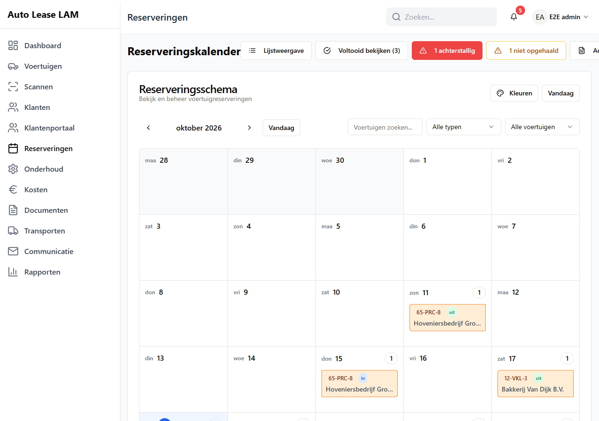

# 5. Reserveringen

Dit is het hart van de app. Een reservering koppelt één auto aan één klant voor een periode. Alles
wat daarna gebeurt — het contract, de kilometers, de schadecheck, de factuurgegevens — hangt aan
die ene regel.

De levensloop van een verhuring is kort:

**Geboekt** → *ophalen* → **Opgehaald** → *innemen* → **Voltooid**

Je zet die stappen met de knoppen **Ophalen starten** en **Inleveren starten**, nooit met het
statuslijstje. De knoppen leggen namelijk ook de kilometerstand, de brandstof en het
contractnummer vast, en maken het contract en de schadecheck aan.

---

## 5.1 De kalender

Klik links op **Reserveringen**. Je komt op de **Reserveringskalender** met standaard een
maandweergave.

Rechtsboven staan:

| Knop | Waarvoor |
|---|---|
| **Lijstweergave** | Dezelfde reserveringen als lijst, zie 5.2 |
| **Voltooid bekijken (…)** | De afgesloten verhuringen opzoeken en inzien, zie 5.8 |
| **Verwijderde reserveringen** | De prullenbak van dit scherm, zie 5.10 |
| **… achterstallig** | De verhuringen die over hun einddatum heen zijn (rood) |
| **… niet opgehaald** | Boekingen die nooit zijn opgehaald en een maand of langer geleden zijn gestart, zie 5.12 — staat er alleen als die er zijn |
| **Administratie** | De factuurgegevens voor het externe facturatiesysteem |
| **Nieuwe reservering** | Een nieuwe boeking, zie 5.3 |

Boven de kalender zelf: **Kleuren** (de legenda), **Vandaag** (spring terug naar deze maand), de
pijltjes voor de vorige en volgende maand, en de filters **Voertuigen zoeken...**,
**Voertuigtype** (**Alle typen**) en **Beschikbaarheid** (**Alle voertuigen**, **Beschikbaar**,
**Gereserveerd**).

**Wat er in een dagvakje staat.** Alleen reserveringen die op die dag **beginnen of eindigen**.
Per regel zie je het kenteken, het woordje **uit** (die dag gaat de auto mee) of **in** (die dag
komt hij terug), en de klantnaam. Zijn er meer dan vijf, dan verschijnt **+… meer**; die knop
opent het venster **Reserveringen voor <datum>**.

Verder kun je in een dagvakje tegenkomen:

- een moersleuteltje bij een onderhoudsblok, met de tekst *Onderhoud: <type> - <status>*;
- **TBD** in plaats van een kenteken: een vervangend voertuig dat nog niet is aangewezen;
- **🚗 VERVANGER**: deze regel is een vervangende auto;
- **Feestdag** of **Geblokkeerd** op een niet-werkdag.

*De **Reserveringskalender**: per dagvakje de reserveringen die die dag beginnen (**uit**) of
eindigen (**in**), met rechtsboven het aantal en **+… meer** als er meer dan vijf zijn.*

Klik op **Kleuren** voor het venster **Legenda reserveringskalender** met de betekenis van elke
kleur: **Bevestigde reservering**, **Reservering in behandeling**, **Voltooide reservering**,
**Geannuleerde reservering**, **Vervangend voertuig**, **Vervangend voertuig (nog te bepalen)**,
**Ophaaldag** en **Inleverdag**.

**Een reservering verslepen.** Sleep je een blok naar een andere dag, dan vraagt de app eerst
**Reservering verplaatsen?** — *Je staat op het punt deze reservering … dag(en) later te zetten*
— met de oude en de nieuwe periode erbij. Bevestig met **Verplaatsen**.

---

## 5.2 De lijstweergave

Klik rechtsboven op **Lijstweergave**. Je krijgt het venster **Reserveringen** — *Bekijk en
beheer alle reserveringen* — met drie tabbladen:

**Actief (…) · Achterstallig (…) · Geschiedenis (…)**

Zoek met *Zoek op kenteken, klant, contract, ID...* en sorteer met de knoppen **Ophalen**,
**Klant**, **Kenteken** en **Inleveren**.

Per regel zie je: het nummer (bijvoorbeeld **#3366**) met de status ernaast, het kenteken met
merk en model, de klant en het contractnummer, **Uit:** met de startdatum en **In:** met de
einddatum plus de duur, de kilometerstanden (**KM:** uit → in) en de prijs. Rechts staan een
oogje (bekijken), een potlood (bewerken) en een prullenbak (verwijderen). Bij een nog niet
toegewezen vervanger staat er **Voertuig toewijzen**.

Op het tabblad **Achterstallig** staat de toelichting *Voertuigen die ingeleverd hadden moeten
zijn maar nog bij de klant zijn*, met per regel **… dag(en) te laat** en **Verwacht: <datum>**.

Onderhoudsblokken staan hier **niet** tussen; die vind je op de Onderhoudskalender (hoofdstuk 7).

---

## 5.3 Een nieuwe reservering maken

1. Druk op `N`, of klik op **Reserveringen** → **Nieuwe reservering**. Het venster **Nieuwe
   reservering** opent.

### Stap 1 — de huurdata

Bovenaan staat **1. Selecteer huurdata** met de uitleg *Kies eerst je huurdata om alleen
beschikbare voertuigen te zien en boekingsconflicten te voorkomen.* Doe dat ook echt eerst: pas
daarna filtert de app de voertuiglijst.

2. **Startdatum** staat al op vandaag.
3. **Einddatum** staat alvast drie dagen na de startdatum. Het vinkje **Huur zonder einddatum**
   staat standaard **uit**; zet het alleen aan als de inleverdatum echt nog niet bekend is. Dan
   verdwijnt het veld **Einddatum** en toont de duur **Open einde**.
4. Pas **Einddatum** aan. Onder de velden staat **Duur:** met het aantal dagen.
5. **Ophaaltijd (optioneel)** en **Inlevertijd (optioneel)** vul je alleen in als de auto op
   dezelfde dag wisselt van klant. De app gebruikt de tijden om te zien dat dat geen echt
   conflict is.

> **Waarom de datums eerst:** de app haalt de lijst met vrije auto's op voor precies die periode.
> Vul je ze later in, dan staan er auto's in de lijst die in jouw periode al bezet zijn.

> **Een datum in het verleden mag gewoon.** Typ je bij **Startdatum** of **Einddatum** een dag
> die al voorbij is, dan accepteert de app dat zonder waarschuwing — handig om een verhuring die
> je vergeten was in te voeren alsnog vast te leggen. Het voertuig telt daarna alleen als
> **verhuurd** zolang die periode ook echt loopt; is de periode al voorbij, dan staat de auto
> gewoon weer **beschikbaar** voor een nieuwe boeking, ook als de oude reservering zelf nooit is
> opgehaald (zie 5.12).

### Stap 2 — voertuig en klant

Onder **2. Selecteer voertuig en klant** staat in het groen: *Alleen beschikbare voertuigen voor
je geselecteerde data worden getoond.*

6. Klik op **Voertuig** → **Zoek en selecteer een voertuig...** en typ het kenteken in het veld
   *Zoek op kenteken, merk of model...* Klik op de juiste regel.
   - Staat je auto er niet bij en krijg je *Geen voertuigen gevonden.*, dan is hij in die periode
     bezet. Kies een andere auto of andere datums.
   - Heb je bewust een auto nodig die al bezet lijkt (een langlopende huur die overloopt), vink
     dan **Toon alle voertuigen (voor langdurige verhuur)** aan. Je krijgt dan wel de rode
     waarschuwing van stap 8 als hij echt botst.
   - Met **Nieuw toevoegen** en **Bewerken** kun je vanuit dit venster een auto aanmaken of
     bijwerken.
7. Klik op **Klant** → **Zoek en selecteer een klant...** en typ de naam, het telefoonnummer of
   de plaats. Onder elke naam staan het telefoonnummer en het e-mailadres — lees die regel
   voordat je klikt, zeker bij een veelvoorkomende naam.
8. Zodra er een klant staat, verschijnt het veld **Gemachtigde chauffeur (optioneel)**. Kies de
   chauffeur die gaat rijden, of maak er een aan met **Snel chauffeur toevoegen**. De
   hoofdchauffeur van de klant heeft het label **Primaire chauffeur**.

**Wat je hier kunt tegenkomen:**

| Melding | Betekent | Kun je door? |
|---|---|---|
| Rood: *Dit voertuig is al gereserveerd voor de geselecteerde data. Kies andere data of een ander voertuig.* | De periode botst met een andere boeking | **Nee** — de knop **Reservering aanmaken** wordt grijs |
| Geel: *Let op: dit voertuig staat in deze periode ingepland voor onderhoud (05-10-2026 t/m 07-10-2026). Opslaan mag; het onderhoudsblok blijft staan.* | De werkplaats heeft die auto ook geclaimd | **Ja** — maar zorg dan dat het onderhoud verzet of geregeld wordt |
| Rood: *De APK (keuring) van dit voertuig is verlopen op <datum>. Bevestig dat het veilig en legaal is om te verhuren voordat je verdergaat.* | De APK is over datum | Technisch wel — doe het niet, laat eerst keuren |

Staat een klant op de zwarte lijst voor een auto, dan verdwijnt die combinatie stil uit de
lijstjes. Je krijgt geen melding; de auto is er simpelweg niet.

### Stap 3 — de details

9. Onder **3. Reserveringsdetails** laat je **Reserveringsstatus** op **Geboekt** staan.
10. **Totaalprijs (€) (optioneel)** vult de app zelf in op basis van de dagprijs van de auto maal
    het aantal dagen; er staat dan bij *Automatisch ingevuld op basis van het dagtarief van €…
    voor … dagen — bewerk om te overschrijven*. Heeft de auto geen dagprijs, dan blijft er € 0,00
    staan en vul je het bedrag zelf in.
11. Moet de auto gebracht worden, zet dan **Bezorgservice vereist** aan en vul **Bezorgadres**,
    **Stad**, **Postcode** en eventueel **Bezorgnotities** in.
12. Zet bijzonderheden in **Notities**.
13. Klik onderaan op **Reservering aanmaken**.

Je krijgt **Reservering succesvol aangemaakt** — *Reservering voor <merk> <model> is aangemaakt.*
Daarna verandert **Annuleren** in **Sluiten**; documenten uploaden kan nu wel.

**Twee dingen die vanzelf gebeuren:**

- Staat de auto op **BV**, dan zet de app de registratie zelf om naar **Opnaam** en meldt dat
  achteraf: *Voertuig automatisch gewijzigd van BV naar Opnaam (vereist voor verhuur -
  verzekering & wegenbelasting)*. Lukt dat niet, dan vraagt de app je het zelf te doen op de
  voertuigkaart.
- Staat er van deze auto nog een **opgehaalde** verhuring die over haar einddatum heen is en nog
  niet is ingeleverd, dan verschijnt eerst **Achterstallige reserveringen gevonden**. Los die
  eerst op met **Markeer als voltooid** of **Details bekijken**, of ga bewust verder met
  **Doorgaan met reservering**. Een oude boeking die nooit is opgehaald, blokkeert dit sinds kort
  niet meer — die krijgt in plaats daarvan de eigen melding uit 5.12.

---

## 5.4 Een reservering openen — let op welk venster je krijgt

Er zijn twee vensters die allebei **Reserveringsdetails** heten, en ze hebben **niet** dezelfde
knoppen. Dat is belangrijk, want de kleine wijzigvensters van 5.5 zitten maar in één ervan.

**Het korte venster** krijg je door in de **kalender** op een regel te klikken, of in de
**lijstweergave** op het oogje. Onderaan staan alleen:

**Ophalen starten** of **Inleveren starten** · **Bewerken** · **Onderhoud** · **Sluiten**

In de kalender staat er bij een huur die al is opgehaald, afgesloten of geannuleerd ook
**Overdracht terugdraaien** bij (bij een geannuleerde huur heet de knop **Annulering terugdraaien**;
zie 5.14), plus een prullenbakje. Het volledige venster hieronder heeft die knop niet.

**Het volledige venster** krijg je via het zoekveld bovenin het scherm: typ het kenteken, de
klantnaam of het contractnummer, en klik onder **Reserveringen** op de regel. Dit venster toont
ook de reserveringscode (**RES-003366**), de status, de huurperiode, de totaalprijs, het
voertuig, de klant, de chauffeur, de documenten, het blok **Voertuigservice** en de
**Geschiedenis**. Onderaan staan:

**Ophalen starten** of **Inleveren starten** · **Datums wijzigen** · **Klant wijzigen** ·
**Voertuig wijzigen** · **Bewerken** · **Reservering annuleren** · **Verwijderen** · **Sluiten**

**Reservering annuleren** staat er alleen zolang de reservering nog loopt. Bij een huur die al
**Voltooid** of **Geannuleerd** is, verdwijnt de knop.

> **Onthoud:** wil je snel alleen de datums, de klant of de auto corrigeren, of wil je de huur
> annuleren, zoek de reservering dan op via het **zoekveld bovenin**. Vanuit de kalender krijg je
> die knoppen niet.

---

## 5.5 De kleine wijzigvensters

Deze drie vensters veranderen precies één ding en laten de rest van de boeking met rust. Gebruik
ze liever dan het volledige bewerkformulier: werken twee collega's tegelijk aan dezelfde
reservering, dan overschrijft het volledige formulier elkaars werk, en deze vensters niet.

### Datums wijzigen

1. Open de reservering via het zoekveld bovenin en klik op **Datums wijzigen**.
2. Je leest: *Alleen de begin- en einddatum worden gewijzigd; de rest van de boeking blijft zoals
   hij is.*
3. Pas **Begindatum** en/of **Einddatum** aan.
4. Klik op **Opslaan**.

Zet je de einddatum vóór de begindatum, dan verschijnt meteen in het venster: *De einddatum kan
niet vóór de begindatum liggen.* Botst de nieuwe periode met een andere boeking, dan weigert de
app met de botsende reservering erbij.

> **Let op:** ook de datums van een huur die al is opgehaald mag je wijzigen, en de app
> waarschuwt daar niet bij. Het getekende contract klopt dan niet meer. Genereer in dat geval het
> contract opnieuw (hoofdstuk 8).

### Klant wijzigen

1. Klik op **Klant wijzigen**. Je leest: *Alleen de klant wordt gewijzigd; de rest van de
   boeking blijft zoals hij is.*
2. Zoek de juiste klant in het veld *Zoek op naam, bedrijf of debiteurnummer...* en klik hem aan.
   Met **Andere klant kiezen** pak je een andere.
3. Klik op **Opslaan**. Je krijgt **Klant gewijzigd**.

### Voertuig wijzigen

1. Klik op **Voertuig wijzigen**. Je leest: *Alleen het voertuig wordt gewijzigd; de
   beschikbaarheid wordt opnieuw gecontroleerd.*
2. Kies een auto in het veld *Kies een voertuig...*
3. Klik op **Opslaan**. Je krijgt **Voertuig gewijzigd**.

### Het contractnummer wijzigen

In de kalender staat het contractnummer in een blauw vakje met een potloodje ernaast (*Contractnummer
bewerken*). Het venster **Contractnummer bewerken** controleert live of het nummer vrij is:
**Beschikbaarheid controleren...**, dan **Beschikbaar** of *Al in gebruik door reservering #…
Kies een ander nummer.*

**Na elke wijziging:** is er al een contract gemaakt, dan krijgt dat het oranje label
**Verouderd**. Klik op **Opnieuw genereren** en geef de klant de nieuwe versie (hoofdstuk 8).

---

## 5.6 Het volledige bewerkformulier

Klik op **Bewerken** in het venster van de reservering. Je krijgt hetzelfde formulier als bij het
aanmaken, met dezelfde drie genummerde stappen. Onder **3. Reserveringsdetails** staan hier extra
velden: **Contractnummer**, **Kilometerstand bij inleveren**, **Brandstofniveau bij inleveren**
en **Brandstofkosten (€)**.

**Reserveringsstatus** biedt hier alle vijf de statussen: **Geboekt**, **Opgehaald**,
**Ingeleverd**, **Voltooid** en **Geannuleerd**. In het aanmaakvenster zie je er maar twee.

Klik onderaan op **Reservering bijwerken**. Je krijgt **Reservering succesvol bijgewerkt**.

**Een oude verhuring bewerken vraagt een beheerderswachtwoord.** Is de auto meer dan drie weken
geleden opgehaald, dan komt het venster **Beheerdersgoedkeuring vereist**: *Deze verhuur is meer
dan 3 weken geleden opgehaald. Voer een beheerderswachtwoord in om je wijzigingen op te slaan.*
Vul het in en klik op **Bevestigen**, of haal er een beheerder bij.

> **Let op:** twee collega's tegelijk in dit formulier gaat mis — wie het laatst opslaat, wint,
> zonder waarschuwing. Gebruik voor kleine correcties de vensters uit 5.5.

---

## 5.7 Ophalen: de auto meegeven

Je kunt het ophalen op drie manieren starten. Ze openen allemaal precies hetzelfde venster:

- **Dashboard** → **Snelle acties** → **Ophalen starten** → het sleutellabel scannen of het
  kenteken typen; het venster opent dan meteen (het snelst aan de balie, hoofdstuk 18,
  paragraaf 18.7);
- **Scannen** → het sleutellabel scannen → **Ophalen starten** (het veiligst, hoofdstuk 18);
- de reservering openen → **Ophalen starten**.

Het venster heet **Ophaalproces starten** — *Voer de huidige kilometerstand en het brandstofniveau
van het voertuig bij ophalen in. Er wordt automatisch een contract gegenereerd.*

1. Controleer in het blok **Voertuiginformatie** het **Kenteken**, het **Voertuig** en de
   **Klant**. Klopt dit niet, klik dan op **Annuleren**.
2. **Contractnummer** is al ingevuld (*Automatisch gegenereerd, je kunt het indien nodig
   bewerken*). Laat het staan tenzij er een reden is om het te wijzigen.
3. **Ophaaldatum** staat op vandaag.
4. Vul **Kilometerstand bij ophalen** in. In het veld staat wat de app als laatste stand kent,
   bijvoorbeeld *Huidig: 25.000 km*.
5. Zet **Brandstofniveau bij ophalen** op **Vol**, **3/4**, **1/2**, **1/4** of **Leeg**.
6. Maak eventueel een schadecheck: **Ophaal-schadecheck aanmaken** voor de digitale check, of
   **Papieren check uploaden** als je een formulier op papier hebt.
7. Zet bijzonderheden in **Aanvullende notities (optioneel)**.
8. Klik op **Ophalen voltooien & contract genereren**.

Je krijgt **Ophalen voltooid** — *Voertuig succesvol opgehaald. Contract is gegenereerd.* Direct
daarna verschijnt het venster **Contract klaar** met de bestandsnaam en de knoppen **Afdrukken**,
**Mail naar klant** en **Sluiten**.

> **Waarom het contract pas hier wordt gemaakt:** op dit moment liggen de kilometerstand, de
> brandstof, het contractnummer en de ophaaldatum vast. Maak je het contract eerder, dan staan
> die velden er leeg op en klopt het papier niet met de auto die wegrijdt.

### Vijf dingen die de app kan vragen of weigeren

**1. Voertuigopmerkingen.** Staan er opmerkingen bij de auto, dan verschijnt eerst
**Voertuigopmerkingen - Ophaalwaarschuwing** met de tekst *BELANGRIJK: Bekijk deze opmerkingen
voordat het voertuig vertrekt:*. Lees ze, bespreek ze met de klant en klik op **Ik bevestig & ga
door**. Klik je op **Annuleren**, dan sluit het hele ophaalvenster. Sla je de bevestiging over,
dan meldt de app **Opmerkingen niet bevestigd** — *Je moet de voertuigopmerkingen bevestigen
voordat je verdergaat met ophalen.*

**2. De huur start eerder.** Haal je de auto op vóór de afgesproken startdatum, dan vraagt de
app:

> **De huur start eerder — datum aanpassen?**
> *Deze huur staat gepland vanaf 05-10-2026, maar het voertuig gaat vandaag (13-09-2026) mee. Zet
> de startdatum op vandaag, zodat de periode en de prijs kloppen?*
> **Nee, niet ophalen** · **Ja, startdatum naar vandaag**

Kies **Ja, startdatum naar vandaag** als de huur vandaag ingaat — dat is bijna altijd het goede
antwoord, want anders staat de auto buiten terwijl de app hem als vrij ziet en klopt de prijs
niet. Kies **Nee, niet ophalen** als de klant de auto nog niet meekrijgt; er wordt dan niets
opgeslagen.

**3. Dubbel contractnummer.** Is het nummer al in gebruik, dan opent **Dubbel contractnummer** —
*Dit contractnummer is al in gebruik.* Je ziet bij welke reservering het hoort. De uitleg staat
erbij: *Als je doorgaat, wordt het contractnummer van de bestaande reservering verwijderd en aan
deze toegewezen.* Kies **Annuleren** en gebruik een ander nummer, of **Overschrijven & doorgaan**
als je zeker weet dat je een fout herstelt.

**4. Kilometerstand-overschrijving vereist.** Is de stand die je invult lager dan wat de app
weet, dan moet iemand met het recht daarvoor zijn **eigen accountwachtwoord** invullen. Zie
hoofdstuk 4, paragraaf 4.8.

**5. De auto staat in de werkplaats.** Dan opent het venster **Uitgifte geblokkeerd**:

> *Dit voertuig staat in de werkplaats en kan niet worden uitgegeven. Rond de werkplaatsklus
> eerst af.*

Er wordt dan **niets** opgeslagen — ook de startdatum schuift niet.

- **Ben je geen beheerder?** Dan staat er alleen *Alleen een beheerder kan de uitgifte forceren.
  Los de werkplaatsstatus op, of vraag een beheerder.* Gebruik **Terug van onderhoud** of **Terug
  uit onderhoud** (hoofdstuk 7 en 18) en start het ophalen daarna opnieuw.
- **Ben je beheerder?** Dan staat er een veld **Reden voor het forceren** en de knop **Toch
  uitgeven**. Zonder reden blijft die knop uit. De reden komt in de notities van de reservering
  te staan, bijvoorbeeld *[WORKSHOP OVERRIDE 2026-09-13] IN_WORKSHOP forced by admin: klant staat
  aan de balie*. Wil je toch niet uitgeven, klik dan **Niet uitgeven**.

Vergelijkbare weigeringen, in hetzelfde venster: *Dit voertuig staat op "reparatie nodig"…*
(status **Reparatie nodig**) en *Dit voertuig staat op "niet voor verhuur"…*

### Het ophalen ongedaan maken

Heb je het ophalen op de verkeerde regel afgerond, dan kan dat terug, met de knop **Overdracht
terugdraaien**. Dat venster laat eerst zien wat er gaat gebeuren, ook met de kilometerstand van de
auto, en doet pas iets nadat jij bevestigt. Hoe het werkt staat in 5.14. Het contract dat bij het
foute ophalen is gemaakt, wordt daarbij zelf als **Verouderd** gemarkeerd (hoofdstuk 8, paragraaf
8.6); je hoeft het niet meer met de hand te verwijderen.

---

## 5.8 Innemen: de auto terugnemen

Ook hier drie startpunten: **Dashboard** → **Snelle acties** → **Innemen starten** → scannen,
**Scannen** → **Inleveren starten**, of de reservering openen → **Inleveren starten**. Ze openen allemaal het venster
**Inleverproces starten** — *Voer de huidige kilometerstand en het brandstofniveau van het
voertuig bij inleveren in. Er wordt automatisch een schadecheck gegenereerd.*

1. Controleer **Kenteken** en **Voertuig**. In het blok staat ook **Bij ophalen:** met de stand
   van toen.
2. **Inleverdatum** staat op vandaag — *Wanneer het voertuig daadwerkelijk is ingeleverd*. Kwam
   de auto gisteren al terug, zet die datum er dan in.
3. Vul **Kilometerstand bij inleveren** in.
4. Zet **Brandstofniveau bij inleveren**; het niveau bij ophalen staat eronder ter vergelijking.
5. Maak eventueel **Inlever-schadecheck aanmaken**, of upload een **Papieren check**.
6. Zet schade, een ontbrekende sleutel of een vuile auto in **Aanvullende notities (optioneel)**.
7. Klik op **Inleveren voltooien & schadecheck genereren**.

Je krijgt **Inleveren voltooid** — *Voertuig succesvol ingeleverd. Schadecheck is gegenereerd.*
Daarna verschijnt **Schadeformulier klaar** met de bestandsnaam en de knoppen **Afdrukken**,
**Mail naar klant** en **Sluiten**.

### Wat er nu automatisch gebeurt

**Met het innemen is de huur meteen afgesloten.** De reservering springt in één keer naar
**Voltooid** en het voertuig staat weer op **Beschikbaar**. Je hoeft daarna niets meer op een
status te zetten, en er is geen aparte "afronden"-stap meer.

Verder:

- De afgesproken **einddatum blijft staan** zoals hij was. De werkelijke inleverdatum wordt apart
  vastgelegd, zodat je achteraf ziet dat de auto bijvoorbeeld twaalf dagen eerder terug was.
- De kilometerstand van het voertuig wordt bijgewerkt naar de stand die je invulde.
- De werkplaatsstatus verdwijnt **niet** vanzelf. Ging de auto kapot terug, dan moet je hem zelf op
  **Onderhoud nodig** zetten (hoofdstuk 7).

**Een te lage stand wordt geweigerd:** **Ongeldige kilometerstand** — *Kilometerstand bij
inleveren kan niet lager zijn dan bij ophalen (25000 km).* Lees de teller dan opnieuw af.

> **Let op — controleer vóór je afrondt het kenteken en de klant.** Ging het toch mis, dan kun
> je de inname terugdraaien met **Overdracht terugdraaien** (5.14), onder meer in de lijst achter
> **Voltooid bekijken (…)**; zie ook hoofdstuk 11, paragraaf 11.13.

### Een afgesloten verhuring terugzoeken

Klik rechtsboven op de kalender op **Voltooid bekijken (…)**. Je krijgt **Geschiedenis voltooide
verhuur** — *Bekijk, herstel of verwijder voltooide verhuurgegevens*. Zoek op voertuig, klant of
kenteken en stel bij **Periode** in hoe ver je terugkijkt (**Alle tijd**, de laatste 7, 30 of 90
dagen, of het laatste jaar). Per regel staan de auto, de klant, de periode, de kilometerstanden,
de brandstof en het totaalbedrag, met de knoppen **Bekijken**, **Overdracht terugdraaien** en
**Verwijderen**.

**Overdracht terugdraaien** draait de inname terug. Je krijgt eerst de voorvertoning van 5.14: de
verhuring gaat van **Voltooid** terug naar **Opgehaald**, de kilometerstand, het brandstofniveau en
de inleverdatum die je bij het innemen invulde worden gewist — die inname heeft immers niet
plaatsgevonden — en de kilometerstand en het brandstofniveau van de auto gaan terug naar de stand
van vóór het innemen. De afgesproken **begin- en einddatum blijven staan**. Daarna neem je de auto
gewoon opnieuw in, met de juiste gegevens. **Verwijderen** brengt de verhuring naar de prullenbak
(5.10; voor een opgehaalde huur ook 5.15).

---

## 5.9 Annuleren

1. Zoek de reservering op via het **zoekveld bovenin** en open het volledige venster (5.4).
2. Klik onderaan op **Reservering annuleren**.
3. Het venster **Reservering annuleren** opent — *Reservering #… wordt geannuleerd. Kies hieronder
   wat er met het gekoppelde moet gebeuren.* Onder **Hieraan hangt nog:** staat wat er aan de
   reservering vastzit: het bijbehorende **transport**, de **vervangingsreservering**, een
   **placeholder-reservering** en een **chauffeurstoewijzing**, elk met nummer en datum.
4. Vink per onderdeel aan of het mee moet: **Transport meeannuleren**, **Vervangingsreservering
   meeannuleren**, **Placeholder-reservering meeannuleren** of **Chauffeurstoewijzing
   meeannuleren**. Er staat bij: *Wat je niet aanvinkt, blijft gewoon staan.*
5. Klik op **Reservering annuleren**, of op **Niet annuleren** als je twijfelt.

Je krijgt **Reservering geannuleerd** — *Reservering #… staat nu op Geannuleerd.* De regel blijft
zichtbaar op de kalender en in de lijsten, met de kleur van een geannuleerde reservering, en het
aangevinkte is in één keer meegegaan.

Hangt er niets aan de reservering, dan meldt het venster dat ook (*Er hangt niets anders aan deze
reservering.*) en annuleer je alleen de reservering zelf.

> **Wat je niet aanvinkt, moet je zelf afhandelen.** Laat je de vervanger of het transport staan,
> dan blijft die auto bezet en die rit gepland. Loop dat dus na (hoofdstuk 11, paragraaf 11.8).

> **Een annulering kun je terugdraaien (5.14).** Open de geannuleerde reservering in de kalender of
> in de lijst en klik op **Annulering terugdraaien**. Dat lukt alleen als de auto in die periode nog
> vrij is, en wat je bij het annuleren hebt meegenomen (transport, vervanger, chauffeurstoewijzing)
> komt niet vanzelf terug. Zet je een geannuleerde reservering via het statuslijstje weer op
> **Geboekt**, dan weigert de app met *Undoing a handover or a cancellation goes through POST
> /api/reservations/:id/revert.* — gebruik dan de knop.

> **Is de huur al opgehaald?** Dan vraagt het annuleren een eigen vinkje en een bevestigde
> waarschuwing; zie 5.15.

De klant krijgt géén automatisch bericht van een annulering. Bel of mail zelf.

---

## 5.10 Een reservering verwijderen en terugzetten

Verwijderen is iets anders dan annuleren. Annuleren laat de regel staan als spoor; verwijderen
haalt hem uit beeld. Gebruik verwijderen alleen voor een regel die er nooit had moeten staan.

1. Open de reservering en klik op **Verwijderen**.
2. Je krijgt **Weet je het zeker?** — *Reservering #… wordt naar de prullenbak verplaatst;
   terugzetten kan via Prullenbak.*
3. Klik op **Verwijderen**.

Je krijgt **Reservering verwijderd** — *De reservering is succesvol verwijderd.*

**Terugzetten kan.** De reservering gaat naar de prullenbak van dit scherm: de knop **Verwijderde
reserveringen** rechtsboven op de **Reserveringskalender**. De regel staat daar met het label
**Reservering**, bijvoorbeeld *Reservering #3366 — HL-02-HL 2026-10-05*, met de knop **Terugzetten**
en, als je hem voorgoed kwijt wilt, **Definitief verwijderen**. De knop **Verwijderde reserveringen**
is er voor iedereen met het vinkje **Prullenbak beheren** (hoofdstuk 15, paragraaf 15.16); zonder
dat vinkje staat hij er wel, maar grijs. Alles over terugzetten en definitief verwijderen staat in
hoofdstuk 10, paragraaf 10.6. Een verwijderd **onderhoudsblok** staat niet hier maar in de prullenbak
van **Onderhoud** (hoofdstuk 7, paragraaf 7.8).

Lukt terugzetten niet omdat de auto inmiddels opnieuw verhuurd is in die periode, dan meldt de
app: *Deze reservering kan niet terug: het voertuig is in de tussentijd geboekt voor die
periode.*

> **Beperking:** het verwijdervenster van een reservering toont géén lijst van wat eraan hangt.
> Bij een voertuig krijg je die lijst wel. Kijk dus zelf even of er een contract, een transport
> of een vervanger aan hangt.

---

## 5.11 Achterstallige verhuringen nalopen

Een verhuring is **achterstallig** als ze als opgehaald staat en de afgesproken einddatum voorbij
is. De app sluit zo'n verhuring bewust niet automatisch af: alleen jij kunt weten of de auto
werkelijk nog bij de klant staat of dat iemand vergeten is hem in te nemen.

Je vindt ze op drie plekken:

- **Reserveringen** → de rode knop **… achterstallig** rechtsboven. Die staat er alleen als er
  iets achterstallig is. Het venster **Te late verhuren** toont per regel het merk en model, het
  kenteken, de klant met het telefoonnummer, *Had ingeleverd moeten zijn: <datum>*, een rood
  label **… dag(en) te laat** en de knop **Details bekijken**.
- **Reserveringen** → **Lijstweergave** → tabblad **Achterstallig (…)**, met een zoekveld (5.2).
  Klik op een regel om de reservering te openen.
- **Dashboard** → het blok **Achterstallige verhuringen**; met het oogje open je de reservering.

**Zo loop je ze na.** Vraag je per regel af: staat die auto werkelijk nog bij de klant?

- **Staat hij er nog** — laat de regel staan en bel eventueel de klant.
- **Is hij al terug** — klik op **Details bekijken** en daarna op **Inleveren starten**. Je
  krijgt hetzelfde venster als in 5.8, en daarmee is de huur afgesloten.
- **Klopt er iets anders niet** — open de reservering en corrigeer haar (5.4 en 5.5).

**Loop deze verhuringen regelmatig na.** Zolang een oude verhuring openstaat, geldt die auto als
verhuurd en kun je hem niet opnieuw inplannen.

---

## 5.12 Niet opgehaalde reserveringen: de melding in de kalender

Een boeking die nooit is opgehaald en waarvan de startdatum een maand of langer geleden is,
blokkeert sinds kort niets meer (zie 5.3) — maar verdwijnt ook niet vanzelf. Ze blijft gewoon op
**Geboekt** staan totdat iemand ernaar kijkt. Daarvoor is er een eigen melding, los van de
achterstallige verhuringen in 5.11: dit gaat om auto's die nooit zijn opgehaald, niet om auto's
die te laat terugkomen.

**De melding komt vanzelf.** Zodra de reserveringskalender zulke boekingen vindt, opent
automatisch het venster **Niet opgehaalde reserveringen** — *Deze boekingen zijn een maand of
langer geleden gestart en zijn nooit opgehaald. Ze blokkeren niets, maar verdienen een blik.* Dat
gebeurt **één keer per sessie**: sluit je het venster, dan komt het pas terug als je de browser
opnieuw opent of een nieuw tabblad gebruikt. Zolang er nog rijen zijn, staat rechtsboven ook de
knop **… niet opgehaald**, naast **… achterstallig** (5.1), waarmee je het venster later
opnieuw opent.

Per regel zie je het voertuig, de klant, de periode en hoe lang geleden de huur had moeten
beginnen. Twee knoppen per regel:

- **Bekijken** opent de reservering zelf, zodat je kunt corrigeren of alsnog kunt ophalen.
- **Annuleren** annuleert de boeking meteen, zonder tussenstap. Deze knop staat er alleen voor
  wie **Reserveringen beheren** heeft; zonder dat recht staat hij er wel, maar grijs (hoofdstuk
  15, paragraaf 15.9). Iedereen met **Reserveringen bekijken** ziet de melding en de lijst zelf
  wél, ook zonder dat recht.

Is de lijst leeg, dan staat er *Geen niet opgehaalde reserveringen.* Sluit het venster met
**Sluiten**.

---

## 5.13 De statussen op een rij

| Status | Wat het betekent | Hoe hij zo wordt |
|---|---|---|
| **Geboekt** | De auto is gereserveerd, maar staat nog bij ons | Standaard bij **Reservering aanmaken**; ook na het terugdraaien van een ophaling of een annulering (5.14) |
| **Opgehaald** | De auto is meegegeven en staat bij de klant | Door **Ophalen voltooien & contract genereren**; ook na het terugdraaien van een inname of van de annulering van een opgehaalde huur (5.14) |
| **Ingeleverd** | De auto is terug, maar de huur is nog niet afgerond | Alleen door de status met de hand te kiezen — het inleverproces gebruikt hem niet |
| **Voltooid** | De huur is afgesloten, de auto is weer vrij | Door **Inleveren voltooien & schadecheck genereren**; ook met de hand |
| **Geannuleerd** | De boeking gaat niet door | Door **Reservering annuleren** in het volledige venster (5.9); ook met de hand |

Elke stand heeft één naam, in elk scherm: **Geboekt**, **Opgehaald**, **Ingeleverd**,
**Voltooid** en **Geannuleerd**. Ook het scanscherm gebruikt deze woorden.

---

## 5.14 Een overdracht of een annulering terugdraaien

Heb je het ophalen of het innemen op de verkeerde regel afgerond, of een reservering per ongeluk
geannuleerd, dan draai je dat terug met **één venster**: **Overdracht terugdraaien** (bij een
annulering heet het **Annulering terugdraaien**). Het venster laat eerst zien wat er gaat gebeuren
en doet pas iets nadat jij bevestigt. Een andere weg is er niet meer: de oude knoppen
**Terugzetten naar geboekt** en **Terugzetten** achter **Voltooid bekijken (…)** zijn erdoor
vervangen, en een terugdraaiing via het statuslijstje wordt geweigerd.

**Wie het mag.** Iedereen met het vinkje **Overdracht terugdraaien**: een beheerder altijd, een
manager sinds oktober 2026 eenmalig vanzelf, een ander account alleen als je het vinkje aanzet
(hoofdstuk 15, paragraaf 15.16). Wie alleen **Reserveringen beheren** heeft, kan het niet. Mis je
het vinkje, dan staat de knop er wel, maar grijs, met de uitleg welk recht je nodig hebt.

**Waar de knop staat.** Bij elke reservering die opgehaald, ingeleverd, voltooid of geannuleerd is:

- in de kalender: in het korte venster **Reserveringsdetails** (5.4) en in de kaart die verschijnt
  als je een regel aanwijst;
- in de **lijstweergave** (5.2): het draai-pijltje achter de regel, naast het oogje en het potlood;
- achter **Voltooid bekijken (…)** (5.8);
- op het **Dashboard**, bij de verhuringen die nu lopen, en in het venster achter **Snelle acties**;
- op de voertuigkaart, bovenaan, zolang de auto is meegegeven.

Het volledige venster dat je via het zoekveld opent (5.4) heeft de knop niet. Een onderhoudsblok
heeft hem ook niet: een blok is nooit aan een klant meegegeven.

### Het venster, stap voor stap

1. Klik op de knop. Het venster **Overdracht terugdraaien** opent — *Controleer wat er met
   reservering #… gebeurt voordat je bevestigt.* Even wachten tot de voorvertoning er staat.
2. Lees de voorvertoning. Die kan vijf stukken hebben:
   - de regel *Status: Opgehaald wordt Geboekt.*;
   - **Deze gegevens worden gewist:** met per veld wat leegraakt, bijvoorbeeld **Daadwerkelijke
     ophaaldatum**, **Kilometerstand bij ophalen**, **Brandstofniveau bij ophalen** en
     **Contractnummer**;
   - het blok **Voertuig**, bijvoorbeeld *Kilometerstand: van 20.350 km naar 20.000 km.* en
     *Brandstofniveau: van … naar …*;
   - **Deze documenten worden als vervallen gemarkeerd (ze worden niet verwijderd):** met het
     **Niet-ondertekend contract** of de **Schadecheck**;
   - **Let op**, met waarschuwingen (zie hieronder).
3. Gaat de kilometerstand van de auto omlaag, dan staat er een vinkje: *Ik bevestig dat de
   kilometerstand van het voertuig omlaag gaat, van … km naar … km.* Zet het aan; zolang het uit
   staat, blijft de bevestigingsknop grijs.
4. Klik op **Overdracht terugdraaien** (of **Annulering terugdraaien**). Twijfel je, klik dan op
   **Annuleren**: er is dan niets veranderd.

Je krijgt **Overdracht teruggedraaid** (bij een annulering **Annulering teruggedraaid**) —
*Reservering #… heeft weer de status Geboekt.*

### Wat er per soort terugdraaien gebeurt

| Je draait terug | De reservering wordt | Wat er gewist wordt | De auto | Documenten |
|---|---|---|---|---|
| Een **ophaling** (**Opgehaald**) | **Geboekt** | De ophaaldatum, de kilometerstand en het brandstofniveau bij ophalen en het contractnummer (dat komt weer vrij) | Kilometerstand en brandstof gaan terug naar de stand van vóór het ophalen; de beschikbaarheid van de auto wordt opnieuw berekend | Het niet-ondertekende contract wordt **Verouderd** |
| Een **inname** (**Voltooid**) | **Opgehaald** | De inleverdatum, de kilometerstand, het brandstofniveau, de brandstofkosten, het tankpasnummer, de brandstofnotities en de afrondingsdatum | Kilometerstand en brandstof gaan terug naar de stand van vóór het innemen | De schadecheck van de inname wordt **Verouderd** |
| Een huur die met de hand is afgesloten, zonder inname | **Opgehaald**, of **Geboekt** als hij nooit is opgehaald | Alleen de afrondingsdatum; bij **Geboekt** ook de ophaalgegevens | Blijft zoals hij is | Zoals bij de stap hierboven |
| Een **annulering** | **Opgehaald** als de huur was opgehaald, anders **Geboekt** | Niets | Niets | Niets |

Hoort er een vervangend voertuig bij de huur, dan gaat ook zijn status een stap terug.

### De kilometerstand van de auto

- Bij elk ophalen en innemen bewaart de app sinds oktober 2026 de kilometerstand en het
  brandstofniveau die de auto er vlak vóór had. Bij het terugdraaien gaat de auto naar die stand
  terug.
- Gaat de kilometerstand daardoor **omlaag** — bij het terugdraaien van een ophaling waarbij je een
  hogere stand invulde is dat meestal zo — dan moet je dat bevestigen met het vinkje. Dat is een
  vinkje in het venster en geen wachtwoord; het hoort niet bij **Kilometerverlaging goedkeuren**
  (hoofdstuk 15, paragraaf 15.6).
- Soms laat de app de auto zoals hij is, en zegt de voorvertoning waarom: *De stand van vóór deze
  overdracht is niet bewaard…* (huren van vóór deze wijziging hebben die stand nog niet) of *Er is
  na deze overdracht al een andere overdracht met dit voertuig geweest…* (dan zou je een nieuwere
  stand overschrijven). Een ophaling van een andere huur met dezelfde auto op dezelfde dag telt bij
  het terugdraaien van een inname als "later"; een inname op dezelfde dag telt bij het terugdraaien
  van een ophaling niet als "later". In twijfel laat de app de teller staan.

### Wat er verder gebeurt

- De **begin- en einddatum en de totaalprijs blijven staan** zoals ze op dat moment zijn. Liet je bij
  het ophalen de startdatum naar vandaag schuiven (5.7), dan blijft die verschuiving staan.
- **Documenten worden nooit verwijderd.** Ze krijgen het label **Verouderd** (hoofdstuk 8, paragraaf
  8.6) en kunnen met **Opnieuw genereren** opnieuw worden gemaakt.
- In de **notities** van de reservering komt een regel als *[TERUGGEDRAAID 2026-10-10 gebruikersnaam]
  picked_up → booked*; wat er al stond, blijft staan.
- Wie het deed en wat de voorvertoning toen zei, staat in het activiteitenlog (hoofdstuk 10,
  paragraaf 10.5).
- De klant krijgt van het terugdraaien **geen automatisch bericht**. Bel of mail zelf.

### Een annulering terugdraaien

De reservering gaat naar **Opgehaald** als de huur al was opgehaald (de ophaalgegevens staan er nog
op), anders naar **Geboekt**. Er wordt niets gewist en er verandert niets aan de auto of aan de
documenten.

Het lukt alleen als de auto in die periode **nog vrij** is. Is hij intussen opnieuw geboekt, dan
staat er bovenin het venster in een rood blok *Het voertuig is voor deze periode niet meer vrij, dus
de annulering kan niet worden teruggedraaid.*, en blijft de bevestigingsknop grijs. Dezelfde
weigering komt als de auto intussen op **Niet voor verhuur** staat (*Het voertuig staat intussen op
'Niet voor verhuur'…*) of als hij niet meer te vinden is, bijvoorbeeld omdat hij in de prullenbak
staat.

Je krijgt altijd de waarschuwing: *Vervangende voertuigen, transporten en chauffeurtoewijzingen die
bij de annulering zijn gesloten, worden niet opnieuw geopend.* Zet die zelf weer klaar.

### Als er onderweg iets verandert

Is de reservering of de auto veranderd terwijl je het venster open had, dan staat er *De
reservering of het voertuig is intussen gewijzigd. Hierboven staat het bijgewerkte overzicht;
controleer het en bevestig opnieuw.* Het vinkje voor de kilometerstand staat dan weer uit. Dat is
met opzet: je bevestigt alleen wat je hebt gezien. Is er niets (meer) om terug te draaien, dan
staat er *Er is niets om terug te draaien voor deze reservering.*

---

## 5.15 Een opgehaalde huur annuleren of verwijderen

Een huur die al is opgehaald, is een huur waarbij de klant de auto heeft. Annuleren of verwijderen
mag, maar vraagt een eigen vinkje en een waarschuwing die je bevestigt. Een reservering die nog
niet is opgehaald, werkt zoals in 5.9 en 5.10: daar blijft **Reserveringen beheren** genoeg.

**Wie het mag.** Iedereen met het vinkje **Opgehaalde huur annuleren of verwijderen** (hoofdstuk 15,
paragraaf 15.16): een beheerder altijd, een manager eenmalig vanzelf, een ander account als je het
aanzet. **Reserveringen beheren** alleen is niet genoeg. Mis je het vinkje, dan staat de knop
**Reservering annuleren** of het prullenbakje er wel, maar grijs, met een tekstballon die het recht
noemt. Probeer je het toch, dan meldt de app: *Voor een opgehaalde huur is het recht 'Opgehaalde
huur annuleren of verwijderen' nodig.*

**De waarschuwing.** In het venster **Reservering annuleren** en in elk venster waarin je een huur
verwijdert (kalender, het reserveringsvenster, de lijsten, **Voltooid bekijken (…)**, de klantkaart
en de voertuigkaart) staat bij een opgehaalde huur een waarschuwingsblok:

> *Deze huur is al opgehaald op &lt;datum&gt; met contract &lt;nummer&gt;.*
> *Het voertuig telt daarna weer als beschikbaar en de kilometerstand blijft de stand van het
> ophalen.*

Daaronder staat het vinkje *Ik weet dat deze huur al is opgehaald en wil doorgaan*. Zolang dat uit
staat, blijft de knop om te annuleren of te verwijderen grijs.

**Wat er gebeurt.**

- **Annuleren:** de huur staat op **Geannuleerd**. Het contractnummer en de ophaalgegevens blijven op
  de regel staan. De auto telt weer als beschikbaar, en de kilometerstand van de auto blijft de stand
  van het ophalen: de auto gaat dus **niet** terug naar de stand van vóór het ophalen. Wil je dat
  wel, draai dan de ophaling terug (5.14) in plaats van te annuleren.
- **Verwijderen:** de huur gaat naar de prullenbak van Reserveringen (5.10) en kan daar worden
  teruggezet. De bevestiging zegt dat ook: *wordt naar de prullenbak verplaatst; terugzetten kan via
  Prullenbak.*

**Staat je scherm achter?** Is de huur intussen opgehaald terwijl jouw venster al openstond, dan
toont de app de waarschuwing alsnog, met de datum en het contract uit het systeem, en vraagt hij het
vinkje voordat hij doorgaat.

**Wat hier niet onder valt.** Een onderhoudsblok (een blok is nooit aan een klant meegegeven) en een
reservering die nog niet is opgehaald. Een **vervangende** reservering die al is opgehaald valt er
wél onder; probeer je haar vanuit het venster van een onderhoudsblok te verwijderen, dan staat daar
*Dit vervangende voertuig is al opgehaald, dus de toewijzing kan hier niet worden verwijderd.
Annuleer of verwijder de vervangreservering via Reserveringen; daar krijg je de waarschuwing en
bevestig je het.*

---

## 5.16 Snel naslaan

| Wat je wilt | Waar |
|---|---|
| Een boeking maken | `N`, of **Reserveringen** → **Nieuwe reservering** |
| Een reservering zoeken | Het zoekveld bovenin, of **Reserveringen** → **Lijstweergave** |
| De volledige knoppenset krijgen | De reservering openen **via het zoekveld bovenin** |
| Alleen de datums corrigeren | **Datums wijzigen** |
| Alleen de klant corrigeren | **Klant wijzigen** |
| Alleen de auto corrigeren | **Voertuig wijzigen** |
| De auto meegeven | **Dashboard** → **Snelle acties** → **Ophalen starten**, of **Scannen** → **Ophalen starten** |
| De auto terugnemen | **Dashboard** → **Snelle acties** → **Innemen starten**, of **Scannen** → **Inleveren starten** |
| Een ophaling, inname of annulering ongedaan maken | **Overdracht terugdraaien** (bij een annulering **Annulering terugdraaien**) → de voorvertoning lezen → bevestigen, zie 5.14 |
| Een opgehaalde huur annuleren of verwijderen | De waarschuwing lezen → het vinkje aanzetten → bevestigen, zie 5.15 |
| Een boeking annuleren | Zoekveld bovenin → de reservering openen → **Reservering annuleren** (vraagt per gekoppeld record wat er mee moet) |
| Een oude huur alsnog afsluiten | **Reserveringen** → **… achterstallig** → **Details bekijken** → **Inleveren starten** |
| Een nooit-opgehaalde boeking uit een maand geleden zien | Opent vanzelf, of **Reserveringen** → **… niet opgehaald**, zie 5.12 |
| Een verwijderde reservering terughalen | **Reserveringen** → **Verwijderde reserveringen** → **Terugzetten** (vraagt het vinkje **Prullenbak beheren**) |
