# 5. Reserveringen

Dit is het hart van de app. Een reservering koppelt één auto aan één klant voor een periode. Alles
wat daarna gebeurt, hangt aan die ene regel: het contract, de kilometers, de schadecheck en de
factuurgegevens.

De levensloop van een verhuring is kort:

**Geboekt** → *ophalen* → **Opgehaald** → *innemen* → **Voltooid**

Je zet die stappen met de knoppen **Ophalen starten** en **Inleveren starten**. Het
reserveringsformulier heeft geen statusveld meer. De status verandert alleen door **Ophalen**,
**Inleveren**, **Annuleren** en **Terugdraaien**. Die knoppen leggen namelijk ook de kilometerstand,
de brandstof en het contractnummer vast. En ze maken het contract en de schadecheck aan.

---

## 5.1 De kalender

Klik links op **Reserveringen**. Je ziet nu de **Reserveringskalender**. Standaard staat die op een
maandweergave.

Rechtsboven staan deze knoppen:

| Knop | Waarvoor |
|---|---|
| **Lijstweergave** | Dezelfde reserveringen als lijst, zie 5.2 |
| **Voltooid bekijken (…)** | De afgesloten verhuringen opzoeken en bekijken, zie 5.8 |
| **Verwijderde reserveringen** | De prullenbak van dit scherm, zie 5.10 |
| **… achterstallig** | De verhuringen die over hun einddatum heen zijn (rood) |
| **… niet opgehaald** | Boekingen die nooit zijn opgehaald en een maand of langer geleden zijn gestart, zie 5.12. Deze knop staat er alleen als er zulke boekingen zijn |
| **Administratie** | De factuurgegevens voor het externe facturatiesysteem |
| **Nieuwe reservering** | Een nieuwe boeking, zie 5.3 |

Boven de kalender zelf staan nog meer knoppen. **Kleuren** opent de legenda. Een legenda is een
lijstje met de betekenis van elke kleur. **Vandaag** springt terug naar deze maand. Met de pijltjes
ga je naar de vorige of de volgende maand. Daarnaast staan de filters **Voertuigen zoeken...**,
**Voertuigtype** (**Alle typen**) en **Beschikbaarheid** (**Alle voertuigen**, **Beschikbaar**,
**Gereserveerd**). Met een filter laat je alleen een deel van de auto's zien.

*De knoppen van de kalender: 1 **Lijstweergave**, 2 **Voltooid bekijken (…)**, 3 **… achterstallig**,
4 **Administratie**, 5 **Verwijderde reserveringen**, 6 de blauwe knop **Nieuwe reservering**,
7 **Kleuren**, 8 **Vandaag**. Tussen 3 en 4 staat soms nog **… niet opgehaald**.*

**Wat er in een dagvakje staat.** Je ziet alleen de reserveringen die op die dag **beginnen of
eindigen**. Per regel zie je het kenteken, een woordje en de klantnaam. Het woordje **uit** betekent:
die dag gaat de auto mee. Het woordje **in** betekent: die dag komt de auto terug. Zijn er meer dan
vijf reserveringen op een dag? Dan zie je **+… meer**. Die knop opent het venster **Reserveringen
voor <datum>**.

Verder kun je in een dagvakje dit tegenkomen:

- een moersleuteltje bij een onderhoudsblok, met de tekst *Onderhoud: <type> - <status>*.
- **TBD** in plaats van een kenteken: dit is een vervangend voertuig dat nog niet is gekozen.
- **🚗 VERVANGER**: deze regel is een vervangende auto.
- **Feestdag** of **Geblokkeerd** op een dag die geen werkdag is.

*De **Reserveringskalender**. In elk dagvakje staan de reserveringen die die dag beginnen (**uit**) of
eindigen (**in**). Rechtsboven staat het aantal. Bij meer dan vijf staat er **+… meer**.*

Onder de kalender staat de **Legenda reserveringskalender**. Daarin staat wat elke kleur betekent:
**Bevestigde reservering**, **Reservering in behandeling**, **Voltooide reservering**, **Geannuleerde
reservering**, **Vervangend voertuig**, **Vervangend voertuig (nog te bepalen)**, **Ophaaldag** en
**Inleverdag**.

Wil je de kleuren veranderen? Klik op **Kleuren**. Je ziet nu het venster **Kalenderkleuren**.
Bovenin staan tabbladen: **Reserveringsstatus**, **Reserveringstype**, **Onderhoudstype**,
**Prioriteit** en **Indicatoren**. Per soort kies je een **Achtergrondkleur**, een **Tekstkleur** en
een **Randkleur**. Bij **Voorbeeld** zie je meteen hoe het eruitziet. Klik onderaan op **Wijzigingen
opslaan**. Met **Terugzetten naar standaard** krijg je de gewone kleuren terug. Let op: de kleuren
gelden alleen voor jou, op deze computer.

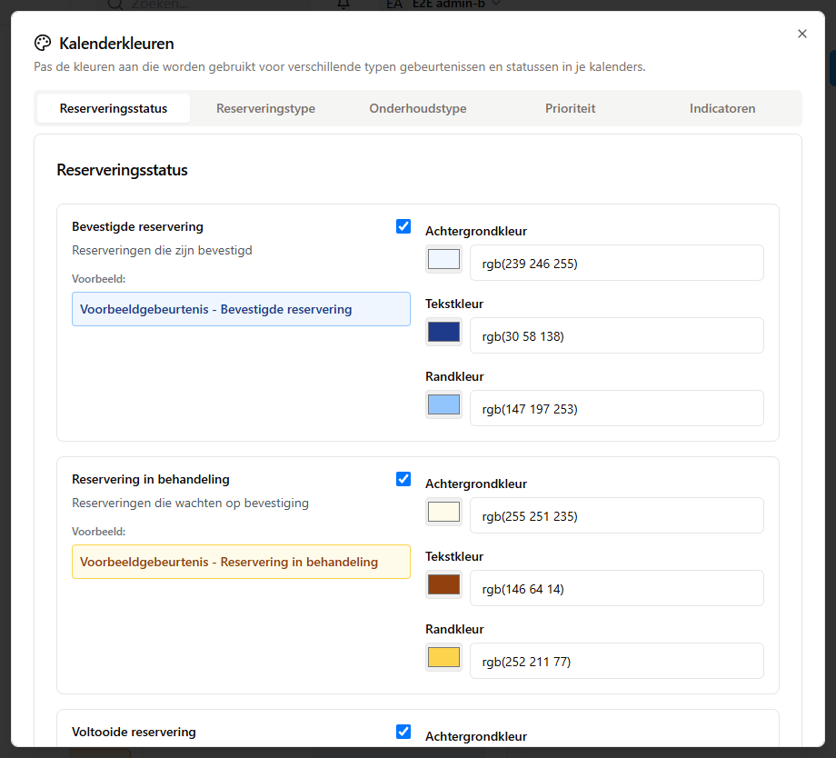
*Het venster **Kalenderkleuren** achter de knop **Kleuren**. Links zie je het voorbeeld, rechts kies je
de kleuren.*

**Administratie.** Klik op **Administratie**. Je ziet nu *Administratie - Factuurgegevens*. Dat is
het overzicht voor het externe facturatiesysteem (hoofdstuk 2, paragraaf 2.7).

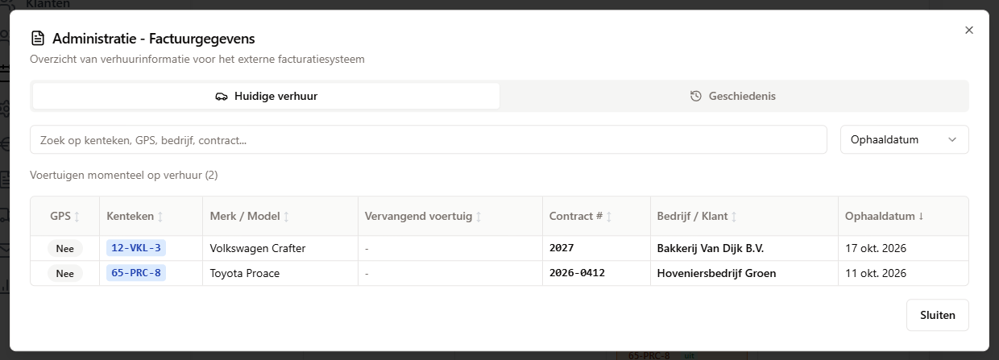
*Het venster **Administratie - Factuurgegevens**. Je zoekt op kenteken, bedrijf of contract. De
kolommen zijn de gegevens voor de facturatie.*

**Een reservering verslepen.** Je kunt een blok naar een andere dag slepen. De app vraagt dan eerst
**Reservering verplaatsen?** met de tekst *Je staat op het punt deze reservering … dag(en) later te
zetten*. Je ziet de oude en de nieuwe periode erbij. Klik op **Verplaatsen** om te bevestigen.

---

## 5.2 De lijstweergave

Klik rechtsboven op **Lijstweergave**. Je ziet nu het venster **Reserveringen** met de tekst *Bekijk
en beheer alle reserveringen*. Het venster heeft drie tabbladen:

**Actief (…) · Achterstallig (…) · Geschiedenis (…)**

Zoeken doe je in het veld *Zoek op kenteken, klant, contract, ID...*. Sorteren doe je met de knoppen
**Ophalen**, **Klant**, **Kenteken** en **Inleveren**.

Per regel zie je het volgende. Eerst het nummer (bijvoorbeeld **#3366**) met de status ernaast. Dan
het kenteken met merk en model. Dan de klant en het contractnummer. **Uit:** toont de startdatum.
**In:** toont de einddatum en de duur. **KM:** toont de kilometerstanden (uit → in). Daarna de prijs.
Rechts staan drie tekentjes: een oogje (bekijken), een potlood (bewerken) en een prullenbak
(verwijderen). Is de vervanger nog niet gekozen? Dan staat er **Voertuig toewijzen**.

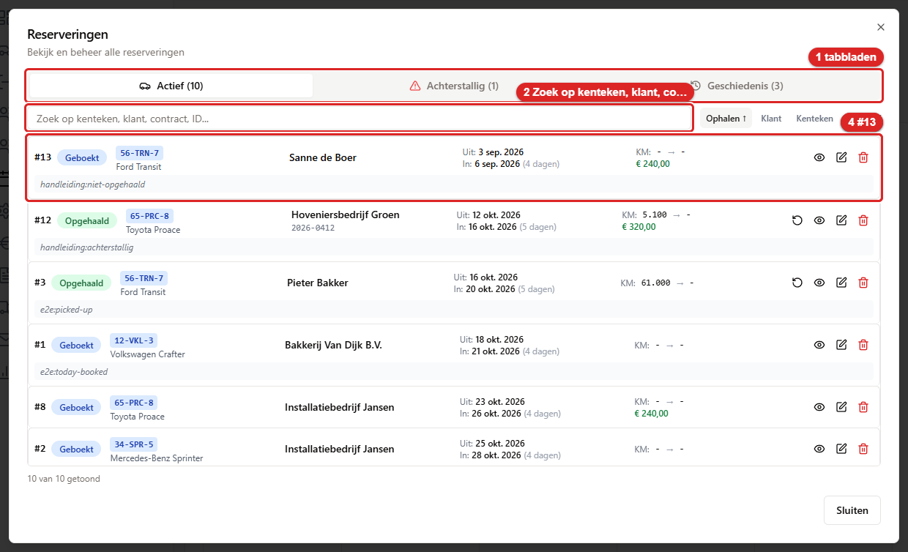
*De **Lijstweergave**: 1 de tabbladen **Actief**, **Achterstallig** en **Geschiedenis**, 2 het
zoekveld, 4 één regel (**#13**). Rechts op elke regel staan **Bekijken** (het oogje) en **Bewerken**
(het potlood). Bij een opgehaalde huur staat er ook het draai-pijltje **Overdracht terugdraaien**
(5.14).*

Op het tabblad **Achterstallig** staat de uitleg *Voertuigen die ingeleverd hadden moeten zijn maar
nog bij de klant zijn*. Per regel staat er **… dag(en) te laat** en **Verwacht: <datum>**.

Onderhoudsblokken staan hier **niet** tussen. Die vind je op de Onderhoudskalender (hoofdstuk 7).

**De lijst toont een pagina tegelijk.** Per tabblad zie je maximaal 50 regels. Onderaan staat hoeveel
regels je ziet, bijvoorbeeld *50 van 366 getoond*. Daarnaast staat de knop **Toon 50 meer**. Zoeken
gaat over de hele lijst, niet alleen over de 50 regels die je ziet. Na het zoeken begint de lijst weer
op de eerste pagina. Duurt het laden even? Dan staat er een regel *Laden...* met een draaiend rondje.
Zo weet je dat de app bezig is en dat het venster niet vastzit.

**De lijst heeft een eigen adres.** Het adres in je browser volgt het tabblad waar je op staat
(**Actief**, **Achterstallig** of **Geschiedenis**). Vernieuw je de pagina? Dan opent de lijst op
hetzelfde tabblad. Stuur je de link naar een collega? Dan ziet die ook hetzelfde tabblad. Sluit je de
lijst? Dan verdwijnt het tabblad weer uit het adres.

---

## 5.3 Een nieuwe reservering maken

1. Druk op `N`. Of klik op **Reserveringen** → **Nieuwe reservering**. Je ziet nu het venster
   **Nieuwe reservering**.

   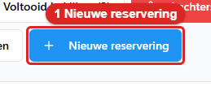
   *Zo ziet de knop **Nieuwe reservering** eruit. Klik erop. Daarna zie je het venster Nieuwe reservering.*

### Stap 1 — de huurdata

Bovenaan staat **1. Selecteer huurdata**. Daaronder staat de uitleg *Kies eerst je huurdata om alleen
beschikbare voertuigen te zien en boekingsconflicten te voorkomen.* Doe dat ook echt eerst. Pas
daarna laat de app alleen de vrije auto's zien.

2. **Startdatum** staat al op vandaag.

   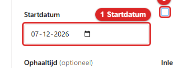
   *Zo ziet het veld **Startdatum** eruit. Klik op het kalendertje erin om een andere dag te kiezen,
   of typ de datum.*
3. **Einddatum** staat alvast op drie dagen na de startdatum. Het vinkje **Huur zonder einddatum**
   staat standaard **uit**. Zet het alleen aan als de inleverdatum echt nog niet bekend is. Dan
   verdwijnt het veld **Einddatum**. Bij de duur staat dan **Open einde**.

   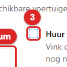
   *Zo ziet het vinkje **Huur zonder einddatum** eruit. Zet het alleen aan als de inleverdatum echt
   nog niet bekend is.*
4. Pas **Einddatum** aan. Onder de velden staat **Duur:** met het aantal dagen.

   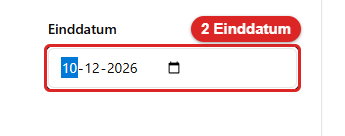
   *Zo ziet het veld **Einddatum** eruit. Pas de datum aan. Onder de velden staat dan **Duur:** met
   het aantal dagen.*
5. **Ophaaltijd (optioneel)** en **Inlevertijd (optioneel)** vul je alleen in als de auto op
   dezelfde dag van klant wisselt. De app kijkt dan naar de tijden. Zo ziet de app dat het geen echt
   conflict is.

   
   *Stap 1: 1 **Startdatum**, 2 **Einddatum**, 3 **Huur zonder einddatum**. Onder de velden staat
   **Duur:**.*

> **Waarom de datums eerst:** de app haalt de lijst met vrije auto's op voor precies die periode.
> Vul je ze later in, dan staan er auto's in de lijst die in jouw periode al bezet zijn.

> **Een datum in het verleden mag gewoon.** Typ je bij **Startdatum** of **Einddatum** een dag
> die al voorbij is, dan accepteert de app dat zonder waarschuwing — handig om een verhuring die
> je vergeten was in te voeren alsnog vast te leggen. Het voertuig telt daarna alleen als
> **verhuurd** zolang die periode ook echt loopt; is de periode al voorbij, dan staat de auto
> gewoon weer **beschikbaar** voor een nieuwe boeking, ook als de oude reservering zelf nooit is
> opgehaald (zie 5.12).

### Stap 2 — voertuig en klant

Onder **2. Selecteer voertuig en klant** staat in het groen: *Alleen beschikbare voertuigen voor
je geselecteerde data worden getoond.*

6. Klik op **Voertuig** → **Zoek en selecteer een voertuig...**. Typ het kenteken in het veld
   *Zoek op kenteken, merk of model...*. Klik op de juiste regel.
   - Staat je auto er niet bij? En zie je *Geen voertuigen gevonden.*? Dan is de auto in die
     periode bezet. Kies een andere auto of andere datums.
   - Soms heb je bewust een auto nodig die al bezet lijkt. Bijvoorbeeld bij een lange huur die
     doorloopt. Vink dan **Toon alle voertuigen (voor langdurige verhuur)** aan. Botst de auto
     echt? Dan krijg je toch de rode waarschuwing van stap 8.
   - Met **Nieuw toevoegen** en **Bewerken** maak je vanuit dit venster een auto aan, of werk je
     een auto bij.

   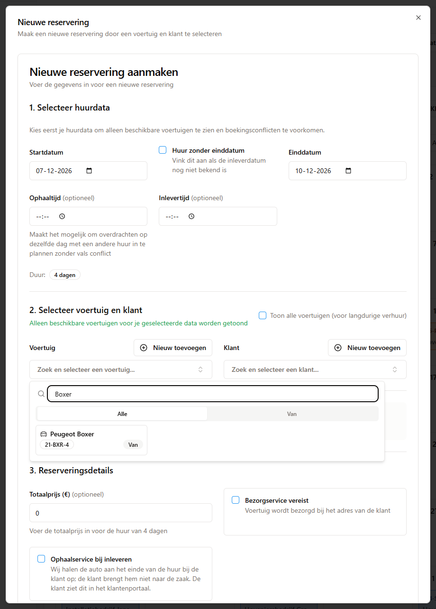
   *De voertuigkeuze: typ een deel van het kenteken, het merk of het model. Klik dan op de auto.
   Alleen auto's die in je periode vrij zijn, staan erin. Een auto met een verlopen APK heeft het
   label **APK verlopen**.*
7. Klik op **Klant** → **Zoek en selecteer een klant...**. Typ de naam, het telefoonnummer of de
   plaats. Onder elke naam staan het telefoonnummer en het e-mailadres. Lees die regel voordat je
   klikt. Dat is extra belangrijk bij een naam die vaker voorkomt.

   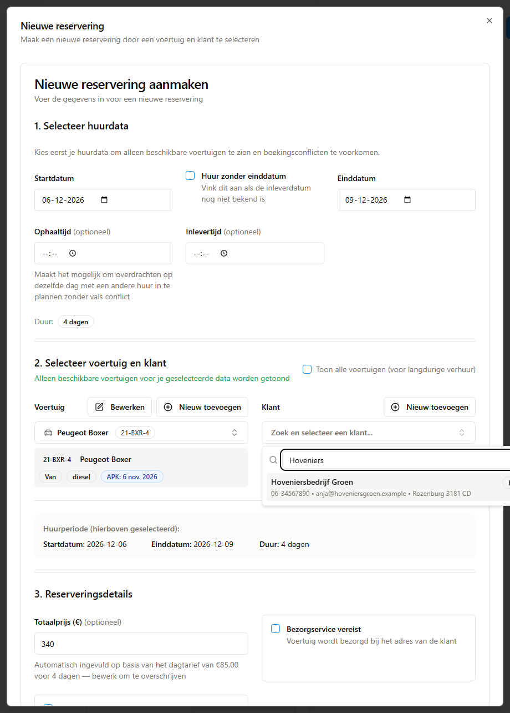
   *De klantkeuze werkt net zo: typ en klik op de juiste klant.*
8. Zodra er een klant staat, zie je het veld **Gemachtigde chauffeur (optioneel)**. Kies de
   chauffeur die gaat rijden. Of maak er een aan met **Snel chauffeur toevoegen**. De
   hoofdchauffeur van de klant heeft het label **Primaire chauffeur**.

**Wat je hier kunt tegenkomen:**

| Melding | Betekent | Kun je door? |
|---|---|---|
| Rood: *Dit voertuig is al gereserveerd voor de geselecteerde data. Kies andere data of een ander voertuig.* | De periode botst met een andere boeking | **Nee**. De knop **Reservering aanmaken** wordt grijs |
| Geel: *Let op: dit voertuig staat in deze periode ingepland voor onderhoud (05-10-2026 t/m 07-10-2026). Opslaan mag; het onderhoudsblok blijft staan.* | De werkplaats heeft die auto ook al ingepland | **Ja**. Zorg dan wel dat het onderhoud wordt verzet of geregeld |
| Rood: *De APK (keuring) van dit voertuig is verlopen op <datum>. Bevestig dat het veilig en legaal is om te verhuren voordat je verdergaat.* | De APK is over datum | De app laat het toe. Doe het toch niet. Laat de auto eerst keuren |

Zo'n auto herken je al in de keuzelijst. Er staat een label **APK verlopen** achter. Zet je de muis
op het label? Dan zie je de datum. De rode waarschuwing zie je ook als je het formulier opent vanuit
een auto. Bijvoorbeeld via **Nieuwe reservering** op de voertuigkaart. De auto staat dan al
ingevuld, en toch zie je de melding. Een verlopen APK blijft een waarschuwing. De app houdt je niet
tegen.

Staat een klant op de zwarte lijst voor een auto? Dan verdwijnt die combinatie stil uit de lijstjes.
Je krijgt geen melding. De auto is er simpelweg niet.

### Stap 3 — de details

9. Een nieuwe reservering is altijd **Geboekt**. Het formulier heeft geen statusveld. Wil je de
   auto meteen meegeven? Klik dan na het opslaan op **Nu ophalen** (zie hieronder).
10. **Totaalprijs (€) (optioneel)** vult de app zelf in. De app rekent de dagprijs van de auto
    maal het aantal dagen. Er staat dan bij *Automatisch ingevuld op basis van het dagtarief van €…
    voor … dagen — bewerk om te overschrijven*. Heeft de auto geen dagprijs? Dan blijft er € 0,00
    staan. Vul het bedrag dan zelf in.

    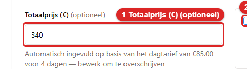
    *Zo ziet het veld **Totaalprijs (€)** eruit. De app vult het zelf in. Vul het bedrag alleen zelf
    in als er € 0,00 staat.*
11. Moet de auto bij de klant gebracht worden? Zet dan **Bezorgservice vereist** aan. Vul
    **Bezorgadres**, **Stad**, **Postcode** en eventueel **Bezorgnotities** in. Halen wij de auto
    aan het einde bij de klant op? Zet dan ook **Ophaalservice bij inleveren** aan. Vul het
    **Ophaaladres** in. Dat mag een andere plek zijn dan het bezorgadres. Met **Zelfde als
    bezorgadres** vul je het in één klik in. Beide diensten maken bij het opslaan vanzelf een
    transport aan. Een transport is een rit. **Bezorgservice vereist** maakt een transport van het
    type **Levering** op de startdatum. **Ophaalservice bij inleveren** maakt een transport
    **Terughalen** op de einddatum. Huurt de klant zonder einddatum? Dan maakt de app dat
    transport pas als er een einddatum is. Wijzig je het adres of de
    einddatum? Dan verandert het transport mee. Zet je de dienst uit? Dan wordt dat transport
    geannuleerd. Zonder deze twee diensten gaat de klant ervan uit dat hij de auto bij ons aan de
    zaak ophaalt en inlevert. Wat de klant ervan ziet, staat in [paragraaf 3.7](03-klanten.md).

    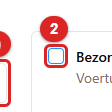
    *Zo ziet het vinkje **Bezorgservice vereist** eruit. Zet het aan als de auto bij de klant gebracht
    moet worden.*

    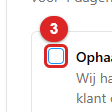
    *Zo ziet het vinkje **Ophaalservice bij inleveren** eruit. Zet het aan als wij de auto aan het
    einde bij de klant ophalen.*
12. Zet bijzonderheden in **Notities**.

    
    *Stap 3: 1 **Totaalprijs (€)** (hier automatisch ingevuld: € 85 per dag maal 4 dagen), 2
    **Bezorgservice vereist**, 3 **Ophaalservice bij inleveren**, 4 **Reservering aanmaken**.*
13. Klik onderaan op **Reservering aanmaken**.

    
    *Zo ziet de knop **Reservering aanmaken** eruit.*

Je ziet nu **Reservering succesvol aangemaakt** met de tekst *Reservering voor <merk> <model> is
aangemaakt.*

*Na het aanmaken: de knop **Nu ophalen** (1) opent meteen het ophaalvenster voor deze reservering.*

Daarna verandert **Annuleren** in **Sluiten**. Documenten uploaden kan nu wel. Met de knop
**Nu ophalen** open je het ophaalvenster (5.7) voor deze reservering. Boeken en direct meegeven kost
zo maar één klik extra. De knop staat in de groene melding in het formulier. Soms sluit het venster
zichzelf na het opslaan. Dat gebeurt bijvoorbeeld vanaf het Dashboard, de klantenlijst of de
voertuigenlijst. Dan staat dezelfde knop twaalf seconden in de melding linksonder.

Heb je het venster geopend vanaf het **Dashboard** (**Snelle acties** → **Nieuwe reservering**)? Dan
sluit **Annuleren** alleen dat venster. Je blijft op het Dashboard. Vroeger sprong de app daarbij
naar de reserveringenpagina.

**Sluiten terwijl je al iets hebt ingevuld.** Je kunt het venster op vier manieren sluiten: met
Escape, met het kruisje, met een klik naast het venster of met **Annuleren**. Heb je al iets getypt
of gekozen? Dan vraagt de app eerst **Wijzigingen verwerpen?** met de tekst *Je hebt wijzigingen
gemaakt die nog niet zijn opgeslagen. Als je sluit, gaan ze verloren.* Met **Verder bewerken** ga je
terug naar het formulier. Met **Verwerpen** sluit je het. Heb je nog niets ingevuld? Dan sluit het
venster gewoon. Vroeger sloten Escape, het kruisje en **Annuleren** zonder vraag. Alleen een klik
naast het venster gaf toen een melding. Een klein venster binnen het formulier, zoals de
voertuigkeuze, sluit op zijn eigen Escape. Het formulier blijft dan open.

**Twee dingen die vanzelf gebeuren:**

- Staat de auto op **BV**? Dan zet de app de registratie zelf om naar **Opnaam**. De app meldt dat
  achteraf: *Voertuig automatisch gewijzigd van BV naar Opnaam (vereist voor verhuur -
  verzekering & wegenbelasting)*. Lukt dat niet? Dan vraagt de app je om het zelf te doen op de
  voertuigkaart.
- Soms loopt er van deze auto nog een **opgehaalde** verhuring. Die is over haar einddatum heen en
  nog niet ingeleverd. Dan zie je eerst **Achterstallige reserveringen gevonden**. Los die eerst op
  met **Markeer als voltooid** of **Details bekijken**. Of ga bewust verder met **Doorgaan met
  reservering**. Een oude boeking die nooit is opgehaald, blokkeert dit sinds kort niet meer. Die
  krijgt in plaats daarvan de eigen melding uit 5.12.

---

## 5.4 Een reservering openen — let op welk venster je krijgt

Er zijn twee vensters die allebei **Reserveringsdetails** heten. Ze hebben **niet** dezelfde
knoppen. Dat is belangrijk. De kleine wijzigvensters van 5.5 zitten maar in één van de twee.

**Het korte venster** krijg je op twee manieren. Klik in de **kalender** op een regel. Of klik in de
**lijstweergave** op het oogje. Onderaan staan alleen:

**Ophalen starten** of **Inleveren starten** · **Bewerken** · **Onderhoud** · **Sluiten**

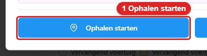
*Zo ziet de knop **Ophalen starten** eruit. Hij staat onderaan het korte venster.*

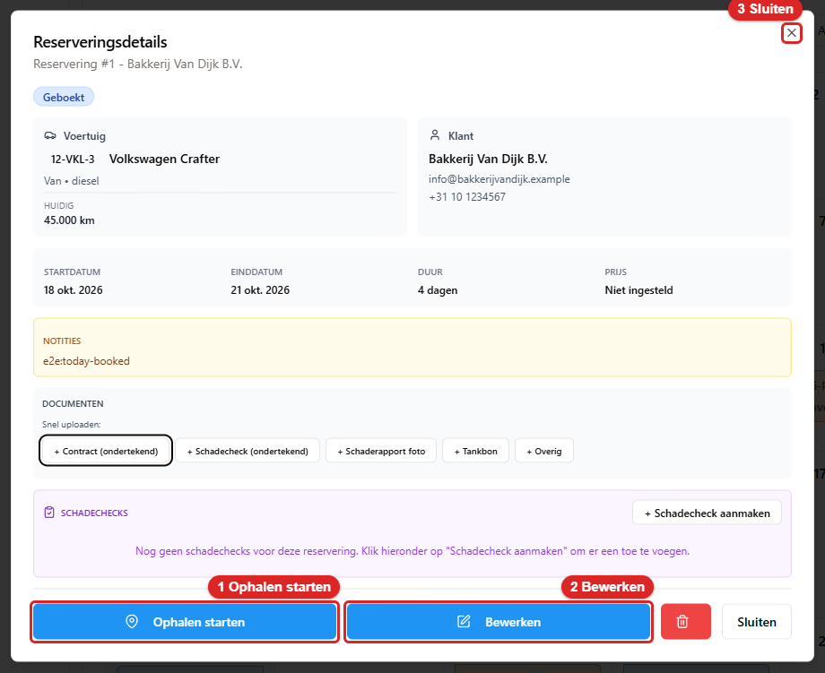
*Het korte venster vanuit de kalender: 1 **Ophalen starten**, 2 **Bewerken**, 3 **Sluiten** (het
kruisje rechtsboven).*

Is de huur al opgehaald, afgesloten of geannuleerd? Dan staat er in de kalender ook **Overdracht
terugdraaien** bij. Bij een geannuleerde huur heet die knop **Annulering terugdraaien** (zie 5.14).
Er staat dan ook een prullenbakje. Het volledige venster hieronder heeft die knop niet.

**Het volledige venster** krijg je via het zoekveld bovenin het scherm. Typ het kenteken, de
klantnaam of het contractnummer. Klik onder **Reserveringen** op de regel. Dit venster toont meer.
Je ziet de reserveringscode (**RES-003366**), de status, de huurperiode en de totaalprijs. Je ziet
ook het voertuig, de klant, de chauffeur, de documenten, het blok **Voertuigservice** en de
**Geschiedenis**. Onderaan staan:

**Ophalen starten** of **Inleveren starten** · **Datums wijzigen** · **Klant wijzigen** ·
**Voertuig wijzigen** · **Bewerken** · **Reservering annuleren** · **Verwijderen** · **Sluiten**

*Zoek in het veld bovenin op kenteken, model, klant of contractnummer. Klik onder **Reserveringen**
op de juiste regel.*

*Het volledige venster. Onderaan: 1 **Datums wijzigen**, 2 **Klant wijzigen**, 3 **Voertuig
wijzigen**, 4 **Reservering annuleren**. Daarnaast **Bewerken**, **Verwijderen** en bij een geboekte
huur **Ophalen starten**.*

**Reservering annuleren** staat er alleen zolang de reservering nog loopt. Is de huur al
**Voltooid** of **Geannuleerd**? Dan verdwijnt de knop. **Datums wijzigen** staat er altijd. Ook
bij een huur die al is opgehaald of afgesloten. Lees daarom de waarschuwing in 5.5.

> **Onthoud:** wil je snel alleen de datums, de klant of de auto corrigeren, of wil je de huur
> annuleren, zoek de reservering dan op via het **zoekveld bovenin**. Vanuit de kalender krijg je
> die knoppen niet.

In het volledige venster staat een lijst met documenten. Klopt een document niet meer met de
reservering? Dan staat erbij het label **Verouderd** (hoofdstuk 8, paragraaf 8.6). Je ziet het dus
meteen. Je hoeft niet naar het scherm Documenten. Het blok **Geschiedenis** noemt in gewone woorden
wat er gebeurde: *Ophalen*, *Inleveren*, *Overdracht teruggedraaid*, *Status gewijzigd*, *Contract
gemaakt*, *Reservering aangemaakt*, *Klant aangemaakt*, *Document gemaild*, *Document opnieuw
gemaakt* of *definitief verwijderd*. Kent de app een actie niet? Dan staat die er toch, met de ruwe
naam. Zet je de muis erop? Dan zie je de technische code.

---

## 5.5 De kleine wijzigvensters

Deze drie vensters veranderen precies één ding. De rest van de boeking blijft zoals hij is. Gebruik
ze liever dan het volledige bewerkformulier. Werken twee collega's tegelijk aan dezelfde
reservering? Dan overschrijft het volledige formulier elkaars werk. Deze kleine vensters doen dat
niet.

### Datums wijzigen

1. Open de reservering via het zoekveld bovenin. Klik op **Datums wijzigen**.

   
   *Zo ziet de knop **Datums wijzigen** eruit. Klik erop. Daarna zie je het venster Datums wijzigen.*
2. Je leest: *Alleen de begin- en einddatum worden gewijzigd; de rest van de boeking blijft zoals
   hij is.*
3. Pas **Begindatum** en/of **Einddatum** aan.
4. Klik op **Opslaan**.

   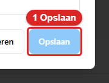
   *Zo ziet de knop **Opslaan** eruit. Klik erop als de datums kloppen.*

*Het venster **Datums wijzigen**: pas de datums aan en klik op **Opslaan** (1).*

Zet je de einddatum vóór de begindatum? Dan zie je meteen in het venster: *De einddatum kan niet
vóór de begindatum liggen.* Botst de nieuwe periode met een andere boeking? Dan weigert de app. Je
ziet dan welke reservering botst.

> **Let op:** ook de datums van een huur die al is opgehaald mag je wijzigen, en de app
> waarschuwt daar niet bij. Het getekende contract klopt dan niet meer. Genereer in dat geval het
> contract opnieuw (hoofdstuk 8).

### Klant wijzigen

1. Klik op **Klant wijzigen**. Je leest: *Alleen de klant wordt gewijzigd; de rest van de
   boeking blijft zoals hij is.*

   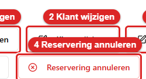
   *Zo ziet de knop **Klant wijzigen** eruit. Klik erop. Daarna zie je het venster Klant wijzigen.*
2. Zoek de juiste klant in het veld *Zoek op naam, bedrijf of debiteurnummer...*. Klik de klant
   aan. Met **Andere klant kiezen** kies je een andere.
3. Klik op **Opslaan**. Je ziet nu **Klant gewijzigd**.

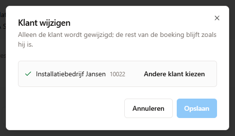
*Het venster **Klant wijzigen**: alleen de klant verandert. De rest van de boeking blijft staan.*

### Voertuig wijzigen

1. Klik op **Voertuig wijzigen**. Je leest: *Alleen het voertuig wordt gewijzigd; de
   beschikbaarheid wordt opnieuw gecontroleerd.*

   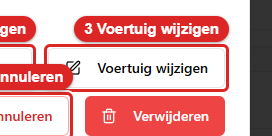
   *Zo ziet de knop **Voertuig wijzigen** eruit. Klik erop. Daarna zie je het venster Voertuig
   wijzigen.*
2. Kies een auto in het veld *Kies een voertuig...*
3. Klik op **Opslaan**. Je ziet nu **Voertuig gewijzigd**.

### Het contractnummer wijzigen

In de kalender staat het contractnummer in een blauw vakje. Ernaast staat een potloodje
(*Contractnummer bewerken*). Klik erop. Je ziet nu het venster **Contractnummer bewerken**. Dat
venster controleert meteen of het nummer vrij is. Eerst staat er **Beschikbaarheid controleren...**.
Daarna staat er **Beschikbaar**, of *Al in gebruik door reservering #… Kies een ander nummer.*

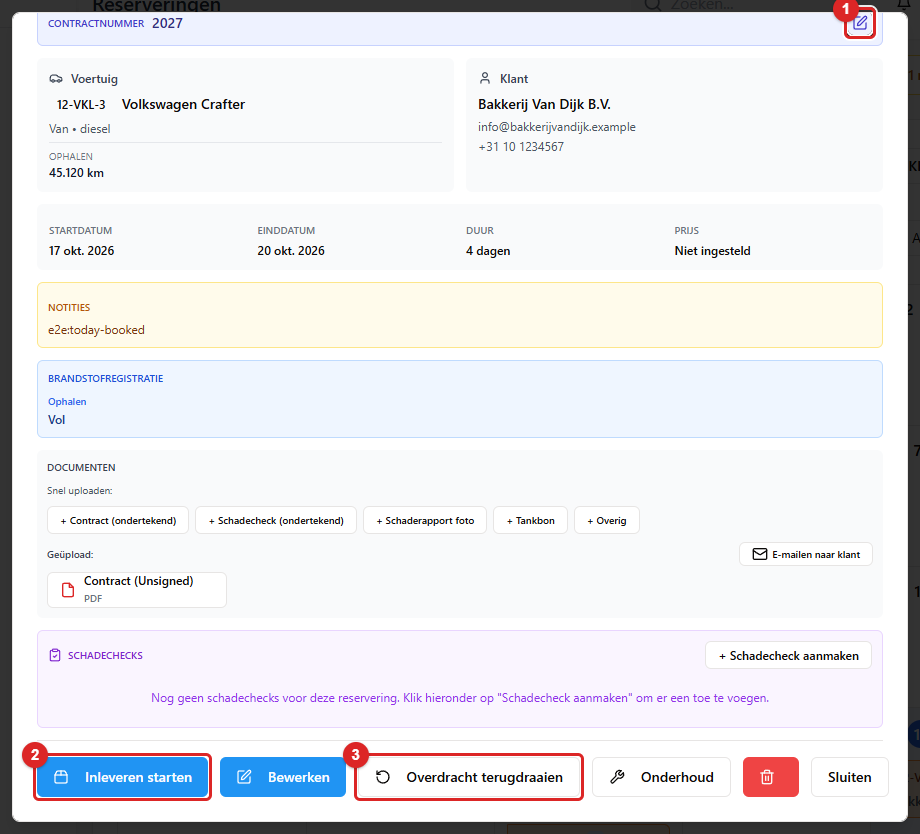
*Een opgehaalde huur in de kalender: 1 het potloodje **Contractnummer bewerken**, 2 **Inleveren
starten**, 3 **Overdracht terugdraaien** (5.14).*

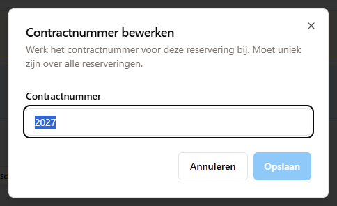
*Het venster **Contractnummer bewerken**: typ een nummer en wacht op **Beschikbaar**.*

**Na elke wijziging:** is er al een contract gemaakt? Dan krijgt dat het oranje label
**Verouderd**. Ga naar **Documenten** → **Documentbibliotheek**. Klik daar bij het contract op
**Opnieuw genereren**. In de reservering zelf staat die knop niet. Geef de klant de nieuwe versie
(hoofdstuk 8, paragraaf 8.6).

---

## 5.6 Het volledige bewerkformulier

Klik op **Bewerken** in het venster van de reservering. Je ziet nu hetzelfde formulier als bij het
aanmaken. Het heeft dezelfde drie genummerde stappen. Er staan geen extra velden in. Vier velden
staan niet meer in het formulier: **Contractnummer**, **Kilometerstand bij inleveren**,
**Brandstofniveau bij inleveren** en **Brandstofkosten (€)**. Het contractnummer pas je aan in het
kleine venster **Contractnummer bewerken** (zie *Het contractnummer wijzigen* in 5.5). De andere drie
legt **Inleveren** vast. Je ziet ze daarna in het venster van de reservering.

Een **Reserveringsstatus** kies je hier niet. Bij een lopende reservering staat onderaan de knop
**Reservering annuleren**. Die opent hetzelfde annuleervenster als in het venster van de reservering
(5.9). Ook hier zie je de waarschuwing voor een al opgehaalde huur.

Klik onderaan op **Reservering bijwerken**. Je ziet nu **Reservering succesvol bijgewerkt**. Heb je
iets gewijzigd en sluit je het venster zonder te bewaren? Bijvoorbeeld met Escape, het kruisje, een
klik naast het venster of **Sluiten**. Dan vraagt de app **Wijzigingen verwerpen?**, net als bij het
aanmaken (5.3).

**Een oude verhuring bewerken vraagt een beheerderswachtwoord.** Is de auto meer dan drie weken
geleden opgehaald? Dan zie je het venster **Beheerdersgoedkeuring vereist**: *Deze verhuur is meer
dan 3 weken geleden opgehaald. Voer een beheerderswachtwoord in om je wijzigingen op te slaan.*
Vul het wachtwoord in en klik op **Bevestigen**. Of haal er een beheerder bij.

> **Let op:** twee collega's tegelijk in dit formulier gaat mis — wie het laatst opslaat, wint,
> zonder waarschuwing. Gebruik voor kleine correcties de vensters uit 5.5.

---

## 5.7 Ophalen: de auto meegeven

Je kunt het ophalen op drie manieren starten. Alle drie openen precies hetzelfde venster:

- **Dashboard** → **Snelle acties** → **Ophalen starten** → scan het sleutellabel of typ het
  kenteken. Het venster opent dan meteen. Dit is het snelst aan de balie (hoofdstuk 18,
  paragraaf 18.7).
- **Scannen** → scan het sleutellabel → **Ophalen starten**. Dit is het veiligst (hoofdstuk 18).
- Open de reservering → **Ophalen starten**.

*Vanaf het Dashboard: het venster **Ophalen starten**. Scan het sleutellabel in veld 1. Of typ het
kenteken en druk op Enter. Het ophaalvenster opent dan vanzelf.*

Het venster heet **Ophaalproces starten**. De tekst erbij is *Voer de huidige kilometerstand en het
brandstofniveau van het voertuig bij ophalen in. Er wordt automatisch een contract gegenereerd.*

1. Kijk in het blok **Voertuiginformatie**. Controleer het **Kenteken**, het **Voertuig** en de
   **Klant**. Klopt dit niet? Klik dan op **Annuleren**.
2. **Contractnummer** is al ingevuld (*Automatisch gegenereerd, je kunt het indien nodig
   bewerken*). Laat het staan. Wijzig het alleen als daar een reden voor is. Het nummer hoort bij
   het ophalen. Pas op dat moment wordt het vastgelegd. Maak je later een contract opnieuw? Dan
   houdt de reservering haar eigen nummer.

   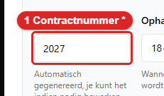
   *Zo ziet het veld **Contractnummer** eruit. Het is al ingevuld. Laat het staan.*
3. **Ophaaldatum** staat op vandaag.
4. Vul **Kilometerstand bij ophalen** in. In het veld staat de laatste stand die de app kent,
   bijvoorbeeld *Huidig: 25.000 km*.

   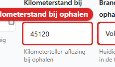
   *Zo ziet het veld **Kilometerstand bij ophalen** eruit. Typ het getal van de kilometerteller.*
5. Zet **Brandstofniveau bij ophalen** op **Vol**, **3/4**, **1/2**, **1/4** of **Leeg**.

   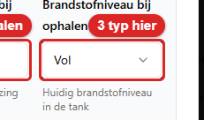
   *Zo ziet het veld **Brandstofniveau bij ophalen** eruit. Kies **Vol**, **3/4**, **1/2**, **1/4** of
   **Leeg**.*
6. Maak eventueel een schadecheck. Een schadecheck is een overzicht van de schade aan de auto.
   Klik op **Ophaal-schadecheck aanmaken** voor de digitale check. Of klik op **Papieren check
   uploaden** als je een formulier op papier hebt.

   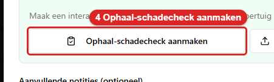
   *Zo ziet de knop **Ophaal-schadecheck aanmaken** eruit. Klik erop voor de digitale check.*
7. Kijk naar het blok **Eigen risico**. Daar staat wat er op het contract komt, voor
   **Binnenland (€)** en **Buitenland (€)**. Erboven staat of het om een auto of een bus gaat. Klopt
   het? Laat het staan. Is het voor deze huur anders? Typ het goede bedrag. Dat bedrag komt op het
   contract. Het geldt alleen voor deze huur. De klantkaart verandert niet. Maak je later het
   contract opnieuw? Dan blijft dit bedrag erop staan.
8. Zet bijzonderheden in **Aanvullende notities (optioneel)**.
9. Klik op **Ophalen voltooien & contract genereren**.

   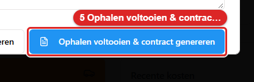
   *Zo ziet de knop eruit. Hij staat rechtsonder in het venster.*

*Het venster **Ophaalproces starten**: 1 **Contractnummer** (al ingevuld), 2 **Kilometerstand bij
ophalen**, 3 **Brandstofniveau bij ophalen**, 4 **Ophaal-schadecheck aanmaken**, 5 **Ophalen voltooien
& contract genereren**. Het groene blok zegt dat de voertuigopmerkingen bevestigd zijn (zie punt 1
hieronder).*

Je ziet nu **Ophalen voltooid** met de tekst *Voertuig succesvol opgehaald. Contract is
gegenereerd.* Direct daarna zie je het venster **Contract klaar**. Daarin staan de bestandsnaam en
de knoppen **Afdrukken**, **Mail naar klant** en **Sluiten**.

*Het venster **Contract klaar**: 1 **Afdrukken**, 2 **Mail naar klant**.*

> **Startte je het ophalen vanuit de kalender?** Dan kan **Contract klaar** achter het
> reserveringsvenster terechtkomen. Je ziet het dan niet. Sluit dan het reserveringsvenster. Nu zie
> je **Contract klaar** wel. Dit is een bekende fout in de app. Vanaf het scanscherm en met **Nu
> ophalen** gebeurt dit niet.

**Dit zie je daarna.** De auto staat nu bij de klant. In de lijst **Voertuigen** heeft hij de status
**Verhuurd**. In de kalender heeft de reservering de kleur van een opgehaalde huur.

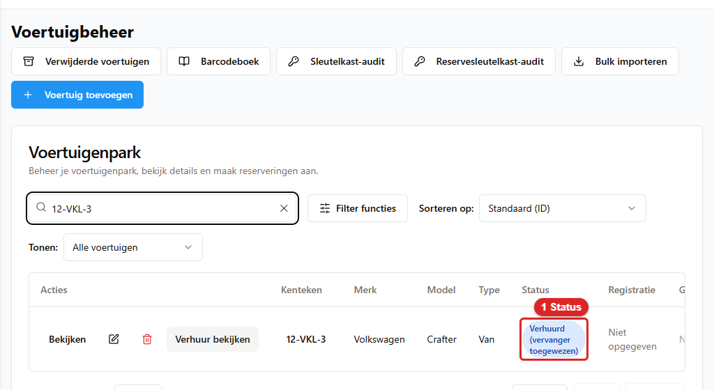
*Na het ophalen: zoek de auto op kenteken. Bij **Status** (1) staat hij nu op **Verhuurd**.*

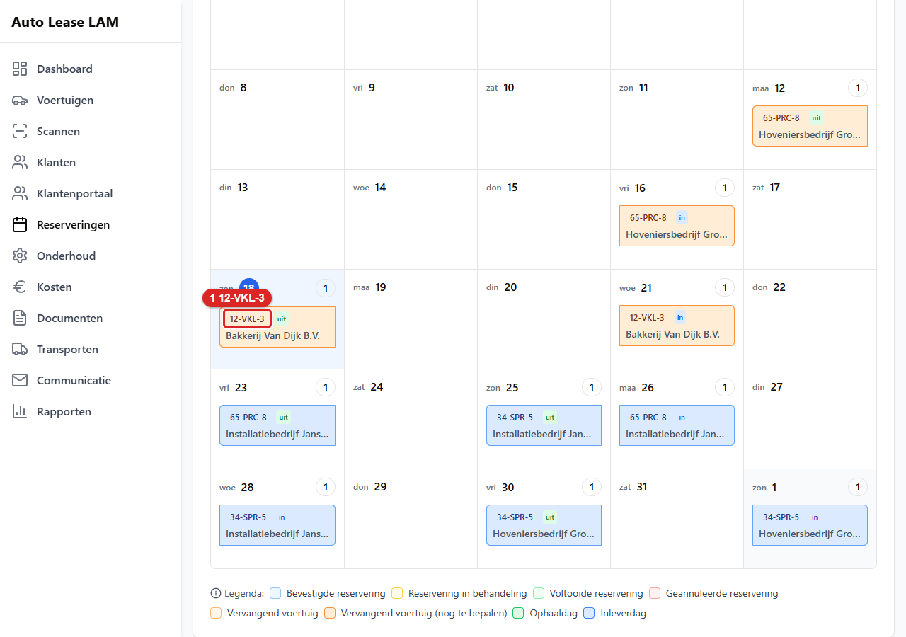
*De kalender na het ophalen: de reservering (1) staat er nog, nu als opgehaalde huur.*

De melding noemt het contract alleen als het er ook echt is. Lukt het maken van het contract niet?
Dan staat er alleen *Voertuig succesvol opgehaald.* Je ziet dan het venster **Contract kon niet
gemaakt worden**. Klik meteen op **Opnieuw proberen**. Sluit dat venster niet eerst. Er is daarna
nergens een andere knop om het contract te maken (hoofdstuk 8, paragraaf 8.4). De auto is wel
opgehaald.

**Mail naar klant** stelt eerst het e-mailadres van de klant zelf voor. Dat is het adres op de
klantkaart. Daarna volgen de andere adressen van de klant. Staat de verzendknop grijs? Dan staat
onder het venster wat er nog ontbreekt. Er staat *Nog nodig om te versturen:* met daarachter wat er
mist (*kies minstens één document*, *een geldig e-mailadres van de ontvanger* of *een onderwerp*).
Mislukt het versturen? Dan staat er in het Nederlands *De e-mail kon niet verstuurd worden.
Controleer de e-mailinstellingen onder Instellingen en probeer het opnieuw.* (hoofdstuk 9).

Start je het ophalen vanaf het scanscherm of vanaf het Dashboard? Dan ligt er telkens maar één
venster open. Zolang het ophaalformulier openstaat, is het scankaartje eronder weggehaald. Dat geldt
ook voor het venster **Contract klaar** daarna. Start je vanaf een tegel op het Dashboard? Dan sluit
het scanvenster vanzelf zodra je **Contract klaar** sluit. Start je vanaf het scanscherm zelf? Dan
blijft dat scherm staan, klaar voor de volgende scan.

> **Waarom het contract pas hier wordt gemaakt:** op dit moment liggen de kilometerstand, de
> brandstof, het contractnummer en de ophaaldatum vast. Maak je het contract eerder, dan staan
> die velden er leeg op en klopt het papier niet met de auto die wegrijdt.

### Zes dingen die de app kan vragen, melden of weigeren

**1. Voertuigopmerkingen.** Is de opmerking bij de auto veranderd sinds het laatste bevestigde
ophalen? Of is het een nieuwe opmerking? Dan zie je eerst **Voertuigopmerkingen -
Ophaalwaarschuwing** met de tekst *BELANGRIJK: Bekijk deze opmerkingen voordat het voertuig
vertrekt:*. Lees de opmerkingen. Bespreek ze met de klant. Klik dan op **Ik bevestig & ga door**.
Is de opmerking niet veranderd? Dan komt deze vraag niet. Je ziet in het ophaalvenster dan een
groen blok **Voertuigopmerkingen bevestigd** met de opmerking erin. Lees hem toch even.

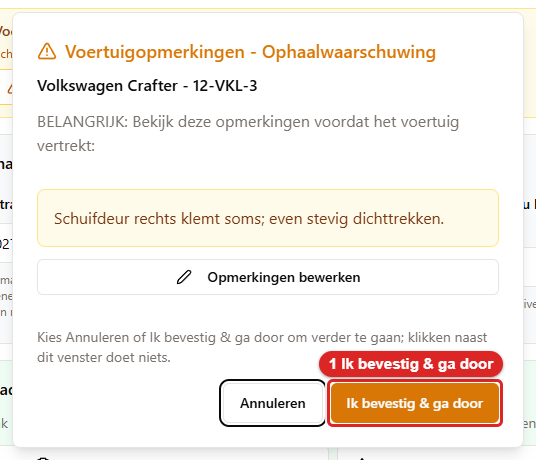
*De ophaalwaarschuwing: lees de opmerking en klik op **Ik bevestig & ga door** (1).*

Klik je op **Annuleren**? Dan sluit het hele ophaalvenster. Klik je ergens naast het venster? Dan
gebeurt er niets. Dat is bewust. Onder de tekst staat dat ook: *Kies Annuleren of Ik bevestig & ga
door om verder te gaan; klikken naast dit venster doet niets.* Het venster licht dan even op. Zo zie
je dat je eerst een keuze moet maken. Sla je de bevestiging over? Dan meldt de app **Opmerkingen
niet bevestigd** met de tekst *Je moet de voertuigopmerkingen bevestigen voordat je verdergaat met
ophalen.*

**2. De huur start eerder.** Haal je de auto op vóór de afgesproken startdatum? Dan vraagt de app:

> **De huur start eerder — datum aanpassen?**
> *Deze huur staat gepland vanaf 05-10-2026, maar het voertuig gaat vandaag (13-09-2026) mee. Zet
> de startdatum op vandaag, zodat de periode en de prijs kloppen?*
> **Nee, niet ophalen** · **Ja, startdatum naar vandaag**

Kies **Ja, startdatum naar vandaag** als de huur vandaag ingaat. Dat is bijna altijd het goede
antwoord. Anders staat de auto buiten terwijl de app hem als vrij ziet. En dan klopt de prijs niet.
Kies **Nee, niet ophalen** als de klant de auto nog niet meekrijgt. Er wordt dan niets opgeslagen.

**3. Dubbel contractnummer.** Is het nummer al in gebruik? Dan zie je het venster **Dubbel
contractnummer** met de tekst *Dit contractnummer is al in gebruik.* Je ziet bij welke reservering
het hoort. De uitleg staat erbij: *Als je doorgaat, wordt het contractnummer van de bestaande
reservering verwijderd en aan deze toegewezen.* Kies **Annuleren** en gebruik een ander nummer. Of
kies **Overschrijven & doorgaan** als je zeker weet dat je een fout herstelt.

**4. Kilometerstand-overschrijving vereist.** Is de stand die je invult lager dan de stand die de
app kent? Dan moet iemand met het recht daarvoor zijn **eigen accountwachtwoord** invullen. Zie
hoofdstuk 4, paragraaf 4.8.

**5. De auto staat in de werkplaats.** Dan zie je het venster **Uitgifte geblokkeerd**:

> *Dit voertuig staat in de werkplaats en kan niet worden uitgegeven. Rond de werkplaatsklus
> eerst af.*

Er wordt dan **niets** opgeslagen. Ook de startdatum schuift niet.

- **Ben je geen beheerder?** Dan staat er alleen *Alleen een beheerder kan de uitgifte forceren.
  Los de werkplaatsstatus op, of vraag een beheerder.* Gebruik **Terug van onderhoud** of **Terug
  uit onderhoud** (hoofdstuk 7 en 18). Start het ophalen daarna opnieuw.
- **Ben je beheerder?** Dan staat er een veld **Reden voor het forceren** en de knop **Toch
  uitgeven**. Zonder reden blijft die knop uit. De reden komt in de notities van de reservering
  te staan. Bijvoorbeeld *[WORKSHOP OVERRIDE 2026-09-13] IN_WORKSHOP forced by admin: klant staat
  aan de balie*. Wil je toch niet uitgeven? Klik dan op **Niet uitgeven**.

Hetzelfde venster weigert ook in twee andere gevallen. Bij *Dit voertuig staat op "reparatie
nodig"…* (status **Reparatie nodig**). En bij *Dit voertuig staat op "niet voor verhuur"…*

**6. De auto is ingepland voor onderhoud, maar nog niet binnen gemeld.** Dat is een waarschuwing,
geen weigering. In het ophaalvenster staat een gele regel: *Let op: dit voertuig staat ingepland voor
onderhoud (<periode>) en is nog niet binnengemeld. Ophalen mag; de balie beslist.* Je kunt gewoon
doorgaan. Er wordt niets uitgeschakeld. Zo'n auto heeft de status **Gepland**, niet **Reparatie
nodig** (hoofdstuk 7, paragraaf 7.3). Zet de werkplaats het onderhoud op **Binnen**? Dan geldt wél
punt 5.

### Het contractnummer en een gat in de reeks

De app gebruikt een contractnummer nooit twee keer. Een voorbeeld. Je haalt een auto op met nummer
1012. Later annuleer je die opgehaalde huur. De geannuleerde huur houdt dan nummer 1012. Voor de
volgende huur stelt de app 1013 voor. In de rij nummers zit dan een gat. Dat is met opzet. Het
nummer staat al op een contract. Dat contract is aan een klant meegegeven. Een verdwenen nummer zou
later tot verwarring leiden. Ben je een nummer kwijt? Kijk dan in de geannuleerde reserveringen.

### Het ophalen ongedaan maken

Heb je het ophalen op de verkeerde regel afgerond? Dat kan terug met de knop **Overdracht
terugdraaien**. Dat venster laat eerst zien wat er gaat gebeuren. Ook de kilometerstand van de auto
staat erbij. Het venster doet pas iets nadat jij bevestigt. Hoe het werkt, staat in 5.14. Bij het
foute ophalen is een contract gemaakt. Dat contract krijgt vanzelf het label **Verouderd** (hoofdstuk
8, paragraaf 8.6). Je hoeft het niet meer met de hand te verwijderen.

---

## 5.8 Innemen: de auto terugnemen

Ook hier zijn er drie startpunten. **Dashboard** → **Snelle acties** → **Innemen starten** →
scannen. Of **Scannen** → **Inleveren starten**. Of open de reservering → **Inleveren starten**.
Alle drie openen het venster **Inleverproces starten**. De tekst erbij is *Voer de huidige
kilometerstand en het brandstofniveau van het voertuig bij inleveren in. Er wordt automatisch een
schadecheck gegenereerd.*

1. Controleer **Kenteken** en **Voertuig**. In het blok staat ook **Bij ophalen:** met de stand
   van toen.
2. **Inleverdatum** staat op vandaag (*Wanneer het voertuig daadwerkelijk is ingeleverd*). Kwam de
   auto gisteren al terug? Zet dan die datum erin.

   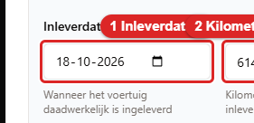
   *Zo ziet het veld **Inleverdatum** eruit. Het staat op vandaag. Kwam de auto eerder terug? Zet dan
   die datum erin.*
3. Vul **Kilometerstand bij inleveren** in.

   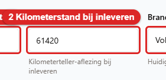
   *Zo ziet het veld **Kilometerstand bij inleveren** eruit. Typ het getal van de kilometerteller.*
4. Zet **Brandstofniveau bij inleveren**. Het niveau bij ophalen staat eronder, zodat je kunt
   vergelijken. Het veld begint op het niveau van het ophalen. Je hoeft het dus alleen te wijzigen
   als de tank anders staat. Kende de app dat niveau niet? Dan begint het veld op **Vol**.

   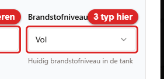
   *Zo ziet het veld **Brandstofniveau bij inleveren** eruit. Wijzig het alleen als de tank anders
   staat dan bij het ophalen.*
5. Maak eventueel een schadecheck met **Inlever-schadecheck aanmaken**. Of upload een **Papieren
   check**. Doe dit vóór je op **Inleveren voltooien & schadecheck genereren** klikt. Sla de check
   eerst op met **Check opslaan**. Het schadeformulier neemt de laatst opgeslagen check van deze
   reservering over. Een check die je pas na het afronden maakt, staat er niet op.

   
   *Zo ziet de knop **Inlever-schadecheck aanmaken** eruit. Klik erop als je een schadecheck wilt
   maken.*
6. Zet schade, een ontbrekende sleutel of een vuile auto in **Aanvullende notities (optioneel)**.
   Kosten doorbelasten aan de klant kan hier niet. Het venster heeft daar geen veld voor. Leg een
   reparatie vast als kostenpost met de categorie **Schade**. Het doorbelasten regel je buiten de
   app.
7. Klik op **Inleveren voltooien & schadecheck genereren**.

   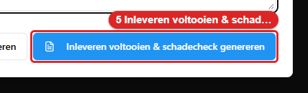
   *Zo ziet de knop eruit. Hij staat rechtsonder in het venster.*

*Het venster **Inleverproces starten**: 1 **Inleverdatum**, 2 **Kilometerstand bij inleveren**, 3
**Brandstofniveau bij inleveren**, 4 **Inlever-schadecheck aanmaken**, 5 **Inleveren voltooien &
schadecheck genereren**.*

Je ziet nu **Inleveren voltooid** met de tekst *Voertuig succesvol ingeleverd. Schadecheck is
gegenereerd.* Daarna zie je **Schadeformulier klaar**. Daarin staan de bestandsnaam en de knoppen
**Afdrukken**, **Mail naar klant** en **Sluiten**.

*Het venster **Schadeformulier klaar**: 1 **Afdrukken**, 2 **Mail naar klant**.*

> **Startte je het inleveren vanuit de kalender?** Dan kan **Schadeformulier klaar** achter het
> reserveringsvenster terechtkomen. Je ziet het dan niet. Sluit dan het reserveringsvenster. Nu zie
> je **Schadeformulier klaar** wel. Dit is een bekende fout in de app.

### Wat er nu automatisch gebeurt

**Met het innemen is de huur meteen afgesloten.** De reservering springt in één keer naar
**Voltooid**. Het voertuig staat weer op **Beschikbaar**. Je hoeft daarna geen status meer te
zetten. Er is geen aparte "afronden"-stap meer.

Verder:

- De afgesproken **einddatum blijft staan** zoals hij was. De echte inleverdatum wordt apart
  vastgelegd. Zo zie je achteraf dat de auto bijvoorbeeld twaalf dagen eerder terug was.
- De kilometerstand van het voertuig wordt bijgewerkt naar de stand die je invulde.
- De werkplaatsstatus verdwijnt **niet** vanzelf. Kwam de auto kapot terug? Dan moet je hem zelf op
  **Onderhoud nodig** zetten (hoofdstuk 7).

**Een te lage stand wordt geweigerd:** je ziet dan **Ongeldige kilometerstand** met de tekst
*Kilometerstand bij inleveren kan niet lager zijn dan bij ophalen (25000 km).* Lees de teller dan
opnieuw af.

> **Let op — controleer vóór je afrondt het kenteken en de klant.** Ging het toch mis, dan kun
> je de inname terugdraaien met **Overdracht terugdraaien** (5.14), onder meer in de lijst achter
> **Voltooid bekijken (…)**; zie ook hoofdstuk 11, paragraaf 11.13.

### Een afgesloten verhuring terugzoeken

Klik rechtsboven op de kalender op **Voltooid bekijken (…)**. Je ziet nu **Geschiedenis voltooide
verhuur** met de tekst *Bekijk, herstel of verwijder voltooide verhuurgegevens*. Zoek op voertuig,
klant of kenteken. Stel bij **Periode** in hoe ver je terugkijkt (**Alle tijd**, de laatste 7, 30 of
90 dagen, of het laatste jaar). Per regel staan de auto, de klant, de periode, de kilometerstanden,
de brandstof en het totaalbedrag. Daarbij staan de knoppen **Bekijken**, **Overdracht terugdraaien**
en **Verwijderen**.

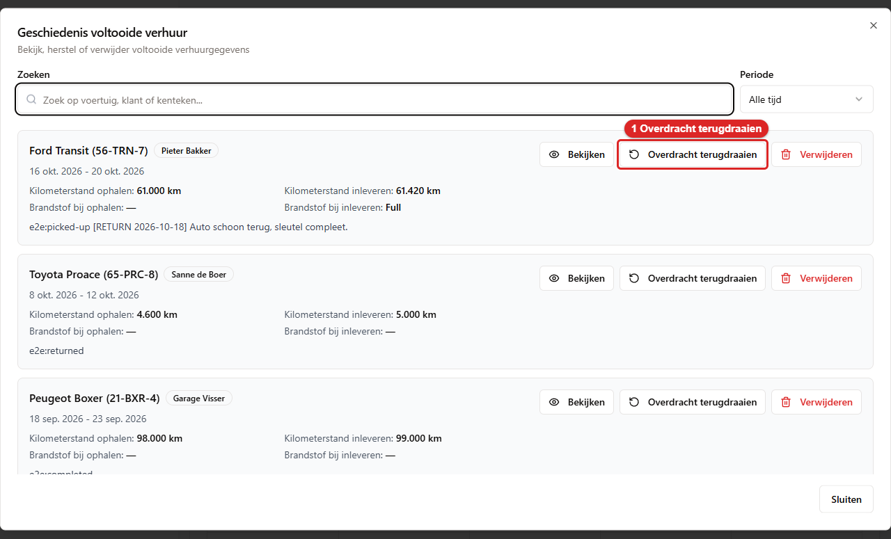
*Het venster **Geschiedenis voltooide verhuur**: per regel **Bekijken**, **Overdracht terugdraaien** (1)
en **Verwijderen**.*

**Overdracht terugdraaien** draait de inname terug. Je ziet eerst de voorvertoning van 5.14. Een
voorvertoning laat zien wat er gaat gebeuren, voordat het gebeurt. De verhuring gaat van **Voltooid**
terug naar **Opgehaald**. De kilometerstand, het brandstofniveau en de inleverdatum van het innemen
worden gewist. Die inname heeft immers niet plaatsgevonden. De kilometerstand en het brandstofniveau
van de auto gaan terug naar de stand van vóór het innemen. De afgesproken **begin- en einddatum
blijven staan**. Daarna neem je de auto gewoon opnieuw in, met de juiste gegevens. **Verwijderen**
brengt de verhuring naar de prullenbak (5.10, en voor een opgehaalde huur ook 5.15).

---

## 5.9 Annuleren

1. Zoek de reservering op via het **zoekveld bovenin**. Open het volledige venster (5.4).
2. Klik onderaan op **Reservering annuleren**.

   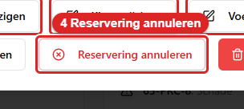
   *Zo ziet de knop **Reservering annuleren** eruit. Klik erop. Daarna zie je het venster Reservering
   annuleren.*
3. Je ziet nu het venster **Reservering annuleren** met de tekst *Reservering #… wordt geannuleerd.
   Kies hieronder wat er met het gekoppelde moet gebeuren.* Onder **Hieraan hangt nog:** staat wat
   er aan de reservering vastzit. Dat kan zijn: het bijbehorende **transport**, de
   **vervangingsreservering**, een **placeholder-reservering** en een **chauffeurstoewijzing**. Elk
   met nummer en datum.
4. Vink per onderdeel aan of het mee moet: **Transport meeannuleren**, **Vervangingsreservering
   meeannuleren**, **Placeholder-reservering meeannuleren** of **Chauffeurstoewijzing
   meeannuleren**. Er staat bij: *Wat je niet aanvinkt, blijft gewoon staan.*
5. Klik op **Reservering annuleren**. Twijfel je? Klik dan op **Niet annuleren**.

   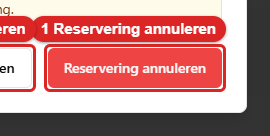
   *Zo ziet de knop **Reservering annuleren** in het venster eruit.*

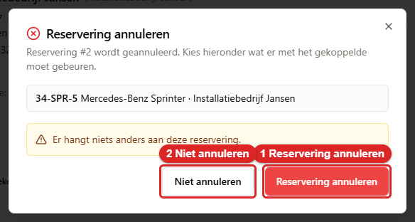
*Het venster **Reservering annuleren**: 1 **Reservering annuleren** zet het door, 2 **Niet annuleren**
laat alles staan.*

Je ziet nu **Reservering geannuleerd** met de tekst *Reservering #… staat nu op Geannuleerd.* De
regel blijft zichtbaar op de kalender en in de lijsten. Hij heeft nu de kleur van een geannuleerde
reservering. Wat je had aangevinkt, is in één keer meegegaan.

Hangt er niets aan de reservering? Dan meldt het venster dat ook (*Er hangt niets anders aan deze
reservering.*). Je annuleert dan alleen de reservering zelf.

> **Wat je niet aanvinkt, moet je zelf afhandelen.** Laat je de vervanger of het transport staan,
> dan blijft die auto bezet en die rit gepland. Loop dat dus na (hoofdstuk 11, paragraaf 11.8).

> **Een annulering kun je terugdraaien (5.14).** Open de geannuleerde reservering in de kalender of
> in de lijst en klik op **Annulering terugdraaien**. Dat lukt alleen als de auto in die periode nog
> vrij is, en wat je bij het annuleren hebt meegenomen (transport, vervanger, chauffeurstoewijzing)
> komt niet vanzelf terug. Een statuslijstje om haar weer op
> **Geboekt** te zetten bestaat niet meer; gebruik de knop.

> **Is de huur al opgehaald?** Dan vraagt het annuleren een eigen vinkje en een bevestigde
> waarschuwing; zie 5.15.

Heeft de klant een portaalaccount? Dan krijgt hij van een annulering automatisch een melding in het
portaal en een e-mail (*Uw reservering is geannuleerd*, hoofdstuk 9, paragraaf 9.8). Heeft hij geen
account? Bel of mail dan zelf.

---

## 5.10 Een reservering verwijderen en terugzetten

Verwijderen is iets anders dan annuleren. Annuleren laat de regel staan als spoor. Verwijderen
haalt de regel uit beeld. Gebruik verwijderen alleen voor een regel die er nooit had moeten staan.

1. Open de reservering. Klik op **Verwijderen**.
2. Je ziet nu **Weet je het zeker?** met de tekst *Reservering #… wordt naar de prullenbak
   verplaatst; terugzetten kan via Prullenbak.*
3. Klik op **Verwijderen**.

Je ziet nu **Reservering verwijderd** met de tekst *De reservering is succesvol verwijderd.*

**Terugzetten kan.** De reservering gaat naar de prullenbak van dit scherm. Dat is de knop
**Verwijderde reserveringen** rechtsboven op de **Reserveringskalender**. De regel staat daar met het
label **Reservering**. Bijvoorbeeld *Reservering #3366 — HL-02-HL 2026-10-05*. Erbij staat de knop
**Terugzetten**. Wil je de regel voorgoed kwijt? Dan is er ook **Definitief verwijderen**. De knop
**Verwijderde reserveringen** werkt voor iedereen met het vinkje **Prullenbak beheren** (hoofdstuk
15, paragraaf 15.16). Zonder dat vinkje staat de knop er wel, maar grijs. Alles over terugzetten en
definitief verwijderen staat in hoofdstuk 10, paragraaf 10.6. Een verwijderd **onderhoudsblok** staat
niet hier. Dat staat in de prullenbak van **Onderhoud** (hoofdstuk 7, paragraaf 7.8).

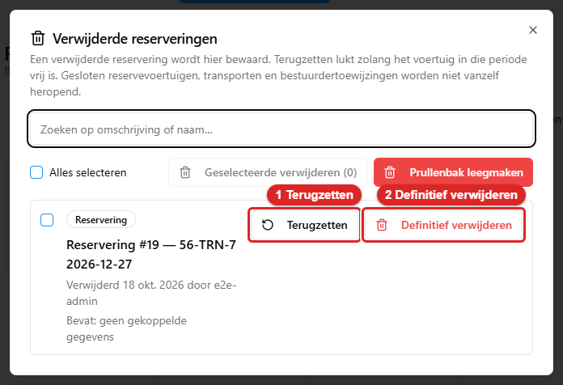
*De prullenbak **Verwijderde reserveringen**: per regel 1 **Terugzetten** en 2 **Definitief verwijderen**.*

Soms lukt terugzetten niet. Dat gebeurt als de auto in die periode inmiddels opnieuw is verhuurd. De
app meldt dan: *Deze reservering kan niet terug: het voertuig is in de tussentijd geboekt voor die
periode.*

> **Beperking:** het verwijdervenster van een reservering toont géén lijst van wat eraan hangt.
> Bij een voertuig krijg je die lijst wel. Kijk dus zelf even of er een contract, een transport
> of een vervanger aan hangt.

---

## 5.11 Achterstallige verhuringen nalopen

Een verhuring is **achterstallig** als twee dingen gelden. De verhuring staat op opgehaald. En de
afgesproken einddatum is voorbij. De app sluit zo'n verhuring bewust niet zelf af. Alleen jij kunt
weten of de auto echt nog bij de klant staat. Misschien is iemand vergeten de auto in te nemen.

Je vindt ze op drie plekken:

- **Reserveringen** → de rode knop **… achterstallig** rechtsboven. Die knop staat er alleen als er
  iets achterstallig is. Je ziet het venster **Te late verhuren**. Per regel staan het merk en
  model, het kenteken en de klant met het telefoonnummer. Ook staat er *Had ingeleverd moeten
  zijn: <datum>*, een rood label **… dag(en) te laat** en de knop **Details bekijken**.

  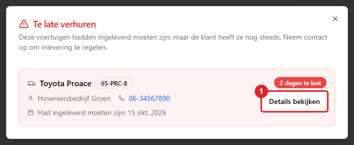
  *Het venster **Te late verhuren**: klik op **Details bekijken** (1) om de reservering te openen.*
- **Reserveringen** → **Lijstweergave** → tabblad **Achterstallig (…)**, met een zoekveld (5.2).
  Klik op een regel om de reservering te openen.
- **Dashboard** → het blok **Achterstallige verhuringen**. Met het oogje open je de reservering.

**Zo loop je ze na.** Stel jezelf per regel de vraag: staat die auto echt nog bij de klant?

- **Staat hij er nog**: laat de regel staan. Bel eventueel de klant.
- **Is hij al terug**: klik op **Details bekijken** en daarna op **Inleveren starten**. Je ziet
  hetzelfde venster als in 5.8. Daarmee is de huur afgesloten.
- **Klopt er iets anders niet**: open de reservering en corrigeer haar (5.4 en 5.5).

**Loop deze verhuringen regelmatig na.** Zolang een oude verhuring openstaat, telt die auto als
verhuurd. Je kunt hem dan niet opnieuw inplannen.

---

## 5.12 Niet opgehaalde reserveringen: de melding in de kalender

Sommige boekingen zijn nooit opgehaald. En hun startdatum is een maand of langer geleden. Zo'n
boeking blokkeert sinds kort niets meer (zie 5.3). Maar ze verdwijnt ook niet vanzelf. Ze blijft
gewoon op **Geboekt** staan totdat iemand ernaar kijkt. Daarvoor is er een eigen melding. Die staat
los van de achterstallige verhuringen in 5.11. Hier gaat het om auto's die nooit zijn opgehaald.
Daar gaat het om auto's die te laat terugkomen.

**De melding komt vanzelf.** Vindt de reserveringskalender zulke boekingen? Dan opent automatisch
het venster **Niet opgehaalde reserveringen** met de tekst *Deze boekingen zijn een maand of
langer geleden gestart en zijn nooit opgehaald. Ze blokkeren niets, maar verdienen een blik.* Dat
gebeurt **één keer per sessie**. Sluit je het venster? Dan komt het pas terug als je de browser
opnieuw opent of een nieuw tabblad gebruikt. Zolang er nog rijen zijn, staat rechtsboven ook de
knop **… niet opgehaald**. Die staat naast **… achterstallig** (5.1). Daarmee open je het venster
later opnieuw.

Bovenin staat een zoekveld: *Zoek op kenteken, klant, contractnummer of reserveringsnummer...*.
Daarnaast staat hoeveel regels je ziet (*12 van 144*). Past er niets bij je zoekopdracht? Dan staat
er *Geen niet opgehaalde reservering komt overeen met je zoekopdracht.* Bij een lange lijst is
zoeken de snelste weg naar de juiste auto.

Per regel zie je het voertuig, de klant, de periode en hoe lang geleden de huur had moeten
beginnen. Per regel staan twee knoppen:

- **Bekijken** opent de reservering zelf. Daar kun je corrigeren of alsnog ophalen.
- **Annuleren** opent het venster **Reservering annuleren** van 5.9. Bovenin staan het kenteken,
  het merk en model en de klant. Zo weet je zeker welke boeking je annuleert. Pas na jouw
  bevestiging wordt de boeking geannuleerd. Deze knop werkt alleen voor wie **Reserveringen
  beheren** heeft. Zonder dat recht staat hij er wel, maar grijs (hoofdstuk 15, paragraaf 15.9).
  Iedereen met **Reserveringen bekijken** ziet de melding en de lijst zelf wél, ook zonder dat
  recht.

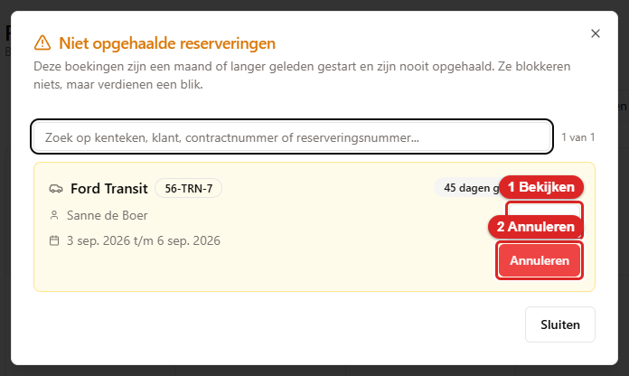
*Het venster **Niet opgehaalde reserveringen**: 1 **Bekijken** opent de reservering, 2 **Annuleren**
opent het annuleervenster.*

Is de lijst leeg? Dan staat er *Geen niet opgehaalde reserveringen.* Sluit het venster met
**Sluiten**.

---

## 5.13 De statussen op een rij

| Status | Wat het betekent | Hoe hij zo wordt |
|---|---|---|
| **Geboekt** | De auto is gereserveerd, maar staat nog bij ons | Standaard bij **Reservering aanmaken**. Ook na het terugdraaien van een ophaling of een annulering (5.14) |
| **Opgehaald** | De auto is meegegeven en staat bij de klant | Door **Ophalen voltooien & contract genereren**. Ook na het terugdraaien van een inname. En na het terugdraaien van de annulering van een opgehaalde huur (5.14) |
| **Ingeleverd** | De auto is terug, maar de huur is nog niet afgerond | Komt in de app niet meer voor als stap. Het inleverproces gebruikt hem niet. Het formulier biedt hem niet aan |
| **Voltooid** | De huur is afgesloten, de auto is weer vrij | Door **Inleveren voltooien & schadecheck genereren** |
| **Geannuleerd** | De boeking gaat niet door | Door **Reservering annuleren** (5.9), ook vanuit het bewerkformulier |

De status verandert alleen door **Ophalen**, **Inleveren**, **Annuleren** en **Terugdraaien**. In
het reserveringsformulier kun je de status niet kiezen.

Elke stand heeft één naam, in elk scherm: **Geboekt**, **Opgehaald**, **Ingeleverd**,
**Voltooid** en **Geannuleerd**. Ook het scanscherm gebruikt deze woorden.

---

## 5.14 Een overdracht of een annulering terugdraaien

Heb je het ophalen of het innemen op de verkeerde regel afgerond? Of heb je een reservering per
ongeluk geannuleerd? Dan draai je dat terug met **één venster**: **Overdracht terugdraaien**. Bij
een annulering heet het **Annulering terugdraaien**. Het venster laat eerst zien wat er gaat
gebeuren. Het doet pas iets nadat jij bevestigt. Een andere weg is er niet meer. De oude knoppen
**Terugzetten naar geboekt** en **Terugzetten** achter **Voltooid bekijken (…)** zijn hierdoor
vervangen. Een statuslijstje voor het terugdraaien bestaat niet meer.

**Wie het mag.** Iedereen met het vinkje **Overdracht terugdraaien**. Een beheerder heeft dat
altijd. Een manager heeft het sinds oktober 2026 eenmalig vanzelf gekregen. Een ander account heeft
het alleen als je het vinkje aanzet (hoofdstuk 15, paragraaf 15.16). Wie alleen **Reserveringen
beheren** heeft, kan het niet. Mis je het vinkje? Dan staat de knop er wel, maar grijs. Erbij staat
welk recht je nodig hebt.

**Waar de knop staat.** Bij elke reservering die opgehaald, ingeleverd, voltooid of geannuleerd is:

- In de kalender: in het korte venster **Reserveringsdetails** (5.4) en in de kaart die verschijnt
  als je een regel aanwijst.
- In de **lijstweergave** (5.2): het draai-pijltje achter de regel, naast het oogje en het potlood.
- Achter **Voltooid bekijken (…)** (5.8).
- Op het **Dashboard**, bij de verhuringen die nu lopen, en in het venster achter **Snelle acties**.
- Op de voertuigkaart, bovenaan, zolang de auto is meegegeven.

Het volledige venster dat je via het zoekveld opent (5.4) heeft de knop niet. Een onderhoudsblok
heeft hem ook niet. Een blok is nooit aan een klant meegegeven.

### Het venster, stap voor stap

1. Klik op de knop. Je ziet nu het venster **Overdracht terugdraaien** met de tekst *Controleer wat
   er met reservering #… gebeurt voordat je bevestigt.* Wacht even tot de voorvertoning er staat.

   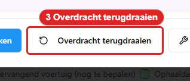
   *Zo ziet de knop **Overdracht terugdraaien** eruit. Klik erop. Daarna zie je het venster Overdracht
   terugdraaien.*
2. Lees de voorvertoning. Die kan vijf stukken hebben:
   - De regel *Status: Opgehaald wordt Geboekt.*
   - **Deze gegevens worden gewist:** met per veld wat leeg wordt. Bijvoorbeeld **Daadwerkelijke
     ophaaldatum**, **Kilometerstand bij ophalen**, **Brandstofniveau bij ophalen** en
     **Contractnummer**.
   - Het blok **Voertuig**, bijvoorbeeld *Kilometerstand: van 20.350 km naar 20.000 km.* en
     *Brandstofniveau: van … naar …*.
   - **Deze documenten worden als vervallen gemarkeerd (ze worden niet verwijderd):** met het
     **Niet-ondertekend contract** of de **Schadecheck**.
   - **Let op**, met waarschuwingen (zie hieronder).
3. Gaat de kilometerstand van de auto omlaag? Dan staat er een vinkje: *Ik bevestig dat de
   kilometerstand van het voertuig omlaag gaat, van … km naar … km.* Zet het aan. Zolang het uit
   staat, blijft de bevestigingsknop grijs.
4. Klik op **Overdracht terugdraaien** (of **Annulering terugdraaien**). Twijfel je? Klik dan op
   **Annuleren**. Er is dan niets veranderd.

   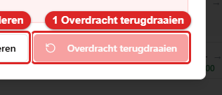
   *Zo ziet de knop **Overdracht terugdraaien** in het venster eruit. Klik erop. Hij blijft grijs
   zolang het vinkje van stap 3 uit staat.*

   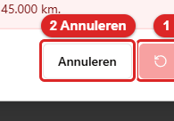
   *Zo ziet de knop **Annuleren** eruit. Twijfel je? Klik dan hierop. Er is dan niets veranderd.*

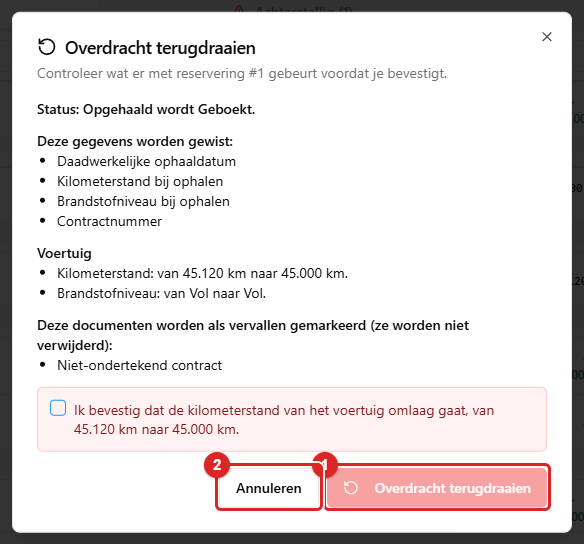
*Het venster **Overdracht terugdraaien**: lees de voorvertoning. 1 **Overdracht terugdraaien** voert
het uit, 2 **Annuleren** laat alles zoals het was.*

Je ziet nu **Overdracht teruggedraaid** (bij een annulering **Annulering teruggedraaid**) met de
tekst *Reservering #… heeft weer de status Geboekt.*

### Wat er per soort terugdraaien gebeurt

| Je draait terug | De reservering wordt | Wat er gewist wordt | De auto | Documenten |
|---|---|---|---|---|
| Een **ophaling** (**Opgehaald**) | **Geboekt** | De ophaaldatum, de kilometerstand en het brandstofniveau bij ophalen en het contractnummer (dat komt weer vrij) | Kilometerstand en brandstof gaan terug naar de stand van vóór het ophalen. De beschikbaarheid van de auto wordt opnieuw berekend | Het niet-ondertekende contract wordt **Verouderd** |
| Een **inname** (**Voltooid**) | **Opgehaald** | De inleverdatum, de kilometerstand, het brandstofniveau, de brandstofkosten, het tankpasnummer, de brandstofnotities en de afrondingsdatum | Kilometerstand en brandstof gaan terug naar de stand van vóór het innemen | De schadecheck van de inname wordt **Verouderd** |
| Een huur die met de hand is afgesloten, zonder inname | **Opgehaald**. Of **Geboekt** als hij nooit is opgehaald | Alleen de afrondingsdatum. Bij **Geboekt** ook de ophaalgegevens | Blijft zoals hij is | Zoals bij de stap hierboven |
| Een **annulering** | **Opgehaald** als de huur was opgehaald, anders **Geboekt** | Niets | Niets | Niets |

Hoort er een vervangend voertuig bij de huur? Dan gaat ook zijn status een stap terug.

### De kilometerstand van de auto

- Sinds oktober 2026 bewaart de app bij elk ophalen en innemen de kilometerstand en het
  brandstofniveau van vlak daarvoor. Bij het terugdraaien gaat de auto naar die stand terug.
- Gaat de kilometerstand daardoor **omlaag**? Dan moet je dat bevestigen met het vinkje. Dat
  gebeurt meestal bij het terugdraaien van een ophaling waarbij je een hogere stand invulde. Het is
  een vinkje in het venster en geen wachtwoord. Het hoort niet bij **Kilometerverlaging
  goedkeuren** (hoofdstuk 15, paragraaf 15.6).
- Soms laat de app de auto zoals hij is. De voorvertoning zegt dan waarom. Bij *De stand van vóór
  deze overdracht is niet bewaard…* gaat het om huren van vóór deze wijziging. Die hebben die stand
  nog niet. Bij *Er is na deze overdracht al een andere overdracht met dit voertuig geweest…* zou
  je een nieuwere stand overschrijven. Let op bij dezelfde dag. Draai je een inname terug? Dan telt
  een ophaling van een andere huur met dezelfde auto op dezelfde dag als "later". Draai je een
  ophaling terug? Dan telt een inname op dezelfde dag niet als "later". Bij twijfel laat de app de
  teller staan.

### Wat er verder gebeurt

- De **begin- en einddatum en de totaalprijs blijven staan** zoals ze op dat moment zijn. Liet je
  bij het ophalen de startdatum naar vandaag schuiven (5.7)? Dan blijft die verschuiving staan.
- **Documenten worden nooit verwijderd.** Ze krijgen het label **Verouderd** (hoofdstuk 8,
  paragraaf 8.6). Met **Opnieuw genereren** in **Documenten** → **Documentbibliotheek** maak je
  ze opnieuw.
- In de **notities** van de reservering komt een regel als *[TERUGGEDRAAID 2026-10-10
  gebruikersnaam] picked_up → booked*. Wat er al stond, blijft staan.
- Wie het deed en wat de voorvertoning toen zei, staat in het activiteitenlog (hoofdstuk 10,
  paragraaf 10.5).
- De klant krijgt van het terugdraaien **geen automatisch bericht**. Bel of mail zelf.

### Een annulering terugdraaien

Was de huur al opgehaald? Dan gaat de reservering naar **Opgehaald**. De ophaalgegevens staan er
nog op. Anders gaat ze naar **Geboekt**. Er wordt niets gewist. Er verandert niets aan de auto of
aan de documenten.

Het lukt alleen als de auto in die periode **nog vrij** is. Is hij intussen opnieuw geboekt? Dan
staat er bovenin het venster in een rood blok *Het voertuig is voor deze periode niet meer vrij, dus
de annulering kan niet worden teruggedraaid.* De bevestigingsknop blijft dan grijs. Dezelfde
weigering krijg je als de auto intussen op **Niet voor verhuur** staat (*Het voertuig staat intussen
op 'Niet voor verhuur'…*). Ook als de auto niet meer te vinden is, bijvoorbeeld omdat hij in de
prullenbak staat.

Je ziet altijd de waarschuwing: *Vervangende voertuigen, transporten en chauffeurtoewijzingen die
bij de annulering zijn gesloten, worden niet opnieuw geopend.* Zet die zelf weer klaar.

### Als er onderweg iets verandert

Is de reservering of de auto veranderd terwijl je het venster open had? Dan staat er *De
reservering of het voertuig is intussen gewijzigd. Hierboven staat het bijgewerkte overzicht;
controleer het en bevestig opnieuw.* Het vinkje voor de kilometerstand staat dan weer uit. Dat is
met opzet. Je bevestigt alleen wat je hebt gezien. Is er niets (meer) om terug te draaien? Dan
staat er *Er is niets om terug te draaien voor deze reservering.*

---

## 5.15 Een opgehaalde huur annuleren of verwijderen

Een huur die al is opgehaald, is een huur waarbij de klant de auto heeft. Annuleren of verwijderen
mag. Maar het vraagt een eigen vinkje en een waarschuwing die je bevestigt. Een reservering die nog
niet is opgehaald, werkt zoals in 5.9 en 5.10. Daar is **Reserveringen beheren** genoeg.

**Wie het mag.** Iedereen met het vinkje **Opgehaalde huur annuleren of verwijderen** (hoofdstuk 15,
paragraaf 15.16). Een beheerder heeft dat altijd. Een manager heeft het eenmalig vanzelf gekregen.
Een ander account heeft het als je het aanzet. **Reserveringen beheren** alleen is niet genoeg. Mis
je het vinkje? Dan staat de knop **Reservering annuleren** of het prullenbakje er wel, maar grijs.
Een tekstballon noemt het recht. Probeer je het toch? Dan meldt de app: *Voor een opgehaalde huur is
het recht 'Opgehaalde huur annuleren of verwijderen' nodig.*

**De waarschuwing.** Bij een opgehaalde huur staat een waarschuwingsblok in het venster
**Reservering annuleren**. Het staat ook in elk venster waarin je een huur verwijdert: de kalender,
het reserveringsvenster, de lijsten, **Voltooid bekijken (…)**, de klantkaart en de voertuigkaart.
Dit staat erin:

> *Deze huur is al opgehaald op &lt;datum&gt; met contract &lt;nummer&gt;.*
> *Het voertuig telt daarna weer als beschikbaar en de kilometerstand blijft de stand van het
> ophalen.*

Daaronder staat het vinkje *Ik weet dat deze huur al is opgehaald en wil doorgaan*. Zolang dat uit
staat, blijft de knop om te annuleren of te verwijderen grijs.

**Wat er gebeurt.**

- **Annuleren:** de huur staat op **Geannuleerd**. Het contractnummer en de ophaalgegevens blijven
  op de regel staan. De auto telt weer als beschikbaar. De kilometerstand van de auto blijft de
  stand van het ophalen. De auto gaat dus **niet** terug naar de stand van vóór het ophalen. Wil je
  dat wel? Draai dan de ophaling terug (5.14) in plaats van te annuleren.
- **Verwijderen:** de huur gaat naar de prullenbak van Reserveringen (5.10). Daar kun je hem
  terugzetten. De bevestiging zegt dat ook: *wordt naar de prullenbak verplaatst; terugzetten kan
  via Prullenbak.*

**Staat je scherm achter?** Soms is de huur intussen opgehaald terwijl jouw venster al openstond.
Dan toont de app de waarschuwing alsnog. Je ziet de datum en het contract uit het systeem. De app
vraagt het vinkje voordat hij doorgaat.

**Wat hier niet onder valt.** Een onderhoudsblok valt er niet onder. Een blok is nooit aan een
klant meegegeven. Een reservering die nog niet is opgehaald, valt er ook niet onder. Een
**vervangende** reservering die al is opgehaald, valt er wél onder. Probeer je haar vanuit het
venster van een onderhoudsblok te verwijderen? Dan staat daar *Dit vervangende voertuig is al
opgehaald, dus de toewijzing kan hier niet worden verwijderd. Annuleer of verwijder de
vervangreservering via Reserveringen; daar krijg je de waarschuwing en bevestig je het.*

---

## 5.16 Snel naslaan

| Wat je wilt | Waar |
|---|---|
| Een boeking maken | `N`, of **Reserveringen** → **Nieuwe reservering** |
| Een reservering zoeken | Het zoekveld bovenin, of **Reserveringen** → **Lijstweergave** |
| Alle knoppen krijgen | De reservering openen **via het zoekveld bovenin** |
| Alleen de datums corrigeren | **Datums wijzigen** |
| Alleen de klant corrigeren | **Klant wijzigen** |
| Alleen de auto corrigeren | **Voertuig wijzigen** |
| De auto meegeven | **Dashboard** → **Snelle acties** → **Ophalen starten**, of **Scannen** → **Ophalen starten** |
| De auto terugnemen | **Dashboard** → **Snelle acties** → **Innemen starten**, of **Scannen** → **Inleveren starten** |
| Een ophaling, inname of annulering ongedaan maken | **Overdracht terugdraaien** (bij een annulering **Annulering terugdraaien**) → de voorvertoning lezen → bevestigen, zie 5.14 |
| Een opgehaalde huur annuleren of verwijderen | De waarschuwing lezen → het vinkje aanzetten → bevestigen, zie 5.15 |
| Een boeking annuleren | Zoekveld bovenin → de reservering openen → **Reservering annuleren** (vraagt per gekoppeld onderdeel wat er mee moet) |
| Een oude huur alsnog afsluiten | **Reserveringen** → **… achterstallig** → **Details bekijken** → **Inleveren starten** |
| Een nooit-opgehaalde boeking van een maand geleden zien | Opent vanzelf, of **Reserveringen** → **… niet opgehaald**, zie 5.12 |
| Een verwijderde reservering terughalen | **Reserveringen** → **Verwijderde reserveringen** → **Terugzetten** (vraagt het vinkje **Prullenbak beheren**) |
