# 6. Transport

Een **transport** is elke verplaatsing van een auto die geen gewone verhuring is. Denk aan een auto
wegbrengen, een wissel bij de klant, een sleepactie, een auto terughalen of een bezorging.

Je legt een transport vast om drie redenen. Er gaat iemand mee op pad. Er staan kilometers en tol
tegenover. En de klant heeft vaak een vervangende auto nodig zolang de zijne weg is.

---

## 6.1 Het transportdashboard

Klik links op **Transporten**. Je komt op het **Transportdashboard**. Daar staat de uitleg
*Leveringen, wissels, sleepacties, inbeslagnames en andere voertuigbewegingen — leveringen zijn ook
transporten*.

Bovenaan staan drie kaartjes. **Aankomend transport** is het eerstvolgende transport. **Laatste
transport** is het laatst afgeronde transport. Het derde kaartje heeft vier tellers: **Wacht op
planning**, **Klaar voor levering**, **In uitvoering** en **Leveringen voltooid**. Rechtsboven staat de
knop **Route-optimalisatie** (zie 6.8).

Daaronder staan de tabbladen. Bij elk tabblad staat het aantal transporten:

**Alle transporten (…) · Voertuigwissel (…) · Slepen (…) · Terughalen (…) · Levering (…) ·
Overig (…)**

Daaronder staat de tabel **Voertuigtransporten**. Boven de tabel staan een zoekveld **Transporten
zoeken...**, het filter **Alle statussen** (**Gepland**, **Bezig**, **Voltooid**, **Geannuleerd**) en
de knop **Nieuw transport**.

De kolommen zijn: een selectievakje, **Afdrukken / rapport genereren**, **Voertuig**, **Vervangend
voertuig**, **Type**, **Route**, **Datum**, **Afstand / tol**, **Facturatie**, **Status** en
**Acties**. Klik op een kolomkop om op die kolom te sorteren. Klik nog een keer om de volgorde om te
draaien. Klik ergens op een regel om het transport te openen. Dat is hetzelfde als **Bekijken**.

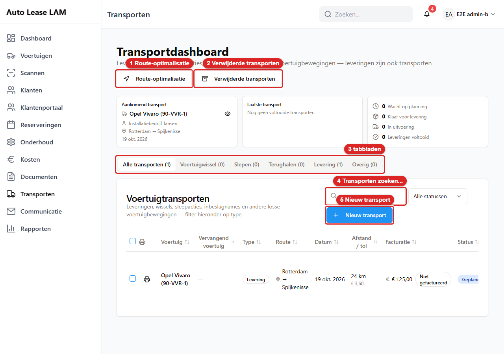
*Het **Transportdashboard**: 1 **Route-optimalisatie**, 2 **Verwijderde transporten**, 3 de tabbladen
per soort, 4 het zoekveld, 5 **Nieuw transport**.*

- **Vervangend voertuig** toont het kenteken en de stand van zaken: **TBD**, **Toegewezen**,
  **Opgehaald** of **Teruggebracht**. Bij **TBD** staat een knopje **Selecteren**. Houd je de muis
  erop, dan lees je *Vervangend voertuig selecteren*.
- **Facturatie** toont **Gefactureerd**, **Niet gefactureerd** of **Niet factureerbaar**.
- **Status** is **Gepland**, **Bezig**, **Voltooid** of **Geannuleerd**.
- Een auto die niet van ons is, krijgt het label **Extern**.
- Bij **Route** staat *van → naar*. Is één kant nog niet ingevuld, dan staat daar *onbekend*.
  Bijvoorbeeld *Eindhoven → onbekend*. Er staat dus geen vraagteken of Engels woord.

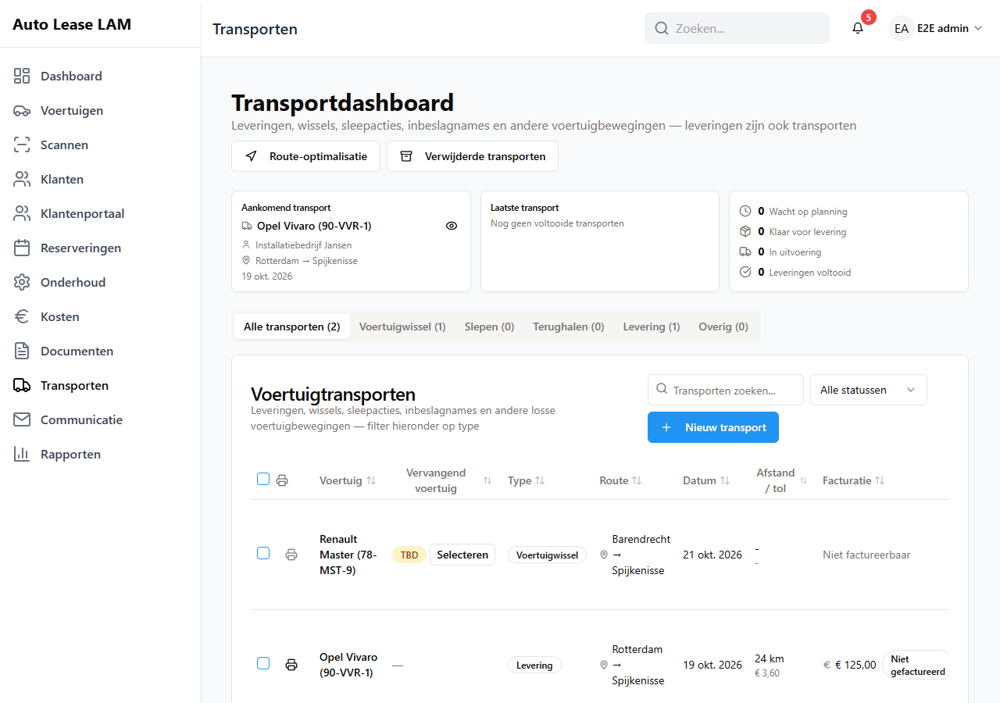
*Het **Transportdashboard**: bovenaan **Aankomend transport**, **Laatste transport** en de vier
tellers. Daaronder de tabbladen per soort en de tabel **Voertuigtransporten**.*

**De knoppen achter een regel**. Het zijn kleine plaatjes (icoontjes). Houd je de muis erop, dan zie
je de tekst:

| Knop | Waarvoor |
|---|---|
| **Bekijken** | Het transport openen |
| **Markeren als voltooid** | Het transport afronden. Grijs bij *Al voltooid of geannuleerd* |
| **Vervangend voertuig markeren als opgehaald** | De vervanger is meegegeven. Grijs bij *Nog geen vervangend voertuig toegewezen* |
| **Vervangend voertuig markeren als teruggebracht** | De vervanger is terug. Grijs bij *Vervangend voertuig nog niet opgehaald* |
| **Afdrukken / rapport genereren** | Het transportrapport maken, zie 6.7 |
| **Bewerken** | Het transport wijzigen |
| **Verwijderen** (prullenbak) | Het transport verwijderen |

Elk icoontje heeft een naam. Houd je de muis erop, dan verschijnt er een tekstje. Een schermlezer
leest die naam voor. Dat geldt ook voor het prullenbakje. Dat had vroeger geen naam.
**Afdrukken / rapport genereren** staat vooraan in de tabel, direct na het selectievakje. De andere
knoppen staan rechts onder **Acties**.

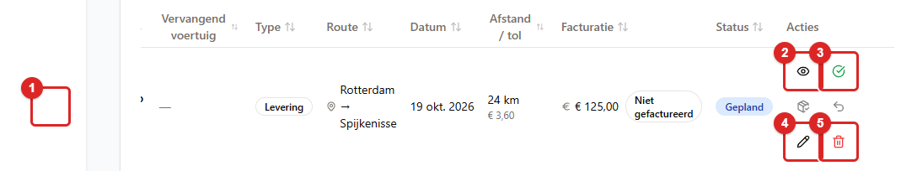
*De knoppen in een regel: 1 **Afdrukken / rapport genereren**, 2 **Bekijken**, 3 **Markeren als
voltooid**, 4 **Bewerken**, 5 **Verwijderen**. De grijze knoppen ertussen zijn **Vervangend voertuig
markeren als opgehaald** en **… als teruggebracht**. Die werken pas als er een vervanger is.*

Vink je meerdere regels aan, dan verschijnt bovenin een balk. Daarin staan **… geselecteerd**,
**Afdrukken**, **Markeer voltooid** en **Wissen**.

---

## 6.2 Een transport plannen

1. Klik op het transportdashboard op **Nieuw transport**. Je ziet nu het venster **Transport
   registreren**. Daar staat de uitleg *Registreer een losstaande voertuigverplaatsing — een wissel,
   sleepactie of terughaalactie — los van een normale verhuurlevering.*

   
   *De blauwe knop **Nieuw transport** (1) staat boven de tabel **Voertuigtransporten**.*

   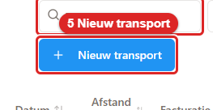
   *Zo ziet de knop **Nieuw transport** eruit. Klik erop. Daarna zie je het venster Transport registreren.*
2. Kies het **Type**: **Voertuigwissel**, **Slepen**, **Terughalen**, **Levering** of **Overig**.

   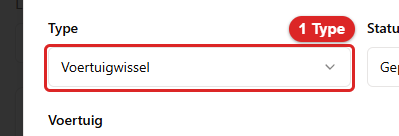
   *Zo ziet het veld **Type** eruit. Kies hier Voertuigwissel, Slepen, Terughalen, Levering of Overig.*
3. Laat **Status** op **Gepland** staan.
4. Kies het **Voertuig** in het veld *Zoek en selecteer een voertuig...* Typ het kenteken. Klik
   daarna op de juiste regel.
   - Is de auto niet van ons? Bijvoorbeeld bij een ophaalactie bij een garage. Vink dan
     **Extern voertuig (niet in ons wagenpark)** aan. Er staat bij: *Een voertuig van
     een klant of van buitenaf … Het wordt niet toegevoegd aan Voertuigen, alleen vastgelegd op
     dit transport.* Je vult dan zelf **Kenteken** (met **Opzoeken via RDW**), **Kleur**,
     **Merk**, **Model**, **Naam eigenaar** en **Telefoon eigenaar** in.

   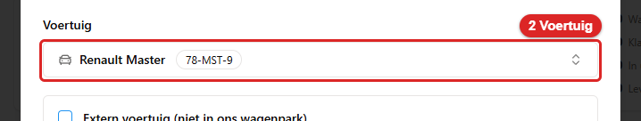
   *Zo ziet het veld **Voertuig** eruit. Typ het kenteken en klik daarna op de juiste regel.*
5. Heeft de klant een vervanger nodig? Vink dan **Vervangend voertuig vereist** aan. Zie 6.4.

   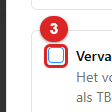
   *Zo ziet het vinkje **Vervangend voertuig vereist** eruit. Vink het aan als de klant een vervanger nodig heeft.*
6. Vul de **Geplande datum** in. Dat veld is verplicht. **Voltooiingsdatum (optioneel)** laat je
   meestal leeg. De app vult die zelf in als je het transport afrondt.

   
   *Het venster **Transport registreren**, bovenste deel: 1 **Type**, 2 **Voertuig**, 3 **Vervangend voertuig vereist**, 4 **Geplande datum**.*

   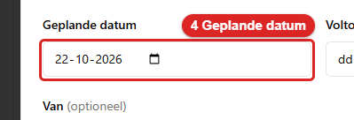
   *Zo ziet het veld **Geplande datum** eruit. Vul de datum in. Dit veld is verplicht.*
7. Vul onder **Van (optioneel)** en **Naar (optioneel)** het **Straatadres** en de **Plaats** in.
   Doe dat ook als het om ons eigen terrein gaat. Zonder adressen kan de app geen afstand
   berekenen. Op het dashboard staat dan alleen een streepje.

   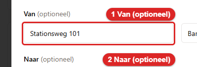
   *Zo ziet het veld **Van (optioneel)** eruit. Vul hier het Straatadres en de Plaats in.*

   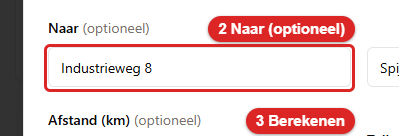
   *Zo ziet het veld **Naar (optioneel)** eruit. Vul ook hier het Straatadres en de Plaats in.*
8. Klik op **Berekenen** naast **Afstand (km) (optioneel)**. De app rekent de rijafstand uit. Dat
   doet hij met de adressen bij Van en Naar.

   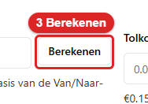
   *Zo ziet de knop **Berekenen** eruit. Klik erop. De app rekent de rijafstand uit.*
9. Klik op **Voorstellen** naast **Tolkosten (€) (optioneel)**. De app rekent met een vast bedrag
   per kilometer (*€0.15/km — instelbaar in Instellingen*). Rijdt de chauffeur leeg terug? Vink
   dan **Retour — voorstel omvat de lege terugrit** aan.

   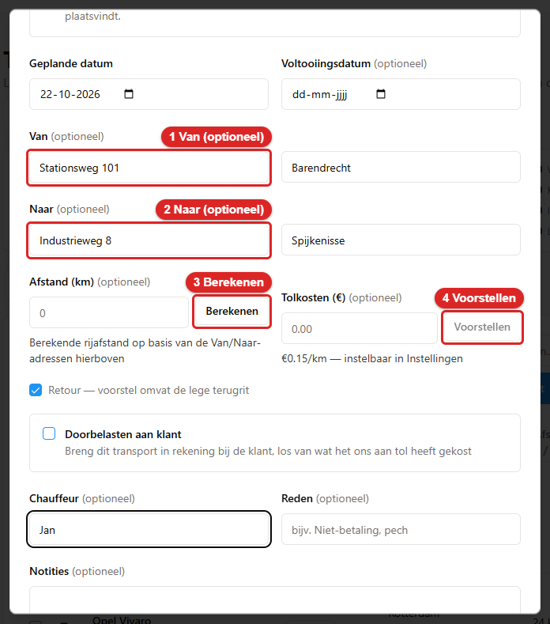
   *Adressen en kosten: 1 **Van**, 2 **Naar** (straat en plaats), 3 **Berekenen** voor de afstand,
   4 **Voorstellen** voor de tolkosten.*

   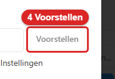
   *Zo ziet de knop **Voorstellen** eruit. Klik erop. De app rekent de tolkosten uit met een vast bedrag per kilometer.*
10. Moet de klant dit transport betalen? Zet dan **Doorbelasten aan klant** aan. Daar staat bij:
    *Breng dit transport in rekening bij de klant, los van wat het ons aan tol heeft gekost*. Kies
    de **Klant**. Vul het **Te factureren bedrag (€)** in. Is de rit al gefactureerd? Zet dan
    **Al gefactureerd aan de klant** aan.

    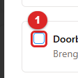
    *Zo ziet het vinkje **Doorbelasten aan klant** eruit. Zet het aan als de klant dit transport moet betalen.*
11. Vul **Chauffeur (optioneel)** in. Daar staat bij: *Wie voerde het transport uit*. Dit is een
    gewoon tekstveld. Je typt er de naam van de rijder in.

    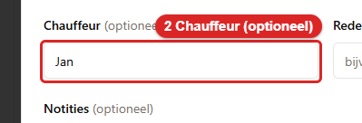
    *Zo ziet het veld **Chauffeur (optioneel)** eruit. Typ hier de naam van de rijder.*
12. Vul zo nodig **Reden (optioneel)** in (*bijv. Niet-betaling, pech*). Vul zo nodig ook
    **Notities (optioneel)** in.
13. Klik op **Transport registreren**.

    
    *Onderaan: 1 **Doorbelasten aan klant**, 2 **Chauffeur (optioneel)**, 3 **Transport registreren**.*

    
    *Zo ziet de knop **Transport registreren** eruit. Klik erop. Daarna zie je de melding Transport geregistreerd.*

Je ziet nu de melding **Transport geregistreerd**. Daar staat bij: *De transportopdracht is
geregistreerd.*

**Staat de auto uit bij een klant?** Dan verschijnt er een oranje kader. Daarin staat: *Dit voertuig
staat momenteel uit bij <klant>. Als dit transport het voertuig buiten dienst stelt, heeft die klant
waarschijnlijk een vervangend voertuig nodig.* Klik op de knop **Vervangend voertuig vereist
markeren**. Dan staat het vinkje van stap 5 meteen aan. Lees dat kader altijd. Het is het enige
moment waarop de app je waarschuwt dat een klant zonder auto komt te staan.

---

## 6.3 De voertuigwissel

Een wissel is geen apart scherm. Het is een transport met **Type = Voertuigwissel**. De opbouw is
altijd dezelfde:

- het **Voertuig** is de auto die weggaat;
- het **Vervangend voertuig** is de auto die ervoor in de plaats komt.

Het transport legt de beweging vast. Twee dingen veranderen daarbij vanzelf. Kies je een
vervangend voertuig? Dan maakt de app een reservering op die auto. Zo kan hij niet dubbel geboekt
worden. Zet je **Pech- of onderhoudswissel** aan? Dan verandert de werkplaatsstatus van de auto
(zie hieronder). Wat er verder met de lopende huur en het onderhoud moet gebeuren, regel je in
hoofdstuk 5 en 7.

Is de wissel voor onze eigen rekening? Bijvoorbeeld bij pech of onderhoud. Zet dan **Pech- of
onderhoudswissel** aan. Er staat bij: *Onze eigen kosten, niet die van de klant — standaard niet
gefactureerd.* Wil je de wissel toch aan de klant doorbelasten? Zet dan daarnaast ook
**Doorbelasten aan klant** aan.

> **Pech- of onderhoudswissel verandert de werkplaatsstatus.** Sla je het transport op met dit
> vinkje aan? Dan zet de app de auto meteen op **Onderhoud nodig**. Dat is de werkplaatsstatus
> (hoofdstuk 7, paragraaf 7.5). De auto kan dan niet worden uitgegeven. Rond je het transport af?
> Of annuleer je het? Dan haalt de app de werkplaatsstatus er weer af. Dat gebeurt ook als de auto
> nog in de werkplaats staat. Staat hij er nog? Zet hem dan opnieuw op onderhoud (hoofdstuk 7).
> Bij een extern voertuig verandert er niets, want dat staat niet in ons wagenpark.

---

## 6.4 Het vervangend voertuig en de TBD-placeholder

Vink je bij het plannen **Vervangend voertuig vereist** aan? Dan verschijnt een extra veld. Er
staat bij: *Het voertuig van dit transport heeft een vervanger nodig. Je kunt het vervangend
voertuig als TBD (nog te bepalen) laten staan en later toewijzen, op elk moment vóór het
transport plaatsvindt.*

**Meteen een auto kiezen.** Klik op *Zoek en selecteer het vervangend voertuig...* Kies een auto. Het
label verandert dan in **Vervangend voertuig (het voertuig dat als vervanger wordt ingezet)**.
In de lijst staan alleen auto's die op de geplande datum vrij zijn.

**Of laat het leeg — de TBD-placeholder.** TBD betekent "nog te bepalen". Een placeholder is
een lege plek die je later invult. Laat je het veld leeg, dan staat er **Vervangend voertuig (TBD —
nog niet geselecteerd)**. Het transport krijgt op het dashboard het oranje label **TBD**. Dat mag
met opzet. Bij het plannen weet je vaak nog niet welke auto vrij is. Toch wil je de afspraak al
vastleggen.

Achter een gekozen auto staat een kruisje (*Wissen (terug naar TBD)*). Klik erop om de auto weer op
TBD te zetten.

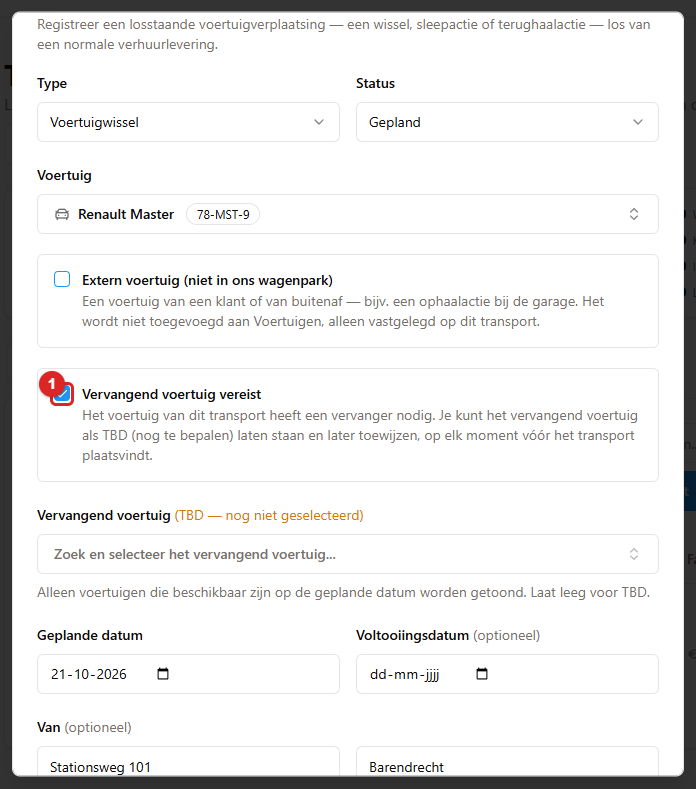
*Met **Vervangend voertuig vereist** (1) aan verschijnt het veld voor de vervanger. Laat je het leeg,
dan wordt het **TBD**.*

### Later een echte auto toewijzen

Dat kan op twee plekken:

**1. Vanaf het transportdashboard.** Klik in de kolom **Vervangend voertuig** op **Selecteren**. Dat
is de knop bij **TBD**. Je ziet nu het venster **Transport bewerken** bij het veld **Vervangend
voertuig**. Kies de auto. Klik op **Wijzigingen opslaan**. Je ziet de melding **Transport
bijgewerkt**. Daar staat bij: *De transportopdracht is bijgewerkt.* Het label springt van **TBD**
naar **Toegewezen**.

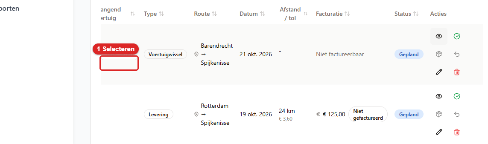
*Een transport met **TBD**: klik op **Selecteren** (1) om alsnog een auto te kiezen.*

**2. Vanuit het onderhoud.** Zie hoofdstuk 7: **Onderhoud** → **Lijstweergave** → tabblad
**Vervangers (…)** → **Toewijzen**.

> **Zonder toegewezen auto kun je geen rapport maken.** De knop **Afdrukken / rapport genereren**
> is dan grijs met de tekst: *Voor dit transport is een vervangend voertuig vereist, maar er is
> er nog geen geselecteerd. Wijs een vervangend voertuig toe voordat je de transportbrief
> genereert of afdrukt.* Logisch: de chauffeur moet weten welke auto hij meeneemt.

---

## 6.5 De transportdag

Op de dag zelf werkt de chauffeur het snelst via het scanscherm.

**Het transport starten**

1. Klik links op **Scannen**, of druk op `S`.
2. Scan het sleutellabel of typ het kenteken.
3. Onder de voertuiggegevens zie je nu het blok **Actief transport**. Daarin staan de route en het
   label **Gepland**.
4. Klik op **Transport starten**.

Je ziet de melding **Transport gestart**. Het label verandert in **Onderweg**. De knop heet nu
**Transport afronden**. Op het dashboard staat het transport op **Bezig**.

> **Let op:** het transport is alleen op het scanscherm te *starten*. Op het transportdashboard
> zit daar geen knop voor.

Staan er geen adressen bij het transport? Dan toont de route *onbekend* bij de ontbrekende kant. Vul
de adressen dan alsnog in met **Bewerken**. Zo kloppen de gegevens voor de chauffeur en klopt de
afstandsberekening.

---

## 6.6 Het transport afronden

Dat kan op drie manieren:

- **Op het scanscherm:** scan de auto en klik op **Transport afronden**. Je ziet de melding
  **Transport afgerond**.
- **Op het dashboard:** klik achter de regel op **Markeren als voltooid**. Je ziet eerst het venster
  **Transport afronden?** Daar staat: *Het transport wordt als voltooid gemarkeerd. Dat kun je daarna
  niet zomaar terugdraaien.* Vul **Afgerond op** in. Dat staat standaard op vandaag. Vul eventueel
  een **Uitkomst** in, bijvoorbeeld *auto afgeleverd, klant niet thuis, schade gemeld*. Die uitkomst
  komt bij de notities van het transport te staan, met *Uitkomst:* ervoor. Klik op **Afronden** om
  het door te zetten. Bedenk je je? Sluit dan het venster. Daarna zie je de melding **Transport
  gemarkeerd als voltooid**. Zit er een vervangend voertuig aan het transport? Dan volgt daarna nog
  de vraag hieronder.

  
  *Het venster **Transport afronden?**: vul **Afgerond op** en eventueel **Uitkomst** in. Klik daarna
  op **Afronden** (1).*
- **In bulk:** vink meerdere regels aan en klik op **Markeer voltooid**. Je hebt dan zelf een
  keuze gemaakt. Daarom komt er geen extra vraag.

De status wordt **Voltooid**. De voltooiingsdatum wordt vastgelegd.

### De vraag over de vervanger

Rond je een transport af met een vervangend voertuig? Dan vraagt de app:

> **Vervangend voertuig markeren als opgehaald?**
> *<merk> <kenteken> is toegewezen als vervangend voertuig. Markeer het nu als opgehaald, of doe
> dit later vanuit de transportenlijst.*
> **Later** · **Nu markeren als opgehaald**

Heeft de klant de vervanger echt meegekregen? Kies dan **Nu markeren als opgehaald**. Je ziet dan
het gewone ophaalvenster met contractnummer, kilometerstand, brandstof en schadecheck
(hoofdstuk 5, paragraaf 5.7). Moet dat nog gebeuren? Kies dan **Later**. Je kunt het dan op het
dashboard alsnog doen met de knop **Vervangend voertuig markeren als opgehaald**.

Komt de vervanger terug? Dan gebruik je **Vervangend voertuig markeren als teruggebracht**. Ook
daar vraagt de app eerst: **Vervangend voertuig markeren als teruggebracht?** Daar staat bij: *… staat
nog uit als vervangend voertuig. Markeer het nu als teruggebracht, of doe dit later vanuit de
transportenlijst.*

De vervanger doorloopt dus vier standen: **TBD** → **Toegewezen** → **Opgehaald** →
**Teruggebracht**.

---

## 6.7 Het transportrapport

Het transportrapport is het papier dat de chauffeur meeneemt. Het is één pagina per transport. Daarop
staan de auto, de route en de datum.

1. Klik op het dashboard achter de regel op **Afdrukken / rapport genereren**. Wil je er meerdere
   in één keer? Vink dan de regels aan. Klik daarna bovenin op **Afdrukken**.

   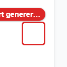
   *Zo ziet de knop **Afdrukken / rapport genereren** eruit. Klik erop achter de regel van het transport.*
2. De app maakt het rapport en slaat het op. Je ziet de melding **Rapport gemaakt**. Daar staat bij:
   *Het rapport staat in Documenten en wordt hieronder getoond.* Er verschijnt een voorvertoning. De
   titel daarvan is de bestandsnaam, bijvoorbeeld
   *Transport_Report_HANDLEIDING_Unknown_18-09-2026_55544.pdf*. Daaronder staat de regel: *Rapport
   gegenereerd en opgeslagen in Documenten — hieronder bekijken en afdrukken.*
3. Klik op **Afdrukken**. Wilde je het alleen opslaan? Klik dan op **Sluiten**.

Het rapport staat daarna ook bij **Documenten** (hoofdstuk 8). Zo kun je later terugvinden wat de
chauffeur mee had.

**Wat er mis kan gaan:**

| Melding | Wat je doet |
|---|---|
| De knop is grijs met *Voor dit transport is een vervangend voertuig vereist, maar er is er nog geen geselecteerd…* | Wijs eerst een vervanger toe (6.4) |
| **Pop-up geblokkeerd** met *Sta pop-ups voor deze site toe en klik daarna opnieuw op Afdrukken.* | Zet pop-ups aan voor deze site |
| *Je browser heeft de inline voorvertoning geblokkeerd…* | Klik op **Openen in nieuw tabblad** |
| **Genereren van rapport mislukt** | Probeer het opnieuw. Blijft het misgaan? Meld het dan bij een beheerder |

Je kunt maximaal 50 transporten in één rapport zetten.

De bestandsnaam is Engels. Dat is alleen de naam van het bestand. De inhoud is Nederlands. Heeft de
auto nog geen echt merk en model? Bijvoorbeeld omdat hij een placeholder is, of omdat die velden leeg
zijn. Dan staat het kenteken in de bestandsnaam. Eerder stond daar *Unknown_Unknown*.

---

## 6.8 Route-optimalisatie

Heb je meerdere ritten op één dag? Dan kun je de app de beste volgorde laten uitrekenen.

1. Klik rechtsboven op **Route-optimalisatie**. Je ziet nu het venster **Routeoptimalisatie**. Daar
   staat de uitleg *Plan een efficiënte bezoekvolgorde voor de leveringen en transporten van een dag,
   met echte rijafstanden.*

   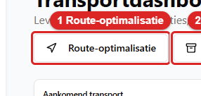
   *Zo ziet de knop **Route-optimalisatie** eruit. Klik erop. Daarna zie je het venster Routeoptimalisatie.*
2. Kies de **Datum**.

   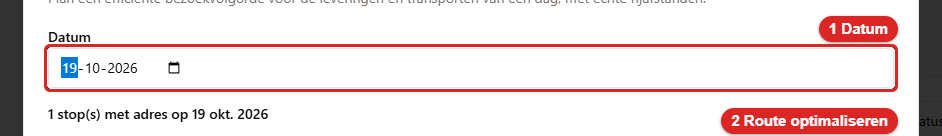
   *Zo ziet het veld **Datum** eruit. Kies hier de datum.*
3. Klik op **Route optimaliseren**.

   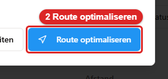
   *Zo ziet de knop **Route optimaliseren** eruit. Klik erop. Daarna zie je de voorgestelde volgorde.*

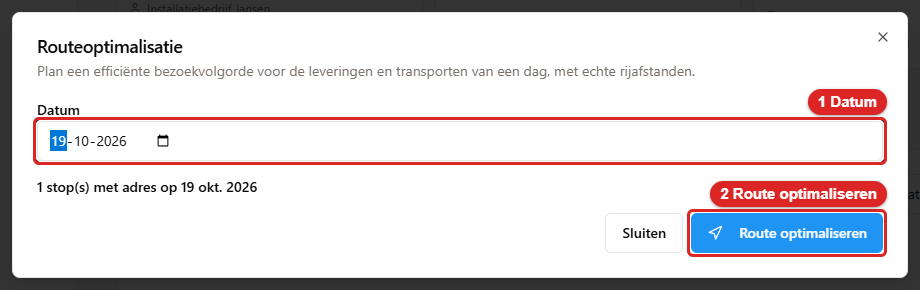
*Het venster **Routeoptimalisatie**: 1 kies de **Datum**, 2 klik op **Route optimaliseren**.*

Is de knop grijs? Dan staat onder het venster waarom. Bijvoorbeeld: *Er is op deze datum niets
gepland. Kies een andere datum.* Of: *Geen van de geplande ritten heeft een adres of plaats. Vul die
eerst in.*

Je ziet nu de voorgestelde volgorde met de **Totale afstand**. Klik op **Openen in Google
Maps (nieuw tabblad)** om de route op de kaart te zien. Staat er *(schatting in rechte lijn)* bij?
Dan ontbraken er adressen. De afstand is dan een ruwe schatting.

---

## 6.9 Een transport wijzigen, verwijderen en terugzetten

**Bekijken.** Klik achter een regel op **Bekijken**. Je ziet alle gegevens op een rij: **Type**,
**Status**, **Vervangend voertuig**, **Route**, **Datum**, **Voltooiingsdatum**, **Afstand**,
**Tolkosten**, **Facturatie**, **Klant**, **Chauffeur**, **Reden** en **Notities**. Hoort het
transport bij een reservering? Dan staat er **Levering vanuit reservering #…**. Klik op
**Open reservering** om meteen naar de huur te gaan.

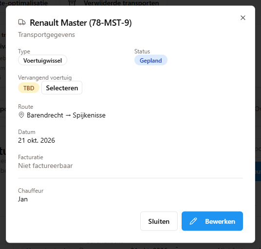
*Een transport na **Bekijken** (of een klik op de regel): alle gegevens op een rij.*

**Wijzigen.** Klik op **Bewerken**. Pas de gegevens aan. Klik op **Wijzigingen opslaan**.

**Verwijderen.** Klik op het prullenbakje. Je ziet de vraag **Dit transport verwijderen?** Daar staat
bij: *Dit verwijdert dit transportrecord permanent. Deze actie kan niet ongedaan worden gemaakt.*

**Terugzetten kan wel.** Die tekst klopt niet helemaal, net als bij reserveringen. Een verwijderd
transport komt in de prullenbak. Die staat op dit scherm, rechtsboven: de knop **Verwijderde
transporten**. De regel staat daar met het label **Transport**. Bijvoorbeeld *Transport #47 —
P36T64813O3 2027-04-10*. Erachter staat de knop **Terugzetten**. Dat mag iedereen met het vinkje
**Prullenbak beheren** (hoofdstuk 15, paragraaf 15.16). Wie dat vinkje mist, ziet de knop grijs.
Bij het terugzetten wordt ook het vervangend voertuig weer geopend. Dat gebeurt alleen als die auto
nog vrij is. Wil je een transport voorgoed weghalen? Dat kan op dezelfde plek met **Definitief
verwijderen** (hoofdstuk 10, paragraaf 10.6).

---

## 6.10 Snel naslaan

| Wat je wilt | Waar |
|---|---|
| Een rit vastleggen | **Transporten** → **Nieuw transport** |
| Een wissel plannen | **Nieuw transport** → **Type: Voertuigwissel** |
| Een vervanger openhouden | **Vervangend voertuig vereist** aan, veld leeg = **TBD** |
| Later een auto toewijzen | **Selecteren** bij **TBD** op het dashboard |
| Het transport starten | **Scannen** → **Transport starten** |
| Het transport afronden | **Scannen** → **Transport afronden**, of **Markeren als voltooid** |
| Het rapport maken | **Afdrukken / rapport genereren** achter de regel |
| De dagroute plannen | **Route-optimalisatie** |
| Een transport terughalen | **Transporten** → **Verwijderde transporten** → **Terugzetten** (vraagt het vinkje **Prullenbak beheren**) |
