# 7. Onderhoud

Onderhoud gaat over auto's die tijdelijk niet verhuurd kunnen worden. Bijvoorbeeld bij een beurt,
een APK, een reparatie of pech. Je legt dat vast als een **onderhoudsblok** in de werkplaatskalender.
Een onderhoudsblok is een afspraak in de kalender: deze auto is op die dagen bij de werkplaats.
Daarnaast heeft een auto een **werkplaatsstatus**. Die status houdt de uitgifte tegen. Die twee zijn
niet hetzelfde. Lees 7.5 goed.

---

## 7.1 De onderhoudskalender

Klik links op **Onderhoud**. Je komt op de **Onderhoudskalender**. Daaronder staat de
**Onderhoudsplanning** met de uitleg *Voertuigonderhoudsevenementen bekijken en beheren*.

Rechtsboven staan:

| Knop | Waarvoor |
|---|---|
| **Lijstweergave** | Hetzelfde als lijst, zie 7.8 |
| **Voltooide bekijken (…)** | De afgeronde onderhoudsbeurten, zie 7.8 |
| **Verwijderd onderhoud** | De prullenbak van dit scherm, zie 7.8 |
| **Onderhoud plannen** | Een nieuw onderhoudsblok, zie 7.2 |

Boven de kalender staan **Kleuren** (de kleuren van de kalender aanpassen), **Vandaag** en de knoppen om van
maand te wisselen. Daarnaast staan drie filters: **Zoek voertuigen of evenementen...**,
**Voertuigtype** (**Alle types**) en **Evenementtype** (**Alle evenementen**).

**Wat er in de kalender staat.** Er staan twee soorten regels door elkaar:

1. **Signalen**. Die rekent de app zelf uit. Hij kijkt daarvoor naar de APK-datum en de
   garantiedatum van de auto. De signalen zijn: **APK-keuring verschuldigd**, **APK Herinnering (2
   maanden)**, **APK Herinnering (1 maand)**, **Garantie verloopt**, **Garantie Herinnering (2
   maanden)** en **Garantie Herinnering (1 maand)**. Die staan er automatisch. Je kunt ze niet
   weghalen. Je kunt ze alleen opvolgen.
2. **Onderhoudsblokken**. Die heeft iemand ingepland. Dit zijn **Gepland onderhoud**, **In
   onderhoud** en **Onderhoudsbeurt nodig**.

Achter een signaal kan **(Verplaatst van het weekend)** staan. Dan viel de datum zelf in het
weekend. De app heeft de datum naar de eerstvolgende werkdag geschoven. Zo zie je het signaal op een
werkdag.

Bij een blok kun je labels zien: **Vervanger nodig**, **Vervangend voertuig nodig**,
**Verhuur komt eraan** of **Verhuur komt eraan (binnen 3 weken)**. Dat is een waarschuwing. Er zit
een klant aan dit blok vast.

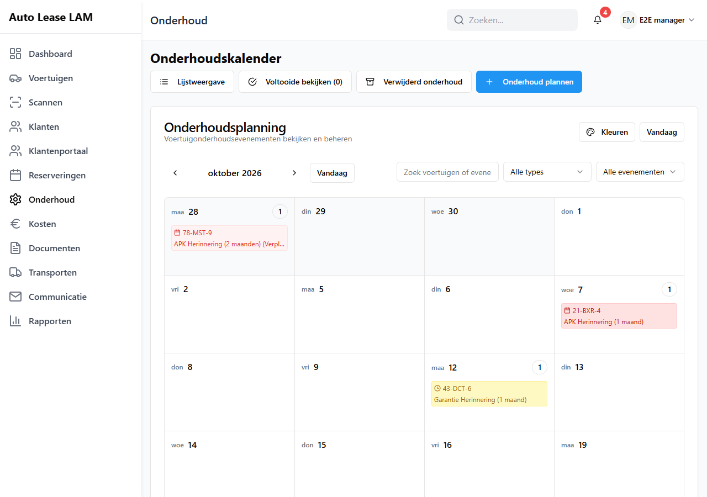
*De **Onderhoudskalender**: per dag de herinneringen voor APK en garantie. Ingepland onderhoud
staat er ook in, als blok op de dagen van het onderhoud.*

*De knoppen: 1 **Lijstweergave**, 2 **Voltooide bekijken (…)**, 3 **Verwijderd onderhoud**, 4
**Onderhoud plannen**, 5 **Kleuren**.*

**Een dag openen.** Klik op een dagvakje. Je ziet nu het venster **Onderhoudsevenementen -
<datum>**. Daar staat de uitleg *Onderhoudsevenementen voor deze dag bekijken en beheren*. Wat je
per regel kunt doen, hangt af van het soort regel:

- Bij een **signaal** (APK of garantie) staat alleen **Onderhoud plannen**. Daarmee zet je de
  keuring in de kalender.
- Bij een **onderhoudsblok** staan **Afronden**, **Bewerken**, **Verwijderen** en **Onderhoud
  bekijken**.

*Het dagvenster: per onderhoudsblok 1 **Afronden**, 2 **Bewerken**, 3 **Onderhoud bekijken**. Het
label **Vervangend voertuig nodig** zegt dat er een klant aan vastzit.*

Is er niets op die dag? Dan staat er *Geen onderhoudsevenementen gepland voor deze dag*.

---

## 7.2 Onderhoud plannen

1. Klik rechtsboven op **Onderhoud plannen**. Je ziet nu het venster **Onderhoud plannen**. Daar
   staat de uitleg *Meld pech, plan reparaties of onderhoud voor je voertuigen. Ideaal wanneer een
   voertuig direct aandacht nodig heeft of versleten onderdelen heeft.*

   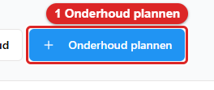
   *De blauwe knop **Onderhoud plannen** (1) staat rechtsboven op de **Onderhoudskalender**.*
2. Kies het **Voertuig** via *Selecteer een voertuig...* Typ het kenteken. Onder
   **Voertuigfilters** kun je de lijst korter maken. Dat doe je met **Alleen beschikbare voertuigen
   tonen** en **Voertuigen met bestaand onderhoud uitsluiten**.

   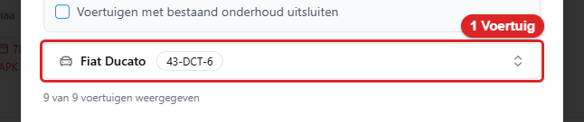
   *Zo ziet het veld **Voertuig** eruit. Typ het kenteken en kies de auto uit de lijst.*
3. Kies eventueel een **Klant**. Daar staat bij: *Wie brengt het voertuig voor onderhoud?* Dit is
   een zoekveld, net als in het reserveringsformulier. Typ een deel van de naam, het telefoonnummer
   of de plaats (*Zoek op naam, telefoon of plaats...*). Klik daarna op de juiste regel. Past er
   niemand bij? Dan staat er *Geen klanten gevonden.* Bovenaan de lijst staat **Geen (geen klant)**.
   Heeft de auto een lopende verhuring? Dan staat bij die klant het label **Actieve verhuur**.
4. Kies het **Onderhoudstype**. Er zijn veertien types. Bij elk type staat een korte uitleg:

   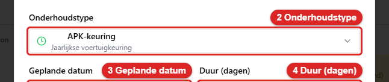
   *Zo ziet het veld **Onderhoudstype** eruit. Kies het type uit de lijst.*

| Type | Waarvoor |
|---|---|
| **Voertuigpech** | Auto start niet, motorproblemen |
| **Bandenwissel** | Versleten banden, lekke band |
| **Remmenonderhoud** | Versleten remblokken, remvloeistof |
| **Motorreparatie** | Motorproblemen, oververhitting |
| **Transmissiereparatie** | Problemen met schakelen |
| **Elektrisch probleem** | Verlichting, sensoren, elektronica |
| **Airconditioning** | Airco-reparatie, gas bijvullen |
| **Accuwissel** | Lege accu, laadproblemen |
| **Olieverversing** | Reguliere oliebeurt |
| **Regulier onderhoud** | Geplande servicebeurt |
| **APK-keuring** | Jaarlijkse voertuigkeuring |
| **Garantieservice** | Gedekte reparaties |
| **Ongevalschade** | Reparaties na aanrijding |
| **Overig** | Aangepast onderhoud |

5. Vul de **Geplande datum** in. Daar staat bij: *Wanneer moet dit onderhoud worden uitgevoerd?*

   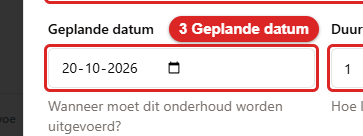
   *Zo ziet het veld **Geplande datum** eruit. Vul de dag in waarop het onderhoud moet gebeuren.*
6. Vul **Duur (dagen)** in. Daar staat bij: *Hoe lang duurt dit?* Er is geen veld voor de einddatum.
   De app rekent die zelf uit: startdatum plus duur.

   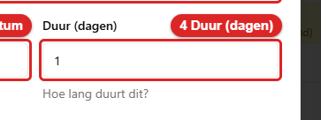
   *Zo ziet het veld **Duur (dagen)** eruit. Vul het aantal dagen in.*
7. Een nieuw blok staat altijd op *gepland*. Daarom zie je het veld **Status** niet bij het
   plannen. Dat veld verschijnt pas als je een bestaand blok bewerkt. Het heeft dan twee keuzes:
   **Gepland (voertuig nog niet gearriveerd)** en **Binnen (voertuig is in onderhoud)**. Een
   onderhoud rond je niet af met een status. Dat doe je met de knop **Afronden** (7.6).
8. Vul **Omschrijving** in. Houd het kort en duidelijk, bijvoorbeeld *voorremmen* of *olie- en
   filterwissel*. Extra uitleg zet je in **Notities**.

   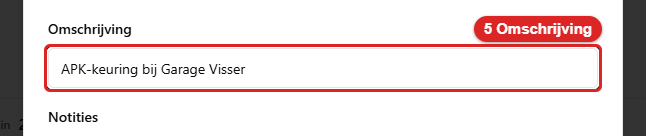
   *Zo ziet het veld **Omschrijving** eruit. Houd het kort en duidelijk.*
9. Klik op **Onderhoud plannen**.

   
   *Zo ziet de knop **Onderhoud plannen** onderaan het venster eruit.*

*Het venster **Onderhoud plannen**: 1 **Voertuig**, 2 **Onderhoudstype**, 3 **Geplande datum**, 4 **Duur (dagen)**, 5 **Omschrijving**, 6 **Onderhoud plannen**.*

Je ziet nu de melding **Onderhoud gepland**. Daar staat bij: *Het onderhoud is gepland en de
herinneringen zijn bijgewerkt.* Het blok staat nu in de kalender op de gekozen dagen. Je ziet het
kenteken en het type.

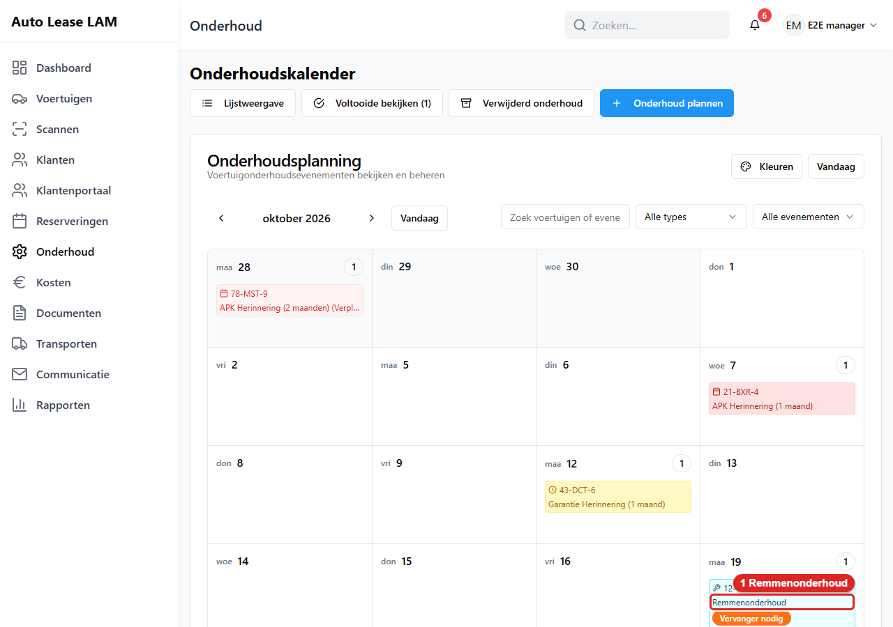
*Dit zie je daarna: het blok **Remmenonderhoud** (1) staat in de kalender, met het kenteken en het type.*

**Een geannuleerde of afgeronde verhuring telt niet als conflict.** De app kijkt bij het plannen
alleen naar verhuringen die nog lopen of nog moeten komen. Staat er op die dagen alleen een huur met
**Geannuleerd** of **Voltooid**, of een huur die al is ingeleverd? Dan krijg je niet de tweede stap
met vervangers. Je krijgt ook geen leeg venster. Je plant gewoon door.

> **Waarom je dit vastlegt en niet alleen afspreekt met de werkplaats:** het blok maakt zichtbaar
> dat de auto die dagen geclaimd is. Iedereen die de kalender bekijkt, ziet het, en wie in die
> periode wil boeken krijgt een waarschuwing (7.3).

### Als er een klant aan vastzit

Heeft de gekozen auto in die periode een lopende verhuring? Dan verschijnt een tweede stap:
**Vervangende voertuigen toewijzen**. Daar staat de uitleg *Het geselecteerde voertuig heeft actieve
reserveringen tijdens de onderhoudsperiode. Wijs vervangende voertuigen toe aan de betrokken
klanten.*

Per betrokken reservering kies je onder **Vervoersoplossing:** één van drie keuzes:

| Keuze | Wat het betekent |
|---|---|
| **Nu vervangend voertuig toewijzen** | Je kiest meteen een auto uit de beschikbare voertuigen |
| **Later vervanger toewijzen (nog te bepalen)** | Er komt een placeholder (een lege plek). Je wijst later een auto aan (7.4) |
| **Klant regelt eigen vervoer** | Er komt geen vervanger |

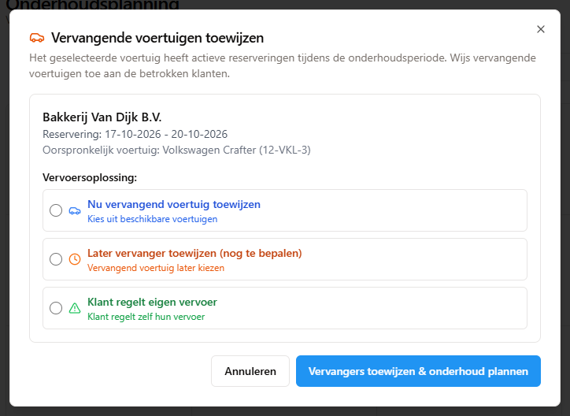
*De tweede stap **Vervangende voertuigen toewijzen**: per betrokken klant kies je een van de drie
keuzes.*

*Met 1 **Later vervanger toewijzen (nog te bepalen)** gekozen klik je op 2 **Vervangers toewijzen &
onderhoud plannen**.*

Achter *Vervangende verhuur* staat de knop **Bewerken**. Klik erop. Je ziet nu het venster
**Huurperiode vervanger instellen**. Daar stel je de startdatum en de einddatum van de vervangende
huur in. Laat je de einddatum leeg? Dan is het een huur zonder einddatum. De knoppen
**Onderhoudsdata gebruiken** en **Open einde maken** schelen typwerk.

Klik tot slot op **Vervangers toewijzen & onderhoud plannen**. Eén klik op die knop is genoeg. Dat
geldt ook als de lijst met auto's nog openstaat. Die lijst staat los van het venster. Hij houdt je
klik niet meer tegen.

Vergeet je een keuze te maken? Dan meldt de app **Ontbrekende toewijzingen vervangend voertuig**.
Daar staat bij: *Kies een specifiek voertuig of 'Nog te bepalen' voor alle betrokken reserveringen.*

### Plannen afbreken

Ben je bij **Vervangende voertuigen toewijzen** en bedenk je je? Klik dan op **Annuleren**. Je kunt
ook op Escape drukken, op het kruisje klikken of naast het venster klikken. Dat maakt het hele
plannen ongedaan, niet alleen deze tweede stap. Het onderhoud dat je net aanmaakte, bestaat anders al.
De app vraagt eerst **Plannen afbreken?** Daar staat bij: *Het onderhoud wordt weer weggehaald. Wilt u
zonder vervanger plannen, kies dan bij de klant 'Later vervanger toewijzen'.* Klik op **Plannen
afbreken** om het onderhoud weg te halen. Je ziet dan de melding **Plannen afgebroken** met *Het
onderhoud is weer weggehaald.* Klik op **Doorgaan met plannen** om terug te gaan naar het venster.

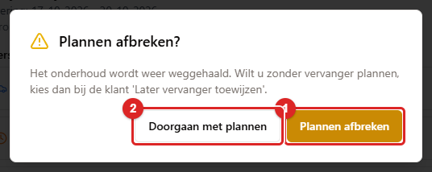
*De vraag **Plannen afbreken?**: 1 **Plannen afbreken** haalt het onderhoud weg, 2 **Doorgaan met
plannen** gaat terug.*

Wil je wél plannen, maar nog geen vervanger kiezen? Kies dan bij de klant **Later vervanger toewijzen
(nog te bepalen)** (7.4). Plan daarna gewoon door. **Annuleren** is daar niet voor bedoeld.

**Wanneer het écht weggehaald wordt.** Het afbreken verwijdert het onderhoud meteen. Het komt dan
niet in de prullenbak. Dat gebeurt alleen als het onderhoud nog helemaal nieuw is. Dat betekent: je
hebt het zelf aangemaakt, minder dan een uur geleden. Het staat nog op *gepland*. En er hangt nog geen
vervanger of placeholder aan. Klopt een van die dingen niet? Dan breekt de app het plannen niet af.
De app verwijdert het onderhoud dan op de gewone manier. Je ziet dan de melding **Onderhoud
verwijderd** met *Het onderhoud staat in de prullenbak en kan daar worden teruggezet.* Had de klant
al een melding "onderhoud gepland" gekregen? Dan hoort hij daarna ook dat het onderhoud niet doorgaat.
Was die melding nog niet verstuurd? Dan hoort hij niets.

---

## 7.3 Wat een onderhoudsblok doet met de beschikbaarheid

Dit is de vraag die aan de balie het vaakst misgaat. Daarom staat het hier apart.

**Een gepland onderhoudsblok zet de auto op Gepland, niet op Reparatie nodig.** Staat het blok op
*gepland*? Dan is de auto er nog niet. Je ziet de auto dan in de lijst en op het scanscherm als
**Gepland**. Zet je het blok op **Binnen**? Of gebruik je **Binnen melden** (7.8)? Pas dan wordt de
auto **Reparatie nodig**. Een auto die al bij een klant staat, blijft **Verhuurd**. Dat geldt ook
als er vandaag een gepland blok ligt. Eerder werd de auto al bij het plannen **Reparatie nodig**.
Dat is niet meer zo.

**Een gepland onderhoudsblok haalt de auto niet uit de keuzelijst.** Je kunt hem gewoon
kiezen in het boekingsformulier. Je ziet dan wel een gele waarschuwing:

> *Let op: dit voertuig staat in deze periode ingepland voor onderhoud (05-10-2026 t/m
> 07-10-2026). Opslaan mag; het onderhoudsblok blijft staan.*

Opslaan mag dus. Staan er meerdere blokken? Dan meldt de app: *Let op: dit voertuig heeft …
onderhoudsblokken in deze periode (…). Opslaan mag; de blokken blijven staan.*

**Doe je dat, dan heb je iets op te lossen.** De auto is nu twee keer bezet: door de klant en
door de werkplaats. Verzet het onderhoud, of bel de werkplaats. De app doet dat niet voor je. De app
waarschuwt daarna ook nooit meer.

**In de tellingen telt de auto wél als niet-beschikbaar.** Kijk op het dashboard bij "beschikbare
voertuigen". Daar zie je hem niet staan. Dat is geen tegenspraak. De telling is voorzichtig. Het
boeken is een bewuste keuze van jou.

**Ophalen mag, met een waarschuwing.** Haal je een huur op met een auto die voor onderhoud is
ingepland? En is die auto nog niet binnen gemeld? Dan staat in het ophaalvenster: *Let op: dit
voertuig staat ingepland voor onderhoud (<periode>) en is nog niet binnengemeld. Ophalen mag; de balie
beslist.* Er wordt niets geblokkeerd. Staat de auto wél op **Binnen**? Dan weigert de app het ophalen.
Je ziet dan het venster **Uitgifte geblokkeerd** (7.5).

**De werkplaatsstatus is iets anders en die blokkeert wél.** Zie 7.5.

---

## 7.4 Het vervangend voertuig

Gaat de auto van een klant naar de werkplaats? Dan krijgt de klant vaak een vervanger. In de app is
dat een eigen reservering op de vervangende auto. Die reservering is gekoppeld aan het onderhoud.

**Meteen toewijzen.** Kies bij het plannen (7.2) **Nu vervangend voertuig toewijzen**.

Of doe het vanuit de lopende huur:

1. Open de reservering via het zoekveld bovenin.
2. Zet de auto eerst op onderhoud met **Voertuig markeren voor onderhoud** (7.5).

   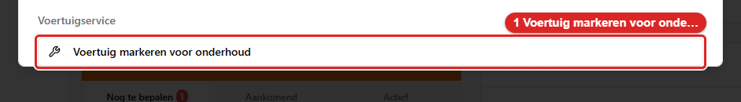
   *Zo ziet de knop **Voertuig markeren voor onderhoud** eruit. Klik erop. Hij staat onder **Voertuigservice**.*
3. Onder **Voertuigservice** staat nu de knop **Vervangend voertuig toewijzen**. Klik erop.
4. Je ziet nu een venster met de uitleg *Wijs een vervangend voertuig toe om de klant te blijven
   bedienen terwijl het originele voertuig in onderhoud is.* Vul **Startdatum** en **Einddatum** in
   (*Laat leeg voor vervanging zonder einddatum*). Kies een auto uit **Beschikbare vervangende
   voertuigen**. Daar staan alleen auto's in die in die periode vrij zijn.
5. Klik op **Vervangend voertuig toewijzen**.

Je ziet nu de melding **Vervangend voertuig toegewezen**. Daar staat bij: *Het vervangende voertuig
is succesvol toegewezen.*

> **Waarom de auto eerst naar onderhoud moet:** het blok **Voertuigservice** toont maar één knop
> tegelijk. Zolang de auto in orde is, staat er alleen **Voertuig markeren voor onderhoud**. Pas
> als hij op **Onderhoud nodig** of **Momenteel in onderhoud** staat, verschijnt **Vervangend
> voertuig toewijzen**. En zodra er een vervanger loopt, verschijnt in plaats daarvan het oranje
> blok met **Terug van onderhoud**. Zie je de knop die je zoekt niet, kijk dan eerst in welke van
> die drie standen deze auto staat.

**Later toewijzen (nog te bepalen).** Kies je bij het plannen **Later vervanger toewijzen (nog te
bepalen)**? Dan maakt de app een placeholder. Die herken je aan:

- **TBD** in plaats van een kenteken op de reserveringskalender;
- op het **Dashboard** in het blok **Beheer vervangende voertuigen**, tabblad **Nog te bepalen**,
  met *Vervangend voertuig (nog te bepalen)* en de knop **Voertuig toewijzen**;
- het tabblad **Vervangers (…)** in het **Onderhoudsoverzicht**, met per regel **Toewijzing
  nodig** en de knop **Toewijzen**.

Er is ook een venster om er meerdere tegelijk af te handelen: **Vervangende voertuigen
toewijzen**. Daar staat de uitleg *Selecteer beschikbare voertuigen om toe te wijzen aan nog te
bepalen vervangende-voertuigreserveringen.* Per regel kies je bij **Selecteer voertuig** een auto.
Daarna klik je op **… voertuigen toewijzen**.

**In het onderhoudsvenster zelf.** Open een onderhoudsblok met **Onderhoud bekijken**. In het
blok **Toewijzingen vervangend voertuig** staat de keuzelijst **Toegewezen vervangend voertuig**.
Die heeft twee bijzondere keuzes: **Nog te bepalen (Placeholder)** en **Eigen vervoer**. Daarnaast
staat de huidige stand, bijvoorbeeld *(Nog toe te wijzen)* of *(Klant regelt zelf)*.

**Waarom je de auto eerst naar onderhoud zet en pas daarna een vervanger aanwijst:** zolang het
onderhoud niet vastligt, weet de app niet voor welke periode de vervanger nodig is. De app weet dan
ook niet welke auto's in die periode vrij zijn. Doe je het andersom? Dan krijg je misschien een
vervanger die zelf al verhuurd is.

---

## 7.5 De werkplaatsstatus: de auto echt op slot zetten

Naast het onderhoudsblok in de kalender heeft elke auto een **werkplaatsstatus**. Die staat
standaard op in orde. Hij kan twee andere waarden hebben: **Onderhoud nodig** of **Momenteel in
onderhoud**.

**Deze status blokkeert de uitgifte.** Staat hij aan? Dan weigert de app het ophalen. Je ziet
het venster **Uitgifte geblokkeerd**:

> *Dit voertuig staat in de werkplaats en kan niet worden uitgegeven. Rond de werkplaatsklus
> eerst af.*

Er wordt dan niets opgeslagen. Ben je beheerder? Dan kun je de uitgifte in datzelfde venster
alsnog doorzetten met een reden. Zie hoofdstuk 5, paragraaf 5.7.

### De status aanzetten

1. Open de reservering via het zoekveld bovenin.
2. Klik onder **Voertuigservice** op **Voertuig markeren voor onderhoud**.

   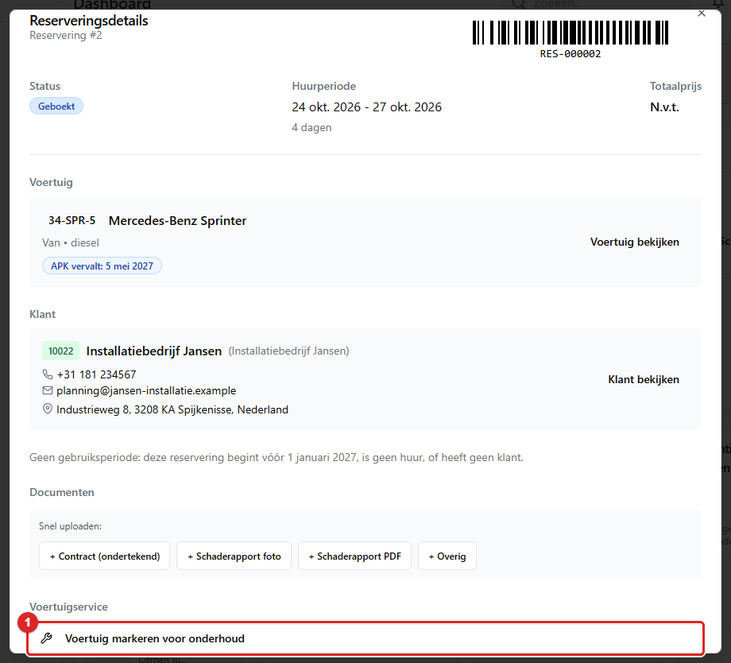
   *Het blok **Voertuigservice** in het volledige reserveringsvenster: klik op **Voertuig markeren voor
   onderhoud** (1).*
3. Kies bij **Onderhoudsstatus**: **Onderhoud nodig** of **Momenteel in onderhoud**. Daar staat
   bij: *Kies of het voertuig onderhoud nodig heeft of momenteel wordt onderhouden.*
4. Zet in **Servicenotities** wat er aan de hand is.
5. Vul eventueel **Startdatum onderhoud** en **Einddatum onderhoud** in.
6. Klik op **Markeren voor onderhoud**.

   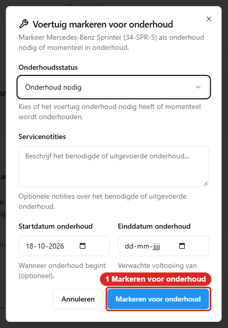
   *Het venster: kies de status, vul de notities in en klik op **Markeren voor onderhoud** (1).*

Je ziet nu de melding **Voertuig gemarkeerd voor onderhoud**. Daar staat bij: *Het voertuig is
succesvol gemarkeerd als onderhoud nodig.* De app zet de auto op **In reparatie**. De app maakt er
meteen een onderhoudsblok bij aan. De app onthoudt welk blok de stand **Reparatie nodig** heeft
veroorzaakt (zie *Verwijderen of annuleren wist ook de reparatiestand* in 7.8).

Het kan ook vanaf het scanscherm. Scan de auto. Klik op **Onderhoud inplannen**. Je ziet dan het
gewone venster **Onderhoud plannen**. De auto is al ingevuld.

### De status weer uitzetten

Er zijn twee knoppen. Het verschil is belangrijk.

**A. Terug uit onderhoud (scanscherm).** Scan de auto. Klik op **Terug uit onderhoud**. Staat de
auto op **Binnen** in een onderhoudsblok dat vandaag loopt? Dan zie je het venster **Onderhoud
afronden** voor dat blok (7.6). Een onderhoud rond je altijd af met de gegevens van de werkplaats,
niet met één klik. Vul het venster in. Klik op **Afronden**. Je ziet de melding **Onderhoud
afgerond**. Staat de auto in de werkplaats zonder een blok op **Binnen**? Dan werkt de knop zoals
vroeger, in één klik. Je ziet dan **Voertuig is terug uit onderhoud**. In beide gevallen gaat de
werkplaatsstatus eraf. De auto is meteen weer verhuurbaar. Hij staat dus niet meer op **Reparatie
nodig**. Je hoeft de beschikbaarheidsstatus niet meer met de hand terug te zetten.

Onderhoud dat verderop in de kalender staat, blijft gewoon staan. Alleen het blok dat vandaag
loopt, gaat dicht.

> **Alleen Voertuigen beheren is niet genoeg.** Staat de auto op **Binnen** in een lopend onderhoud, dan
> is **Terug uit onderhoud** het afronden van dat onderhoud, en dat vraagt het vinkje **Onderhoud beheren**
> of **Reserveringen beheren**. Een scanaccount dat alleen **Voertuigen beheren** heeft, ziet de knop
> grijs; wijs of tik erop en de app zegt welk vinkje er ontbreekt (hoofdstuk 15, paragraaf 15.9). Vraag
> iemand die een van die vinkjes heeft. Wie **Onderhoud beheren** heeft, hoeft **Voertuigen beheren** niet
> te hebben: het venster **Onderhoud afronden** opent meteen. Een auto in de werkplaats zonder lopend
> onderhoud geef je wel vrij met alleen **Voertuigen beheren**.

**B. Terug van onderhoud (bij een vervanger).** Heeft de klant een vervangende auto gekregen? Dan
staat er in de reservering een oranje blok **Vervangend voertuig toegewezen** met de tekst
*Voertuig wordt momenteel onderhouden*. Daarin staat de knop **Terug van onderhoud**. Klik erop. Je
ziet het venster **Voertuig terug van onderhoud** met de uitleg *Markeer het originele voertuig als
teruggekeerd van onderhoud en sluit de vervangende reservering.* Vul de **Inleverdatum** in. Vul
eventueel de **Huidige kilometerstand** en **Servicenotities** in. Klik op **Terug van onderhoud**.

Deze knop doet alles in één keer. De vervangende reservering wordt afgesloten. Het onderhoudsblok dat
op de inleverdatum loopt, wordt afgerond. Het originele voertuig komt uit de werkplaats en staat weer
op **Beschikbaar**. Je ziet de melding **Voertuig teruggekeerd van onderhoud**. Daar staat bij:
*Het voertuig staat weer op beschikbaar, het onderhoudsblok van vandaag is afgesloten en de
vervangende reservering is beëindigd.* Je hoeft de auto daarna niet meer zelf vrij te geven.

Onderhoud dat verderop in de kalender staat, blijft gewoon staan.

> **De werkplaatsstatus verdwijnt niet vanzelf bij een huur of een transport.** Niet bij het innemen
> van een huur en niet bij het afronden van een transport. Dat is met opzet: een auto die kapot naar
> binnen ging, mag er niet stilletjes weer uitkomen. Je geeft hem vrij met één van deze twee knoppen
> — of door het onderhoud zelf af te ronden met **Afronden** (7.6): dat is een bewuste handeling van
> de werkplaats en haalt de status er wél af.

---

## 7.6 Onderhoud afronden

Is de werkplaats klaar? Dan rond je het blok af. Sinds oktober 2026 is dat **één handeling**. De
nieuwe APK-datum, het APK-formulier en de kilometerstand gaan in dezelfde stap mee. Vroeger waren het
drie losse stappen met drie verschillende vinkjes. Ging er halverwege iets mis? Dan bleef er een half
resultaat achter.

**Wie het mag.** Je hebt **Onderhoud beheren** of **Reserveringen beheren** nodig, meer niet. Je hebt
dus geen **Voertuigen beheren** nodig. Je hebt ook geen **Documenten bewerken en genereren** nodig om
de APK-datum, de kilometerstand en het formulier mee te geven (hoofdstuk 15, paragraaf 15.11). Heb je
geen van die twee vinkjes? Dan staat **Afronden** er grijs. Eén grens blijft. Je opent het
afrondvenster vanuit de onderhoudskalender. Die kalender toont de blokken pas als je ook voertuigen en
reserveringen mag bekijken.

1. Ga naar **Onderhoud**. Klik op de dag waarop het blok staat.
2. Zoek in het venster **Onderhoudsevenementen - <datum>** de regel van jouw auto.
3. Klik op **Afronden**. Je ziet nu het venster **Onderhoud afronden**. Daar staat de uitleg
   *Bekijk en werk de voertuiggegevens bij na het afronden van het onderhoud.*

   
   *Zo ziet de knop **Afronden** eruit. Klik erop. Daarna zie je het venster Onderhoud afronden.*
4. Bovenin staat **Voertuiginformatie** met het **Kenteken**, het **Voertuig**, het
   **Onderhoudstype**, de **Laatst bekende kilometerstand** en de **Huidige APK**.
5. Vul onder **Afrondingsdetails** de **Afrondingsdatum** in. Daar staat bij: *Wanneer is het
   onderhoud afgerond?* Die datum staat vooraf op de begindatum van het blok. Zet hem op de dag dat
   het werk echt klaar was.

   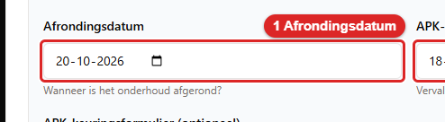
   *Zo ziet het veld **Afrondingsdatum** eruit. Zet hem op de dag dat het werk echt klaar was.*
6. Is de auto gekeurd? Vul dan de nieuwe **APK-datum** in. Daar staat bij: *Vervaldatum APK (indien
   bijgewerkt)*. Voeg met **APK-keuringsformulier (optioneel)** het formulier toe (pdf, jpg of png).
   Let op: het veld staat vooraf al ingevuld. Daar staat de huidige APK-datum van de auto, of de datum
   die de app zelf uitrekent. **Wat er staat, wordt bij het afronden opgeslagen**. Is de auto niet
   gekeurd? Maak het veld dan leeg.

   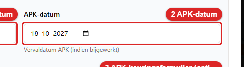
   *Zo ziet het veld **APK-datum** eruit. Vul de nieuwe datum in, of maak het veld leeg als de auto niet gekeurd is.*

   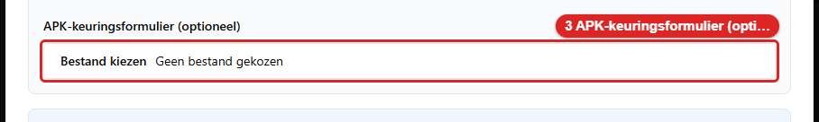
   *Zo ziet het veld **APK-keuringsformulier (optioneel)** eruit. Voeg hier het formulier toe.*
7. Vul onder **Servicedetails** de **Servicecategorie** in (**Gepland onderhoud** of
   **Reparatie**). Vul ook de **Huidige kilometerstand (km)** in. Ook die staat vooraf ingevuld. Daar
   staat de stand die de app van de auto kent.

   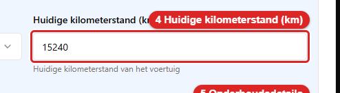
   *Zo ziet het veld **Huidige kilometerstand (km)** eruit. Vul de stand van de teller in.*
8. Beschrijf in **Onderhoudsdetails** wat er gedaan is. Daar staat bij: *Welke werkzaamheden zijn
   aan het voertuig uitgevoerd?* Bijvoorbeeld *olieverversing, luchtfilter, bougies*.

   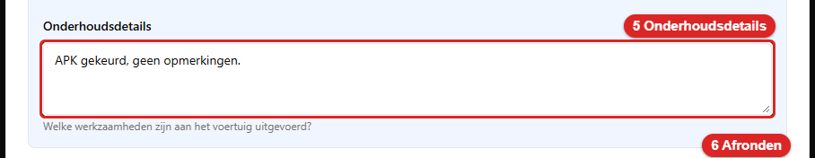
   *Zo ziet het veld **Onderhoudsdetails** eruit. Beschrijf hier wat er gedaan is.*
9. Klik op **Afronden**.

   
   *Zo ziet de knop **Afronden** eruit. Hij staat rechtsonder in het venster.*

*Het venster **Onderhoud afronden**: 1 **Afrondingsdatum**, 2 **APK-datum**, 3
**APK-keuringsformulier (optioneel)**, 4 **Huidige kilometerstand (km)**, 5 **Onderhoudsdetails**, 6
**Afronden**.*

Je ziet nu de melding **Onderhoud afgerond** met je omschrijving erbij. Bijvoorbeeld *Onderhoud
afgerond: olie- en filterwissel.* Het blok verdwijnt uit de kalender. Het staat voortaan onder
**Voltooide bekijken**.

Alle plekken waar je een onderhoud kunt afronden, gebruiken dit ene venster en dit ene woord:
**Afronden**. Je vindt die knop in het dagvenster van de kalender, in het tabblad **Gepland** van het
overzicht, in het bewerkvenster (zie onder) en in het venster van het scanscherm. Het woord
*Voltooien* komt bij onderhoud nergens meer voor.

**Vul de kilometerstand en de werkzaamheden echt in.** Ze bepalen wanneer de volgende beurt nodig
is. En ze zijn het enige bewijs van wat er aan de auto gedaan is.

In het venster staat het **Onderhoudstype** in het Nederlands, bijvoorbeeld *Pech*. Dat is dezelfde
waarde die je bij het plannen koos.

### Wat er in die ene handeling gebeurt

Alles gebeurt in één keer, of helemaal niet:

- **Het blok sluit.** De **Afrondingsdatum** wordt de einddatum van het blok. De begindatum blijft
  staan, want het werk is begonnen toen het begon. Een afrondingsdatum vóór de begindatum wordt
  geweigerd.
- **De voertuigkaart wordt bijgewerkt:** de **APK-datum** en de **kilometerstand**, als je ze hebt
  ingevuld. Is de categorie **Gepland onderhoud**? Dan wordt ook de **laatste servicedatum** gelijk
  aan de afrondingsdatum. Vulde je een kilometerstand in? Dan wordt de laatste servicestand gelijk aan
  die kilometerstand.
- **Het APK-formulier wordt een document**, bij de auto én bij het blok. Het documenttype is *APK
  Inspection*. Er komt een notitie bij als *APK inspection completed on &lt;datum&gt;; APK valid until
  &lt;datum&gt;*.
- **De werkplaatsstatus gaat eraf**. De beschikbaarheid van de auto wordt opnieuw berekend (zie de
  verbetering hieronder).
- **Een openstaand vervangend voertuig van deze auto wordt in dezelfde stap afgesloten.**

**Alles of niets.** Mislukt er iets? Dan blijft alles zoals het was. Er is geen half opgeslagen
formulier. De kilometerstand is niet gewijzigd. Het geüploade bestand wordt weer weggehaald. Je ziet
de melding *Onderhoud afronden mislukt. Probeer het opnieuw.* Het venster blijft open.

**Een te lage kilometerstand wordt geweigerd.** Vul je een stand in die lager is dan de stand die de
app van de auto kent? Dan staat er: *De kilometerstand (… km) is lager dan de huidige stand van het
voertuig (… km). Controleer de stand; er is niets opgeslagen.* Er wordt dan niets gewijzigd. Het
blok blijft open. Dit venster heeft geen wachtwoordstap zoals bij het ophalen en innemen (hoofdstuk
15, paragraaf 15.6). Lees de teller opnieuw af. Verbeter de stand. Een stand die gelijk is aan de
huidige stand, mag wel.

**De verbetering: het afronden geeft de auto vrij.** In eerdere versies van deze handleiding stond
iets anders. Daar stond dat het afronden van een blok de werkplaatsstatus niet omzet. En dat je
daarna altijd nog **Terug van onderhoud** of **Terug uit onderhoud** moest gebruiken. Dat klopte
niet. **Afronden** haalt de werkplaatsstatus er wél af. De auto is daarna weer verhuurbaar. Er zijn
twee uitzonderingen. Loopt er vandaag nog een ánder openstaand onderhoudsblok op dezelfde auto? Dan
blijft hij op **Reparatie nodig**. En **Niet voor verhuur** laat de app staan (7.7). De twee knoppen
uit 7.5 blijven nodig voor een auto die in de werkplaats staat zonder dat je een blok afrondt.

**Het bewerkvenster.** Met **Bewerken** in het dagvenster verander je de gegevens van een blok. De
**Status** heeft daar nog maar twee keuzes: **Gepland (voertuig nog niet gearriveerd)** en **Binnen
(voertuig is in onderhoud)**. Het venster toont de opgeslagen status van het blok. De keuze **Uit
(onderhoud voltooid)** bestaat niet meer. Een afronding zonder APK-datum, formulier en
kilometerstand is namelijk geen afronding. Onder in het bewerkvenster staat daarom de knop
**Afronden**. Die opent hetzelfde venster **Onderhoud afronden** als in 7.6. Is het afronden gelukt?
Dan sluit het bewerkvenster. Het plan-venster van het scanscherm heeft in de bewerkstand dezelfde
knop.

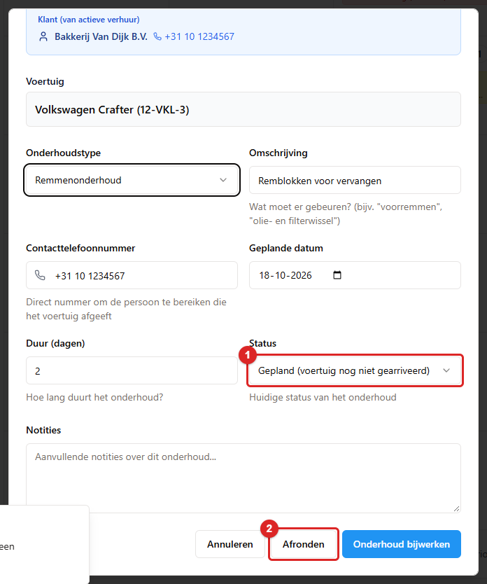
*Het bewerkvenster: 1 **Status** (**Gepland** of **Binnen**), 2 **Afronden** om het blok te sluiten.*

Is een blok al afgerond? Dan staat er in het bewerkvenster geen statuskeuze. Er staat dan de tekst
*Afgerond op <datum>*. Probeert een oudere pagina toch een afronding via de status te bewaren? Dan
weigert de app met *Een onderhoud rond je af met de knop Afronden, niet met de status.* Is het blok
al afgerond en probeer je het nog eens? Dan staat er *Dit onderhoud is al afgerond.*

---

## 7.7 Terug in dienst — de auto weer verhuurbaar maken

Het afronden van een onderhoudsblok (7.6) geeft de auto zelf vrij. De werkplaatsstatus gaat eraf. De
auto is weer verhuurbaar. Dat geldt niet als er vandaag nog een ander openstaand blok loopt. Staat de
auto op een andere manier in de werkplaats? Bijvoorbeeld omdat iemand de werkplaatsstatus met de hand
heeft gezet, zonder dat er een blok aan hangt. Dan gebruik je één van de twee knoppen uit 7.5. Loop
daarom na elk onderhoud dit rijtje langs. Het kost een halve minuut. Het voorkomt de fout die het
vaakst gemaakt wordt: een auto die op het terrein staat, maar in geen enkele lijst met vrije auto's
voorkomt.

1. **Controleer of de auto vrij is.** Na **Afronden** (7.6) is dat al gebeurd. Is het niet zo?
   Scan hem dan en klik op **Terug uit onderhoud**. Is er een vervanger? Gebruik dan **Terug van
   onderhoud** in de reservering. Je ziet de melding **Voertuig is terug uit onderhoud** of
   **Voertuig teruggekeerd van onderhoud**. Beide knoppen halen de werkplaatsstatus eraf. Ze sluiten
   het onderhoudsblok dat op dat moment loopt. En ze zetten de **Beschikbaarheidsstatus** meteen
   terug op een verhuurbare waarde. Je hoeft die status dus niet zelf om te zetten.
2. **Rond een blok af dat nog openstaat.** Kijk op de **Onderhoudskalender**. Staat er nog een
   blok op een andere dag? Sluit het dan met **Afronden** (7.6). Onderhoud dat verderop in de
   kalender staat, blijft bewust staan.
3. **Kijk of er nog een vervanger loopt.** Kijk op het **Dashboard** onder **Beheer vervangende
   voertuigen** → tabblad **Actief**. Kijk ook op **Reserveringen** achter **… achterstallig**. Staat
   een vervangende auto nog op opgehaald terwijl de originele auto allang terug is? Dan is die
   vervanger voor iedereen geblokkeerd. Neem hem in. Of annuleer de reservering als de auto
   nooit is meegegaan.
4. **Controleer de APK-datum.** Is de auto gekeurd? Dan moet de nieuwe datum op de voertuigkaart
   staan. Vulde je hem bij het afronden in (7.6)? Dan staat hij er al.

Controleer stap 1 door de auto te scannen. Staat er **Beschikbaar**? En is er geen oranje blok
**Onderhoud** meer? Pas dan kun je hem weer meegeven.

> **Eén uitzondering.** Stond de auto op **Niet voor verhuur**, dan laat de app hem daarop staan.
> Dat is geen werkplaatsstatus maar een bewuste keuze, en die zet je met de hand terug
> (hoofdstuk 4, paragraaf 4.6).

---

## 7.8 Het onderhoudsoverzicht en de geschiedenis

**Lijstweergave.** Klik op **Lijstweergave**. Je ziet nu het **Onderhoudsoverzicht** met de uitleg
*Uitgebreid overzicht van alle onderhoudsgerelateerde items en aankomende serviceverplichtingen*.
Daar staan het totale aantal items en een zoekveld *Zoek voertuigen, kentekens, klanten...*

Er zijn vier tabbladen:

| Tabblad | Wat erin staat |
|---|---|
| **APK (…)** | *Voertuigen met APK-keuringen die binnen 60 dagen verlopen*, met de kolom **Urgentie** (*… dagen te laat*, *Vandaag verschuldigd*, *… dagen resterend*) en de knoppen **Plannen** en **Bekijken** |
| **Garantie (…)** | Hetzelfde voor de garantie |
| **Gepland (…)** | *Actieve onderhoudsblokken en geplande service-afspraken*, met **Afronden**, **Binnen melden**, **Bewerken**, **Verwijderen** en **Voertuig** |
| **Vervangers (…)** | De nog toe te wijzen vervangers, met **Toewijzen** |

**Afronden en Binnen melden vanuit het overzicht.** Je hoeft niet meer naar de kalender om een blok
af te handelen. Op het tabblad **Gepland** staat achter elk lopend blok de knop **Afronden**. Die
opent hetzelfde venster **Onderhoud afronden** als in 7.6. De APK-datum en de kilometerstand die de
app van de auto kent, staan al ingevuld. Staat het blok nog op *gepland*? Dan is de auto er nog niet.
Dan staat er ook **Binnen melden**. Die knop zet in één klik het blok op *Binnen* en de auto op in
onderhoud. Je ziet dan de melding **Voertuig binnen gemeld** met *Het onderhoud staat op Binnen en
het voertuig is in onderhoud.* Een blok dat al *Binnen* is, heeft alleen **Afronden**. Een afgerond
of geannuleerd blok heeft geen van beide knoppen. De twee knoppen vragen elk een eigen recht:

| Knop | Welk vinkje je nodig hebt |
|---|---|
| **Afronden** | **Onderhoud beheren** of **Reserveringen beheren** (net als **Afronden** in het dagvenster van de kalender) |
| **Binnen melden** | **Voertuigen beheren** |

*Het **Onderhoudsoverzicht**, tabblad **Gepland**: 1 de tabbladen, 2 **Binnen melden**, 3 **Afronden**.*

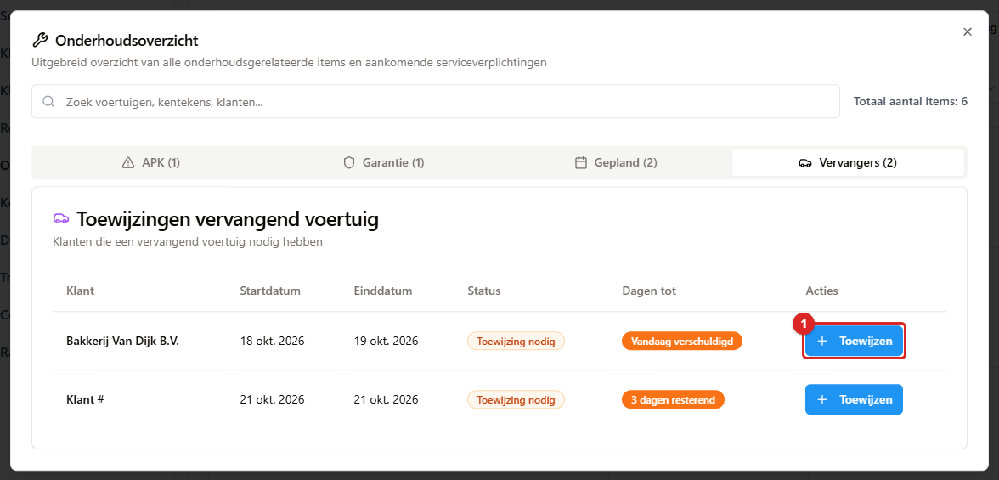
*Het tabblad **Vervangers**: klik op **Toewijzen** (1) om een auto aan een placeholder te geven.*

Heb je het vinkje niet? Dan staat de knop er wel, maar grijs. Tik of klik erop. De app zegt dan welk
vinkje je mist (hoofdstuk 15, paragraaf 15.9). Een werkplaatsprofiel heeft beide vinkjes.

**Verwijderen of annuleren wist ook de reparatiestand.** Zet je een blok op **Binnen**? Dan krijgt
de auto **Reparatie nodig**. De app onthoudt welk blok dat deed. Verwijder je dat blok daarna, of
annuleer je het? En loopt er vandaag geen ander blok dat **Binnen** is? Dan gaat de auto ook weer van
**Reparatie nodig** af. Hij is dan weer verhuurbaar. Soms blijft de stand wel staan. Dat gebeurt als
iemand de auto met de hand op **Reparatie nodig** heeft gezet. Of als de stand van een ander blok
komt, of van een transport. Dan haal je hem zelf weg (hoofdstuk 4, paragraaf 4.6). Auto's die al op
**Reparatie nodig** stonden vóór deze wijziging, houden die stand. De app weet bij hen niet welk blok
het veroorzaakte.

**De omschrijving in het overzicht** staat in het Nederlands. Een blok dat als *pech* is
opgeslagen, toont *Pech: lekke band*. Het Engelse *breakdown: lekke band* zie je niet meer. Oude
blokken die ooit zonder omschrijving zijn ingelezen, heten nu *Onderhoudsblok*. Vroeger heetten ze
*Vehicle maintenance block*. Je ziet dit ook bij de geschiedenis op de voertuigkaart en bij de
APK-keuring.

**Voltooide bekijken.** Klik op **Voltooide bekijken (…)**. Je ziet nu **Geschiedenis voltooid
onderhoud** met de uitleg *Voltooide onderhoudsrecords bekijken, bewerken, terugdraaien of
verwijderen*. Per regel staan het type, het label **Gepland** of **Reparatie**, de auto, de regel
*Voltooid: <datum>* en je omschrijving. Er staan twee knoppen bij:

- **Terugdraaien**: het onderhoud is toch niet klaar. Je ziet de melding **Onderhoud
  teruggedraaid** met *Onderhoud is weer gemarkeerd als actief*. Het blok staat weer op **Binnen**.
  De auto staat weer op **Reparatie nodig**. Het blok staat weer in de kalender én in het tabblad
  **Gepland** van het overzicht. Je kunt het daarna gewoon bewerken. Of je sluit het opnieuw af met
  **Afronden**.
- **Verwijderen**: *Dit onderhoudsrecord wordt naar de prullenbak van dit scherm verplaatst (knop Verwijderd
  onderhoud); terugzetten kan daar.* Doe dit alleen bij een regel die er nooit had moeten
  staan.

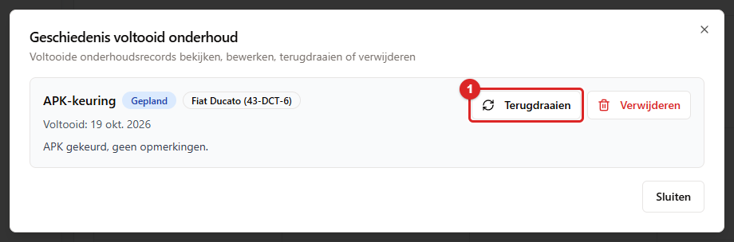
*Het venster **Geschiedenis voltooid onderhoud**: per regel **Terugdraaien** (1) en **Verwijderen**.*

**De prullenbak van Onderhoud.** Rechtsboven staat de knop **Verwijderd onderhoud**. Daarin staan de
verwijderde onderhoudsplanningen, met het label **Onderhoud**. Vroeger stonden ze tussen de
reserveringen. Je kunt een regel **terugzetten**. Dat lukt ook als er intussen een verhuring op die
dagen staat. Een blok mag namelijk overlappen (7.3). Je kunt een regel ook **definitief verwijderen**.
Dat kan per regel, per selectie of met **Prullenbak leegmaken**. Een definitief verwijderd blok
verdwijnt met zijn contracten en schadechecks. Maar **documenten van de auto, zoals een APK-bewijs,
blijven staan**. Heeft de planning fiscale beoordelingen? Dan worden die ook definitief verwijderd
(hoofdstuk 10, paragraaf 10.6). De knop is er voor iedereen met het vinkje **Prullenbak beheren**.
Zonder dat vinkje staat hij grijs (hoofdstuk 10, paragraaf 10.6, en hoofdstuk 15, paragraaf 15.16).

---

## 7.9 Een onderhoudsaanvraag uit het klantenportaal

Klanten kunnen online zelf een storing melden. Ze kunnen ook vragen om hun onderhoudsafspraak te
verzetten. Die aanvragen komen bij jou terecht.

**Waar je ze ziet**

- Op **Klantenportaal**, op de tegel **Aanvragen** en op de tegel **Onderhoud** (*meldingen en
  placeholders*).
- Aan de portaaltegel bovenin het scherm. En aan het rode bolletje achter **Klantenportaal** in het
  menu.

**Hoe je er een afhandelt**

1. Klik op de aanvraag. Je ziet nu het venster **Aanvraag #<nummer>**. Bovenaan staan het soort
   aanvraag (**Onderhoud/storing** of **Onderhoud wijzigen**) en de klant.
2. Lees het blok **Melding van de klant**. Bij een storingsmelding staan daar de **Klacht**, de
   **Kilometerstand**, of het **Dringend** is, of de klant **Vervangend vervoer gewenst** heeft
   en de **Gewenste datum**. Bij een verzoek om te verzetten staan er **Nu gepland op**, de
   **Gevraagde datum** en de **Reden**.
3. Kijk of er **Bijlagen** bij zitten. Vaak is dat een foto van het dashboard of de schade.
4. Klik op **In behandeling nemen** zolang de aanvraag nog op **Nieuw** staat. De klant ziet dan
   dat je ermee bezig bent.
5. Nu kies je:

| Knop | Wanneer |
|---|---|
| **Inplannen in de onderhoudskalender** | Een nieuwe storingsmelding die je inplant |
| **Onderhoud verplaatsen** | Een verzoek om een bestaande afspraak te verzetten |
| **Antwoord sturen (blijft open)** | Je hebt een vraag of wilt iets melden. De aanvraag blijft openstaan |
| **Afwijzen** | De aanvraag gaat niet door |

6. Kies je een van de eerste twee? Dan klapt een klein formulier open. Vul de **Datum** in
   (*Alleen werkdagen (ma t/m vr)*). Vul de **Duur (dagen)** in. Bij een nieuwe melding vul je ook
   het **Soort** in (**Onderhoudsbeurt** of **Reparatie**). Vroeg de klant om vervangend vervoer?
   Dan staat er: *Er wordt een vervanger-placeholder aangemaakt; wijs later een auto toe in de
   onderhoudskalender.*
7. Schrijf een **Notitie voor de klant**. Klik daarna op **Inplannen en bevestigen** of
   **Verplaatsen en bevestigen**.

Je ziet nu de melding **Onderhoud #… staat in de kalender** of **Onderhoud #… is verplaatst**. Het
blok staat nu op de onderhoudskalender. Erbij staat dat het uit het klantenportaal komt.

**Afwijzen** kan alleen met een toelichting. Staat er geen tekst in **Antwoord aan klant**? Dan meldt
de app *Vul een antwoord in.* Leg altijd kort uit waarom. De klant leest dat online terug.

> **Let op:** een onderhoudsmelding sluit je niet af met **Beantwoorden en afhandelen**. Er staat
> ook een tip in het venster: *Een onderhoudsmelding kan alleen worden afgehandeld via Inplannen
> (zet het in de kalender) of Afwijzen.*

De klant krijgt automatisch bericht zodra je het onderhoud inplant of verzet. De klant krijgt ook
bericht als er een vervangend voertuig wordt toegewezen.

---

## 7.10 Snel naslaan

| Wat je wilt | Waar |
|---|---|
| Een beurt of reparatie inplannen | **Onderhoud** → **Onderhoud plannen** |
| Een APK inplannen | Voertuigkaart → **Onderhoud** → **APK-keuring plannen**, of het signaal in de kalender → **Onderhoud plannen** |
| De auto echt op slot zetten | Reservering → **Voertuig markeren voor onderhoud** |
| Een vervanger aanwijzen | **Vervangend voertuig toewijzen**, of **Dashboard** → **Beheer vervangende voertuigen** → **Nog te bepalen** → **Voertuig toewijzen** |
| Een TBD-vervanger invullen | **Onderhoud** → **Lijstweergave** → **Vervangers** → **Toewijzen** |
| Het onderhoud afronden (met APK-datum, formulier en kilometerstand in één keer) | Dag openen in de kalender → **Afronden** (7.6) |
| De vervangende huur afsluiten | Reservering → **Terug van onderhoud** |
| De auto weer vrijgeven | **Scannen** → **Terug uit onderhoud** (zet ook de status terug, 7.7) |
| Een afgerond onderhoud terugdraaien | **Voltooide bekijken (…)** → **Terugdraaien** |
| Een verwijderd onderhoud terugzetten | **Verwijderd onderhoud** → **Terugzetten** (vraagt het vinkje **Prullenbak beheren**) |
| Een portaalaanvraag afhandelen | **Klantenportaal** → tegel **Aanvragen** → klik op de aanvraag |
