# 8. Documenten en afdrukken

In dit hoofdstuk lees je welke documenten de app zelf maakt. Je leest waar die documenten
vandaan komen. Je leest ook hoe je ze bekijkt, afdrukt en downloadt. En je leest wat er gebeurt
als een reservering verandert nadat het document al gemaakt is.

---

## 8.1 Welke documenten de app maakt

De app maakt vier soorten documenten. Elk document is een PDF. Een PDF is een bestand dat je op
elke computer kunt openen en afdrukken.

| Document | Waar het ontstaat | Waar het terechtkomt |
|---|---|---|
| **Huurcontract** | Bij het ophalen van een voertuig. Of met de knop om het los te maken | In de documentbibliotheek, bij het voertuig en bij de reservering |
| **Schadecheck** | Bij het innemen. Of vanuit het schadecheckscherm | In de documentbibliotheek, bij het voertuig en bij de reservering |
| **Transportrapport** (transportbrief) | Vanuit het transportscherm. Per transport of voor meerdere tegelijk | In de documentbibliotheek. Bij meerdere voertuigen onder **Algemene rapporten** |
| **Sleutellabels en barcodelabels** | Vanuit het voertuig of het labelscherm | Wordt direct afgedrukt. Wordt **niet** bewaard in de documentbibliotheek |

Twee dingen maakt de app niet:

- **Een getekend contract.** De app maakt alleen het contract zonder handtekening. De klant
  tekent het op papier. Dat getekende exemplaar scan je in. Daarna zet je het in de app met
  **Contract uploaden**. Uploaden betekent: een bestand van je computer in de app zetten.
- **Facturen.** De app maakt geen facturen. De factuurgegevens gebruik je in de rapporten.

---

## 8.2 Waar de gegevens vandaan komen

De app bouwt een document op het moment dat je het maakt. Daarvoor gebruikt de app drie bronnen:

1. **De reservering**. Daaruit komen de periode, het contractnummer, de prijs, de kilometerstanden,
   de brandstofniveaus, het afleveradres en de notities.
2. **Het voertuig en de klant**. Daaruit komen het kenteken, het merk, het model en het
   chassisnummer. En ook de naam, het adres, het telefoonnummer en het rijbewijsnummer van de klant.
3. **Het sjabloon**. Een sjabloon is een vaste opmaak. Het bepaalt de achtergrond en de plek van
   elk veld op de pagina.

Daarom geldt: **een document is een momentopname.** Verandert er later iets aan de reservering?
Dan verandert het document niet mee. Zie paragraaf 8.6.

Datums en bedragen op een document staan altijd in het Nederlands. Ze staan ook in de
Nederlandse schrijfwijze: `13-09-2026` of `13 september 2026`, en `€ 1.234,50`. Dat geldt ook als
de klant het portaal in het Engels gebruikt. Heeft een huur geen einddatum? Dan staat er
**nader te bepalen** op het contract.

---

## 8.3 Waar je documenten terugvindt

Er zijn drie plekken waar je documenten vindt. Op alle drie staan dezelfde documenten.

*Het scherm **Documentbeheer**. Rechtsboven staat **Document uploaden**. Daaronder staan de tabbladen
**Documentbibliotheek**, **Contractsjablonen**, **Transportrapportsjablonen**, **Barcodelabels**
en **Schadecheck-sjablonen**.*

**Documenten → Documentbibliotheek**
Dit is het volledige overzicht. De documenten staan per voertuig bij elkaar. Bovenaan zie je drie
getallen: het aantal voertuigen, het aantal documenten en het aantal documenttypen. Je kunt
filteren met **Alle voertuigen** en **Alle documenttypen**. Filteren betekent: alleen een deel van
de lijst laten zien. Je kunt ook zoeken in **Documenten zoeken...**. Het zoekveld kijkt naar de
bestandsnaam. Het kijkt ook naar het kenteken, met of zonder streepjes. En het kijkt naar het merk,
het model en de naam van het documenttype zoals jij die ziet. De groepen die bij je zoekopdracht
passen, klappen vanzelf open. Met **Alles uitklappen** zet je alle voertuiggroepen in één keer open.
Met **Alles inklappen** zet je ze in één keer dicht. De groepen staan op kenteken gesorteerd. Soms
filter je zo dat er op de huidige pagina niets meer staat. Dan springt de lijst terug naar een pagina
met inhoud. Je ziet dus geen leeg scherm. Staat er helemaal niets? Dan lees je:
*"Geen documenten gevonden die overeenkomen met je filters."*

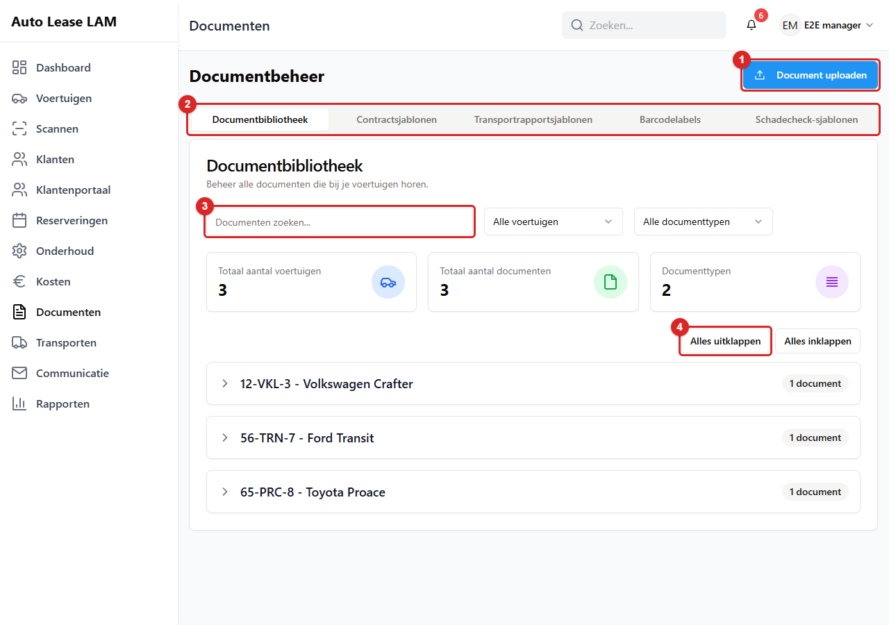
*De **Documentbibliotheek**. 1 is de knop **Document uploaden**. 2 zijn de tabbladen. 3 is het
zoekveld. 4 is **Alles uitklappen**. Klik op een auto. Klik daarna op een groep, bijvoorbeeld
**Contracten**. Dan zie je de documenten.*

**Document uploaden.** Rechtsboven staat de knop **Document uploaden**. Klik erop. Je ziet nu een
venster. Daarin kies je eerst de auto. Zodra je een auto hebt gekozen, verschijnt het uploadformulier
in hetzelfde venster.

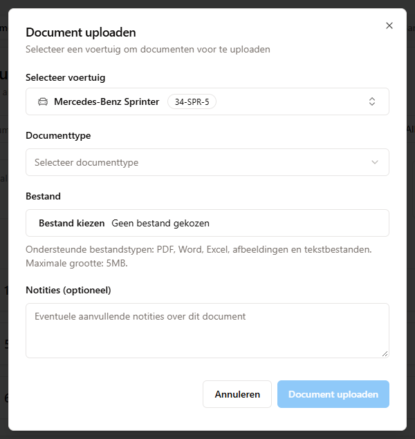
*Het venster **Document uploaden**. Kies de auto. Het formulier verschijnt eronder.*

Heb je in de bibliotheek al op een voertuig gefilterd? Dan staat dat voertuig al ingevuld. De knop
werkt alleen als je het recht **Documenten bewerken en genereren** hebt (zie 8.7). Zonder dat
vinkje is de knop grijs. Klik je er toch op? Dan zegt de app welk vinkje je mist.

**Bij het voertuig**
Open het voertuig. Ga naar het tabblad **Documenten**. Je ziet alleen wat bij deze auto hoort.

**Bij de reservering**
Open de reservering via het zoekveld bovenin. Scrol naar het kopje **Documenten**. Scrollen is de
pagina naar beneden schuiven. Bij het kopje staan knoppen om snel iets te uploaden:
**+ Contract (ondertekend)**, **+ Schaderapport foto**, **+ Schaderapport PDF** en **+ Overig**.
Daaronder staat **Geüploade documenten**. Dat zijn de contracten en schadechecks van deze huur. Of
een document gemaild is, zie je hier niet. Die regel (*Verzonden op … aan …*) staat alleen in het
venster **Reserveringsdocumenten**. Dat venster open je alleen vanuit een onderhoudsblok, met
**Documenten uploaden**. Bij een gewone huur zie je het dus niet.

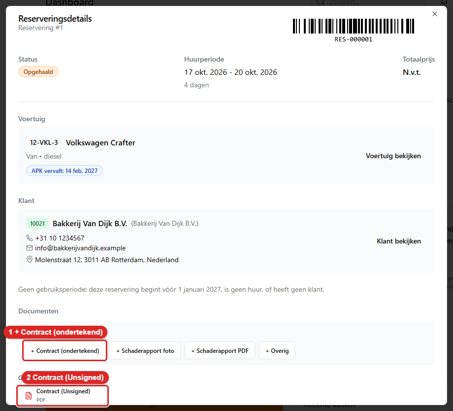
*Het blok **Documenten** in de reservering. 1 is **+ Contract (ondertekend)**. Daarmee upload je het
getekende exemplaar. 2 is het contract dat de app bij het ophalen heeft gemaakt.*

In de **Documentbibliotheek** staan de documenttypen in het Nederlands. De omschrijvingen eronder
ook. Je ziet **Contract (niet ondertekend)**, **Contract (ondertekend)**, **Schadecheck (ophalen)**,
**Schadecheck (inleveren)** en **Transportrapport**. Kentekens in de titels staan met streepjes. De
opmerking bij een document is ook Nederlands. Bijvoorbeeld *Automatisch aangemaakt contract (niet
ondertekend) voor reservering #3366*. In de reserveringsvensters staat het type nog in het Engels.
Onder **Geüploade documenten** lees je bijvoorbeeld *Contract (Unsigned)* of *Damage Check*. Op de
voertuigkaart is dat ook zo. Het is hetzelfde document. Het opgeslagen bestand zelf verandert hier
niet door. Alleen wat je op het scherm leest, is anders.

---

## 8.4 Genereren, bekijken, afdrukken, downloaden

### Genereren

Genereren betekent: de app maakt het document zelf. Meestal hoef je niets te doen. Het contract
wordt gemaakt als je het ophalen afrondt met **Ophalen voltooien & contract genereren**. De
schadecheck wordt gemaakt bij **Inleveren voltooien & schadecheck genereren**.

Direct daarna zie je een venster met de uitslag. Startte je het ophalen of inleveren vanuit de
kalender? Dan kan dat venster achter het reserveringsvenster terechtkomen. Sluit dan het
reserveringsvenster. Daarna zie je de uitslag wel. Dit is een bekende fout in de app.

- **Contract klaar**. Je leest: *"&lt;bestandsnaam&gt; is aangemaakt. Print het of mail het direct naar de
  klant."* Er staan twee knoppen bij: **Afdrukken** en **Mail naar klant**.
- **Contract kon niet gemaakt worden**. Hierbij staat sinds kort een concrete Nederlandse reden.
  Vroeger stond er alleen een kale mededeling. De volledige lijst met redenen staat in 8.5. Daar
  staat ook wat je eraan doet. Herkent de app de reden niet? Dan staat er de algemene tekst
  *"De handeling is vastgelegd, maar het document is niet aangemaakt. Probeer het opnieuw of
  controleer de sjablonen."* In beide gevallen staat de knop **Opnieuw proberen** erbij.

Het ophalen zelf is in beide gevallen wel verwerkt. Een mislukt contract betekent niet dat de auto
niet is meegegeven. Het betekent alleen dat er geen PDF is. Klik meteen op **Opnieuw proberen**.
Sluit het venster niet eerst. In de reservering staat geen knop om het contract later alsnog te
maken. Ook **Opnieuw genereren** (8.6) helpt dan niet, want die knop heeft een bestaand contract
nodig.

> **De archivering bewaart nooit een kapot bestand.** Mislukt het maken van het contract, dan
> schrijft de app ook geen half of ongeldig bestand naar de documentbibliotheek voor die poging.
> Zie je geen contract bij deze reservering, dan is er dus ook niets stuk — er is alleen nog
> niets gemaakt.

> Bij een mislukte **schadecheck** staat er geen knop **Opnieuw proberen**. Maak de schadecheck
> dan opnieuw vanuit het schadecheckscherm.

### Bekijken, downloaden, afdrukken, e-mailen, verwijderen

In de documentbibliotheek heeft elk document dezelfde vijf knoppen:

| Knop | Wat het doet |
|---|---|
| **Bekijken** | Opent de PDF in een voorvertoning. Je ziet het document, zonder het op te slaan |
| **Downloaden** | Slaat het bestand op je computer op |
| **Afdrukken** | Opent het afdrukvenster van je browser |
| **E-mailen** | Opent het venster **Document e-mailen**. Daarmee stuur je dit ene document (hoofdstuk 9, paragraaf 9.3) |
| **Verwijderen** | Haalt het document weg |

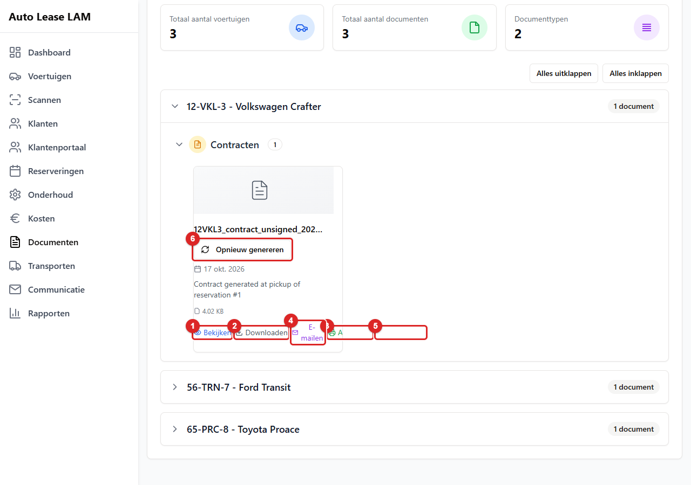
*De knoppen bij een document: 1 **Bekijken**, 2 **Downloaden**, 3 **Afdrukken**, 4 **E-mailen**, 5
**Verwijderen**. Bij een contract dat de app zelf maakte, staat er ook 6 **Opnieuw genereren** (zie
8.6).*

Klik je op afdrukken? Dan zie je de melding *"Afdrukken gestart — Het afdrukvenster zou nu open
moeten zijn. De pop-up sluit automatisch."* Lukt dat niet? Dan krijg je een van deze twee meldingen:

- *"Je browser heeft afdrukken geblokkeerd. Gebruik de downloadknop en druk handmatig af."*
- *"Sta pop-ups toe en probeer het opnieuw, of gebruik de downloadknop."*

Beide meldingen komen door een instelling van je browser. Een browser is het programma waarmee je
de app opent, zoals Chrome of Edge. Het is geen fout in de app. Downloaden en daarna afdrukken
werkt altijd.

### De interactieve schadecheck invullen

Een schadecheck maak je op het tabblad **Documenten** van de voertuigkaart. Daar staat de knop
**Nieuwe check** (hoofdstuk 4, paragraaf 4.10). Je kunt de check ook maken tijdens het ophalen en
inleveren. Dit is erin verbeterd:

- **Het diagram.** Een diagram is een tekening van de auto. Daarop markeer je de schade. Heeft de
  auto geen eigen diagram voor zijn model? Dan toont de app het diagram van een ander model. Je ziet
  dan de melding **Geen diagram voor dit model**. Daarin staat van welk merk en model het diagram is.
  De markeringen kunnen dan afwijken van de echte carrosserie. Is het opgeslagen diagram
  onbruikbaar, bijvoorbeeld een te platte strook? Dan staat er een rood blok **Dit diagram is niet
  bruikbaar**. De afmetingen staan erbij. Wie diagrammen beheert (**Documenten** →
  **Schadecheck-sjablonen**), kan zo'n plaatje niet meer opslaan. De app weigert een afbeelding die
  te plat of te klein is om schade op te markeren.
- **Wat je al hebt aangeklikt.** Een gekozen antwoord heeft een vinkje en een rand. Een leeg veld
  zegt *niet ingevuld*. Per blok staat hoeveel je al hebt gedaan, bijvoorbeeld *3 van 8 ingevuld*.
- **Alles goed.** Per blok staat een knop **Alles goed**. Die vult alleen de velden die nog leeg
  zijn. Daar komt de normale waarde in, bijvoorbeeld schoon, goed of ja. Wat je al had ingevuld,
  blijft staan.
- **Opslaan.** Terwijl de check wordt opgeslagen, draait er een rondje. Je ziet *Bezig met
  opslaan…*. Daarna staat er *Opgeslagen om 14:32. De PDF is klaar.* De PDF open je met de eigen
  knop. Of je opent hem onder **Documenten** bij het voertuig. Je krijgt geen melding **Check
  geladen** meer voor een check die je net zelf hebt opgeslagen.
- **Hoe de check bij het inleveren wordt gebruikt.** Boven het formulier staat uitgelegd: *de
  schadecheck-PDF die bij het inleveren wordt gemaakt, neemt de laatst opgeslagen check van de
  reservering over: sla de check dus eerst op.*

---

## 8.5 Sjablonen: wie ze beheert en wat er mis kan gaan

Een sjabloon bepaalt hoe een document eruitziet. De sjablonen staan onder **Documenten**. Ze
staan in vijf tabbladen naast de bibliotheek:

| Tabblad | Waarvoor | Wie mag het wijzigen |
|---|---|---|
| **Contractsjablonen** | Het huurcontract | Recht **PDF-sjablonen beheren** |
| **Transportrapportsjablonen** | De transportbrief | Recht **PDF-sjablonen beheren** |
| **Barcodelabels** | Sleutel- en voertuiglabels | Bekijken mag iedereen. Wijzigen vraagt **PDF-sjablonen beheren** |
| **Schadecheck-sjablonen** | Het schadecheckformulier en de voertuigdiagrammen | Recht **Schadecontroles beheren** |
| **Lease offertes** | De PDF van een lease offerte voor de klant (hoofdstuk 22.11) | Recht **PDF-sjablonen beheren** |

Heb je het vinkje **PDF-sjablonen beheren** niet? Dan zijn de tabbladen **Contractsjablonen** en
**Transportrapportsjablonen** grijs. Klik je erop? Dan zegt de app welk vinkje je mist. Er opent
niets. Zo zie je wel dat de tabbladen bestaan. En je weet bij wie je het recht moet aanvragen. Op
dezelfde manier staat **Document uploaden** grijs zonder **Documenten bewerken en genereren**.

Een contractsjabloon open je met **Sjablooneditor openen**. In de editor sleep je velden op de
achtergrond. Slepen is: klikken, de muisknop vasthouden en de muis verplaatsen. Eén sjabloon is de
standaard. Je herkent het aan het label **Standaard**. Je stelt het in met **Als standaard
instellen**.

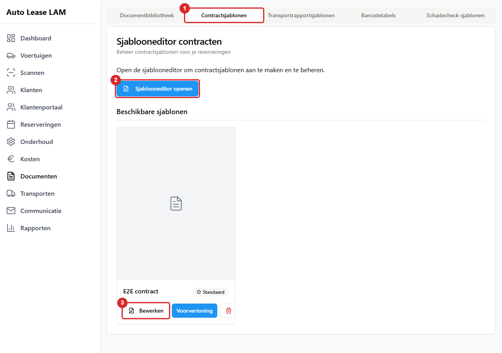
*Het tabblad **Contractsjablonen** (1). 2 is **Sjablooneditor openen**. 3 is **Bewerken** bij een
sjabloon. Het label **Standaard** staat bij het sjabloon dat de app gebruikt.*

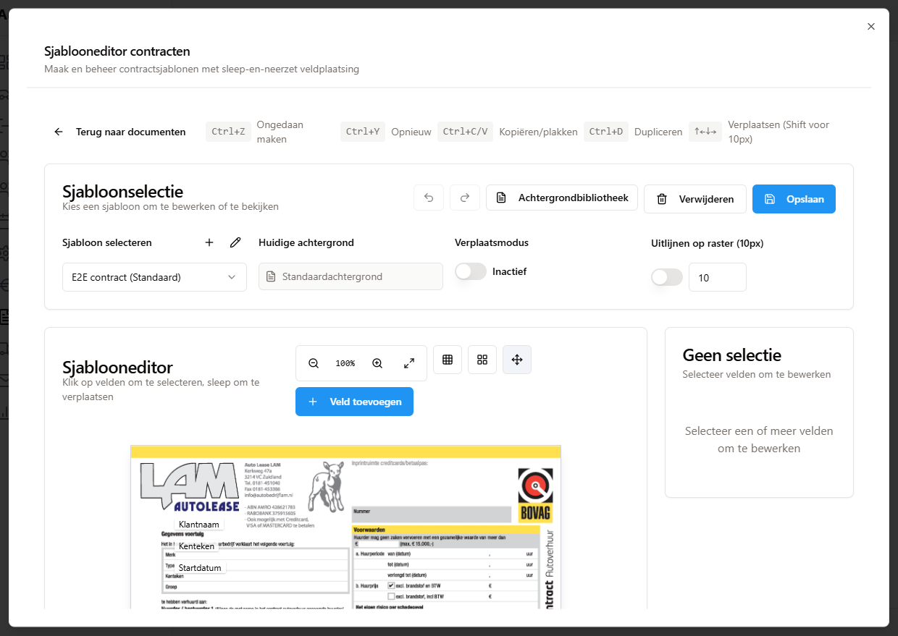
*De sjablooneditor. Sleep velden op de achtergrond. Klik daarna op **Opslaan**.*

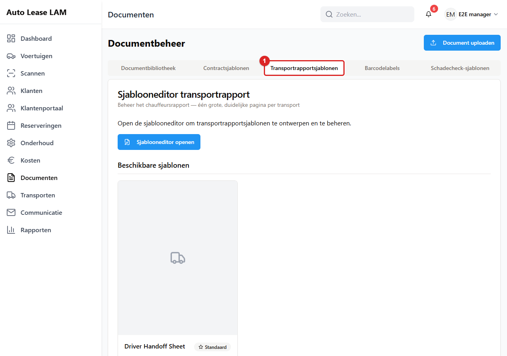
*Het tabblad **Transportrapportsjablonen** (1) werkt net als de contractsjablonen.*

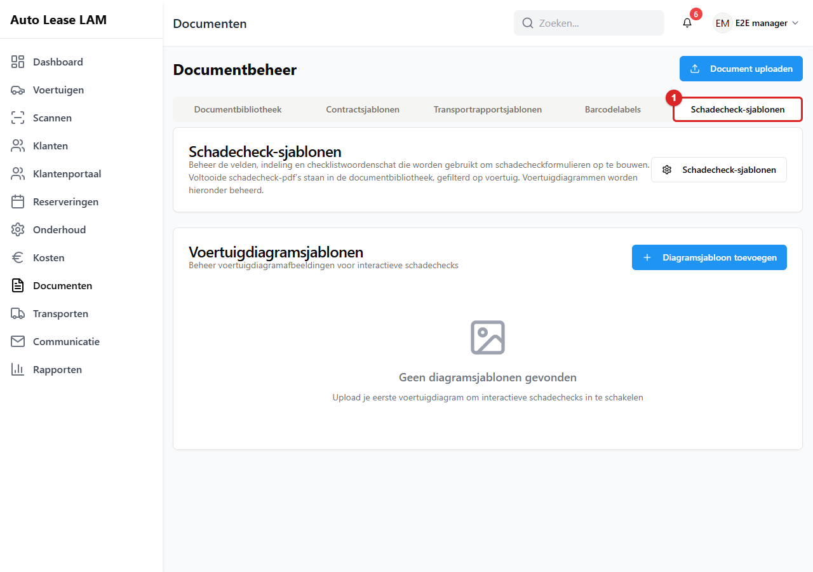
*Het tabblad **Schadecheck-sjablonen** (1). Hier staan het formulier en de voertuigdiagrammen.*

**Barcodelabels: etiket of DYMO-tape.** Bij **Nieuw sjabloon** vul je een naam in. Daarnaast kies
je het **Soort label**. Je hebt twee keuzes. De eerste is **Etiket (62 x 29 mm)**. De uitleg erbij
is: *Een los etiket of een vel etiketten: barcode boven, kenteken eronder.* De tweede is
**DYMO-tape (48 x 12 mm)**. De uitleg erbij is: *Voor de labelmaker aan de balie: barcode over de
lengte, kenteken en Hoofd/Reserve eronder, staand afgedrukt.* Een tapesjabloon begint met drie
velden: de barcode over de lengte, het kenteken linksonder en **Sleutel (Hoofd/Reserve)**
rechtsonder. Die velden verschuif je, vergroot je of vul je aan, net als op een etiket. Aanvullen
kan bijvoorbeeld met **Vaste tekst**. De maten heten dan **Lengte (mm)** en **Tapebreedte (mm)**.
De lengte loopt over de tape en is standaard 48. De tapebreedte is standaard 12. Er is ook een
schakelaar: **DYMO-tape: staand afdrukken, inhoud gedraaid**. Daarmee zet je een bestaand sjabloon
om naar tape, of weer terug. Bij het afdrukken draait de app de inhoud zelf een kwartslag. Barcodes
op tape drukt de app af zonder de code eronder. Het veld **Sleutel (Hoofd/Reserve)** leest de app
uit de code. Een code van een reservesleutel eindigt op -S. Daarna kies je het sjabloon bij
**Labelsjabloon** op de voertuigkaart. Dat kan ook in **Voertuigbarcode** of in het
**Barcodeboek**. Zie [hoofdstuk 18, paragraaf 18.9](18-barcode-en-scannen.md).

**Drie standaarden.** In de labeleditor staan drie knoppen naast elkaar: **Hoofdsleutel**,
**Reservesleutel** en **Autolabel (sticker in de auto)**. Een gevulde ster laat zien welk sjabloon
voor dat soort label de standaard is. Klik erop. De keuze wordt meteen opgeslagen. Een sjabloon is
standaard voor één soort, of voor geen enkele soort. Is er voor de reservesleutel of het autolabel
geen eigen standaard? Dan gebruikt de app het sjabloon van de hoofdsleutel. Met de knop
**Kenteken onder barcode** zet je in één keer het kenteken als tekst onder de streepjescode.

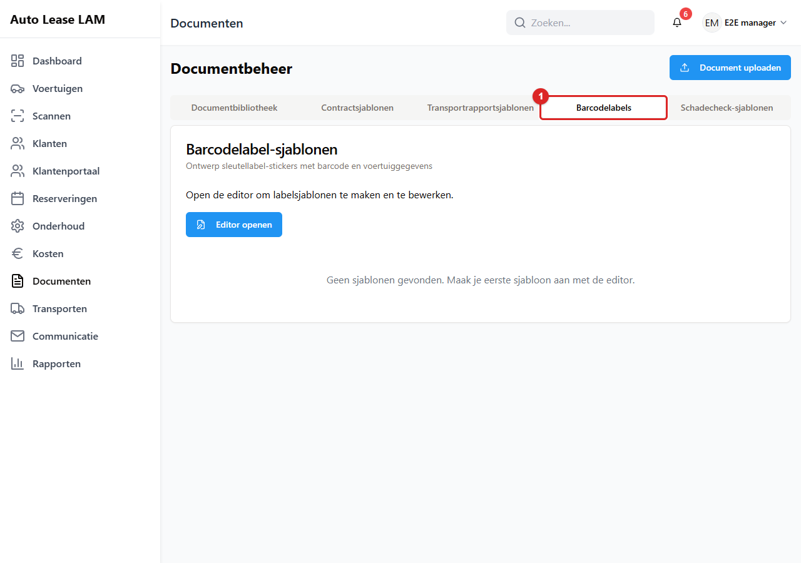
*Het tabblad **Barcodelabels** (1).*

**Dit is de belangrijkste regel over sjablonen:** een sjabloon zonder velden geeft een leeg
contract. Daarom weigert de app zo'n sjabloon. Een duidelijke fout is beter dan een onbruikbaar
bestand. Je kunt een sjabloon zonder velden dus niet op **Als standaard instellen** zetten. Je
leest dan: *Een sjabloon zonder velden kan niet het standaardsjabloon zijn: elk contract dat ermee
wordt gemaakt zou leeg zijn. Plaats eerst minstens één veld.* Haal je alle velden uit het
standaardsjabloon? Dan staat er een rood blok **Dit standaardsjabloon heeft geen velden**. Bij het
opslaan krijg je een waarschuwing.

**Een sjabloon bewerken zonder iets kwijt te raken.** In de sjablooneditor staat een regel die
zegt hoe het ervoor staat. Je leest *Er zijn niet-opgeslagen wijzigingen.* of *Alle wijzigingen
zijn opgeslagen.* Sluit je de editor terwijl er nog niet-opgeslagen wijzigingen zijn? Dat kan met
het kruisje, met de toets Escape of door naast het venster te klikken. Dan vraagt de app eerst
**Wijzigingen niet opgeslagen**. Je leest: *Je hebt wijzigingen aan dit sjabloon die nog niet zijn
opgeslagen. Als je de editor nu sluit, gaan ze verloren.* Kies **Verder bewerken** of
**Wijzigingen weggooien**. Kies je in de editor een ander sjabloon terwijl er wijzigingen
openstaan? Dan komt dezelfde vraag, met dezelfde twee knoppen. Dit geldt voor drie editors: die van
het contractsjabloon, die van het transportrapportsjabloon en die van het barcodelabel.

> **Escape werkt soms een moment niet.** Direct na **Opslaan** staat er een korte melding in beeld,
> en die vangt de eerste Escape op. Wacht een paar seconden of klik op **Sluiten**. Heb je net een
> PDF bekeken, dan gaat het toetsenbord weer naar het venster zelf zodra de PDF geladen is.

Mislukt het contract bij het **ophalen** (5.7)? Dan staat er sinds kort een Nederlandse zin in het
venster **Contract kon niet gemaakt worden**. Bij elke zin staat hieronder wat je eraan doet:

| Zin | Wat je doet |
|---|---|
| *Er is geen contractsjabloon ingesteld. Maak er een aan onder Documenten → Contractsjablonen en klik dan op Opnieuw proberen.* | Er is nog helemaal geen contractsjabloon. Maak er één. |
| *Er zijn meerdere sjablonen maar geen standaard. Kies een standaardsjabloon onder Documenten → Contractsjablonen.* | Zet één van de bestaande sjablonen op **Standaard**. |
| *Het contractsjabloon 'naam' heeft geen velden. Vul het sjabloon onder Documenten → Contractsjablonen.* (de zin noemt het sjabloon dat leeg is) | Open dat sjabloon in de sjablooneditor. Plaats de velden. |
| *De achtergrond van het contractsjabloon kon niet worden gelezen. Upload de achtergrond opnieuw onder Documenten → Contractsjablonen.* | Upload de achtergrondafbeelding van het sjabloon opnieuw. |
| *Het voertuig van deze reservering kon niet worden gevonden. Controleer het voertuig en probeer het opnieuw.* | Controleer of het voertuig bij deze reservering nog bestaat. |
| *Aan deze reservering is nog geen voertuig gekoppeld. Ken een voertuig toe en genereer het contract daarna opnieuw.* | Wijs eerst een voertuig toe aan de reservering. |
| *Aan deze reservering is geen klant gekoppeld, dus het contract kan niet worden gemaakt. Voeg een klant toe aan de reservering.* | Voeg een klant toe aan de reservering. |
| *Dit is een onderhoudsblok, geen verhuur — hier hoort geen contract bij.* | Niets. Een onderhoudsblok krijgt terecht geen contract. |
| *Het contract kon niet worden gemaakt door een technische fout. Probeer het opnieuw; blijft het misgaan, meld dan deze tekst: …* | Probeer het opnieuw. Blijft het misgaan? Geef dan de bijgevoegde tekst door aan wie de sjablonen beheert. |

Je ziet hieraan: het gaat altijd om het sjabloon, het voertuig, de klant of de reservering zelf.
Het gaat nooit om de kilometerstand of de brandstof. Ook niet om iets anders dat je net bij het
ophalen hebt ingevuld. Je hebt het recht **PDF-sjablonen beheren** nodig om een sjabloon te
wijzigen. Dat recht heb je ook nodig om velden te plaatsen of een sjabloon op **Standaard** te
zetten. Mis je dat recht? Haal er dan een collega bij die het wel heeft.

Soms maak je een contract niet bij het ophalen, maar met de knop **Opnieuw genereren** in de
documentbibliotheek (8.6). Ook dan krijg je bij dezelfde soort fout een Nederlandse zin.
Bijvoorbeeld *Er is geen contractsjabloon ingesteld. Maak er een aan onder Documenten →
Contractsjablonen.* Of *Het contractsjabloon bestaat niet meer. Kies een ander sjabloon onder
Documenten → Contractsjablonen.* Onder **Opnieuw genereren is niet gelukt** staat dus nooit meer
een Engelse tekst met *400:* ervoor.

Staat er geen sjabloon als standaard ingesteld? Dan geeft de app tegenwoordig een duidelijke fout.
De app raadt niet meer zelf een sjabloon. Zie de tweede zin in de tabel hierboven. Zijn er meer
sjablonen? Zorg dan dat er altijd bewust één op **Standaard** staat.

---

## 8.6 Versies en de markering "Verouderd"

Een document dat de app maakt, krijgt een **versienummer**. Het eerste document is versie 1.
Maakt de app hetzelfde soort document nog een keer bij dezelfde reservering? Dan krijgt dat
document het volgende nummer.

### Wanneer iets "verouderd" wordt

Een document krijgt de markering **Verouderd** in drie gevallen:

1. **De reservering is gewijzigd nadat het document gemaakt was.** Dit geldt voor de gegevens die
   op het contract staan: het voertuig, de klant, de chauffeur, de datums, de prijs en het
   contractnummer. En ook de kilometerstanden, de brandstofniveaus, de werkelijke ophaal- en
   innamedatum, het afleveradres en de notities. De reden die erbij staat is
   *de reservering is gewijzigd nadat dit document was gemaakt*.
2. **Er is een nieuwere versie gemaakt.** De vorige versie krijgt dan de reden
   *vervangen door een nieuwere versie*.
3. **Een overdracht is teruggedraaid** (hoofdstuk 5, paragraaf 5.14). Draai je een ophaling terug?
   Dan krijgt het niet-ondertekende contract van die reservering de markering. Draai je een inname
   terug? Dan krijgt de schadecheck van de inname de markering. De reden die erbij staat is
   *de overdracht is teruggedraaid*. Het document wordt niet verwijderd. Draai je een annulering
   terug? Dan blijven de documenten zoals ze zijn.

Je herkent het aan een oranje label bij het document:

> ⚠ **Verouderd** · versie 1

Ga je met de muis over het label? Dan lees je: *"Dit document is gemaakt vóór een wijziging aan de
reservering en klopt mogelijk niet meer."*

*Een verouderd contract in de bibliotheek. 1 is het label **Verouderd**. 2 is de knop **Opnieuw
genereren**.*

**Het oude document blijft altijd bewaard.** De app gooit nooit uit zichzelf een contract weg. De
app vervangt het ook niet stilletjes. Wat ooit is afgedrukt of gemaild, blijft terug te vinden.

### Bewust een nieuwe versie maken

Bij elk contract dat de app zelf maakte, staat de knop **Opnieuw genereren**. Ook als het contract
niet verouderd is. Klik er dus alleen op als het nodig is. De knop maakt een nieuwe versie met de
gegevens zoals ze nu zijn. Tijdens het maken staat er *"Bezig met genereren…"*. Daarna krijg je
de melding:

> **Nieuwe versie aangemaakt** — *"Versie 2 van &lt;bestandsnaam&gt; staat nu in het dossier. De oude
> versie blijft bewaard."*

De oude versie houdt zijn label **Verouderd**. De nieuwe versie heeft geen label. Lukt het niet?
Dan staat er **Opnieuw genereren is niet gelukt** met de reden erbij.

Je vindt **Opnieuw genereren** in **Documenten** → **Documentbibliotheek**. Klap de auto open en
daarna de groep **Contracten**. In de reserveringsvensters en op de voertuigkaart staat de knop
niet. Alleen het venster **Reserveringsdocumenten** heeft hem ook. Dat venster open je alleen vanuit
een onderhoudsblok (8.3).

### Waar de knop niet staat

**Opnieuw genereren** zie je alleen bij documenten die de app zelf kan namaken. Dat zijn het
huurcontract en de niet-ondertekende schadecheck van een reservering. Het schadeformulier dat de
app bij het inleveren maakt, hoort daar niet bij. Bij een geüpload document staat de knop er
niet. Ook niet bij een transportrapport, en niet bij een document zonder reservering. De app heeft
dan niets om het document opnieuw mee op te bouwen.

### Wat je zelf moet doen

De markering is een signaal. De app verbetert het document niet vanzelf. Dit doe je:

1. Je ziet **Verouderd** staan bij een contract.
2. Controleer of de klant het oude contract al heeft. Zo ja, spreek dan af wat er met dat
   exemplaar gebeurt.
3. Klik op **Opnieuw genereren**.

   
   *Zo ziet de knop **Opnieuw genereren** eruit. Klik erop. De app maakt een nieuwe versie met de gegevens zoals ze nu zijn.*

4. Print of mail de nieuwe versie.

   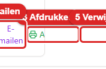
   *Zo ziet de knop **Afdrukken** eruit. Klik erop. Het afdrukvenster van je browser gaat open.*

   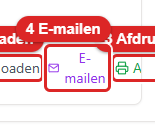
   *Zo ziet de knop **E-mailen** eruit. Klik erop. Je ziet het venster **Document e-mailen**.*

Doe je dit niet? Dan blijft het oude contract gewoon bestaan. Het klopt dan niet meer met de
reservering. De app waarschuwt daar verder niet over.

---

## 8.7 De twee documentrechten

Documenten hebben een eigen recht. Dat recht staat los van het recht op voertuigen en
reserveringen. In het beheerscherm staan twee vinkjes:

| Vinkje | Wat het toestaat |
|---|---|
| **Documenten bekijken** | De lijst zien. Een document openen, downloaden en afdrukken. De contractgegevens inzien |
| **Documenten bewerken en genereren** | Alles hierboven. Plus: een contract of schadecheck genereren, opnieuw genereren, uploaden, mailen en verwijderen |

Dat onderscheid is er met opzet. In een contract staan het adres, het telefoonnummer en het
rijbewijsnummer van de klant. Heeft iemand die gegevens niet nodig? Dan krijgt die persoon het
vinkje **Documenten bekijken** niet.

Heb je het recht niet? Dan geeft de app een melding als:

> *Not authorized. One of these permissions required: view_documents, manage_documents*

Of, bij genereren:

> *Not authorized. One of these permissions required: manage_documents*

Dat is geen storing. Vraag een beheerder om het vinkje aan te zetten (hoofdstuk 10).

> **Let op:** een beheerder mag altijd alles. De vinkjes hebben op een beheerdersaccount geen
> beperkende werking.

---

## 8.8 Kort samengevat

- Het contract wordt gemaakt bij het ophalen. De schadecheck bij het innemen. Allebei automatisch.
- Alles staat in **Documenten → Documentbibliotheek**. Je vindt het ook bij het voertuig en bij de
  reservering.
- **Bekijken · Downloaden · Afdrukken · E-mailen · Verwijderen** staan bij elk document.
- Verandert de reservering? Dan krijgt het document het label **Verouderd**. Jij beslist wanneer
  er een nieuwe versie komt, met **Opnieuw genereren** in de **Documentbibliotheek**.
- Het oude document verdwijnt nooit.
- Een sjabloon zonder velden wordt geweigerd. Zo houdt de app een leeg contract tegen.
