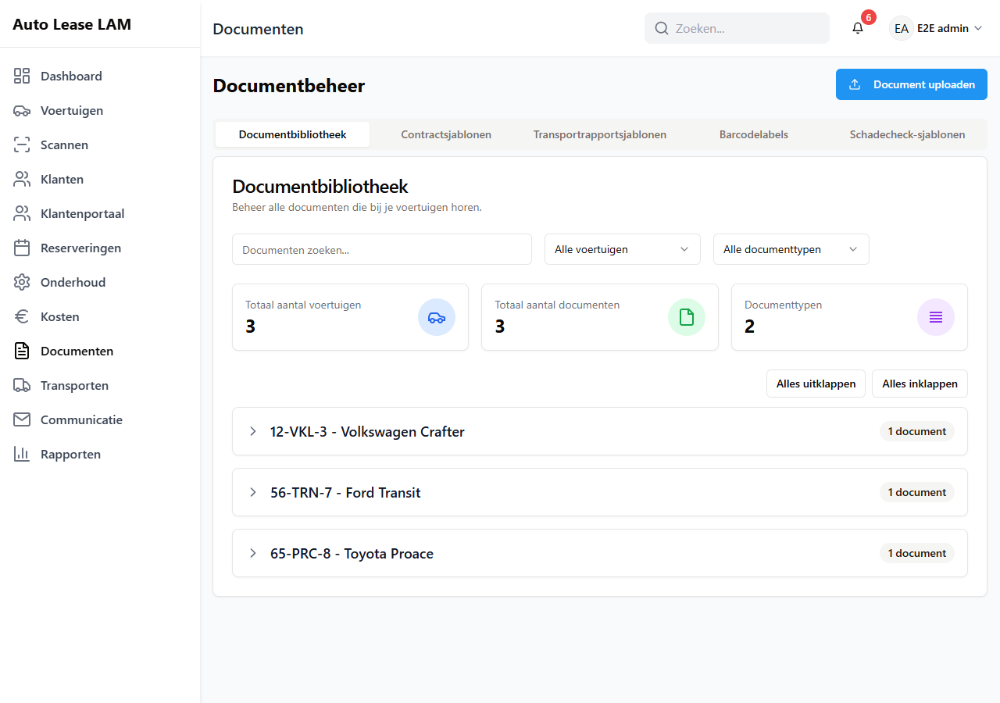

# 8. Documenten en afdrukken

In dit hoofdstuk staat welke documenten de app zelf maakt, waar ze vandaan komen, hoe je
ze bekijkt, afdrukt en downloadt, en wat er gebeurt als een reservering verandert nadat het
document al gemaakt is.

---

## 8.1 Welke documenten de app maakt

De app maakt vier soorten papier. Alles wat de app maakt is een PDF.

| Document | Waar het ontstaat | Waar het terechtkomt |
|---|---|---|
| **Huurcontract** | Bij het ophalen van een voertuig, en met de knop om het los te genereren | Documentbibliotheek, bij het voertuig en bij de reservering |
| **Schadecheck** | Bij het innemen, en vanuit het schadecheckscherm | Documentbibliotheek, bij het voertuig en bij de reservering |
| **Transportrapport** (transportbrief) | Vanuit het transportscherm, per transport of voor meerdere tegelijk | Documentbibliotheek; bij meerdere voertuigen onder **Algemene rapporten** |
| **Sleutellabels en barcodelabels** | Vanuit het voertuig of het labelscherm | Wordt direct afgedrukt, wordt **niet** bewaard in de documentbibliotheek |

Twee dingen die de app níét maakt:

- **Een getekend contract.** De app maakt alleen het onbetekende contract. Het exemplaar dat
  de klant heeft getekend, scan je in en zet je erbij met **Contract uploaden**.
- **Facturen.** De app genereert geen facturen. De factuurgegevens gebruik je in de rapporten.

---

## 8.2 Waar de gegevens vandaan komen

Een document wordt op het moment van genereren opgebouwd uit drie bronnen:

1. **De reservering** — periode, contractnummer, prijs, kilometerstanden, brandstofniveaus,
   afleveradres en de notities.
2. **Het voertuig en de klant** — kenteken, merk, model, chassisnummer, naam, adres, telefoon
   en rijbewijsnummer.
3. **Het sjabloon** — de achtergrond en de plek waar elk veld op de pagina komt te staan.

Daarom geldt: **een document is een momentopname.** Verandert er daarna iets aan de
reservering, dan verandert het document niet mee. Zie paragraaf 8.6.

Datums en bedragen op een gegenereerd document staan altijd in het Nederlands en in de
Nederlandse notatie: `13-09-2026` of `13 september 2026`, en `€ 1.234,50`. Dat geldt ook als
de klant het portaal in het Engels gebruikt. Heeft een huur geen einddatum, dan staat er
**nader te bepalen** op het contract.

---

## 8.3 Waar je documenten terugvindt

Er zijn drie plekken, met dezelfde documenten erin.

*Het scherm **Documentbeheer**: rechtsboven **Document uploaden**, daaronder de tabbladen
**Documentbibliotheek**, **Contractsjablonen**, **Transportrapportsjablonen**, **Barcodelabels**
en **Schadecheck-sjablonen**.*

**Documenten → Documentbibliotheek**
Het volledige overzicht, gegroepeerd per voertuig. Bovenaan zie je het aantal voertuigen, het
aantal documenten en het aantal documenttypen. Je filtert met **Alle voertuigen** en
**Alle documenttypen**, of je zoekt in **Documenten zoeken...**. Dat zoekveld kijkt niet alleen naar de
bestandsnaam, maar ook naar het kenteken (met of zonder streepjes), het merk, het model en de naam
van het documenttype zoals jij die ziet. De groepen die bij je zoekopdracht passen, klappen zelf
open. Met **Alles uitklappen** en **Alles inklappen** zet je alle voertuiggroepen in één keer
open of dicht. De groepen staan op kenteken gesorteerd. Filter je zo dat er op de huidige pagina
niets meer staat, dan springt de lijst terug naar een pagina met inhoud, in plaats van een leeg
scherm te tonen. Staat er niets: *"Geen documenten gevonden die overeenkomen met je filters."*

**Document uploaden.** Rechtsboven staat de knop **Document uploaden**. Je kiest eerst het
voertuig; het formulier verschijnt dan meteen in hetzelfde venster, zonder tweede knop of tweede
venster. Heb je in de bibliotheek al op een voertuig gefilterd, dan staat dat voertuig er al
ingevuld. De knop is voor wie **Documenten bewerken en genereren** heeft (8.7); zonder dat
vinkje staat hij grijs, en als je erop tikt of klikt zegt de app welk vinkje je mist.

**Bij het voertuig**
Open het voertuig en ga naar het tabblad **Documenten**. Je ziet alleen wat bij deze auto hoort.

**Bij de reservering**
Open de reservering en klik op de knop om documenten te openen. Je krijgt het venster
**Reserveringsdocumenten** — *"Documenten specifiek gekoppeld aan deze reservering (contracten,
schaderapporten, foto's)"*. Dit is de plek waar je ook ziet of een document gemaild is.

De kopjes boven de groepen in dit venster, en de omschrijvingen eronder, staan in het Nederlands:
**Contract (niet ondertekend)**, **Contract (ondertekend)**, **Schadecheck (ophalen)**,
**Schadecheck (inleveren)** en **Transportrapport**. Dat geldt ook in de documentbibliotheek, op
de voertuigkaart en in de lijst met documenten bij de reservering. Kentekens in de titels staan
met streepjes. De opmerking bij een document, bijvoorbeeld *Automatisch aangemaakt contract (niet
ondertekend) voor reservering #3366*, is ook Nederlands. Het opgeslagen bestand zelf verandert er
niet door; alleen wat je op het scherm leest.

---

## 8.4 Genereren, bekijken, afdrukken, downloaden

### Genereren

Meestal hoef je niets te doen: het contract wordt gemaakt op het moment dat je het ophalen
afrondt met **Ophalen voltooien & contract genereren**, en de schadecheck bij
**Inleveren voltooien & schadecheck genereren**.

Direct daarna verschijnt een venster met de uitslag:

- **Contract klaar** — *"&lt;bestandsnaam&gt; is aangemaakt. Print het of mail het direct naar de
  klant."* Met de knoppen **Afdrukken** en **Mail naar klant**.
- **Contract kon niet gemaakt worden** — met, sinds kort, een concrete Nederlandse reden erbij in
  plaats van een kale mededeling. De volledige lijst met redenen en wat je eraan doet staat in
  8.5. Herkent de app de reden niet, dan staat de algemene tekst *"De handeling is vastgelegd,
  maar het document is niet aangemaakt. Probeer het opnieuw of controleer de sjablonen."* Beide
  keren staat de knop **Opnieuw proberen** erbij.

Het ophalen zelf is in beide gevallen wél verwerkt. Een mislukt contract betekent niet dat de
auto niet is meegegeven; het betekent alleen dat er geen PDF is. Klik op **Opnieuw proberen**,
of maak het contract later alsnog vanuit de reservering.

> **De archivering bewaart nooit een kapot bestand.** Mislukt het maken van het contract, dan
> schrijft de app ook geen half of ongeldig bestand naar de documentbibliotheek voor die poging.
> Zie je geen contract bij deze reservering, dan is er dus ook niets stuk — er is alleen nog
> niets gemaakt.

> Bij een mislukte **schadecheck** staat er geen knop **Opnieuw proberen**. Maak de schadecheck
> dan opnieuw vanuit het schadecheckscherm.

### Bekijken, downloaden, afdrukken, e-mailen, verwijderen

In de documentbibliotheek heeft elk document dezelfde vijf knoppen:

| Knop | Wat het doet |
|---|---|
| **Bekijken** | Opent het PDF in een voorvertoning |
| **Downloaden** | Slaat het bestand op je computer op |
| **Afdrukken** | Opent het afdrukvenster van je browser |
| **E-mailen** | Opent het venster om het document naar de klant te sturen (hoofdstuk 9) |
| **Verwijderen** | Haalt het document weg |

Bij afdrukken meldt de app *"Afdrukken gestart — Het afdrukvenster zou nu open moeten zijn.
De pop-up sluit automatisch."* Lukt dat niet, dan krijg je een van deze twee meldingen:

- *"Je browser heeft afdrukken geblokkeerd. Gebruik de downloadknop en druk handmatig af."*
- *"Sta pop-ups toe en probeer het opnieuw, of gebruik de downloadknop."*

Beide zijn een browserinstelling, geen fout in de app. Downloaden en daarna afdrukken werkt
altijd.

### De interactieve schadecheck invullen

Een schadecheck maak je op het tabblad **Documenten** van de voertuigkaart (knop **Nieuwe check**, hoofdstuk 4,
paragraaf 4.10) of tijdens het ophalen en inleveren. Wat daarin is verbeterd:

- **Het diagram.** Heeft de auto geen eigen diagram voor zijn model, dan toont de app het diagram van
  een ander model, met de melding **Geen diagram voor dit model**, waarin staat van welk merk en
  model het is: markeringen kunnen dan afwijken van de echte carrosserie. Is het opgeslagen diagram
  onbruikbaar, bijvoorbeeld een te platte strook, dan staat er een rood blok **Dit diagram is niet
  bruikbaar** met de afmetingen erbij. Wie diagrammen beheert (**Documenten** → **Schadecheck-sjablonen**)
  kan zo'n plaatje niet meer opslaan: de app weigert een afbeelding die te plat of te klein is om
  schade op te markeren.
- **Wat je al hebt aangeklikt.** Een gekozen antwoord heeft een vinkje en een rand, en een leeg veld
  zegt *niet ingevuld*. Per blok staat hoeveel je al hebt gedaan, bijvoorbeeld *3 van 8 ingevuld*.
- **Alles goed.** Per blok staat een knop **Alles goed**. Die vult alleen de velden die nog leeg zijn
  met de normale waarde (bijvoorbeeld schoon, goed, ja). Wat je al had ingevuld, blijft staan.
- **Opslaan.** Terwijl de check wordt opgeslagen draait er een rondje en staat er *Bezig met
  opslaan…*. Daarna staat er *Opgeslagen om 14:32. De PDF is klaar.* De PDF zelf open je met de
  eigen knop of onder **Documenten** bij het voertuig. Je krijgt geen melding **Check geladen** meer
  voor de check die je net zelf hebt opgeslagen.
- **Hoe de check bij het inleveren wordt gebruikt.** Boven het formulier staat uitgelegd: *de
  schadecheck-PDF die bij het inleveren wordt gemaakt, neemt de laatst opgeslagen check van de
  reservering over: sla de check dus eerst op.*

---

## 8.5 Sjablonen: wie ze beheert en wat er mis kan gaan

De sjablonen bepalen hoe een document eruitziet. Ze staan onder **Documenten**, in vier
tabbladen naast de bibliotheek:

| Tabblad | Waarvoor | Wie mag het wijzigen |
|---|---|---|
| **Contractsjablonen** | Het huurcontract | Recht **PDF-sjablonen beheren** |
| **Transportrapportsjablonen** | De transportbrief | Recht **PDF-sjablonen beheren** |
| **Barcodelabels** | Sleutel- en voertuiglabels | Bekijken mag iedereen; wijzigen vraagt **PDF-sjablonen beheren** |
| **Schadecheck-sjablonen** | Het schadecheckformulier en de voertuigdiagrammen | Recht **Schadecontroles beheren** |

Heb je het vinkje **PDF-sjablonen beheren** niet, dan zijn de tabbladen **Contractsjablonen** en
**Transportrapportsjablonen** grijs. Tik of klik erop en de app zegt welk vinkje je mist; er
opent niets. Zo zie je dat de tabbladen bestaan, en weet je bij wie je ze moet aanvragen. Net zo
staat **Document uploaden** grijs zonder **Documenten bewerken en genereren**.

Een contractsjabloon open je via **Sjablooneditor openen**. In de editor sleep je velden op de
achtergrond. Eén sjabloon is de standaard; die herken je aan het label **Standaard**, en je
stelt hem in met **Als standaard instellen**.

**Barcodelabels: etiket of DYMO-tape.** Bij **Nieuw sjabloon** kies je naast de naam het **Soort
label**: **Etiket (62 x 29 mm)** — *Een los etiket of een vel etiketten: barcode boven, kenteken
eronder.* — of **DYMO-tape (48 x 12 mm)** — *Voor de labelmaker aan de balie: barcode over de lengte,
kenteken en Hoofd/Reserve eronder, staand afgedrukt.* Een tapesjabloon begint met drie velden (de
barcode over de lengte, het kenteken linksonder en **Sleutel (Hoofd/Reserve)** rechtsonder) die je
net als op een etiket verschuift, vergroot of aanvult, bijvoorbeeld met **Vaste tekst**. De maten heten
dan **Lengte (mm)** (over de tape, standaard 48) en **Tapebreedte (mm)** (standaard 12). De schakelaar
**DYMO-tape: staand afdrukken, inhoud gedraaid** zet een bestaand sjabloon om naar tape of terug; de
app draait de inhoud bij het afdrukken zelf een kwartslag en drukt barcodes op tape zonder de code
eronder. Het veld **Sleutel (Hoofd/Reserve)** leest het uit de code: een reservesleutel-code eindigt
op -S. Het sjabloon kies je daarna bij **Labelsjabloon** op de voertuigkaart, in **Voertuigbarcode** of
in het **Barcodeboek**; zie [hoofdstuk 18, paragraaf 18.9](18-barcode-en-scannen.md).

**Dit is de belangrijkste regel over sjablonen:** een sjabloon zonder velden levert een blanco
contract op, en daarom weigert de app het — liever een duidelijke fout dan een onbruikbaar
bestand. Je kunt een sjabloon zonder velden dan ook niet op **Als standaard instellen** zetten: er
staat *Een sjabloon zonder velden kan niet het standaardsjabloon zijn: elk contract dat ermee wordt
gemaakt zou leeg zijn. Plaats eerst minstens één veld.* En leeg je het standaardsjabloon, dan
staat er een rood blok **Dit standaardsjabloon heeft geen velden** en krijg je een waarschuwing bij
het opslaan.

**Een sjabloon bewerken zonder iets kwijt te raken.** In de sjablooneditor staat een regel die zegt
hoe het ervoor staat: *Er zijn niet-opgeslagen wijzigingen.* of *Alle wijzigingen zijn opgeslagen.*
Sluit je de editor terwijl er nog niet-opgeslagen wijzigingen zijn (met het kruisje, met Escape
of door naast het venster te klikken), dan vraagt de app eerst **Wijzigingen
niet opgeslagen** — *Je hebt wijzigingen aan dit sjabloon die nog niet zijn opgeslagen. Als je de
editor nu sluit, gaan ze verloren.* Kies **Verder bewerken** of **Wijzigingen weggooien**. Kies je in
de editor een ander sjabloon terwijl er wijzigingen openstaan, dan komt dezelfde vraag, met dezelfde twee
knoppen. Dit geldt voor de editor van het contractsjabloon, van het transportrapportsjabloon en van
het barcodelabel.

> **Escape werkt soms een moment niet.** Direct na **Opslaan** staat er een korte melding in beeld,
> en die vangt de eerste Escape op. Wacht een paar seconden of klik op **Sluiten**. Heb je net een
> PDF bekeken, dan gaat het toetsenbord weer naar het venster zelf zodra de PDF geladen is.

Mislukt het contract bij het **ophalen** (5.7), dan staat er sinds kort een van deze Nederlandse
zinnen in het venster **Contract kon niet gemaakt worden**, elk met wat je eraan doet:

| Zin | Wat je doet |
|---|---|
| *Er is geen contractsjabloon ingesteld. Maak er een aan onder Documenten → Contractsjablonen en klik dan op Opnieuw proberen.* | Er is nog helemaal geen contractsjabloon. Maak er één. |
| *Er zijn meerdere sjablonen maar geen standaard. Kies een standaardsjabloon onder Documenten → Contractsjablonen.* | Zet één van de bestaande sjablonen op **Standaard**. |
| *Het contractsjabloon 'naam' heeft geen velden. Vul het sjabloon onder Documenten → Contractsjablonen.* (de zin noemt het sjabloon dat leeg is) | Open dat sjabloon in de sjablooneditor en plaats de velden. |
| *De achtergrond van het contractsjabloon kon niet worden gelezen. Upload de achtergrond opnieuw onder Documenten → Contractsjablonen.* | Upload de achtergrondafbeelding van het sjabloon opnieuw. |
| *Het voertuig van deze reservering kon niet worden gevonden. Controleer het voertuig en probeer het opnieuw.* | Controleer of het voertuig bij deze reservering nog bestaat. |
| *Aan deze reservering is nog geen voertuig gekoppeld. Ken een voertuig toe en genereer het contract daarna opnieuw.* | Wijs eerst een voertuig toe aan de reservering. |
| *Aan deze reservering is geen klant gekoppeld, dus het contract kan niet worden gemaakt. Voeg een klant toe aan de reservering.* | Voeg een klant toe aan de reservering. |
| *Dit is een onderhoudsblok, geen verhuur — hier hoort geen contract bij.* | Niets: een onderhoudsblok krijgt terecht geen contract. |
| *Het contract kon niet worden gemaakt door een technische fout. Probeer het opnieuw; blijft het misgaan, meld dan deze tekst: …* | Probeer het opnieuw. Blijft het misgaan, geef de bijgevoegde tekst door aan wie de sjablonen beheert. |

Je herkent hieraan dat het altijd om het sjabloon, het voertuig, de klant of de reservering zelf
gaat — nooit om de kilometerstand, de brandstof of iets anders dat je net bij het ophalen hebt
ingevuld. Het recht **PDF-sjablonen beheren** heb je nodig om een sjabloon te wijzigen, velden te
plaatsen of een sjabloon op **Standaard** te zetten; mis je dat recht, haal er dan een collega bij
die het wel heeft.

Genereer je een contract niet bij het ophalen maar met de knop **Opnieuw genereren** uit de
documentbibliotheek (8.6), dan krijg je bij dezelfde soort fout ook een Nederlandse zin, bijvoorbeeld
*Er is geen contractsjabloon ingesteld. Maak er een aan onder Documenten → Contractsjablonen.* of
*Het contractsjabloon bestaat niet meer. Kies een ander sjabloon onder Documenten →
Contractsjablonen.* Onder **Opnieuw genereren is niet gelukt** staat dus nooit meer een Engelse tekst met
*400:* ervoor.

Staat er geen sjabloon als standaard ingesteld, dan geeft de app tegenwoordig een duidelijke fout
in plaats van zelf een sjabloon te raden — zie de tweede zin in de tabel hierboven. Zorg dus dat
er, zodra er meer dan één sjabloon is, altijd bewust één op **Standaard** staat.

---

## 8.6 Versies en de markering "Verouderd"

Een document dat de app maakt, krijgt een **versienummer**. De eerste is versie 1. Elke nieuwe
versie van hetzelfde soort document bij dezelfde reservering krijgt het volgende nummer.

### Wanneer iets "verouderd" wordt

Een document krijgt de markering **Verouderd** in drie gevallen:

1. **De reservering is gewijzigd nadat het document gemaakt was.** Dat geldt voor de dingen die
   op het contract staan: het voertuig, de klant, de chauffeur, de datums, de prijs, het
   contractnummer, de kilometerstanden, de brandstofniveaus, de werkelijke ophaal- en
   innamedatum, het afleveradres en de notities. De reden die erbij staat is
   *de reservering is gewijzigd nadat dit document was gemaakt*.
2. **Er is een nieuwere versie gemaakt.** De vorige versie krijgt dan de reden
   *vervangen door een nieuwere versie*.
3. **Een overdracht is teruggedraaid** (hoofdstuk 5, paragraaf 5.14). Draai je een ophaling terug,
   dan krijgt het niet-ondertekende contract van die reservering de markering; draai je een inname
   terug, dan krijgt de schadecheck van de inname hem. De reden die erbij staat is *de overdracht is teruggedraaid*. Het document wordt niet verwijderd, en een annulering terugdraaien laat de
   documenten ongemoeid.

Je herkent het aan een oranje label bij het document:

> ⚠ **Verouderd** · versie 1

Ga je er met de muis overheen, dan staat er: *"Dit document is gemaakt vóór een wijziging aan de
reservering en klopt mogelijk niet meer."*

**Het oude document blijft altijd bewaard.** De app gooit nooit uit zichzelf een contract weg en
vervangt het ook niet stilletjes. Wat er ooit is afgedrukt of gemaild, blijft terug te vinden.

### Bewust een nieuwe versie maken

Naast een verouderd document staat de knop **Opnieuw genereren**. Die maakt een nieuwe versie
met de gegevens zoals ze nu zijn. Tijdens het maken staat er *"Bezig met genereren…"*, daarna
krijg je de melding:

> **Nieuwe versie aangemaakt** — *"Versie 2 van &lt;bestandsnaam&gt; staat nu in het dossier. De oude
> versie blijft bewaard."*

De oude versie houdt zijn label **Verouderd**, de nieuwe versie is schoon. Lukt het niet, dan
staat er **Opnieuw genereren is niet gelukt** met de reden erbij.

De knop **Opnieuw genereren** staat op twee plekken: in de **Documentbibliotheek** en in het
venster **Reserveringsdocumenten**.

### Waar de knop niet staat

**Opnieuw genereren** verschijnt alleen bij documenten die de app zelf kan namaken: het
huurcontract en de schadecheck die bij een reservering horen. Bij een geüpload document, bij een
transportrapport en bij een document zonder reservering staat de knop er niet — er is dan niets
om het opnieuw uit op te bouwen.

### Wat je zelf moet doen

De markering is een signaal, geen automatische correctie. Wat je moet doen:

1. Je ziet **Verouderd** staan bij een contract.
2. Controleer of de klant het oude contract al heeft. Zo ja, spreek af wat er met dat exemplaar
   gebeurt.
3. Klik op **Opnieuw genereren**.
4. Print of mail de nieuwe versie.

Doe je dit niet, dan blijft het oude contract gewoon bestaan en klopt het niet meer met de
reservering. De app waarschuwt daar verder niet over.

---

## 8.7 De twee documentrechten

Documenten hebben een eigen recht, los van het recht op voertuigen en reserveringen. In het
beheerscherm staan twee vinkjes:

| Vinkje | Wat het toestaat |
|---|---|
| **Documenten bekijken** | De lijst zien, een document openen, downloaden en afdrukken, en de contractgegevens inzien |
| **Documenten bewerken en genereren** | Alles hierboven, plus: een contract of schadecheck genereren, opnieuw genereren, uploaden, mailen en verwijderen |

Dat onderscheid is er met opzet. In een contract staan het adres, het telefoonnummer en het
rijbewijsnummer van de klant. Wie die gegevens niet nodig heeft, krijgt het vinkje
**Documenten bekijken** niet.

Heb je het recht niet, dan geeft de app een melding als:

> *Not authorized. One of these permissions required: view_documents, manage_documents*

of, voor genereren:

> *Not authorized. One of these permissions required: manage_documents*

Dat is geen storing. Vraag een beheerder om het vinkje aan te zetten (hoofdstuk 10).

> **Let op:** een beheerder mag altijd alles. De vinkjes hebben op een beheerdersaccount geen
> beperkende werking.

---

## 8.8 Kort samengevat

- Contract bij ophalen, schadecheck bij innemen — allebei automatisch.
- Alles staat in **Documenten → Documentbibliotheek**, en ook bij het voertuig en bij de
  reservering.
- **Bekijken · Downloaden · Afdrukken · E-mailen · Verwijderen** staan bij elk document.
- Verandert de reservering, dan krijgt het document het label **Verouderd**. Jij beslist wanneer
  er een nieuwe versie komt, met **Opnieuw genereren**.
- Het oude document verdwijnt nooit.
- Een sjabloon zonder velden wordt geweigerd; dat is de app die een blanco contract tegenhoudt.
