# 9. E-mail versturen vanuit de app

De app kan zelf e-mail versturen. Bijvoorbeeld documenten naar de klant, meldingen naar het
klantenportaal, APK-herinneringen en bericht over een bekeuring. In dit hoofdstuk lees je welke
mail er bestaat en wie hem krijgt. Je leest ook waar je ziet of een mail is aangekomen. En je
leest wat je doet als het misgaat.

---

## 9.1 Welke mails er bestaan

| Mail | Wie hem start | Naar wie |
|---|---|---|
| **Documenten naar de klant** | Jij, met de knop **E-mailen** of **Mail naar klant** | Het e-mailadres dat je in het venster kiest |
| **Portaaluitnodiging en wachtwoord-reset** | Jij, vanuit het klantenportaalscherm | De portaalgebruiker |
| **Bevestiging nieuw e-mailadres / nieuwe aanmelding** | De klant zelf, in het portaal | De portaalgebruiker |
| **Onderhoudsmelding** | De app, zodra onderhoud gepland, verzet of afgerond wordt | De klant van de huur waar dat onderhoud bij hoort |
| **Reservering gewijzigd, geannuleerd of nieuw document** | De app, zodra kantoor dat doet | De klant van die reservering (zie 9.8) |
| **Bekeuring gekoppeld** | Jij, met de knop **Klant informeren** in het venster van de bekeuring. Dit kan alleen bij een gekoppelde bekeuring | Het e-mailadres van die klant. Het bevestigingsvenster noemt het adres |
| **Reactie op een portaalaanvraag** | Jij, als je een aanvraag beantwoordt | De klant die de aanvraag deed |
| **APK-herinnering** | Jij, met **APK-meldingen versturen** of de knop op de voertuigkaart | De huidige huurder (zie 9.2) |
| **Onderhoudsherinnering en vrij bericht** | Jij, vanuit **Communicatie** | De klanten die je kiest |
| **GPS-activatieverzoek** | Jij, vanuit het voertuig | De GPS-leverancier |
| **Melding aan kantoor** | De app | Het kantooradres uit de instellingen |

De onderhoudsmail heeft zeven soorten bericht. De aanleiding staat in het onderwerp:
**Onderhoud gepland**, **Onderhoud verplaatst**, **Auto in onderhoud**, **Onderhoud klaar**,
**Onderhoud vervalt**, **Onderhoud hoort niet meer bij uw huur**, en
**Vervangend vervoer staat klaar**.

> Onderhouds- en bekeuringsmail gaat alleen uit als het klantenportaal aan staat. Staat het
> portaal uit, dan krijgt de klant geen bericht.
>
> Een bekeuring invoeren, inlezen, importeren of koppelen stuurt zelf **geen** mail. De klant hoort
> het pas als jij op **Klant informeren** drukt. Daarna staat in het venster *Klant geïnformeerd op
> …* en heet de knop **Opnieuw informeren**. Lukt het versturen niet, dan zegt de melding waarom:
> er is geen klant gekoppeld, de klant heeft geen e-mailadres, het portaal staat uit voor die klant,
> of de mail kon niet worden verstuurd. In het **E-maillogboek** staat de mail onder het soort
> **Bekeuring**.

---

## 9.2 Wie krijgt een APK-herinnering?

**Alleen de huidige huurder.** Dat is de klant van de huur die nu loopt. Loopt er geen huur? Dan
is het de klant van de eerstvolgende geplande huur.

Staat de auto leeg? Dat betekent: er is geen lopende huur en geen geplande huur. Dan gaat er geen
mail naar een klant. In plaats daarvan krijgt kantoor één verzamelmail:

> **Herinnering: 3 voertuig(en) zonder huurder**
> *"Deze voertuigen zijn nu niet verhuurd, dus er is geen huurder om te waarschuwen:"*
> … per regel het kenteken, merk, model en de APK-datum …
> *"Deze melding gaat alleen naar kantoor."*

Is er wel een huidige huurder, maar heeft die geen bruikbaar e-mailadres? Dan komt die auto ook
op die lijst voor kantoor. Zo blijft zichtbaar dat er iemand gebeld moet worden.

Een klant die de auto vroeger huurde en nu niet meer, krijgt **nooit** een herinnering. Begint de
huur van een klant pas over een halfjaar? Dan krijgt die klant de herinnering alleen als er nu
niemand anders in rijdt.

Het venster **APK-herinnering versturen** op de voertuigkaart toont precies die ene ontvanger.
Erbij staan het label **Huidige huurder** en de periode van zijn huur. Is de auto niet verhuurd?
Dan meldt het venster **Dit voertuig is nu niet verhuurd**. De knop heet dan **Melding
naar kantoor versturen**.

Het kantooradres stel je in bij **App-instellingen → E-mail & GPS**. Daar staat het kader
**Kantooradres voor meldingen**, onder de mailservers. Vul het adres in. Kies daarna **Kantooradres
opslaan**. Laat je het leeg? Dan gaat de kantoormelding naar het afzenderadres van de app. Het
scherm noemt dat adres erbij. Zo zie je waar de melding dan terechtkomt.

---

## 9.3 Documenten mailen naar de klant

Er zijn twee vensters.

**Eén document, vanuit de bibliotheek.** Ga naar de **Documentbibliotheek** of naar de
voertuigkaart. Klik bij een document op **E-mailen**. Je ziet nu het venster **Document e-mailen**.
Daarin staat *Verstuur "<bestandsnaam>" via e-mail*. Vul **Ontvangers (kommagescheiden)** in. Dat
zijn één of meer e-mailadressen. Zet een komma tussen de adressen. Pas zo nodig **Onderwerp** en
**Bericht** aan. Klik op **E-mail versturen**. Die knop blijft grijs zolang er geen ontvanger staat.

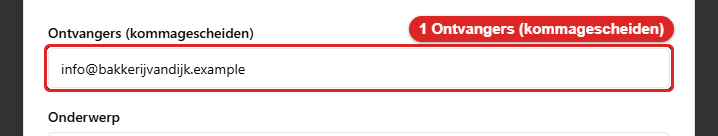
*Zo ziet het veld **Ontvangers (kommagescheiden)** eruit. Typ hier één of meer e-mailadressen, met een komma ertussen.*

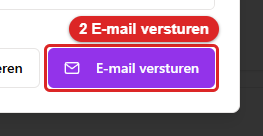
*Zo ziet de knop **E-mail versturen** eruit. Klik erop. De knop blijft grijs zolang er geen ontvanger staat.*

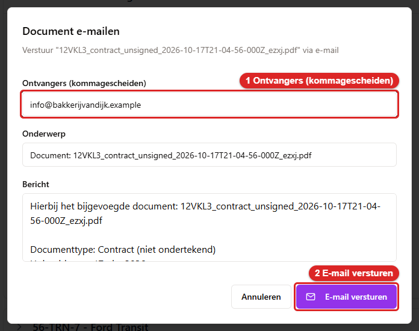
*Het venster **Document e-mailen**. 1: typ het e-mailadres bij **Ontvangers**. 2: klik op **E-mail
versturen**.*

**De documenten van een reservering naar de klant.** Dit venster opent met de knop **Mail naar
klant**. Die knop staat in het venster na het ophalen (**Contract klaar**) en na het innemen
(**Schadeformulier klaar**). Je kunt het venster ook vanuit de reservering openen. Het heet
**Documenten e-mailen naar klant**. Je leest: *"Selecteer documenten, ontvanger en taal om naar de
klant te sturen"*.

Je vult in:

1. **Selecteer documenten**. De documenten staan in groepen: **Contracten**, **Schadechecks** en
   **Overige documenten**. Vink aan wat mee moet. Alles wat je aanvinkt, gaat in **één** e-mail.
   Elk document is daarin een losse bijlage.
2. **E-mailadres ontvanger**. Kies **Algemeen**, of het adres van de klant zelf (*Klant: <adres>*).
   Je kunt ook **Facturen** kiezen. Of kies **Aangepast e-mailadres** en typ het adres zelf. Het
   adres van de klant staat er dus vanzelf bij. Ook als de klant geen algemeen adres heeft.
3. **E-mailsjabloon**. Kies **Contract-e-mail**, **Schadecheck-e-mail** of
   **Gecombineerde documenten-e-mail**. Vink je meer dan één document aan? Dan springt de app
   vanzelf naar het gecombineerde sjabloon.
4. **E-mailtaal**. Kies **Nederlands** of **Engels**. Dit gaat alleen over de tekst van de e-mail.
   De documenten zelf zijn altijd Nederlands.
5. **Onderwerp** en **Bericht** kun je aanpassen voordat je verstuurt.

Klik daarna op **E-mail versturen**. Tijdens het versturen staat er *"Versturen..."*. Is de knop
grijs? Dan staat onder het venster wat er nog ontbreekt. Je leest *Nog nodig om te versturen:* met
erachter *kies minstens één document*, *een geldig e-mailadres van de ontvanger* en/of
*een onderwerp*.

Gaat het goed? Dan sluit het venster met de melding:

> **Gelukt** — *"E-mail succesvol verstuurd naar &lt;adres&gt; met 2 documenten bijgevoegd"*

De app controleert vooraf drie dingen. Klopt er iets niet? Dan weigert de app met een duidelijke
melding:

| Melding | Wat je moet doen |
|---|---|
| **Ongeldig e-mailadres**: *"Voer een geldig e-mailadres in"* | Verbeter het adres |
| **Geen documenten**: *"Selecteer minstens één document om te versturen"* | Vink een document aan |
| *"Geen e-mailadres ontvanger geselecteerd"* | Kies een ontvanger |

> **Let op:** het venster blijft open als het versturen mislukt, en je leest dan in het Nederlands
> wat er aan de hand is, bijvoorbeeld *De e-mail kon niet verstuurd worden. Controleer de
> e-mailinstellingen onder Instellingen en probeer het opnieuw.* Zie 9.5.

---

## 9.4 Waar je ziet of een mail verzonden is

### Bij het document — dit is de plek die je moet gebruiken

Open de reservering. Open daarna **Reserveringsdocumenten**. Onder elk document staat de
verzendstatus:

- Groen: **Verzonden op 13-09-2026 aan klant@voorbeeld.nl**
- Rood: **Verzenden mislukt — &lt;reden&gt;**

Staat er niets onder een document? Dan is het nooit verstuurd. Is een document meerdere keren
verstuurd? Dan zie je de **laatste** poging.

Deze regel is het bewijs dat de klant zijn papieren heeft gekregen. Belt een klant met "ik heb niks
ontvangen"? Gebruik dan deze regel.

### Het scherm Communicatie

Onder **Communicatie** staat een tabblad **E-maillogboek**. De uitleg erbij is: *Elke verstuurde en
mislukte e-mail, de nieuwste bovenaan.* Sinds oktober 2026 toont het de **echte
verzendgeschiedenis**. (Tot die tijd stonden er drie vaste voorbeeldregels uit maart 2024 in. Die
hadden niets met jouw werk te maken.)

Per regel zie je het onderwerp, de datum en de tijd. Je ziet ook de soort: **APK**, **Onderhoud**,
**Aangepast**, **GPS-activatie**, **Document per e-mail** of **Overige e-mail**. En je ziet de
ontvanger. Bij een hele verzendronde staat er *N ontvangers · X verstuurd, Y mislukt*. Tot slot
staat er een label: **verzonden**, **mislukt** of **deels mislukt**. Bij een mislukking staat
eronder **Reden van mislukking:**. Die reden staat in het Nederlands. Bijvoorbeeld *De e-mailserver
weigerde de verbinding.* of *Geen geschikt e-mailadres gevonden.* Bij een hele ronde staat per reden
hoe vaak die voorkwam. Bijvoorbeeld *2x Geen geschikt e-mailadres gevonden.* De oorspronkelijke
tekst van de mailserver blijft bewaard. Die staat als **Technische melding:** achter de Nederlandse
zin. Heb je hulp van een beheerder nodig? Geef dan die tekst door. Een oudere regel is soms nog
zonder vaste code bewaard. Die toont de algemene zin *Verzenden mislukt.* met de bewaarde tekst
eronder. Is er nog niets verstuurd? Dan staat er *Er zijn nog geen e-mails verstuurd*. Lukt het
laden niet? Dan staat er *Het e-maillogboek kon niet worden geladen. Probeer het later opnieuw.*

Achter elke regel staat de knop **Details**. Die opent **E-mail in het logboek**. Daar zie je het
onderwerp, het resultaat, de soort en het tijdstip. Je ziet ook de ontvanger. Bij een ronde zie je
alle ontvangers en voertuigen. Verder staan er de reden in het Nederlands en de technische melding.
Onderaan staat dat de inhoud van een verstuurde e-mail niet wordt bewaard. Het logboek houdt alleen
het resultaat bij. Wil je dezelfde mail opnieuw sturen? Doe dat dan via **Meldingen versturen**.

Verstuur je vanuit **Communicatie**? Dan staat de nieuwe regel meteen in het logboek. Je hoeft de
pagina niet te vernieuwen.

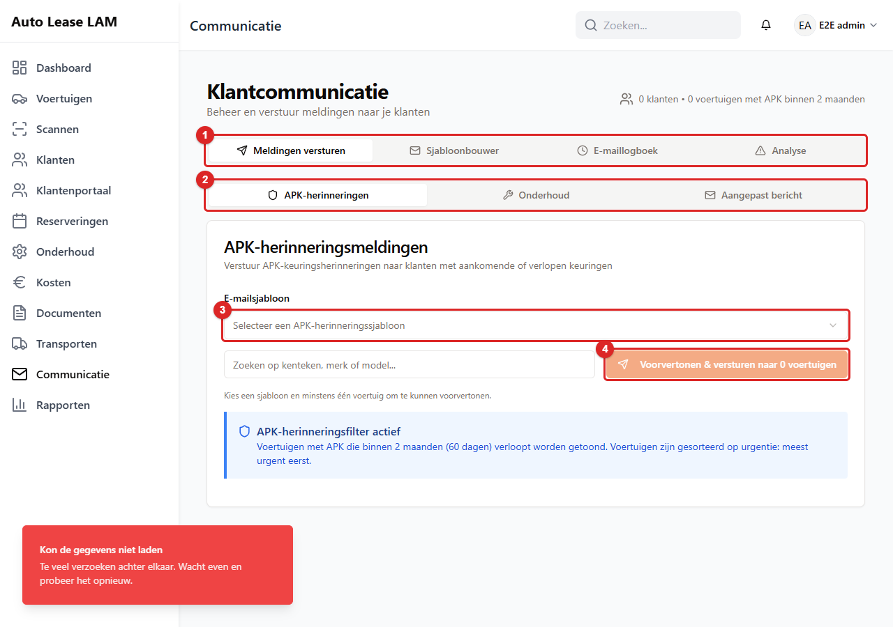
*Het scherm **Communicatie**, tabblad **Meldingen versturen**. 1 zijn de vier tabbladen. Bij 2 kies
je **APK-herinneringen**, **Onderhoud** of **Aangepast bericht**. Bij 3 kies je het
**E-mailsjabloon**. 4 is **Voorvertonen & versturen**. Die knop wordt pas blauw als je een sjabloon
en minstens één auto hebt gekozen.*

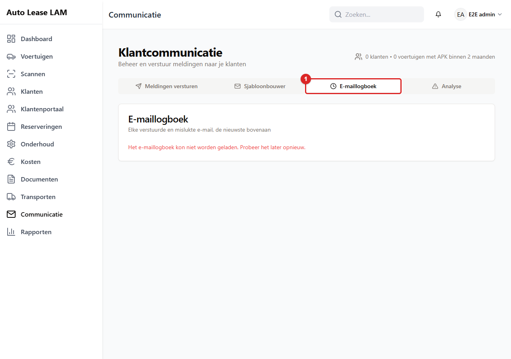
*Het tabblad **E-maillogboek** (1). Hier staat elke verstuurde en mislukte e-mail, de nieuwste
bovenaan.*

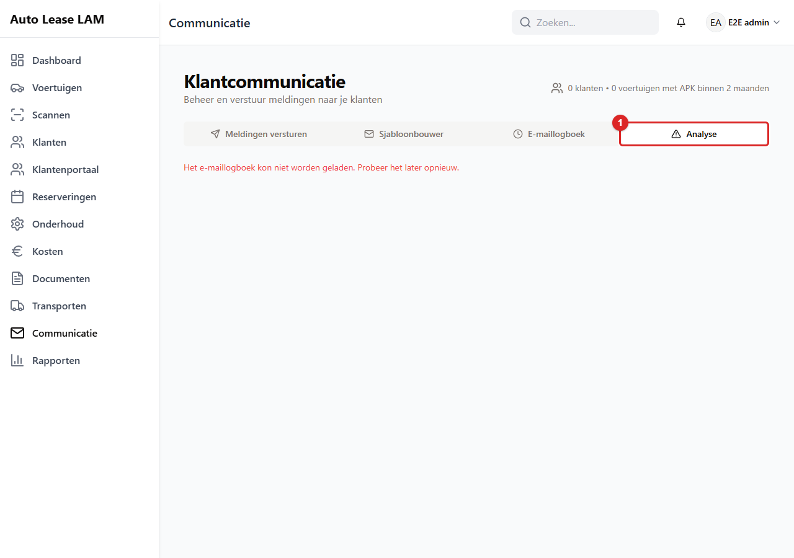
*Het tabblad **Analyse** (1). Hier staan de aantallen verstuurd en mislukt, per soort.*

Het tabblad **Analyse** rekent zijn cijfers uit diezelfde regels. Je ziet **Verstuurde e-mails**,
**Mislukte e-mails**, **Verzendrondes** en **Rondes met mislukkingen**. Per soort zie je hoeveel er
verstuurd en mislukt is: **APK-meldingen**, **Onderhoudsherinneringen**, **Aangepaste berichten**
en **Overige e-mails**. Een zin onderaan zegt wat niet meetelt. Mislukkingen vóór het versturen,
zoals een klant zonder e-mailadres, staan alleen bij hun ronde. Oudere verzendingen zonder regel
per ontvanger tellen niet mee.

Voor beide tabbladen heb je het recht **E-mailsjablonen beheren** nodig. Zonder dat recht staat er
*Geen toegang tot deze gegevens*. Wil je weten of een klant zijn papieren heeft gekregen? Gebruik
dan de regel bij het document, zoals hierboven staat.

### Het meldingencentrum

Het belletje rechtsboven opent het **Meldingencentrum**. Daar komen gebeurtenissen uit het
klantenportaal binnen. Bijvoorbeeld een nieuwe aanvraag of een reactie van een klant. Dit is geen
verzendstatus van e-mail.

---

## 9.5 Als versturen mislukt

Mislukken gebeurt buiten de app. Het gaat mis bij de mailserver of bij de ontvanger. Een
mailserver is de computer die e-mail verstuurt en ontvangt. De app vertaalt de reden naar een
Nederlandse zin. De tekst van de mailserver zelf blijft in het logboek bewaard (9.4).

| Wat je ziet | Wat het betekent | Wat je doet |
|---|---|---|
| *Er is geen werkende e-mailconfiguratie voor dit soort e-mail. Controleer de e-mailinstellingen.* | Voor dit soort mail is geen mailinstelling ingevuld | Beheerder: vul de mailinstellingen aan (hoofdstuk 10) |
| *Inloggen bij de e-mailserver is mislukt: gebruikersnaam of wachtwoord klopt niet.* | De gebruikersnaam of het wachtwoord van de mailserver klopt niet | Beheerder |
| *De e-mailprovider accepteert dit wachtwoord niet; inloggen met alleen een wachtwoord kan zijn uitgeschakeld.* | De mailprovider accepteert deze manier van inloggen niet meer | Beheerder |
| *De e-mailserver weigerde de verbinding.* of *Er kon geen verbinding worden gemaakt met de e-mailserver.* | De mailserver is niet bereikbaar | Probeer het later opnieuw. Blijft het misgaan? Dan de beheerder |
| *De verbinding met de e-mailserver duurde te lang.* | De mailserver reageerde niet op tijd | Probeer het later opnieuw |
| *De e-mailserver is niet gevonden; controleer de servernaam in de e-mailinstellingen.* | De naam van de mailserver klopt niet | Beheerder |
| *De e-mailserver heeft het bericht geweigerd; controleer het adres van de ontvanger en de afzender.* | De ontvanger of het bericht is geweigerd | Controleer het e-mailadres |
| *Geen geschikt e-mailadres gevonden.* | De klant heeft geen bruikbaar adres | Vul het e-mailadres van de klant aan (hoofdstuk 3) |
| *Het adres of het onderwerp bevat een regeleinde en is daarom niet verstuurd.* | Er zit een regelovergang in het adres of het onderwerp | Typ het opnieuw, zonder Enter |
| *De e-mail kon niet verstuurd worden. Controleer de e-mailinstellingen onder Instellingen en probeer het opnieuw.* | Verzamelmelding bij het mailen van documenten | Zie de regels hierboven |

**Wat je zelf kunt doen bij het mailen van documenten:** het venster blijft open als het mislukt.
Er is geen wachtrij. De app probeert het niet vanzelf opnieuw. Controleer het e-mailadres. Klik
daarna nog een keer op **E-mail versturen**. Blijft het mislukken? Dan ligt het aan de
mailinstellingen. Er moet dan een beheerder bij.

**Bij een portaaluitnodiging** krijg je: *"Account aangemaakt, maar de e-mail kon niet worden
verstuurd. Controleer de e-mailinstellingen en stuur de uitnodiging opnieuw."* Het account is dan
wel aangemaakt. Gebruik daarna de knop **Uitnodiging opnieuw sturen**.

**Bij APK- en onderhoudsherinneringen en vrije berichten** (scherm **Communicatie**) zegt de
melding na afloop eerlijk wat er gebeurd is. Dit zijn de mogelijke uitkomsten:

| Melding | Betekent |
|---|---|
| **Meldingen verstuurd**: *3 e-mails verstuurd* | Alles is verzonden |
| **Gedeeltelijk verstuurd**: *3 e-mails verstuurd, 2 e-mails mislukt. De redenen staan in het E-maillogboek.* | Een deel is niet aangekomen. Kijk in het logboek (9.4) |
| **Er is niets verstuurd**: *2 e-mails mislukt* met de reden erachter, in rood | Er is niets uitgegaan |
| *Er was niemand om naar te mailen.* | Er was geen ontvanger met een bruikbaar adres. Er is niets gemaild en ook niets mislukt |

Vroeger stond er altijd **Meldingen succesvol verstuurd**. Ook als er geen enkele mail was
uitgegaan. Dat is verholpen. Bij **Er is niets verstuurd** blijven de ontvangers, het onderwerp en
de tekst in het formulier staan. Je hoeft dus niet opnieuw te beginnen.

**De voorvertoning is persoonlijk.** Een voorvertoning laat zien hoe de mail eruit gaat zien. Klik
op **Voorvertonen & versturen naar … voertuigen**. Je ziet nu het venster **E-mailvoorvertoning**.
Dat laat de mail zien zoals één ontvanger hem krijgt. Klik op een ontvanger. Je ziet dan *Zo ziet
<naam> de e-mail*. Daarin staan zijn eigen kenteken en klantnaam, en niet meer de voorbeeldwaarden.
Een voertuig zonder huurder krijgt geen klantmail. Dat voertuig krijgt een melding aan kantoor
(*Zo ziet kantoor de melding over dit voertuig*). Is er geen bruikbaar e-mailadres? Dan staat er
*Geen geschikt e-mailadres: wordt niet verstuurd. Kies een ander adres of een andere ontvanger.* Het
adres dat je in de voorvertoning kiest, is ook het adres waarnaar de app echt verstuurt. Is een
veld voor een ontvanger leeg? Dan staat er *Leeg voor deze ontvanger:* met de naam van het veld.

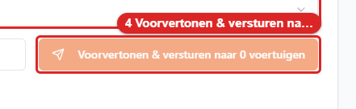
*Zo ziet de knop **Voorvertonen & versturen** eruit. Klik erop. Je ziet dan het venster **E-mailvoorvertoning**.*

**Veel ontvangers.** Verstuur je 25 e-mails of meer in één keer? Dan zie je de waarschuwing
**Let op: veel ontvangers**. De verzendknop blijft grijs. Hij werkt pas als je **Ik heb de tekst en
de ontvangers gecontroleerd** hebt aangevinkt.

**Een grijze voorvertoonknop** heeft een regel eronder. Die zegt wat er nog ontbreekt: *Kies
minstens één ontvanger (klant of voertuig) om te kunnen voorvertonen.* of *Vul een onderwerp en
een bericht in, of kies een sjabloon, om te kunnen voorvertonen.*

Op de voertuigkaart heet de foutmelding **Fout bij versturen APK-herinnering**. Je leest:
*"APK-herinnering versturen mislukt. Probeer het opnieuw."*

**Onderhoudsmail die vanzelf uitgaat** kan ook mislukken. Dat zie je nergens in het scherm terug.
Is het belangrijk dat het bericht aankomt? Bel dan de klant. De bekeuringsmail start je zelf met
**Klant informeren**. Die meldt direct als hij niet is verstuurd.

---

## 9.6 Mailinstellingen

Alleen een beheerder komt hier. Ga via het menu rechtsboven naar
**App-instellingen → tabblad E-mail & GPS**.

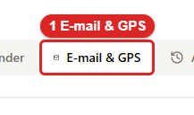
*Zo ziet het tabblad **E-mail & GPS** eruit. Klik erop. Daarna zie je de mailinstellingen.*

Onder **E-mailconfiguratie** kun je per doel een eigen mailserver instellen. De doelen zijn:
**APK-herinneringen**, **Onderhoudsmeldingen**, **GPS/IEI-informatie**, **Documenten-e-mail**,
**Aangepaste berichten** en **Standaard/Algemeen**. Wat je niet apart invult, gebruikt de
standaardinstelling.

Per instelling vul je in: **Afzender-e-mail**, **Afzendernaam**, **SMTP-host**, **SMTP-poort**,
**SMTP-gebruikersnaam** en **SMTP-wachtwoord**. SMTP is de techniek waarmee een mailserver e-mail
verstuurt. Klik daarna op **Configuratie opslaan**.

Met de knop **Verbinding testen** controleer je of het werkt. De knop is uitgeschakeld zolang de
host, de gebruikersnaam of het wachtwoord leeg is. De test **stuurt geen echte e-mail**. Hij logt
alleen in op de mailserver. Onder de knop verschijnt het antwoord, in groen of rood:

- Goed: *Connection successful. The SMTP server accepted the credentials.*
- Velden leeg: *SMTP host, username and password are required to test the connection.*
- Mislukt: de reden uit de tabel in 9.5. Vaak staat er een tip achter, zoals *"Common ports: 587
  (TLS), 465 (SSL), 25 (unencrypted)."*

Is er nog niets ingevuld? Dan staat er **Geen e-mailconfiguratie ingesteld**.

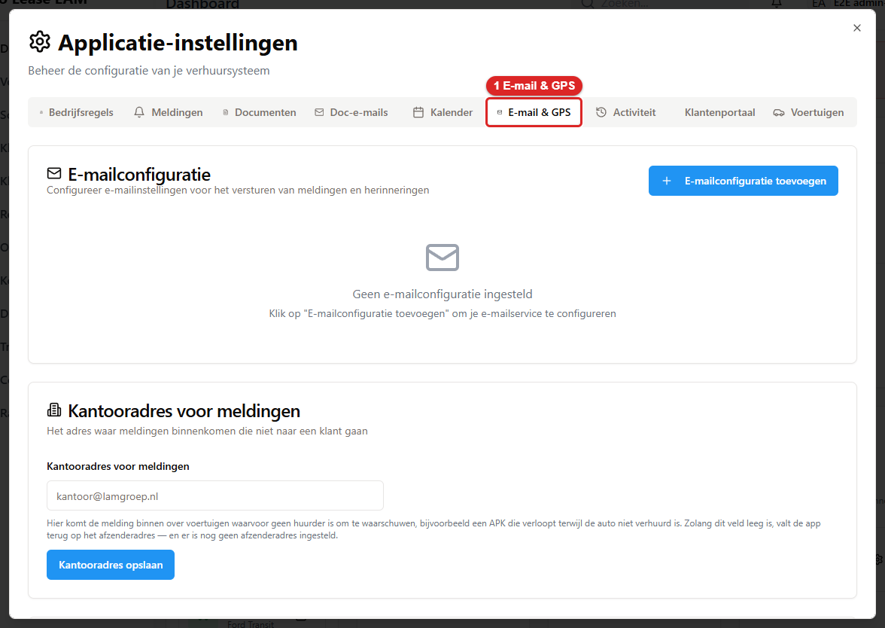
*Het tabblad **E-mail & GPS** (1) van de app-instellingen. Per doel staat er een mailserver, met
**Verbinding testen**.*

**De naam onder je mails.** De naam van het bedrijf staat in de mails. Je ziet hem onderaan de
herinneringen, in de portaalmails en als standaard afzendernaam. Die naam stel je niet hier in. Je
stelt hem in bij **App-instellingen → tabblad Bedrijfsregels → Bedrijfsnaam** (hoofdstuk 10,
paragraaf 10.3). Het is één naam voor alle mails. Zolang je niets opslaat, is het *Autolease Lam*.
Vul je hierboven bij een mailinstelling een **Afzendernaam** in? Dan gaat die voor op de
bedrijfsnaam.

Het opgeslagen wachtwoord wordt nooit meer getoond. Het veld is leeg als je de instelling later
weer opent. Dat is met opzet.

---

## 9.7 E-mailsjablonen

De teksten van de mails staan op twee plekken.

**Voor documentmail:** ga naar App-instellingen → tabblad **Doc-e-mails**. Daar staan
**Huurcontract E-mail**, **Schade Controle E-mail** en **Gecombineerde Documenten E-mail**. Elk
sjabloon heeft een Engelse en een Nederlandse versie. Elke versie heeft een **Onderwerp** en een
**Bericht**. Opslaan doe je met **E-mailsjablonen opslaan**. Hiervoor heb je het recht
**Instellingen beheren** nodig.

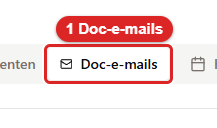
*Zo ziet het tabblad **Doc-e-mails** eruit. Klik erop. Daarna zie je de drie sjablonen voor documentmail.*

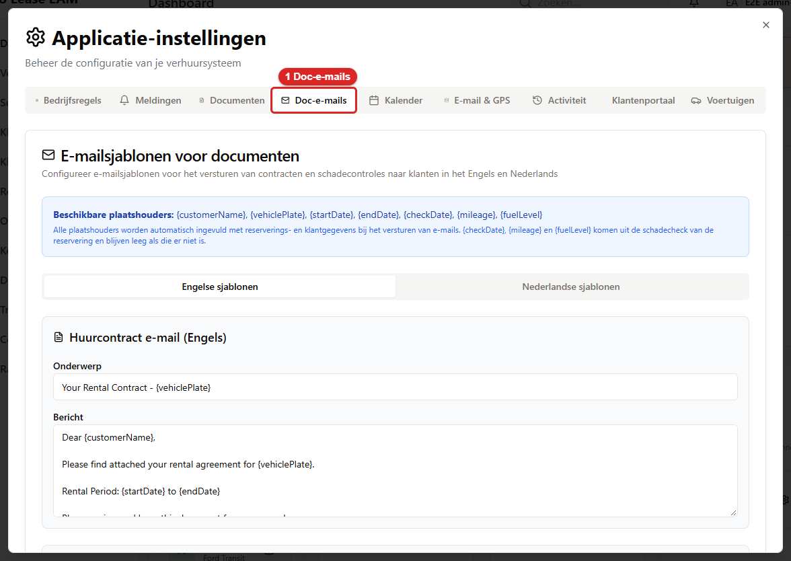
*Het tabblad **Doc-e-mails** (1). Hier staan de teksten van de mails waarmee je documenten
verstuurt.*

**Voor APK, onderhoud en vrije berichten:** ga naar **Communicatie → Sjabloonbouwer**. Klik op
**Nieuw sjabloon**. Vul een **Sjabloonnaam**, een **E-mailonderwerp** en een **Sjablooncategorie**
in. De categorie is APK-herinneringen, Onderhoud of Aangepast. Vul daarna de **E-mailinhoud** in.
Met **Placeholders invoegen** zet je velden in de tekst, zoals het kenteken of de naam van de
klant. Een placeholder is een plaatshouder. Dat is een vaste code die de app bij het versturen
vervangt door de echte gegevens. Hiervoor heb je het recht **E-mailsjablonen beheren** nodig.

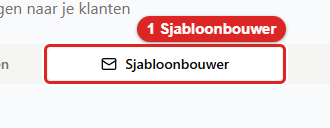
*Zo ziet het tabblad **Sjabloonbouwer** eruit. Klik erop. Daarna zie je links de lijst met sjablonen en rechts het formulier.*

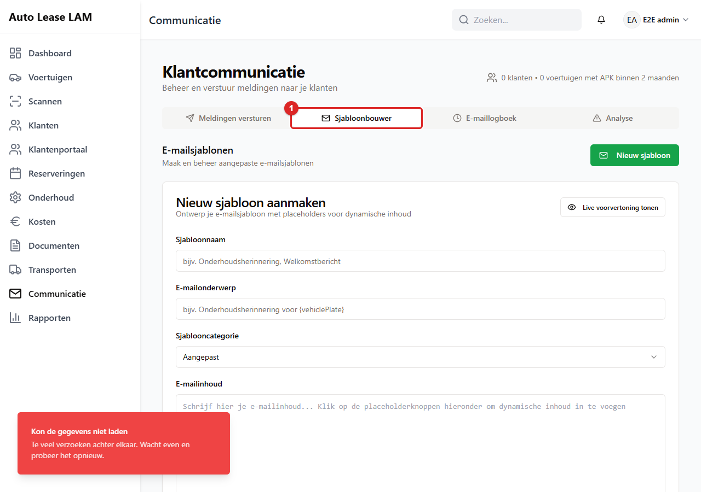
*Het tabblad **Sjabloonbouwer** (1). Links staat de lijst met sjablonen. Rechts staat het
formulier.*

De app vult de plaatshouders bij het versturen automatisch in. Daarvoor gebruikt de app de gegevens
van de reservering en de klant. Je mag ze met één accolade schrijven (`{customerName}`) of met
twee. Beide werken, in elk scherm.

**Welk sjabloon je kunt kiezen.** Verstuur je **APK-herinneringen**? Dan zie je de sjablonen van de
categorie APK en de algemene sjablonen. Bij **Onderhoud** zie je die van Onderhoud en de algemene.
Bij **Aangepast bericht** zie je alle sjablonen, behalve de vaste systeemsjablonen. De sjablonen
voor het klantenportaal zie je daar nooit. Dat zijn de sjablonen voor uitnodiging, wachtwoord,
onderhoud en wijziging. In de **Sjabloonbouwer** staan ze wel. Ze hebben een Nederlandse naam, zoals
*Portaal: uitnodiging*, en het label **PORTAAL**. In het filter hebben ze een eigen categorie. Je
kunt zo'n portaalsjabloon bewerken en opslaan. Een nieuw portaalsjabloon maak je er niet.

**Vaste sjablonen hernoemen kan niet.** De systeemsjablonen, zoals de portaalsjablonen, hebben in
de **Sjabloonbouwer** een grijs naamveld. Je kunt hun tekst wel aanpassen. De naam blijft zoals hij
is.

**Bewerken en dupliceren.** Dupliceren betekent: een kopie maken. Klik je op **Bewerken** of op
dupliceren bij een sjabloon? Dan scrolt de pagina naar de sjabloonbouwer. De cursor staat dan in
het naamveld. Een gedupliceerd sjabloon heet *<naam> (kopie)*. Na opslaan of verwijderen klopt de
lijst direct.

**Welke placeholders de app invult.** De bouwer biedt elf velden aan. De app vult ze bij het
versturen allemaal in, per ontvanger:

| Placeholder | Wat erin komt |
|---|---|
| `{customerName}` (**Klantnaam**) | De volledige naam van de klant |
| `{vehiclePlate}`, `{vehicleBrand}`, `{vehicleModel}` | Het kenteken, het merk en het model van het voertuig |
| `{apkDate}` (**APK-datum**) | De vervaldatum van de APK |
| `{companyName}` (**Bedrijfsnaam**) | De bedrijfsnaam uit de app-instellingen (10.3) |
| `{customerEmail}` (**E-mail klant**) | Het e-mailadres waarnaar dit bericht gaat |
| `{customerPhone}` (**Telefoon klant**) | Het telefoonnummer van de klant |
| `{reservationStart}`, `{reservationEnd}` (**Startdatum reservering**, **Einddatum reservering**) | De begindatum en de einddatum van de reservering waar het voertuig nu bij hoort. Geschreven als dd-mm-jjjj |
| `{maintenanceDate}` (**Onderhoudsdatum**) | Alleen bij de categorie **Onderhoud**. De laatste onderhoudsdatum van het voertuig. Is die er niet? Dan de datum van het onderhoud dat de auto nu dekt, of anders het onderhoud dat als eerste volgt |

Twee dingen om te weten:

- **Wat er niet is, blijft leeg.** Heeft een voertuig geen huurder? Dan heeft het ook geen
  reservering. Dan zijn `{reservationStart}` en `{reservationEnd}` leeg. Weet de app niets voor een
  placeholder? Dan verstuurt de app hem leeg. Er komt nooit code in de tekst. De voorvertoning zegt
  per ontvanger wat leeg blijft (*Leeg voor deze ontvanger: …*).
- **`{maintenanceDate}` hoort bij Onderhoud.** Bij de categorieën **APK-herinneringen** en
  **Aangepast** biedt de bouwer deze placeholder niet aan. De app vult hem daar ook niet in. De app
  gebruikt de laatste onderhoudsdatum van het voertuig. Is die er niet? Dan het onderhoud dat
  vandaag loopt. Is dat er ook niet? Dan het eerstvolgende onderhoud. De voorvertoning toont
  dezelfde datum als de mail.

Heeft een placeholder een typefout? Of staat het veld niet in de tabel? Dan vult de app het niet
in. Er komt een lege plek in de tekst. De voorvertoning waarschuwt daarvoor met *Deze placeholders
worden nergens ingevuld en gaan zo naar de klant: …*. Lees dat als: dit veld blijft leeg. Een zin
met een gat erin leest slecht. Verbeter het veld dus voordat je verstuurt.

---

## 9.8 Wat de klant hoort bij een wijziging van kantoor

Pas je iets aan een reservering aan? Dan hoeft de klant dat niet zelf te ontdekken. Bij deze drie
gebeurtenissen stuurt de app automatisch een melding in het portaal **en** een e-mail:

| Wat je doet | Onderwerp van de mail |
|---|---|
| De datums of het voertuig van een huur wijzigen | **Uw reservering is gewijzigd** |
| Een reservering annuleren of verwijderen | **Uw reservering is geannuleerd** |
| Een document genereren dat voor de klant bestemd is | **Nieuw document beschikbaar** |

Daarnaast bestaat de onderhoudsmail uit paragraaf 9.1. Die heeft zijn eigen zeven onderwerpen.

Drie dingen om te weten:

- Alleen een klant **met een portaalaccount** krijgt bericht. Heeft de klant geen account? Dan
  moet je nog steeds bellen of zelf mailen.
- Wijzig je twee keer kort achter elkaar hetzelfde? Dan krijgt de klant daar niet twee losse
  berichten over.
- Gaat het versturen mis? Dan mislukt jouw wijziging daar niet door. De wijziging staat gewoon
  opgeslagen. Controleer in dat geval het verzendoverzicht uit paragraaf 9.6.

Wat wel vanzelf gaat, staat in de tabel in 9.1: onderhoud, portaalaccounts en reacties op
portaalaanvragen. Een bekeuringsmail gaat alleen uit als jij hem start.

---

## 9.9 Facturen per e-mail ontvangen

De app heeft een eigen postvak: **fakturenapp@lamgroep.nl**. Elke factuur die daar binnenkomt,
leest de app zelf uit. De app boekt de factuur als kosten op het juiste voertuig. Vraag het
onderhoudsbedrijf om dit adres op elke factuur als extra ontvanger (CC) te zetten. Zelf een
factuur doorsturen vanaf een `@lamgroep.nl`-adres werkt hetzelfde.

### Wanneer boekt de app automatisch?

Alleen als alles klopt:

- De afzender staat in de lijst **Vertrouwde afzenders**. En de mail komt volgens jullie eigen
  mailserver ook echt van dat adres (zie **Instellen**, punt 4).
- Het is echt een factuur. Een offerte, herinnering of creditnota wordt nooit vanzelf geboekt.
- Er staat precies één kenteken op de factuur. Dat kenteken zit in de vloot.
- De factuur is niet eerder binnengekomen. Dat geldt ook als het factuurnummer anders is
  geschreven. Of als de naam van de leverancier anders is geschreven. Hetzelfde factuurnummer met
  hetzelfde totaalbedrag telt als dubbel.
- De regels zijn echt van de factuur gelezen. Ze tellen op tot het totaal (zonder of met btw), op
  hooguit 1 euro na.
- De factuurdatum is echt gelezen. Die ligt niet in de toekomst en is niet ouder dan 400 dagen.

Dan maakt de app één kostenregel per categorie, bijvoorbeeld Onderhoud en Remmen. De factuur
hangt als bon aan elke regel. En er komt een melding in de bel:
"Factuur van Garage Jansen geboekt op V-123-XB".

De bedragen worden geboekt **exclusief btw**. Staan de regels op de factuur inclusief btw? Dan
rekent de app ze terug naar exclusief btw. Daarvoor gebruikt de app het subtotaal, of het totaal
min de btw. Elk bedragveld en elke kolom in de app heet daarom **Bedrag (excl. btw)**.

> **Open het postvak niet met de hand.** De app haalt alleen ongelezen mail op. Lees je
> een factuurmail in de webmail of in Outlook, dan is hij gelezen en ziet de app hem niet
> meer. Moet je toch kijken, zet de mail dan daarna weer op ongelezen.

### Wat als de app twijfelt?

Dan wordt er **niets geboekt**. Op de pagina **Kosten** staat naast **Factuur scannen** de knop
**Ontvangen facturen**. Op die knop staat een getal zolang er facturen wachten. Klik erop. Je ziet
nu een venster met de tabbladen **Te controleren**, **Geboekt** en **Afgewezen**. De factuur staat
onder **Te controleren**. De reden staat erbij:

| Reden | Wat je doet |
| --- | --- |
| Onbekende afzender | Controleer of de factuur echt is. Zo ja: boek hem, en zet de afzender in de lijst. |
| Geen kenteken gevonden | Kies zelf het voertuig. |
| Meerdere kentekens | Kies het voertuig waar de kosten bij horen. Splitsen over voertuigen kan niet. Boek dan met de hand. |
| Kenteken niet in de vloot | Verkeerd gelezen, of niet van ons. Kies het voertuig of wijs af. |
| Mogelijk dubbel | Dezelfde factuur is al geboekt of wacht al. Meestal: afwijzen. |
| Geen factuur (offerte, herinnering of creditnota) | De app las geen factuur, maar iets anders. Klopt dat? Wijs dan af. Is het toch een factuur? Controleer dan de regels en boek hem hier. |
| Bedragen of datum kloppen niet | Kijk de regels en de factuurdatum na naast de factuur. Verbeter ze. |
| Uitlezen mislukt | Vul de leverancier, de datum en de regels zelf in. De factuur staat ernaast. |
| Geen bruikbare bijlage | De mail had geen PDF of foto. Vraag de factuur opnieuw op, of wijs af. |

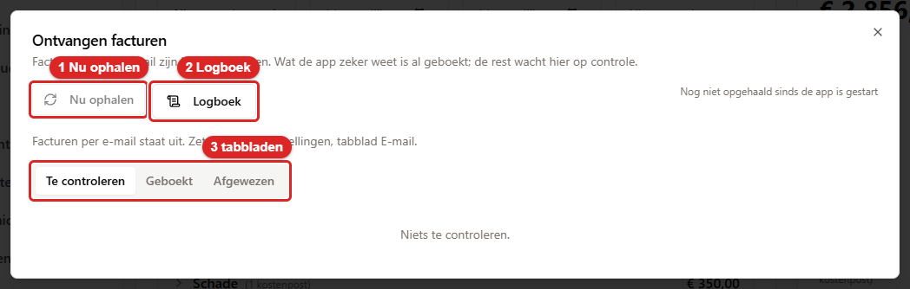
*Het venster **Ontvangen facturen**. 1 is **Nu ophalen**. 2 is **Logboek**. 3 zijn de tabbladen **Te
controleren**, **Geboekt** en **Afgewezen**.*

Klik op **Controleren**. Links staat de factuur. Rechts staat wat de app heeft gelezen. Pas aan wat
niet klopt. Kies het voertuig. Klik op **Boeken**. Hoort de factuur niet in de app? Klik dan op
**Afwijzen**. Je kunt er een korte notitie bij zetten. Twee knoppen helpen daarbij.
**Opnieuw uitlezen** laat de app de factuur nog een keer lezen. Dat is handig als een eerdere lezing
fout was. **Afzender vertrouwen** zet het afzenderadres op de lijst **Vertrouwde afzenders**. De
volgende facturen van die afzender worden dan vanzelf geboekt. Afgewezen en geboekte facturen
blijven terug te vinden in de andere twee tabbladen. Wijs je iets af met de reden
**Onbekende afzender** of **Geen bruikbare bijlage**? Dan gooit de app het bestand meteen weg. Dat
is meestal reclame of spam. Dat hoeft niet bewaard te blijven. Bij alle andere redenen blijft de
bijlage staan.

Iedereen kan naar dit adres mailen. Van onbekende afzenders leest de app hooguit twintig bijlagen
per dag uit. Wat daarna binnenkomt, komt wel in de lijst. Maar het wordt niet gelezen. Je ziet dan
"Niet uitgelezen: de daglimiet voor onbekende afzenders is bereikt". Maak de map **Verwerkt** in
de webmail af en toe leeg. Dan blijft het postvak overzichtelijk.

Een melding in de bel ("Factuur van ... wacht op controle") opent dit venster meteen.

### Instellen

**Instellingen, tabblad E-mail, kaart "Facturen per e-mail (inkomend)".** Hiervoor heb je het
recht *instellingen beheren* nodig.

1. Vul de IMAP-server, de gebruikersnaam en het wachtwoord van het postvak in. IMAP is de techniek
   waarmee de app het postvak leest. Deze gegevens staan in het beheerpaneel van de webhosting.
   Verbinding: TLS (poort 993).
2. **Map na verwerking**: `Verwerkt`. De app verplaatst elke afgehandelde mail naar die map. Zo
   blijft het postvak leeg. Werkt dat niet bij jullie provider? Probeer dan `INBOX.Verwerkt`. Je
   mag het veld ook leeg laten. De mail blijft dan staan als gelezen.
3. **Vertrouwde afzenders**: één per regel. Dat kan een adres zijn (`facturen@garage.nl`) of een
   heel domein (`@garage.nl`). Wil je zelf facturen doorsturen? Zet er dan ook `@lamgroep.nl` in.
4. **Naam van jullie mailserver (Authentication-Results)**: vul dit in vóór je de app aanzet.
   Zonder die naam kan de app niet controleren of een mail echt van de afzender komt. Een mail die
   alleen maar zegt dat hij van een vertrouwde afzender komt, wordt dan gewoon geboekt. De kaart
   waarschuwt daar in het geel voor zolang het veld leeg is.

   Zo vind je de naam. Stuur jezelf een testmail naar `fakturenapp@lamgroep.nl`. Open die mail in
   de webmail van de hosting. Laat de kopregels zien. Die heten ook wel headers, "originele
   bericht" of "broncode". Zoek de regel die begint met `Authentication-Results:`. Wat daar direct
   achter staat, tot aan de eerste puntkomma, is de naam. Bijvoorbeeld `mx.voorbeeld.nl`. Die naam
   vul je hier in. Staat die regel er helemaal niet? Vraag dan de hostingpartij of de mailserver
   DMARC- en SPF-controle stempelt.

   Let op. Soms verstuurt een vertrouwde afzender zijn post via een ander (sub)domein dan het
   domein in zijn afzenderadres. Zodra deze naam is ingevuld, wordt zo'n factuur mogelijk niet meer
   automatisch geboekt. Zulke facturen komen dan onder **Te controleren** te staan. De reden is
   "Onbekende afzender". Je boekt ze daar met één klik.
5. Klik op **Verbinding testen**. Je ziet "Verbonden, 3 ongelezen" of de foutmelding van de
   mailserver. Test je een andere server dan de opgeslagen server? Vul dan het wachtwoord opnieuw
   in. Het opgeslagen wachtwoord wordt alleen voor de opgeslagen server gebruikt.
6. Zet **Postvak automatisch uitlezen** aan. Klik op **Opslaan**. De app kijkt daarna elke
   15 minuten in het postvak. Die tijd kun je instellen. Met **Nu ophalen** hoef je daar niet op te
   wachten.

Wie de instellingen mag beheren, mag ook op **Nu ophalen** klikken. Die persoon ziet hier ook de
status. Voor het boeken en afwijzen van facturen heb je het recht *kosten beheren* nodig.

### Het logboek

Op dezelfde kaart staat naast **Nu ophalen** de knop **Logboek**. Die knop staat ook in het venster
**Ontvangen facturen**, naast **Nu ophalen**. Daar zie je hem als je **Kosten beheren** of
**Instellingen beheren** hebt. De knop opent een venster met drie tabbladen. Daar zie je wat de app
uit het postvak heeft gehaald. Je verandert er niets mee. Het is alleen om terug te kijken.

- **Facturen**. Elke bijlage die de app als factuur heeft behandeld. Het resultaat staat erbij:
  geboekt, te controleren met de reden, of afgewezen. Zo nodig staat de foutmelding erbij. Heb je
  het recht *kosten beheren*? Dan kun je de PDF openen. Je kunt ook doorklikken naar de lijst
  **Te controleren**.
- **Overige mail**. Mail waar geen factuur in zat. Bijvoorbeeld mail zonder bijlage, of met een
  offerte of herinnering. Die mail blijft gewoon staan waar hij stond. Er verandert niets aan hoe
  je hem afhandelt.
- **Ophaalrondes**. Elke keer dat de app het postvak heeft uitgelezen. Je ziet hoe lang het
  duurde. Je ziet of het automatisch ging, of dat iemand op **Nu ophalen** klikte. En je ziet wat
  het opleverde. De schakelaar **Alleen rondes met mail of fouten** staat aan. Zo zitten de
  kwartieren waarin niets binnenkwam je niet in de weg.

Het zoekveld in de eerste twee tabbladen zoekt op de server. Het zoekt dus ook in oude mail. Je
kunt zoeken op afzender, onderwerp, bestandsnaam, leverancier, factuurnummer, kenteken en
foutmelding. Een kenteken mag je met of zonder streepjes typen. Ophaalrondes worden 90 dagen
bewaard. Daarna ruimt de app ze vanzelf op. Rondes van vóór deze functie bestaan niet.

### Als het niet werkt

- **"Ophalen mislukt" bij de knop, of de melding "Postvak facturen onbereikbaar"**: het
  wachtwoord is gewijzigd, of de mailserver is onbereikbaar. Test de verbinding bij de
  instellingen.
- **Alles komt ter controle met "Uitlezen mislukt"**: de sleutel voor de AI-dienst
  (`GEMINI_API_KEY`) ontbreekt op de server. De instellingenkaart waarschuwt hiervoor.
- **Een factuur is op het verkeerde voertuig geboekt**: verwijder de kostenregels bij dat
  voertuig. Voer ze daarna met de hand opnieuw in bij het juiste voertuig. Dat doe je bij Kosten,
  met de knop **Kosten vastleggen**. Opnieuw scannen kan niet. De app kent de factuur al en weigert
  hem als dubbel.
- **Handmatig scannen zegt "Deze factuur is al geboekt"**: dat klopt dan ook. Dezelfde factuur is
  al via de mail of een eerdere scan verwerkt. Kijk in het tabblad **Geboekt**.
- **Een mail groter dan 30 MB**: die haalt de app niet op. De mail komt onder **Te controleren**
  met de reden "Geen bruikbare bijlage". Er staat een melding bij die dat zegt. Vraag de factuur
  opnieuw op, of boek hem met de hand.
