# 10. Beheer

Dit hoofdstuk gaat over het beheerdeel van de app. Daarin regel je de gebruikers en hun rechten.
Ook de instellingen staan er, de mailinstellingen, de back-ups, de geschiedenis per record en de
prullenbak. Een record is één ding in de app, bijvoorbeeld één klant of één reservering.

Bijna alles in dit hoofdstuk kan alleen een **beheerder**. Herken je de schermen hieronder niet?
Dan heb je geen beheerdersaccount. Dat is geen storing. De prullenbakken (10.6) zijn de uitzondering.
Die openen ook voor wie het vinkje **Prullenbak beheren** heeft.

---

## 10.1 Waar het beheer zit

Het beheer staat **niet** in het menu aan de linkerkant. Je vindt het via je eigen naam
rechtsboven in het scherm. Onder het kopje **Beheer** staan drie ingangen:

| Ingang | Waarvoor |
|---|---|
| **Gebruikers** | Accounts aanmaken, wijzigen en rechten geven |
| **Back-upbeheer** | Back-ups bekijken, maken, downloaden en terugzetten |
| **App-instellingen** | Alle instellingen van de app, ook de e-mail |

Daarboven staan **Profiel** (je eigen gegevens en wachtwoord), de taalknop en **Handleiding**. Die
zijn voor iedereen.

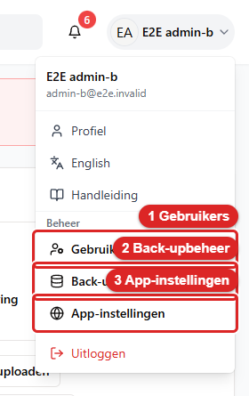
*Klik rechtsboven op je naam. Onder het kopje **Beheer** staan 1 **Gebruikers**, 2 **Back-upbeheer**
en 3 **App-instellingen**.*

---

## 10.2 Gebruikers en rechten

Kies **Gebruikers**. Je ziet nu het scherm **Gebruikersbeheer**. Heb je geen beheerdersaccount?
Dan staat er **Toegang geweigerd** met de tekst *"Je hebt geen toestemming voor deze functie."*

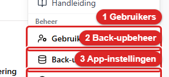
*Zo ziet de knop **Gebruikers** eruit. Klik erop. Daarna zie je het scherm Gebruikersbeheer.*

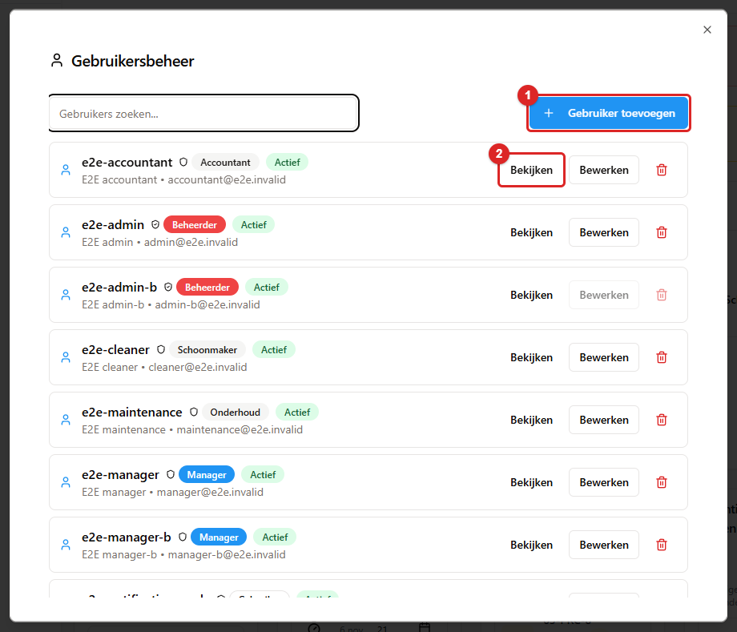
*Het venster **Gebruikersbeheer**. 1 is **Gebruiker toevoegen**. 2 is **Bekijken** bij een gebruiker.*

### Een gebruiker toevoegen

Klik op **Gebruiker toevoegen**. Je ziet nu in hetzelfde venster het formulier **Nieuwe gebruiker
toevoegen**:

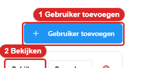
*Zo ziet de knop **Gebruiker toevoegen** eruit. Klik erop. Daarna zie je het formulier Nieuwe gebruiker toevoegen.*

| Veld | Toelichting |
|---|---|
| **Gebruikersnaam** | De naam waarmee iemand inlogt. Je kunt die later niet meer veranderen. |
| **Wachtwoord** | Bij een nieuwe gebruiker is dit verplicht. Laat je het leeg, dan staat er *Een wachtwoord is verplicht*. Het wachtwoord moet voldoen aan de wachtwoordregel hieronder. Bewerk je een bestaande gebruiker? Laat het veld dan leeg om het huidige wachtwoord te houden. |
| **Volledige naam** | De naam die overal in de app bij wijzigingen komt te staan. |
| **E-mail** | Het e-mailadres van de medewerker. |
| **Rol** | Zie hieronder. |
| **Actief** | *"Gebruiker kan inloggen wanneer actief"*. Zet je dit uit, dan kan de medewerker niet meer inloggen. Alles wat hij ooit deed, blijft wel zichtbaar in de geschiedenis. |
| **Prijzen verbergen** | *"Gebruiker ziet nergens in de app prijzen/geldbedragen"*. |

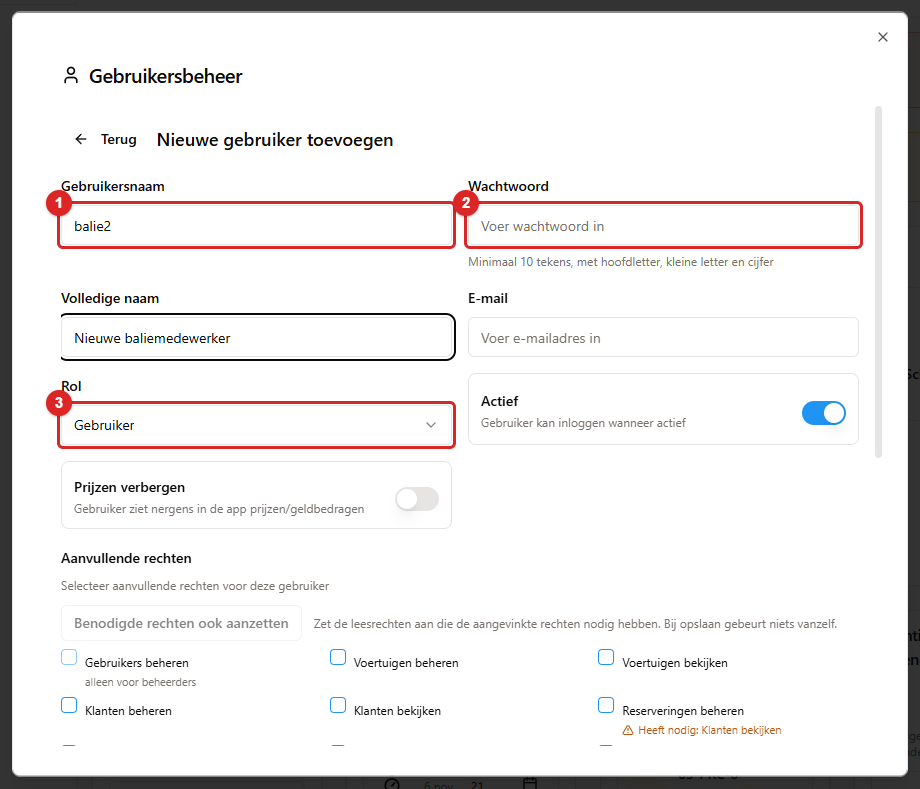
*Het formulier **Nieuwe gebruiker toevoegen**. 1 is **Gebruikersnaam**. 2 is **Wachtwoord**. 3 is
**Rol**. Daaronder staan **Actief** en **Prijzen verbergen**.*

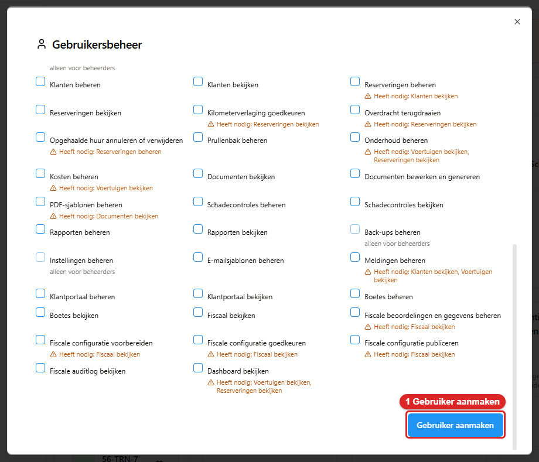
*Scrol naar beneden en klik op **Gebruiker aanmaken** (1).*

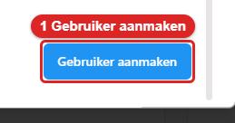
*Zo ziet de knop **Gebruiker aanmaken** eruit. Klik erop. Lukt het? Dan staat er Gelukt met de naam erbij.*

Je slaat op met **Gebruiker aanmaken** of **Gebruiker bijwerken**. Lukt het? Dan staat er **Gelukt**
met de naam erbij, bijvoorbeeld *Gebruiker "jan" is aangemaakt* of *Gebruiker "jan" is opgeslagen*.
Lukt het niet? Dan staat er in het Nederlands waarom. Bestaat de gebruikersnaam al, dan staat er
*Deze gebruikersnaam is al in gebruik* onder het veld. Soms klopt meer dan één veld niet. Bijvoorbeeld:
de gebruikersnaam is te kort en het wachtwoord ontbreekt. Dan staan alle meldingen tegelijk onder hun
veld, zoals *De gebruikersnaam moet minstens 3 tekens hebben* en *Vul een geldig e-mailadres in*. Je
hoeft ze niet één voor één op te lossen.

**De wachtwoordregel.** Elk wachtwoord van een medewerker heeft minimaal 10 tekens. Er moet een
hoofdletter in zitten, een kleine letter en een cijfer. Onder het wachtwoordveld staat de hint *Minimaal 10 tekens, met hoofdletter,
kleine letter en cijfer*. Voldoet het wachtwoord niet? Dan weigert de app met *Het wachtwoord voldoet niet
aan de regel: minimaal 10 tekens, met hoofdletter, kleine letter en cijfer*. Dezelfde regel geldt overal
waar iemand een wachtwoord kiest. Dus bij een nieuwe gebruiker, bij een wachtwoord dat een beheerder
voor een ander instelt, en bij het wijzigen van je eigen wachtwoord in je **Profiel** (10.1). Een
wachtwoord dat al bestond, blijft gewoon werken. De regel geldt alleen voor een nieuw wachtwoord.
Portaalaccounts van klanten hebben een eigen, kortere regel (hoofdstuk 3, paragraaf 3.7).

**Je eigen wachtwoord zet je niet in Gebruikersbeheer.** Je eigen wachtwoord wijzig je in je **Profiel**,
onder **Wachtwoord wijzigen**. Je vult daar ook je huidige wachtwoord in. Probeer je het via het formulier van je
eigen account? Dan weigert de app met *Je eigen wachtwoord wijzig je via je profiel, onder Wachtwoord
wijzigen*. Een nieuw wachtwoord voor een ander account (een reset) zet een beheerder wel hier.

**Een leeg wachtwoordveld verandert nooit iets.** Sinds oktober 2026 geldt dit bij het bijwerken van een
gebruiker: staat het veld leeg, dan blijft het wachtwoord zoals het was. Dat geldt ook als er alleen
spaties in staan. Tot dan kon een leeg veld het wachtwoord van het account leegmaken, of vervangen door spaties. Dat is
hersteld. Alleen een beheerder kan een nieuw wachtwoord voor een **andere** gebruiker instellen. Een
ander account dat het probeert, krijgt *Only an administrator can set another account's password*.

**Een medewerker die weggaat, zet je op inactief.** Verwijderen kan ook. Maar dan is de link
tussen zijn naam en zijn wijzigingen minder duidelijk. Het verwijderknopje achter je **eigen** regel
is grijs. Dat geldt ook voor het knopje achter de **laatste actieve beheerder**. Je kunt die knopjes niet aanklikken. Houd je de muis
erboven, dan staat er *Je kunt je eigen account niet verwijderen* of *Dit is de laatste actieve beheerder;
die kan niet worden verwijderd*. Een andere beheerder kun je wél verwijderen. Er moet daarna wel nog een
actieve beheerder overblijven. De bevestiging is: *Weet je zeker dat je gebruiker "…" wilt verwijderen?
Deze actie kan niet ongedaan worden gemaakt.*

**De laatste beheerder blijft beschermd.** Er moet altijd minstens één actieve beheerder zijn. Probeer je
de laatste actieve beheerder te verwijderen, op inactief te zetten of een andere rol te geven? Dan
weigert de app met *De laatste actieve beheerder kan niet worden verwijderd, gedeactiveerd of een andere
rol krijgen*. Wil je een nieuwe beheerder in plaats van de oude? Maak dan eerst de nieuwe aan.
Verwijder of degradeer daarna pas de oude. Degraderen betekent: een lagere rol geven.

**Verwijderen werkt nu ook bij wie ooit ingelogd of iets gedaan heeft.** Vroeger antwoordde de app *niet
gevonden* als je een account verwijderde dat al eens was gebruikt. Nu verdwijnt het account echt. De
wijzigingen die het deed, blijven in de geschiedenis staan. De gebruikersnaam staat er dan als tekst bij.

### Rollen

Er zijn zeven rollen: **Beheerder**, **Manager**, **Gebruiker**, **Schoonmaker**, **Kijker**,
**Accountant** en **Onderhoud**.

De rol **Beheerder** is bijzonder. Een beheerder mag alles, wat de vinkjes ook zeggen. Alleen een
beheerder kan een nieuwe beheerder aanmaken. Probeert iemand anders dat? Dan weigert de app met
*"Only an administrator can create an administrator account"*.

Voor de andere rollen bepalen de vinkjes wat iemand mag.

### De rechten (de vinkjes)

Onder **Aanvullende rechten** staat *"Selecteer aanvullende rechten voor deze gebruiker"*. Daaronder
staat een raster met alle rechten. Een raster is een tabel met vakjes. Je vinkt aan wat iemand nodig heeft.

*Het rechtenraster: elk vinkje is één recht. Onder een vinkje staat *Heeft nodig: …*. 1 is de knop
**Benodigde rechten ook aanzetten**.*

De belangrijkste:

| Vinkje | Wat het toestaat |
|---|---|
| Gebruikers beheren | Accounts en rechten wijzigen, en het activiteitenlog bekijken |
| Voertuigen bekijken / Voertuigen beheren | Het wagenpark bekijken / voertuigen toevoegen en wijzigen |
| Klanten bekijken / Klanten beheren | Klantgegevens bekijken / wijzigen |
| Reserveringen bekijken / Reserveringen beheren | Huren bekijken / boeken, wijzigen, ophalen en innemen |
| **Documenten bekijken** | Documenten openen, downloaden en afdrukken |
| **Documenten bewerken en genereren** | Contracten en schadechecks maken, opnieuw maken, uploaden, mailen en verwijderen |
| PDF-sjablonen beheren | De contract- en transportsjablonen wijzigen |
| Schadecontroles bekijken / beheren | Schadechecks bekijken / maken en de sjablonen wijzigen |
| Onderhoud beheren | Onderhoudsblokken plaatsen en afronden |
| Kosten beheren | Kosten vastleggen |
| Rapporten bekijken / beheren | De rapportenmodule |
| Boetes bekijken / beheren | De bekeuringen (knop **Bekeuringen** op de pagina Klantenportaal) |
| Klantportaal bekijken / beheren | Het klantenportaal |
| Meldingen beheren | APK- en onderhoudsherinneringen versturen |
| E-mailsjablonen beheren | De sjabloonbouwer onder Communicatie |
| Instellingen beheren | De app-instellingen, ook de mailinstellingen |
| Back-ups beheren | Back-ups maken en terugzetten |
| Kilometerverlaging goedkeuren | Een lagere kilometerstand mogen invoeren dan de vorige |
| Dashboard bekijken | Het dashboard |
| **Overdracht terugdraaien** | Een ophaling, een inname of een annulering ongedaan maken (hoofdstuk 5, paragraaf 5.14) |
| **Opgehaalde huur annuleren of verwijderen** | Een huur die al is opgehaald annuleren of verwijderen (5.15) |
| **Prullenbak beheren** | De prullenbakken openen, iets terugzetten en definitief verwijderen (10.6) |

**De drie vinkjes van oktober 2026 hebben een eenmalige start.** Het gaat om **Overdracht terugdraaien**,
**Opgehaalde huur annuleren of verwijderen** en **Prullenbak beheren**. Alle accounts met de
rol **Manager** hebben die één keer automatisch gekregen. Dat gebeurde bij de eerste start na de uitrol. Een beheerder heeft
ze altijd. Een manager die je daarna aanmaakt, krijgt ze niet vanzelf. Vink ze dan zelf aan. Wie alleen
**Reserveringen beheren** heeft, kan niet terugdraaien. Die kan ook geen opgehaalde huur annuleren. Zie
hoofdstuk 15, paragraaf 15.16.

**De twee documentvinkjes zijn met opzet gescheiden.** In een contract staan het adres, het
telefoonnummer en het rijbewijsnummer van de klant. Wie die gegevens niet nodig heeft, krijgt
geen van beide vinkjes. Wie contracten moet kunnen uitdraaien, krijgt **Documenten bewerken en
genereren**. Dat vinkje geeft automatisch ook het recht om te bekijken.

Klik op **Bekijken** bij een gebruiker. Onder **Rechten** zie je dan in één oogopslag wat hij wel
en niet mag. Bij een beheerder staat alles aangevinkt. Ook in je eigen **Profiel** staan je rechten.
Ze hebben daar dezelfde Nederlandse namen als hier, en niet meer de interne naam van het vinkje.

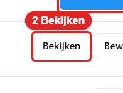
*Zo ziet de knop **Bekijken** eruit. Klik erop bij een gebruiker. Onder Rechten zie je dan wat hij wel en niet mag.*

**Bij elk vinkje staat wat het nodig heeft.** Een recht werkt vaak pas als een ander recht ook aanstaat.
Een voorbeeld: iemand heeft **Reserveringen beheren**, maar niet **Voertuigen bekijken** en **Klanten bekijken**.
Die ziet op het reserveringsscherm een lege lijst, of een melding dat de gegevens ontbreken. Daarom staat onder elk vinkje
een regel *Heeft nodig: Voertuigen bekijken, Klanten bekijken*. Dat zijn de rechten die het scherm nodig heeft.

- Staan de benodigde rechten al aan? Dan is de regel grijs.
- Mist er een? Dan is de regel oranje, met een waarschuwingsteken.
- Sommige rechten maken het scherm prettiger, maar zijn niet nodig. Die staan in de tekstballon als *Handig erbij: …*.
- Boven het raster staat de knop **Benodigde rechten ook aanzetten**. Die kijkt naar alles wat je al hebt
  aangevinkt. Hij vinkt in één keer de benodigde rechten aan die nog ontbreken. De knop is grijs als er niets ontbreekt. Bij
  het opslaan gebeurt er niets vanzelf. Jij beslist. Je kunt een recht daarna gewoon weer uitzetten.
- Een paar rechten zijn alleen voor beheerders: **Gebruikers beheren**, **Instellingen beheren** en **Back-ups
  beheren**. Bij een medewerker die geen beheerder is, staat daar *alleen voor beheerders*. Je kunt ze dan niet
  aanvinken. Stond zo'n vinkje al aan? Dan kun je het wel uitzetten. De server zelf blijft dezelfde
  controle doen. Dit is een hulp bij het kiezen, geen nieuwe beveiliging.
- Met de knop **Bekijken** zie je dezelfde regels. Je ziet ze dan alleen bij de rechten die het account heeft.

**Een wijziging van rechten werkt meteen.** De app leest de rechten bij elke handeling opnieuw. Stel: je
past de vinkjes van iemand aan terwijl hij is ingelogd. Dan ziet zijn scherm dat vanzelf. Hij hoeft
niet uit en weer in te loggen.

### Geweigerde pogingen: de balk op het dashboard

Soms probeert een medewerker iets te doen waarvoor hij geen recht heeft. De app weigert dat dan en schrijft
het op. Als **beheerder** zie je dat bij het inloggen. Dit geldt voor de rol Beheerder, niet voor iedereen met het vinkje **Gebruikers beheren**.
Bovenaan het **Dashboard** staat dan een balk met *Sinds je vorige inlog (<datum>)
probeerden 3 medewerkers iets waarvoor ze geen recht hebben*. Bij één medewerker staat er *probeerde 1 medewerker
iets waarvoor die geen recht heeft*.

- Klik op **Bekijken**. Je ziet nu het venster **Geweigerde pogingen**. Daar staat *Wat medewerkers probeerden sinds je
  vorige inlog (<datum>) en niet mochten.* Per regel staan **Wie**, **Wat** (een scherm, gegevens ophalen
  of wijzigen), het **Recht dat ontbrak** en **Wanneer**.
- Met het kruisje sluit je de balk voor de rest van die sessie. Een sessie is de tijd tussen inloggen en uitloggen. Er is geen balk als er niets te melden is.
  Er is ook geen balk bij je allereerste inlog. Er is dan nog geen vorige inlog om mee te vergelijken.
- Dezelfde pogingen staan in het activiteitenlog (10.5) onder de actie *access.denied*, met de status
  *mislukt*. Er gaat geen e-mail uit.
- Dezelfde poging van dezelfde medewerker op dezelfde plek binnen vijf minuten telt als één. Ook één
  medewerker die heel veel pogingen doet, vult het log niet. Na 50 pogingen in een kwartier
  schrijft de app één regel *Meer geweigerde pogingen zijn niet apart vastgelegd*. Daarna schrijft hij niets meer tot
  het kwartier om is. Zijn er meer regels dan het venster toont? Dan staat er *Alleen de nieuwste … van …
  pogingen worden getoond.*

**Wat als "poging" telt.** Een poging kan ook een onderdeel van een scherm zijn. De medewerker mag dat scherm
wel openen, maar één stukje ervan niet zien. Bijvoorbeeld een tegel op het scherm waarvoor het
bijbehorende recht ontbreekt. De medewerker deed dan niets bewust, en toch staat het erbij. Stel: één persoon
heeft een rij pogingen die steeds hetzelfde onderdeel raken. Dat wijst dan eerder op een recht dat je
vergat aan te vinken (zie *Bij elk vinkje staat wat het nodig heeft*). Het wijst niet op iemand die ergens
rondsnuffelt.

---

## 10.3 App-instellingen

Kies **App-instellingen**. Je ziet nu het scherm **Applicatie-instellingen**. Daar staat *"Beheer de
configuratie van je verhuursysteem"*. Configuratie betekent: de instellingen. Het scherm heeft negen tabbladen:

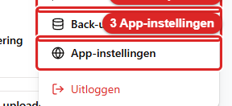
*Zo ziet de knop **App-instellingen** eruit. Klik erop. Daarna zie je het scherm Applicatie-instellingen.*

| Tabblad | Wat je er instelt |
|---|---|
| **Bedrijfsregels** | Standaardwaarden voor een verhuring, het brandstofbeleid, het toltarief per kilometer, het depotadres, de tijdzone van het kantoor en de bedrijfsnaam voor alle mails |
| **Meldingen** | Hoeveel dagen van tevoren een APK-, garantie- of onderhoudsherinnering verschijnt |
| **Documenten** | Factuur- en contractinstellingen, en het **Startcontractnummer** |
| **Doc-e-mails** | De teksten van de mails waarmee je documenten verstuurt |
| **Kalender** | Feestdagen, geblokkeerde datums, de onderhoudskalender en de onderhoudsintervallen |
| **E-mail & GPS** | De mailservers en de GPS-instellingen. Zie hoofdstuk 9 |
| **Activiteit** | Het **Activiteitenlog**: wie heeft wat gewijzigd, en wanneer |
| **Klantenportaal** | De instellingen van het portaal |
| **Voertuigen** | De kaart **RDW-voertuigtypes**: het wagenpark laten nalopen door de RDW (hoofdstuk 4, paragraaf 4.13) |

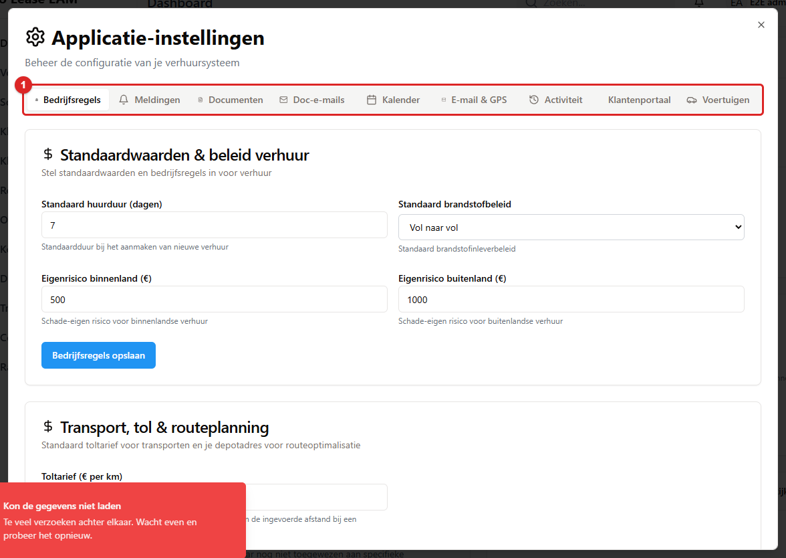
*Het venster **Applicatie-instellingen**: bovenaan de negen tabbladen (1). Klik op een tabblad om
die instellingen te zien.*

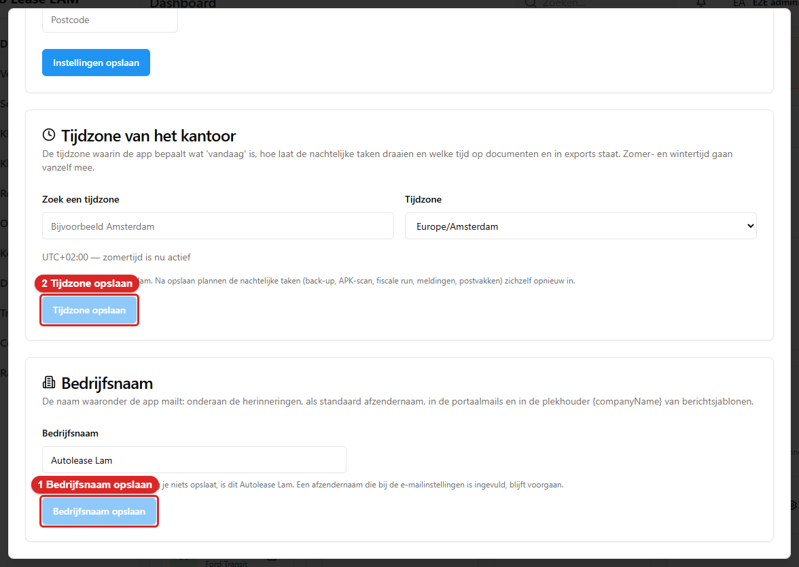
*Het tabblad **Bedrijfsregels**. 1 is **Bedrijfsnaam opslaan**. 2 is **Tijdzone opslaan**.*

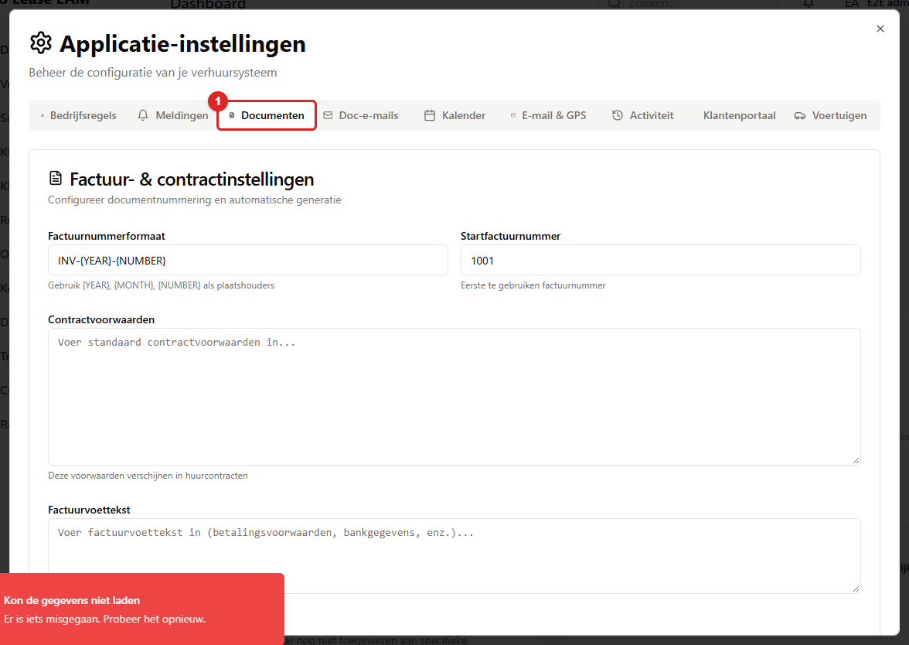
*Het tabblad **Documenten** (1) met het **Startcontractnummer**.*

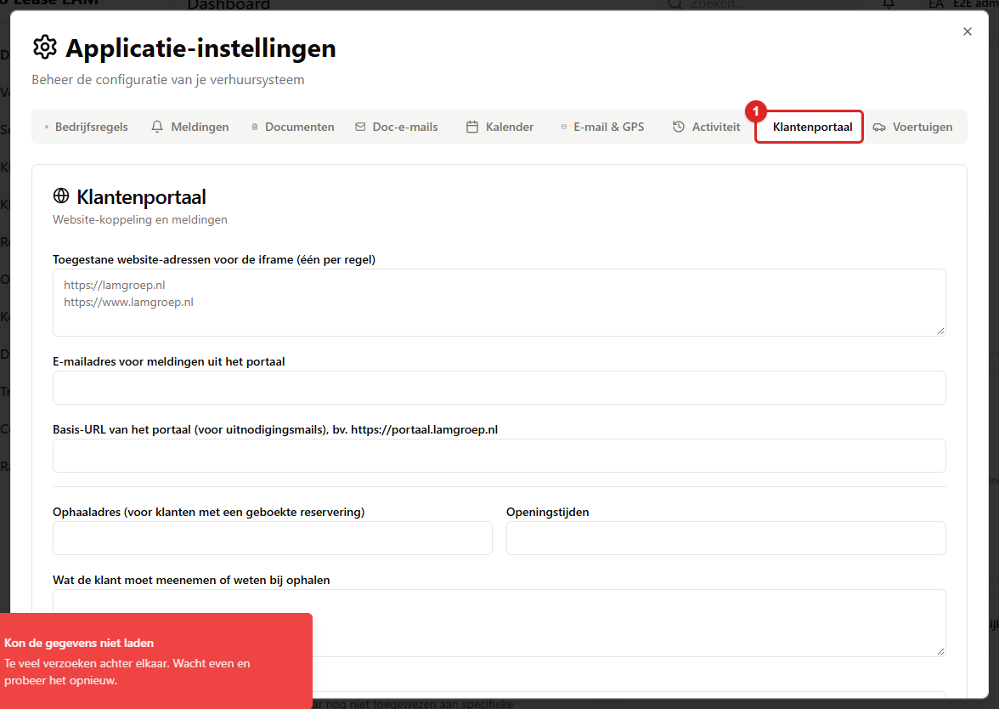
*Het tabblad **Klantenportaal** (1): de instellingen van het portaal en de bekeuringen.*

Vijf instellingen komen vaak terug:

- **Eigen risico** (tabblad **Bedrijfsregels**). Er zijn twee soorten: auto en bus.
  - **Eigen risico auto binnenland (€)** en **Eigen risico auto buitenland (€)**. Standaard 750 en 1500.
  - **Eigen risico bus binnenland (€)** en **Eigen risico bus buitenland (€)**. Standaard 1500 en 2500.
  - Klik daarna op **Bedrijfsregels opslaan**.
  - Of een auto een bus is, staat op de voertuigkaart bij **Eigen risico** (hoofdstuk 4).
  - Een klant kan een eigen bedrag hebben (hoofdstuk 3). Dat gaat voor op dit algemene bedrag.
  - Stond hier al een bedrag opgeslagen, bijvoorbeeld 500? Dat blijft staan. Pas het zelf aan als het
    750 moet zijn.

- **Startcontractnummer**. Daarbij staat *"Dit vormt de basis voor automatisch gegenereerde
  contractnummers"*. Daaronder staat **Volgend contractnummer**. Je slaat op met
  **Startnummer opslaan**. Wil je één keer van de reeks afwijken? Gebruik dan **Slimme override**.
  Je klikt op **Override instellen** en later op **Override wissen**. Vul je een onmogelijk getal in? Dan
  weigert de app met *"Must be a whole number between 1 and 2147483647"*.
- **Toltarief (€ per km)**. Daarbij staat *"Wordt gebruikt om een tolkost voor te stellen op basis van de
  ingevoerde afstand bij een transport"*.
- **Tijdzone van het kantoor** (tabblad **Bedrijfsregels**). Dit is de tijdzone waarin de app bepaalt wat
  "vandaag" is. De app bepaalt er ook mee hoe laat de nachtelijke taken draaien. En welke tijd op documenten en in exports staat.
  Zomer- en wintertijd gaan vanzelf mee. Standaard staat hij op *Europe/Amsterdam*. Voor een
  kantoor in Nederland is dat goed. Zoek een andere zone met **Zoek een tijdzone**. Kies hem bij **Tijdzone**.
  De kaart zegt erbij of de zomer- of wintertijd nu actief is. Klik daarna op **Tijdzone opslaan**. Je krijgt
  *De app rekent nu met <zone>.* Na het opslaan plannen de nachtelijke taken zichzelf opnieuw in de nieuwe zone.
  Dat zijn de back-up, de APK-scan, de fiscale run, de meldingen en de postvakken. Zet de tijdzone alleen om als het
  kantoor echt verhuist. Kies je per ongeluk een andere? Dan lopen datums en tijden een of meer uren
  verkeerd. Lukt het opslaan niet, dan staat er *De tijdzone kon niet worden opgeslagen.*

  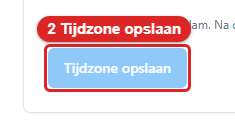
  *Zo ziet de knop **Tijdzone opslaan** eruit. Klik erop nadat je de tijdzone hebt gekozen. Daarna zie je de melding dat de app met de nieuwe zone rekent.*
- **Bedrijfsnaam** (tabblad **Bedrijfsregels**). Dit is de naam waaronder de app mailt. Die naam staat onderaan de
  herinneringen, als standaard afzendernaam, in de portaalmails en in de plekhouder `{companyName}` van
  berichtsjablonen (hoofdstuk 9). Het is één naam voor alle mails. Zolang je niets opslaat, is dit *Autolease
  Lam*. Vul de naam in en klik op **Bedrijfsnaam opslaan**. Je krijgt *De bedrijfsnaam is opgeslagen.*
  Een naam van meer dan 100 tekens wordt geweigerd. Een naam met een regeleinde ook. Je ziet dan *Vul een naam in van
  maximaal 100 tekens, zonder regeleinden.* Heb je bij de e-mailinstellingen een afzendernaam
  ingevuld? Die gaat voor op de bedrijfsnaam. Mails aan portaalklanten zeiden vroeger *Lam Groep*. Sommige portaalsjablonen
  hebben nog de oude standaardtekst. Die gaan de bedrijfsnaam volgen zodra je hem **voor het eerst
  opslaat**. Tot dan blijven die mails *Lam Groep* zeggen. Wil je dat de portaalmails ook *Autolease
  Lam* zeggen, of een andere naam? Sla dan één keer de bedrijfsnaam op. Een portaalsjabloon dat je zelf
  hebt aangepast, houdt altijd zijn eigen tekst. De klant ziet in het portaal ook meldingen (het belletje). Die
  volgen dezelfde regel. Ze zeggen *Lam Groep* totdat je de bedrijfsnaam voor het eerst opslaat. Daarna volgen ze deze
  instelling. Een melding die al was aangemaakt, houdt zijn oude tekst.

  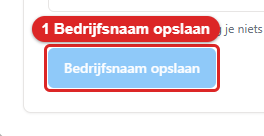
  *Zo ziet de knop **Bedrijfsnaam opslaan** eruit. Vul eerst de naam in en klik dan op deze knop. Daarna zie je de melding dat de bedrijfsnaam is opgeslagen.*

**Wat je typt, blijft staan.** Wissel je tijdens het invullen van tabblad? Dan raak je niets kwijt.
Een tabblad dat je eenmaal hebt geopend, houdt wat je erin hebt ingevuld. Dat geldt ook voor de onderdelen met een
eigen formulier: **Klantenportaal**, de fiscale check, de CJIB-koppeling en de filters van de
activiteit. Sluit je de instellingen? Dan is alles wat je niet hebt opgeslagen natuurlijk wel weg.

**Het klantenportaal en de bekeuringen.** Onder het tabblad **Klantenportaal** staat het veld
**Standaard administratiekosten per bekeuring (€)**. Daarbij staat *Dit bedrag staat bij een nieuwe bekeuring alvast
ingevuld en komt bovenop het boetebedrag. Vul 0 in voor geen kosten.* Een negatief of leeg bedrag
wordt geweigerd met *Vul een bedrag van 0 of hoger in, bijvoorbeeld 12,50.* Het bedrag blijft nu ook
echt bewaard. Vroeger werd het bij elke keer opslaan van dit formulier op 0 gezet. De bekeuringen zelf
staan achter de knop **Bekeuringen** bovenaan de pagina **Klantenportaal** (hoofdstuk 2, paragraaf 2.6). Een eigen menu-item is er niet meer.

**De CJIB-koppeling** staat bij de bekeuringen, achter **CJIB-importen**. Daarbij staat *Het CJIB levert beschikkingen als XML- of CSV-bestand op een beveiligde
FTPS-server*. De schakelaar **Automatisch ophalen
aan** kun je pas aanzetten als er een server (**Server (host)**) is ingevuld. Zonder server zijn ook
**Verbinding testen** en **Nu ophalen** grijs. Onder de knoppen staat waarom. In het overzicht
lees je de status als een zin: *Automatisch ophalen elke 15 min* of *Automatisch ophalen staat uit*.
Mislukt de test? Dan staat er *Verbinding mislukt* met een Nederlandse zin als *De verbinding met het
CJIB is mislukt. Controleer de instellingen en probeer het opnieuw.* De technische tekst van de
FTPS-server zelf zie je niet meer in het scherm. Een beheerder vindt hem in het serverlog.

Zonder het recht **Instellingen beheren** kun je de instellingen wel openen, maar niet opslaan.
De app antwoordt dan:

> *Not authorized. One of these permissions required: manage_settings*

---

## 10.4 Back-ups

Kies **Back-upbeheer**. Je ziet nu het scherm **Back-up & Herstel**. Een back-up is een reservekopie van alle gegevens.

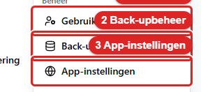
*Zo ziet de knop **Back-upbeheer** eruit. Klik erop. Daarna zie je het scherm Back-up & Herstel.*

### Wat er 's nachts gebeurt

De app maakt **elke nacht om 02:00 uur** (Nederlandse tijd) automatisch twee bestanden:

1. **De database**. Dat zijn alle gegevens: voertuigen, klanten, reserveringen, documentregels,
   instellingen, gebruikers.
2. **De geüploade bestanden**. Dat is de map met de PDF's en de scans die in de app staan.

De broncode van de app wordt níét meegenomen in de nachtelijke back-up. Die staat elders.

De bestanden worden weggeschreven in mappen per jaar, maand en dag. In het scherm staat bij
**Back-uplocatie:** alleen dat de map *vast ingesteld* is via de omgevingsvariabele BACKUP_PATH. Het
pad zelf wordt om veiligheidsredenen niet meer getoond. Wil je weten waar de bestanden staan? Vraag
het dan aan de beheerder van de server.

Draaide de app om 02:00 uur niet? Dan wordt de back-up ingehaald. Vijf minuten na het opstarten
maakt de app er alsnog een. Dat doet hij alleen als de laatste geslaagde back-up ouder is dan een dag.

**Hoelang blijven ze staan?** De app ruimt zelf op. Hij houdt altijd van elk soort de nieuwste
back-up. Verder geldt: alles van de laatste twee weken blijft staan. Daarna blijven nog de
zondagsback-ups staan. Na acht weken blijven alleen die van de eerste van de maand staan. Wat ouder is dan een jaar,
wordt opgeruimd. Een back-up die je zelf hebt geüpload, wordt nooit opgeruimd.

### Controleren of er een back-up is

Bovenin het scherm staan drie regels. Lees die regelmatig:

- **Laatste back-up**: datum en tijd, of **Nooit** als er nog geen is.
- **Volgende back-up**: **Vannacht om 02:00 uur**.
- **Laatste back-upfout:** staat er alleen als de laatste poging misging. Je ziet dan een zin in het
  Nederlands. Bijvoorbeeld *de schijf van de server is vol* of *de server kan de database niet
  bereiken*. Bij een fout die de app niet kent, staat er dat de reden in het serverlog staat.

Is de laatste geslaagde back-up ouder dan een dag? Of is er nog nooit een geslaagd? Dan staat er
bovenaan een gele waarschuwing: *De laatste geslaagde back-up is ouder dan een dag.* Soms is de datum van een back-up
niet te lezen. Dan staat er **Onbekende datum** in plaats van een datum in 1970.

Daaronder staan de **Recente automatische back-ups**. Die zijn gesplitst in **Database-back-ups** en
**Bestand-back-ups**.

Is er langere tijd geen geverifieerde back-up gemaakt? Geverifieerd betekent: gecontroleerd. Dan verschijnt er ook op het dashboard
een balk: **Geen geverifieerde back-up in 30 uur** met *"Open Back-up & Herstel om er nu een uit
te voeren."* Negeer die balk niet.

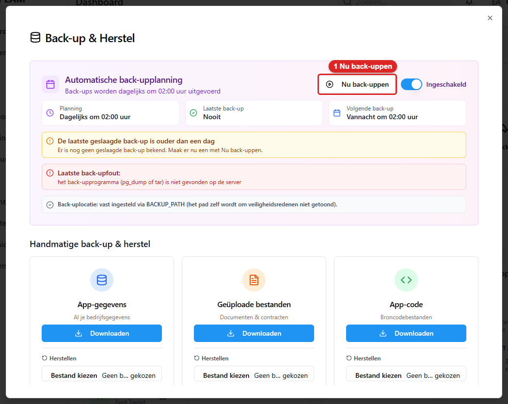
*Het venster **Back-up & Herstel**: bovenaan de laatste en de volgende back-up, 1 is **Nu
back-uppen**.*

Met **Nu back-uppen** maak je er meteen een, los van het schema. Mislukt dat? Dan staat er een
Nederlandse zin, zoals *De back-up is mislukt.* Loopt er al een back-up, dan staat er *Er loopt al een
back-up. Wacht tot die klaar is.* De schakelaar
**Ingeschakeld / Uitgeschakeld** zet het nachtelijke schema aan of uit.

### Downloaden

Achter elke back-up staat **Downloaden**. Daarmee haal je het bestand naar je eigen computer.
Bewaar het op een andere plek dan de server. Het downloaden begint meteen. De app maakt het
bestand tijdens het downloaden. Daardoor blijft ook een groot archief niet eerst minutenlang hangen. Is
het bestand klaar? Dan meldt de app **Bestand gemaakt** met de naam en de grootte. Mislukt het?
Dan staat er *De back-up kon niet worden gedownload.* Je ziet geen pad of technische tekst van de server.

Onder **Handmatige back-up & herstel** staan drie kaarten: **App-gegevens** ("Al je
bedrijfsgegevens"), **Geüploade bestanden** ("Documenten & contracten") en **App-code**
("Broncodebestanden"). Zie hoofdstuk 12 voor wat daar op dit moment wel en niet van werkt.

### Herstellen — waarom dit een beheerdershandeling is

Herstellen betekent: **alle gegevens van nu worden vervangen door de gegevens uit de back-up.**
Alles wat je sinds die back-up hebt ingevoerd, is daarna weg. Dus reserveringen, ophalingen, klanten en contracten.
Dat is geen "terugzetten van één foutje". Daarvoor gebruik je de prullenbak
(paragraaf 10.6) of de geschiedenis (paragraaf 10.5).

De app maakt het met opzet moeilijk. Klik je op **Herstellen**? Dan verschijnt:

> **Waarschuwing: deze back-up herstellen**
> *"Dit overschrijft de huidige actieve database met de inhoud van &lt;bestandsnaam&gt;. Er wordt
> automatisch een verse back-up van de huidige status gemaakt en geverifieerd voordat het
> herstel start, maar het herstel zelf kan niet ongedaan worden gemaakt."*
> *"Typ de exacte bestandsnaam hieronder ter bevestiging:"*

De knop **Ja, herstel deze back-up** blijft grijs tot je de bestandsnaam letterlijk hebt
overgetypt. Dat is met opzet. Zo kun je niet per ongeluk op de verkeerde regel klikken.

**Voordat er ook maar iets wordt overschreven, maakt de app eerst een veiligheidskopie van de
huidige gegevens. Daarna controleert de app of die kopie deugt.** Lukt dat niet? Dan gaat het herstel niet
door:

> *Refusing to restore: could not take a verified safety backup of the current data first …
> Restoring now would overwrite live data with no way back.*

Gaat het wel door? Dan staat de naam van die veiligheidskopie in de bevestiging: *"Een back-up
van je vorige gegevens is opgeslagen als &lt;bestandsnaam&gt;."* **Schrijf die naam op.** Dat is je
weg terug.

Na het herstellen moet je je browser vernieuwen. Daarna log je opnieuw in.

### Een back-up die niet deugt wordt geweigerd

De app controleert het bestand vóór het herstel. Deugt het niet, dan weigert de app met uitleg. De app stopt dus niet halverwege.
De meldingen beginnen allemaal met *Refusing to restore:* en eindigen met
*Nothing was changed*. Er is dan dus niets kapotgegaan:

| Melding | Wat het betekent |
|---|---|
| *the dump is only 45 bytes — it is empty or truncated* | Het bestand is leeg of half gedownload |
| *that file does not look like a PostgreSQL dump* | Je hebt het verkeerde bestand gekozen |
| *the dump does not end with the "PostgreSQL database dump complete" marker* | Het bestand is afgebroken |
| *the archive is corrupt or truncated and could not be decompressed* | Het bestand is beschadigd |
| *this archive restores into the database "X", not "Y"* | Deze back-up hoort bij een andere omgeving |
| *the archive contains N entries that would be written outside the uploads directory* | Het bestandsarchief bevat iets wat er niet in hoort |

Gaat het herstel zelf onderweg mis? Dan wordt alles teruggedraaid: *"The restore failed and was
rolled back; the database was not changed."*

---

## 10.5 Geschiedenis per record

De app houdt bij wie wat wanneer veranderde. Dat doet hij bij elke reservering, elk voertuig, elke klant,
elke chauffeur, elke kostenpost en elk document.

Je vindt het onder het kopje **Geschiedenis**:

- **Reservering**: onderaan het venster van de reservering.
- **Voertuig**: het tabblad **Geschiedenis**.
- **Klant**: het tabblad **Geschiedenis**.
- **Chauffeur**: onderaan het venster van de chauffeur (hoofdstuk 3, paragraaf 3.6).
- **Kostenpost**: onderaan het venster van de kostenpost.
- **Document**: de knop **Geschiedenis** bij het document op de voertuigkaart (hoofdstuk 4,
  paragraaf 4.10). Hier staat ook wie het document heeft bekeken, gedownload of afgedrukt.

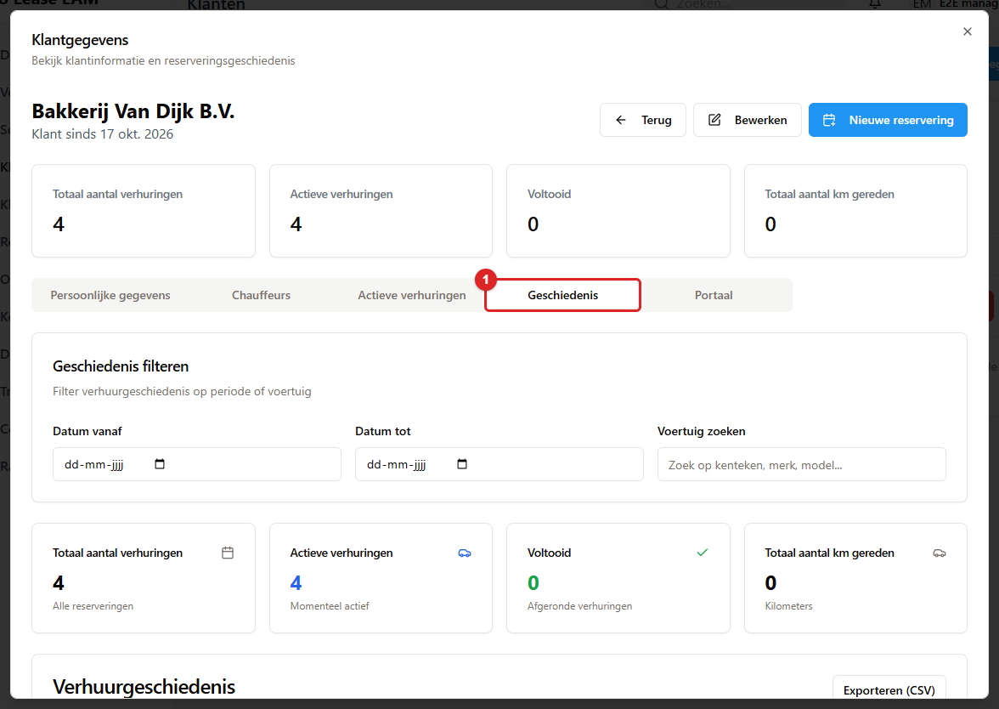
*Het tabblad **Geschiedenis** (1) bij een klant. Per regel staat wat er gebeurde, wie het deed en wanneer.*

Onder het kopje staat: *"Elke wijziging aan dit record, met wie het deed en wanneer."*

Per regel zie je:

- **wat er gebeurde**, in woorden. Bijvoorbeeld *Reservering aangemaakt*, *Ophalen*, *Inleveren*,
  *Overdracht teruggedraaid*, *Status gewijzigd*, *Klant aangemaakt*, *Document gemaild*,
  *Kilometerstand gewijzigd*, *definitief verwijderd* en *hersteld*. Een actie die de app niet kent,
  staat er met de ruwe naam. De technische code zie je als je de muis erop zet.
- **wie** het deed. Dat is de gebruikersnaam, of **Systeem** als de app het zelf deed.
- **wanneer**, op de minuut.
- **welk veld** veranderde. De oude waarde staat doorgestreept en de nieuwe staat erachter. Een leeg veld
  staat als `—`. Een aan/uit-veld staat als `ja` of `nee`.

Is er niets veranderd? Dan staat er: *"Er is nog niets gewijzigd aan dit record."*

Mag je de geschiedenis van dit soort record niet zien? Dan staat er: *"Je hebt geen rechten om de
geschiedenis van dit record te bekijken."* Je hebt daarvoor het beheerrecht van dát soort record
nodig. Dus **Reserveringen beheren** voor een reservering, **Voertuigen beheren** voor een
voertuig en **Klanten beheren** voor een klant.

**Gebruik dit bij elke discussie.** "Wie heeft die datum veranderd?" en "wanneer is dat
contractnummer gewijzigd?" staan hier gewoon in.

### Het volledige activiteitenlog

Een beheerder ziet alles bij elkaar. Ga naar **App-instellingen → tabblad Activiteit → Activiteitenlog**.
Daar staat *"Wie heeft wat gewijzigd, en wanneer."* Je filtert op **Zoeken** (kenteken, klant, veld of
actie), **Gebruiker**, **Actie**, **Soort**, **Vanaf** en **Tot en met**. Met
**Filters wissen** wis je alles. De kolommen zijn **Wanneer**, **Wie**, **Actie**, **Object** en
**Wijzigingen**. Er staan 50 regels per pagina. Lange wijzigingen staan op één regel met **+n meer**.

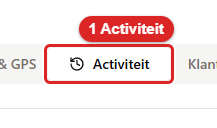
*Zo ziet het tabblad **Activiteit** eruit. Klik erop in de App-instellingen. Daarna zie je het Activiteitenlog.*

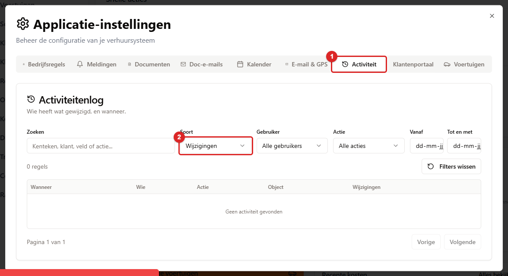
*Het **Activiteitenlog** op het tabblad **Activiteit** (1). 2 is het filter **Soort**.*

**Het filter Soort.** Het log bewaart niet alleen wijzigingen. Het bewaart ook elk scherm en elk venster dat
een medewerker opent (*Scherm geopend*, *Venster geopend*, met de naam uit het menu). Om het
overzicht te bewaren staat het filter **Soort** standaard op **Wijzigingen**. Kies **Schermen en
vensters** om te zien wie welk scherm opende. Of kies **Alles**.

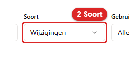
*Zo ziet het filter **Soort** eruit. Kies hier Schermen en vensters of Alles. Standaard staat het op Wijzigingen.*

**Bekijken, afdrukken en exporteren staan er ook in.** Wie een contract opent, krijgt een regel in het log.
Dat geldt ook voor wie een schadeformulier afdrukt, een sleutellabel print of een CSV exporteert. Je ziet dan
*bekeken*, *gedownload*, *afgedrukt* of *geëxporteerd*.

**Nachtelijke taken heten systeem.** De RDW APK-scan, de servicebeurt-scan, de fiscale nachtrun en
de postvakken (CJIB, facturen) schrijven per run één regel. De gebruiker is dan *systeem*. De
aantallen staan erbij. Een mislukte run heeft de status *mislukt*.

---

## 10.6 De prullenbakken

Wat je verwijdert, is niet weg. Het gaat naar de prullenbak van het scherm waar je het verwijderde. Daar kun je
het terughalen. Je kunt het daar ook voorgoed verwijderen.

**Acht prullenbakken, één per scherm.** Sinds oktober 2026 is er niet meer één gedeeld venster met
alles door elkaar. Elk scherm heeft zijn eigen prullenbak, met alleen zijn eigen soort:

| Scherm | De knop | Wat erin staat |
|---|---|---|
| **Voertuigen** | **Verwijderde voertuigen** | Voertuigen (label **Voertuig**), met hun reserveringen, documenten en kosten |
| **Klanten** | **Verwijderde klanten** | Klanten (**Klant**), met hun chauffeurs en portaalgegevens |
| **Reserveringen** (de kalender) | **Verwijderde reserveringen** | Reserveringen (**Reservering**) |
| **Onderhoud** | **Verwijderd onderhoud** | Onderhoudsplanningen (**Onderhoud**) |
| **Transporten** | **Verwijderde transporten** | Transporten (**Transport**) |
| **Klantenportaal** → **Bekeuringen** | **Prullenbak** | Bekeuringen (**Boete**). Het venster heet **Verwijderde bekeuringen** |
| **Kosten** | **Verwijderde kostenposten** | Kostenposten (**Kostenpost**), met hun bon |
| **Klanten** → een klant openen → tabblad **Chauffeurs** | **Verwijderde chauffeurs** | De verwijderde chauffeurs van die ene klant (**Chauffeur**) |

Onderhoud heeft zijn eigen soort. Een verwijderd onderhoudsblok stond vroeger met het label
**Reservering** tussen de rest. Bij de eerste start na de uitrol zijn die oude regels verhuisd naar
**Onderhoud**. Soms gaat een vervangreservering automatisch mee met een verwijderd onderhoudsblok of
transport. Die krijgt geen eigen regel in de prullenbak.

**Wie erbij kan.** Iedereen met het vinkje **Prullenbak beheren** (hoofdstuk 15, paragraaf 15.16).
Een beheerder heeft dat altijd. Een manager kreeg het eenmalig vanzelf. Een ander account heeft het alleen als je het vinkje
aanzet. Wie het vinkje mist, ziet de knop wel, maar grijs. Er staat dan een tekstballon bij die het recht noemt
(15.9). Je hoeft dus geen beheerder meer te zijn om iets terug te zetten. Wie het vinkje heeft, kan
dat ook zelf doen als hij de fout maakte.

**Wat je ziet.** Bovenin staat een zoekveld (*Zoeken op omschrijving of naam…*). Daarnaast staan **Alles selecteren** en
twee knoppen om voorgoed te verwijderen (zie hieronder). Per regel staat:

- een vinkje, het label en de omschrijving, bijvoorbeeld *Reservering #3366 — HL-02-HL 2026-10-05*.
- *Verwijderd &lt;datum&gt; door &lt;naam&gt;*.
- **Bevat: …**. Dat is wat er nog aan hing, in woorden. Bijvoorbeeld *2 reserveringen, 1 document*. Hing er
  niets aan, dan staat er *geen gekoppelde gegevens*.
- de knoppen **Terugzetten** en **Definitief verwijderen**.

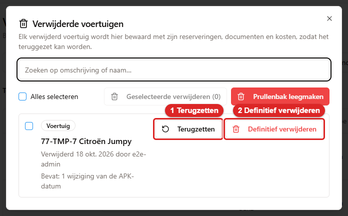
*Een prullenbak, hier die van **Voertuigen**. 1 is **Terugzetten**. 2 is **Definitief verwijderen**.
Alle acht prullenbakken zien er zo uit.*

Per soort staan de nieuwste 200 regels erin. De nieuwste staat bovenaan. Een regel die al is teruggezet,
wordt standaard **niet meer getoond**. Zo zie je alleen wat er nog te doen is. Wil je ze wel zien?
Vink dan **Teruggezette items ook tonen (3)** aan. Het getal zegt hoeveel het er zijn. Het vinkje
staat er alleen als er zijn. Zo'n regel heeft het groene label **Teruggezet** en *Teruggezet
&lt;datum&gt; door &lt;naam&gt;*. Zijn knop **Terugzetten** is grijs. Is er niets? Dan staat er bijvoorbeeld
*Geen verwijderde voertuigen.*

### Terugzetten

Klik op **Terugzetten**. Alles wat met het record mee is gegaan, komt mee terug. Je krijgt
**Teruggezet** met de tekst *&lt;omschrijving&gt; is teruggezet.* Elke keer dat iemand iets terugzet, komt dat in de
geschiedenis te staan.

Per soort goed om te weten:

- Een **reservering** komt alleen terug als de auto in die periode vrij is. Gesloten vervangers,
  transporten en chauffeurtoewijzingen komen niet vanzelf terug.
- Een **onderhoudsplanning** kan terug. Dat kan ook als er intussen een verhuring op die dagen staat. Een
  blok mag overlappen met een verhuring (hoofdstuk 7, paragraaf 7.3). Gesloten vervangers komen
  niet vanzelf terug.
- Een **transport** komt terug met zijn vervangend voertuig, als dat nog vrij is.
- Een **klant** hield zijn debiteurnummer zolang hij in de prullenbak stond (3.9).
- Een **chauffeur** komt terug zolang zijn klant nog bestaat. De koppelingen aan reserveringen,
  bekeuringen en portaalaccounts komen mee terug. Dat geldt alleen waar die nog bestaan en nog leeg zijn. Bestaat de klant niet meer? Dan
  moet je eerst de klant terugzetten.
- Een **kostenpost** komt terug met zijn bon. Hing hij aan een factuur uit het postvak? Dan komt die
  koppeling mee terug als de factuur er nog is. Bestaat het voertuig van de kostenpost niet meer? Dan
  komt de kostenpost toch terug. De app zegt dan *Let op: het voertuig van deze kostenpost bestaat niet
  meer. De kostenpost staat er weer, maar hoort bij een voertuig dat ontbreekt.*

De app weigert het terugzetten als dat niet meer kan. De meldingen:

| Melding | Wat het betekent |
|---|---|
| *Dit record is al teruggezet.* | Iemand was je voor |
| *Dit record staat niet meer in de prullenbak.* | De regel bestaat niet meer. Hij is bijvoorbeeld net definitief verwijderd |
| *Het oorspronkelijke nummer is intussen aan iets anders gegeven, dus terugzetten kan niet.* | Het nummer van het record is niet meer vrij |
| *Er bestaat al een voertuig met hetzelfde kenteken. Verwijder of hernoem dat eerst.* | Er is intussen een nieuwe auto met datzelfde kenteken |
| *Een ander voertuig gebruikt dezelfde barcode. Maak die daar eerst leeg.* | De barcode zit nu op een andere auto |
| **Deze reservering kan niet terug: het voertuig is in de tussentijd geboekt voor die periode.** | De auto is intussen opnieuw verhuurd in die periode |
| *Dit debiteurnummer is al in gebruik bij klant &lt;naam&gt;.* | Een andere klant heeft het nummer intussen gekregen |
| *De klant van deze chauffeur bestaat niet meer. Zet eerst de klant terug (Klanten, Verwijderde klanten) en daarna de chauffeur.* | Je zet een chauffeur terug, maar zijn klant staat in de prullenbak of is definitief weg |
| *De bewaarde gegevens zijn leeg, er is niets om terug te zetten.* en *Dit soort record kan nog niet worden teruggezet.* | Komt zelden voor. Meld het aan wie de app beheert |

### Definitief verwijderen (de prullenbak legen)

Sinds oktober 2026 kun je een prullenbak ook leegmaken. Dat kan op drie manieren:

1. **Eén regel:** klik achter de regel op **Definitief verwijderen**.
2. **Een selectie:** vink de regels aan. Of kies **Alles selecteren**. Die knop vinkt alleen de regels aan
   die je nu in de lijst ziet. Heb je gezocht, dan alleen de gevonden regels. Klik daarna op
   **Geselecteerde verwijderen (…)**.
3. **Alles van die soort:** klik op **Prullenbak leegmaken**. Dat haalt *alles* uit deze prullenbak
   weg. Ook de regels die niet in de lijst staan. Toont de lijst het maximum van 200 regels? Dan zegt
   het venster dat ook.

Staan er teruggezette regels verborgen? Dan zegt de bevestiging van **Prullenbak leegmaken** dat ook:
*Dat zijn ook 3 teruggezette regels die nu verborgen zijn.* Ook die gaan dus weg.

Er verschijnt altijd een bevestiging: **Definitief verwijderen?**. Die noemt het aantal en de soort.
Bijvoorbeeld *2 klanten worden definitief uit de prullenbak verwijderd.* Ze zegt ook wat er
verdwijnt: *Een bestand dat nog door andere gegevens wordt gebruikt, blijft staan.* en *Dit kan niet
ongedaan worden gemaakt.* Pas als je op **Definitief verwijderen** klikt, gebeurt er iets. Met **Annuleren** laat je
alles zoals het was. Je krijgt dan **Definitief verwijderd** met de tekst *2 regels definitief verwijderd.*

Lukt een regel niet? Dan staat er **Niet alles is gelukt** met per regel de reden, in het Nederlands.
Dit kan voorkomen:

| Melding | Wat het betekent |
|---|---|
| *Dit record stond al niet meer in de prullenbak.* | Iemand was je voor |
| *Dit record kon niet worden verwijderd en staat nog in de prullenbak.* | Er ging iets mis. Er is niets weggehaald. Probeer het opnieuw |
| *Het record is verwijderd, maar een of meer bestanden konden niet van de schijf worden gehaald.* | De regel is weg. Een bestand staat er nog. Meld het aan wie de app beheert |

**Wat definitief verwijderen weghaalt**, per soort:

| Soort | Wat er verdwijnt | Wat blijft staan |
|---|---|---|
| **Voertuig** | Het voertuig, met alles wat erbij hoort: reserveringen, documenten en kosten, en hun bestanden | — |
| **Klant** | De klant, met zijn chauffeurs en portaalgegevens, en hun bestanden. Het **debiteurnummer komt weer vrij**. De **fiscale beoordelingen** van de klant gaan mee | — |
| **Reservering** | De reservering, met haar contracten, schadechecks, transportrapporten en bezorgtaken, en hun bestanden. Haar **fiscale beoordelingen** gaan mee | **Overige documenten van het voertuig** (zoals een APK-bewijs, een factuur of een verzekering) blijven staan, zonder reservering |
| **Onderhoud** | De onderhoudsplanning, met eventuele contracten en schadechecks, en hun bestanden. Eventuele **fiscale beoordelingen** gaan mee | Documenten van het voertuig, zoals een **APK-bewijs**, blijven staan |
| **Transport** | Het transport | — |
| **Boete** | De boete, met de bijgevoegde brief | — |
| **Chauffeur** | De chauffeur, met de kopie van het rijbewijs. Reserveringen en bekeuringen die naar hem verwezen, krijgen die koppeling niet meer terug | — |
| **Kostenpost** | De kostenpost, met de bon | Een bon die ook de bijlage van een factuur in het postvak is, blijft staan |

**Een chauffeur verwijderen is niet hetzelfde als zijn gegevens wissen.** Een verwijderde chauffeur blijft in de prullenbak staan
tot die is geleegd. Zijn naam, contactgegevens, rijbewijsnummer en de kopie van het rijbewijs blijven dus bewaard.
Vraagt iemand om zijn gegevens te laten wissen? Kies dan ook **Definitief verwijderen** in
**Verwijderde chauffeurs**. In de prullenbak van de chauffeurs van een klant verwijdert **Prullenbak
leegmaken** precies de regels die je op dat moment ziet. De chauffeurs van andere klanten blijven staan.

**Bestanden gaan alleen weg als niets ze nog gebruikt.** De app haalt een bestand pas van de schijf
nadat de regel definitief is verwijderd. Dat doet hij alleen met een bestand in de uploadmap van de app. En alleen als geen
ander levend record er nog naar verwijst. Een bestand dat nog ergens anders wordt gebruikt, blijft
staan.

**Fiscale beoordelingen gaan mee.** Wordt een reservering, een onderhoudsplanning of een klant
definitief verwijderd? Dan worden ook de fiscale beoordelingen definitief verwijderd. De bijbehorende beoordelingszaken
(zie `docs/fiscaal/07-handleiding-kantoor.md`) gaan ook weg. Dat geldt ook voor de beoordelingen van een
andere periode die naar die reservering verwijzen. In de lijst staat bij zo'n regel bij **Bevat** hoeveel
fiscale beoordelingen het zijn. De bevestiging **Definitief verwijderen?** noemt het aantal nog een
keer. Het activiteitenlog (10.5) telt ze mee in de regel *&lt;soort&gt;.purge*. Het fiscale auditlog
(app-instellingen, Klantenportaal) krijgt de actie *Definitief verwijderd (prullenbak)*. Daar staat bij wie het
deed en hoeveel het er waren. Dat auditlog kan niemand in de app wissen. Het blijft het bewijs dat er iets is
weggehaald. Eén kanttekening. Ook een beoordeling van een *andere* periode die naar de verwijderde reservering
verwees, gaat weg. De reeks beoordelingen van die andere periode kan daardoor een gat krijgen. Een
volgnummer ontbreekt dan. Een verwijzing naar de beoordeling die ze vervangt, is leeg. En de laatste beoordeling
van die periode kan een oudere zijn. Er blijft niets hangen dat naar niets wijst. Kijk bij twijfel
eerst in het fiscale overzicht van die andere periode.

> **Let op: bewaarplicht.** Fiscale gegevens vallen onder de wettelijke bewaarplicht. Dat de
> beoordelingen met de reservering meegaan, is een bewuste keuze van de eigenaar (besluit B-41), niet
> een eis van de wet. Wie twijfelt of een reservering nog nodig is voor de administratie, laat hem in de
> prullenbak staan.

**Wat je niet terugkrijgt.** Wat je definitief verwijdert, kun je niet meer terugzetten. De app
schrijft elke definitieve verwijdering op in het activiteitenlog (10.5). Daar staat de actie
*&lt;soort&gt;.purge* (bijvoorbeeld *customer.purge*), wie het deed en wat er is weggehaald.

> **Loop eerst langs wat erin staat.** Een regel die je niet herkent, is vaak van een collega. Met
> **Prullenbak leegmaken** gaat álles van die soort weg, ook wat anderen er gisteren in hebben gezet.
