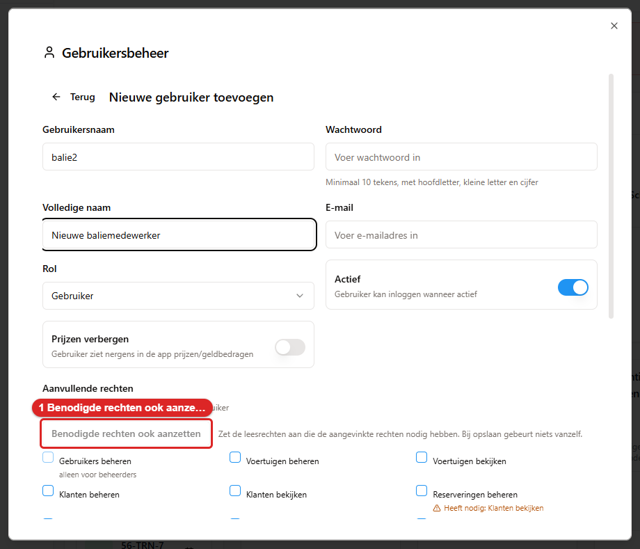
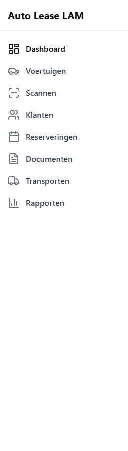
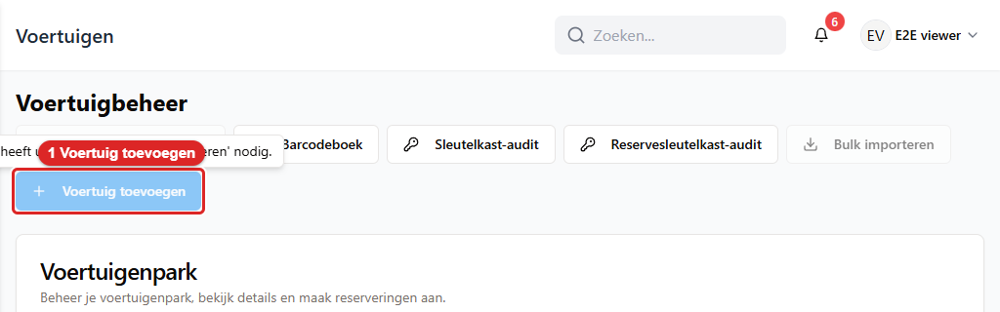

# 15. Rollen en rechten

Niet iedereen ziet dezelfde app. Wat jij in het menu hebt staan, welke knoppen werken en welke
schermen leeg blijven, hangt af van wat er bij jouw account is aangevinkt.

Dit hoofdstuk legt uit hoe dat werkt, wat de rechten betekenen, en wat je ziet als je er één mist.
Het aanmaken en wijzigen van accounts zelf staat in hoofdstuk 10; dat kan alleen een beheerder.

---

## 15.1 Hoe het is opgebouwd: een rol plus vinkjes

Elk account heeft twee dingen:

1. **Een rol.** Beheerder, Manager, Gebruiker, Schoonmaker, Kijker, Accountant of Onderhoud.
2. **Een rijtje vinkjes**, in het beheerscherm **Aanvullende rechten** genoemd.

Er is één regel die alles verklaart:

> **De rol doet niets, behalve de rol Beheerder. Voor alle andere rollen bepalen alleen de
> vinkjes wat je mag.**

Een **Manager** zonder vinkjes kan net zo weinig als een **Schoonmaker** zonder vinkjes: allebei
zien ze een leeg menu. En een **Kijker** met veel vinkjes kan veel. De rol is dus vooral een
etiket waaraan je ziet wat voor werk iemand doet; de vinkjes zijn de echte rechten.

Een **Beheerder** is de uitzondering. Die mag alles, ongeacht de vinkjes. Er is één recht dat ook
voor een beheerder apart aangevinkt moet staan; zie 15.5.

**Wees er niet te makkelijk in.** Iedereen beheerder maken is verleidelijk, maar dan kan iedereen
gebruikers wijzigen, de instellingen aanpassen en een back-up terugzetten. Geef mensen de vinkjes
die bij hun werk horen, en houd het aantal beheerders klein. Voor de prullenbak, het terugdraaien
van een overdracht en het annuleren van een opgehaalde huur hoef je niemand beheerder te maken:
daar zijn sinds oktober 2026 eigen vinkjes voor (15.16).

---

## 15.2 De zeven rollen

| Rol | Waarvoor bedoeld | Wat de rol op zichzelf geeft |
|---|---|---|
| **Beheerder** | Wie het systeem beheert | **Alles**, plus de drie beheerschermen |
| **Manager** | Wie de verhuur aanstuurt | Niets — alleen de vinkjes tellen |
| **Gebruiker** | De gewone kantoor- en baliemedewerker | Niets — alleen de vinkjes tellen |
| **Schoonmaker** | Wie de auto's klaarmaakt | Niets — alleen de vinkjes tellen |
| **Kijker** | Wie alleen mag meekijken | Niets — alleen de vinkjes tellen |
| **Accountant** | Wie de cijfers doet | Niets — alleen de vinkjes tellen |
| **Onderhoud** | De werkplaats | Niets — alleen de vinkjes tellen |

De rol staat wel bij het account en in de gebruikerslijst. Gebruik hem dus consequent, zodat een
beheerder in één oogopslag ziet wat voor account het is.

---

## 15.3 De beheerder

Een beheerder herken je aan twee dingen:

1. In het menu links staan **alle twaalf** items.
2. Rechtsboven, onder je eigen naam, staat het kopje **Beheer** met **Gebruikers**,
   **Back-upbeheer** en **App-instellingen**.

De prullenbak hoort daar sinds oktober 2026 niet meer bij: die staat op elk scherm voor iedereen met
het vinkje **Prullenbak beheren** (15.16), en is dus ook geen herkenningsteken meer voor een
beheerder.

**Wat alleen een beheerder kan:**

| Handeling | Waar |
|---|---|
| Accounts aanmaken, wijzigen, op inactief zetten en rechten geven | **Gebruikers** |
| Het volledige activiteitenlog lezen | **App-instellingen → Activiteit** |
| Back-ups bekijken, maken, downloaden en terugzetten | **Back-upbeheer** |
| De app-instellingen wijzigen | **App-instellingen** |
| Een nieuw beheerdersaccount aanmaken | **Gebruikers** |
| De uitgifte van een auto uit de werkplaats forceren, met opgaaf van reden | Het venster **Uitgifte geblokkeerd** bij het ophalen |
| De meldingen van geweigerde pogingen zien | De balk op het **Dashboard** (hoofdstuk 10, paragraaf 10.2) |
| De RDW-voertuigtypes van het wagenpark toepassen | **App-instellingen → Voertuigen → RDW-voertuigtypes → Toepassen** |
| Een andere beheerder verwijderen | **Gebruikers**; de laatste actieve beheerder blijft altijd beschermd |

Let op: die drie beheerschermen zitten aan de **rol** Beheerder vast, niet aan de vinkjes. Vink je
bij een gewone medewerker **Gebruikers beheren**, **Back-ups beheren** of **Instellingen beheren**
aan, dan verschijnt het kopje **Beheer** bij hem nog steeds niet. Wil je dat iemand die schermen
kan openen, dan moet zijn rol op **Beheerder** staan.

Het scherm **Gebruikers** zegt dat nu ook zelf. Bij **Gebruikers beheren**, **Instellingen beheren** en
**Back-ups beheren** staat bij een medewerker die geen beheerder is *alleen voor beheerders* en kun je
het vinkje niet aanzetten (een vinkje dat al aanstond, kun je wel uitzetten). Zie 15.17.

**Iemand die geen beheerder is, is dat niet.** Dat klinkt flauw, maar het is de meestgestelde
vraag aan de balie: "bij mij staat die knop er niet". Dat is meestal geen storing en ook niet iets
wat je met vernieuwen oplost. Zie 15.8.

---

## 15.4 De rechten, één voor één

*Zo ziet een beheerder de rechten bij een gebruiker: één vinkje per recht, met eronder *Heeft nodig:
…*. 1 is de knop **Benodigde rechten ook aanzetten** (hoofdstuk 10, paragraaf 10.2).*

In het beheerscherm staan onder **Aanvullende rechten** vijfendertig vinkjes. Negenentwintig daarvan
bepalen het dagelijkse werk; die staan hieronder, per vinkje wat het opent. De zes vinkjes van de
fiscale mobiliteitscheck staan onderaan in een eigen tabel.

### Voertuigen, klanten en verhuur

| Vinkje | Wat het toestaat | Welk menu-item je ermee krijgt |
|---|---|---|
| **Voertuigen bekijken** | Het wagenpark inzien, een voertuigkaart openen, de barcode bekijken | **Voertuigen**, **Scannen** |
| **Voertuigen beheren** | Alles hierboven, plus toevoegen, wijzigen, verwijderen, kilometerstand en brandstof bijwerken (een ingevuld tankbedrag wordt daarbij ook een kostenpost, zonder dat je **Kosten beheren** nodig hebt, hoofdstuk 4, paragraaf 4.9), bulkimport, de zwarte lijst, en een auto in de werkplaats **Binnen melden** (hoofdstuk 7, paragraaf 7.8) | **Voertuigen**, **Scannen** |
| **Klanten bekijken** | De klantendatabase en klantkaarten inzien | **Klanten** |
| **Klanten beheren** | Alles hierboven, plus klanten en chauffeurs aanmaken, wijzigen en verwijderen | **Klanten** |
| **Reserveringen bekijken** | De kalender, de lijst en de details van een verhuring lezen | **Reserveringen**, **Transporten** |
| **Reserveringen beheren** | Alles hierboven, plus boeken, wijzigen, annuleren, **ophalen** en **innemen** | **Reserveringen**, **Transporten** |
| **Kilometerverlaging goedkeuren** | Een kilometerstand invoeren die lager is dan de vorige, met je eigen wachtwoord | — |
| **Overdracht terugdraaien** | Een ophaling, een inname of een annulering ongedaan maken, na een voorvertoning en een bevestiging (hoofdstuk 5, paragraaf 5.14) | — |
| **Opgehaalde huur annuleren of verwijderen** | Een huur annuleren of verwijderen die al is opgehaald, na een waarschuwing (hoofdstuk 5, paragraaf 5.15) | — |

### Werkplaats, kosten en rapporten

| Vinkje | Wat het toestaat | Menu-item |
|---|---|---|
| **Onderhoud beheren** | De werkplaatskalender, onderhoud plannen, blokken plaatsen en afronden (ook met **Afronden** in het onderhoudsoverzicht), vervangers toewijzen | **Onderhoud** |
| **Kosten beheren** | Kosten registreren en inzien, facturen scannen | **Kosten** |
| **Rapporten bekijken** | De rapportenmodule lezen | **Rapporten** |
| **Rapporten beheren** | Alles hierboven, plus eigen rapporten opslaan en beheren | **Rapporten** |

### Documenten en schadechecks

| Vinkje | Wat het toestaat | Menu-item |
|---|---|---|
| **Documenten bekijken** | De documentbibliotheek, een document openen, downloaden en afdrukken | **Documenten** |
| **Documenten bewerken en genereren** | Alles hierboven, plus genereren, opnieuw genereren, uploaden, mailen en verwijderen | **Documenten** |
| **PDF-sjablonen beheren** | De contract- en transportrapportsjablonen wijzigen | — (tabbladen binnen **Documenten**) |
| **Schadecontroles bekijken** | Schadechecks inzien | — |
| **Schadecontroles beheren** | Schadechecks maken en afronden, en de schadecheck-sjablonen wijzigen | — |

### Klantenportaal, boetes en communicatie

| Vinkje | Wat het toestaat | Menu-item |
|---|---|---|
| **Klantportaal bekijken** | Het portaalbeheer lezen: aanvragen, accounts, activiteit | **Klantenportaal** |
| **Klantportaal beheren** | Alles hierboven, plus aanvragen afhandelen, accounts uitnodigen, auto's online zetten, blokkades beheren | **Klantenportaal** |
| **Boetes bekijken** | Bekeuringen inzien | De knop **Bekeuringen** en de tegel **Bekeuringen** op **Klantenportaal** |
| **Boetes beheren** | Bekeuringen invoeren, aan een klant koppelen, de klant erover informeren en verwijderen | De knop **Bekeuringen** en de tegel **Bekeuringen** op **Klantenportaal** |
| **Meldingen beheren** | APK-, garantie- en onderhoudsherinneringen versturen | **Communicatie** |
| **E-mailsjablonen beheren** | De sjabloonbouwer onder **Communicatie** | **Communicatie** |

### Algemeen en beheer

| Vinkje | Wat het toestaat | Menu-item |
|---|---|---|
| **Dashboard bekijken** | Het **Dashboard** met de snelle acties en de signaalblokken | **Dashboard** |
| **Gebruikers beheren** | Accounts en rechten wijzigen en het activiteitenlog lezen — **maar alleen als de rol Beheerder is** | — |
| **Instellingen beheren** | De app-instellingen opslaan — idem | — |
| **Back-ups beheren** | Back-ups maken en terugzetten — idem | — |
| **Prullenbak beheren** | De prullenbakken van Voertuigen, Klanten (met de chauffeurs van een klant), Reserveringen, Onderhoud, Transporten, Kosten en Boetes openen, er iets uit terugzetten en er iets definitief uit verwijderen (hoofdstuk 10, paragraaf 10.6). Dit vinkje is **niet** aan de rol Beheerder gebonden | — (een knop op elk van die schermen) |

### Fiscale mobiliteitscheck

Deze zes vinkjes horen bij de fiscale check (de pseudo-eindheffing voor huurauto's, vanaf 2027). De
check zelf staat beschreven in `docs/fiscaal/07-handleiding-kantoor.md`; hier alleen wat elk vinkje
opent.

| Vinkje | Wat het toestaat | Waar |
|---|---|---|
| **Fiscaal bekijken** | Het overzicht met de tegels per status, het tabblad **Fiscaal** bij een voertuig, de kaart **Fiscaal gebruik** bij een reservering en het fiscale maandrapport. Heb je dit vinkje maar geen rapportvinkje, dan toont **Rapporten** alleen de fiscale check, met de knop **Fiscale check** | **Klantenportaal** → **Fiscale check**, **Rapporten** → **Fiscaal** |
| **Fiscale beoordelingen en gegevens beheren** | Een beoordeling bevestigen, een voertuiggegeven corrigeren en de beoordelingswachtrij afwerken | Het tabblad **Fiscaal**, de kaart **Fiscaal gebruik**, de **Wachtrij** |
| **Fiscale configuratie voorbereiden** | Een nieuwe versie van de fiscale regels voorbereiden | **App-instellingen** → **Klantenportaal** → **Fiscale check** |
| **Fiscale configuratie goedkeuren** | Een voorbereide versie goedkeuren | Idem |
| **Fiscale configuratie publiceren** | Een goedgekeurde versie publiceren | Idem |
| **Fiscale auditlog bekijken** | De auditlog van de fiscale check lezen | Idem, tabblad **Audit** |

---

## 15.5 De twee documentvinkjes: bekijken is niet hetzelfde als maken

Documenten hebben **eigen** rechten. Ze liften niet mee op het recht op voertuigen of
reserveringen. Iemand die de hele dag auto's meegeeft en inneemt, ziet dus niet automatisch de
documenten die daarbij horen.

| Vinkje | Wat je ermee kunt |
|---|---|
| **Documenten bekijken** | De lijst zien, een document openen, downloaden, afdrukken en de contractgegevens inzien |
| **Documenten bewerken en genereren** | Alles hierboven, **plus** een contract of schadecheck genereren, opnieuw genereren, uploaden, mailen en verwijderen |

**Waarom die twee gescheiden zijn.** Op een contract staan het adres, het telefoonnummer en het
rijbewijsnummer van de klant. Wie die gegevens voor zijn werk niet nodig heeft, krijgt geen van
beide vinkjes. Wie contracten moet kunnen uitdraaien, krijgt **Documenten bewerken en genereren**;
dat vinkje geeft automatisch ook inzage, dus je hoeft ze niet allebei aan te zetten.

**Wat er donker wordt zonder documentrechten:**

- Het menu-item **Documenten** verdwijnt helemaal.
- Het tabblad **Documenten** op de voertuigkaart blijft leeg.
- Bij een reservering kun je geen contract of schadecheck openen, afdrukken of mailen.
- Bij een verouderd document is er geen **Opnieuw genereren**.

**Wat er wél gewoon blijft werken:** het ophalen zelf. Heb je **Reserveringen beheren** maar geen
documentrechten, dan kun je een auto meegeven en **maakt de app het contract gewoon aan**. Je kunt
het alleen niet openen of afdrukken. Laat de klant dan niet met lege handen weg: haal er een
collega bij die het contract kan uitdraaien.

Zie ook hoofdstuk 8, paragraaf 8.7.

---

## 15.6 Het ene recht dat ook voor een beheerder telt

**Kilometerverlaging goedkeuren** werkt anders dan alle andere vinkjes. Dit recht wordt strikt
gecontroleerd: **ook een beheerder moet het aangevinkt hebben.** Staat het bij jou uit, dan kun je
geen lagere kilometerstand bevestigen, hoe hoog je rechten verder ook zijn.

Wanneer je het nodig hebt: je vult bij het ophalen of innemen een stand in die lager is dan de
stand die de app van die auto kent. Dan komt het venster **Kilometerstand-overschrijving vereist**
en moet je **je eigen accountwachtwoord** typen. Niet dat van een collega, en niet een apart
"beheerderswachtwoord" — je eigen wachtwoord.

Heb je het recht niet, dan staat er:

> *"Je hebt geen recht om een verlaging van de kilometerstand te autoriseren. Vraag iemand met het
> recht 'authorize_mileage_decrease'."*

Haal er dan iemand bij die het wél heeft; die vult zijn eigen wachtwoord in. Zie ook hoofdstuk 11,
paragraaf 11.16.

---

## 15.7 Vijf profielen die in de praktijk voorkomen

Hieronder vijf combinaties met wat zo iemand op een dag doet. Ze zijn bedoeld als voorbeeld voor
de beheerder die een nieuw account inricht.

### Baliemedewerker (alleen verhuren)

**Vinkjes:** Dashboard bekijken · Voertuigen bekijken · Klanten bekijken · Reserveringen beheren ·
Documenten bekijken · Klantportaal bekijken.

**Zijn dag:** begint op het **Dashboard** en de **Reserveringskalender**, geeft auto's mee en
neemt ze terug, beantwoordt telefoon, zoekt reserveringen op contractnummer, drukt het contract
af dat bij het ophalen is gemaakt.

**Wat hij ziet:** **Dashboard**, **Voertuigen**, **Scannen**, **Klanten**, **Klantenportaal**,
**Reserveringen**, **Documenten**, **Transporten**.

**Wat hij niet mag:** een auto of klant wijzigen of aanmaken, kosten registreren, onderhoud
plannen, rapporten openen, een document genereren of mailen, een portaalaanvraag afhandelen, een
overdracht terugdraaien en een opgehaalde huur annuleren of verwijderen (daar zijn sinds oktober
2026 eigen vinkjes voor, 15.16).

**Hoort bij:** de werkstromen ophalen, innemen en achterstallige verhuringen nalopen (hoofdstuk
16).

### Verhuurmedewerker (het volledige kantoorwerk)

**Vinkjes:** Dashboard bekijken · Voertuigen beheren · Klanten beheren · Reserveringen beheren ·
Documenten bewerken en genereren · Schadecontroles beheren · Klantportaal beheren · Kosten beheren ·
Kilometerverlaging goedkeuren.

**Zijn dag:** alles van de baliemedewerker, plus klanten aanmaken en bijwerken, boekingen wijzigen,
contracten genereren en mailen, schadechecks maken, portaalaanvragen beoordelen en kosten
vastleggen.

**Wat hij niet ziet:** **Onderhoud** (daar is **Onderhoud beheren** voor nodig), **Communicatie**
(**Meldingen beheren** of **E-mailsjablonen beheren**) en **Rapporten** (**Rapporten bekijken**).

**Wat hij niet mag:** gebruikers beheren, de instellingen wijzigen, back-ups maken of terugzetten,
en — tenzij je de vinkjes uit 15.16 erbij aanzet — iets uit de prullenbak halen, een overdracht
terugdraaien of een opgehaalde huur annuleren.

### Kijker (meekijken, niets wijzigen)

**Vinkjes:** Dashboard bekijken · Voertuigen bekijken · Klanten bekijken · Reserveringen bekijken.

**Zijn dag:** opzoeken en beantwoorden. Hij kan de kalender lezen, een klantkaart openen en zien
waar een auto is.

**Wat hij niet mag:** letterlijk niets veranderen. Geen boeking maken, geen auto meegeven, geen
kosten, geen documenten. De knoppen **Ophalen starten** en **Innemen starten** bij de **Snelle
acties** op het **Dashboard** lopen bij hem stuk op een rechtenmelding.

### Werkplaats

**Vinkjes:** Voertuigen beheren · Onderhoud beheren · Kosten beheren.

**Zijn dag:** de onderhoudskalender nalopen, auto's in en uit de werkplaats zetten, blokken
afronden, reparatiekosten vastleggen.

**Wat hij ziet:** **Voertuigen**, **Scannen**, **Onderhoud**, **Kosten**.

**Wat hij niet ziet:** **Dashboard** (daar is **Dashboard bekijken** voor nodig), **Klanten**,
**Reserveringen** en **Transporten**.

**Let op:** zonder **Reserveringen bekijken** (of **beheren**) opent het onderhoudsscherm wel, maar
toont het geen blokken: de kalender leest de reserveringen mee, ook voor de blokken zelf, en laat
dan alleen de regel *Geen toegang tot deze gegevens (recht 'Reserveringen bekijken')* zien. Ook
staat **Transporten** dan niet in zijn menu. Voor dit profiel hoort **Reserveringen bekijken** er
dus gewoon bij; zie ook 15.11.

### Boekhouding

**Vinkjes:** Kosten beheren · Rapporten bekijken · Voertuigen bekijken.

**Zijn dag:** kosten boeken en controleren, rapporten draaien over kosten, benutting en APK.

**Wat hij ziet:** **Voertuigen**, **Scannen**, **Kosten**, **Rapporten**.

**Wat hij niet ziet:** **Dashboard**, **Klanten**, **Reserveringen**, **Documenten**,
**Transporten**, **Klantenportaal**.

**Let op:** het scherm *Administratie - Factuurgegevens* zit achter de knop **Administratie** op
het scherm **Reserveringen**. Wie de facturatiegegevens moet kunnen uitlezen, heeft dus ook
**Reserveringen bekijken** nodig.

---

## 15.8 Wat je ziet als je een recht mist

Dit gaat over het moment dat je ergens terechtkomt of op iets klikt waarvoor je het recht niet
hebt. Sinds de doorlichting van september 2026 maken de meeste schermen dat al ván tevoren
duidelijk, met een eigen pagina en grijze knoppen in plaats van een melding achteraf — zie 15.9.

Er zijn drie manieren waarop de app je een ontbrekend recht laat merken.

**1. Het menu-item staat er niet.** Dit is het meest voorkomende. Je ziet **Onderhoud** of
**Documenten** simpelweg niet staan. Er is geen grijze knop en geen uitleg: het item is er niet.

*Het menu van een account met alleen kijkrechten. Vergelijk met het volledige menu in hoofdstuk 1,
paragraaf 1.2: de items waar je geen recht voor hebt, staan er gewoon niet.*

**2. Een melding met de naam van het recht erin.** Open je een scherm langs een omweg, of druk je
op een knop waar je het recht niet voor hebt, dan komt er:

> *Not authorized. One of these permissions required: view_documents, manage_documents*

Achter de dubbele punt staat welk recht ontbreekt. Die namen zijn Engels; in de tabel in 15.4 vind
je waar ze bij horen. Schrijf de melding over als je erom vraagt bij de beheerder.

**3. Een scherm met "Toegang geweigerd".** Bij de beheerschermen krijg je een net venster:
**Toegang geweigerd** — *"Je hebt geen toestemming voor deze functie."*

**Geen van drieën is een storing.** Vernieuwen, opnieuw inloggen of een andere browser helpt niet.
Vraag de beheerder om het vinkje. Hij zet het aan in **Gebruikers** en het werkt bij je volgende
handeling.

---

## 15.9 De schermmelding en de grijze knoppen (sinds september 2026)

Sinds de doorlichting van de rechten in september 2026 laten de meeste schermen een ontbrekend
recht al vooraf zien, in plaats van pas na een klik. Drie dingen zijn hierdoor bij gekomen ten
opzichte van 15.8:

**Een scherm zonder recht toont een duidelijke pagina, niet alleen een lege.** Kom je toch op het
adres van een scherm waar je het recht niet voor hebt — een overgetikte link, een oude
snelkoppeling, een collega die het adres doorstuurt — dan opent niet een leeg scherm, maar een
pagina met de kop **"U heeft geen toegang tot dit scherm"** en een zin die het ontbrekende recht
met naam noemt, bijvoorbeeld: *"Hiervoor is het recht 'Onderhoud beheren' nodig. Vraag een
beheerder om het aan te zetten."* Er staat een knop naar het eerste scherm dat je wél mag openen.
Het scherm zelf vraagt in dit geval helemaal niets bij de server op. Dat geldt ook voor een oude
bladwijzer of gedeelde link naar bijvoorbeeld **Onderhoud** (`/maintenance`), de bewerkpagina van
een reservering (`/reservations/edit/…`) of het toevoegen van een kostenpost (`/expenses/add`): mis
je het recht daarvoor, dan zie je voortaan diezelfde schermmelding in plaats van een leeg of kapot
scherm.

**Een knop die je niet mag gebruiken, blijft zichtbaar maar staat uit.** Op steeds meer schermen
zie je nu een knop die er wel gewoon staat maar **grijs** is. Wijs je hem aan, of spring je er met
Tab naartoe, dan verschijnt een tekstballon die het ontbrekende recht noemt, bijvoorbeeld
*"Hiervoor heeft u het recht 'Reserveringen beheren' nodig."* Op een tablet of telefoon, waar
je niets kunt aanwijzen, tik je op de knop: dan verschijnt dezelfde tekstballon. Met het toetsenbord
spring je er met Tab naartoe en open je hem met Enter of spatie. De ballon noemt het vinkje; er
gebeurt verder niets: geen foutmelding, geen half uitgevoerde actie. Hetzelfde geldt voor een tabblad
dat je niet mag openen, zoals **Contractsjablonen** en **Transportrapportsjablonen** bij het scherm
**Documenten** zonder het vinkje **PDF-sjablonen beheren** (hoofdstuk 8, paragraaf 8.5): het tabblad
staat er grijs, en tikken of klikken zegt welk vinkje je mist. Dit vervangt voor deze knoppen de oude melding uit 15.8,
punt 2 — die melding kan nog wel voorkomen bij een knop die deze behandeling nog niet heeft
gekregen.

*Een grijze knop met uitleg: **Voertuig toevoegen** (1) staat er wel, maar werkt niet; wijs hem aan
en de tekstballon zegt welk vinkje je mist.*

**Een stukje van een scherm dat gegevens uit een ander recht toont, laat dat nu netjes weg.**
Sommige schermen tonen een detail dat eigenlijk bij een ander recht hoort — bijvoorbeeld een
klantnaam op een scherm waarvoor je geen klantrecht hebt. Heb je dat andere recht niet, dan
verschijnt daar de zin **"Geen toegang tot deze gegevens (recht '...')"**, of het stukje wordt
gewoon weggelaten als het maar een detail was, zoals een naam naast een nummer. Ook hier: geen
foutmelding en geen scherm dat blijft laden.

## 15.10 Transporten, Communicatie en Onderhoud: wie het scherm ziet

**Transporten** staat in het menu van iedereen die **Reserveringen bekijken/beheren** ÓF
**Voertuigen bekijken/beheren** heeft — niet pas bij een apart transportrecht. Dat is bewust: het
scherm toont de overbrengingen die bij een verhuring of een voertuig horen, dus wie een van de
twee al mag zien, moet dat ook hier kunnen volgen.

**Communicatie** vraagt **Meldingen beheren** ÓF **E-mailsjablonen beheren** om het scherm te
mogen openen — wie meldingen mag versturen, verliest het scherm niet omdat sjablonen apart
staan. Sjabloonbeheer (een sjabloon aanmaken, bewerken, verwijderen, en het e-maillogboek)
blijft voorbehouden aan **E-mailsjablonen beheren** (met opzet alleen voor admin en manager);
zonder dat recht staan die knoppen er wel, maar grijs, of toont het scherm "geen toegang tot
deze gegevens" — zie 15.9. Een herinnering of eigen bericht versturen (APK, garantie,
onderhoud) vraagt **Meldingen beheren**; zonder dat recht staan de verstuurknoppen er ook wel,
maar grijs.

**Onderhoud** vraagt het recht **Onderhoud beheren** om het scherm te mogen openen. Wat dat recht
daar concreet wel en niet dekt, staat in 15.11.

## 15.11 Onderhoud beheren: wat het wel en niet dekt

Wie alleen **Onderhoud beheren** heeft — en niet ook **Reserveringen beheren** — komt op een grens
die niet voor de hand ligt. De werkplaatskalender opent gewoon, en een bestaand blok **afronden**
werkt (mits de kalender de blokken mag tonen; zie onderaan), maar **nieuw onderhoud inplannen
niet**: dat loopt via dezelfde route als een gewone
boeking, en die vraagt **Reserveringen beheren**.

| Handeling op het onderhoudsscherm | Wat er nodig is | Werkt met alléén 'Onderhoud beheren'? |
|---|---|---|
| Nieuw onderhoud inplannen (kop-knop, dag-tegel "+", vanuit een leeg dag-venster) | Reserveringen beheren | Nee |
| Een bestaand onderhoudsblok bewerken (datum, type, notities) | Reserveringen beheren | Nee |
| Onderhoud **afronden**: het blok sluiten, de werkplaats-vlag wissen, de vervanger terugzetten | Onderhoud beheren **of** Reserveringen beheren | Ja |
| Vanuit het onderhoudsoverzicht (**Lijstweergave** → **Gepland**): **Afronden** | Onderhoud beheren **of** Reserveringen beheren | Ja |
| Vanuit het bewerkvenster van een blok: **Afronden** | Onderhoud beheren **of** Reserveringen beheren (het bewerkvenster zelf openen vraagt Reserveringen beheren) | Nee: het venster opent niet zonder Reserveringen beheren |
| Vanaf het scanscherm: **Terug uit onderhoud** bij een auto die in een lopend onderhoud (**Binnen**) staat. De knop opent dan het venster **Onderhoud afronden** | Onderhoud beheren **of** Reserveringen beheren | Ja. **Alleen Voertuigen beheren is niet genoeg**: een scanaccount met alleen dat vinkje kan het onderhoud niet vanaf het scanscherm afronden |
| Vanuit het onderhoudsoverzicht: **Binnen melden** (blok op *Binnen*, auto in onderhoud) | Voertuigen beheren | Nee: dit loopt via de route waarmee een auto in onderhoud wordt gezet, en die vraagt dit vinkje. Een werkplaatsprofiel (Voertuigen beheren, Onderhoud beheren, Kosten beheren) heeft het |
| Bij het afronden ook de APK-datum, kilometerstand of laatste-onderhoud-datum van het voertuig bijwerken (zelfde formulier, dezelfde handeling) | Onderhoud beheren **of** Reserveringen beheren | Ja — sinds oktober 2026; vroeger had je hier ook Voertuigen beheren voor nodig |
| Bij het afronden een APK-formulier uploaden (zelfde formulier, dezelfde handeling) | Onderhoud beheren **of** Reserveringen beheren | Ja — sinds oktober 2026; vroeger had je hier ook Documenten bewerken en genereren voor nodig |
| Een onderhoudsblok verwijderen | Reserveringen beheren | Nee |
| Een afgeronde onderhoudsregistratie terugzetten | Reserveringen beheren | Nee |
| Bij het bekijken van een onderhoudsblok: een vervanger op "nog te bepalen" of "eigen vervoer" zetten | Reserveringen beheren | Nee |
| Bij het bekijken: foto's, servicerapport of overige documenten uploaden | Documenten bewerken en genereren | Nee |
| Bij het bekijken: kosten aanmaken via de factuurscanner | Kosten beheren | Nee |
| De prullenbak van Onderhoud openen, iets terugzetten of definitief verwijderen | Prullenbak beheren | Nee |
| Reservevoertuig toewijzen als een nieuw onderhoudsblok een bestaande verhuring raakt | Onderhoud beheren **of** Reserveringen beheren | Kan pas nadat het blok is aangemaakt — en dat lukt niet zonder Reserveringen beheren (zie regel 1) |

**Kort gezegd:** met alléén **Onderhoud beheren** kun je een bestaand blok afronden, maar geen
nieuw onderhoud inplannen, geen blok bewerken of verwijderen, en geen afgeronde registratie
terugzetten — daar is ook **Reserveringen beheren** voor nodig. Wil je dat de werkplaats zelf
onderhoud kan inplannen, geef dat account dan ook **Reserveringen beheren**.

Het afronden zelf is sinds oktober 2026 **één handeling met één vinkje**: de APK-datum, het
APK-formulier en de kilometerstand gaan in dezelfde stap mee, ook zonder **Voertuigen beheren** of
**Documenten bewerken en genereren** (hoofdstuk 7, paragraaf 7.6). Eén grens blijft: je opent het
afrondvenster vanuit de onderhoudskalender, en die toont de blokken pas als je ook voertuigen en
reserveringen mag bekijken (**Voertuigen bekijken** of **beheren**, en **Reserveringen bekijken** of
**beheren**). Het afronden vraagt dus één vinkje, maar om bij het blok te komen heb je er twee meer
nodig.

Eén uitzondering: vanaf het scanscherm (**Voertuigen → Scannen**) kan iemand met alléén
**Onderhoud beheren** een bestaand onderhoudsblok van het gescande voertuig wél bewerken via de
knop "Onderhoud openen" — die ene route accepteert sinds deze doorlichting **Onderhoud beheren**
naast **Reserveringen beheren**, omdat hij nergens anders vandaan te bereiken is.

**Het scanscherm en een auto die in een lopend onderhoud staat.** Sinds de wijziging van oktober 2026 rond
je een onderhoud altijd af met de knop **Afronden**, ook vanaf het scanscherm. De knop **Terug uit onderhoud**
opent daar het venster **Onderhoud afronden** als de auto op **Binnen** staat in een blok dat vandaag loopt.
Een account dat op het scanscherm wel **Voertuigen beheren** heeft, maar niet **Onderhoud beheren** of
**Reserveringen beheren**, kan dat venster niet gebruiken en dus het onderhoud niet vanaf het scanscherm
afronden. De knop zegt welk vinkje hij mist (15.9). Een auto die in de werkplaats staat zonder lopend
onderhoud, geeft zo iemand wel nog met één klik vrij.

## 15.12 Etiketsjablonen: bekijken kan iedereen, wijzigen niet

De sjablonen voor kentekenlabels (**Documenten → Barcode-etiketten**) hebben een bijzondere regel.
**Elke ingelogde medewerker kan de lijst met etiketsjablonen inzien**, ook zonder enig extra
recht — dat is bewust zo gebouwd, want bij het scannen en printen van een label moet iedereen uit
die lijst kunnen kiezen. **Een sjabloon wijzigen, aanmaken of verwijderen vraagt wél het recht
'PDF-sjablonen beheren'**; zonder dat recht is de knop **Barcode-etiketten beheren** onder
**Documenten** grijs (zie 15.9).

---

## 15.13 Prijzen verbergen

Naast de rechten staat bij elk account een schakelaar **Prijzen verbergen** —
*"Gebruiker ziet nergens in de app prijzen/geldbedragen"*.

Staat die aan, dan zie je op de plek van elk bedrag drie puntjes: **•••**. Dat geldt overal: de
totaalprijs van een verhuring, de kosten bij een voertuig, de bedragen in de rapporten.

Het is geen recht maar een afscherming. Je kunt met deze schakelaar aan gewoon alles doen wat je
vinkjes toestaan; je ziet alleen de bedragen niet. Handig voor wie wel met de auto's werkt maar
niets met de tarieven te maken heeft.

---

## 15.14 Actief en inactief

Bij elk account staat de schakelaar **Actief** — *"Gebruiker kan inloggen wanneer actief"*.

Gaat een collega weg, zet zijn account dan **op inactief** in plaats van het te verwijderen. Alles
wat hij ooit heeft gedaan blijft dan met zijn naam in de geschiedenis en het activiteitenlog
staan. Verwijder je het account, dan is die link minder duidelijk.

Probeer je in te loggen op een inactief account, dan meldt de app:

> *403: Account has been disabled*

Dat is geen wachtwoordfout. Blijf niet proberen — na vijf mislukte pogingen zit je werkplek
bovendien een kwartier vast (hoofdstuk 12).

---

## 15.15 Korte vuistregels

- De rol zegt wat voor werk iemand doet; de **vinkjes** bepalen wat hij mag.
- **Beheerder** mag alles. Houd het aantal beheerders klein.
- **Bekijken** en **beheren** zijn twee verschillende vinkjes. Wie iets moet kunnen wijzigen, heeft
  het beheer-vinkje nodig; het bekijk-vinkje hoeft er dan niet apart bij.
- Documenten hebben **eigen** rechten. Zonder die vinkjes kun je wél ophalen, maar het contract
  niet openen.
- **Kilometerverlaging goedkeuren** heeft zelfs een beheerder apart nodig.
- De drie beheerschermen (**Gebruikers**, **Back-upbeheer**, **App-instellingen**) zitten vast aan
  de rol Beheerder, niet aan een vinkje. De **prullenbak** niet meer: die heeft sinds oktober 2026
  zijn eigen vinkje, **Prullenbak beheren**.
- Een overdracht terugdraaien, een opgehaalde huur annuleren of verwijderen en de prullenbak
  beheren: elk een eigen vinkje (15.16). **Reserveringen beheren** alleen is daarvoor niet genoeg.
- Zie je een knop niet, dan is dat bijna altijd een recht — geen storing.
- Zie je een knop wél maar **grijs**, met een tekstballon die een recht noemt: zelfde verhaal,
  alleen laat het scherm het nu al vooraf zien in plaats van pas na een klik (15.9).
- **Onderhoud beheren** dekt niet alles op het onderhoudsscherm: nieuw onderhoud inplannen, een
  blok bewerken of verwijderen vraagt ook **Reserveringen beheren** (15.11).

---

## 15.16 Overdracht terugdraaien, opgehaalde huur annuleren en de prullenbak: drie eigen vinkjes (sinds oktober 2026)

Drie handelingen hingen vroeger aan **Reserveringen beheren**, of — bij de prullenbak — aan de rol
Beheerder. Sinds oktober 2026 heeft elk een eigen vinkje:

| Vinkje | Wat het opent | Uitleg |
|---|---|---|
| **Overdracht terugdraaien** | Een ophaling, een inname of een annulering ongedaan maken | Hoofdstuk 5, paragraaf 5.14 |
| **Opgehaalde huur annuleren of verwijderen** | Een huur annuleren of verwijderen die al is opgehaald | Hoofdstuk 5, paragraaf 5.15 |
| **Prullenbak beheren** | De prullenbakken openen (ook die van Kosten en van de chauffeurs van een klant), iets terugzetten en definitief verwijderen | Hoofdstuk 10, paragraaf 10.6 |

**Wie ze heeft.**

- Een **beheerder** altijd; die gaat voor elk vinkje vanzelf door.
- Elk account met de rol **Manager** heeft ze **één keer** automatisch gekregen, bij de eerste start na
  de uitrol van deze versie. Dat is eenmalig. Haal je een vinkje bij een manager weg, dan blijft het
  weg. En een manager die je ná de uitrol aanmaakt, krijgt ze **niet** vanzelf: vink ze zelf aan.
- Voor **elk ander account** staan ze uit totdat je ze in **Gebruikers** aanvinkt. Ze verschijnen
  vanzelf in het rijtje onder **Aanvullende rechten**, met de namen uit de tabel hierboven.

**Wat dit verandert.** Wie alleen **Reserveringen beheren** heeft, kan niet meer terugdraaien en
geen opgehaalde huur meer annuleren of verwijderen; daar is het eigen vinkje voor nodig. Een
reservering die nog niet is opgehaald annuleren of verwijderen vraagt nog steeds alleen
**Reserveringen beheren**. En de prullenbakken zijn niet meer voorbehouden aan de rol Beheerder: wie
**Prullenbak beheren** heeft, ziet ze, zet er iets uit terug en mag ze ook leegmaken.

**Wat je ziet zonder het vinkje.** De knop staat er, maar is grijs, met een tekstballon die het recht
noemt (15.9). Kom je er via een omweg toch langs, dan antwoordt de app met *Not authorized. One of
these permissions required: …*; de Engelse namen daarin zijn `revert_handover`,
`cancel_picked_up_rental` en `manage_recycle_bin`.

**Niet hetzelfde als Kilometerverlaging goedkeuren.** Gaat de kilometerstand van een auto omlaag
doordat je een overdracht terugdraait, dan vraagt de app geen wachtwoord, maar een vinkje in het
venster zelf (5.14). Het wachtwoordvenster uit 15.6 hoort bij het invoeren van een lagere stand bij
het ophalen of innemen.

---

## 15.17 Welk recht werkt pas met welk ander recht (sinds oktober 2026)

Een vinkje alleen is vaak niet genoeg. Wie **Reserveringen beheren** heeft maar niet **Voertuigen
bekijken** en **Klanten bekijken**, kan wel boeken, maar de lijsten waaruit je een auto of klant kiest
blijven leeg of melden *Geen toegang tot deze gegevens*. Het scherm **Gebruikers** (hoofdstuk 10,
paragraaf 10.2) helpt daarbij:

- Onder elk vinkje staat *Heeft nodig: …* met de rechten die het scherm nodig heeft. Staan die aan, dan is de
  regel grijs; mist er een, dan is hij oranje met een waarschuwingsteken.
- De knop **Benodigde rechten ook aanzetten** vinkt de ontbrekende benodigde rechten van alles wat je
  aanvinkte in één keer aan. Hij is grijs als er niets ontbreekt. Bij het opslaan gebeurt niets vanzelf.
- Rechten die het werk prettiger maken maar niet nodig zijn, staan in de tekstballon als *Handig erbij: …*.
- **Gebruikers beheren**, **Instellingen beheren** en **Back-ups beheren** zijn *alleen voor beheerders*
  (15.3). Bij een andere rol zijn ze uitgeschakeld in de lijst. De server controleert zelf nog steeds
  hetzelfde als voorheen; dit is een hulp bij het kiezen, geen nieuwe beveiliging.

De regels volgen de schermen: voor elk scherm dat een recht opent en voor elk stukje van een scherm dat
gegevens uit een ander recht toont (15.9), staat vast welke rechten erbij horen.
