# 16. Werkstromen: zo werk je met de app

Dit hoofdstuk is voor iedereen die met de app werkt: aan de balie, in de werkplaats en op kantoor.
Het volgt het werk van begin tot eind, in de volgorde waarin je het echt doet. Je leest bij elke stap
waar je klikt en wat je daarna ziet.

De andere hoofdstukken leggen elk scherm tot in detail uit. Hier staat de route. Wil je meer weten
over een scherm? Volg dan de link naar dat hoofdstuk: [klanten](03-klanten.md),
[voertuigen](04-voertuigen.md), [reserveringen](05-reserveringen.md), [transport](06-transport.md),
[onderhoud](07-onderhoud.md), [documenten](08-documenten.md), [e-mail](09-email.md),
[scannen](18-barcode-en-scannen.md), [kosten en facturen](19-kosten-en-facturen.md) en
[klantenportaal en bekeuringen](20-klantenportaal-en-bekeuringen.md).

Welk recht je nodig hebt, hangt af van de werkstroom. Een knop zonder recht is grijs of staat er
niet. Welke rechten er zijn, staat in [hoofdstuk 15](15-rollen-en-rechten.md).

De volgorde is niet zomaar gekozen. De meeste fouten komen niet door een verkeerde klik. Ze komen
doordat iets in de verkeerde volgorde gebeurt. Daarom staat bij de belangrijke stappen **waarom** het
zo hoort.

| Wat wil je doen? | Paragraaf |
|---|---|
| Zien wat er vandaag speelt en in welke volgorde je werkt | 16.1 |
| Een auto verhuren: boeken, meegeven, terugnemen | 16.2 |
| Een huur verlengen, of de auto of de klant wijzigen | 16.3 |
| Een auto naar de werkplaats sturen, met vervanger en transport | 16.4 |
| Een nieuwe auto in de vloot zetten | 16.5 |
| Een factuur of kosten verwerken | 16.6 |
| Een bekeuring verwerken | 16.7 |
| Een aanvraag uit het klantenportaal afhandelen | 16.8 |
| De dag en de week goed afsluiten | 16.9 |
| Alles in één tabel | 16.10 |

---

## 16.1 De werkdag in vogelvlucht

> **Eén regel: kijk op het Dashboard wat er speelt. Handel het af met de knop die de handeling start.**

### Het Dashboard

Na het inloggen kom je op het **Dashboard**. Het Dashboard is een overzicht. Het werk zelf doe je met
een knop. Die knop opent meteen het juiste venster.

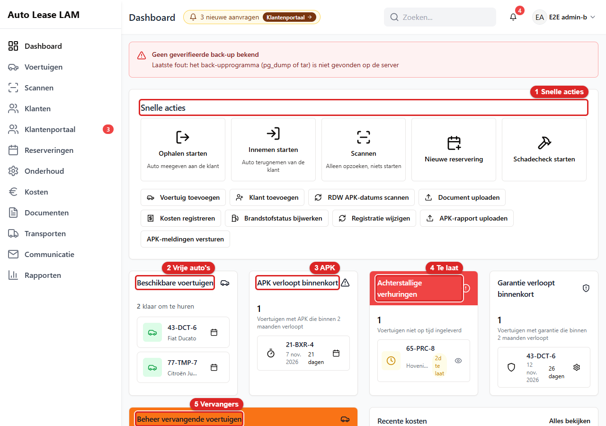
*Het **Dashboard**: 1 **Snelle acties**, 2 **Beschikbare voertuigen** (de vrije auto's), 3 **APK
verloopt binnenkort**, 4 **Achterstallige verhuringen** (te laat), 5 **Beheer vervangende
voertuigen** (de vervangers).*

- **De rode balk bovenaan** gaat over de back-up. Een back-up is een reservekopie van alle gegevens.
  Staat er *Geen geverifieerde back-up bekend*? Meld dat dan meteen bij de beheerder. Je hoeft het
  niet zelf op te lossen. Negeren mag niet.
- **Snelle acties** (1). Hier start je het werk aan de balie: **Ophalen starten**, **Innemen
  starten**, **Scannen**, **Nieuwe reservering** en **Schadecheck starten**. Daaronder staan kleinere
  knoppen, zoals **Voertuig toevoegen** en **Kosten registreren**.
- **Beschikbare voertuigen** (2). Hoeveel auto's er nu klaar zijn om te verhuren.
- **APK verloopt binnenkort** (3). Auto's waarvan de APK binnen twee maanden afloopt. De APK is de
  verplichte keuring van een auto. Een auto met een verlopen APK mag de weg niet op.
- **Achterstallige verhuringen** (4). Auto's die al terug hadden moeten zijn.
- **Beheer vervangende voertuigen** (5). Een vervanger is een auto voor een klant die zijn eigen auto
  tijdelijk mist. Op het tabblad **Nog te bepalen** staan vervangers die nog geen auto hebben.

### De volgorde van de dag

**'s Ochtends**, in deze volgorde:

1. **Lees het Dashboard.** Kijk naar de back-upbalk, **APK verloopt binnenkort**, **Achterstallige
   verhuringen** en **Beheer vervangende voertuigen**.
2. **Wijs de vervangers toe.** Open op het Dashboard bij **Beheer vervangende voertuigen** het
   tabblad **Nog te bepalen**. Klik bij elke regel op **Voertuig toewijzen**. Hoe dat gaat, staat in
   16.4.
3. **Kijk wat er vandaag meegaat en terugkomt.** Klik links op **Reserveringen**. Kijk in het vakje
   van vandaag. **uit** betekent: de auto gaat vandaag mee. **in** betekent: de auto komt vandaag
   terug. Staan er meer dan vijf regels? Klik dan op **+… meer**. Handel nu nog niets af. Dat doe je
   als de klant er is. Kijk daarna ook even in de **Onderhoudskalender** en op het
   **Transportdashboard**.
4. **Loop de achterstallige verhuringen na.** Klik bij **Reserveringen** rechtsboven op de rode knop
   **… achterstallig**. Je ziet het venster **Te late verhuren**. Vraag je bij elke regel af: staat
   die auto echt nog bij de klant? Is hij al terug? Klik dan op **Details bekijken** en daarna op
   **Inleveren starten**. Staat hij er nog? Bel de klant. Het nummer staat erbij.
5. **Kijk of er portaalaanvragen zijn.** Klik links op **Klantenportaal**. Kijk in het paneel
   **Aandacht nodig**. Hoe je een aanvraag afhandelt, staat in 16.8.

> **Waarom de vervangers als eerste.** Een vervanger zonder auto is een klant die straks zonder
> vervoer staat. Hoe later op de dag je hem toewijst, hoe minder auto's er nog vrij zijn. Collega's
> boeken tussendoor ook auto's. 's Ochtends heb je de meeste keuze.

> **Waarom je de achterstallige verhuringen elke ochtend naloopt.** De app weet niet of een auto
> echt terug is. Daarom sluit hij deze huren niet zelf af. Zolang een regel openstaat, telt die auto
> als verhuurd. Je kunt hem niet verhuren en het aantal vrije auto's op het Dashboard klopt niet.

**Overdag** handel je af wat binnenkomt. Een klant haalt een auto op of brengt hem terug (16.2). Een
klant wil langer huren (16.3). Een auto moet naar de werkplaats (16.4). Er komt een factuur, een
bekeuring of een portaalaanvraag binnen (16.6 tot en met 16.8).

**Aan het eind van de dag** loop je een korte controlelijst af (16.9).

---

## 16.2 Een verhuur van begin tot eind

Dit is de belangrijkste werkstroom. Een reservering doorloopt altijd dezelfde standen:

**Geboekt** → (ophalen) → **Opgehaald** → (inleveren) → **Voltooid**

Er is geen aparte stap om de huur af te sluiten. Het inleveren sluit de huur meteen.

### Stap 1: de klant belt. Is er een auto vrij?

Vraag de klant welke dagen hij een auto nodig heeft. Vraag ook wat voor auto. Daarna kijk je wat er
vrij is. Dat kan in de **Reserveringskalender** met het filter **Beschikbaarheid** →
**Beschikbaar**. Het betrouwbaarst is het boekingsformulier. Daar vul je eerst de datums in. Daarna
toont de app alleen de auto's die in die periode vrij zijn. Dat doe je in stap 3.

### Stap 2: de klant opzoeken of aanmaken

Klik links op **Klanten**. Typ de naam van de klant in het zoekveld. Staat de klant erbij? Ga dan
naar stap 3.

Staat de klant er niet bij? Klik dan rechtsboven op **Klant toevoegen**. Alleen de naam is verplicht.
Klik onderaan op **Klant toevoegen**. Linksonder zie je *Klant succesvol aangemaakt*. De app gaat
daarna niet vanzelf verder. Zoek de nieuwe klant op in de lijst. Hoe je een klant zoekt en aanmaakt,
staat in [hoofdstuk 3](03-klanten.md), paragraaf 3.1 en 3.3.

### Stap 3: de reservering maken vanuit de klant

1. Klik in de regel van de klant op **Nieuwe reservering**. Je ziet nu het venster **Nieuwe
   reservering**. De klant staat er al in.

   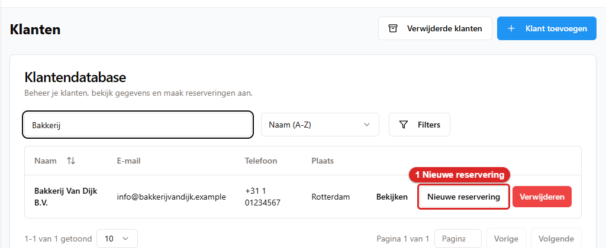
   *Het scherm **Klanten**, gezocht op "Bakkerij": 1 **Nieuwe reservering**.*
2. Vul eerst **Startdatum** en **Einddatum** in. Pas daarna toont de app alleen de vrije auto's.
   Onder de velden staat **Duur:** met het aantal dagen.

   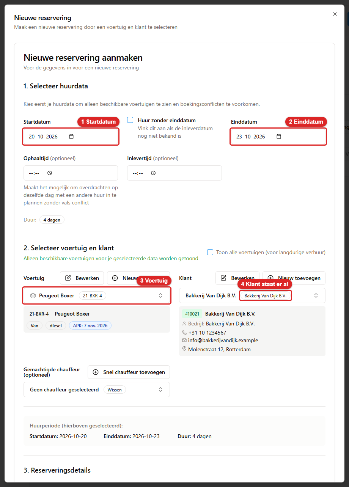
   *Het venster **Nieuwe reservering**: 1 **Startdatum**, 2 **Einddatum**, 3 **Voertuig**, 4 de
   klant staat er al.*
3. Klik op **Voertuig** → **Zoek en selecteer een voertuig...**. Typ een deel van het kenteken, het
   merk of het model. Klik op de auto. Staat je auto er niet bij? Dan is hij in die periode bezet.

   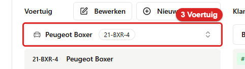
   *Zo ziet het veld **Voertuig** eruit als je een auto gekozen hebt.*
4. Kijk bij **Klant** of de goede klant er staat.

   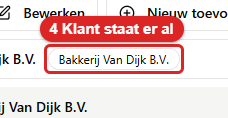
   *De klant staat er al. Kijk of het de goede is.*
5. Kies eventueel een **Gemachtigde chauffeur (optioneel)**. Dat is de persoon die gaat rijden.
6. Kijk bij **3. Reserveringsdetails** naar de **Totaalprijs (€) (optioneel)**. De app vult die zelf
   in: de dagprijs van de auto maal het aantal dagen. Moet de auto bij de klant gebracht worden? Zet
   dan **Bezorgservice vereist** aan. Meer hierover staat in [hoofdstuk 5](05-reserveringen.md),
   paragraaf 5.3.
7. Klik onderaan op **Reservering aanmaken**. De reservering staat nu op **Geboekt**.

   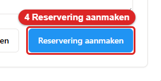
   *Zo ziet de knop **Reservering aanmaken** eruit. Klik erop.*

Het venster sluit. Linksonder zie je de melding *Reservering succesvol aangemaakt*. In die melding
staat twaalf seconden lang de knop **Nu ophalen**.

### Stap 4: Nu ophalen

8. Neemt de klant de auto nu meteen mee? Klik dan in de melding op **Nu ophalen**. Je ziet nu het
   venster **Ophaalproces starten**.

   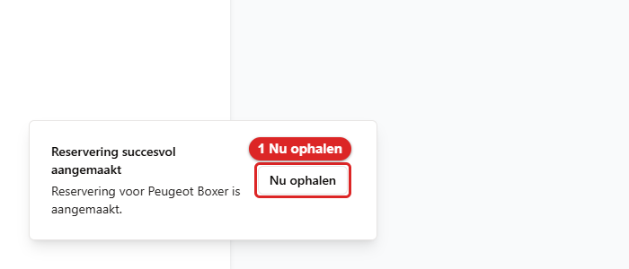
   *De melding na het aanmaken: 1 **Nu ophalen**. De knop staat er twaalf seconden.*

Komt de klant pas later? Laat de melding dan gaan. Op de dag zelf start je het ophalen op een andere
manier. Dat staat aan het eind van deze paragraaf bij "Een andere start".

Maakte je de reservering via een leeg vakje in de kalender? Dan blijft het venster open met een groen
blok. Daar staat dezelfde knop **Nu ophalen**. De tekst in dat blok zegt dat het contract al gemaakt
is. Dat klopt niet. Het contract maakt de app pas bij het ophalen.

### Stap 5: het ophaalvenster en de schadecheck

Een schadecheck is een overzicht van de schade aan de auto op dat moment. Je maakt hem samen met de
klant.

1. Zie je eerst het venster **Voertuigopmerkingen - Ophaalwaarschuwing**? Lees de opmerkingen. Klik
   dan op **Ik bevestig & ga door**. Je ziet deze waarschuwing alleen als de opmerking bij de auto is
   veranderd sinds de vorige keer. Anders zie je een groen blok *Voertuigopmerkingen bevestigd*.
2. Kijk bovenin bij **Voertuiginformatie** naar het kenteken, de auto en de klant. Klopt dat niet?
   Klik dan op **Annuleren**.
3. **Contractnummer** staat al ingevuld. Laat het staan. **Ophaaldatum** staat op vandaag.
4. Lees de kilometerteller af. Typ het getal bij **Kilometerstand bij ophalen**. Kies bij
   **Brandstofniveau bij ophalen** hoe vol de tank is.

   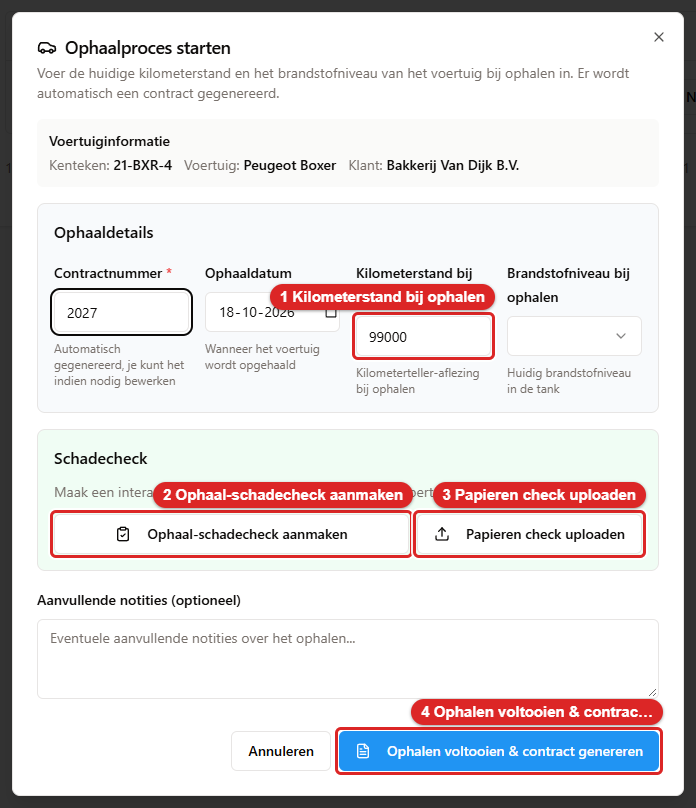
   *Het venster **Ophaalproces starten**: 1 **Kilometerstand bij ophalen**, 2 **Ophaal-schadecheck
   aanmaken**, 3 **Papieren check uploaden**, 4 **Ophalen voltooien & contract genereren**.*

   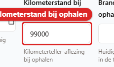
   *Zo ziet het veld **Kilometerstand bij ophalen** eruit. Typ hier de stand van de teller.*
5. Klik op **Ophaal-schadecheck aanmaken**. Je ziet nu de schadecheck met een tekening van de auto.
   Kies een schadetype, zoals **Deuk** of **Kras**. Klik daarna op de plek in de tekening. Laat de
   klant tekenen bij **Handtekening klant**. Klik op **Check opslaan**. Je ziet *Schadecheck
   succesvol opgeslagen*. Klik op **Sluiten**. Heb je een check op papier gemaakt? Klik dan op
   **Papieren check uploaden**.

   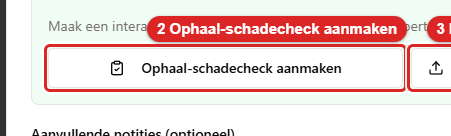
   *Zo ziet de knop **Ophaal-schadecheck aanmaken** eruit. Klik erop.*
6. Zet bijzonderheden in **Aanvullende notities (optioneel)**.
7. Klik op **Ophalen voltooien & contract genereren**. Genereren betekent: de app maakt het document
   zelf.

   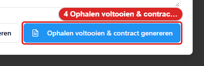
   *Zo ziet de knop **Ophalen voltooien & contract genereren** eruit. Klik erop. Daarna zie je
   **Contract klaar**.*

> **Waarom je de kilometerstand en de brandstof echt afleest.** Deze twee waarden zijn het enige
> vaste punt bij het inleveren. Vul je iets in wat je niet gezien hebt? Dan kun je later niet meer
> bewijzen wat er verschilt. Dat geldt voor jou en voor de klant.

> **Waarom het contract pas bij het ophalen komt.** De app maakt het contract met de gegevens van dat
> moment. Bij het ophalen is de huur definitief. Verandert er daarna toch iets? Dan krijgt het
> contract het label **Verouderd** (16.3).

### Als de huur eerder begint

Haalt de klant de auto op vóór de startdatum van de reservering? Dan vraagt de app eerst **De huur
start eerder — datum aanpassen?**

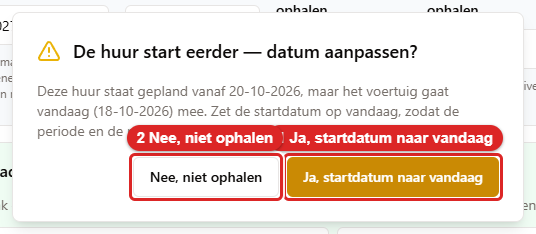
*De vraag **De huur start eerder — datum aanpassen?**: 1 **Ja, startdatum naar vandaag**, 2 **Nee,
niet ophalen**.*

- Gaat de huur vandaag in? Klik dan op **Ja, startdatum naar vandaag**. De startdatum wordt vandaag.
  De app rekent de prijs opnieuw uit. In de notities van de reservering komt een regel dat de huur
  eerder is ingegaan.
- Krijgt de klant de auto nog niet mee? Klik dan op **Nee, niet ophalen**. Er verandert niets.

Let hierop bij het scannen. Een auto met een huur van volgende week kun je vandaag al ophalen. Deze
vraag is dan je laatste kans om het te zien.

Je kunt ook nog deze vensters tegenkomen:

| Venster | Wat er is | Wat je doet |
|---|---|---|
| **Overschrijven & doorgaan** | Het contractnummer bestaat al | Controleer het nummer. Ga alleen door als het klopt |
| **Kilometerstand-overschrijving vereist** | De stand is lager dan wat de app kent | Lees de teller opnieuw af |
| **Uitgifte geblokkeerd** | De auto staat op onderhoud | Los eerst de werkplaatsstatus op (16.4). Alleen een beheerder kan met een reden **Toch uitgeven** |

### Stap 6: Contract klaar en het contract mailen

Je ziet de melding *Ophalen voltooid*. Daarna opent het venster **Contract klaar**.

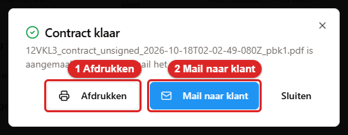
*Het venster **Contract klaar**: 1 **Afdrukken**, 2 **Mail naar klant**.*

1. Tekent de klant op papier? Klik dan op **Afdrukken**.
2. Wil je het contract mailen? Klik op **Mail naar klant**. Je ziet nu het venster **Documenten
   e-mailen naar klant**.

   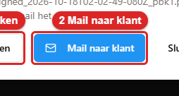
   *Zo ziet de knop **Mail naar klant** eruit. Klik erop.*
3. Kijk onder **Selecteer documenten** of het contract is aangevinkt.

   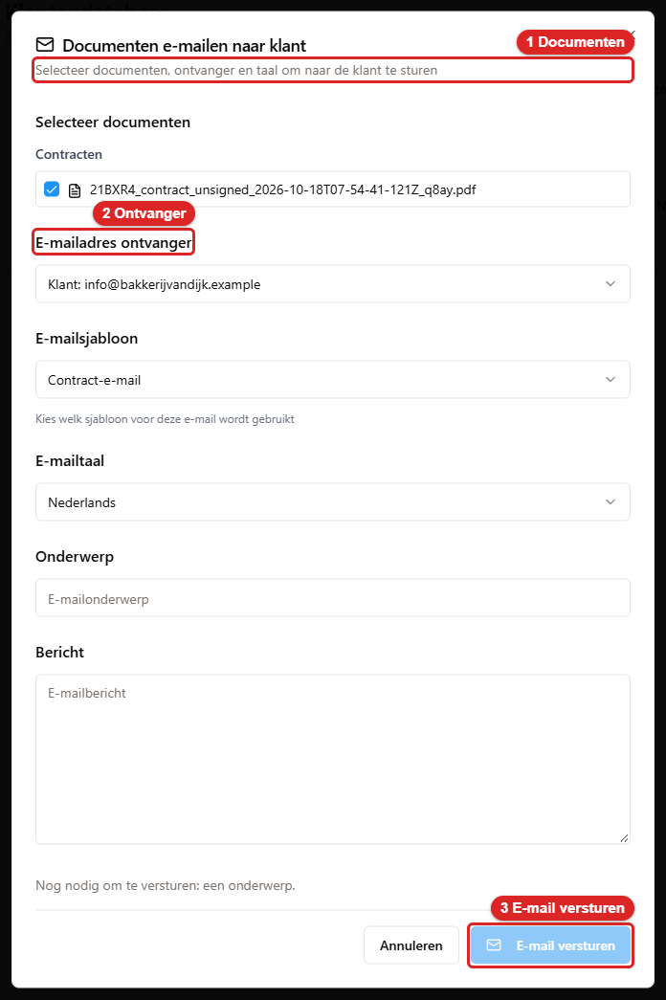
   *Het venster **Documenten e-mailen naar klant**: 1 de documenten, 2 **E-mailadres ontvanger**, 3
   **E-mail versturen**.*
4. Kies het **E-mailadres ontvanger**. Kies het **E-mailsjabloon**. Een sjabloon is een vaste tekst
   die de app gebruikt.
5. Is **Onderwerp** leeg? Vul het dan in. Zonder onderwerp blijft **E-mail versturen** grijs. Onderaan
   staat dan *Nog nodig om te versturen: een onderwerp.*
6. Klik op **E-mail versturen**. Je ziet *E-mail succesvol verstuurd naar …*.

   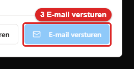
   *Zo ziet de knop **E-mail versturen** eruit. Hij is grijs zolang er nog iets ontbreekt.*

De reservering staat nu op **Opgehaald**. De auto staat op **Verhuurd**.

**Zie je Contract klaar niet?** Begon je het ophalen vanuit de **Reserveringskalender**? Dan kan het
venster **Contract klaar** achter het venster **Reserveringsdetails** terechtkomen. Sluit dan het
venster **Reserveringsdetails**. Daarachter staat **Contract klaar**.

**Zie je Contract kon niet gemaakt worden?** Klik dan op **Opnieuw proberen**. Sluit dit venster
niet zomaar. Er is daarna geen andere knop in de reservering om het contract alsnog te maken.

### Stap 7: het ondertekende contract bewaren

1. Klik links op **Reserveringen**. Klik in de kalender op de reservering. Je ziet nu het venster
   **Reserveringsdetails** met het label **Opgehaald**.
2. Klik onder **Documenten** op **+ Contract (ondertekend)**. Kies de scan of foto van het getekende
   contract op je computer. Je ziet *… succesvol geüpload*.

   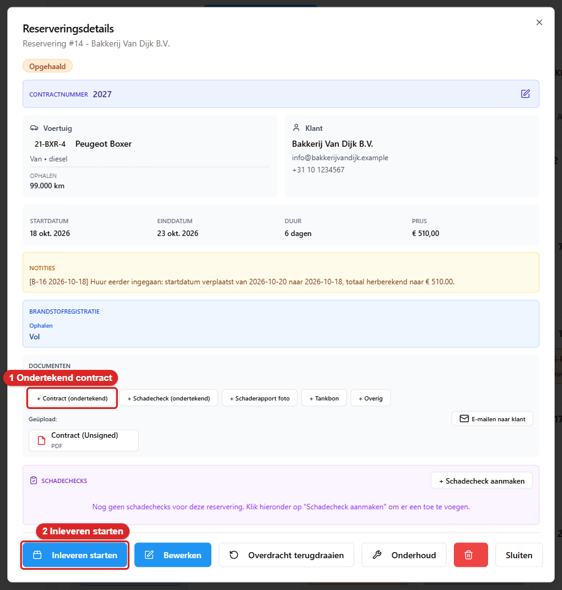
   *Het venster **Reserveringsdetails** van een opgehaalde huur: 1 **+ Contract (ondertekend)**, 2
   **Inleveren starten**.*

   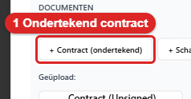
   *Zo ziet de knop **+ Contract (ondertekend)** eruit. Klik erop en kies het bestand.*

### Stap 8: inleveren, met de schadecheck vóór het afronden

De klant brengt de auto terug. Neem hem meteen in.

1. Open de reservering zoals in stap 7. Klik op **Inleveren starten**. Je ziet nu het venster
   **Inleverproces starten**. Je kunt ook op het Dashboard beginnen. Dat staat hieronder bij "Een
   andere start".

   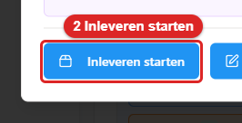
   *Zo ziet de knop **Inleveren starten** eruit. Klik erop.*
2. **Inleverdatum** staat op vandaag. Lees de teller af. Typ het getal bij **Kilometerstand bij
   inleveren**. Dat getal mag niet lager zijn dan bij het ophalen. Anders zie je **Ongeldige
   kilometerstand** en kun je niet verder.

   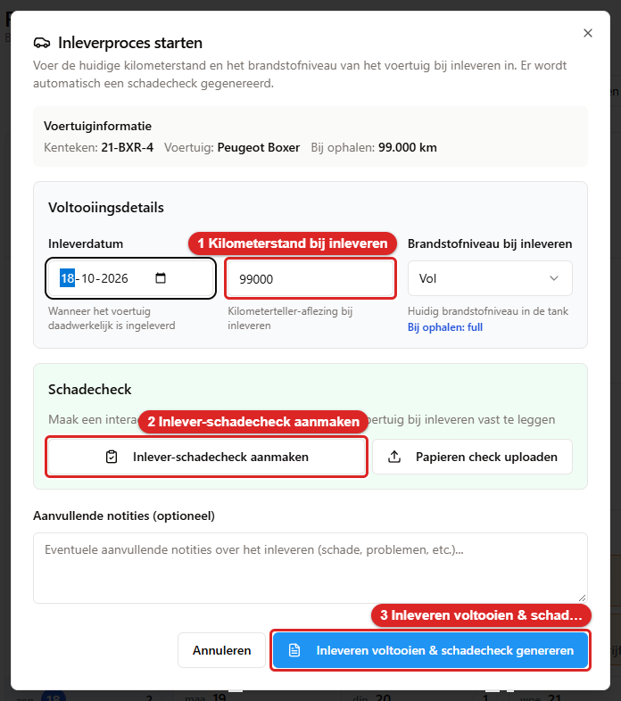
   *Het venster **Inleverproces starten**: 1 **Kilometerstand bij inleveren**, 2 **Inlever-schadecheck
   aanmaken**, 3 **Inleveren voltooien & schadecheck genereren**.*
3. Kies **Brandstofniveau bij inleveren**. Onder het veld staat *Bij ophalen:* met de stand van toen.
   Daar staat soms een Engels woord, zoals *full*. Dat betekent vol.
4. Klik op **Inlever-schadecheck aanmaken**. De app laat de schade van het ophalen zien. Markeer
   alleen de nieuwe schade. Klik op **Check opslaan**. Doe dit altijd vóór stap 6.

   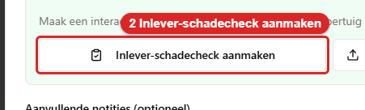
   *Zo ziet de knop **Inlever-schadecheck aanmaken** eruit. Klik erop en sla de check op.*
5. Zet bijzonderheden in **Aanvullende notities (optioneel)**. Denk aan schade, een ontbrekende
   sleutel of een vuile auto.
6. Klik op **Inleveren voltooien & schadecheck genereren**.

   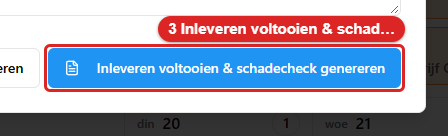
   *Zo ziet de knop **Inleveren voltooien & schadecheck genereren** eruit. Klik erop als de check is
   opgeslagen.*

> **Waarom de schadecheck vóór het afronden.** Het schadeformulier neemt de laatst opgeslagen check.
> Heb je de check niet opgeslagen? Dan is het formulier leeg. Een check die je na het afronden maakt,
> komt niet meer in het formulier. De melding na het inleveren zegt altijd dat de schadecheck gemaakt
> is. Ook als je geen check hebt opgeslagen.

Je ziet de melding *Inleveren voltooid*. Daarna opent het venster **Schadeformulier klaar**.

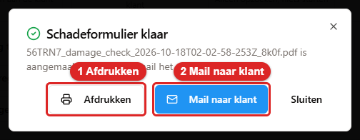
*Het venster **Schadeformulier klaar**: 1 **Afdrukken**, 2 **Mail naar klant**.*

7. Klik op **Afdrukken** of op **Mail naar klant**. Mailen gaat net als bij het contract in stap 6.
   Ook dit venster kan op het kalenderpad achter **Reserveringsdetails** staan.

   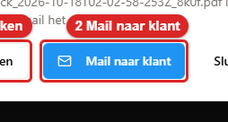
   *Zo ziet de knop **Mail naar klant** eruit. Klik erop om het schadeformulier te mailen.*

**Bij het inleveren kun je niets bij de klant in rekening brengen.** Er is geen knop voor
schadekosten, brandstof of extra kilometers. Leg de schade vast in de check en in de notities. De
reparatie boek je als kosten met de categorie **Schade** (16.6). De rekening voor de klant maak je
buiten de app.

### Wat er vanzelf verandert

| Moment | Wat de app zelf doet |
|---|---|
| Na **Reservering aanmaken** | De reservering staat op **Geboekt**. Met **Bezorgservice vereist** maakt de app ook een transport |
| Na het ophalen | De reservering staat op **Opgehaald**. De auto staat op **Verhuurd**. Het contract staat bij de documenten |
| Na het inleveren | De reservering staat meteen op **Voltooid**. Er is geen aparte afrondstap. De auto is weer vrij |
| Na het inleveren, wat **niet** verandert | De afgesproken einddatum blijft staan. De echte inleverdatum staat apart. Een werkplaatsstatus blijft staan. Een transport voor het terughalen rond je zelf af ([hoofdstuk 6](06-transport.md)) |

Komt de auto kapot terug? Zet hem dan zelf op onderhoud (16.4). Heb je per ongeluk de verkeerde auto
ingenomen? Dan draai je het terug met **Overdracht terugdraaien** ([hoofdstuk 5](05-reserveringen.md),
paragraaf 5.14). Het scheelt veel uitzoekwerk als je het kenteken en de klant vóór het afronden
controleert.

> **Waarom je de auto inneemt op het moment dat hij binnenkomt.** Zolang je hem niet inneemt, staat
> hij als verhuurd. Je collega ziet hem niet als vrij. Na de einddatum komt hij bij de achterstallige
> verhuringen. Dan moet iemand later uitzoeken of hij terug is. Innemen kost een minuut. Uitzoeken kost
> er tien.

### Een andere start: Ophalen starten op het Dashboard, met scannen

Op de dag zelf is dit de snelste manier. Je scant het sleutellabel. Een sleutellabel is het label met
een streepjescode aan de sleutel.

1. Klik op het **Dashboard** bij **Snelle acties** op **Ophalen starten**. Je ziet nu het venster
   **Ophalen starten**.
2. Scan het sleutellabel. Of typ het kenteken en klik op **Zoeken**. Je ziet nu meteen het venster
   **Ophaalproces starten**.

   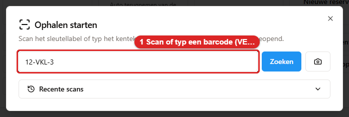
   *Het venster **Ophalen starten**: 1 het veld **Scan of typ een barcode (VEH-... / RES-... /
   kenteken)**. Hier staat het kenteken 12-VKL-3 al ingetypt.*
3. Ga verder zoals in stap 5. Na **Contract klaar** sluit het scanvenster vanzelf.

Terugnemen werkt net zo. Klik op het **Dashboard** op **Innemen starten**. Scan het sleutellabel. Je
ziet meteen het venster **Inleverproces starten**. Ga dan verder zoals in stap 8. Let op de namen. Op
het Dashboard heet de knop **Innemen starten**. In de reservering en op het scanscherm heet hij
**Inleveren starten**. Het is hetzelfde.

Opent het venster niet? Dan past de handeling niet bij de auto. Je wilt bijvoorbeeld innemen, maar
de auto staat in de app niet als opgehaald. Zoek de reservering dan op via het zoekveld bovenaan. Kijk
welke status ze heeft.

Het scherm **Scannen** links in het menu werkt anders. Daar zie je na het scannen alleen een kaartje
met tegels. Het start niets vanzelf. Zie [hoofdstuk 18](18-barcode-en-scannen.md).

---

## 16.3 Een huur verlengen of wijzigen

De klant wil langer doorrijden, een andere auto of de huur op een ander bedrijf. Dat wijzig je in het
volledige reserveringsvenster. Het korte venster uit de kalender heeft deze knoppen niet.

1. Typ in het zoekveld bovenaan het kenteken of de naam van de klant. Klik onder **Reserveringen** op
   de goede regel. Je ziet nu het venster **Reserveringsdetails** met alle wijzigknoppen.

   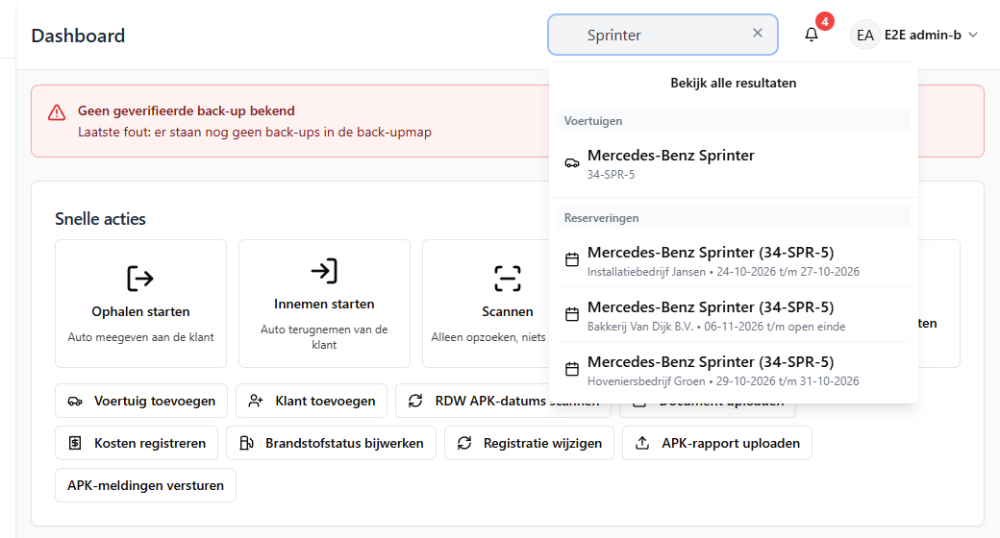
   *Het zoekveld bovenaan, gezocht op "Sprinter". Onder **Reserveringen** staan de huren van die
   auto, met de klant en de periode.*
2. Klik op **Datums wijzigen**. Je ziet nu het venster **Datums wijzigen**. Deze knop staat er
   altijd, ook als de auto al is opgehaald.

   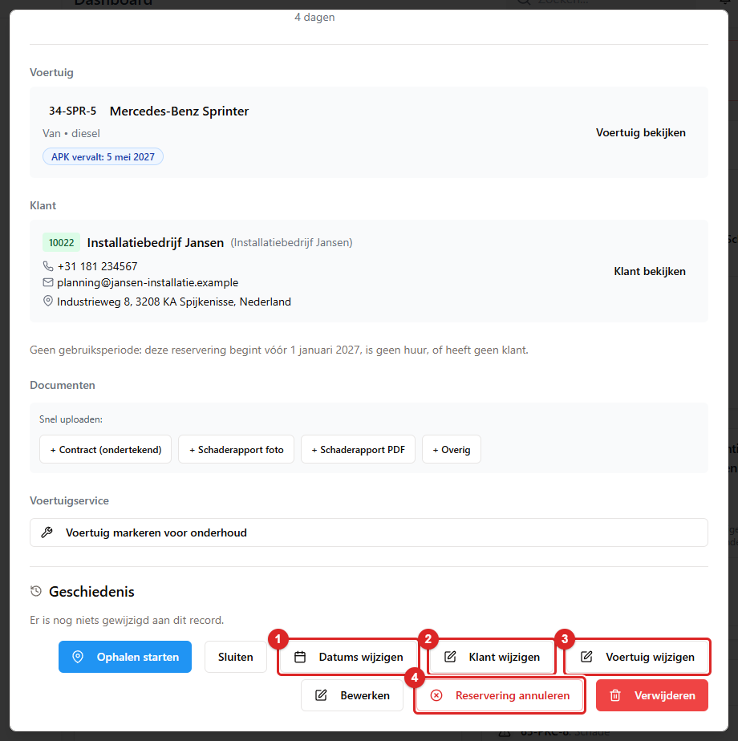
   *Het volledige venster **Reserveringsdetails**: 1 **Datums wijzigen**, 2 **Klant wijzigen**, 3
   **Voertuig wijzigen**, 4 **Reservering annuleren**.*

   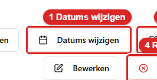
   *Zo ziet de knop **Datums wijzigen** eruit. Klik erop.*
3. Pas **Begindatum** of **Einddatum** aan. Klik op **Opslaan**. Je ziet *Datums gewijzigd*. Botst de
   nieuwe periode met een andere boeking? Dan zie je **Datums wijzigen mislukt**.

   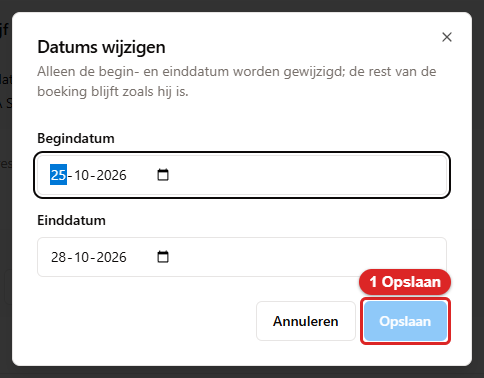
   *Het venster **Datums wijzigen**: 1 **Opslaan**.*
4. Een andere auto of een andere klant gaat net zo. Klik op **Voertuig wijzigen** of **Klant
   wijzigen**. Kies de nieuwe. Klik op **Opslaan**.

Nu klopt het contract niet meer. De app geeft het contract het label **Verouderd**. Maak een nieuwe
versie.

5. Klik links op **Documenten**. Je ziet het tabblad **Documentbibliotheek**. Klap de auto open.
   Onder **Contracten** staat het contract met het label **Verouderd**.

   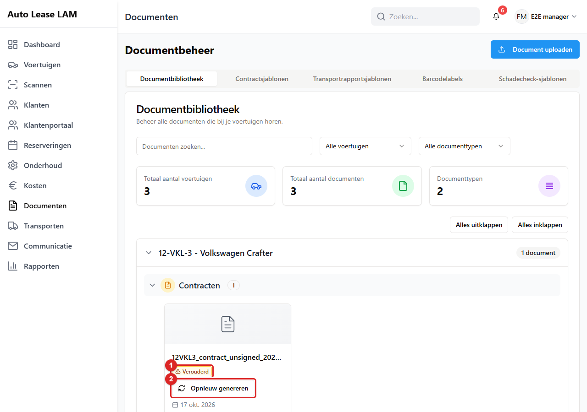
   *De **Documentbibliotheek**: 1 het label **Verouderd**, 2 **Opnieuw genereren**.*
6. Klik op **Opnieuw genereren**. Je ziet *Nieuwe versie aangemaakt*. Deze knop staat alleen in de
   **Documentbibliotheek**. In de reservering zit hij niet.

   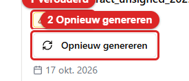
   *Zo ziet de knop **Opnieuw genereren** eruit. Klik erop.*
7. Stuur de nieuwe versie naar de klant. Dat kan in de bibliotheek met **E-mailen**. Of in de
   reservering bij **Geüpload:** met **E-mailen naar klant**.

> **Waarom je bij elke wijziging aan het contract denkt.** De klant heeft het oude contract. De app
> zet er wel **Verouderd** bij. Maar de app mailt de klant niet vanzelf een nieuwe versie. Dat doe je
> zelf.

> **Waarom je soms zelf belt.** Alleen een klant met een portaalaccount krijgt vanzelf bericht van
> een wijziging. Een klant zonder account hoort niets. Bel of mail die klant zelf. Zie
> [hoofdstuk 9](09-email.md), paragraaf 9.8.

**Wat je verder kunt tegenkomen:**

| De klant zegt | Wat je doet |
|---|---|
| "Ik breng hem eerder terug" | Doe nu niets. Neem de auto in op de dag dat hij er is (16.2, stap 8) |
| "Ik wil annuleren" | Klik in het volledige venster op **Reservering annuleren**. Vink aan wat mee moet onder **Hieraan hangt nog:**. Zie [hoofdstuk 5](05-reserveringen.md), paragraaf 5.9 |
| "Ik heb schade" | Zet het in de notities van de reservering. Plan zo nodig onderhoud in (16.4) |
| "Ik heb een bekeuring gekregen" | Zie 16.7 |
| De klant vraagt de verlenging via het portaal | Zie 16.8 |

Is de reservering nog **Geboekt**? Dan kun je het blok in de kalender ook naar andere dagen slepen.
De app vraagt dan **Reservering verplaatsen?** Klik op **Verplaatsen**.

---

## 16.4 Een auto naar de werkplaats

Bij deze werkstroom is de volgorde het allerbelangrijkst:

1. Zet de auto **eerst** op onderhoud.
2. Regel **dan** de vervanger voor de klant.
3. Regel het transport als de auto gehaald of gebracht moet worden.
4. Rond het onderhoud af met één knop. Dan is de auto weer vrij.

> **Waarom de auto eerst op onderhoud gaat.** Een auto op onderhoud geeft de app niet mee aan een
> klant. Doe je het andersom? Dan staat de kapotte auto in de tussentijd als vrij in de lijst. Een
> collega die dan een vervanger zoekt, pakt hem misschien. Zo wordt een auto twee keer uitgegeven.

### Het onderhoud plannen

Hiervoor heb je het recht **Reserveringen beheren** nodig. Alleen **Onderhoud beheren** is niet
genoeg.

1. Klik links op **Onderhoud**. Je ziet de **Onderhoudskalender**. Klik rechtsboven op **Onderhoud
   plannen**. Je ziet nu het venster **Onderhoud plannen**.

   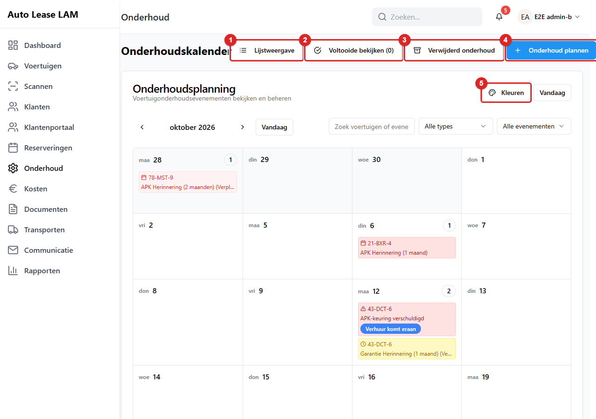
   *De **Onderhoudskalender**: 1 **Lijstweergave**, 2 **Voltooide bekijken (0)**, 3 **Verwijderd
   onderhoud**, 4 **Onderhoud plannen**, 5 **Kleuren**.*

   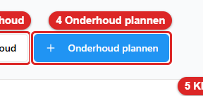
   *Zo ziet de knop **Onderhoud plannen** eruit. Klik erop.*
2. Kies het **Voertuig**. Kies eventueel de **Klant** die de auto brengt. Kies het
   **Onderhoudstype**, bijvoorbeeld **APK-keuring**.

   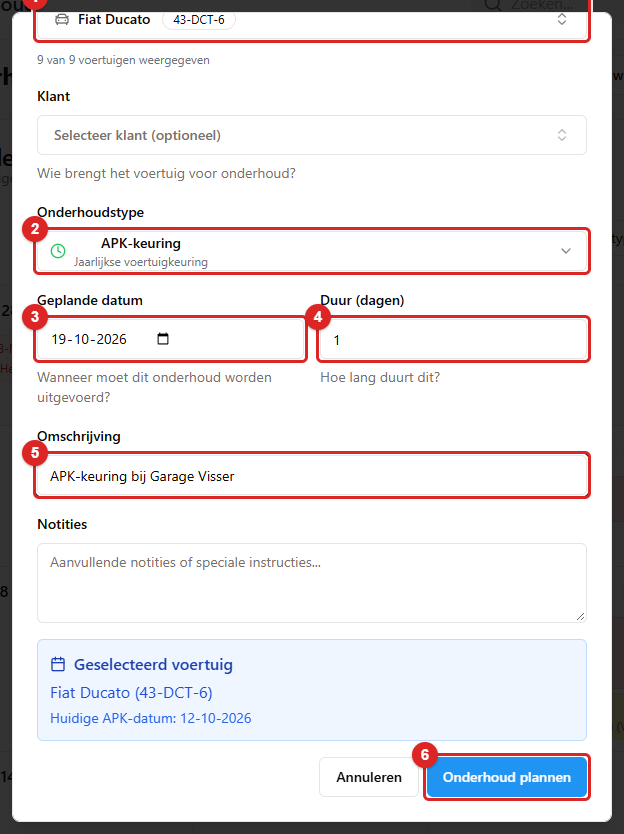
   *Het venster **Onderhoud plannen**: 1 **Voertuig**, 2 **Onderhoudstype**, 3 **Geplande datum**, 4
   **Duur (dagen)**, 5 **Omschrijving**, 6 **Onderhoud plannen**.*
3. Vul **Geplande datum** en **Duur (dagen)** in. Vul de **Omschrijving** in.
4. Klik op **Onderhoud plannen**. Loopt er geen huur op die auto? Dan zie je *Onderhoud gepland*. Het
   blok staat in de kalender. De auto krijgt de status **Gepland**.

   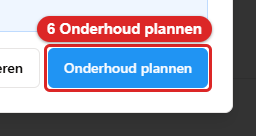
   *Zo ziet de knop **Onderhoud plannen** onderaan het venster eruit. Klik erop.*

### De vervanger kiezen

5. Loopt er in die periode een huur op de auto? Dan zie je nu het venster **Vervangende voertuigen
   toewijzen**. Kies per klant onder **Vervoersoplossing:** een van de drie:
   - **Nu vervangend voertuig toewijzen**: je kiest meteen een vrije auto.
   - **Later vervanger toewijzen (nog te bepalen)**: de app maakt een placeholder. Een placeholder is
     een plek die alvast vastgehouden wordt. Je kiest de auto later.
   - **Klant regelt eigen vervoer**.

   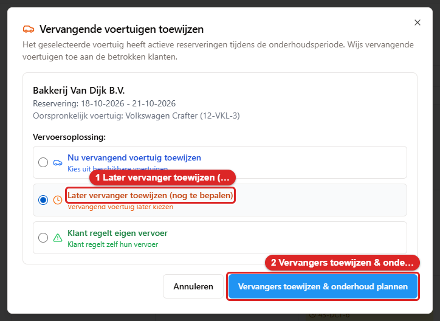
   *Het venster **Vervangende voertuigen toewijzen**: 1 **Later vervanger toewijzen (nog te
   bepalen)**, 2 **Vervangers toewijzen & onderhoud plannen**.*
6. Klik op **Vervangers toewijzen & onderhoud plannen**. Ben je een klant vergeten? Dan zie je
   **Ontbrekende toewijzingen vervangend voertuig**. Kies dan alsnog iets voor die klant.

   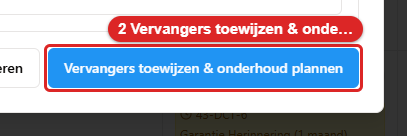
   *Zo ziet de knop **Vervangers toewijzen & onderhoud plannen** eruit. Klik erop.*

Koos je **Later vervanger toewijzen (nog te bepalen)**? Dan staat de vervanger op het Dashboard bij
**Nog te bepalen**. Hoe je hem daar toewijst, staat verderop bij "Een onderhoudsaanvraag van een
klant".

> **Waarom je via Onderhoud plannen werkt.** Dit venster controleert of je voor elke klant iets hebt
> gekozen. Zet je de status los om? Dan houdt niets je tegen. Je ontdekt dan pas op de dag zelf dat
> er een klant zonder auto staat.

Er zijn nog andere ingangen. In het volledige venster **Reserveringsdetails** staat bij
**Voertuigservice** de knop **Voertuig markeren voor onderhoud**. Op het scanscherm staat de tegel
**Onderhoud inplannen**. Zie [hoofdstuk 7](07-onderhoud.md), paragraaf 7.2 en 7.5.

### Het transport regelen

Moet de auto naar de garage gebracht worden? Of moet de vervanger naar de klant? Maak dan een
transport. Een transport is een rit.

7. Klik links op **Transporten**. Klik op **Nieuw transport**. Je ziet nu het venster **Transport
   registreren**.

   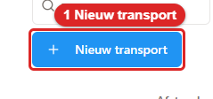
   *Zo ziet de knop **Nieuw transport** (1) eruit. Klik erop.*
8. Kies het **Type**, bijvoorbeeld **Voertuigwissel**. Kies het **Voertuig**. Krijgt de klant een
   vervanger? Vink dan **Vervangend voertuig vereist** aan. Vul de **Geplande datum** in.

   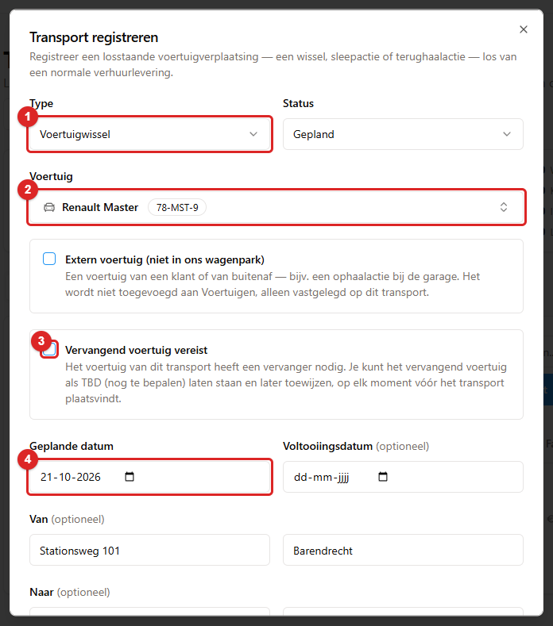
   *Het venster **Transport registreren**: 1 **Type**, 2 **Voertuig**, 3 het vinkje **Vervangend
   voertuig vereist**, 4 **Geplande datum**.*
9. Vul **Van** en **Naar** in. Vul eventueel de **Chauffeur** in. Klik op **Transport registreren**.
   Je ziet *Transport geregistreerd*.

   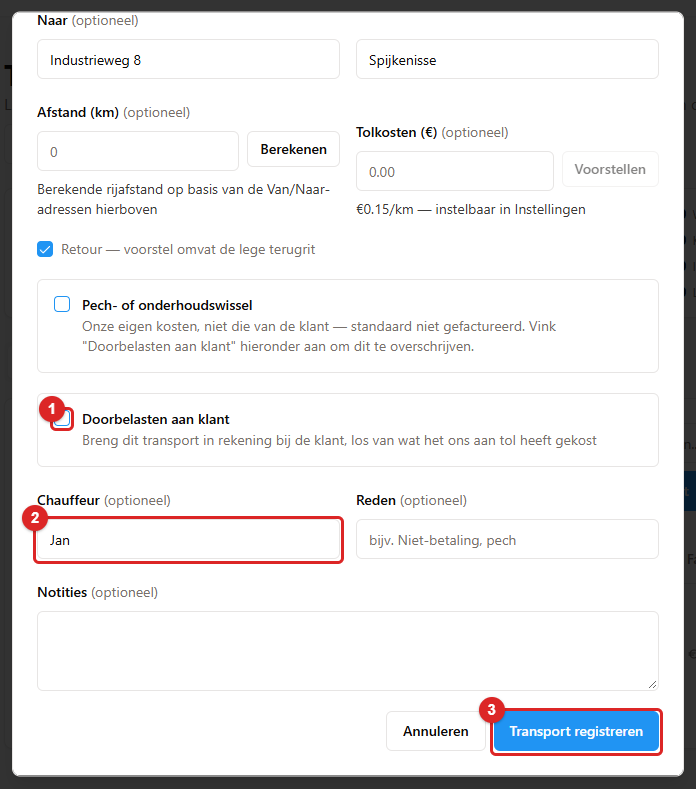
   *Onderaan het venster: 1 het vinkje **Doorbelasten aan klant**, 2 **Chauffeur (optioneel)**, 3
   **Transport registreren**.*

   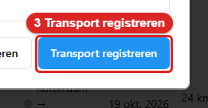
   *Zo ziet de knop **Transport registreren** eruit. Klik erop.*
10. Is de rit gereden? Klik op het **Transportdashboard** bij het transport op **Markeren als
    voltooid**. Je ziet de vraag **Transport afronden?** Klik op **Afronden**. Je ziet *Transport
    gemarkeerd als voltooid*.

    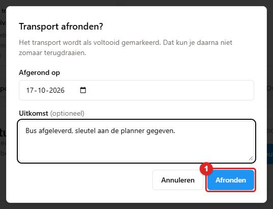
    *De vraag **Transport afronden?**: 1 **Afronden**.*

Let op bij **Pech- of onderhoudswissel**. Vink je dat aan bij een transport met vervanger? Dan zet de
app de auto bij het opslaan op onderhoud. Rond je dat transport af of annuleer je het? Dan haalt de app
die werkplaatsstatus weer weg. Staat de auto dan nog in de werkplaats? Zet hem dan opnieuw op
onderhoud. Meer over transport staat in [hoofdstuk 6](06-transport.md).

### De auto komt binnen en het onderhoud is klaar

11. Staat de auto bij de garage? Klik in de **Onderhoudskalender** op **Lijstweergave**. Open het
    tabblad **Gepland (…)**. Klik op **Binnen melden**. Je ziet *Voertuig binnen gemeld*. Hiervoor
    heb je het recht **Voertuigen beheren** nodig.

    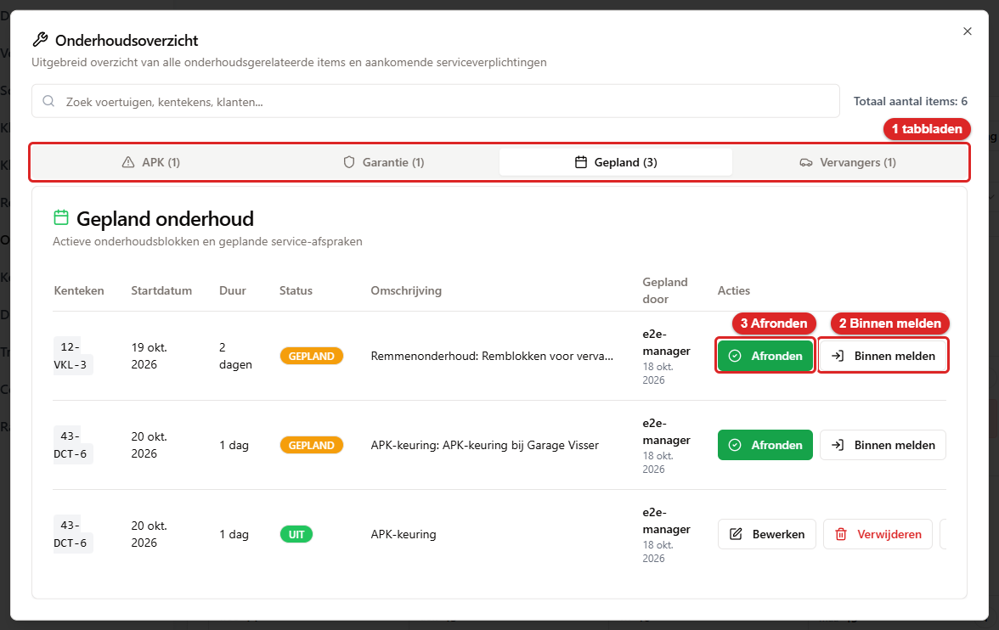
    *Het **Onderhoudsoverzicht**, tabblad **Gepland**: 1 de tabbladen, 2 **Binnen melden**, 3
    **Afronden**.*
12. Is het onderhoud klaar? Klik in de kalender op de dag. Je ziet het venster
    **Onderhoudsevenementen**. Klik bij het blok op **Afronden**. Je ziet nu het venster **Onderhoud
    afronden**. Je kunt ook **Afronden** gebruiken op het tabblad **Gepland**.

    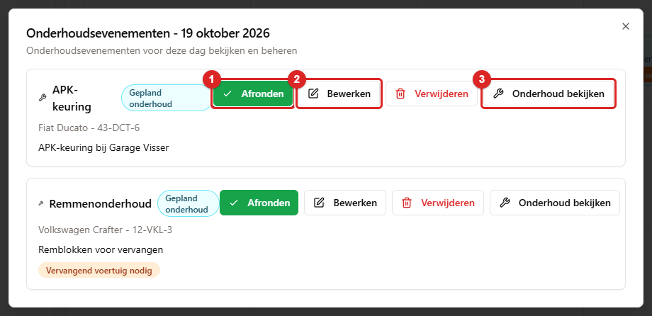
    *Het venster **Onderhoudsevenementen**: 1 **Afronden**, 2 **Bewerken**, 3 **Onderhoud bekijken**.*

    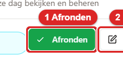
    *Zo ziet de knop **Afronden** eruit. Klik erop.*
13. Zet **Afrondingsdatum** op de dag dat de auto klaar was. Kijk goed naar **APK-datum**. Dat veld
    staat al ingevuld en de app slaat het altijd op. Is de auto niet gekeurd? Maak het veld dan leeg.
    Vul de **Huidige kilometerstand (km)** en de **Onderhoudsdetails** in.

    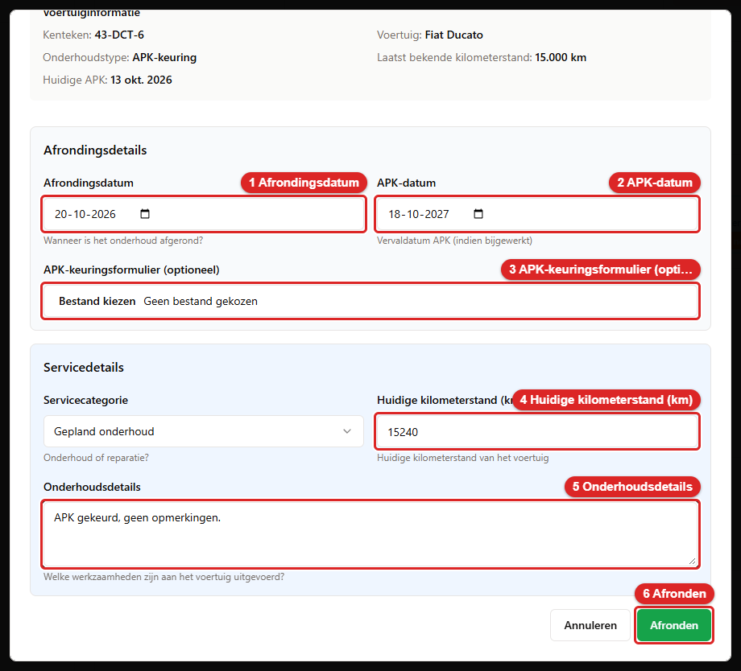
    *Het venster **Onderhoud afronden**: 1 **Afrondingsdatum**, 2 **APK-datum**, 3
    **APK-keuringsformulier (optioneel)**, 4 **Huidige kilometerstand (km)**, 5 **Onderhoudsdetails**,
    6 **Afronden**.*
14. Klik op **Afronden**. Je ziet *Onderhoud afgerond*.

    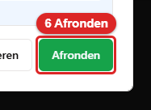
    *Zo ziet de knop **Afronden** eruit. Klik erop.*

Daarna doet de app in één keer: het blok sluiten, de werkplaatsstatus weghalen, de APK-datum en de
kilometerstand bijwerken en een open vervanger van deze auto afsluiten. De auto staat weer op
**Beschikbaar**.

> **Waarom je zelf afrondt.** De werkplaatsstatus verdwijnt niet vanzelf. Niet als je de auto
> inneemt. En niet als de einddatum van het onderhoud voorbij is. Dat is met opzet. Een auto die
> kapot naar binnen ging, mag er niet stilletjes weer uitkomen. Met **Afronden** geef je hem in één
> keer vrij.

Zette je de auto op onderhoud via **Voertuig markeren voor onderhoud** in de reservering? Rond dan af
met **Terug van onderhoud** in die reservering. Of gebruik **Terug uit onderhoud** op het scanscherm.
Zie [hoofdstuk 7](07-onderhoud.md), paragraaf 7.6 en 7.7.

### Een onderhoudsaanvraag van een klant, met vervanger

Een klant met een portaalaccount kan zelf onderhoud aanvragen. Zo plan je dat in en geef je de klant
een vervanger.

1. Klik links op **Klantenportaal**. Klik in **Aandacht nodig** op de aanvraag **Onderhoud/storing**.
   Je ziet nu het venster **Aanvraag #…**. Bovenaan staat wat de klant meldt. Je ziet ook of de klant
   vervangend vervoer wil.
2. Vul onder **Inplannen in de onderhoudskalender** de **Datum**, **Duur (dagen)** en **Soort** in.
   Alleen werkdagen kunnen. Schrijf eventueel een **Notitie voor de klant**. Klik op **Inplannen en
   bevestigen**. Je ziet *Onderhoud #… staat in de kalender*.

   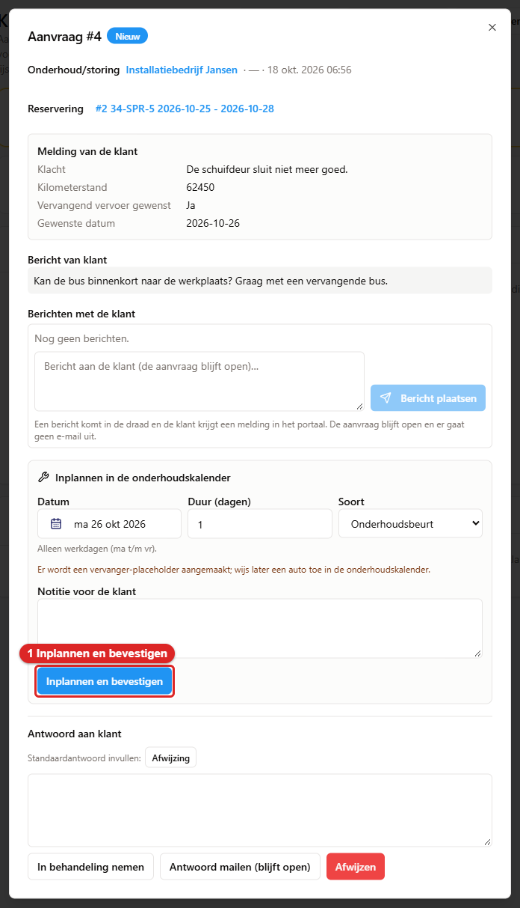
   *Het venster **Aanvraag #4**, type **Onderhoud/storing**: 1 **Inplannen en bevestigen**.*

   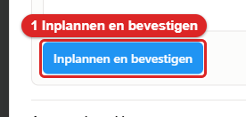
   *Zo ziet de knop **Inplannen en bevestigen** eruit. Klik erop.*

   In het venster staat *Er wordt een vervanger-placeholder aangemaakt; wijs later een auto toe in de
   onderhoudskalender.* Dat klopt niet altijd. De app maakt de placeholder alleen als de datum binnen
   de huur van de klant valt. Valt de datum erbuiten? Dan komt er geen placeholder. Kijk daarom na het
   inplannen op het Dashboard bij **Nog te bepalen**. Staat de vervanger er niet? Regel hem dan zelf.
   Zie [hoofdstuk 7](07-onderhoud.md), paragraaf 7.4.
3. Ga naar het **Dashboard**. Open bij **Beheer vervangende voertuigen** het tabblad **Nog te
   bepalen**. Klik bij de regel *Vervangend voertuig (nog te bepalen)* op **Voertuig toewijzen**. Je
   ziet nu het venster **Vervangende voertuigen toewijzen**.

   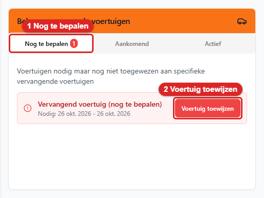
   *Het blok **Beheer vervangende voertuigen**: 1 het tabblad **Nog te bepalen**, 2 **Voertuig
   toewijzen**.*

   
   *Zo ziet de knop **Voertuig toewijzen** eruit. Klik erop.*
4. Kies bij **Selecteer voertuig** een auto in de lijst *Kies voertuig...*. Zolang je niets kiest,
   staat op de knop *Kies eerst een voertuig*. Daarna staat er **1 voertuig toewijzen**. Klik erop.
   Je ziet *Voertuigen succesvol toegewezen*.

   
   *Het venster **Vervangende voertuigen toewijzen**. Links staan de klant, de **Toewijzingsperiode**
   en de auto die vervangen wordt. Rechts kies je bij **Selecteer voertuig** de auto. De knop
   rechtsonder is grijs tot je een auto kiest.*

Dezelfde knop vind je ook in **Onderhoud** → **Lijstweergave** → tabblad **Vervangers (…)** →
**Toewijzen**.

---

## 16.5 Een nieuwe auto in de vloot

Hiervoor heb je het recht **Voertuigen beheren** nodig.

1. Klik links op **Voertuigen**. Klik op **Voertuig toevoegen**. Je ziet nu het venster **Nieuw
   voertuig toevoegen**. Op het **Dashboard** staat dezelfde knop bij **Snelle acties**.

   
   *Het scherm **Voertuigbeheer**: 1 het zoekveld **Zoeken op kenteken, merk of model...**, 2
   **Filter functies**, 3 **Sorteren op:**, 4 **Tonen:**, 5 **Bekijken**, 6 **Voertuig toevoegen**.*

   
   *Zo ziet de knop **Voertuig toevoegen** eruit. Klik erop.*
2. Typ het kenteken bij **Kenteken**. Klik op **Opzoeken**. De app haalt de gegevens op bij de RDW.
   De RDW is de overheidsdienst die alle kentekens bijhoudt. Je ziet *Voertuiggegevens gevonden*.

   
   *Het venster **Nieuw voertuig toevoegen**: 1 **Kenteken**, 2 **Opzoeken**, 3 **Voertuig
   toevoegen**.*

   
   *Zo ziet de knop **Opzoeken** eruit. Klik erop nadat je het kenteken hebt getypt.*

   
   *Na **Opzoeken**: **Merk** en **Model** zijn ingevuld uit de RDW. Linksonder staat de melding
   *Voertuiggegevens gevonden*.*

   Vindt de app niets? Dan zie je bijvoorbeeld **Voertuig niet gevonden**. Vul de velden dan zelf in.
3. Loop de tabbladen **Algemeen**, **Technisch**, **Datums**, **Contract** en **Overig** na. Vul bij
   **Contract** de **Dagprijs (€)** in. Daarmee rekent de app later de prijs van een reservering uit.
   Wat je bij **Opmerkingen** zet, zie je terug bij het ophalen.
4. Klik onderaan op **Voertuig toevoegen**. Je ziet *Voertuig succesvol aangemaakt*. Het venster
   sluit. De app geeft de auto zelf een barcode.

   
   *Zo ziet de knop **Voertuig toevoegen** onderaan het venster eruit. Klik erop.*
5. Daarna opent er niets vanzelf. Zoek de auto op kenteken in het zoekveld van **Voertuigenpark**. De
   lijst staat op volgorde van nummer, dus een nieuwe auto staat achteraan. Klik op **Bekijken**. Je
   ziet nu het venster **Voertuiggegevens**.

   
   *Het venster **Voertuiggegevens**: 1 **Barcode bekijken**, 2 **Bewerken**, 3 **Brandstofstatus
   bijwerken**, 4 **Nieuwe reservering**, 5 de tabbladen. Rechtsboven staan ook de knoppen
   **Sleutellabel** en **Reservesleutel-label**.*
6. Klik op **Barcode bekijken**. Je ziet nu het venster **Voertuigbarcode**.

   
   *Zo ziet de knop **Barcode bekijken** eruit. Klik erop.*
7. Kies het **Labelsjabloon**. Klik op **Sleutellabel afdrukken**. Heeft de auto een reservesleutel?
   Klik dan ook op **Reservesleutel-label afdrukken**.

   
   *Het venster **Voertuigbarcode**: 1 **Labelsjabloon**, 2 **Sleutellabel afdrukken**, 3
   **Reservesleutel-label afdrukken**.*

   
   *Zo ziet de knop **Sleutellabel afdrukken** eruit. Klik erop.*
8. Hang het label aan de sleutel en de sleutel in de kast. Dat laatste legt de app niet vast.

Druk je af op een DYMO-labelmaker? Kies dan bij **Labelsjabloon** de DYMO-tape. Hoe dat werkt, staat
in [hoofdstuk 4](04-voertuigen.md), paragraaf 4.11, en [hoofdstuk 18](18-barcode-en-scannen.md),
paragraaf 18.9.

---

## 16.6 Een factuur of kosten verwerken

Hier staat de korte route. Het hele verhaal staat in [hoofdstuk 19](19-kosten-en-facturen.md).

1. Klik links op **Kosten**. Je ziet het scherm **Kostenbeheer**.

   
   *Het scherm **Kostenbeheer**: 1 **Verwijderde kostenposten**, 2 **Ontvangen facturen**, 3
   **Factuur scannen**, 4 **Kosten registreren**.*

**Een losse kostenpost**, zoals een schoonmaakbeurt of een reparatie:

2. Klik op **Kosten registreren**. Je ziet nu het venster **Nieuwe kosten toevoegen**.

   
   *Zo ziet de knop **Kosten registreren** eruit. Klik erop.*
3. Kies het **Voertuig**. Elke kostenpost hoort bij één auto. Kies de **Categorie**. Vul het
   **Bedrag (€, excl. btw)**, de **Datum** en de **Omschrijving** in. Klik op **Kosten
   registreren**. Je ziet *Kosten succesvol geregistreerd*.

**Een factuur die per e-mail binnenkwam:**

4. Klik op **Ontvangen facturen**. Het getal op de knop is het aantal facturen dat op jou wacht. Je
   ziet nu het venster **Ontvangen facturen**.

   
   *Zo ziet de knop **Ontvangen facturen** eruit. Het getal is het aantal facturen dat je nog moet
   controleren.*
5. Open het tabblad **Te controleren**. In de kolom **Reden** staat waarom de app de factuur niet zelf
   boekte. Klik bij de factuur op **Controleren**. Je ziet nu het venster **Factuur controleren**.

   
   *Het venster **Ontvangen facturen**: 1 **Nu ophalen**, 2 **Logboek**, 3 de tabbladen, 4
   **Controleren**.*
6. Vergelijk links de factuur met rechts wat de app heeft gelezen. Controleer de **Leverancier** en
   kies het **Voertuig**. Controleer de regels en de bedragen. Klik op **Boeken**. Je ziet *… kostenregel(s)
   geboekt*. De factuur staat nu bij **Geboekt**. Hoort de factuur niet bij ons? Klik dan op
   **Afwijzen**.

   
   *Het venster **Factuur controleren**: 1 **Leverancier**, 2 **Voertuig**, 3 de regels, 4 **Afzender
   vertrouwen**, 5 **Afwijzen**, 6 **Boeken**.*

   
   *Zo ziet de knop **Boeken** eruit. Klik erop. Daarna staat de factuur bij **Geboekt**.*

Let op twee dingen. Bedragen zijn altijd zonder btw. Een bon met btw reken je zelf terug. En tankte je
via **Brandstofstatus bijwerken** met een bedrag? Dan is dat al een kostenpost. Voer het niet nog een
keer in.

---

## 16.7 Een bekeuring verwerken

Hier staat de korte route. Het hele verhaal staat in
[hoofdstuk 20](20-klantenportaal-en-bekeuringen.md).

Bekeuringen hebben geen eigen plek in het menu. Je komt er via het klantenportaal.

1. Klik links op **Klantenportaal**. Klik rechtsboven op **Bekeuringen**. Je ziet nu het scherm
   **Bekeuringen**.

   
   *Het scherm **Klantenportaal beheren**: 1 **Bekeuringen**, 2 **Fiscale check**, 3 **Account
   uitnodigen**, 4 de tegel **Aanvragen**, 5 **Aandacht nodig**.*

   
   *Zo ziet de knop **Bekeuringen** eruit. Klik erop.*
2. Klik op **Nieuwe bekeuring**. Heb je de brief als PDF of foto? Voeg hem toe en klik op **Brief
   scannen**. De app vult de velden dan zelf in. Controleer ze. Een veld met een oranje rand heeft de
   app niet zeker gelezen. Klik op **Opslaan**. Je ziet nu het venster **Bekeuring #…**.

   
   *Het scherm **Bekeuringen**: 1 **Exporteren (CSV)**, 2 **Prullenbak**, 3 **CJIB-importen**, 4
   **Brieven scannen**, 5 **Nieuwe bekeuring**.*

   
   *Zo ziet de knop **Nieuwe bekeuring** eruit. Klik erop.*
3. Was er op dat moment precies één huur van die auto? Dan koppelt de app de bekeuring zelf aan die
   klant. Je ziet dan **Gekoppeld**. Staat er **Niet gekoppeld**? Open de bekeuring. De app stelt de
   huren rond die datum voor. Klik op de goede huur, of zoek de klant bij **Klant zoeken…**. Klik
   daarna op **Koppelen**. Je ziet *Bekeuring gekoppeld.*

   
   *Het venster van een bekeuring die niet vanzelf gekoppeld is: 1 een voorgestelde huur, 2 **Klant
   zoeken…**, 3 **Koppelen**.*

   
   *Zo ziet de knop **Koppelen** eruit. Klik erop als de goede klant er staat.*
4. Wil je de klant een mail sturen? Klik dan op **Klant informeren**. Bevestig met **Klant
   informeren**. Je ziet *Klant geïnformeerd.*

Een klant met portaalaccount ziet een gekoppelde bekeuring meteen in het portaal. Een mail krijgt hij
alleen als je op **Klant informeren** klikt. De app rekent de bekeuring niet door aan de klant. Dat
regel je buiten de app. Komen er veel brieven tegelijk? Gebruik dan **Brieven scannen**.

---

## 16.8 Een aanvraag uit het klantenportaal

Hier staat de korte route. Het hele verhaal staat in
[hoofdstuk 20](20-klantenportaal-en-bekeuringen.md).

Het klantenportaal is de website waarop klanten zelf iets aanvragen. Een nieuwe aanvraag zie je op
drie plekken. Er staat een rood bolletje achter **Klantenportaal** in het menu. Er staat een gele
balk bovenin het scherm. En de aanvraag staat in het paneel **Aandacht nodig**.

1. Klik links op **Klantenportaal**. Klik in **Aandacht nodig** op de aanvraag. Je ziet nu het
   venster **Aanvraag #…**.

   
   *Zo ziet het paneel **Aandacht nodig** eruit. Klik op een regel om de aanvraag te openen.*
2. Lees bovenaan het type, bijvoorbeeld **Verlenging** of **Huuraanvraag**. Lees het **Bericht van
   klant**.

   
   *Het venster **Aanvraag #1**, type **Verlenging**: 1 de **Reservering**, 2 **Akkoord**, 3
   **Antwoord aan klant**, 4 **In behandeling nemen**, 5 **Goedkeuren (past reservering aan)**, 6
   **Beantwoorden en afhandelen**, 7 **Afwijzen**.*
3. Moet je nog iets uitzoeken? Klik dan op **In behandeling nemen**. De klant ziet dan dat je ermee
   bezig bent.
4. Handel de aanvraag af. Welke knop je gebruikt, hangt af van het type:

   | Type aanvraag | Knop | Wat er gebeurt |
   |---|---|---|
   | **Verlenging** of **Eerder inleveren** | **Goedkeuren (past reservering aan)** | De app past de einddatum aan. Het contract wordt **Verouderd** (16.3). De klant krijgt een melding en een mail |
   | **Huuraanvraag** | **Goedkeuren: reservering aanmaken** | Je ziet **Reservering aanmaken uit deze aanvraag**. Kies de auto en klik op **Reservering aanmaken en goedkeuren** |
   | **Onderhoud/storing** | **Inplannen en bevestigen** | Zie 16.4, "Een onderhoudsaanvraag van een klant" |
   | **APK inplannen** | **Beantwoorden en afhandelen** | Zet eerst de afspraak in de planner van de garage. Klik dan op **Ontvangen** en zet de datum in het antwoord (20.2) |
   | Alleen een antwoord nodig | **Beantwoorden en afhandelen** | Het antwoord gaat naar de klant en de aanvraag is klaar |
   | Je zegt nee | **Afwijzen** | Schrijf eerst een toelichting in **Antwoord aan klant**. Zonder antwoord gaat het niet |

   
   *Zo ziet de knop **Goedkeuren (past reservering aan)** eruit. Klik erop om de verlenging door te
   voeren.*

Let op bij **Goedkeuren (past reservering aan)**. Wat je in **Antwoord aan klant** typt, gaat bij deze
knop verloren. De app meldt toch *Antwoord verstuurd.* Wil je de klant iets extra laten weten? Plaats
dan eerst een bericht bij **Berichten met de klant** met **Bericht plaatsen**.

Bij **Eerder inleveren** past de app alleen de datum aan. De auto neem je nog steeds aan de balie in
(16.2, stap 8). Botst de gevraagde periode met een andere boeking? Dan staat in het venster
**Conflict met reservering #…**.

> **Waarom je een aanvraag dezelfde dag aanraakt.** Een aanvraag die blijft liggen, is een klant die
> niets hoort. **In behandeling nemen** kost je twee seconden. De klant weet dan dat er iets gebeurt.
> Ook als het echte uitzoekwerk pas morgen kan.

---

## 16.9 Het einde van de dag en de week

Loop aan het eind van de dag deze vijf punten af. Het kost vijf minuten. De ochtendploeg begint dan
morgen niet met jouw open einden.

1. **Is alles wat vandaag terugkwam ook ingenomen?** Klik bij **Reserveringen** in het vakje van
   vandaag op elke regel met **in**. Staat er nog **Inleveren starten**, terwijl de auto binnen is?
   Neem hem dan alsnog in.
2. **Staat er nog een vervanger op Nog te bepalen?** Kijk op het **Dashboard** bij **Beheer
   vervangende voertuigen**.
3. **Zijn de portaalaanvragen aangeraakt?** Het rode bolletje achter **Klantenportaal** hoort weg te
   zijn. Of de aanvragen die er nog staan, zijn **In behandeling**.
4. **Is er vandaag iets geannuleerd?** Kijk dan of alles wat eraan vastzat ook mee is gegaan. Denk
   aan het transport en de vervanger. Wat niemand heeft aangevinkt, staat er nog
   ([hoofdstuk 5](05-reserveringen.md), paragraaf 5.9).
5. **Moet er morgen iets gebeuren?** Zet het als melding in het **Meldingencentrum**. Klik op het
   belletje en daarna op **Nieuwe melding**. Vul een titel, een datum en een prioriteit in.

**Log daarna uit.** Klik rechtsboven op je naam en daarna op **Uitloggen**. Laat je het scherm
openstaan? Dan sluit de app je sessie na een kwartier zonder handelingen. Een sessie is de tijd dat je
ingelogd bent. Werk dat nog niet opgeslagen was, ben je dan kwijt.

**Eén keer per week:**

| Wat | Waar | Waarom |
|---|---|---|
| **APK verloopt binnenkort** doorlopen | **Dashboard** | Een auto met een verlopen APK mag de weg niet op |
| Alle achterstallige verhuringen nalopen, ook de oude | **Reserveringen** → **Lijstweergave** → tabblad **Achterstallig (…)** | Elke open regel houdt een auto bezet |
| Kijken of er een back-up is | **Dashboard**, de balk bovenaan | Zonder back-up kun je een fout niet terugdraaien |
| Nieuwe klanten controleren op dubbelen | **Klanten** → **Filters** | Eén klant op twee kaarten geeft veel gedoe |
| De sleutelkast nalopen | **Voertuigen** → **Sleutelkast-audit** | Zo zie je welke sleutel ontbreekt. De app bewaart de uitkomst niet, dus schrijf die zelf op |

---

## 16.10 In het kort

| Wat wil je? | Waar klik je? |
|---|---|
| Zien wat er vandaag speelt | **Dashboard** |
| Een vervanger een auto geven | **Dashboard** → **Beheer vervangende voertuigen** → **Nog te bepalen** → **Voertuig toewijzen** |
| Een reservering maken voor een klant | **Klanten** → **Nieuwe reservering** |
| De auto meteen meegeven na het boeken | **Nu ophalen** in de melding |
| Een auto meegeven op de dag zelf | **Dashboard** → **Ophalen starten** → scannen |
| Het contract mailen | **Contract klaar** → **Mail naar klant** |
| Het getekende contract bewaren | **Reserveringsdetails** → **+ Contract (ondertekend)** |
| Een auto terugnemen, de huur sluit meteen | **Dashboard** → **Innemen starten**, of **Inleveren starten** in de reservering. Eerst **Inlever-schadecheck aanmaken** |
| Een huur verlengen | Zoekveld → **Reserveringsdetails** → **Datums wijzigen** |
| Een verouderd contract vernieuwen | **Documenten** → **Documentbibliotheek** → **Opnieuw genereren** |
| Een auto naar de werkplaats | **Onderhoud** → **Onderhoud plannen**. Eerst het blok, dan de vervanger |
| Een transport regelen | **Transporten** → **Nieuw transport** |
| Onderhoud afronden | **Onderhoudskalender** → dag → **Afronden** |
| Een nieuwe auto toevoegen | **Voertuigen** → **Voertuig toevoegen** → **Opzoeken** |
| Een sleutellabel afdrukken | **Voertuiggegevens** → **Barcode bekijken** → **Sleutellabel afdrukken** |
| Losse kosten boeken | **Kosten** → **Kosten registreren** |
| Een gemailde factuur boeken | **Kosten** → **Ontvangen facturen** → **Controleren** → **Boeken** |
| Een bekeuring invoeren | **Klantenportaal** → **Bekeuringen** → **Nieuwe bekeuring** |
| Een portaalaanvraag afhandelen | **Klantenportaal** → **Aandacht nodig** |
| De dag afsluiten | De vijf punten van 16.9, daarna **Uitloggen** |
