# 18. Barcode en scannen

Aan elke sleutelbos hangt een label met een barcode. Een barcode is een rij streepjes die een
scanner kan lezen. Scan je dat label? Dan zit je in één handeling op de juiste auto. Vanaf datzelfde
scherm kun je meteen doorwerken: ophalen, innemen, kosten boeken, tanken en de kilometerstand
bijwerken.

Scannen is sneller dan zoeken. Het is ook veiliger. Met een scan kun je niet de verkeerde auto
pakken. Twee Volkswagens Golf van hetzelfde bouwjaar zien er in een lijst hetzelfde uit. Hun labels
niet.

---

## 18.1 Het scanscherm openen

Er zijn drie manieren:

- Klik links in het menu op **Scannen**.
- Druk op de toets `S`. Dat werkt overal. Het werkt alleen niet terwijl je in een invoerveld typt.
- Klik op het **Dashboard** onder **Snelle acties** op **Scannen**.

Je ziet nu het scherm **Barcode scannen**. Daar staat de tekst *Scan een sleutellabel met een
barcodescanner of camera, of typ de code handmatig.*

Op het scherm staan een invoerveld, de knop **Zoeken** en een cameraknopje. Onderaan staat het blok
**Recente scans**.

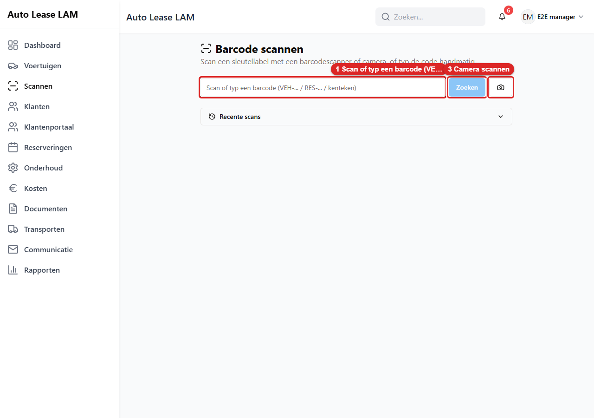
*Het scherm **Barcode scannen**. 1 is het invoerveld. Hier komt de scan of het kenteken. 2 is
**Zoeken**. 3 is **Camera scannen**.*

**Met een USB-scanner.** Een barcodescanner gedraagt zich als een toetsenbord. Hij typt de code en
drukt zelf op Enter. Klik één keer in het invoerveld. De cursor staat dan in het veld. Scan nu het
label. Je hoeft verder niets te doen.

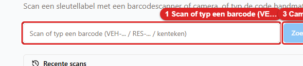
*Zo ziet het invoerveld eruit. Klik er één keer in. Scan daarna het label.*

**Met de hand.** Typ de code of het kenteken. Klik op **Zoeken** of druk op Enter. Tijdens het
zoeken staat er *Bezig met zoeken...*

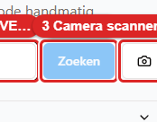
*Zo ziet de knop **Zoeken** eruit. Klik erop nadat je de code of het kenteken hebt getypt.*

**Met de camera.** Klik op het cameraknopje. Zie 18.6.

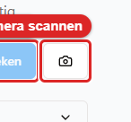
*Zo ziet de knop **Camera scannen** eruit. Klik erop om het venster Camera scannen te openen.*

> **Waarom de losse letters `N`, `S` en `?` niet werken terwijl je in het scanveld staat:** een
> scanner typt letters als een toetsenbord. Zou de app op die letters reageren, dan opende elke
> scan met een S erin een ander venster. Dat is met opzet uitgezet.

---

## 18.2 Wat je kunt scannen

| Code | Wat het is |
|---|---|
| **VEH-000123** of **V123** | Het sleutellabel van een voertuig. Op het scherm heet de code *VEH-000123*. Op het label zelf staat de korte vorm *V123* |
| **VEH-000123-S** of **S123** | Het label van de **reservesleutel** van datzelfde voertuig |
| **VEH-000123-R2** of **V123R2** | Een opnieuw aangemaakt label (na *Barcode opnieuw genereren*) |
| **RES-003366** | De code van een reservering |
| Een **kenteken** | Werkt ook. Typ of scan gewoon `HL-02-HL` |

Hoofdletters, kleine letters en spaties maken niet uit. De app maakt er zelf hoofdletters van. De
korte code op het label zet de app zelf om naar de lange code.

Vindt de app niets? Dan staat er: *Geen voertuig of reservering gevonden voor "ZZ-00-ZZ"*.
Controleer dan het label. Of typ het kenteken. Bij een storing zie je *Opzoeken mislukt.
Controleer de verbinding en probeer opnieuw.*

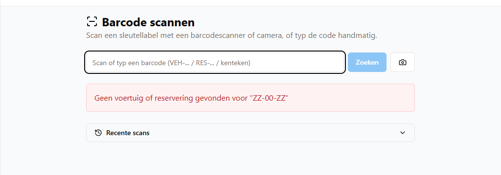
*Een code die de app niet kent. De melding staat onder het veld. De code blijft staan. Zo kun je hem
verbeteren.*

---

## 18.3 Wat je te zien krijgt na een scan

### Bij een voertuig

Bovenaan het resultaat staan het merk en het model. Daarnaast staat een statuslabel. Daaronder staat
het kenteken met de barcode. De statuslabels zijn hier dezelfde als in de voertuigenlijst:
**Beschikbaar**, **Gepland**, **Verhuurd**, **Reparatie nodig** en **Niet voor verhuur**. Loopt er
vandaag een boeking die nog niet is opgehaald? Dan staat er **Geboekt, nog niet opgehaald**. Er
staat dan niet **Verhuurd**. De auto staat immers nog bij ons. **Verhuurd** zie je pas als het
ophalen is afgerond.

Scande je het label van de reservesleutel? Dan staat er het extra label **Reservesleutel** bij. Zo
weet je zeker welke sleutel je in handen hebt.

*Na een scan. Bovenin staat de auto met zijn status en barcode. Daaronder staan de gegevens, de
reservering en de tegels.*

*Een auto die bij een klant staat. De status is **Verhuurd**. Je ziet de lopende reservering en de
tegel **Inleveren starten**.*

Daaronder staat een rijtje gegevens: **APK-vervaldatum**, **Garantie tot**, **Kilometerstand**,
**Brandstof** en **Registratie**. Is iets niet bekend? Dan staat er **N.v.t.**

Daaronder volgen drie blokken. Je ziet ze alleen als ze er zijn:

- **Actieve reservering** of **Aankomende reservering**. Hier staan de klant, de status en de
  periode. Er staat ook de knop **Reservering openen**. Is er niets? Dan staat er *Geen actieve of
  aankomende reservering*.

  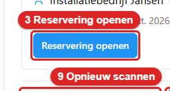
  *Zo ziet de knop **Reservering openen** eruit. Klik erop om de reservering te openen.*
- **Onderhoud** (oranje). Hier staat de werkplaatsstatus: **Onderhoud nodig** of **In onderhoud**.
  Er staat ook de stand van het onderhoudsblok: **Gepland**, **In werkplaats** of **Voltooid**. En er
  staat de knop **Onderhoudsblok openen**.
- **Actief transport**. Hier staan de route en het label **Gepland** of **Onderweg**.

### Bij een reservering

Scande je een `RES-`-code? Dan staat er **Reservering gevonden**. Je ziet de auto, de klant, de
status en de periode. Je ziet ook de knoppen **Reservering openen** en **Voertuig openen**.

---

## 18.4 Wat je kunt doen zonder het scanscherm te verlaten

Onder het resultaat staan tegels. Een tegel is een grote knop. Je ziet alleen de tegels die op dat
moment zinvol zijn. Je ziet ze dus niet allemaal tegelijk.

**Altijd zichtbaar:**

| Tegel | Wat er gebeurt |
|---|---|
| **Opnieuw scannen** | Het veld wordt leeggemaakt voor de volgende sleutel |
| **Voertuig openen** | De voertuigkaart opent |
| **Kosten registreren** | Je boekt een kostenregel op deze auto (hoofdstuk 13, paragraaf 13.10) |
| **Document uploaden** | Je hangt een bestand aan deze auto (hoofdstuk 8) |
| **Tanken** | Het venster **Brandstofstatus bijwerken** opent |
| **Km-stand bijwerken** | Het venster **Kilometerstand bijwerken** opent |

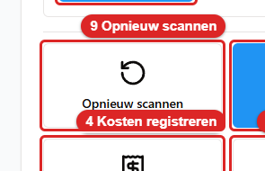
*Zo ziet de tegel **Opnieuw scannen** eruit. Klik erop en het veld wordt leeggemaakt voor de volgende sleutel.*

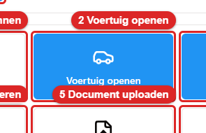
*Zo ziet de tegel **Voertuig openen** eruit. Klik erop en de voertuigkaart opent.*

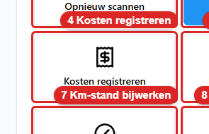
*Zo ziet de tegel **Kosten registreren** eruit. Klik erop om een kostenregel op deze auto te boeken.*

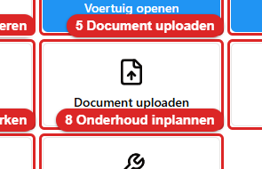
*Zo ziet de tegel **Document uploaden** eruit. Klik erop om een bestand aan deze auto te hangen.*

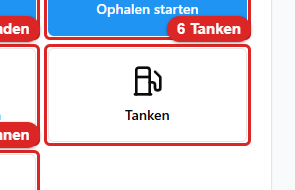
*Zo ziet de tegel **Tanken** eruit. Klik erop en het venster Brandstofstatus bijwerken opent.*

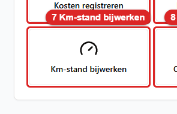
*Zo ziet de tegel **Km-stand bijwerken** eruit. Klik erop en het venster Kilometerstand bijwerken opent.*

**Afhankelijk van de situatie:**

| Tegel | Verschijnt wanneer |
|---|---|
| **Ophalen starten** | Er is een reservering die nog niet is opgehaald. Of er staat er een op stapel |
| **Inleveren starten** | De lopende reservering staat op **Opgehaald** |
| **Reservering maken** | Er is geen enkele lopende of aankomende reservering |
| **Onderhoud inplannen** | De auto staat niet in de werkplaats |
| **Terug uit onderhoud** | De auto staat wél in de werkplaats |
| **Transport starten** | Er ligt een transport op **Gepland** |
| **Transport afronden** | Het transport staat op **Bezig** |

*De tegels bij een auto met een aankomende reservering: 1 **Ophalen starten**, 2 **Voertuig
openen**, 3 **Reservering openen**, 4 **Kosten registreren**, 5 **Document uploaden**, 6 **Tanken**,
7 **Km-stand bijwerken**, 8 **Onderhoud inplannen**, 9 **Opnieuw scannen**.*

Van **Ophalen starten** en **Inleveren starten** zie je er altijd maar één. Welke je ziet, hangt af
van de stand van de huur. Is er helemaal geen reservering? Dan zie je ze geen van beide.

Voor **Onderhoud inplannen** en **Terug uit onderhoud** geldt hetzelfde. Je ziet er altijd maar één
van de twee.

Wat elke tegel doet:

- **Ophalen starten** opent het venster **Ophaalproces starten**. Zie hoofdstuk 5, paragraaf 5.7.

  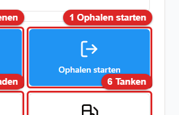
  *Zo ziet de tegel **Ophalen starten** eruit. Klik erop en het venster Ophaalproces starten opent.*

- **Inleveren starten** opent **Inleverproces starten**. Zie hoofdstuk 5, paragraaf 5.8.
- **Onderhoud inplannen** opent het venster **Onderhoud plannen**. Deze auto is daar al ingevuld. Zie
  hoofdstuk 7, paragraaf 7.2.

  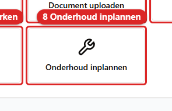
  *Zo ziet de tegel **Onderhoud inplannen** eruit. Klik erop en het venster Onderhoud plannen opent. Deze auto is daar al ingevuld.*

- **Terug uit onderhoud** werkt op twee manieren.
  - Staat de auto op **Binnen** in een onderhoudsblok dat vandaag loopt? Dan opent de knop het venster
    **Onderhoud afronden** voor dat blok (hoofdstuk 7, paragraaf 7.6). Vul het in. Klik op **Afronden**.
    Je ziet **Onderhoud afgerond**. Een onderhoud rond je dus ook vanaf het scanscherm niet af met één
    klik. Daarvoor heb je het vinkje **Onderhoud beheren** of **Reserveringen beheren** nodig. Heb je
    alleen **Voertuigen beheren**? Dan kun je het onderhoud hier niet afronden (hoofdstuk 15,
    paragraaf 15.11).
  - Staat de auto in de werkplaats zonder zo'n lopend blok? Dan zet de knop de werkplaatsstatus meteen
    om. Er komt geen tussenvenster. Je ziet **Voertuig is terug uit onderhoud**.
  > De knop sluit alleen het onderhoudsblok af dat vandaag loopt; onderhoud dat verderop in de
  > kalender staat blijft gewoon staan. De **Beschikbaarheidsstatus** komt meteen in een
  > verhuurbare staat, dus je hoeft niets meer met de hand terug te zetten. Zie hoofdstuk 7,
  > paragraaf 7.5.
  >
  > De tegel staat er alleen als de auto een werkplaatsstatus heeft. Zette je een onderhoud via het
  > bewerkvenster op **Binnen**, dan heeft de auto die status niet en ontbreekt de tegel; rond het
  > onderhoud dan af via **Onderhoudsblok openen** en **Afronden**.
- **Transport starten** zet het transport op **Onderweg**. Je ziet **Transport gestart**. De knop
  heet daarna **Transport afronden**. Die zet het transport op voltooid. Je ziet dan de melding
  **Transport afgerond**. Zie hoofdstuk 6, paragraaf 6.5.

Gaat er iets mis? Dan meldt de app **Onderhoudsstatus wijzigen mislukt** of **Transportstatus
wijzigen mislukt**.

**Een venster tegelijk.** Start je **Ophalen starten** of **Inleveren starten** vanaf het
scankaartje? Dan haalt de app het kaartje weg. Dat blijft zo zolang het ophaal- of inleverformulier
openstaat. Het blijft ook zo tijdens het venster **Contract klaar** of **Schadeformulier klaar**. Je
krijgt dus geen drie vensters over elkaar. Ben je klaar? Dan komt het scankaartje terug. Je kunt dan
de volgende sleutel scannen. Start je vanaf een tegel op het Dashboard? Dan sluit het scanvenster
zelf. Dat gebeurt zodra je het venster **Contract klaar** of **Schadeformulier klaar** sluit.

**Het scanscherm start zelf geen ophaling.** Scan je een auto op het scanscherm zelf? Dan zie je
eerst het kaartje. Je kiest daarna zelf **Ophalen starten**. Scan je vanaf een tegel op het Dashboard
(18.7)? Dan weet de app wat je wilt. Het ophaalvenster opent dan direct. Dat verschil is met opzet.
Op het scanscherm kan iemand ook alleen even iets opzoeken.

---

## 18.5 Recente scans

Onderaan het scherm staat het blok **Recente scans**. Per regel zie je het tijdstip en de gescande
code. Je ziet ook het kenteken dat erbij hoort. En je ziet wie er gescand heeft. Vond de app niets?
Dan staat er **geen match**.

Dit is handig als je net iets in handen had. Je weet dan misschien niet meer welk kenteken het was.
Je ziet ook of een collega die sleutel al langs heeft gehad. Staat er niets? Dan lees je
*Nog geen scans*.

**Een regel is een knop.** Klik op een regel in **Recente scans**. Je kunt ook met de pijltjestoetsen
naar de regel gaan en op Enter drukken. De app zoekt die code dan opnieuw op. Het is net alsof je hem
weer scande. Was het een regel met **geen match**? Dan blijft de code in het zoekveld staan. Zo kun je
hem verbeteren.

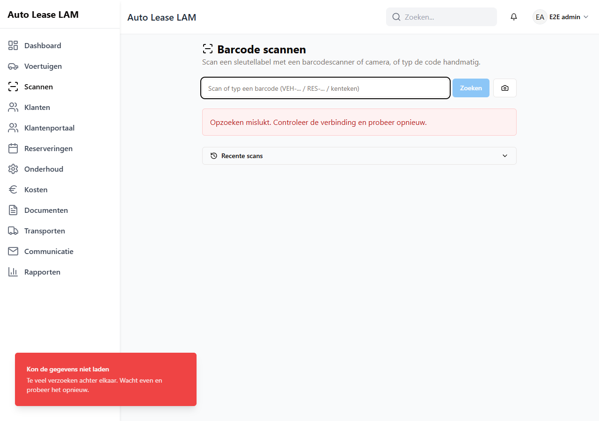
*Het blok **Recente scans**. Klik op de balk **Recente scans** (1) om het blok open of dicht te klappen. Elke regel
is een knop. Klik erop om die scan opnieuw op te zoeken.*

---

## 18.6 Scannen met de camera

Klik op het cameraknopje naast het invoerveld. Je ziet nu het venster **Camera scannen**. Daar staat
de tekst *Richt de camera op de barcode van het sleutellabel.* Houd de barcode rustig in beeld. Zodra
de barcode gelezen is, gaat het venster dicht. Het resultaat staat dan op het scherm. Met **Sluiten**
stop je.

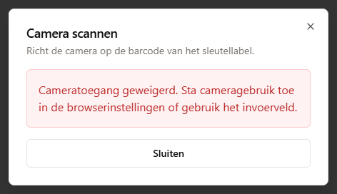
*Het venster **Camera scannen**. Heeft de pc geen camera, of mag de browser de camera niet
gebruiken? Dan staat hier een melding in plaats van het camerabeeld.*

**Camera scannen werkt alleen via een beveiligde verbinding (https).** Het adres van de app begint
dan met https. Opent de app via gewoon `http`? Dan blokkeert de browser de camera. Je ziet dan de
melding:

> *De browser blokkeert de camera omdat de app via onbeveiligd HTTP wordt geopend. Camera scannen
> werkt alleen via HTTPS of op localhost. Open de app via https:// of gebruik het invoerveld met
> een USB-scanner.*

Je kunt ook andere meldingen zien: *Cameratoegang geweigerd. Sta cameragebruik toe in de
browserinstellingen of gebruik het invoerveld.*, *Geen camera gevonden op dit apparaat.* en
*Camera starten mislukt.*

Aan de balie is de USB-scanner in de praktijk sneller. Hij werkt ook betrouwbaarder. Gebruik de
camera vooral op een tablet of telefoon op het terrein.

---

## 18.7 Scannen vanuit het dashboard

Op het **Dashboard** staan onder **Snelle acties** drie tegels. Die gebruiken het scanvenster als
opstapje. Elke tegel heeft een regeltje dat zegt wat hij doet. Bij **Ophalen starten** staat
*Auto meegeven aan de klant*. Bij **Innemen starten** staat *Auto terugnemen van de klant*. Bij
**Scannen** staat *Alleen opzoeken, niets starten*.

- **Ophalen starten**. Je ziet het venster **Ophalen starten** met de tekst *Scan het
  sleutellabel of typ het kenteken. De juiste handeling wordt meteen geopend.* Scan het label. Het
  ophaalvenster opent dan direct.
- **Innemen starten**. Dit werkt hetzelfde, maar dan voor het innemen.
- **Schadecheck starten**. Hier staat *Scan de barcode van het voertuig. Bij een opgehaald voertuig
  start de retourcheck, anders de ophaalcheck.* Je kunt ook op **Doorgaan zonder scan** klikken.

De knop op het dashboard heet **Innemen starten**. De tegel op het scanscherm zelf heet
**Inleveren starten**. Het is hetzelfde venster.

---

## 18.8 De sleutelkast-audit

Eén keer per periode loop je de sleutelkast na. Hangt er nog wat er hoort te hangen? Zo'n controle
heet een audit. De app helpt je daarbij. De app houdt bij welke sleutels je gescand hebt. En welke
sleutels ontbreken.

1. Klik links op **Voertuigen**.
2. Klik rechtsboven op **Sleutelkast-audit**. Je ziet nu het venster **Sleutelkast-audit**. Daar
   staat de tekst *Scan alle sleutels in de kast; daarna zie je welke ontbreken.*
3. Onder het invoerveld staat de teller: *0 van 305 verwachte sleutels gescand*. Dat getal is het
   aantal sleutels dat volgens de app in de kast hoort te hangen.
4. Scan nu één voor één alle sleutels in de kast. De teller loopt mee. Na elke scan staat er in het
   groen welke sleutel je net hebt gescand (*Gescand: AB-123-C*). Daaronder staan twee lijsten. De
   eerste lijst is **Gescand (n)**. De nieuwste scan staat bovenaan. De tweede lijst is
   **Nog niet gescand (n)**. Daar staan het kenteken, het merk en het model. Zo zie je tijdens het
   werk wat er nog moet hangen. Is er nog niets gescand? Dan staat er *Nog niets gescand*. Is alles
   gescand? Dan staat bij de tweede lijst *Alle verwachte sleutels zijn gescand*.

   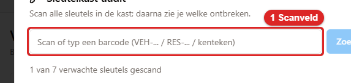
   *Zo ziet het scanveld eruit. Klik erin en scan de sleutels een voor een. De teller eronder loopt mee.*

   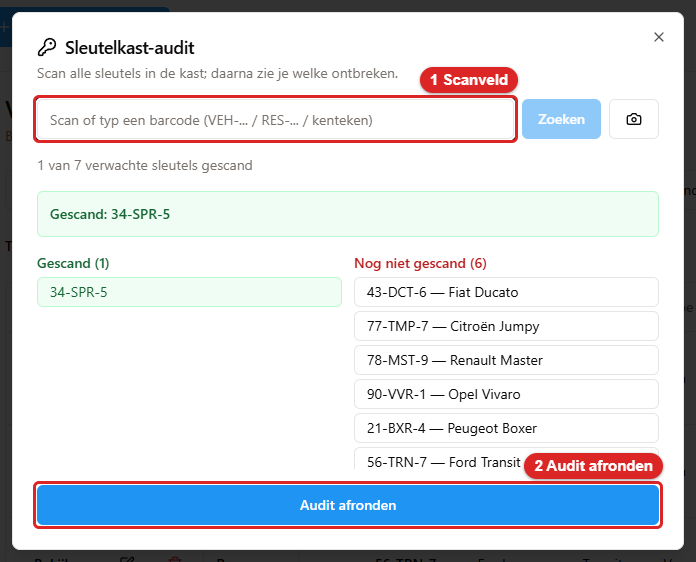
   *Het venster **Sleutelkast-audit** na één scan. 1 is het scanveld. 2 is **Audit afronden**.*
5. Ben je door de kast heen? Klik dan op **Audit afronden**.

   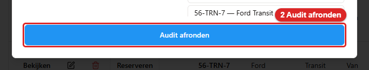
   *Zo ziet de knop **Audit afronden** eruit. Klik erop als je door de kast heen bent. Daarna zie je de uitslag.*
6. Je ziet nu de uitslag:
   - **Ontbrekende sleutels**. Dit zijn de auto's waarvan je het label niet hebt gescand. Je ziet het
     kenteken, het merk en het model. Met deze lijst moet je aan de slag.
   - **Onverwacht aanwezig (voertuig staat als verhuurd)**. Dit zijn sleutels die je wél gescand hebt.
     Maar volgens de app staat de auto bij een klant. Dat betekent dat de auto terug is. De huur is
     dan nooit afgesloten. Scan de sleutel daarna op **Scannen**. Neem de auto in met
     **Inleveren starten**. Is de einddatum al voorbij? Dan staat de huur ook bij
     **Reserveringen** achter **… achterstallig** (hoofdstuk 5, paragraaf 5.11).
   - Is alles compleet? Dan staat er: *Geen sleutels ontbreken 🎉*

   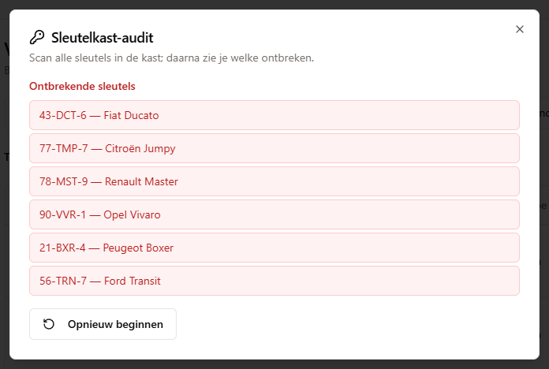
   *De uitslag na **Audit afronden**. De sleutels die je niet hebt gescand, staan onder
   **Ontbrekende sleutels**.*
7. Met **Opnieuw beginnen** wis je de telling. Je begint dan opnieuw. Met **Sluiten** ga je weg.

**Meldingen tijdens het scannen:**

| Melding | Betekenis |
|---|---|
| *Al gescand* | Deze sleutel had je al gehad |
| *Onbekende code: <code>* | Het label hoort bij geen enkel voertuig |
| *Dit is een reserveringscode, geen voertuigsleutel* | Je scande een `RES-`-code |
| *Dit is een hoofdsleutel. Scan het reservesleutel-label (-S).* | Verkeerde kast |
| *Dit is een reservesleutel. Gebruik hiervoor de reservesleutelkast-audit.* | Verkeerde kast |

### De reservesleutelkast

Voor de reservesleutels is er een eigen knop: **Reservesleutelkast-audit**. Daar staat de tekst
*Scan alle reservesleutels in de kast; daarna zie je welke ontbreken.* Deze audit werkt precies
hetzelfde. De teller telt de reservesleutels. Het tweede resultatenblok heet hier
**Onverwacht aanwezig (staat als bij klant of zonder reservesleutel)**.

Hangt een reservesleutel bij de klant? Dan zet je dat op de voertuigkaart. Klik op **Bewerken**. Ga
naar het tabblad **Technisch**. Vul daar **Reservesleutel bij klant** in, met de **Klantnaam**. Dan
weet de audit dat die sleutel terecht niet in de kast hangt.

> **Twee dingen om te weten.** De uitslag van de audit wordt **niet bewaard**: sluit je het
> venster, dan is de lijst weg. Er is ook geen knop om hem af te drukken of te exporteren.
> Schrijf de ontbrekende kentekens dus over, of handel ze meteen af. Wat wél bewaard blijft, is
> elke scan afzonderlijk: die komt in **Recente scans** te staan, met jouw naam erbij.

---

## 18.9 Labels afdrukken

### Eén label

1. Open de auto met **Bekijken**.
2. Klik op **Barcode bekijken**. Je ziet nu het venster **Voertuigbarcode**.

   
   *Het venster **Voertuigbarcode**. 1 is **Labelsjabloon**. 2 is **Sleutellabel afdrukken**. 3 is
   **Reservesleutel-label afdrukken**.*
3. Kies bij **Labelsjabloon** de indeling die bij jullie labelprinter hoort. Daar staat de tekst
   *Kies het labelsjabloon voor deze afdruk.* Voor de labelmaker aan de balie kies je
   **DYMO-tape (labelmaker, staand)**. Zie *Op de DYMO-labelmaker* hieronder. Op het label komt de
   korte code (**V123**, of **S123** voor de reservesleutel). Zie 18.2.
4. Klik op **Sleutellabel afdrukken** of op **Reservesleutel-label afdrukken**. De app meldt dat er
   een afdrukvenster van je browser is geopend (**Afdrukvenster geopend** met de tekst
   *Het afdrukvenster van je browser is geopend voor het label van <kenteken>. Kies daar de
   printer.*). De app maakt hier geen bestand. Je kiest zelf de printer.

Op de voertuigkaart staan bovenin ook de knoppen **Sleutellabel** en **Reservesleutel-label**. Ze
staan direct naast de barcode. Die knoppen doen hetzelfde. Ze vragen eerst om het **Labelsjabloon**.
Daarna klik je op **Afdrukken**.

### Op de DYMO-labelmaker

**Op de DYMO-labelmaker (tape).** Aan de balie staat een labelmaker (LabelManager 420P, tape van
12 mm). Die drukt via Windows alleen staand af. Een gewoon sleutellabel van 62 bij 29 mm kwam daardoor
afgesneden uit de printer. Kies daarom bij **Labelsjabloon** de optie **DYMO-tape (labelmaker,
staand)**. Je ziet dan extra velden. Dat zijn **Tapebreedte** (6, 9, 12, 19 of 24 mm, standaard 12),
**Labellengte (mm)** (standaard 48, de lengte van het sleutellabel, minimaal 15),
**Marge links/rechts (mm)** en **Marge boven/onder (mm)**. Daaronder staat **Uitvoer**. Daar kies je
waar het label heen gaat:

*Kies je **DYMO-tape (labelmaker, staand)**? Dan verschijnen de tapematen en de keuze **Uitvoer**.*

- **<naam van de labelmaker> (rechtstreeks via DYMO Connect)**, bijvoorbeeld *DYMO LabelManager
  420P*. De app stuurt het label zelf naar de labelmaker. Er komt geen afdrukvenster. Dat kan als op
  de pc DYMO Connect draait. DYMO Connect is een programma van de maker van de labelmaker. De regel
  eronder zegt dan *DYMO Connect gevonden: 1 labelmaker.* De labelmaker snijdt elk label af. Na het
  sturen meldt de app **Naar de labelmaker gestuurd** met de tekst *1 label is naar DYMO LabelManager
  420P gestuurd.* Dit is de bedoelde weg aan de balie. Bij deze keuze kun je ook de
  **Positie op de tape** kiezen: **Links (begin van de tape)**, **Midden** of **Rechts**. Je kunt ook
  **Doorlopend printen (minder lege tape, niet knippen na elk label)** aanzetten. Voegt de labelmaker
  toch steeds een stuk lege tape toe? Zet dan **Meerdere labels op één strook, met kniplijn ertussen
  (zelf knippen)** aan. Kies daarna de **Ruimte naast de kniplijn (mm)**. De labels komen dan achter
  elkaar op één strook. Tussen de labels staat een kniplijn.
- **Bestand .label (openen in DYMO Connect)**. De app maakt per label een bestand in het formaat van
  DYMO (**Bestand gemaakt** met de tekst *sleutellabel-<kenteken>-<code>.label*). Open dat bestand in
  DYMO Connect. Druk het daar af. Dit is handig op een pc zonder aangesloten labelmaker.
- **Afdrukvenster van de browser**. De app maakt per label één pagina van 12 bij 48 mm. De inhoud
  draait de app zelf een kwartslag. Kies in het afdrukvenster de DYMO-printer. Kies papier 12 mm,
  staand, marges **Geen** en schaal **100%**. Let op: de Windows-printer van de LabelManager 420P
  heeft als poort *FILE:*. Je krijgt dan een .prn-bestand in plaats van een label. Gebruik voor de
  420P daarom een van de twee keuzes hierboven.

Op het label staat de barcode over de lengte van de tape. Daarnaast staan het kenteken en **Hoofd** of
**Reserve**. Staat er *DYMO Connect is niet gevonden op deze pc*? Start dan DYMO Connect. Of kies het
bestand. De keuzes en de maten worden op die pc onthouden. De volgende keer staan de tape en de
labelmaker dus meteen goed. Druk eerst één label af. Leg het naast een oud label. Doe pas daarna de
hele kast.

**Zelf bepalen wat er op de tape staat.** De keuze **DYMO-tape (labelmaker, staand)** heeft een vaste
indeling. Wil je iets anders op het label? Bijvoorbeeld een bedrijfsnaam, een ander lettertype of het
merk? Ga dan naar **Documenten** → **Barcodelabels**. Maak daar een sjabloon van het soort
**DYMO-tape (48 x 12 mm)**. Kies dat sjabloon daarna bij **Labelsjabloon**. Zo'n sjabloon wordt net zo
staand en gedraaid afgedrukt. Zie [hoofdstuk 8, paragraaf 8.5](08-documenten.md).

### Een nieuw label voor een auto

Is het label onleesbaar of kwijt? Dan kun je een nieuwe code laten maken. Klik daarvoor op
**Barcode opnieuw genereren**. De app waarschuwt eerst:

> **Barcode opnieuw genereren?**
> *De oude barcode (<code>) werkt daarna niet meer. Reeds afgedrukte labels moeten opnieuw worden
> afgedrukt. Deze actie kan niet ongedaan worden gemaakt.*

Doe dit alleen als het echt nodig is. Het oude label in de kast of in het barcodeboek werkt daarna
niet meer. Na afloop zie je **Nieuwe barcode: <code>**. Druk meteen een nieuw label af.

### Alle labels tegelijk

1. Klik op **Voertuigen** → **Barcodeboek**. Je ziet nu **Barcodeboek**. Daar staat de tekst
   *Druk alle voertuigbarcodes af voor in een map of klapper.*
2. Kies een **Labelsjabloon**. Kies je **DYMO-tape (labelmaker, staand)**? Dan maakt
   **Stickers afdrukken** één tapelabel per auto. **Stickers afdrukken** kiest vanzelf het sjabloon dat
   onder **Documenten** → **Barcodelabels** als **Autolabel (sticker in de auto)** is aangewezen.

   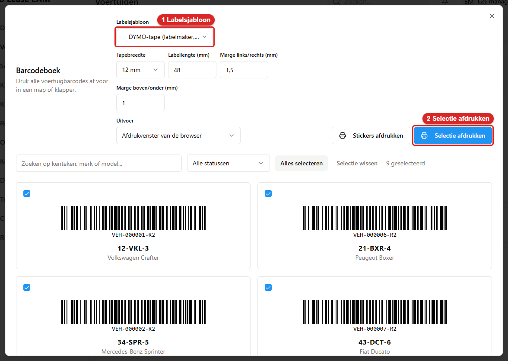
   *Het **Barcodeboek** met **DYMO-tape** als sjabloon. 1 is **Labelsjabloon**. 2 is de afdrukknop. De
   naam van die knop hangt af van je selectie.*

   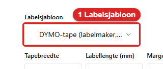
   *Zo ziet het veld **Labelsjabloon** eruit. Kies hier de indeling die bij jullie labelprinter hoort.*
3. Je kunt de lijst filteren. Gebruik daarvoor het zoekveld *Zoeken op kenteken, merk of model...* Of
   gebruik het statuslijstje **Alle statussen**.
4. Selecteer wat je wilt. Dat doe je met **Alles selecteren** of door regels aan te vinken. Met
   **Selectie wissen** maak je de selectie leeg. Boven de lijst staat *… geselecteerd*.
5. Klik op de afdrukknop. Heb je regels aangevinkt? Dan heet de knop **Selectie afdrukken**. Staat er
   een filter aan? Dan heet hij **Gefilterde afdrukken (…)**. Anders heet hij **Alles afdrukken (…)**.
   Met **Stickers afdrukken** krijg je de sleutellabels in stickervorm.

   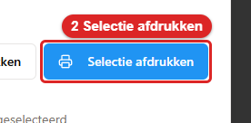
   *Zo ziet de knop **Selectie afdrukken** eruit. Zo heet de afdrukknop als je regels hebt aangevinkt.*

De afgedrukte pagina heeft bovenaan de kop *Barcodeboek — Auto Lease LAM*.

**Drukt de browser niets af?** Dan blokkeert hij het pop-upvenster. Je ziet dan de melding
*Je browser heeft afdrukken geblokkeerd. Gebruik de downloadknop en druk handmatig af.* Sta
pop-ups toe voor deze site. Probeer het dan opnieuw.

---

## 18.10 Snel naslaan

| Wat je wilt | Waar |
|---|---|
| Het scanscherm openen | `S`, of **Scannen** in het menu |
| Een auto opzoeken met de sleutel | Scan `VEH-…` of typ het kenteken |
| Een reservering opzoeken | Scan of typ `RES-…` |
| Meteen ophalen of innemen | Scannen → **Ophalen starten** / **Inleveren starten** |
| Een transport starten of afronden | Scannen → **Transport starten** / **Transport afronden** |
| Een auto uit de werkplaats halen | Scannen → **Terug uit onderhoud** (bij een lopend onderhoud opent dat het venster **Onderhoud afronden**) |
| Zien wat je net gescand hebt | **Recente scans** |
| De sleutelkast nalopen | **Voertuigen** → **Sleutelkast-audit** |
| De reservesleutels nalopen | **Voertuigen** → **Reservesleutelkast-audit** |
| Eén label afdrukken | Voertuigkaart → **Barcode bekijken** → **Sleutellabel afdrukken** |
| Alle labels afdrukken | **Voertuigen** → **Barcodeboek** |
