# 19. Kosten en facturen

Dit hoofdstuk is voor iedereen die kosten van de auto's bijhoudt. Denk aan het kantoor en de
werkplaats. Je leert hoe je kosten vastlegt en terugvindt. Je leert ook hoe je een factuur uit de
mail controleert en boekt. Je hebt daarvoor het recht **Kosten beheren** nodig. Zonder dat recht
staat **Kosten** niet in het menu links. Voor de prullenbak heb je ook **Prullenbak beheren**
nodig (zie 19.8).

Twee dingen om vooraf te weten:

- Elke kostenpost hoort bij precies één voertuig. Een kostenpost is één regel kosten, met een
  bedrag, een datum en een categorie. Algemene kosten zonder auto kun je niet vastleggen.
- Alle bedragen zijn **exclusief btw**. Ook in het formulier dat je zelf invult. Staat er op de bon
  een bedrag met btw? Reken het dan eerst terug.

De namen en bedragen in de plaatjes zijn verzonnen.

---

## 19.1 Het scherm Kostenbeheer

1. Klik in het menu links op **Kosten**. Je ziet nu het scherm **Kostenbeheer**. Bovenaan staan vier
   knoppen.

   
   *Het scherm **Kostenbeheer**: 1 **Verwijderde kostenposten**, 2 **Ontvangen facturen**, 3 **Factuur
   scannen**, 4 **Kosten registreren**.*

Wat de vier knoppen doen:

| Knop | Wat het doet | Waar het staat |
|---|---|---|
| **Verwijderde kostenposten** | De prullenbak van dit scherm | 19.7 |
| **Ontvangen facturen** | Facturen die per e-mail binnenkwamen. Het getal op de knop is het aantal dat op controle wacht | 19.3 en 19.4 |
| **Factuur scannen** | Zelf een factuur-PDF laten uitlezen | 19.5 |
| **Kosten registreren** | Zelf een kostenpost invullen | 19.2 |

Onder de knoppen staan twee blokken. Links staat het **Kostenoverzicht** met alle kosten. Rechts
staat de **Kostensamenvatting**. Daar zie je de **Totale kosten** en een bedrag **Per categorie**. De
samenvatting rekent altijd met je filters. Filter je op één auto? Dan zie je alleen de kosten van
die auto.

### Filteren

Filteren betekent: alleen de regels tonen die bij je keuze passen.

2. Kies bij **Voertuig** een auto. Typ het kenteken, met of zonder streepjes. Je ziet nu alleen de
   kosten van die auto.

   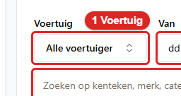
   *Zo ziet het filter **Voertuig** eruit. Klik erop en typ het kenteken.*
3. Vul **Van** en **Tot en met** in. Beide dagen tellen mee.

   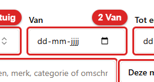
   *Zo ziet het veld **Van** eruit. Klik op het kalendertje of typ de datum.*

   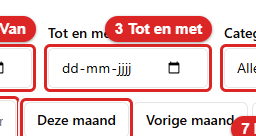
   *Zo ziet het veld **Tot en met** eruit. Ook deze dag telt mee.*
4. Kies bij **Categorie** bijvoorbeeld **Banden** of **Schade**.

   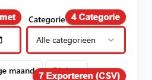
   *Zo ziet het filter **Categorie** eruit. Klik erop en kies een categorie.*
5. Wil je zoeken op een woord? Typ dat in het zoekveld *Zoeken op kenteken, merk, categorie of
   omschrijving...*.

   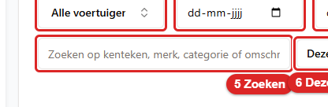
   *Zo ziet het zoekveld eruit. Typ een kenteken, een merk of een woord uit de omschrijving.*
6. Wil je snel een hele periode? Klik op **Deze maand**, **Vorige maand** of **Dit jaar**. De
   datums staan dan meteen goed.

   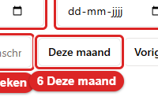
   *Zo ziet de knop **Deze maand** eruit. **Vorige maand** en **Dit jaar** staan ernaast.*

   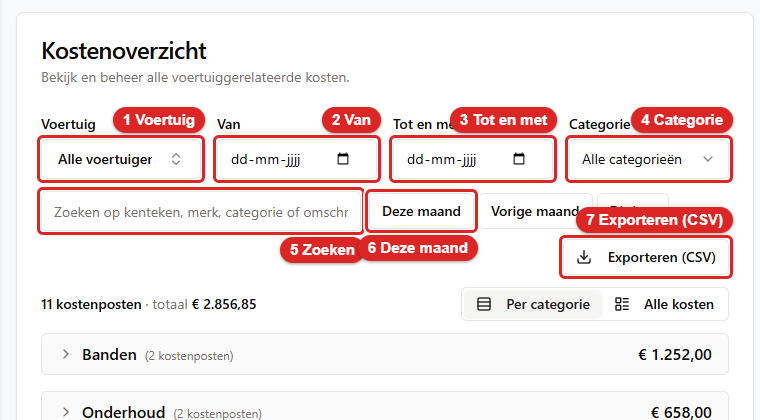
   *De filters: 1 **Voertuig**, 2 **Van**, 3 **Tot en met**, 4 **Categorie**, 5 het zoekveld, 6 **Deze
   maand**, 7 **Exporteren (CSV)**.*

Onder de filters staat hoeveel kostenposten je selectie heeft. Ook het totaal staat erbij,
bijvoorbeeld *11 kostenposten · totaal € 2.856,85*. Met **Filters wissen** zet je alles terug. Die
knop zie je pas als er een filter aan staat.

### Exporteren

7. Klik op **Exporteren (CSV)**. De app maakt een bestand met de kosten die je nu ziet. Een
   CSV-bestand is een lijst die je in Excel kunt openen. Zet dus eerst de filters goed.

   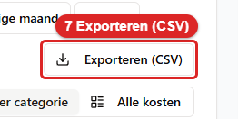
   *Zo ziet de knop **Exporteren (CSV)** eruit. Klik erop. Daarna krijg je het bestand met de
   gefilterde kosten.*

### Per categorie of alle kosten

Rechts boven de lijst kies je hoe je de kosten ziet.

8. **Per categorie** staat aan als je het scherm opent. Elke categorie is dan één ingeklapte regel.
   Op die regel staan het aantal en het totaal.

   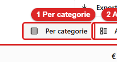
   *Zo ziet de knop **Per categorie** eruit. Klik erop om de kosten per categorie te zien.*
9. Klik op een categorie, bijvoorbeeld **Banden**. Je ziet nu de vijf nieuwste kostenposten van die
   categorie. Zijn het er meer? Klik dan op **Alle N tonen**. Er opent een venster met de hele
   categorie. Dat venster heeft een eigen zoekveld en de keuze **Sorteren**.

   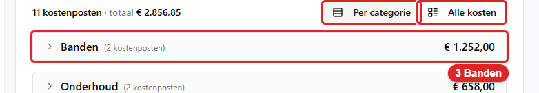
   *Zo ziet een categorie eruit, hier **Banden**. Klik op de regel. Daarna zie je de nieuwste
   kostenposten van die categorie.*
10. Wil je alles in één tabel? Klik op **Alle kosten**. Je ziet nu de kolommen **Datum**,
    **Voertuig**, **Categorie**, **Leverancier**, **Omschrijving** en **Bedrag (excl. btw)**. Klik op
    een kolomkop om te sorteren. Onderaan kies je de pagina en het aantal regels per pagina.

    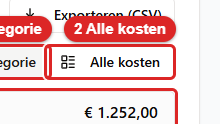
    *Zo ziet de knop **Alle kosten** eruit. Klik erop. Daarna zie je alle kosten in één tabel.*

    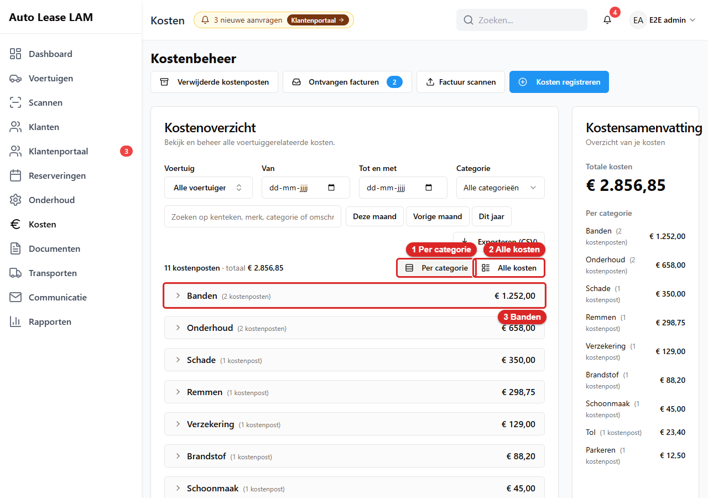
    *De twee weergaven: 1 **Per categorie**, 2 **Alle kosten**, 3 de categorie **Banden**.*

    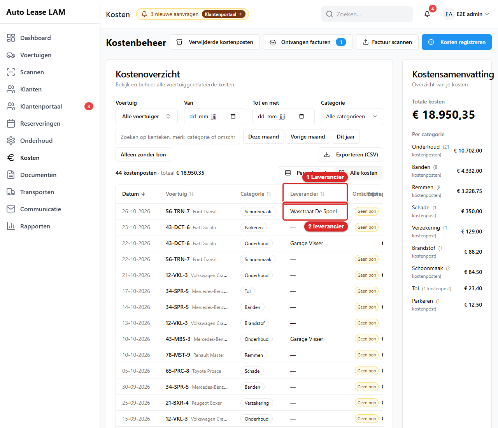
    *De tabel **Alle kosten**: 1 de kolom **Leverancier**, 2 een leverancier die je zelf typte. Een
    streepje betekent: geen leverancier. Een factuur uit het postvak vult de leverancier zelf in, hier
    *Garage Visser*.*

    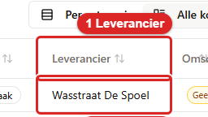
    *Zo ziet de kolom **Leverancier** eruit. Klik op de kop om op leverancier te sorteren.*

    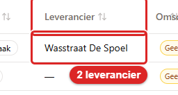
    *Zo ziet een leverancier in de tabel eruit.*

### Een kostenpost openen

11. Elke regel heeft rechts twee knopjes. Klik op het oogje. Je ziet nu het venster
    **Kostendetails**. Daar staan de datum, de categorie, het bedrag, het voertuig, de omschrijving
    en de bon. Onderaan zie je wie de kostenpost heeft gemaakt of veranderd.
12. Klopt er iets niet? Klik op **Kosten bewerken**. Pas het aan en klik op **Kosten bijwerken**.
    Je ziet dan *Kosten succesvol bijgewerkt*.

Het rode prullenbakje naast het oogje is voor verwijderen. Dat staat in 19.7.

---

## 19.2 Kosten registreren

Zo leg je zelf een kostenpost vast. Bijvoorbeeld een bon van de wasstraat of een parkeerbon.

1. Klik op **Kosten** → **Kosten registreren**. Je ziet nu het venster **Nieuwe kosten
   toevoegen**. Eronder staat *Registreer nieuwe kosten voor je wagenpark*.

   
   *Zo ziet de knop **Kosten registreren** eruit. Klik erop. Daarna zie je het venster **Nieuwe
   kosten toevoegen**.*
2. Kies bij **Voertuig** de auto. Typ het kenteken en klik op de juiste regel. Dit veld is
   verplicht. De app zegt erbij: *Een voertuig is verplicht: elke kostenpost hoort bij één
   voertuig.*

   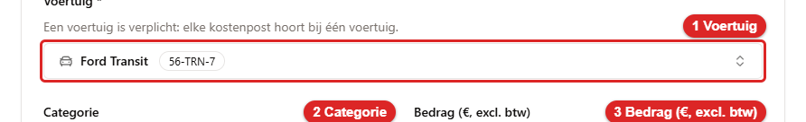
   *Zo ziet het veld **Voertuig** eruit. Klik erop, typ het kenteken en kies de auto.*
3. Kies bij **Categorie** het soort kosten. Je kunt kiezen uit Onderhoud, Banden, Remmen, Schade,
   Brandstof, Verzekering, Registratie, Schoonmaak, Parkeren, Tol, Accessoires en Overig.

   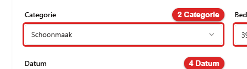
   *Zo ziet het veld **Categorie** eruit. Klik erop en kies het soort kosten.*
4. Vul bij **Bedrag (€, excl. btw)** het bedrag in. Dat is het bedrag **zonder** btw.

   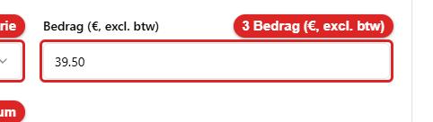
   *Zo ziet het veld **Bedrag (€, excl. btw)** eruit. Typ het bedrag zonder btw.*
5. Bij **Datum** staat vandaag al ingevuld. Klopt de datum van de bon niet? Pas hem dan aan.

   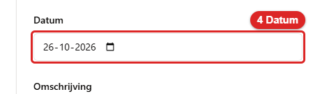
   *Zo ziet het veld **Datum** eruit. Klik op het kalendertje of typ de datum van de bon.*
6. Typ bij **Omschrijving** kort wat er is gedaan. Bijvoorbeeld "Binnenkant laten reinigen na
   verhuur".

   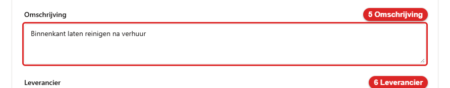
   *Zo ziet het veld **Omschrijving** eruit. Typ in een paar woorden wat er is gedaan.*
7. Typ bij **Leverancier** bij wie je het hebt laten doen of gekocht. Bijvoorbeeld "Garage Visser".
   Heb je die naam al eerder gebruikt? Dan zie je hem als keuze onder het veld. Klik erop. Zo staat
   dezelfde garage altijd op dezelfde manier geschreven. Dat is belangrijk voor de onderhoudsanalyse
   (hoofdstuk 21.9): daar zie je per leverancier wat het kost. Weet je het niet? Laat het veld leeg.

   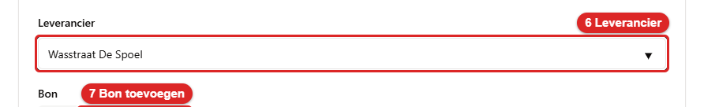
   *Zo ziet het veld **Leverancier** eruit. Typ de naam of kies een eerder gebruikte naam.*
8. Wil je de bon bewaren? Klik bij **Bon** op **Bestand uploaden**. Kies het bestand of sleep het in
   het vak. Dat mag een PDF, PNG, JPG of GIF zijn, tot 25 MB. Staat de bon online? Gebruik dan het
   tabblad **URL** en plak de link.

   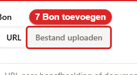
   *Zo ziet **Bestand uploaden** eruit. Klik erop. Daarna kies je het bestand van de bon.*
9. Klik op **Kosten registreren**. Je ziet nu de melding *Kosten succesvol geregistreerd*. De
   kostenpost staat meteen in het **Kostenoverzicht**.

   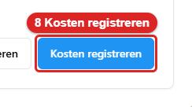
   *Zo ziet de knop **Kosten registreren** onderaan het venster eruit. Klik erop. Daarna is de
   kostenpost opgeslagen.*

   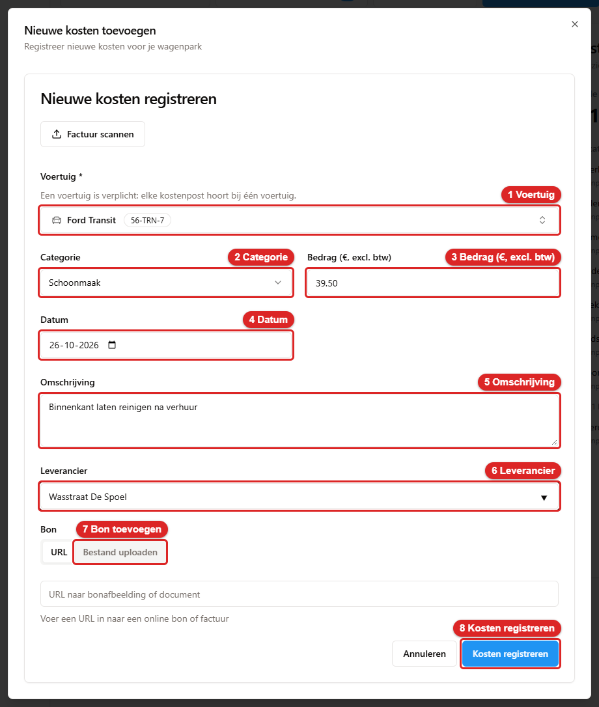
   *Het venster **Nieuwe kosten toevoegen**: 1 **Voertuig**, 2 **Categorie**, 3 **Bedrag (€, excl.
   btw)**, 4 **Datum**, 5 **Omschrijving**, 6 **Leverancier**, 7 **Bestand uploaden** bij **Bon**,
   8 **Kosten registreren**.*

   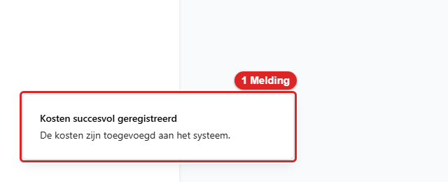
   *1 de melding **Kosten succesvol geregistreerd**. Eronder staat: De kosten zijn toegevoegd aan het
   systeem.*

Bovenin het venster staat ook een knop **Factuur scannen**. Die doet hetzelfde als in 19.5.

### Andere ingangen

Hetzelfde venster opent ook op deze plekken:

- **Dashboard** → **Kosten registreren**. Je kiest het voertuig zelf.
- De voertuigkaart → tabblad **Kosten** → **Kosten toevoegen**. Het voertuig staat dan al ingevuld.
  Op dit tabblad zie je ook alle kosten van die ene auto (hoofdstuk 4).

  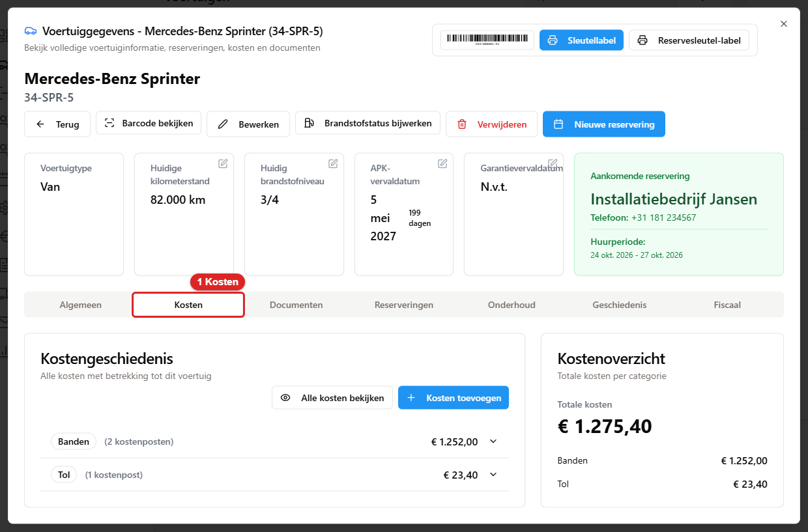
  *1 het tabblad **Kosten** op de voertuigkaart. Rechts in het blok staat de knop **Kosten
  toevoegen**.*

- **Reserveringsdetails** → **Kosten toevoegen**.
- **Scannen** → scan de sleutel → tegel **Kosten registreren**. Het voertuig staat dan al ingevuld
  ([hoofdstuk 18](18-barcode-en-scannen.md)).
- **Tanken**. Vul je bij het bijwerken van de brandstof een **Tankkosten (€)** in? Dan maakt de app
  zelf een kostenpost **Brandstof** aan. Je ziet dan *Brandstofstatus bijgewerkt; kostenpost van
  € x geboekt*. Voer die tankbeurt dus **niet** nog een keer in bij Kosten. Anders staat hij er
  dubbel. Hoe tanken werkt, staat in [hoofdstuk 4](04-voertuigen.md), paragraaf 4.9.

---

## 19.3 Facturen per e-mail

De app heeft een eigen postvak voor facturen. Garages en leveranciers sturen hun factuur daarheen.
De app leest elke factuur zelf uit. Klopt alles? Dan boekt de app de factuur meteen als kosten op
het juiste voertuig. Je hoeft dan niets te doen. Je krijgt wel een melding in de bel.

De app boekt alleen vanzelf als alles klopt. De afzender staat op de lijst met vertrouwde
afzenders. Er staat precies één kenteken op de factuur, en dat kenteken zit in de vloot. De
bedragen tellen op tot het totaal. En de factuur is niet eerder binnengekomen. Twijfelt de app?
Dan boekt de app **niets**. De factuur wacht dan op jou. De volledige regels staan in
[hoofdstuk 9](09-email.md), paragraaf 9.9.

### Waar de facturen staan

1. Klik op **Kosten** → **Ontvangen facturen**. Het getal op de knop is het aantal facturen dat op
   controle wacht. Je ziet nu het venster **Ontvangen facturen**.

   
   *Zo ziet de knop **Ontvangen facturen** eruit. Het getal zegt hoeveel facturen wachten. Klik
   erop. Daarna zie je het venster **Ontvangen facturen**.*
2. Het venster heeft drie tabbladen:
   - **Te controleren**: hier wacht de factuur op jou. De kolom **Reden** zegt waarom. Bijvoorbeeld
     *Onbekende afzender* of *Geen kenteken gevonden*.
   - **Geboekt**: facturen die als kosten zijn geboekt. Met **Bekijken** zie je wat er is geboekt.
   - **Afgewezen**: facturen die niet in de app horen.

   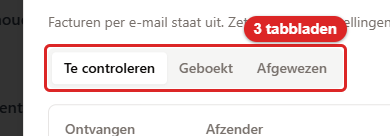
   *Zo zien de tabbladen **Te controleren**, **Geboekt** en **Afgewezen** eruit. Klik op een
   tabblad om die lijst te zien.*

   
   *Het venster **Ontvangen facturen**: 1 **Nu ophalen**, 2 **Logboek**, 3 de tabbladen **Te
   controleren**, **Geboekt** en **Afgewezen**, 4 **Controleren**.*

Een melding in de bel over een factuur die wacht, opent dit venster ook.

### Nu ophalen

De app kijkt vanzelf in het postvak, standaard elke 15 minuten. Wil je niet wachten?

3. Klik op **Nu ophalen**. De app haalt de nieuwe mail meteen op. Je ziet dan bijvoorbeeld *2 mail(s)
   opgehaald: 1 geboekt, 1 ter controle*. Rechts staat wanneer de app voor het laatst keek.

   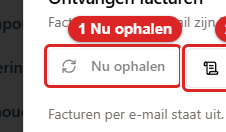
   *Zo ziet de knop **Nu ophalen** eruit. Klik erop. Daarna haalt de app de nieuwe mail meteen op.
   In het plaatje is de knop grijs, omdat de functie uit staat.*

### Logboek

4. Klik op **Logboek**. Je ziet nu het venster **Logboek**. Daar zie je wat de app uit het postvak
   heeft gehaald. Je verandert hier niets. Het is alleen om terug te kijken.

   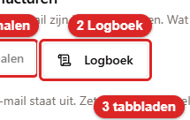
   *Zo ziet de knop **Logboek** eruit. Klik erop. Daarna zie je het venster **Logboek**.*
5. Het logboek heeft drie tabbladen:
   - **Facturen**: elke factuur die binnenkwam, met het **Resultaat**. Met het documentknopje
     (**PDF openen**) zie je de factuur. Met het pijltje (**Naar controleren**) ga je naar de lijst
     **Te controleren**.
   - **Overige mail**: mail zonder factuur. Bijvoorbeeld een offerte of een herinnering.
   - **Ophaalrondes**: elke keer dat de app in het postvak keek. De schakelaar **Alleen rondes met
     mail of fouten** staat aan. Zo zie je de lege rondes niet.

   Bovenin zoek je op afzender, onderwerp, bestand, leverancier, factuurnummer of kenteken. Met
   **Meer laden** zie je oudere regels.

   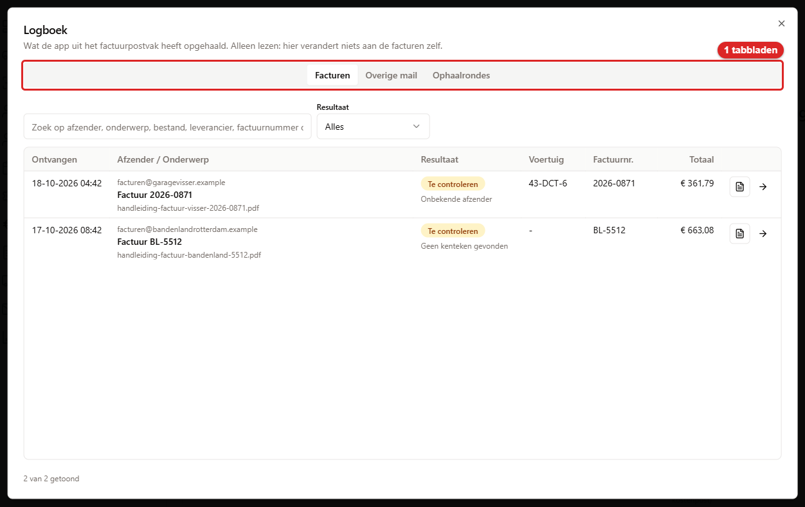
   *Het venster **Logboek**: 1 de tabbladen **Facturen**, **Overige mail** en **Ophaalrondes**.*

### Als de functie uit staat

Zie je bovenin *Facturen per e-mail staat uit. Zet het aan bij Instellingen, tabblad E-mail.*? Dan
leest de app het postvak niet. **Nu ophalen** is dan grijs. Facturen die al binnen waren, kun je
nog wel controleren.

Alleen een beheerder kan de functie aanzetten. Daarvoor is het recht **Instellingen beheren**
nodig. Dat recht kan alleen een beheerder hebben. Hij doet dit zo: klik rechtsboven op je naam →
**App-instellingen** → tabblad **E-mail & GPS** (op een smal scherm heet het **E-mail**) → de kaart
**Facturen per e-mail (inkomend)**. Daar zet hij **Postvak automatisch uitlezen** aan en klikt op
**Opslaan**. Hoe je de rest van die kaart invult, staat in [hoofdstuk 9](09-email.md), paragraaf
9.9. Waar de instellingen staan, lees je in [hoofdstuk 10](10-beheer.md), paragraaf 10.3.

---

## 19.4 Een factuur controleren en boeken

Een factuur onder **Te controleren** boek je zelf. Je kijkt na wat de app heeft gelezen. Daarna klik
je op **Boeken**.

1. Klik op **Kosten** → **Ontvangen facturen**. Het tabblad **Te controleren** staat open.
2. Kijk naar de kolom **Reden**. Die zegt wat je moet nakijken. Klik op **Controleren** bij de
   factuur. Je ziet nu het venster **Factuur controleren**. Links staat de factuur zelf. Rechts staat
   wat de app heeft gelezen.

   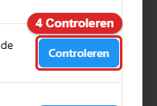
   *Zo ziet de knop **Controleren** eruit. Klik erop. Daarna zie je het venster **Factuur
   controleren**.*
3. Kijk of **Leverancier**, **Factuurnummer** en **Factuurdatum** kloppen met de factuur links.
   Verbeter wat niet klopt.

   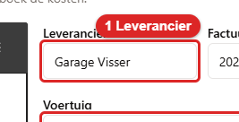
   *Zo ziet het veld **Leverancier** eruit. Vergelijk de naam met de factuur links.*
4. Kijk bij **Voertuig** of de juiste auto staat. Eronder staat *Gevonden kentekens:* met wat de app
   op de factuur las. Staat er geen auto? Kies dan zelf de auto bij *Kies een voertuig*. Een
   factuur kan maar op één voertuig. Staan er kosten voor twee auto's op? Boek het deel van de
   tweede auto dan zelf met **Kosten registreren** (19.2).

   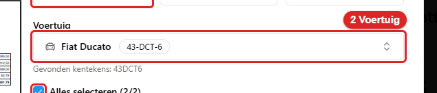
   *Zo ziet het veld **Voertuig** eruit. Klik erop en kies de juiste auto.*
5. Kijk de regels na. Elke regel heeft een **Omschrijving**, een **Bedrag (excl. btw)** en een
   **Categorie**. Verbeter een bedrag of kies een andere categorie als dat nodig is. Met het vinkje
   voor een regel kies je of die regel wordt geboekt. Met **Alles selecteren** zet je alle vinkjes
   in één keer aan of uit. Mist er een regel? Klik op **Regel toevoegen**.

   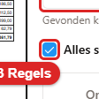
   *Zo ziet het vinkje bij de regels eruit. Alleen regels met een vinkje worden geboekt.*
6. Laat **Eén kostenregel per categorie** aan staan. De app voegt dan de regels met dezelfde
   categorie samen tot één kostenpost. Wil je elke regel als eigen kostenpost? Zet de schakelaar
   dan uit.
7. Komt de factuur van een vaste leverancier die je vertrouwt? Dan kun je op **Afzender
   vertrouwen** klikken. Het adres komt dan op de lijst met vertrouwde afzenders. Klopt een
   volgende factuur van dit adres helemaal? Dan boekt de app die voortaan zelf. Je ziet dan
   *&lt;adres&gt; wordt voortaan automatisch verwerkt*. Deze knop zie je alleen met het recht
   **Instellingen beheren**. Heb je dat niet? Vraag het dan aan de beheerder. Klik er nooit op bij
   een afzender die je niet kent.

   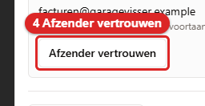
   *Zo ziet de knop **Afzender vertrouwen** eruit. Klik erop. Daarna boekt de app facturen van dit
   adres voortaan zelf, als alles klopt.*
8. Alles goed? Klik op **Boeken**. Je ziet nu bijvoorbeeld *1 kostenregel(s) geboekt*. De factuur
   staat daarna onder **Geboekt**. De kostenposten staan meteen in het **Kostenoverzicht**. De
   factuur hangt als bon aan elke kostenpost. De naam bij **Leverancier** komt bij elke kostenpost
   in de kolom **Leverancier**. Verbeter hem dus hier als hij niet klopt. Dat geldt ook voor facturen
   die de app zelf boekt, en voor facturen die al eerder uit het postvak zijn geboekt. **Boeken** blijft grijs zolang er geen voertuig is
   gekozen, de datum niet klopt of er geen regel met een vinkje is. Ook elke gekozen regel moet een
   omschrijving en een bedrag hebben.

   
   *Zo ziet de knop **Boeken** eruit. Klik erop. Daarna staat de factuur bij **Geboekt**.*

   
   *Het venster **Factuur controleren**: 1 **Leverancier**, 2 **Voertuig**, 3 de regels, 4 **Afzender
   vertrouwen**, 5 **Afwijzen**, 6 **Boeken**. Links staat de factuur zelf. Links onderaan staat
   **Opnieuw uitlezen**.*

   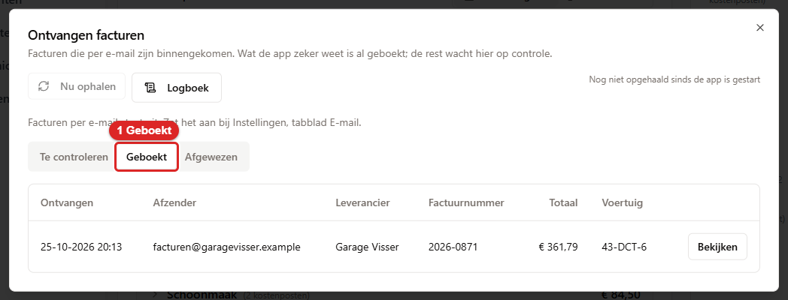
   *1 het tabblad **Geboekt**. De factuur staat erin met het kenteken. Met **Bekijken** zie je wat er
   is geboekt.*

### Afwijzen

Hoort de factuur niet in de app? Bijvoorbeeld omdat hij dubbel is, of omdat het reclame is.

9. Typ eventueel bij **Waarom afwijzen? (optioneel)** een korte reden.
10. Klik op **Afwijzen**. Je ziet nu *Factuur afgewezen*. De factuur staat daarna onder
    **Afgewezen**. Er wordt niets geboekt. Was de reden *Onbekende afzender* of *Geen bruikbare
    bijlage*? Dan gooit de app het bestand meteen weg. Bij de andere redenen blijft het bestand
    bewaard.

    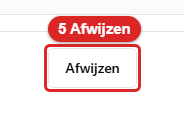
    *Zo ziet de knop **Afwijzen** eruit. Klik erop. Daarna staat de factuur bij **Afgewezen**.*

### Opnieuw uitlezen

Heeft de app de factuur slecht gelezen? Klik dan op **Opnieuw uitlezen**. De app leest de factuur
nog een keer. Je ziet dan *Factuur opnieuw uitgelezen*. Wat je zelf al had aangepast, is dan weg.
Open de factuur daarna opnieuw met **Controleren**.

> **Verkeerd voertuig geboekt?** Opnieuw boeken kan niet. De app kent de factuur al. Verwijder de
> kostenposten bij de verkeerde auto (19.7). Leg ze daarna zelf vast bij de goede auto met **Kosten
> registreren** (19.2).

---

## 19.5 Een factuur zelf scannen

Heb je een factuur als PDF, maar kwam die niet via het postvak? Dan laat je de app hem toch
uitlezen.

1. Klik op **Kosten** → **Factuur scannen**. Je ziet nu het venster **Factuur scannen**. Eronder
   staat *Upload een PDF-factuur om kosten automatisch te herkennen en te categoriseren*.

   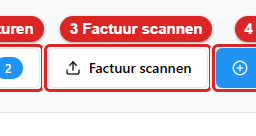
   *Zo ziet de knop **Factuur scannen** eruit. Klik erop. Daarna zie je het venster **Factuur
   scannen**.*
2. Klik bij **Factuur-PDF uploaden** op **Bestand kiezen**. Kies de PDF. Alleen een PDF werkt. Een
   foto van een bon leg je vast met **Kosten registreren** (19.2).

   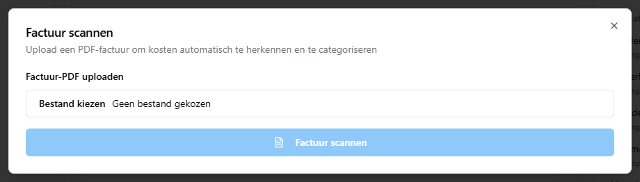
   *Het venster **Factuur scannen**. Kies eerst bij **Factuur-PDF uploaden** het bestand. Daarna
   wordt de knop **Factuur scannen** blauw.*
3. Klik op **Factuur scannen**. De app leest de factuur. Dat duurt even. Je ziet dan *Factuur
   succesvol gescand*.
4. Kijk bij **Selecteer voertuig voor kosten** of de goede auto staat. Vond de app een kenteken dat
   in de vloot zit? Dan staat de auto er al. Je ziet dan *Voertuig automatisch geselecteerd*. Anders
   kies je de auto zelf.
5. Kijk bij **Factuurinformatie** de leverancier, het factuurnummer, de datum en het totaal na.
6. Kijk bij **Kostenregels** de regels na. Pas een bedrag of categorie aan als dat nodig is. Alleen
   regels met een vinkje worden kosten. Met **Groeperen op categorie** voeg je regels van dezelfde
   categorie samen. Onderaan staat **Totaal geselecteerd**.
7. Klik op de knop **n kostenposten aanmaken**. In plaats van n staat het aantal. Je ziet nu *Kosten
   succesvol aangemaakt*. Wil je toch overnieuw? Klik dan op **Opnieuw beginnen**.

Een gescande factuur komt ook in **Ontvangen facturen** te staan. Bij de afzender staat dan
*handmatige scan*. Is dezelfde factuur al eerder binnengekomen? Dan weigert de app hem. Je ziet dan
*Deze factuur is al geboekt.* of *Deze factuur staat al bij Ontvangen facturen ter controle. Boek
hem daar.*

---

## 19.6 Schade en kosten

Bij het ophalen en het innemen maak je een schadecheck. Dat staat in
[hoofdstuk 5](05-reserveringen.md), paragraaf 5.7 en 5.8. Een schadepunt in de check is nog geen
kostenpost. De reparatie leg je apart vast.

1. Krijg je de rekening van de schadeherstelling? Leg die vast als kostenpost met de categorie
   **Schade**. Dat kan met **Kosten registreren** (19.2). Komt de factuur via het postvak? Kies dan
   bij het controleren de categorie **Schade** (19.4).
2. Zet in de **Omschrijving** waar het om gaat. Bijvoorbeeld het reserveringsnummer of de naam van
   de klant. De app koppelt de schade, de kostenpost en de klant niet aan elkaar. Dat moet je zelf
   bijhouden.

Wat de app **niet** kan:

- Schade doorrekenen aan de klant. Daar is in de app geen functie voor. Een kostenpost **Schade**
  telt in de rapporten als eigen kosten. Het eigen risico van de klant reken je buiten de app af.
- De bedragen voor het eigen risico staan alleen in de instellingen. Die zijn voor het contract.

Een klant met een portaalaccount kan zelf een **Schademelding** doen. Die komt binnen als aanvraag
bij het klantenportaal.

---

## 19.7 Een kostenpost verwijderen en terugzetten

### Verwijderen

1. Zoek de kostenpost in het **Kostenoverzicht** (19.1).
2. Klik op het rode prullenbakje rechts op de regel. Je ziet nu de vraag **Weet je het zeker?**. Daaronder
   staat *Deze kostenpost gaat naar de prullenbak; terugzetten kan via Prullenbak op de pagina
   Kosten.*
3. Klik op **Verwijderen**. Je ziet nu *Kosten verwijderd*. De kostenpost is uit de lijst. Hij staat
   nu in de prullenbak.

Je kunt ook verwijderen vanuit het venster **Kostendetails**. Klik daar op **Verwijderen**.

### Terugzetten

Hiervoor heb je het recht **Prullenbak beheren** nodig. Zonder dat recht is de knop grijs.

4. Klik op **Kosten** → **Verwijderde kostenposten**. Je ziet nu het venster **Verwijderde
   kostenposten**. Bovenin staat het zoekveld *Zoeken op omschrijving of naam…*. Elke regel zegt
   wanneer en door wie de kostenpost is verwijderd.

   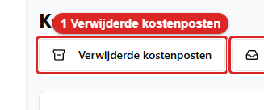
   *Zo ziet de knop **Verwijderde kostenposten** eruit. Klik erop. Daarna zie je de prullenbak van
   Kosten.*

   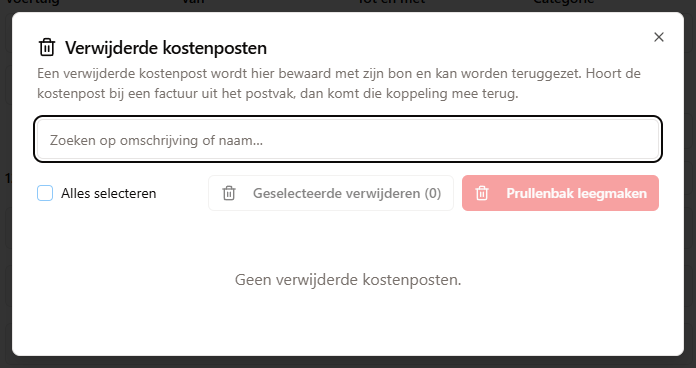
   *Het venster **Verwijderde kostenposten**. Hier is het nog leeg. Dan staat er Geen
   verwijderde kostenposten. Rechtsboven staan **Geselecteerde verwijderen (0)** en **Prullenbak leegmaken**.*
5. Klik bij de kostenpost op **Terugzetten**. Je ziet nu **Teruggezet**. De kostenpost staat weer in
   het **Kostenoverzicht**. De bon komt mee terug. Hoorde de kostenpost bij een factuur uit het
   postvak? Dan komt die koppeling ook terug.

Is de auto van de kostenpost intussen verwijderd? Dan komt de kostenpost toch terug. Je ziet dan
*Let op: het voertuig van deze kostenpost bestaat niet meer. De kostenpost staat er weer, maar
hoort bij een voertuig dat ontbreekt.*

> **Definitief verwijderen kun je niet ongedaan maken.** Met **Definitief verwijderen**,
> **Geselecteerde verwijderen (n)** of **Prullenbak leegmaken** is de kostenpost voorgoed weg. Ook
> de bon is dan weg. Doe dit alleen als je het zeker weet. Meer over de prullenbakken staat in
> [hoofdstuk 10](10-beheer.md), paragraaf 10.6.

---

## 19.8 Welk recht je nodig hebt

| Wat je wilt | Recht |
|---|---|
| Het scherm **Kosten** openen, kosten registreren, bewerken en verwijderen | **Kosten beheren** |
| Facturen controleren, boeken en afwijzen, en **Factuur scannen** | **Kosten beheren** |
| Het **Logboek** van het factuurpostvak zien | **Kosten beheren** of **Instellingen beheren** |
| **Afzender vertrouwen** | **Instellingen beheren** (alleen beheerders) |
| Facturen per e-mail aanzetten en instellen | **Instellingen beheren** (alleen beheerders) |
| Een tankbeurt met bedrag vastleggen | **Voertuigen beheren** is genoeg |
| **Verwijderde kostenposten** openen, terugzetten of definitief verwijderen | **Prullenbak beheren** |

**Prullenbak beheren** is een eigen vinkje. Ook een beheerder krijgt het niet vanzelf. Mis je een
recht? Vraag het aan de beheerder. Meer over rechten staat in
[hoofdstuk 15](15-rollen-en-rechten.md).

---

## 19.9 In het kort

| Wat wil je? | Waar klik je? |
|---|---|
| Een kostenpost vastleggen | **Kosten** → **Kosten registreren** |
| Kosten vastleggen voor de auto waarvan je de sleutel hebt | **Scannen** → scan → **Kosten registreren** |
| De kosten van één auto zien | Voertuigkaart → tabblad **Kosten** |
| De kosten filteren | **Kosten** → **Voertuig**, **Van**, **Tot en met**, **Categorie** of het zoekveld |
| Een maand of jaar in één klik | **Deze maand**, **Vorige maand** of **Dit jaar** |
| De kosten naar Excel | **Kosten** → **Exporteren (CSV)** |
| Alle kosten in één tabel | **Kosten** → **Alle kosten** |
| De leverancier van een kostenpost vastleggen | **Kosten registreren** of **Kosten bewerken** → **Leverancier** (bij facturen uit het postvak gaat dat vanzelf) |
| Eén kostenpost bekijken of aanpassen | Het oogje op de regel → **Kosten bewerken** |
| Facturen uit de mail zien | **Kosten** → **Ontvangen facturen** |
| De mail meteen ophalen | **Ontvangen facturen** → **Nu ophalen** |
| Een factuur boeken | **Ontvangen facturen** → **Controleren** → **Boeken** |
| Een factuur weigeren | **Ontvangen facturen** → **Controleren** → **Afwijzen** |
| Zien wat er uit het postvak kwam | **Ontvangen facturen** → **Logboek** |
| Een PDF-factuur zelf laten uitlezen | **Kosten** → **Factuur scannen** |
| Een schadereparatie vastleggen | **Kosten registreren** → categorie **Schade** |
| Een kostenpost verwijderen | Het rode prullenbakje op de regel → **Verwijderen** |
| Een kostenpost terughalen | **Kosten** → **Verwijderde kostenposten** → **Terugzetten** |
