# 20. Klantenportaal en bekeuringen

Dit hoofdstuk is voor de balie en het kantoor. Je leert hoe je aanvragen uit het klantenportaal
afhandelt. Je leert ook hoe je bekeuringen invoert, aan een klant koppelt en de klant informeert.
Aan het eind lees je wat de fiscale check laat zien. Het klantenportaal is de website waar klanten
zelf online dingen regelen. Je hebt het recht **Klantportaal bekijken** of **Klantportaal beheren**
nodig. Voor bekeuringen heb je **Boetes bekijken** of **Boetes beheren** nodig. Alle rechten staan
in paragraaf 20.6.

Een rondleiding langs het scherm staat ook in [hoofdstuk 2, paragraaf 2.6](02-navigatie.md). Het
portaal van één klant staat in [hoofdstuk 3, paragraaf 3.7](03-klanten.md).

---

## 20.1 Het scherm Klantenportaal beheren

1. Klik in het menu links op **Klantenportaal**. Je ziet nu het scherm **Klantenportaal beheren**.

   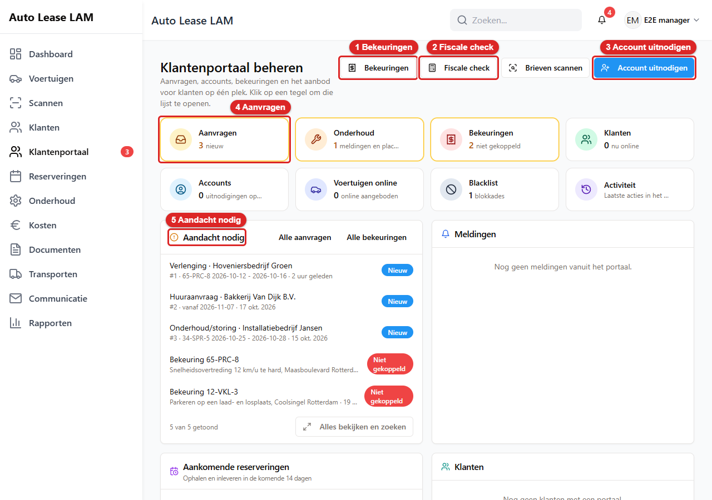
   *Het scherm **Klantenportaal beheren**: 1 **Bekeuringen**, 2 **Fiscale check**, 3 **Account
   uitnodigen**, 4 **Aanvragen**, 5 **Aandacht nodig**.*
2. Kijk naar het rode bolletje achter **Klantenportaal** in het menu. Het getal telt de nieuwe
   aanvragen en de ongelezen meldingen uit het portaal bij elkaar op. Staat er geen bolletje? Dan is
   er niets nieuws.

**De knoppen bovenaan.** Rechtsboven staan vier knoppen:

| Knop | Wat het doet | Zie |
|---|---|---|
| **Bekeuringen** | Opent de lijst met alle bekeuringen | 20.4 |
| **Fiscale check** | Opent het fiscale overzicht. Alleen met het recht **Fiscaal bekijken** | 20.5 |
| **Brieven scannen** | Leest een stapel bekeuringsbrieven in | 20.4 |
| **Account uitnodigen** | Nodigt iemand van een klant uit voor het portaal | 20.3 |

**De acht tegels.** Onder de knoppen staan acht tegels. Elke tegel toont een getal. Klik op een
tegel. Je ziet dan de hele lijst.

| Tegel | Wat het getal telt |
|---|---|
| **Aanvragen** | Nieuwe aanvragen van klanten |
| **Onderhoud** | Onderhoudsmeldingen en placeholders. Een placeholder is een plek die alvast vastgehouden wordt voor een vervangende auto |
| **Bekeuringen** | Bekeuringen die nog niet aan een klant gekoppeld zijn |
| **Klanten** | Klanten die nu online zijn |
| **Accounts** | Uitnodigingen die nog openstaan |
| **Voertuigen online** | Auto's die klanten online kunnen aanvragen |
| **Blacklist** | Blokkades. Een geblokkeerde klant ziet die auto niet in het portaal |
| **Activiteit** | Geen getal. De laatste acties in het portaal |

Een tegel met een gele rand vraagt om actie.

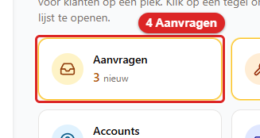
*Zo ziet de tegel **Aanvragen** eruit. Klik erop. Daarna zie je de lijst met alle aanvragen.*

**Aandacht nodig.** Dit paneel is je werklijst. Hier staan de nieuwe aanvragen en de bekeuringen
die nog niet gekoppeld zijn. Elke regel noemt het soort, de klant of het kenteken en een label.
Een blauw label **Nieuw** is een aanvraag. Een rood label **Niet gekoppeld** is een bekeuring. Soms
staat er ook *Start binnenkort* of *Wacht al lang*. Pak die regels eerst op. Klik op een regel. Je
ziet dan meteen de aanvraag of de bekeuring. Met **Alle aanvragen** en **Alle bekeuringen** open je
de hele lijst.

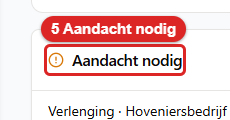
*Zo ziet de kop van het paneel **Aandacht nodig** eruit. De regels eronder zijn je werk voor
vandaag.*

**Meldingen.** Rechts naast **Aandacht nodig** staat het paneel **Meldingen**. Daar zie je wat
klanten in het portaal hebben gedaan. Bijvoorbeeld een gewijzigd adres. Is er niets? Dan staat er
*Nog geen meldingen vanuit het portaal.* Heb je alles gelezen? Klik dan op **Alles gelezen**. Het
rode bolletje in het menu wordt dan kleiner.

Daaronder staan nog twee panelen: **Aankomende reserveringen** (*Ophalen en inleveren in de komende
14 dagen*) en **Klanten**. Elk paneel toont alleen de eerste regels. Klik op **Alles bekijken en
zoeken** voor de hele lijst.

---

## 20.2 Een aanvraag afhandelen

Een aanvraag is iets wat een klant online vraagt. Bijvoorbeeld een langere huur of een
onderhoudsafspraak. Elke aanvraag werkt in grote lijnen hetzelfde.

### De vaste stappen

1. Klik in **Aandacht nodig** op de aanvraag. Of klik op de tegel **Aanvragen** en daarna op de
   regel. Je ziet nu het venster **Aanvraag #<nummer>**.
2. Lees bovenaan het soort aanvraag en de naam van de klant. Lees het blok **Bericht van klant**.
   Kijk of er **Bijlagen** bij zitten.
3. Klik op **In behandeling nemen**. De klant ziet dan dat je ermee bezig bent. Deze knop zie je
   alleen zolang de aanvraag op **Nieuw** staat.
4. Wil je iets vragen zonder de aanvraag af te sluiten? Typ dan je vraag in het vak onder
   **Berichten met de klant**. Klik op **Bericht plaatsen**. Het bericht komt in de draad. De klant
   krijgt een melding in het portaal. Er gaat geen e-mail uit en de aanvraag blijft open.
5. Wil je de aanvraag beantwoorden? Gebruik dan het vak **Antwoord aan klant**. Klik eerst op een
   knop achter **Standaardantwoord invullen**. Dat zijn **Ontvangen**, **Akkoord** of **Afwijzing**.
   Niet elke aanvraag heeft alle drie. De tekst komt dan in het vak. Je mag hem nog aanpassen.
6. Kies daarna hoe je afsluit. Dat hangt af van het soort aanvraag (zie hieronder).

**Het verschil tussen bericht en antwoord.** **Bericht plaatsen** is een tussenbericht in het
portaal. **Antwoord aan klant** is het antwoord bij het afsluiten. Dat gaat ook per e-mail naar de
klant. Behalve als de klant die mails heeft uitgezet (zie [paragraaf 3.7](03-klanten.md)).

**Afwijzen.** Gaat een aanvraag niet door? Vul dan een reden in bij **Antwoord aan klant**. Klik op
**Afwijzen**. Is het vak leeg? Dan meldt de app *Vul een antwoord in.* De klant leest je reden
online terug.

### Verlenging of eerder inleveren

Bij een verlenging vraagt de klant een latere einddatum. Bij eerder inleveren vraagt de klant een
eerdere einddatum.

1. Open de aanvraag. Je ziet de **Reservering** en de **Gevraagde nieuwe einddatum**.

   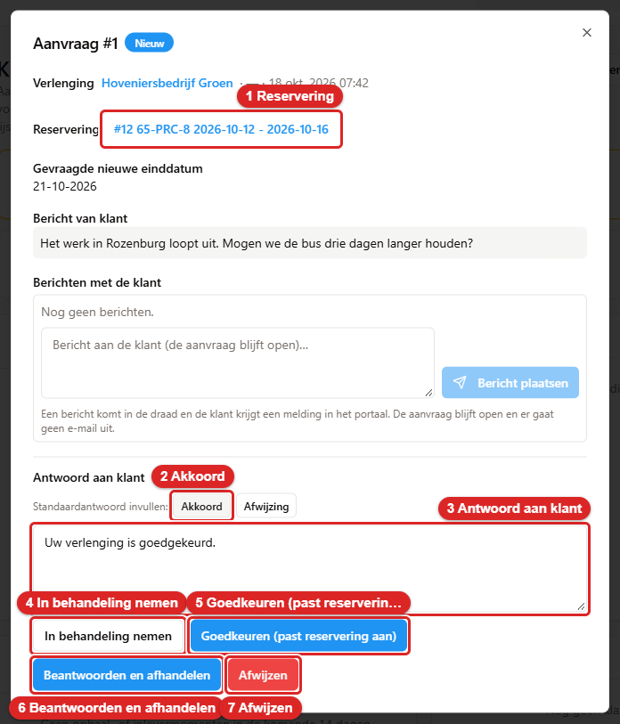
   *Het venster **Aanvraag #1** voor een verlenging: 1 **Reservering**, 2 **Akkoord**, 3 **Antwoord
   aan klant**, 4 **In behandeling nemen**, 5 **Goedkeuren (past reservering aan)**, 6 **Beantwoorden
   en afhandelen**, 7 **Afwijzen**.*
2. Klik op de blauwe regel achter **Reservering**. Je ziet dan de reservering. Kijk of de auto daarna
   nog vrij is.

   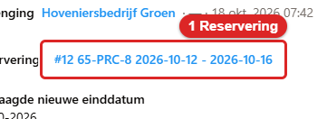
   *Zo ziet de link achter **Reservering** eruit. Klik erop. Daarna zie je de reservering.*
3. Klik op **In behandeling nemen**.

   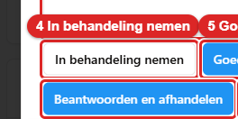
   *Zo ziet de knop **In behandeling nemen** eruit. Klik erop. Daarna staat de aanvraag niet meer op
   **Nieuw**.*
4. Gaat het door? Klik op **Goedkeuren (past reservering aan)**. De app zet de nieuwe einddatum in
   de reservering. Het contract krijgt de status **Verouderd**. De klant krijgt een melding en een
   e-mail.

   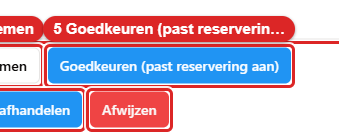
   *Zo ziet de knop **Goedkeuren (past reservering aan)** eruit. Klik erop. Daarna heeft de reservering
   de nieuwe einddatum.*

> **Let op: je eigen tekst gaat niet mee.** Bij **Goedkeuren (past reservering aan)** stuurt de app
> niet de tekst uit **Antwoord aan klant**. De klant krijgt altijd een vast standaardbericht. De app
> meldt toch *Antwoord verstuurd.* Wil je de klant iets extra's vertellen? Plaats dat dan eerst met
> **Bericht plaatsen**. Daarna klik je op **Goedkeuren (past reservering aan)**.

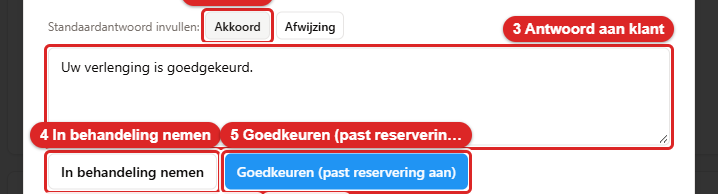
*Hier zie je **Akkoord** en het vak **Antwoord aan klant** (3). Bij goedkeuren wordt deze tekst niet
verstuurd.*

5. Gaat het niet door? Klik op **Afwijzing** achter **Standaardantwoord invullen**. Pas de tekst zo
   nodig aan. Klik op **Afwijzen**.

   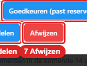
   *Zo ziet de knop **Afwijzen** eruit. Klik erop. Daarna is de aanvraag afgewezen en blijft de
   reservering zoals hij was.*

**Beantwoorden en afhandelen** sluit de aanvraag met jouw antwoord. Maar de reservering verandert
dan niet. Gebruik die knop dus niet als je de verlenging wilt goedkeuren.

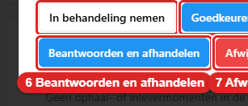
*Zo ziet de knop **Beantwoorden en afhandelen** eruit. Hij sluit de aanvraag. De reservering blijft
gelijk.*

**Eerder inleveren** keur je op dezelfde manier goed. De einddatum wordt dan eerder. Je moet de auto
daarna nog steeds aan de balie innemen (zie [hoofdstuk 5](05-reserveringen.md)).

### Huuraanvraag

Bij een huuraanvraag wil de klant een auto huren voor een periode. Jij maakt daar een reservering
van.

1. Open de aanvraag. Je ziet het **Voertuig**, **Vanaf**, **Tot en met** en de **Bestuurder**.

   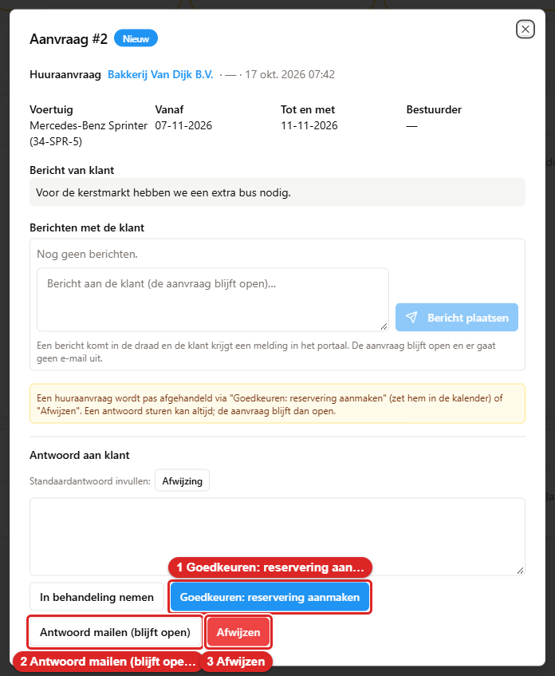
   *Het venster **Aanvraag #2** voor een huuraanvraag: 1 **Goedkeuren: reservering aanmaken**,
   2 **Antwoord mailen (blijft open)**, 3 **Afwijzen**.*
2. Klik op **Goedkeuren: reservering aanmaken**. Je ziet nu het blok **Reservering aanmaken uit
   deze aanvraag**.

   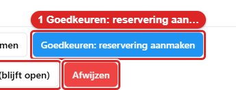
   *Zo ziet de knop **Goedkeuren: reservering aanmaken** eruit. Klik erop. Daarna klapt het blok
   voor de reservering open.*
3. Controleer de **Periode**. Kies een **Ophaaltijd** en een **Inlevertijd** als die bekend zijn.
4. Kijk bij **Voertuig** naar de auto achter **Gevraagd**. Staat daar een rood label **Bezet in deze
   periode**? Dan is die auto in die periode al verhuurd of in onderhoud. Kies dan een andere auto.
   Onder **Zelfde type, vrij** staan auto's van hetzelfde soort die wel vrij zijn. Klik op een van
   die auto's. Of zoek een andere auto op kenteken, merk of type. Onderaan staat welke auto geboekt
   wordt: *Wordt geboekt: …*. Lees die regel na voordat je verdergaat.

   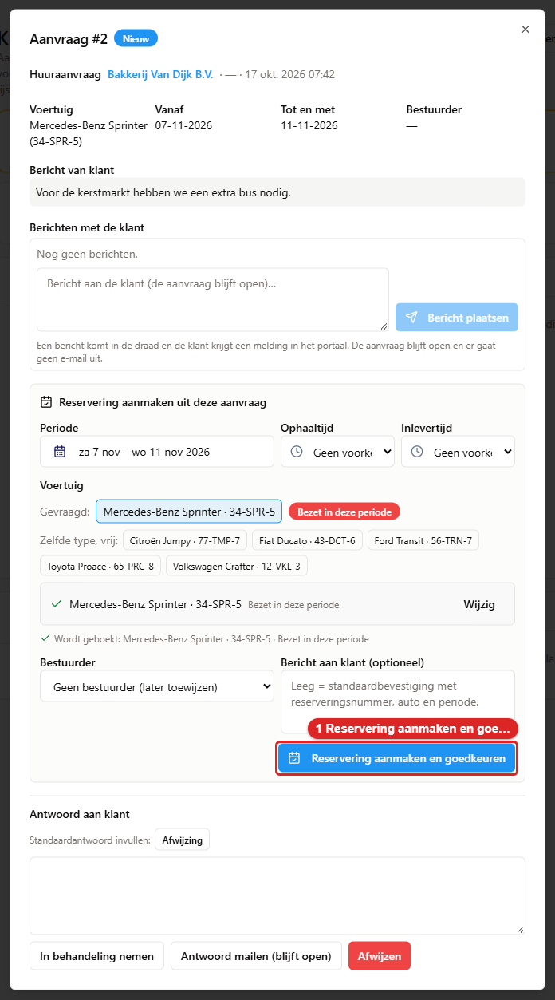
   *Het blok **Reservering aanmaken uit deze aanvraag**. De gevraagde auto heeft het label **Bezet in
   deze periode**. Daaronder staan de auto's bij **Zelfde type, vrij**. 1 **Reservering aanmaken en
   goedkeuren**.*
5. Kies een **Bestuurder**. Weet je die nog niet? Laat dan **Geen bestuurder (later toewijzen)**
   staan.
6. Typ eventueel een **Bericht aan klant (optioneel)**. Laat je het leeg? Dan krijgt de klant een
   standaardbevestiging met het reserveringsnummer, de auto en de periode.
7. Klik op **Reservering aanmaken en goedkeuren**. Je ziet nu *Reservering #… aangemaakt; de klant is
   geïnformeerd.* Daarna opent de nieuwe reservering vanzelf.

   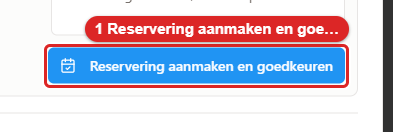
   *Zo ziet de knop **Reservering aanmaken en goedkeuren** eruit. Klik erop. Daarna staat de
   reservering in de kalender.*

Een huuraanvraag sluit je alleen af met **Goedkeuren: reservering aanmaken** of **Afwijzen**. Met
**Antwoord mailen (blijft open)** stuur je wel een antwoord. Maar de aanvraag blijft dan openstaan.

### Onderhoud

Een klant kan online een storing melden. Of hij vraagt om een onderhoudsafspraak te verzetten. Hoe
je dat afhandelt, staat uitgebreid in [hoofdstuk 7, paragraaf 7.9](07-onderhoud.md). Hier kort:

1. Open de aanvraag. Lees het blok **Melding van de klant**.

   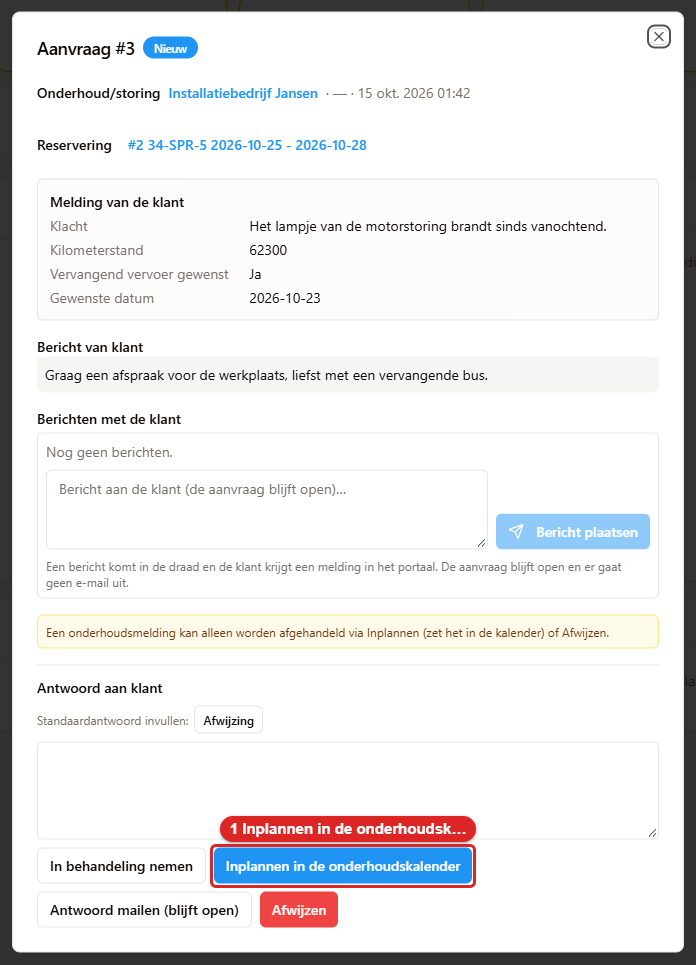
   *Het venster **Aanvraag #3** voor **Onderhoud/storing**: 1 **Inplannen in de
   onderhoudskalender**.*
2. Klik op **Inplannen in de onderhoudskalender**. Bij een verzoek om te verzetten heet de knop
   **Onderhoud verplaatsen**.

   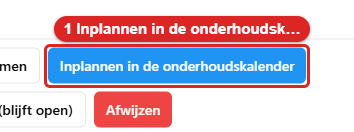
   *Zo ziet de knop **Inplannen in de onderhoudskalender** eruit. Klik erop. Daarna klapt een klein
   formulier open.*
3. Vul de **Datum**, de **Duur (dagen)** en het **Soort** in. Schrijf een **Notitie voor de klant**.
4. Klik op **Inplannen en bevestigen**. Je ziet nu *Onderhoud #… staat in de kalender*.

**Vervangend vervoer.** Vroeg de klant om vervangend vervoer? Dan staat er *Er wordt een
vervanger-placeholder aangemaakt; wijs later een auto toe in de onderhoudskalender.* Die placeholder
maakt de app alleen als de onderhoudsdatum binnen de huur van de klant valt. Valt de datum erbuiten?
Dan komt er geen placeholder. Regel de vervangende auto dan zelf (zie [paragraaf
7.4](07-onderhoud.md)).

Een onderhoudsmelding sluit je alleen af met inplannen of **Afwijzen**.

### APK inplannen

Een klant kan in het portaal vragen om de APK van zijn huurauto in te plannen. Hoe de klant dat
doet, staat in [paragraaf 3.7](03-klanten.md). De app plant de APK niet zelf. Dat doe jij in de
planner van de garage.

1. Open de aanvraag **APK inplannen**. Bovenaan staat de **Reservering**. Daaronder staat de
   **Voorkeursdag** van de klant. Heeft de klant geen dag gekozen? Dan staat er *Geen voorkeur*.

   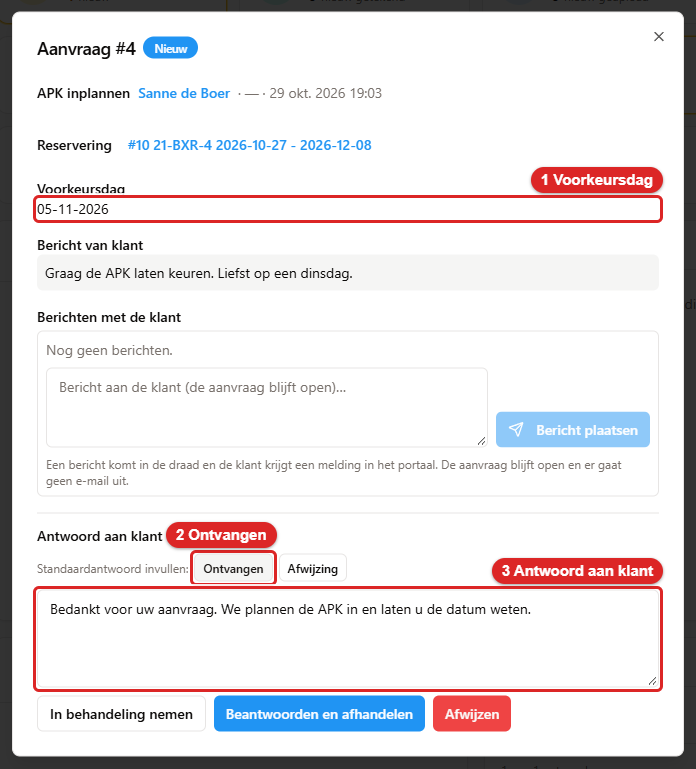
   *De aanvraag **APK inplannen**. 1 is de **Voorkeursdag**. 2 is **Ontvangen**. 3 is **Antwoord aan
   klant**.*
2. Zet de afspraak in de planner van de garage. Kies zo mogelijk de voorkeursdag.
3. Klik op **Ontvangen** achter **Standaardantwoord invullen**. Zet de datum van de afspraak in de
   tekst.

   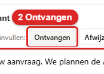
   *Zo ziet de knop **Ontvangen** eruit.*
4. Klik op **Beantwoorden en afhandelen**. De klant krijgt je antwoord met de datum.

   
   *Zo ziet de knop **Beantwoorden en afhandelen** eruit.*

Een klant kan ook zelf een afspraak maken in de online agenda van de garage. Dat komt niet als
aanvraag bij jou binnen. Je ziet het alleen in de planner van de garage.

### Wijziging bedrijfsnaam

Een klant kan zijn bedrijfsnaam niet zelf wijzigen. Hij vraagt dat aan. Je ziet dan bovenaan de
**Gevraagde bedrijfsnaam**. Klik op **Goedkeuren (past de bedrijfsnaam aan)**. De naam in het
klantrecord verandert dan. Of klik op **Afwijzen** met een reden. Afsluiten zonder goedkeuren kan
niet. Wat er precies verandert, staat in [paragraaf 3.7](03-klanten.md).

### Overige aanvragen

Een **Schademelding**, een **Vraag over bekeuring**, een **Kilometerstand** en **Overig** werken
eenvoudig. Er is niets in de app aan te passen.

1. Lees de aanvraag.
2. Klik op **Ontvangen** achter **Standaardantwoord invullen**. Pas de tekst aan als dat nodig is.
3. Klik op **Beantwoorden en afhandelen**. De klant krijgt je antwoord en de aanvraag is klaar.

Gaat het om een bekeuring? Open die dan eerst. Zie paragraaf 20.4.

---

## 20.3 Portaalaccounts uitnodigen en beheren

Een portaalaccount is de inlog van één persoon bij een klant. Dat kan een beheerder zijn of een
bestuurder. Je nodigt iemand uit op twee manieren:

- Via de klant zelf, op het tabblad **Portaal**. Dat staat stap voor stap in [hoofdstuk 3, paragraaf
  3.7](03-klanten.md).
- Via **Klantenportaal** met de knop **Account uitnodigen**.

1. Klik rechtsboven op **Account uitnodigen**. Je ziet nu het venster **Portaalaccount**.

   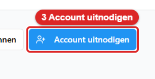
   *Zo ziet de knop **Account uitnodigen** eruit. Klik erop. Daarna zie je het venster
   **Portaalaccount**.*
2. Kies eerst de **Klant**. Vul daarna het **E-mailadres**, de **Naam** en de **Rol** in. Kies je de
   rol **Bestuurder**? Wijs dan ook de **Gekoppelde bestuurder** aan.
3. Haal onder **Rechten voor dit account** de vinkjes weg die deze persoon niet mag.
4. Klik op **Uitnodigen**. Je ziet nu *Uitnodiging verstuurd naar …*.

   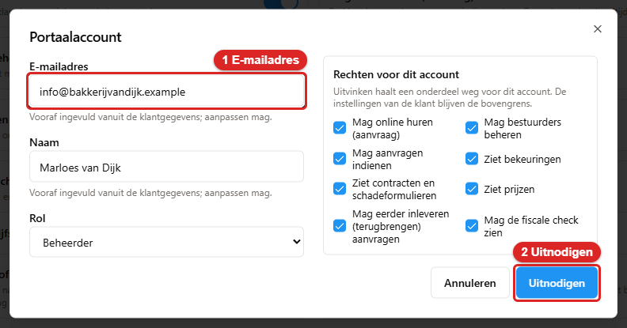
   *Het venster **Portaalaccount**: 1 **E-mailadres**, 2 **Uitnodigen**.*

Een bestaand account beheer je via de tegel **Accounts**. Achter elke regel staan **Bewerken en
rechten**, **Uitnodiging opnieuw sturen**, **Wachtwoord-reset sturen**, **Blokkeren** /
**Deblokkeren** en **Verwijderen**. Wanneer je welke knop ziet, staat in [paragraaf
3.7](03-klanten.md).

---

## 20.4 Bekeuringen

De app registreert bekeuringen en koppelt ze aan de klant die de auto toen had. Het doorbelasten en
betalen regel je buiten de app. Een bekeuring heeft een van deze statussen:

| Status | Betekenis |
|---|---|
| **Niet gekoppeld** | Er hoort nog geen klant bij |
| **Gekoppeld** | De klant is bekend. De klant ziet de bekeuring in het portaal |
| **Geannuleerd** | De bekeuring telt niet meer mee |

### Het scherm Bekeuringen openen

Er is geen menu-item **Bekeuringen**. Je komt er via het klantenportaal.

1. Klik in het menu op **Klantenportaal**.
2. Klik rechtsboven op **Bekeuringen**. Je ziet nu het scherm **Bekeuringen**.

   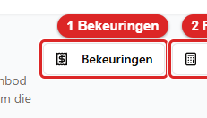
   *Zo ziet de knop **Bekeuringen** eruit. Klik erop. Daarna zie je de lijst met bekeuringen.*

Je kunt ook op de tegel **Bekeuringen** klikken. Of op een bekeuring in **Aandacht nodig**.

### De lijst

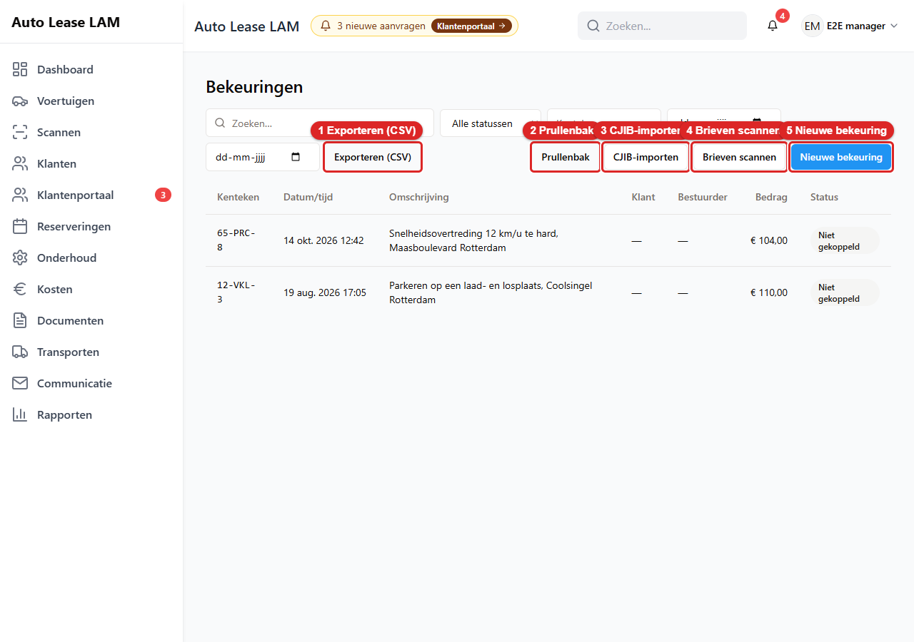
*Het scherm **Bekeuringen**: 1 **Exporteren (CSV)**, 2 **Prullenbak**, 3 **CJIB-importen**,
4 **Brieven scannen**, 5 **Nieuwe bekeuring**.*

Bovenaan zoek en filter je. Er is een zoekveld, het filter **Alle statussen**, een veld **Kenteken**
en de datums **Van** en **Tot**. Met **Exporteren (CSV)** download je de lijst als bestand voor
Excel. De tabel heeft de kolommen **Kenteken**, **Datum/tijd**, **Omschrijving**, **Klant**,
**Bestuurder**, **Bedrag** en **Status**. Het bedrag is inclusief administratiekosten. Klik op een
regel. Je ziet dan het venster **Bekeuring #<nummer>**.

Er zijn drie manieren om bekeuringen in te voeren. **Nieuwe bekeuring** is voor één brief.
**Brieven scannen** is voor een stapel brieven. **CJIB-importen** haalt bestanden van het CJIB op.
Het CJIB is de overheidsdienst die de bekeuringen int.

### Eén bekeuring invoeren

1. Klik op **Nieuwe bekeuring**. Je ziet nu het venster **Nieuwe bekeuring**.

   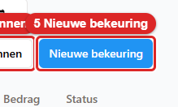
   *Zo ziet de knop **Nieuwe bekeuring** eruit. Klik erop. Daarna zie je het venster **Nieuwe
   bekeuring**.*

   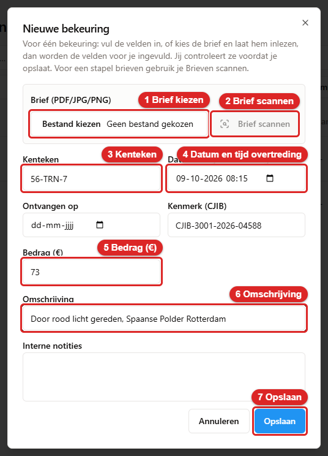
   *Het venster **Nieuwe bekeuring**: 1 **Brief kiezen**, 2 **Brief scannen**, 3 **Kenteken**,
   4 **Datum en tijd overtreding**, 5 **Bedrag (€)**, 6 **Omschrijving**, 7 **Opslaan**.*
2. Heb je de brief als PDF of foto? Klik dan bij **Brief (PDF/JPG/PNG)** op **Bestand kiezen**. Kies
   de brief.

   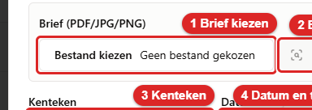
   *Zo ziet het veld voor de brief eruit. Klik op **Bestand kiezen**. Daarna staat de naam van de
   brief in het veld.*
3. Klik op **Brief scannen**. De app leest de brief. Je ziet *Brief lezen…*. Daarna zie je *Brief
   gelezen. Controleer de velden en sla op.* De velden zijn nu ingevuld.

   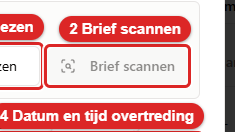
   *Zo ziet de knop **Brief scannen** eruit. Hij is grijs zolang je nog geen brief hebt gekozen.*
4. Controleer elk veld. Een veld met een oranje rand heeft de app niet zeker gelezen. Daar staat
   *Onzeker gelezen: …* bij. Verbeter het als het nodig is.
5. Heb je geen brief? Vul dan zelf de verplichte velden in. Dat zijn **Kenteken**, **Datum en tijd
   overtreding**, **Bedrag (€)** en **Omschrijving**. **Ontvangen op**, **Kenmerk (CJIB)** en
   **Interne notities** mag je leeg laten.
6. Staat er *Kenmerk bestaat al: bekeuring #…*? Dan heb je deze bekeuring al ingevoerd. Klik op
   **Openen** om die te bekijken. Sla niet opnieuw op.
7. Klik op **Opslaan**. Het venster sluit. Daarna opent het venster **Bekeuring #<nummer>**.

   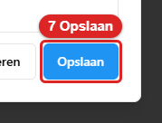
   *Zo ziet de knop **Opslaan** eruit. Klik erop. Daarna zie je de nieuwe bekeuring.*
8. Kijk naar de status bovenaan. Staat er **Niet gekoppeld**? Koppel de bekeuring dan zelf. Zie
   hieronder bij "Een bekeuring aan een klant koppelen".

Onder de velden hoort de app te zeggen aan welke reservering hij de bekeuring gaat koppelen. Op dit
moment vindt de app die reservering niet. Reken er dus op dat je zelf koppelt.

### Een stapel brieven inlezen

1. Klik op **Brieven scannen**. Dat kan op het scherm **Bekeuringen** of op **Klantenportaal**. Je
   ziet nu het venster **Bekeuringsbrieven importeren**.

   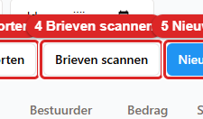
   *Zo ziet de knop **Brieven scannen** eruit. Klik erop. Daarna zie je het venster
   **Bekeuringsbrieven importeren**.*

   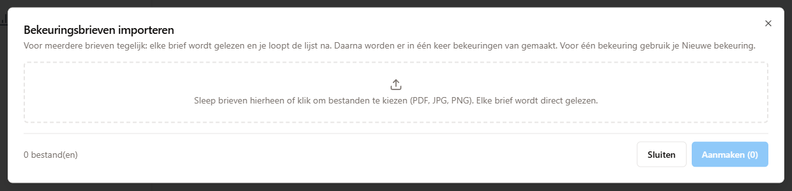
   *Het venster **Bekeuringsbrieven importeren**. Sleep de brieven in het vak met de stippellijn.
   Onderaan staan **Sluiten** en **Aanmaken (0)**.*
2. Sleep de brieven in het vak. Of klik in het vak en kies de bestanden. Elke brief wordt meteen
   gelezen.
3. Kijk per regel naar de status. Je ziet *Wachten*, *Lezen…*, *Klaar*, *Dubbel* of *Mislukt*. Een
   dubbele brief staat al in de app. Die is niet aangevinkt.
4. Verbeter wat niet klopt. Vink de brieven aan die je wilt invoeren. In de kolom **Koppeling** zie
   je wat de app met elke brief wil doen.
5. Klik op **Aanmaken (n)**. Het getal is het aantal aangevinkte brieven. Je ziet nu hoeveel
   bekeuringen er zijn aangemaakt en hoeveel daarvan gekoppeld zijn.
6. Klik op **Sluiten**. Koppel daarna de bekeuringen die nog op **Niet gekoppeld** staan.

### CJIB-bestanden ophalen

Het CJIB kan bekeuringen als bestand aanleveren. De verbinding stelt een beheerder in. Dat gebeurt
in **App-instellingen**, op het tabblad **Klantenportaal**, bij **CJIB-koppeling (FTPS)**.

1. Klik op **CJIB-importen**. Je ziet nu het venster **CJIB-importen**.

   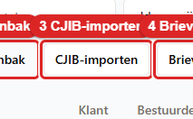
   *Zo ziet de knop **CJIB-importen** eruit. Klik erop. Daarna zie je het venster **CJIB-importen**.*

   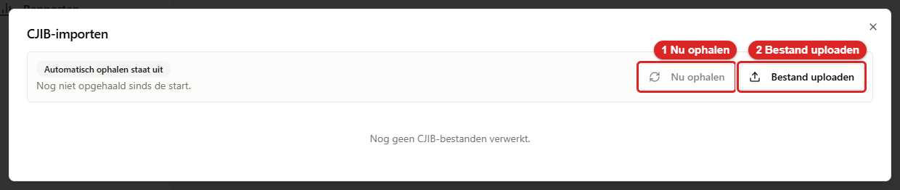
   *Het venster **CJIB-importen**: 1 **Nu ophalen**, 2 **Bestand uploaden**. Hier staat het
   automatisch ophalen nog uit.*
2. Klik op **Nu ophalen**. De app haalt de nieuwe bestanden op. Je ziet daarna hoeveel bestanden er
   zijn opgehaald en hoeveel bekeuringen er zijn aangemaakt.

   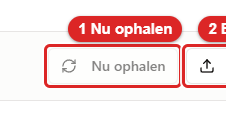
   *Zo ziet de knop **Nu ophalen** eruit. Hij is grijs zolang er geen verbinding met het CJIB is
   ingesteld.*
3. Heb je het bestand zelf gekregen? Klik dan op **Bestand uploaden**. Kies het bestand.

   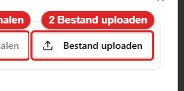
   *Zo ziet de knop **Bestand uploaden** eruit. Klik erop. Daarna kies je het bestand van het CJIB.*
4. Klik op een regel in de lijst. Je ziet dan alleen de bekeuringen uit dat bestand.

### Een bekeuring aan een klant koppelen

Koppelen betekent: je zegt bij welke klant de bekeuring hoort. Meestal doet de app dat zelf. Had
precies één huur de auto op het moment van de overtreding? Dan koppelt de app de bekeuring meteen
aan die huur, die klant en de bestuurder van dat moment. In de lijst staat hij dan op **Gekoppeld**.

Staat een bekeuring op **Niet gekoppeld**? Dan was er op dat moment geen huur, of waren er twee. Je
koppelt hem dan zelf:

1. Open de bekeuring. In het venster staat *Niet automatisch gekoppeld. Kies hieronder de klant (en
   eventueel de reservering/bestuurder).*
2. Daaronder stelt de app huren voor. Onder **Reserveringen op het moment van de overtreding** staan
   huren die toen liepen. Onder **Reserveringen rond die datum** staan huren van een paar dagen ervoor
   of erna. Dat is handig als een auto te laat is ingeleverd. Klik op de goede huur. De app vult dan
   de klant, de reservering en de bestuurder in.

   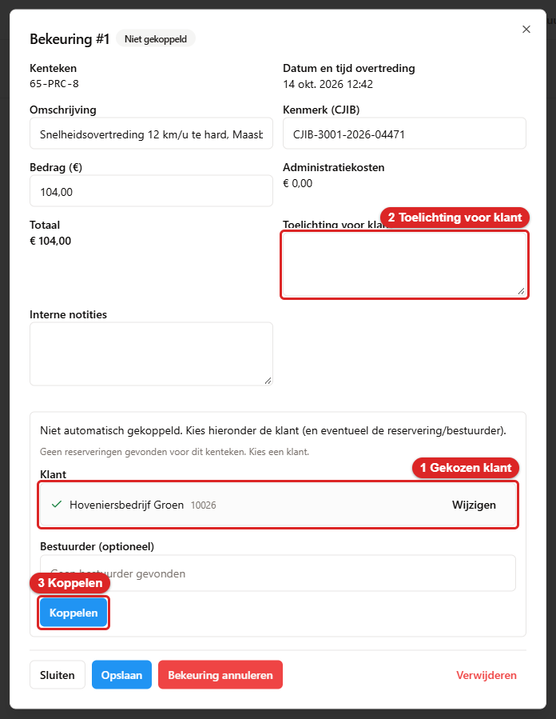
   *Een bekeuring die niet vanzelf gekoppeld is: 1 een voorgestelde huur, 2 **Klant zoeken…**, 3
   **Koppelen**.*

   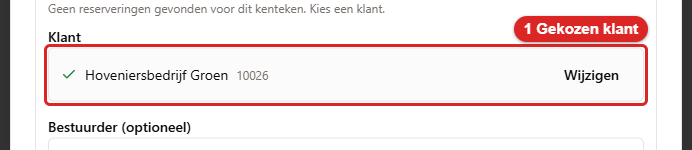
   *Zo ziet een voorgestelde huur eruit. Klik erop als het de goede is.*
3. Staat de goede huur er niet bij? Of zegt de app *Geen reserveringen gevonden voor dit kenteken.
   Kies een klant.*? Typ dan de naam of het nummer van de klant in **Klant zoeken…**. Klik op de
   juiste klant. Je ziet nu een vinkje voor de naam.

   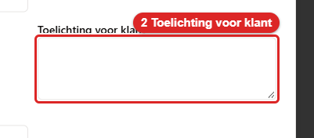
   *Zo ziet het veld **Klant zoeken…** eruit. Typ de naam of het debiteurnummer.*
4. Weet je wie er reed? Kies dan de **Bestuurder (optioneel)**. Weet je het niet? Laat het veld leeg.
5. Wil je de klant iets uitleggen? Typ dat bij **Toelichting voor klant**. De klant ziet die tekst
   in het portaal. **Interne notities** ziet de klant niet.
6. Klik op **Koppelen**. Je ziet nu *Bekeuring gekoppeld.* Bovenaan staat nu **Gekoppeld**.

   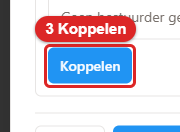
   *Zo ziet de knop **Koppelen** eruit. Klik erop. Daarna staat de bekeuring op **Gekoppeld**.*

Zie je het veld **Klant** niet? Dan mis je het recht **Klanten bekijken**. Er staat dan *Om een klant
aan deze bekeuring te koppelen heb je ook het recht Klanten bekijken nodig.*

### De klant informeren

Koppelen stuurt de klant geen e-mail. Invoeren, inlezen en importeren ook niet. De klant ziet een
gekoppelde bekeuring wel meteen in het portaal. Wil je de klant een e-mail sturen? Doe dan dit:

1. Open de gekoppelde bekeuring.

   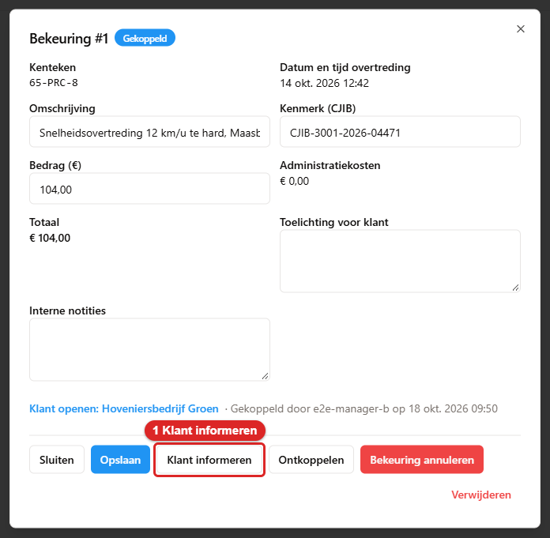
   *Een bekeuring met status **Gekoppeld**: 1 **Klant informeren**.*
2. Klik op **Klant informeren**. Je ziet nu het venster **Klant informeren?** Daarin staat naar welk
   e-mailadres de mail gaat.

   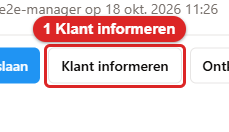
   *Zo ziet de knop **Klant informeren** eruit. Klik erop. Daarna vraagt de app of je het zeker
   weet.*
3. Klik op **Klant informeren** om te versturen. Of klik op **Nee, niet sturen**. Na versturen zie
   je *Klant geïnformeerd.* In het venster staat dan *Klant geïnformeerd op <datum>*. De knop heet
   daarna **Opnieuw informeren**.

Lukt het niet? Dan zegt de app waarom. Bijvoorbeeld *Deze klant heeft geen e-mailadres, dus er is
niets verstuurd.* Of *Het portaal staat uit voor deze klant, dus er is niets verstuurd.*

### Wijzigen, annuleren, heractiveren en verwijderen

Onderaan het venster **Bekeuring #<nummer>** staan deze knoppen:

| Knop | Wat het doet |
|---|---|
| **Sluiten** | Sluit het venster zonder iets te wijzigen |
| **Opslaan** | Bewaart je wijzigingen in **Omschrijving**, **Kenmerk (CJIB)**, **Bedrag (€)**, **Toelichting voor klant** en **Interne notities**. Je ziet *Bekeuring opgeslagen.* |
| **Ontkoppelen** | Haalt de klant weer los. Je ziet *Bekeuring ontkoppeld.* |
| **Bekeuring annuleren** | Zet de bekeuring op **Geannuleerd**. De app vraagt eerst of je het zeker weet. De veilige keuze is **Nee, laten staan** |
| **Heractiveren** | Maakt een geannuleerde bekeuring weer actief. Je ziet *Bekeuring heractiveerd.* |
| **Verwijderen** | Verplaatst de bekeuring naar de prullenbak. Je ziet *Bekeuring naar de prullenbak verplaatst* |

De **Administratiekosten** staan in het venster, maar je kunt ze hier niet wijzigen. Ze komen uit de
instelling **Standaard administratiekosten per bekeuring (€)** in **App-instellingen**, tabblad
**Klantenportaal**.

Met de links **Klant openen**, **Reservering openen** en **Brief bekijken** ga je direct naar de
klant, de reservering of de brief.

### De prullenbak

1. Klik op het scherm **Bekeuringen** op **Prullenbak**. Je ziet nu **Verwijderde bekeuringen**.

   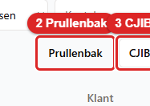
   *Zo ziet de knop **Prullenbak** eruit. Klik erop. Daarna zie je de verwijderde bekeuringen.*
2. Klik op **Terugzetten** om een bekeuring terug te halen.
3. Wil je hem echt weggooien? Klik dan op **Definitief verwijderen**. Dat kun je niet terugdraaien.
   Met **Geselecteerde verwijderen (n)** en **Prullenbak leegmaken** gooi je meer tegelijk weg.

Hiervoor heb je het recht **Prullenbak beheren** nodig. Meer over prullenbakken staat in [hoofdstuk
10, paragraaf 10.6](10-beheer.md).

### Wat de klant in het portaal ziet

De klant ziet een bekeuring als twee dingen kloppen. De bekeuring staat op **Gekoppeld**. En bij de
klant staat de schakelaar **Ziet bekeuringen** aan (zie [paragraaf 3.7](03-klanten.md)). Die
schakelaar staat standaard aan.

In het portaal ziet de klant een tegel met het aantal bekeuringen. Op de pagina staat *Het
doorbelasten aan uw bestuurder regelt u zelf.* De klant kan de brief bekijken. Hij kan ook op **Vraag
stellen over deze bekeuring** klikken. Dat komt bij jou binnen als aanvraag **Vraag over bekeuring**
in **Aandacht nodig**. Je handelt die af zoals in paragraaf 20.2 bij "Overige aanvragen".

---

## 20.5 De fiscale check

Sommige zakelijke klanten moeten belasting betalen als hun personeel een gehuurde auto privé
gebruikt. De fiscale check zoekt per huurperiode uit of dat zo is. De app geeft geen fiscaal
advies. Bij twijfel is een mens nodig.

1. Klik op **Klantenportaal** op **Fiscale check**. Je ziet nu het venster **Fiscale check:
   overzicht**. Je kunt hier ook komen via **Rapporten**, tabblad **Fiscaal**.

   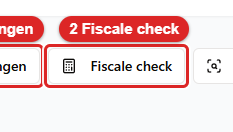
   *Zo ziet de knop **Fiscale check** eruit. Klik erop. Daarna zie je het fiscale overzicht.*

   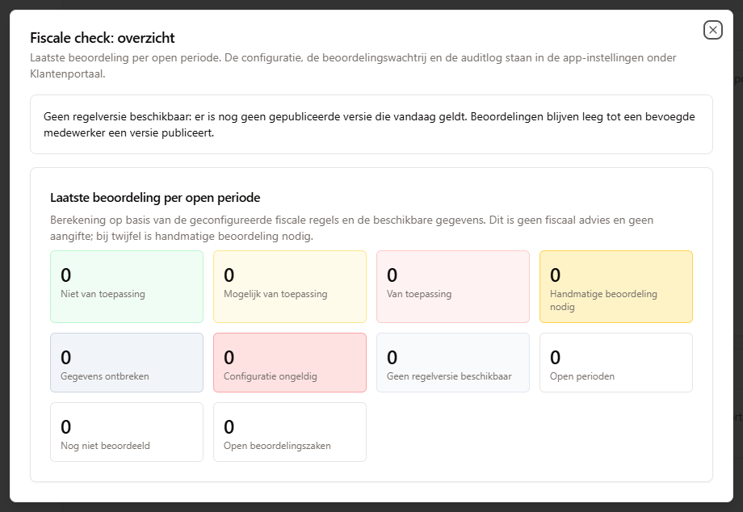
   *Het venster **Fiscale check: overzicht**. Bovenaan staat de regelversie. Daaronder staan de tegels
   met het aantal huurperioden per uitkomst.*
2. Lees bovenaan welke regelversie geldt. Staat er *Geen regelversie beschikbaar*? Dan is er nog geen
   versie van de regels gepubliceerd. De tegels blijven dan op 0 staan.
3. Lees de tegels. Bijvoorbeeld **Niet van toepassing**, **Van toepassing**, **Handmatige
   beoordeling nodig** en **Gegevens ontbreken**. Onderaan staan **Open perioden**, **Nog niet
   beoordeeld** en **Open beoordelingszaken**.

Dit venster kun je alleen lezen. Je vult de gegevens op drie andere plekken in:

- **Bij de reservering:** de kaart **Fiscaal gebruik**. Daar vul je in of de bestuurder de auto privé
  gebruikt en of hij er woon-werkverkeer mee doet. Je kiest ook het **Gebruikstype**. Klik daarna op
  **Bevestigen**.
- **Bij het voertuig:** het tabblad **Fiscaal**. Klik op **Wijzigen** om een gegeven te verbeteren.
  Vul de **Waarde** en de **Reden (verplicht)** in. Klik op **Opslaan**.
- **Bij de beheerder:** **App-instellingen**, tabblad **Klantenportaal**, bij **Fiscale
  mobiliteitscheck**. Daar staan de tabbladen **Configuratie**, **Beoordelingen** en **Auditlog**.

Voor de inhoud van de fiscale regels heeft kantoor een aparte uitleg. Die hoort niet bij deze
handleiding. Vraag de beheerder ernaar als je hem nodig hebt.

---

## 20.6 Rechten

| Recht | Wat je ermee kunt |
|---|---|
| **Klantportaal bekijken** | Het scherm **Klantenportaal beheren** openen en aanvragen, accounts en activiteit lezen |
| **Klantportaal beheren** | Aanvragen afhandelen, accounts uitnodigen, auto's online zetten en blokkades beheren |
| **Boetes bekijken** | Het scherm **Bekeuringen** openen en bekeuringen lezen |
| **Boetes beheren** | Bekeuringen invoeren, koppelen, de klant informeren, annuleren en verwijderen |
| **Klanten bekijken** | Nodig om bij een bekeuring een klant te kiezen |
| **Prullenbak beheren** | Verwijderde bekeuringen terugzetten of definitief verwijderen |
| **Fiscaal bekijken** | Het venster **Fiscale check: overzicht** openen |
| **Fiscale beoordelingen en gegevens beheren** | Een beoordeling bevestigen en een voertuiggegeven verbeteren |

Mis je een recht? Dan staat een knop grijs, of je ziet hem niet. Vraag de beheerder om het recht.
Alle rechten staan in [hoofdstuk 15](15-rollen-en-rechten.md).

---

## 20.7 In het kort

| Wat wil je? | Waar klik je? |
|---|---|
| Zien wat er nieuw is | **Klantenportaal** → paneel **Aandacht nodig** |
| Een aanvraag openen | **Aandacht nodig** of tegel **Aanvragen** → klik op de regel |
| De klant iets vragen zonder af te sluiten | **Aanvraag #…** → **Bericht plaatsen** |
| Een verlenging goedkeuren | **Aanvraag #…** → **Goedkeuren (past reservering aan)** |
| Van een huuraanvraag een reservering maken | **Goedkeuren: reservering aanmaken** → **Reservering aanmaken en goedkeuren** |
| Een onderhoudsmelding inplannen | **Inplannen in de onderhoudskalender** → **Inplannen en bevestigen** |
| Een aanvraag weigeren | Reden in **Antwoord aan klant** → **Afwijzen** |
| Iemand uitnodigen voor het portaal | **Klantenportaal** → **Account uitnodigen** |
| De bekeuringen zien | **Klantenportaal** → **Bekeuringen** |
| Eén bekeuring invoeren | **Bekeuringen** → **Nieuwe bekeuring** → **Brief scannen** → **Opslaan** |
| Een stapel brieven invoeren | **Brieven scannen** → **Aanmaken (n)** |
| CJIB-bestanden ophalen | **Bekeuringen** → **CJIB-importen** → **Nu ophalen** |
| Een bekeuring koppelen | **Bekeuring #…** → **Klant zoeken…** → **Koppelen** |
| De klant mailen over een bekeuring | **Bekeuring #…** → **Klant informeren** |
| Een verwijderde bekeuring terughalen | **Bekeuringen** → **Prullenbak** → **Terugzetten** |
| Het fiscale overzicht zien | **Klantenportaal** → **Fiscale check** |
