# 21. Rapporten

Dit hoofdstuk is voor iedereen die cijfers over het bedrijf wil zien of afdrukken. Denk aan kosten,
benutting, APK, transporten, omzet, bekeuringen, de wachtlijst en het factuurpostvak. Je leert hoe
het scherm **Rapporten** werkt. Je leert een rapport afdrukken. Je leert ook een eigen rapport
bouwen, met groepen en een grafiek. En je leert de rapportkaarten gebruiken.

Je hebt het vinkje **Rapporten bekijken** of **Rapporten beheren** nodig. Een eigen rapport opslaan
kan alleen met **Rapporten beheren**. Welke tabbladen en kaarten je ziet, hangt ook van je andere
vinkjes af. Dat staat in 21.9.

---

## 21.1 Het scherm Rapporten

1. Klik links in het menu op **Rapporten**. Je ziet nu het scherm **Rapporten**. Daaronder staat
   *Genereer en analyseer rapporten voor je autoverhuurbedrijf*.

   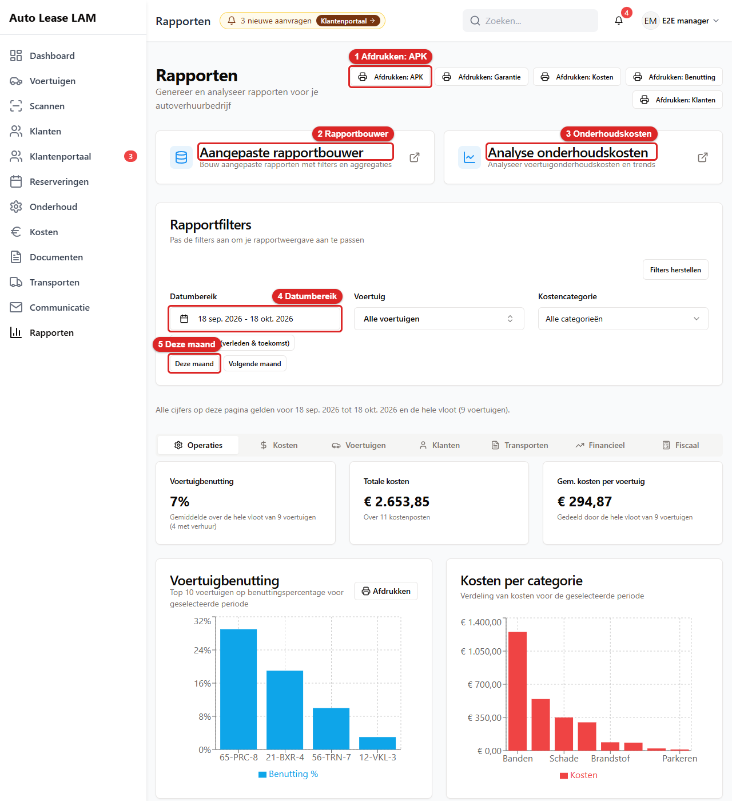
   *Het scherm **Rapporten**: 1 **Afdrukken: APK**, 2 Rapportbouwer (de tegel **Aangepaste
   rapportbouwer**), 3 Onderhoudskosten (de tegel **Analyse onderhoudskosten**), 4 **Datumbereik**,
   5 **Deze maand**.*

Op het scherm staan vier delen. Van boven naar beneden zijn dat:

**De afdrukknoppen.** Rechtsboven staan vijf knoppen: **Afdrukken: APK**, **Afdrukken: Garantie**,
**Afdrukken: Kosten**, **Afdrukken: Benutting** en **Afdrukken: Klanten**. Elke knop drukt één vast
rapport af. Sta je op een ander tabblad dan **Operaties**? Dan staat er nog een zesde knop bij:
**Afdrukken: huidig tabblad**. Hoe afdrukken werkt, staat in 21.2.

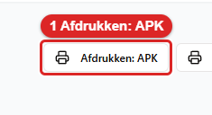
*Zo ziet de knop **Afdrukken: APK** eruit. De andere afdrukknoppen zien er net zo uit.*

**De twee tegels.** Een tegel is een groot vlak waar je op klikt.

- **Aangepaste rapportbouwer**: *Bouw aangepaste rapporten met filters en aggregaties.* Hier maak
  je zelf een rapport. Zie 21.3.
- **Analyse onderhoudskosten**: *Analyseer voertuigonderhoudskosten en trends.* Zie 21.4.

**Rapportfilters.** Met dit blok kies je waar de cijfers over gaan. Een filter is een keuze die
bepaalt welke gegevens je ziet.

- **Datumbereik**: de periode. Klik op het veld. Je ziet nu een kalender. Klik op de eerste dag en
  daarna op de laatste dag. Als je het scherm opent, staan de laatste 30 dagen ingesteld.

  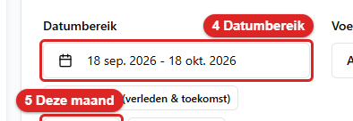
  *Zo ziet het veld **Datumbereik** eruit. Klik erop om de kalender te openen.*

- Onder het datumveld staan drie snelknoppen. **Alle gegevens (verleden & toekomst)** toont alles,
  zonder periode. **Deze maand** kiest de lopende maand. **Volgende maand** kiest de maand hierna.

  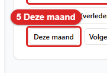
  *Zo ziet de knop **Deze maand** eruit. Klik erop. Daarna gaan alle cijfers over deze maand.*

- **Voertuig**: één auto of **Alle voertuigen**. Het veld is een zoekveld. Typ een kenteken, met of
  zonder streepjes. Je kunt ook een merk of model typen.
- **Kostencategorie**: één soort kosten, zoals **Banden**, of **Alle categorieën**. Je ziet alleen
  categorieën die in de gegevens voorkomen.
- **Filters herstellen** zet alles terug. Dat is: de laatste 30 dagen, alle voertuigen en alle
  categorieën.

Verander je een filter? Dan staat er even *Cijfers worden bijgewerkt...*. Wacht tot die tekst weg
is. Dan kloppen de cijfers bij je nieuwe keuze.

Onder de filters staat één regel. Die zegt waar alle cijfers voor gelden. Bijvoorbeeld: *Alle
cijfers op deze pagina gelden voor 18 sep. 2026 tot 18 okt. 2026 en de hele vloot (9 voertuigen).*
Een gemiddelde deelt altijd door de hele vloot. Dus ook door auto's die niet verhuurd waren.

**De tabbladen.** Daaronder staan de tabbladen met de cijfers. Klik op een tabblad om het te openen.

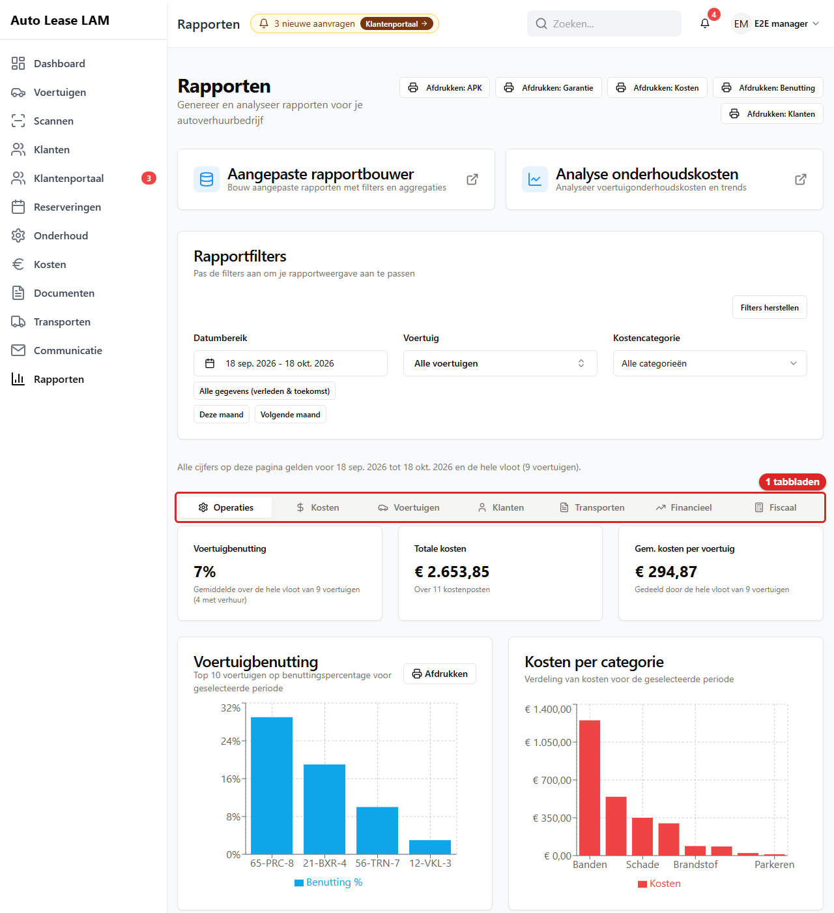
*Het scherm **Rapporten** met 1 de tabbladen. Er zijn nu negen tabbladen: **Operaties**,
**Kosten**, **Voertuigen**, **Klanten**, **Transporten**, **Financieel**, **Fiscaal**, **Portaal**
en **Kantoor**. Op de afbeelding staan de nieuwste nog niet.*

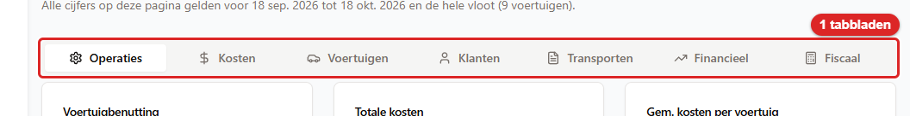
*Zo ziet de rij tabbladen eruit. Het tabblad dat open staat, is wit.*

| Tabblad | Wat je ziet |
|---|---|
| **Operaties** | Drie tellers: **Voertuigbenutting**, **Totale kosten** en **Gem. kosten per voertuig**. Daaronder de grafieken **Voertuigbenutting**, **Kosten per categorie** en **Kostentrends**. Benutting is het deel van de dagen dat een auto verhuurd was |
| **Kosten** | **Kostenoverzicht per categorie**, de lijst **Recente kosten** en de grafiek **Kostenvisualisatie** |
| **Voertuigen** | De benutting per auto, **Onderhoudskosten per voertuig**, het **APK-keuring overzicht** en het **Garantiestatus overzicht**. In de APK- en garantielijst kun je zoeken en op status filteren. Ook de kaarten **Bezetting per dag**, **Onderhoud en APK vooruit** en **Kilometerstanden vloot**. Zie 21.7 |
| **Klanten** | **Klantimpactanalyse** (kosten per klant), **Kostencategorieën per klant**, **Recente klantreserveringen** en de kaart **Klantwaarde**. Zie 21.7 |
| **Transporten** | Alle transporten in de periode, met tolkosten en facturatie. Zie 21.5 |
| **Financieel** | Omzet, kosten en marge per voertuig. Daaronder de kaarten **Bekeuringen**, **Meer-km en brandstof** en **Transport en facturatie**. Zie 21.5 |
| **Fiscaal** | De fiscale check per klant, auto en maand. Alleen met het vinkje **Fiscaal bekijken**. Zie 21.5 |
| **Portaal** | De kaarten **Portaalaanvragen** en **Wachtlijst**. Zie 21.8 |
| **Kantoor** | De kaarten **Factuurpostvak**, **Bezorgen en ophalen** en **Schadechecks**. Zie 21.8 |

Let op: het filter **Kostencategorie** geldt niet overal. Op **Financieel**, **Fiscaal**,
**Transporten** en bij het APK- en garantieoverzicht telt het niet mee. Daar staat dan een regel,
bijvoorbeeld *Het categoriefilter (Banden) geldt niet voor dit tabblad.*

---

## 21.2 Een rapport afdrukken

Elke afdrukknop werkt hetzelfde. Je ziet eerst een afdrukvoorbeeld. Pas daarna kies je de printer.

1. Stel bij **Rapportfilters** de periode en eventueel de auto in. Het rapport gebruikt die
   filters.
2. Klik rechtsboven op een afdrukknop, bijvoorbeeld **Afdrukken: Kosten**. Je ziet nu het venster
   **Rapport afdrukken: Kostenrapport**, met daaronder *Documentvoorvertoning*.

   
   *Het afdrukvoorbeeld na **Afdrukken: Kosten**: 1 **Afdrukken**. Links daarvan staat
   **Sluiten**.*

3. Lees het rapport na. Klopt de periode bovenaan? Klopt het niet, klik dan op **Sluiten**. Pas de
   filters aan en begin opnieuw.
4. Klik rechtsonder op **Afdrukken**. Je ziet nu het afdrukvenster van je browser. Kies daar de
   printer, of kies opslaan als PDF.

   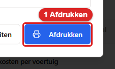
   *Zo ziet de knop **Afdrukken** eruit. Klik erop. Daarna opent het afdrukvenster van je browser.*

Wat elke knop afdrukt:

| Knop | Rapport |
|---|---|
| **Afdrukken: APK** | APK-vervalrapport |
| **Afdrukken: Garantie** | Garantievervalrapport |
| **Afdrukken: Kosten** | Kostenrapport |
| **Afdrukken: Benutting** | Voertuigbenuttingsrapport |
| **Afdrukken: Klanten** | Klantimpactanalyserapport. Telt alleen klanten met een reservering in de periode |

Ook op de tabbladen staat bij sommige blokken een eigen knop **Afdrukken**. Bijvoorbeeld bij de
grafiek **Voertuigbenutting** op **Operaties**. Die knop opent hetzelfde afdrukvoorbeeld als de
knop rechtsboven.

**Afdrukken: huidig tabblad werkt maar op twee tabbladen.** De knop staat op elk tabblad behalve
**Operaties**. Hij werkt alleen op **Kosten** en **Transporten**. Op **Voertuigen**, **Klanten**,
**Financieel** en **Fiscaal** krijg je een leeg voorbeeld met de kop *Rapportinhoud niet
beschikbaar*. Klik dan op **Sluiten**. Gebruik op **Voertuigen** de knoppen **Afdrukken: APK**,
**Afdrukken: Garantie** of **Afdrukken: Benutting**. Gebruik op **Klanten** de knop **Afdrukken:
Klanten**. Voor **Financieel** en **Fiscaal** is er geen afdrukrapport.

Je kunt dit voorbeeld ook zien in [hoofdstuk 2](02-navigatie.md), paragraaf 2.8. Daar staat het
APK-rapport:

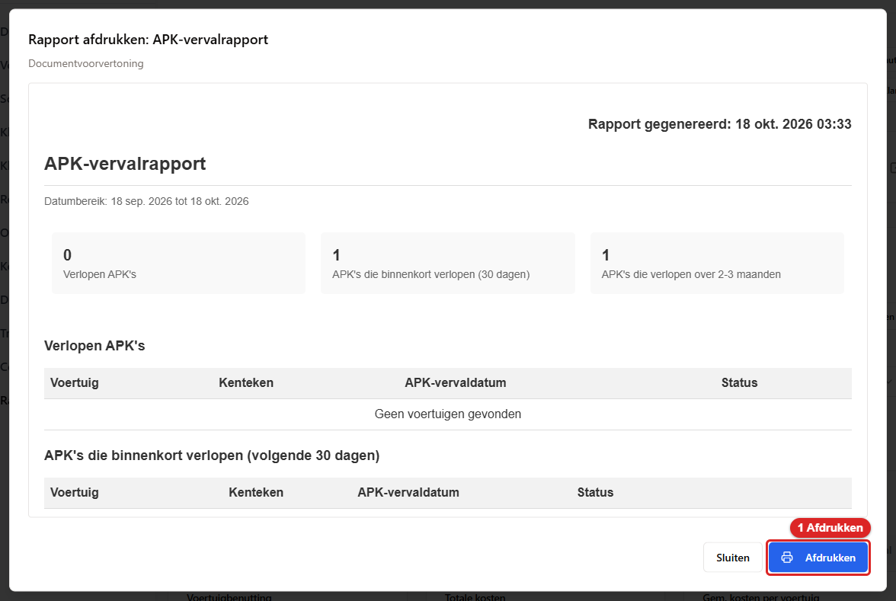
*Het afdrukvoorbeeld na **Afdrukken: APK**: 1 **Afdrukken**.*

---

## 21.3 Een eigen rapport bouwen

Met de rapportbouwer maak je zelf een lijst. Je kiest welke gegevens erin komen. Bijvoorbeeld alle
bussen met kenteken, merk en model. Die lijst kun je naar Excel sturen of afdrukken.

1. Klik op het scherm **Rapporten** op de tegel **Aangepaste rapportbouwer**. Je ziet nu het
   venster **Aangepaste rapportbouwer**. Het tabblad **Bouwer** staat open.

   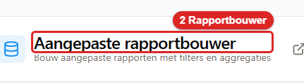
   *Zo ziet de tegel **Aangepaste rapportbouwer** eruit. Klik erop om de rapportbouwer te openen.*

   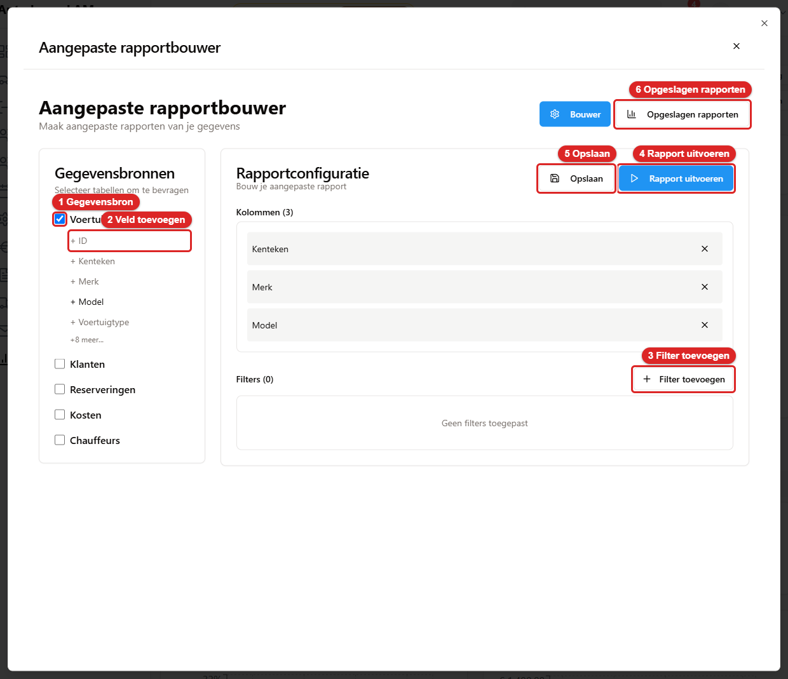
   *De **Aangepaste rapportbouwer**: 1 Gegevensbron (het vakje bij **Voertuigen**), 2 Veld toevoegen
   (**+ ID**), 3 **Filter toevoegen**, 4 **Rapport uitvoeren**, 5 **Opslaan**, 6 **Opgeslagen
   rapporten**.*

2. Kies links onder **Gegevensbronnen** waar je rapport over gaat. Een gegevensbron is een soort
   gegevens in de app. Je kunt kiezen uit **Voertuigen**, **Klanten**, **Reserveringen**,
   **Kosten** en **Chauffeurs**. Vink het vakje voor de bron aan. Je ziet nu onder de bron een lijst
   velden met een plusje ervoor.

   Er zijn tien bronnen. Welke je ziet, hangt van je vinkjes af (zie 21.9).

   | Bron | Wat je vinkje moet zijn |
   |---|---|
   | **Voertuigen**, **Klanten**, **Reserveringen**, **Kosten**, **Chauffeurs** | Zoals tot nu toe. Voor **Klanten** en **Chauffeurs** heb je **Klanten bekijken** of **Klanten beheren** nodig |
   | **Bekeuringen** | **Boetes bekijken** of **Boetes beheren** |
   | **Transporten** | **Voertuigen** of **Reserveringen**: bekijken of beheren |
   | **Werkplaatsbezoeken** | **Reserveringen bekijken**, **Reserveringen beheren** of **Onderhoud beheren** |
   | **Schadechecks** | **Schadecontroles bekijken** of **Schadecontroles beheren** |
   | **Km-historie** | Alleen de beheerder |

   Een bron die je niet mag gebruiken, zie je niet. Een opgeslagen rapport met zo'n bron zie je ook
   niet in de lijst. **Werkplaatsbezoeken** zijn alleen de blokken voor onderhoud. Gewone
   verhuur zit er niet in. **Schadechecks** bij een reservering in de prullenbak tellen niet mee.
   Een **Km-historie** met een vervallen stand telt niet mee. Wil je die wel? Filter dan op
   **Vervallen op**.

   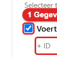
   *Zo ziet het aangevinkte vakje bij **Voertuigen** eruit.*

3. Klik op een veld, bijvoorbeeld **+ Kenteken**. Je ziet het veld nu rechts onder **Kolommen**.
   Elk veld wordt een kolom in je rapport. Klik zo op elk veld dat je wilt. Wil je een kolom weg?
   Klik dan op het kruisje rechts van die kolom.

   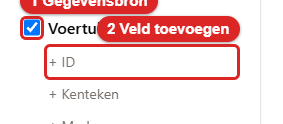
   *Zo zien de velden eruit. Klik op een veld. Daarna staat het bij **Kolommen**.*

   Je kunt alle velden van een bron aanklikken. Bij **Voertuigen** ook **Kilometerstand** en
   **APK-datum**.

4. Wil je niet alle regels? Voeg dan een filter toe. Klik op **Filter toevoegen**. Je ziet nu drie
   velden: **Veld**, **Operator** en **Waarde**.

   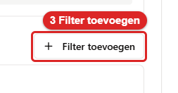
   *Zo ziet de knop **Filter toevoegen** eruit. Klik erop om een voorwaarde toe te voegen.*

5. Kies bij **Veld** waarop je filtert, bijvoorbeeld **Merk**. Kies bij **Operator** hoe je
   vergelijkt, bijvoorbeeld **is gelijk aan** of **bevat**. Een operator is de manier van
   vergelijken. Typ bij **Waarde** waarmee je vergelijkt, bijvoorbeeld *Ford*. Klik onderaan op
   **Filter toevoegen**. Je ziet het filter nu bij **Filters (1)**. Met **Annuleren** sluit je het
   zonder filter.
6. Wil je tellen of optellen? Kies dan een groep. Zie "Groeperen en rekenen" hieronder. Wil je
   dat niet? Sla deze stap over.
7. Klik rechtsboven op **Rapport uitvoeren**. Je ziet de melding *Rapport succesvol uitgevoerd*.
   Daarna opent het venster **Rapportresultaten**. De knop is grijs zolang er geen kolom is.

   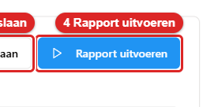
   *Zo ziet de knop **Rapport uitvoeren** eruit. Klik erop. Daarna zie je de resultaten.*

   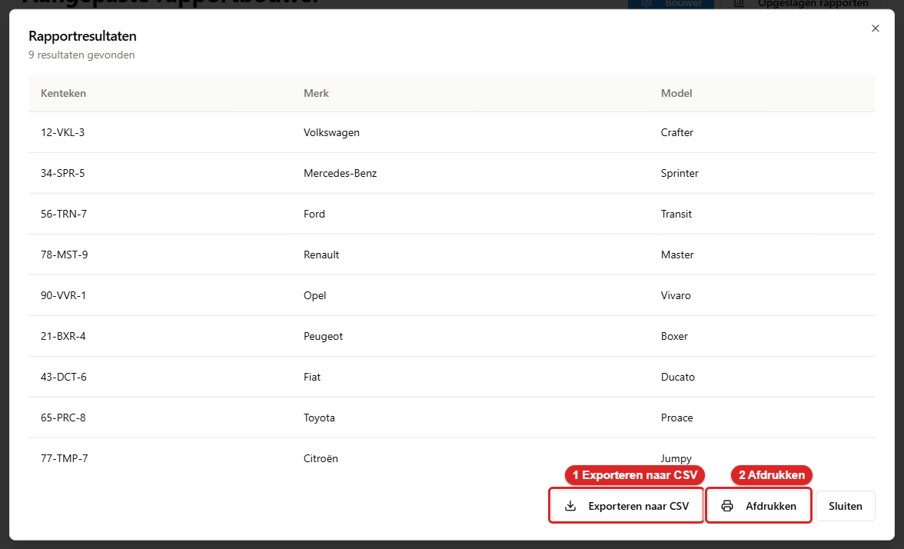
   *Het venster **Rapportresultaten** met *9 resultaten gevonden*: 1 **Exporteren naar CSV**,
   2 **Afdrukken**. Rechts staat **Sluiten**.*

8. Wil je de lijst in Excel? Klik op **Exporteren naar CSV**. Een CSV-bestand is een eenvoudige
   tabel die Excel kan openen. Je ziet de melding *Bestand gemaakt*. Het bestand staat in je map
   Downloads.

   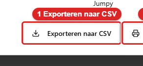
   *Zo ziet de knop **Exporteren naar CSV** eruit. Klik erop. Daarna staat het bestand in je
   downloads.*

9. Wil je de lijst op papier? Klik op **Afdrukken**. Je ziet eerst een afdrukvoorbeeld. Klik daar
   op **Afdrukken**. Dat werkt zoals in 21.2.

   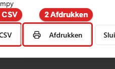
   *Zo ziet de knop **Afdrukken** eruit. Klik erop. Daarna zie je het afdrukvoorbeeld.*

10. Klik op **Sluiten**. Je bent nu terug in de rapportbouwer.
11. Wil je dit rapport later nog eens draaien? Klik dan op **Opslaan**. Je ziet nu het venster
    **Rapport opslaan**. Typ bij **Rapportnaam \*** een naam. Het sterretje betekent dat dit veld
    verplicht is. Typ bij **Omschrijving** eventueel wat het rapport toont. Klik op **Rapport
    opslaan**. Je ziet de melding *Rapport succesvol opgeslagen*.

    
    *Zo ziet de knop **Opslaan** eruit. Klik erop om het venster **Rapport opslaan** te openen.*

    Opslaan kan alleen met het vinkje **Rapporten beheren**. Heb je dat niet? Dan is de knop grijs.

**Groeperen en rekenen.** Met een groep zet je regels bij elkaar. Bijvoorbeeld alle bekeuringen van
één maand op één regel. Zo doe je dat:

1. Kies bij **Groeperen op** een veld. Staat dat veld nog niet bij de kolommen? Dan komt het er
   zelf bij. Kies je **Niet groeperen**? Dan krijg je weer een gewone lijst.
2. Is het veld een datum, zoals **Datum overtreding**? Dan kun je het vakje **Per maand** aanvinken.
   Je krijgt dan één regel per maand. De regels staan van oud naar nieuw. De maand volgt de Nederlandse
   klok.
3. Kies bij elke andere kolom een **Berekening**: **Geen**, **Som**, **Gemiddelde**, **Kleinste**,
   **Grootste**, **Aantal** of **Aantal verschillend**. **Som**, **Gemiddelde**, **Kleinste** en
   **Grootste** kunnen alleen bij getallen en bedragen. **Aantal** en **Aantal verschillend** kunnen
   altijd. De kolom van de groep zelf heeft geen berekening.
4. Klik op **Rapport uitvoeren**.

Voorbeeld: bron **Bekeuringen**. Klik op **+ Datum overtreding** en op **+ Totaalbedrag**. Kies bij
**Groeperen op** **Datum overtreding** en vink **Per maand** aan. Kies bij **Totaalbedrag** de
berekening **Som**. Je ziet nu één regel per maand met het totaalbedrag.

Staat er een kolom in je rapport die niet in de groep zit en geen berekening heeft? Dan krijg je
een melding met de naam van die kolom. Er gaat niets mis. Kies bij die kolom een berekening, of haal
hem weg.

**De grafiek.** Heb je gegroepeerd? Dan staat in **Rapportresultaten** ook het blok **Grafiek**. Kies
bij **Soort grafiek** tussen **Staaf**, **Lijn** en **Taart**. Standaard is dat **Staaf**.

- Elke kolom met een berekening wordt een reeks in de grafiek.
- Heb je gegroepeerd, maar geen berekening gekozen? Dan zie je de tekst *Kies bij een kolom een
  berekening, zoals Som of Aantal, om een grafiek te zien.*
- Bij **Staaf** en **Lijn** zie je hoogstens de eerste 50 groepen. De tabel toont ze allemaal.
  Je ziet er een melding bij.
- **Taart** gebruikt alleen de eerste reeks. Je ziet de tien grootste stukken en daarna **Overig**.
  Waarden van nul of lager tellen niet mee.
- Heb je niet gegroepeerd? Dan is er geen grafiek en ook geen keuze voor het soort.
- De keuze van het soort grafiek wordt niet bewaard in een opgeslagen rapport. Je ziet dus steeds
  eerst een **Staaf**.

**Een opgeslagen rapport gebruiken.** Klik rechtsboven op **Opgeslagen rapporten**. Je ziet nu je
opgeslagen rapporten. Bij elk rapport staat hoeveel kolommen en filters het heeft.

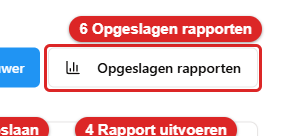
*Zo ziet de knop **Opgeslagen rapporten** eruit. Klik erop om je opgeslagen rapporten te zien.*

- **Uitvoeren** draait het rapport meteen. Je ziet direct het venster **Rapportresultaten**.
- **Bewerken** zet de bronnen, kolommen en filters terug in het tabblad **Bouwer**. Daar kun je ze
  aanpassen.
- Het prullenbakje verwijdert het rapport. Je ziet eerst de vraag **Rapport verwijderen?** Klik op
  **Verwijderen** om het echt weg te halen. Dit kan niet ongedaan worden gemaakt.

**Let op bij Bewerken.** **Bewerken** neemt de naam van het rapport niet over. Klik je daarna op
**Opslaan**? Dan moet je opnieuw een naam typen. Er komt dan een nieuw rapport bij. Het oude rapport
blijft gewoon staan. Wil je het oude kwijt? Verwijder het dan met het prullenbakje.

---

## 21.4 De analyse van onderhoudskosten

Hier zie je wat het onderhoud van de vloot kost. Je ziet ook welke auto's en merken het duurst zijn.

1. Klik op het scherm **Rapporten** op de tegel **Analyse onderhoudskosten**. Je ziet nu het
   venster **Analyse onderhoudskosten**.

   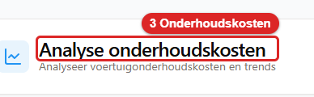
   *Zo ziet de tegel **Analyse onderhoudskosten** eruit. Klik erop om de analyse te openen.*

   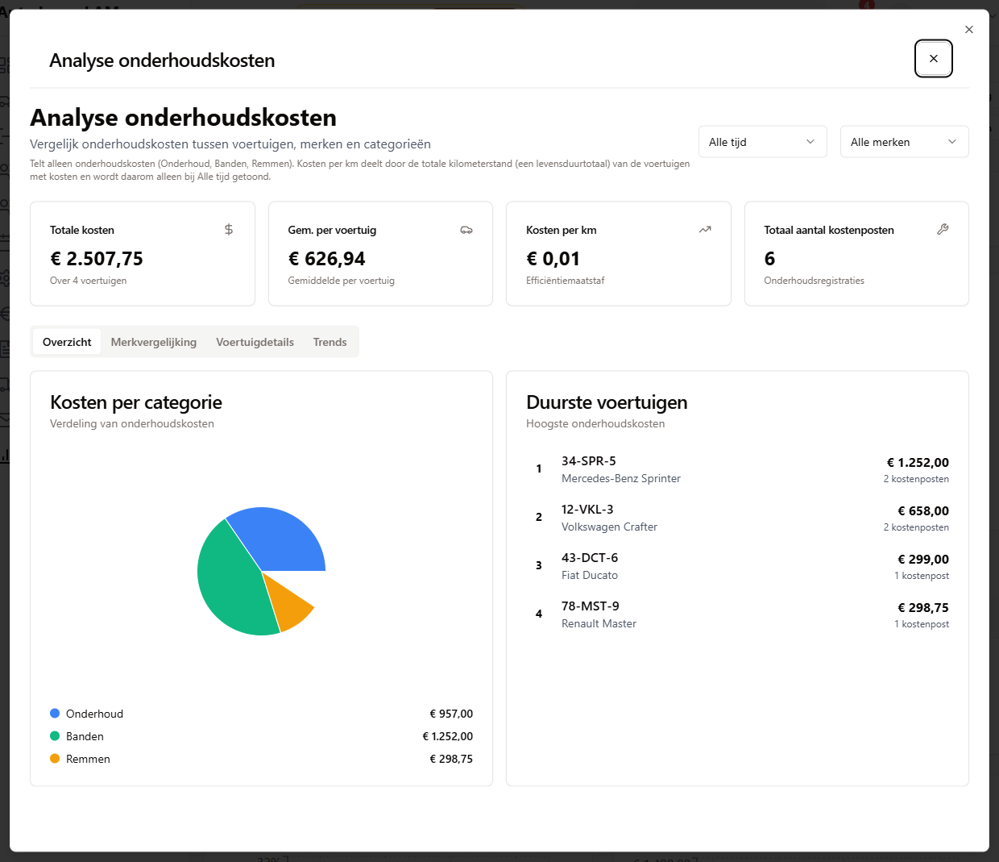
   *Het venster **Analyse onderhoudskosten**. Rechtsboven staan de keuzes **Alle tijd** en **Alle
   merken**. Daaronder staan vier tellers en de tabbladen **Overzicht**, **Merkvergelijking**,
   **Voertuigdetails** en **Trends**.*

2. Kies rechtsboven de periode. Je kunt kiezen uit **Alle tijd**, **Afgelopen jaar**, **Afgelopen
   6 maanden**, **Afgelopen 3 maanden** en **Afgelopen maand**. Deze keuze staat los van de
   **Rapportfilters** op het scherm erachter.
3. Kies ernaast eventueel één merk. Standaard staat er **Alle merken**.
4. Lees de vier tellers: **Totale kosten**, **Gem. per voertuig**, **Kosten per km** en **Totaal
   aantal kostenposten**.
5. Klik op een tabblad voor meer detail:
   - **Overzicht**: **Kosten per categorie** en **Duurste voertuigen**.
   - **Merkvergelijking**: de kosten per merk, met een **Efficiëntiebeoordeling**.
   - **Voertuigdetails**: per auto de kosten, de kilometerstand en de kosten per km.
   - **Trends**: de **Maandelijkse kostentrends**, met de maanden in het Nederlands.
6. Klik rechtsboven op het kruisje. Je bent nu terug op het scherm **Rapporten**.

Wat je moet weten:

- De analyse telt alleen echte onderhoudskosten. Dat zijn **Onderhoud**, **Banden** en **Remmen**.
  Schade, brandstof, tol en parkeren tellen niet mee. Dat staat ook boven de tellers.
- **Kosten per km** zie je alleen bij **Alle tijd**. De kilometerstand van een auto is namelijk een
  totaal over zijn hele leven. Bij een andere periode staat er een streepje met *alleen bij Alle
  tijd: de kilometerstand is een totaal*.
- Een merk krijgt pas een beoordeling bij minstens drie kostenregels en twee auto's. Anders staat
  er **Onvoldoende gegevens**.

---

## 21.5 Transporten, Financieel en Fiscaal

**Transporten afdrukken.**

1. Klik op het tabblad **Transporten**. Je ziet bovenaan drie tellers: **Totale tolkosten**,
   **Openstaande klantfacturatie** en **Vermelde transporten**. Daaronder staat de lijst
   **Voertuigtransporten**.
2. Kies eventueel een soort transport (**Alle types**) en een status (**Alle statussen**). De lijst
   toont dan alleen die transporten.
3. Wil je maar een paar transporten afdrukken? Vink ze dan aan in de eerste kolom. Het vakje
   bovenin de kolom vinkt alles aan.
4. Klik op de afdrukknop boven de lijst. Heb je niets aangevinkt? Dan heet de knop **Afdrukken
   Alle**. Heb je wel iets aangevinkt? Dan heet hij **Afdrukken Geselecteerd (2)**, met het aantal
   tussen haakjes. Je ziet nu het afdrukvoorbeeld van het **Voertuigtransportenrapport**.
5. Klik op **Afdrukken**. Dat werkt zoals in 21.2.

Hier werkt **Afdrukken: huidig tabblad** ook. Die knop drukt hetzelfde af.

**Financieel.** Dit tabblad toont wat elke auto opbrengt en kost in de gekozen periode. Bovenaan
staan **Omzet**, **Kosten**, **Marge** en **Gereden km**. Marge is omzet min kosten. Daaronder
staan de grafiek **Omzet versus kosten per voertuig** en de tabel **Kosten en opbrengst per
voertuig**. Boven die tabel staat een knop **CSV**. Daarmee zet je de tabel in Excel. De omzet
komt uit gewone verhuringen die in de periode begonnen. Het filter **Kostencategorie** geldt hier
niet. Marge wordt altijd over alle kosten berekend.

**Kilometers per maand** staat hier niet meer. Dat staat nu in de kaart **Kilometerstanden vloot**
op het tabblad **Voertuigen**. Zie 21.7. Die kaart is alleen voor de beheerder.

Onder de tabel staan drie kaarten. Hoe je met een kaart werkt, staat in 21.6.

- **Bekeuringen**: boetes van de politie en het CJIB, op de datum van de overtreding. De tegels zijn
  **Nieuw**, **Gekoppeld**, **Vervallen**, **Oude statussen** en **Totaal (zonder vervallen)**. Je ziet
  ook het **Bedrag per maand** en het overzicht **Per klant**, **Per voertuig** en **Per bestuurder**.
- **Meer-km en brandstof**: extra kilometers en brandstof die bij een verhuur in rekening zijn
  gebracht. De tegels zijn **Meer-km-kosten**, **Brandstofkosten** en **Verhuur met meer-km**.
- **Transport en facturatie**: de tegels zijn **Nog te factureren**, **Gefactureerd**, **Tolkosten**
  en **Nog te factureren (alle perioden)**. Je ziet ook het bedrag per maand en het overzicht **Per
  soort transport**.

**Fiscaal.** Dit tabblad zie je alleen met het vinkje **Fiscaal bekijken**. Het heet **Fiscale
check per maand**. Je kiest een **Jaar** en een **Klant** (of **Alle klanten**). Je ziet de
**Totalen** van dat jaar en een overzicht **Per klant**. Met **CSV downloaden** haal je de lijst
binnen. De app zegt er zelf bij: *Dit is geen fiscaal advies.* Meer over de fiscale check staat in
[hoofdstuk 20](20-klantenportaal-en-bekeuringen.md).

---

## 21.6 Werken met een rapportkaart

Een rapportkaart is een blok met cijfers, een grafiek en tegels. Alle kaarten werken hetzelfde.

1. Open het tabblad met de kaart. Bijvoorbeeld **Financieel**. Je ziet de kaart met bovenaan de
   tegels. Elke tegel is een knop met een getal erin.
2. Klik op een tegel. Je ziet nu een lijst. Die lijst toont precies de regels die de tegel telt. Het
   aantal in de lijst is dus gelijk aan het getal op de tegel.
3. Klik op een kolomkop om te sorteren. Is de lijst lang? Dan staan er pagina's onderaan.
4. Wil je de lijst in Excel? Klik op **CSV**. Je krijgt alle regels, niet alleen de pagina die je
   ziet. Zijn het er meer dan de grens? Dan zie je de melding dat alleen de eerste regels zijn
   meegenomen.
5. Wil je de lijst op papier? Klik op **Afdrukken**.
6. Sluit de lijst en je bent terug bij de kaart.

Wat je nog moet weten:

- De kaart gebruikt de periode en het voertuig uit **Rapportfilters**. Kies je een periode van meer
  dan een jaar? Dan zie je de melding *Kies een periode van maximaal een jaar*.
- Een kaart waar je geen recht voor hebt, staat er niet. Zie 21.9.
- Staat er een regel dat het voertuigfilter hier niet geldt? Dan heeft dat filter geen effect op
  die kaart. Dat is zo bij **Portaalaanvragen**, **Wachtlijst** en **Factuurpostvak**.

---

## 21.7 Voertuigen en Klanten

**Bezetting per dag** (tabblad **Voertuigen**). Je ziet hoeveel auto's van de vloot elke dag
verhuurd waren. De tegels zijn **Verhuurd**, **Vervangend**, **Werkplaats** en **Beschikbaar**.
Bovenaan staat de **Gemiddelde bezetting**. Een auto in de werkplaats of een vervangende auto telt
niet als verhuurd. Klik op een dag. Je ziet dan de auto's van die dag.

**Onderhoud en APK vooruit** (tabblad **Voertuigen**). Je ziet welke auto's de komende tijd een
beurt of APK nodig hebben, per week. Bij **Vooruitkijken** kies je hoeveel maanden. De tegels zijn
**APK**, **Beurt**, **Achterstallig** en **Alles**. De datum van een beurt komt uit de gereden
kilometers en de maanden sinds de vorige beurt. De kilometerstanden in de lijst ziet alleen de
beheerder.

**Kilometerstanden vloot** (tabblad **Voertuigen**, alleen de beheerder). Je ziet hoeveel kilometer
elke auto reed. De tegels zijn **Auto's gereden**, **Waarschuwingen** en **Te weinig standen**. De
grafiek heet **Kilometers per maand**.

**Km-historie per voertuig** (tabblad **Voertuigen**, alleen de beheerder). Kies bij **Voertuig**
een auto. Je ziet alle km-standen in de gekozen periode.

**Klantwaarde** (tabblad **Klanten**). Je ziet wat elke klant oplevert en kost. De tegels zijn
**Omzet**, **Kosten door de klant**, **Te laat ingeleverd**, **Geannuleerd** en **Portaalaanvragen**.
Kosten door de klant zijn bekeuringen, extra kilometers en brandstof. Daaronder staan de **Top 10
beste klanten (omzet)** en de **Top 10 duurste klanten (kosten)**.

**Km-historie in het voertuigscherm** (alleen de beheerder). Open een voertuig. Daar staat het
tabblad **Km-historie**. Je ziet er:

- een lijst met alle km-standen, met de bron en wie ze invoerde;
- de grafiek **Km-stand in de tijd**;
- tegels met **Gereden km**, **Gemiddeld per maand**, **Vrije km**, **Boven vrije km** en
  **Waarschuwingen**. Een waarschuwing is een stand die lager is dan de vorige, of een onlogische
  sprong. Met **Alleen waarschuwingen** zie je alleen die;
- de knoppen **Afdrukken** en **CSV**.

Heb je een tikfout gezien? Klik bij die stand op **Laten vervallen**. De stand telt dan niet meer
mee. Met **Weer geldig maken** zet je hem terug.

---

## 21.8 Portaal en Kantoor

**Portaalaanvragen** (tabblad **Portaal**). Wat klanten via het portaal vragen en hoe snel er
antwoord komt. De tegels zijn **Alle aanvragen**, **Open**, **Afgehandeld**, **Afgewezen** en **Open,
ouder dan** een aantal dagen. Je ziet ook de mediane reactietijd en **Afgehandeld per medewerker**.

**Wachtlijst** (tabblad **Portaal**). Klanten die op een auto wachten. De tegels zijn **Alle
vermeldingen**, **Open**, **Vervuld** en **Geannuleerd**. Je ziet de gemiddelde wachttijd en per
type auto welk type ontbreekt.

**Factuurpostvak** (tabblad **Kantoor**). Wat het postvak voor facturen binnenhaalt. Er zijn twee
lijsten: **Ophaalrondes** en **Binnengekomen facturen**.

- De ophaalrondes worden 90 dagen bewaard. Oudere rondes staan er niet meer in. Dat staat ook op
  de kaart.
- De lijst met facturen zie je alleen met het vinkje **Kosten beheren**.
- Het voertuigfilter geldt hier niet. Je ziet daarover een melding.

**Bezorgen en ophalen** (tabblad **Kantoor**). De leveringen en terughaalritten in de periode, op
de geplande dag. De tegels zijn **Alle ritten**, **Op tijd**, **Te laat**, **Nog open** en **Afgerond
zonder datum**. Te laat is een rit die niet op de geplande dag is afgerond. Wissel- en sleepritten
staan niet hier. Die staan in het transportrapport.

**Schadechecks** (tabblad **Kantoor**). De schadechecks bij ophalen en inleveren, op de dag van de
check. De tegels zijn **Alle checks**, **Ophalen**, **Inleveren** en **Met schade**. **Met schade**
is een inlevercheck met minstens één schadepunt. Schade die al bij het ophalen is gemeld, telt niet
mee. Checks bij een reservering in de prullenbak tellen niet mee.

---

## 21.9 Rechten

| Wat | Welk vinkje |
|---|---|
| Het scherm **Rapporten** openen | **Rapporten bekijken** of **Rapporten beheren** |
| Een eigen rapport opslaan of verwijderen | **Rapporten beheren**. Zonder dit vinkje zijn **Opslaan** en het prullenbakje grijs |
| Tabblad **Operaties** | Ook **Voertuigen bekijken** en **Reserveringen bekijken** (of de beheren-vinkjes) |
| Tabblad **Kosten** | Ook **Kosten beheren** |
| Tabblad **Voertuigen** | Ook **Voertuigen bekijken** of **Voertuigen beheren** |
| Tabblad **Klanten** | Ook **Klanten bekijken** of **Klanten beheren** |
| Tabblad **Transporten** | Ook een vinkje voor voertuigen of reserveringen |
| Tabblad **Fiscaal** | **Fiscaal bekijken**. Zonder dit vinkje is het tabblad er niet |
| De kaarten op **Financieel** (**Bekeuringen**, **Meer-km en brandstof**, **Transport en facturatie**) | Alleen het rapportvinkje |
| **Klantwaarde** | Alleen het rapportvinkje |
| **Bezetting per dag** | Ook **Reserveringen bekijken** of **Reserveringen beheren** |
| **Onderhoud en APK vooruit** | Ook **Voertuigen bekijken** of **Voertuigen beheren** |
| **Portaalaanvragen** en **Wachtlijst** | Ook **Klantportaal bekijken** of **Klantportaal beheren** |
| **Factuurpostvak**, de ophaalrondes | Ook **Kosten beheren** of **Instellingen beheren** |
| **Factuurpostvak**, de facturen | Ook **Kosten beheren** |
| **Bezorgen en ophalen** | Ook een vinkje voor voertuigen of reserveringen |
| **Schadechecks** (kaart) | Ook **Schadecontroles bekijken** of **Schadecontroles beheren** |
| De bronnen in de rapportbouwer | Zie de tabel in 21.3 |
| **Kilometerstanden vloot**, **Km-historie per voertuig**, de bron **Km-historie** en het tabblad **Km-historie** bij een voertuig | Alleen de beheerder. Alles over kilometers is alleen voor de beheerder |

Mis je een vinkje voor een tabblad? Dan kun je het tabblad wel openen. Je ziet dan de melding
*Geen toegang tot deze gegevens*, met de naam van het recht dat je mist. Mis je het vinkje voor een
kaart of een bron? Dan is de kaart of de bron er gewoon niet.

Heb je alleen **Fiscaal bekijken** en geen rapportvinkje? Dan toont **Rapporten** alleen de fiscale
check. De afdrukknoppen, de tegels en de andere tabbladen zie je dan niet. Meer over vinkjes staat
in [hoofdstuk 15](15-rollen-en-rechten.md).

---

## 21.10 In het kort

| Wat wil je? | Waar klik je? |
|---|---|
| De cijfers bekijken | **Rapporten** → een tabblad, van **Operaties** tot en met **Kantoor** |
| De periode kiezen | **Rapportfilters** → **Datumbereik**, of **Deze maand** / **Volgende maand** / **Alle gegevens (verleden & toekomst)** |
| Eén auto bekijken | **Rapportfilters** → **Voertuig** → typ het kenteken |
| De filters terugzetten | **Rapportfilters** → **Filters herstellen** |
| Een vast rapport afdrukken | Rechtsboven **Afdrukken: APK**, **Garantie**, **Kosten**, **Benutting** of **Klanten** → **Afdrukken** |
| Het open tabblad afdrukken | **Afdrukken: huidig tabblad** (werkt alleen op **Kosten** en **Transporten**) |
| Transporten afdrukken | Tabblad **Transporten** → vink aan → **Afdrukken Geselecteerd (…)** of **Afdrukken Alle** |
| De lijst achter een cijfer zien | Klik op de tegel in de kaart |
| Die lijst in Excel of op papier | In de lijst: **CSV** of **Afdrukken** |
| Een eigen rapport maken | **Aangepaste rapportbouwer** → bron aanvinken → velden aanklikken → **Rapport uitvoeren** |
| Tellen of optellen per maand | Bij **Groeperen op** een datumveld kiezen → **Per maand** → bij de andere kolommen **Berekening** |
| Een grafiek van mijn rapport | Eerst groeperen en een **Berekening** kiezen → **Rapport uitvoeren** → **Grafiek** → **Soort grafiek** |
| Een eigen rapport naar Excel | **Rapportresultaten** → **Exporteren naar CSV** |
| Een eigen rapport bewaren | **Aangepaste rapportbouwer** → **Opslaan** → naam → **Rapport opslaan** |
| Een opgeslagen rapport draaien | **Aangepaste rapportbouwer** → **Opgeslagen rapporten** → **Uitvoeren** |
| De onderhoudskosten bekijken | **Rapporten** → **Analyse onderhoudskosten** |
| Aanvragen en wachtlijst van klanten | **Rapporten** → **Portaal** |
| Facturen uit het postvak, ritten, schadechecks | **Rapporten** → **Kantoor** |
| De km-historie van een auto (beheerder) | Voertuig openen → tabblad **Km-historie** |
