# 22. Lease offertes

Dit hoofdstuk is voor wie een leaseprijs wil uitrekenen en een offerte voor een klant wil maken. Dat
deed je eerst in Excel. Nu kan het in de app. Je typt de aanschafwaarde, de restwaarde en de looptijd.
De prijs per maand rekent live mee, terwijl je typt. Je zet meerdere varianten naast elkaar, kiest
welke de klant krijgt en maakt er een PDF van. Je ziet alle offertes terug, ook de varianten die je
toen bekeek.

Alle bedragen in dit hoofdstuk zijn **excl. btw**.

Het voorbeeld dat we steeds gebruiken is het voorbeeld uit je Excel-bestand: een auto van
**€ 17.318**, een restwaarde van **€ 10.000**, **48 maanden**, **20.000 km** per jaar. De leaseprijs
is dan **€ 466,23** per maand. De namen op de afbeeldingen zijn verzonnen.

---

## 22.1 Waar vind je het, en wat heb je nodig?

1. Kijk in het menu links. Onderaan staat **Lease offertes**. Klik erop. Daarna zie je het scherm
   **Lease offertes**.

   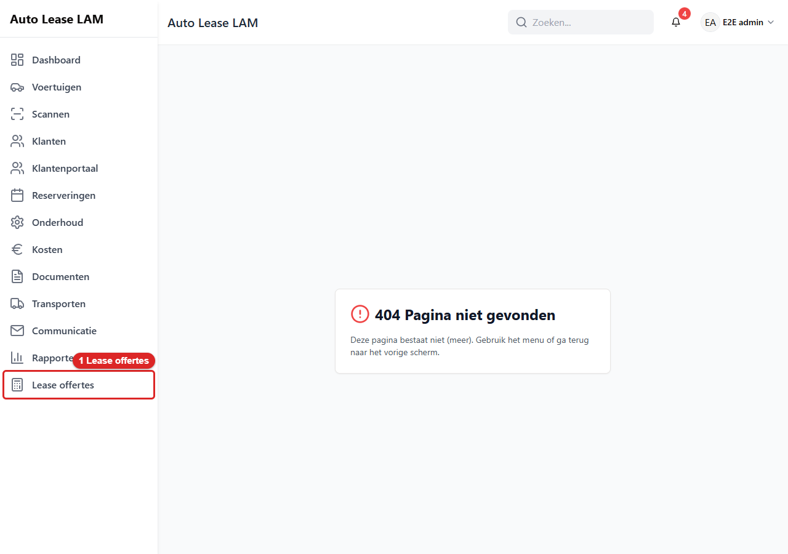
   *Het menu: 1 **Lease offertes**.*

   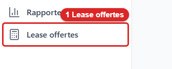
   *Zo ziet het menu-item **Lease offertes** eruit.*

Zie je **Lease offertes** niet in het menu? Dan heb je het vinkje **Lease offertes** niet. Standaard
hebben alleen beheerders dat vinkje. Een beheerder kan het aan jouw account geven bij
**Gebruikers** (zie hoofdstuk 10 en 15). Zonder het vinkje opent het scherm ook niet als je het
adres in de browser typt.

Het **sjabloon** van de PDF staat niet hier, maar bij **Documenten**. Daarvoor heb je het vinkje
**PDF-sjablonen beheren** nodig (zie 22.11).

---

## 22.2 De lijst met offertes

Het scherm heeft twee tabbladen: **Offertes** en **Instellingen**. Het tabblad **Offertes** staat
open. Daar zie je de lijst.

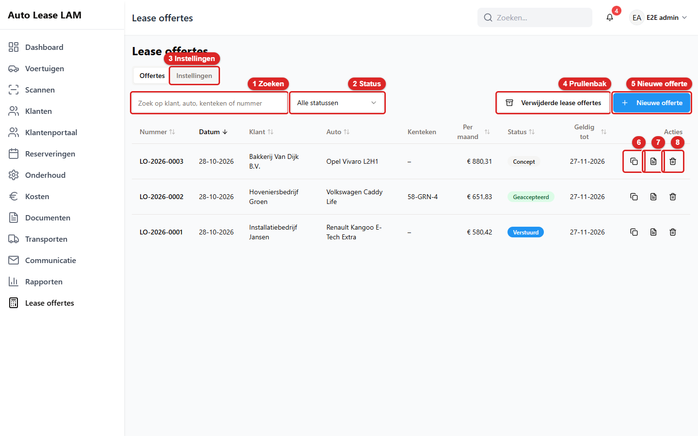
*De lijst: 1 **Zoeken**, 2 **Status**, 3 **Instellingen**, 4 **Verwijderde lease offertes**,
5 **Nieuwe offerte**, 6 Kopiëren, 7 PDF, 8 Verwijderen.*

In de lijst staat per offerte: het **Nummer**, de **Datum**, de **Klant**, de **Auto**, het
**Kenteken** (als je dat al weet), de prijs **Per maand** van de variant die de klant krijgt, de
**Status** en **Geldig tot**. Klik op een kolomkop om te sorteren. Onderaan kies je hoeveel offertes
je per pagina ziet.

Het nummer is zo opgebouwd: **LO-2026-0004**. Dat is *LO*, het jaar en een volgnummer. Elke offerte
krijgt vanzelf een eigen nummer.

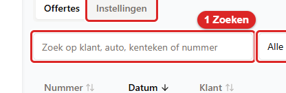
*Zo ziet het veld **Zoeken** eruit.*

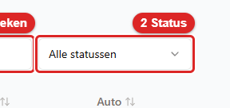
*Zo ziet de keuzelijst **Status** eruit.*

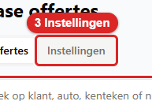
*Zo ziet het tabblad **Instellingen** eruit.*

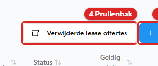
*Zo ziet de knop **Verwijderde lease offertes** eruit. Die zie je alleen met het vinkje **Prullenbak
beheren**.*

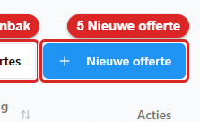
*Zo ziet de knop **Nieuwe offerte** eruit.*

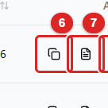
*Zo ziet de knop **Kopiëren** achter een offerte eruit (22.7).*

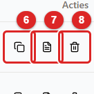
*Zo ziet de knop **PDF** achter een offerte eruit. Hij maakt meteen de PDF voor de klant (22.6).*

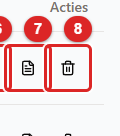
*Zo ziet de knop **Verwijderen** achter een offerte eruit (22.9).*

Klik op een regel (niet op de drie knoppen) om de offerte te openen.

---

## 22.3 Een nieuwe offerte maken

2. Klik op **Nieuwe offerte**. Daarna opent een groot venster met een nieuw nummer, bijvoorbeeld
   **Offerte LO-2026-0004**. De offerte bestaat nu al, als **Concept**. De voorinstellingen uit het
   tabblad **Instellingen** staan al ingevuld (22.10).

   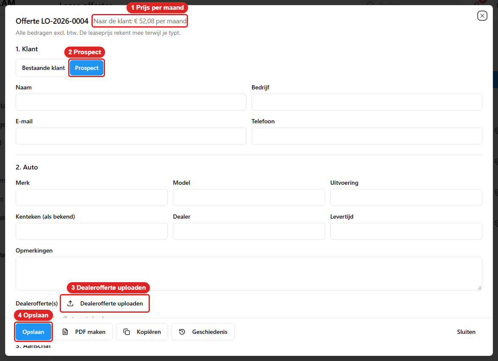
   *De nieuwe offerte: 1 **Naar de klant: … per maand**, 2 **Prospect**, 3 **Dealerofferte
   uploaden**, 4 **Opslaan**.*

   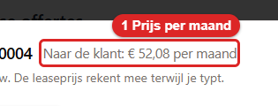
   *Zo ziet de prijs bovenaan eruit. Hij rekent mee terwijl je typt. Zolang je nog niets hebt
   ingevuld, staan er alleen de kosten per maand die al vaststaan.*

Sluit je het venster zonder iets in te vullen? Dan blijft er een lege conceptofferte in de lijst staan,
zonder klant. Verwijder die dan met **Verwijderen** (22.9).

Het venster heeft zes stukken, van boven naar beneden: **1. Klant**, **2. Auto**, **3. Aanschaf**,
**4. Kosten**, **5. Varianten** en **6. Offerte**. Onderaan, op een vaste balk, staan de knoppen
**Opslaan**, **PDF maken**, **Kopiëren**, **Geschiedenis** en **Sluiten**. De balk blijft in beeld als
je naar beneden schuift.

### 1. Klant

3. Kies bij **1. Klant** wie de offerte krijgt:
   - **Bestaande klant**: typ in **Zoek een klant** een stuk van de naam en klik op de klant. Zo
     staan de gegevens van de klant straks goed op de PDF. Zie je de klantenlijst niet, omdat je het
     vinkje **Klanten bekijken** mist? Gebruik dan **Prospect**.
   - **Prospect**: iemand die nog geen klant is. Je typt zelf **Naam**, **Bedrijf**, **E-mail** en
     **Telefoon**.

   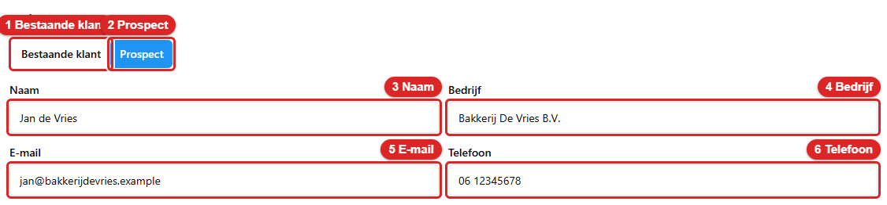
   *Het stuk **1. Klant**: 1 **Bestaande klant**, 2 **Prospect**, 3 **Naam**, 4 **Bedrijf**,
   5 **E-mail**, 6 **Telefoon**.*

   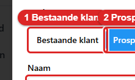
   *Zo ziet de keuze **Bestaande klant** eruit.*

   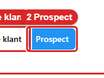
   *Zo ziet de keuze **Prospect** eruit. De gekozen knop is blauw.*

   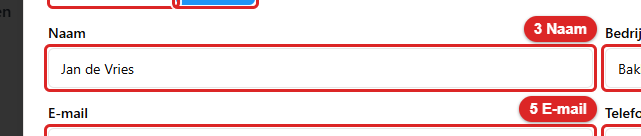
   *Zo ziet het veld **Naam** eruit. De velden **Bedrijf**, **E-mail** en **Telefoon** werken net zo.*

Het formulier onthoudt wat je bij **Prospect** typt, ook als je tussendoor **Bestaande klant**
kiest. Maar alleen de keuze die op het scherm staat telt.

### 2. Auto en dealerofferte

Bij **2. Auto** vul je **Merk**, **Model**, **Uitvoering**, **Kenteken (als bekend)**, **Dealer**,
**Levertijd** en **Opmerkingen** in. Een nieuwe auto heeft vaak nog geen kenteken. Laat dat veld dan
leeg. Je kunt dit alles zelf typen. Of je laat de app het uit de offerte van de dealer lezen (22.4).

### 3. Aanschaf

4. Typ bij **3. Aanschaf** de **Aanschafwaarde excl. btw (incl. BPM en afleverkosten)**. In het
   voorbeeld is dat **17318**. Zodra je het veld verlaat, zet de app er punten in: **17.318**.

   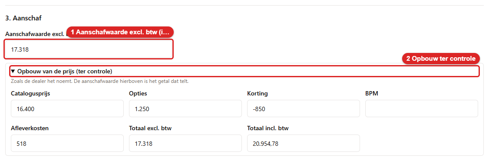
   *Het stuk **3. Aanschaf**: 1 **Aanschafwaarde**, 2 **Opbouw van de prijs (ter controle)**.*

   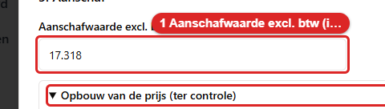
   *Zo ziet het veld **Aanschafwaarde** eruit.*

   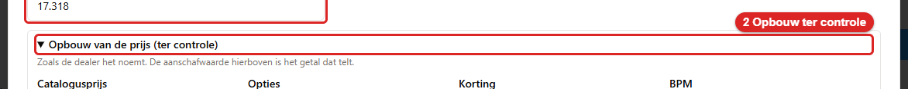
   *Zo ziet het blok **Opbouw van de prijs (ter controle)** eruit. Klik erop om het open te
   klappen.*

De **aanschafwaarde** is het getal dat de berekening gebruikt. Het blok **Opbouw van de prijs (ter
controle)** is alleen een geheugensteuntje: de catalogusprijs, opties, korting, BPM, afleverkosten
en de totalen zoals de dealer ze noemt. Daar rekent de app niets mee. Het blok is gevuld als je de
dealerofferte hebt laten uitlezen.

### 4. Kosten

5. Controleer bij **4. Kosten** de kosten. **Rente**, **ROB per jaar**, **Overige kosten per jaar**,
   **Marge per maand** en de twee kilometerprijzen komen uit **Instellingen**. Vul zelf
   **Verzekering per maand** en **Wegenbelasting per maand** in. In het voorbeeld zijn dat **97,80** en
   **34**.

   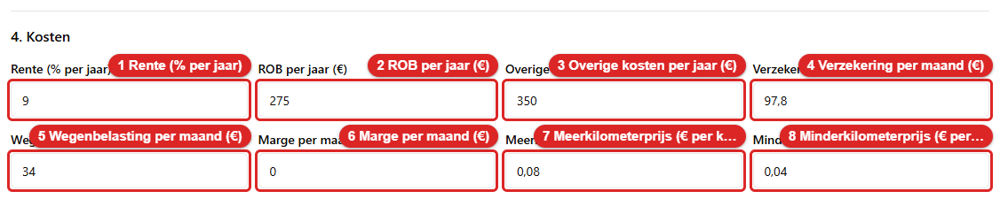
   *Het stuk **4. Kosten**: 1 **Rente (% per jaar)**, 2 **ROB per jaar**, 3 **Overige kosten per
   jaar**, 4 **Verzekering per maand**, 5 **Wegenbelasting per maand**, 6 **Marge per maand**,
   7 **Meerkilometerprijs**, 8 **Minderkilometerprijs**.*

   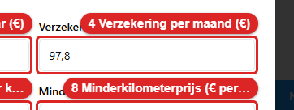
   *Zo ziet het veld **Verzekering per maand** eruit. Typ **97,80**. De app maakt er **97,8** van.
   Dat is hetzelfde bedrag.*

   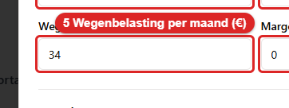
   *Zo ziet het veld **Wegenbelasting per maand** eruit.*

   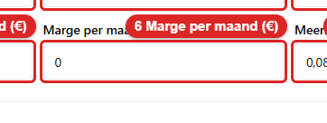
   *Zo ziet het veld **Marge per maand** eruit. De marge is wat jij erbovenop wilt verdienen. In het
   voorbeeld is dat **0**.*

Typ bedragen met een komma voor de centen (**97,80**). Een punt voor de duizendtallen mag, het hoeft
niet. Klopt een getal niet? Dan krijgt het veld een rode rand en kun je de offerte niet opslaan.

**ROB** staat voor reparatie, onderhoud en banden. Je typt het bedrag per jaar. De app deelt het door
twaalf.

De **Meerkilometerprijs** en de **Minderkilometerprijs** staan op de offerte voor de klant. Dat is
wat de klant betaalt voor elke kilometer boven, of krijgt voor elke kilometer onder, de afgesproken
kilometers.

---

## 22.4 Een dealerofferte uploaden en controleren

Heb je een offerte van de dealer als PDF of foto? Laat de app die lezen. Dan hoef je merk, model,
prijs en levertijd niet over te typen. De app leest het uit met de AI-scanner. **Er komt niets in de
offerte zonder dat jij het ziet en op Overnemen klikt.**

6. Klik bij **2. Auto** op **Dealerofferte uploaden**. Kies een PDF, PNG of JPG van maximaal 10 MB.

   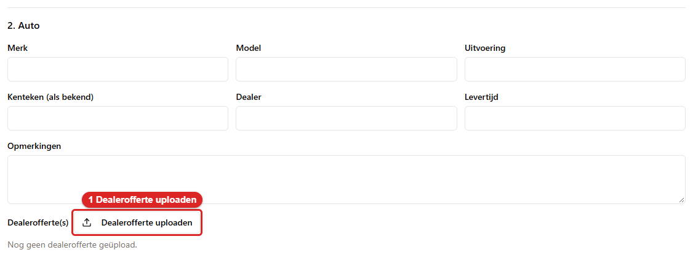
   *De knop: 1 **Dealerofferte uploaden**.*

   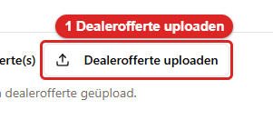
   *Zo ziet de knop **Dealerofferte uploaden** eruit.*

7. Wacht even. Daarna opent het venster **Dealerofferte uitlezen** met alles wat de app las.

   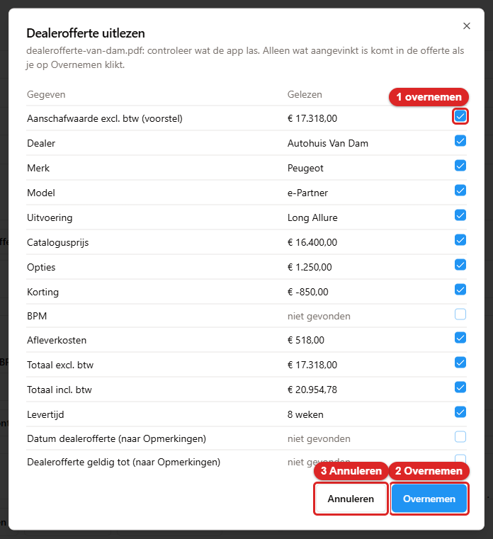
   *Het venster: 1 het vinkje **overnemen** bij de aanschafwaarde, 2 **Overnemen**, 3 **Annuleren**.*

   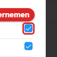
   *Zo ziet het vinkje **overnemen** eruit. Een blauw vinkje betekent: dit gaat mee.*

   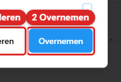
   *Zo ziet de knop **Overnemen** eruit.*

   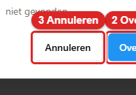
   *Zo ziet de knop **Annuleren** eruit.*

8. Lees elke regel. Staat er een gegeven fout? Haal dan het vinkje bij die regel weg. Staat er **niet
   gevonden**? Dan kon de app dat niet lezen. Dat vakje is grijs.

   De bovenste regel is **Aanschafwaarde excl. btw (voorstel)**. De app stelt het **Totaal excl. btw**
   van de dealer voor. Dat bedrag hoort al BPM en afleverkosten te bevatten. Noemt de dealer alleen
   een bedrag **incl. btw**? Dan zegt het venster dat erbij en stelt de app niets voor. Je vult de
   aanschafwaarde dan zelf in.

9. Klik op **Overnemen**. Daarna sluit het venster en staan de aangevinkte gegevens in de offerte.
   **Klik daarna op Opslaan.** Overnemen vult alleen het formulier in. Het bewaart nog niets.

   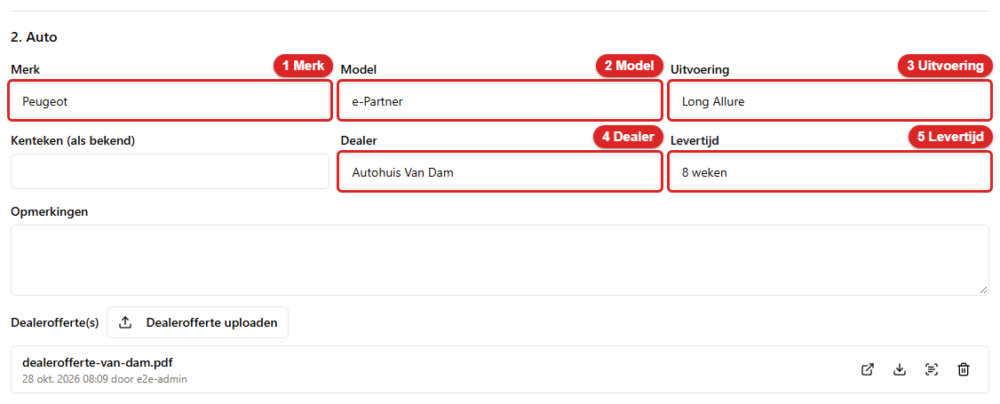
   *Na **Overnemen**: 1 **Merk**, 2 **Model**, 3 **Uitvoering**, 4 **Dealer**, 5 **Levertijd**.
   Onderaan staat het bestand van de dealer.*

   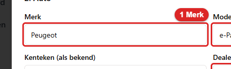
   *Zo ziet het veld **Merk** eruit, nu ingevuld.*

   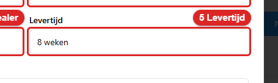
   *Zo ziet het veld **Levertijd** eruit, nu ingevuld.*

De dealerofferte blijft bij de offerte bewaard, in de lijst onder **Dealerofferte(s)**. Achter het
bestand staan vier knoppen: **Openen**, **Downloaden**, **Opnieuw uitlezen** en **Verwijderen**. De
datum van de dealerofferte en hoe lang hij geldig is, komen onder **Opmerkingen**.

**Lukt het uitlezen niet?** Dan zegt het venster *Uitlezen lukte niet. Het bestand is bewaard; vul de
gegevens zelf in.* Het bestand blijft bij de offerte staan. Typ de gegevens zelf. Je kunt later op
**Opnieuw uitlezen** klikken.

---

## 22.5 Varianten vergelijken en de variant voor de klant kiezen

Je kunt meerdere varianten naast elkaar zetten. Elke variant heeft een eigen **Looptijd (maanden)**,
**Km per jaar** en **Restwaarde (€)**. Dat is handig om te zien wat de prijs doet als je de looptijd
korter of langer maakt. **De restwaarde vul je altijd zelf in.** De app bedenkt geen restwaarde, ook
niet uit de kilometers. De kilometers verwerk je zelf in de restwaarde die je invult.

10. Ga naar **5. Varianten**. Er staat één kolom, **Variant 1**. Typ bij **Looptijd (maanden)** **48**,
    bij **Km per jaar** **20000** en bij **Restwaarde (€)** **10000**. Daarna rekent de app alles
    door.

    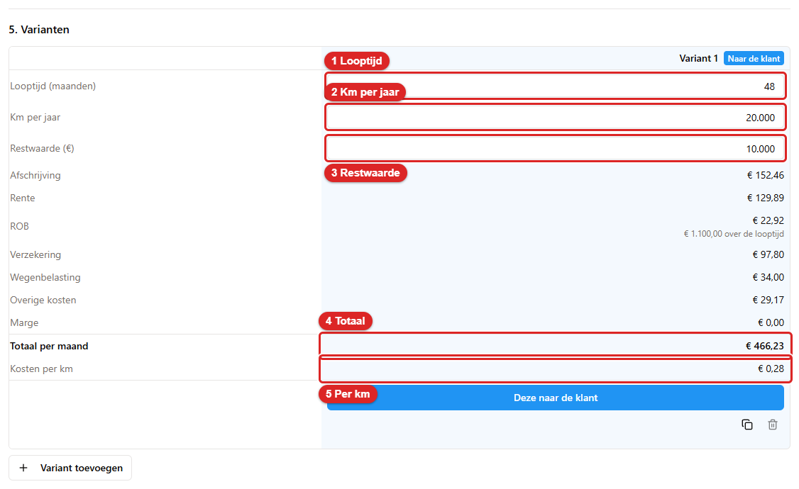
    *Het stuk **5. Varianten**: 1 **Looptijd**, 2 **Km per jaar**, 3 **Restwaarde**, 4 **Totaal per
    maand**, 5 **Kosten per km**.*

    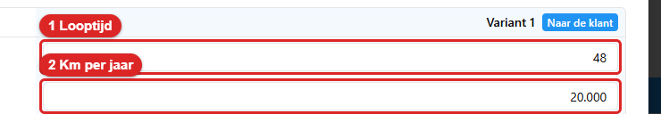
    *Zo ziet het veld **Looptijd (maanden)** eruit.*

    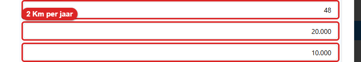
    *Zo ziet het veld **Km per jaar** eruit.*

    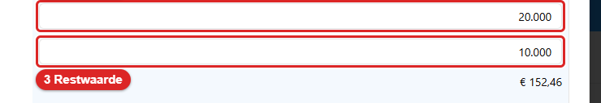
    *Zo ziet het veld **Restwaarde (€)** eruit.*

    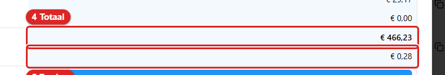
    *Zo ziet het **Totaal per maand** eruit: **€ 466,23**. Dat is hetzelfde als in je Excel.*

    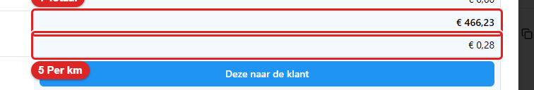
    *Zo zien de **Kosten per km** eruit: **€ 0,28**.*

    Onder de drie invoervelden staat hoe de prijs is opgebouwd: **Afschrijving** (**€ 152,46**),
    **Rente** (**€ 129,89**), **ROB** (**€ 22,92**, met eronder wat dat over de looptijd is),
    **Verzekering**, **Wegenbelasting**, **Overige kosten** en **Marge**. Samen is dat het **Totaal per
    maand**.

    De prijs staat ook bovenaan het venster.

    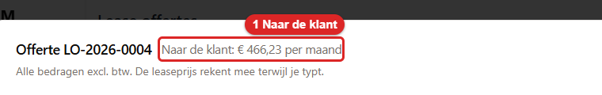
    *Bovenaan: 1 **Naar de klant: € 466,23 per maand**.*

    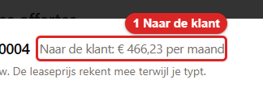
    *Zo ziet de prijs bovenaan eruit.*

11. Wil je een tweede variant? Klik op **Variant toevoegen**. Er komt een kolom bij. Typ andere
    cijfers, bijvoorbeeld 60 maanden en een restwaarde van 7500. Wil je een kopie van een kolom om
    iets aan te passen? Klik onder die kolom op **Variant dupliceren**. Een kolom die je niet nodig
    hebt, haal je weg met **Variant verwijderen**. De laatste kolom kun je niet verwijderen.

    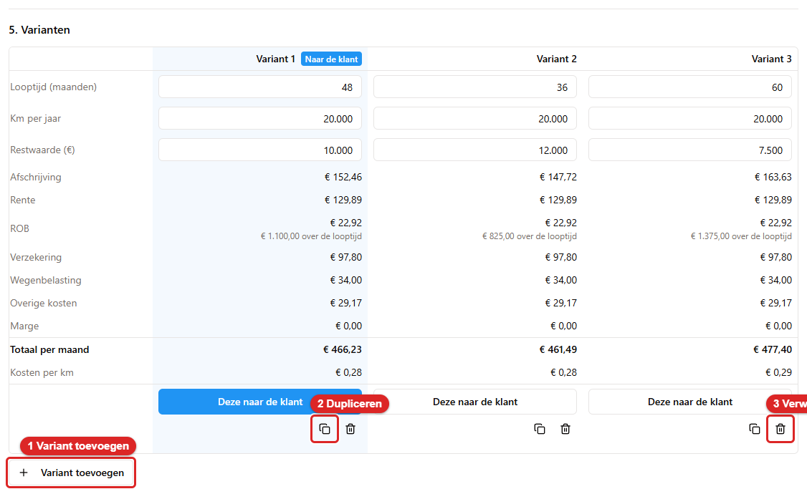
    *Drie varianten: 1 **Variant toevoegen**, 2 **Variant dupliceren**, 3 **Variant verwijderen**.*

    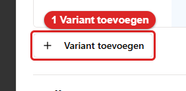
    *Zo ziet de knop **Variant toevoegen** eruit.*

    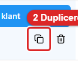
    *Zo ziet de knop **Variant dupliceren** eruit. Het zijn twee blaadjes.*

    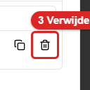
    *Zo ziet de knop **Variant verwijderen** eruit. Het is een prullenbakje.*

    Alle varianten worden **bewaard**. De klant ziet er straks maar één: de variant die jij kiest.

12. Kies de variant voor de klant. Klik onder die kolom op **Deze naar de klant**. Precies één variant
    is de gekozen variant. In die kolom staat het label **Naar de klant**. Bovenaan het venster
    staat nu de prijs van die variant. De eerste variant is standaard gekozen.

    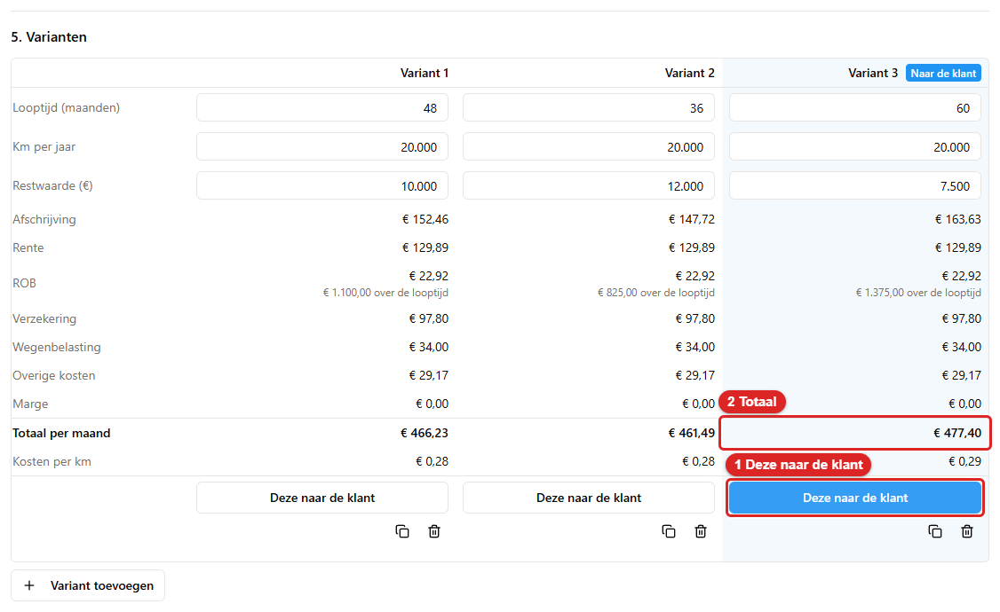
    *Na een klik: 1 **Deze naar de klant** bij variant 3, 2 het totaal van die variant. De prijs
    bovenaan en op de PDF is nu die van variant 3.*

    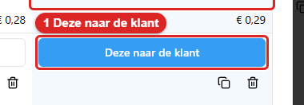
    *Zo ziet de knop **Deze naar de klant** eruit.*

    Kies voor het voorbeeld weer **Variant 1**. Dan krijgt de klant **€ 466,23** per maand.

Een kolom waar nog een getal ontbreekt, laat een oranje regel zien, bijvoorbeeld *Vul een restwaarde
in*. Je kunt niet opslaan zolang bij een variant de looptijd, de km per jaar of de restwaarde
ontbreekt. Staat de restwaarde hoger dan de aanschafwaarde? Dan waarschuwt de app, maar het mag.

---

## 22.6 Opslaan en de PDF voor de klant maken

### Offertegegevens en opslaan

13. Kijk bij **6. Offerte**. Daar staan de **Status** (**Concept**, **Verstuurd**, **Geaccepteerd**,
    **Afgewezen**), de **Offertedatum**, **Geldig tot** en een **Interne notitie (niet voor de
    klant)**. **Geldig tot** is standaard de offertedatum plus 30 dagen. Je kunt dat aanpassen. De
    interne notitie komt nooit op de PDF.

    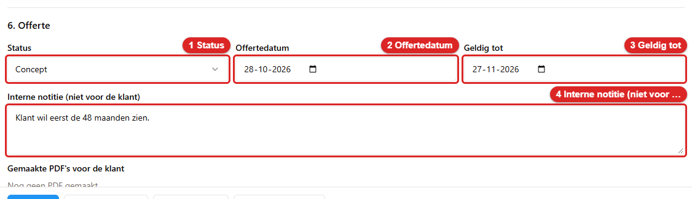
    *Het stuk **6. Offerte**: 1 **Status**, 2 **Offertedatum**, 3 **Geldig tot**, 4 **Interne
    notitie**.*

    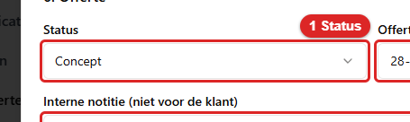
    *Zo ziet de keuzelijst **Status** eruit.*

    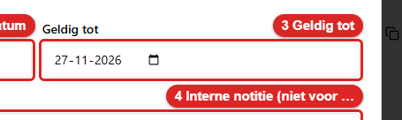
    *Zo ziet het veld **Geldig tot** eruit.*

    Onder het stuk **6. Offerte** staan de **Gemaakte PDF's voor de klant** (zie hieronder).

14. Klik onderaan op **Opslaan**. Daarna zie je linksonder de melding **De offerte is opgeslagen.**

    
    *De balk onderaan: 1 **Opslaan**, 2 **PDF maken**, 3 **Kopiëren**, 4 **Geschiedenis**,
    5 **Sluiten**.*

    
    *Zo ziet de knop **Opslaan** eruit.*

    
    *Na **Opslaan**: 1 de melding **De offerte is opgeslagen.***

    
    *Zo ziet de melding eruit. Hij verdwijnt vanzelf.*

Lukt opslaan niet? Boven de knoppen staat dan in rood waarom. Bijvoorbeeld *Een getal klopt niet
(rood omrand). Verbeter het om op te slaan.* of *Vul bij elke variant een looptijd, km per jaar en
restwaarde in om op te slaan.*

Klik je op **Sluiten** terwijl er nog niet-opgeslagen wijzigingen zijn? Dan vraagt de app wat je wilt
doen. Kies **Verwerpen** om ze kwijt te raken, of ga terug en klik op **Opslaan**.

### De PDF voor de klant maken

15. Klik onderaan op **PDF maken**. Zijn er wijzigingen? Dan slaat de app die eerst op. Daarna opent
    de PDF in een nieuw tabblad van je browser. Linksonder staat de melding *De PDF van offerte … is
    gemaakt.* Wordt het tabblad door je browser tegengehouden? Klik dan in de melding op **Bestand
    openen**.

    Je kunt de PDF ook maken in de lijst, met de knop **PDF** achter de offerte (22.2).

16. Elke PDF die je maakt, wordt **bewaard** bij de offerte. Je ziet ze onder **Gemaakte PDF's voor de
    klant**, met de datum en wie hem maakte. Zo zie je later precies wat de klant kreeg, ook als je
    het sjabloon of de offerte daarna wijzigt. Achter elke PDF staan **Openen** en **Downloaden**.

    
    *De gemaakte PDF's: 1 **Openen**, 2 **Downloaden**.*

    
    *Zo ziet de knop **Openen** eruit.*

    
    *Zo ziet de knop **Downloaden** eruit.*

    Zo ziet de PDF eruit die de klant krijgt, met het standaardsjabloon:

    
    *De PDF voor de klant: het offertenummer, de datums, de klant, de auto, de looptijd, de kilometers,
    de prijs per maand en de prijs per meer- en minderkilometer.*

**Wat de klant wel en niet ziet.** Op de PDF staat alleen de **prijs per maand excl. btw** van de
gekozen variant, met de looptijd, de kilometers per jaar en de meer- en minderkilometerprijs. Verder
het offertenummer, de datums, de klant en de auto. De klant ziet **nooit** de afschrijving, de rente,
de marge, de ROB, de verzekering, de wegenbelasting, de overige kosten, de aanschafwaarde, de
restwaarde of de andere varianten. Die velden bestaan niet in het sjabloon. Ze kunnen er ook niet in
gezet worden.

Staat er geen PDF-sjabloon? Dan zegt de app *Er is nog geen PDF-sjabloon voor lease offertes. Maak er
een bij Documenten.* Zie 22.11. Is er geen variant gekozen? Dan zegt de app *Kies eerst welke
variant naar de klant gaat.*

De app mailt de PDF niet. Je downloadt hem en stuurt hem zelf.

---

## 22.7 Een offerte kopiëren

Wil je een offerte opnieuw gebruiken, bijvoorbeeld voor dezelfde auto bij een andere klant? Kopieer
hem. De kopie krijgt alle gegevens en alle varianten.

17. Klik in de lijst op **Kopiëren** achter de offerte. Of klik in de offerte onderaan op **Kopiëren**.
    Daarna vraagt de app: **Bijlagen (dealerofferte) ook kopiëren?**

    
    *De vraag: 1 **Ja**, 2 **Nee**, 3 **Annuleren**.*

    
    *Zo ziet de knop **Ja** eruit. De kopie krijgt eigen kopieën van de dealerbestanden.*

    
    *Zo ziet de knop **Nee** eruit. De kopie krijgt geen dealerbestanden.*

    
    *Zo ziet de knop **Annuleren** eruit. Er wordt niets gekopieerd.*

18. Kies **Ja** of **Nee**. Daarna opent de kopie in het venster, met een **nieuw nummer**. De kopie
    heeft de status **Concept**, de datum van vandaag en een nieuwe **Geldig tot**. Je ziet linksonder
    de melding *Offerte … is aangemaakt.*

    
    *De kopie: een nieuw nummer, dezelfde prijs.*

    
    *Zo ziet de titel van de kopie eruit.*

De PDF's die je voor de klant maakte, worden **nooit** meegekopieerd.

---

## 22.8 Zoeken, filteren en de status

19. Typ in **Zoeken** een deel van de klantnaam, het merk, het model, het kenteken of het
    offertenummer. De lijst toont alleen wat past.

    
    *Na het typen van **Vries**: 1 **Zoeken**, 2 de gevonden offerte.*

    
    *Zo ziet het veld **Zoeken** eruit, met de zoektekst erin.*

20. Wil je alleen offertes met één status? Kies die bij **Status**. De keuzes zijn **Alle statussen**,
    **Concept**, **Verstuurd**, **Geaccepteerd**, **Afgewezen** en **Verlopen**.

    
    *Gefilterd: 1 **Status** staat op **Geaccepteerd**, 2 de offertes met die status.*

    
    *Zo ziet de keuzelijst **Status** eruit.*

**Verlopen** kies je niet zelf. De app zet het erbij zodra de datum bij **Geldig tot** voorbij is
en de offerte nog **Concept** of **Verstuurd** is. Een geaccepteerde of afgewezen offerte wordt nooit
**Verlopen**. Een geaccepteerde offerte wordt in de app niet vanzelf een voertuig, reservering of
contract. Dat doe je zelf.

### De waarschuwing bij een verstuurde offerte

Open je een offerte die **Verstuurd** of **Geaccepteerd** is en wil je hem opslaan, een PDF maken of
kopiëren na een wijziging? Dan vraagt de app eerst of je het zeker weet. De klant heeft de offerte al.

*De vraag *Deze offerte is al verstuurd. Toch wijzigen?*: 1 **Ja, wijzigen**, 2 **Nee**.*

*Zo ziet de knop **Ja, wijzigen** eruit. Je wijzigingen worden opgeslagen in deze offerte.*

*Zo ziet de knop **Nee** eruit. Er wordt niets opgeslagen.*

Wijzigen blijft dus mogelijk. De waarschuwing is een extra kans om je te bedenken. Wil je de oude
offerte laten staan en iets nieuws maken? Kopieer hem dan (22.7).

---

## 22.9 Geschiedenis, verwijderen en de prullenbak

### Geschiedenis

21. Klik in de offerte onderaan op **Geschiedenis**. Daarna zie je elke wijziging: wat er veranderde,
    wie het deed en wanneer. Ook het maken van een PDF en het kopiëren staan erbij.

    
    *De geschiedenis van een offerte, de nieuwste bovenaan.*

    De geschiedenis noemt de velden nog met hun Engelse naam, bijvoorbeeld *prospectName* en
    *purchasePrice*. De bedragen en teksten zelf staan er gewoon bij.

### Een offerte verwijderen

22. Klik in de lijst op **Verwijderen** achter de offerte. Daarna vraagt de app: **Offerte
    verwijderen?** Klik op **Verwijderen**. De offerte gaat naar de prullenbak. Je ziet linksonder
    *Offerte … staat in de prullenbak.*

    
    *De vraag: 1 **Verwijderen**, 2 **Annuleren**.*

    
    *Zo ziet de knop **Verwijderen** eruit.*

    
    *Zo ziet de knop **Annuleren** eruit.*

    
    *Na het verwijderen: 1 de melding, 2 de knop **Verwijderde lease offertes**.*

    
    *Zo ziet de melding eruit.*

    
    *Zo ziet de knop **Verwijderde lease offertes** eruit.*

### Een offerte terugzetten

23. Klik op **Verwijderde lease offertes**. Daarna opent de prullenbak voor offertes. Klik bij de
    offerte op **Terugzetten**. De offerte staat weer in de lijst, met zijn varianten en bijlagen.

    
    *De prullenbak: 1 **Terugzetten**.*

    
    *Zo ziet de knop **Terugzetten** eruit.*

Deze prullenbak werkt net als de andere prullenbakken in de app (hoofdstuk 10). Je ziet de knop
alleen met het vinkje **Prullenbak beheren**.

---

## 22.10 Instellingen

Op het tabblad **Instellingen** zet je de voorinstellingen voor **nieuwe** offertes. Elke nieuwe
offerte neemt deze waarden over. Je kunt ze daarna per offerte nog aanpassen.

24. Klik op het tabblad **Instellingen**. Daarna zie je zeven velden en de knop **Opslaan**.

    
    *Het tabblad **Instellingen**: 1 **Rente (% per jaar)**, 2 **Marge per maand (€)**, 3 **ROB per jaar
    (€)**, 4 **Overige kosten per jaar (€)**, 5 **Meerkilometerprijs (€ per km)**, 6 **Minderkilometerprijs
    (€ per km)**, 7 **Geldigheid (dagen)**, 8 **Opslaan**.*

    
    *Zo ziet het veld **Rente (% per jaar)** eruit. In het voorbeeld is dat **9**.*

    
    *Zo ziet het veld **ROB per jaar (€)** eruit. In het voorbeeld is dat **275**.*

    
    *Zo ziet het veld **Overige kosten per jaar (€)** eruit. In het voorbeeld is dat **350**.*

    
    *Zo ziet het veld **Geldigheid (dagen)** eruit. Een nieuwe offerte is zoveel dagen geldig. Dat
    moet een heel aantal van minstens 1 zijn.*

25. Verander wat je wilt. Klik op **Opslaan**. Daarna zie je de melding **De instellingen zijn
    opgeslagen.**

    
    *Na **Opslaan**: 1 de melding.*

    
    *Zo ziet de knop **Opslaan** eruit.*

**Oude offertes veranderen niet.** Bij het maken van een offerte worden de instellingen in de
offerte gekopieerd. Pas je later de rente aan? Dan blijft elke bestaande offerte bij zijn eigen
rente, en dus bij zijn eigen prijs.

---

## 22.11 Het PDF-sjabloon aanpassen onder Documenten

De PDF voor de klant wordt getekend met een **sjabloon**. Er is een standaardsjabloon. Dat werkt
meteen. Wil je de pagina anders hebben, bijvoorbeeld met je eigen briefpapier als achtergrond? Pas het
sjabloon aan. Dat gaat net als bij het contract en het transportrapport.

Je hebt het vinkje **PDF-sjablonen beheren** nodig.

26. Klik in het menu op **Documenten**. Klik op het tabblad **Lease offertes**.

    
    *Het tabblad: 1 **Lease offertes**.*

    
    *Zo ziet het tabblad **Lease offertes** eruit.*

27. Klik op **Sjablooneditor openen**. Daarna opent het venster **Sjabloon lease offerte bewerken**.
    Je ziet de pagina (één A4) met de velden erop. Sleep een veld om het te verplaatsen. Klik op een
    veld om het te kiezen. Rechts kun je lettergrootte, vet en uitlijning aanpassen. Met **Veld
    toevoegen** zet je een veld op de pagina. Met **Achtergrondbibliotheek** kies je een PDF- of
    afbeeldingsachtergrond. Klik op **Opslaan** als je klaar bent.

    
    *De editor: 1 **Opslaan**, 2 **Achtergrondbibliotheek**, 3 **Veld toevoegen**.*

    
    *Zo ziet de knop **Opslaan** eruit.*

    
    *Zo ziet de knop **Achtergrondbibliotheek** eruit.*

    
    *Zo ziet de knop **Veld toevoegen** eruit.*

De velden die je kunt kiezen zijn: het offertenummer, de offertedatum, **Geldig tot**, de klant
(naam of bedrijf, contactpersoon, adres, postcode, plaats en e-mail), de auto (merk, model,
uitvoering, kenteken en levertijd), de looptijd, de kilometers per jaar, de **Leaseprijs per maand
excl. btw**, de meer- en minderkilometerprijs, de eigen bedrijfsnaam en de handtekening van de
verhuurder. Die handtekening is de handtekening die je bij je **Profiel** hebt gezet. Is die er niet?
Dan blijft het vak leeg.

Er is **geen** veld voor de afschrijving, de rente, de marge, de ROB, de verzekering, de
wegenbelasting, de overige kosten, de aanschafwaarde, de restwaarde of een andere variant. Dat is
zo bedoeld: de klant mag de kostenopbouw niet zien.

**Tekst voor de waarde.** Elk veld heeft rechts het vak **Tekst voor de waarde**. Wat je daar typt, komt
vlak voor de waarde op de PDF te staan. Typ je bij het veld voor de looptijd bijvoorbeeld *Looptijd:*,
dan staat er op de PDF *Looptijd: 48 maanden*. Laat je het vak leeg? Dan staat alleen de waarde op de
PDF. Is de waarde zelf leeg, bijvoorbeeld een meerkilometerprijs die je niet hebt ingevuld? Dan komt
ook de tekst er niet. Het standaardsjabloon heeft deze teksten al, zoals *Leaseprijs per maand excl.
btw:*, *Looptijd:* en *Kilometers per jaar:*. Pas ze aan als je andere woorden wilt. In de editor staat
de tekst voor de veldnaam, in grijze cursieve letters.

Meer over sjablonen staat in hoofdstuk 8.

---

## 22.12 Zo rekent de app

Alle bedragen zijn per maand en excl. btw. Het voorbeeld is: aanschafwaarde € 17.318, restwaarde
€ 10.000, 48 maanden, 20.000 km, rente 9 %, ROB € 275 per jaar, verzekering € 97,80, wegenbelasting
€ 34, overige kosten € 350 per jaar, marge € 0.

| Regel | Zo rekent de app | In het voorbeeld |
|---|---|---|
| Afschrijving | (aanschafwaarde − restwaarde) / looptijd | (17.318 − 10.000) / 48 = **€ 152,46** |
| Rente | aanschafwaarde × rente % / 12 | 17.318 × 9 % / 12 = **€ 129,89** |
| ROB | ROB per jaar / 12 | 275 / 12 = **€ 22,92** |
| Verzekering | wat je invult | **€ 97,80** |
| Wegenbelasting | wat je invult | **€ 34,00** |
| Overige kosten | overige kosten per jaar / 12 | 350 / 12 = **€ 29,17** |
| Marge | wat je invult | **€ 0,00** |
| **Totaal per maand** | alles bij elkaar | **€ 466,23** |
| Kosten per km | totaal / (km per jaar / 12) | 466,23 / (20.000 / 12) = **€ 0,28** |

Twee dingen om te weten:

- **De rente staat over de volle aanschafwaarde**, niet over het bedrag dat nog openstaat. Zo
  rekende je Excel het ook.
- **De app telt de regels onafgerond op** en rondt pas het eindbedrag af op centen. Tel je de
  afgeronde regels op het scherm zelf op, dan kom je op € 466,24. Het juiste bedrag is € 466,23. Dat
  is ook wat je Excel geeft.

---

## 22.13 Als iets niet lukt

| Wat je ziet | Wat je doet |
|---|---|
| **Lease offertes** staat niet in het menu | Je mist het vinkje **Lease offertes**. Vraag een beheerder (hoofdstuk 15). |
| *U heeft geen toegang tot dit scherm* na het typen van het adres | Hetzelfde: het vinkje ontbreekt. |
| *Uitlezen lukte niet. Het bestand is bewaard; vul de gegevens zelf in.* | De scanner kon het bestand niet lezen. Typ de gegevens zelf. Probeer later **Opnieuw uitlezen**. |
| *Alleen een PDF, PNG of JPG kan worden geüpload.* of *Het bestand is te groot (maximaal 10 MB).* | Kies een ander bestand. |
| De knop **Opslaan** doet niets en er staat rood *Een getal klopt niet…* | Zoek het veld met de rode rand en verbeter het getal. |
| *Vul bij elke variant een looptijd, km per jaar en restwaarde in om op te slaan.* | Vul de ontbrekende cijfers in, of verwijder de variant die je niet nodig hebt. |
| *Er is nog geen PDF-sjabloon voor lease offertes. Maak er een bij Documenten.* | Maak of herstel het sjabloon onder **Documenten** → **Lease offertes** (22.11). |
| *Kies eerst welke variant naar de klant gaat.* | Klik onder een variant op **Deze naar de klant**. |
| De PDF opent niet in een nieuw tabblad | Je browser hield het tabblad tegen. Klik in de melding op **Bestand openen**, of op **Openen** bij **Gemaakte PDF's voor de klant**. |
| De offerte is weg uit de lijst | Kijk bij **Verwijderde lease offertes**. Of de lijst staat op een filter: zet **Status** op **Alle statussen** en maak **Zoeken** leeg. |
